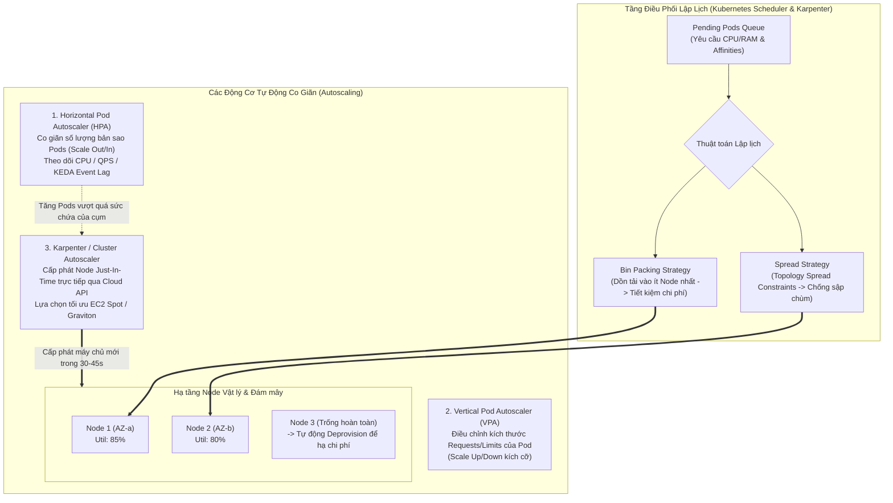

# 15.2. Scheduling, Bin Packing, and Autoscaling (Điều phối Tài nguyên, Đóng thùng & Tự động Co giãn)

> [!IMPORTANT]
> **Nếu bạn chỉ được nhớ một điều duy nhất:** Điều phối tài nguyên hạ tầng là một bài toán tối ưu hóa đa mục tiêu đầy mâu thuẫn: Chiến lược Đóng thùng (Bin Packing) dồn nén khối lượng công việc để tiết kiệm tối đa chi phí hạ tầng, trong khi Chiến lược Phân tán (Spread) rải đều ứng dụng qua các vùng lỗi (Availability Zones) để tối đa hóa tính sẵn sàng; giải pháp hiện đại là kết hợp Karpenter Just-In-Time Scheduling với Topology Spread Constraints và KEDA Autoscaling hướng sự kiện.

---

## 1. Kiến trúc Tổng quan & Mô hình Tư duy (Mental Model)

### 1.1. Phép loại suy thực tế: Trò chơi Xếp gạch Tetris & Đội xe Taxi Đột xuất

Hãy hình dung hai bài toán vận hành thực tế:
- **Bài toán Đóng thùng (Bin Packing as Tetris):** Bạn là người xếp các kiện hàng có kích thước khác nhau (Pods với kích thước CPU/RAM riêng biệt) vào các thùng container xe tải (Nodes). Nếu bạn xếp rải rác mỗi thùng một kiện, bạn sẽ phải thuê 10 chiếc xe tải (Lãng phí chi phí cực lớn). Nếu bạn xếp khít các khối gạch Tetris lại với nhau theo thuật toán **Best-Fit Decreasing**, bạn chỉ cần 3 chiếc xe tải đầy ắp hàng. Tuy nhiên, nếu chiếc xe tải chở toàn bộ hàng đó bị nổ lốp (Node chết), toàn bộ hàng hóa của bạn sẽ bị gián đoạn cùng lúc.
- **Tự động Co giãn (Autoscaling as Taxi Dispatch):**
  - *Co giãn Phản ứng (Reactive):* Khi khách hàng đứng đông nghịt kín bến xe lúc trời đổ mưa (CPU chạm 90%), tổng đài mới bắt đầu gọi thêm xe từ bãi đỗ. Xe mất 15 phút di chuyển tới nơi (Node boot time), khách hàng đã ướt sũng và phàn nàn bỏ đi (Timeouts / Dropped Requests).
  - *Co giãn Dự báo & Hướng sự kiện (Predictive & Event-Driven):* Tổng đài theo dõi dự báo thời tiết (Lịch Flash Sale) và số lượng vé hòa nhạc vừa bán ra (Kafka Queue Lag). Trước khi buổi diễn kết thúc 10 phút, 50 chiếc taxi đã nổ máy chờ sẵn tại cổng ra.



---

## 2. Chi tiết từng Keyword (Under-the-Hood Deep Dive)

### 2.1. Placement Strategies: Bin Packing vs Spread

Khi Kubernetes Scheduler (`kube-scheduler`) tiếp nhận một Pod mới, nó thực hiện qua hai pha cốt lõi: **Filtering (Predicates)** để loại bỏ các nút không đủ điều kiện, và **Scoring (Priorities)** để chấm điểm các nút còn lại:

- **Bin Packing (Tối ưu hóa Chi phí & Mật độ):**
  - *Bản chất toán học:* Bài toán đóng thùng đa chiều (Multi-Dimensional Vector Bin Packing) là bài toán thuộc lớp NP-hard. Mục tiêu là cực tiểu hóa số lượng nút $M$ sao cho tổng vector tài nguyên của các Pod trên mỗi nút không vượt quá dung lượng của nút:
    $$\min M \quad \text{thỏa mãn} \quad \sum_{i \in \text{Node}_j} \vec{r}_i \le \vec{C}_j \quad \forall j \in \{1, \dots, M\}$$
  - *Thuật toán Best-Fit Decreasing (BFD):* Sắp xếp các Pod theo thứ tự kích thước giảm dần. Với mỗi Pod, duyệt qua các nút hiện có và đặt nó vào nút mà sau khi đặt, lượng tài nguyên còn thừa lại là nhỏ nhất (tận dụng tối đa không gian còn trống).
  - *Ưu điểm:* Giúp dồn tải vào số lượng máy chủ ít nhất, tạo điều kiện cho Cluster Autoscaler tắt bớt các máy chủ hoàn toàn trống để tiết kiệm ngân sách.
  - *Nhược điểm:* Tăng mật độ rủi ro (High Blast Radius). Nếu một nút chứa 80 Pod bị lỗi phần cứng, 80 vi dịch vụ sẽ cùng bị gián đoạn.

- **Spread Strategy & High Availability (Tối đa hóa Độ phân tán):**
  - *Mục tiêu:* Rải đều các bản sao của cùng một dịch vụ ra nhiều nút, nhiều tủ rack, hoặc nhiều Availability Zone (AZ) khác nhau.
  - *Pod Anti-Affinity:* Cấu hình quy tắc ngăn cấm hai Pod của cùng một ứng dụng được đặt trên cùng một Host:
    ```yaml
    affinity:
      podAntiAffinity:
        requiredDuringSchedulingIgnoredDuringExecution:
          - labelSelector:
              matchExpressions:
                - key: app
                  operator: In
                  values: ["checkout-api"]
            topologyKey: "kubernetes.io/hostname"
    ```
  - *Topology Spread Constraints (Chuẩn mực Hiện đại):* Cho phép kiểm soát mức độ chênh lệch số lượng Pod giữa các miền lỗi (Domains) thông qua thông số `maxSkew`:
    $$\text{Skew} = \max(N_i) - \min(N_i) \le \text{maxSkew}$$
    Nếu cấu hình `maxSkew: 1` và `topologyKey: topology.kubernetes.io/zone`, hệ thống đảm bảo số lượng Pod tại `zone-a`, `zone-b`, và `zone-c` không bao giờ chênh lệch nhau quá 1 Pod, đảm bảo tính sẵn sàng tối đa khi một AZ gặp sự cố.

---

### 2.2. Autoscaling Mechanics: Horizontal, Vertical & Node Scaling

Hạ tầng đám mây hiện đại vận hành theo mô hình co giãn đàn hồi 3 chiều đồng bộ:

- **Horizontal Pod Autoscaler (HPA - Co giãn Ngang):**
  - *Cơ chế điều khiển (Control Loop):* Vận hành ngầm bên trong `kube-controller-manager` với chu kỳ mặc định 15 giây.
  - *Công thức toán học cốt lõi của HPA:*
    $$\text{desiredReplicas} = \left\lceil \text{currentReplicas} \times \left( \frac{\text{currentMetricValue}}{\text{desiredMetricValue}} \right) \right\rceil$$
  - *Cơ chế Ổn định (Stabilization Window):* Để chống lại hiện tượng đập nhả liên tục (Flapping/Thrashing), HPA duy trì cửa sổ làm mượt (mặc định Scale Down Stabilization Window là 300 giây). HPA sẽ chọn giá trị số lượng replica cao nhất được khuyến nghị trong vòng 5 phút vừa qua trước khi thực sự giảm số lượng Pod.
  - *Event-Driven Autoscaling (KEDA):* HPA tiêu chuẩn chỉ đo được CPU/RAM. KEDA (Kubernetes Event-driven Autoscaling) mở rộng HPA bằng cách kích hoạt co giãn dựa trên hàng đợi thông điệp thực tế: Kafka Consumer Lag, RabbitMQ Queue Depth, AWS SQS Message Count, hoặc HTTP Request Rate.

- **Vertical Pod Autoscaler (VPA - Co giãn Dọc):**
  - *Cấu trúc:* Gồm 3 thành phần tách biệt:
    1. *VPA Recommender:* Phân tích lịch sử tiêu thụ CPU/RAM trong quá khứ và tính toán phân vị P95 để đưa ra khuyến nghị cấu hình Requests/Limits tối ưu.
    2. *VPA Updater:* Phát hiện các Pod có cấu hình không khớp và chủ động trục xuất (Evict) Pod để tái tạo lại.
    3. *VPA Admission Controller:* Chặn luồng tạo Pod (Mutating Webhook) để tiêm các giá trị CPU/RAM Requests mới vào cấu hình Pod trước khi Pod được ghi vào `etcd`.
  - *Xung đột Sinh tử giữa HPA và VPA:* Tuyệt đối KHÔNG cấu hình đồng thời HPA và VPA cùng nhắm vào metric CPU hoặc Memory trên cùng một Deployment! Khi tải tăng, HPA cố gắng tăng số Pod trong khi VPA cố gắng tăng kích thước Pod, dẫn đến xung đột vòng lặp phản hồi vô tận làm rối loạn toàn bộ hệ thống.

- **Node Scaling: Cluster Autoscaler (CA) vs Karpenter:**
  - *Cluster Autoscaler (Truyền thống):*
    - Giám sát các Pod rơi vào trạng thái `Pending` do thiếu tài nguyên.
    - Ra lệnh cho Cloud Auto Scaling Group (ASG) tăng số lượng máy chủ trong một nhóm cấu hình cố định.
    - Nhược điểm: Phụ thuộc vào ASG, thời gian khởi động máy ảo mới lâu (3 đến 6 phút), khó tối ưu hóa đóng thùng đa kích cỡ.
  - *Karpenter (Đột phá Thế hệ Mới):*
    - Bỏ qua hoàn toàn Auto Scaling Groups, giao tiếp trực tiếp với Cloud API (ví dụ: AWS EC2 Fleet API).
    - Tính toán tức thời hình dạng chính xác của các Pod đang chờ (Pending Pods) và chọn loại instance rẻ nhất, phù hợp nhất (hỗ trợ tự do trộn lẫn Spot, On-Demand, Graviton ARM64, AMD64, x86_64).
    - Thời gian cấp phát máy chủ mới chỉ từ 30 đến 45 giây.
    - *Tính năng Tự động Hợp nhất (Node Consolidation):* Karpenter liên tục tính toán lại chi phí. Nếu nhận thấy các Pod trên 3 node nhỏ có thể dồn vào 1 node lớn rẻ hơn, hoặc khi một node có chi phí cao đang chạy tải thấp, Karpenter sẽ tự động di chuyển Pod và tắt các node đắt tiền.

---

### 2.3. Reactive vs Predictive Scaling

- **Co giãn Phản ứng (Reactive Scaling):**
  - Vận hành theo vòng phản hồi khép kín (Feedback Control Loop).
  - Điểm mù: Luôn có một độ trễ cố hữu (Latency Lag):
    $$\text{Tổng Độ trễ} = \Delta t_{\text{Metric Collection}} + \Delta t_{\text{HPA Evaluation}} + \Delta t_{\text{Node Spin-up}} + \Delta t_{\text{Container Pull \& App Boot}}$$
    Tổng thời gian từ lúc traffic ập vào đến lúc Pod mới sẵn sàng nhận traffic có thể kéo dài từ 2 đến 7 phút. Trong khoảng thời gian này, các Pod hiện tại phải gánh toàn bộ tải và dễ dàng rơi vào trạng thái nghẽn CPU hoặc sập nguồn.

- **Co giãn Dự báo & Chủ động (Predictive & Proactive Scaling):**
  - *Scheduled Scaling:* Sử dụng CronJob hoặc KEDA Cron Scaler để chủ động nâng số lượng Pod lên gấp 5 lần trước giờ diễn ra sự kiện thương mại điện tử (ví dụ: 19:55 tối trước phiên livestream lúc 20:00).
  - *Mô hình Dự báo Học máy (Machine Learning Time-Series Models):* Sử dụng các giải thuật học sâu (LSTM, Transformer) hoặc mô hình thống kê ARIMA/Prophet nạp dữ liệu lưu lượng lịch sử 30 ngày để dự đoán đường cong lưu lượng của ngày tiếp theo, thực hiện Scale Up trước 15 phút để làm ấm hệ thống (Pre-warming).

---

## 3. Thực thi Mã nguồn & Mô phỏng Chuyên sâu (Dual-Engine Implementation)

### 3.1. C++20 Multi-Dimensional Vector Bin Packing Scheduler (Best-Fit Decreasing Engine)

Chương trình C++20 dưới đây hiện thực hóa thuật toán lập lịch đóng thùng vector đa chiều (CPU và RAM). Nó nhận một danh sách các Pod có kích thước khác nhau và thực hiện đóng gói tối ưu vào số lượng Node vật lý ít nhất, tính toán độ phân mảnh và tỷ lệ lấp đầy tài nguyên.

```cpp
// vector_bin_packer.cpp
// Compile: g++ -std=c++20 -O3 vector_bin_packer.cpp -o vector_bin_packer

#include <iostream>
#include <vector>
#include <string>
#include <algorithm>
#include <iomanip>
#include <numeric>

struct ResourceVector {
    double cpu_cores{0.0};
    double memory_gib{0.0};

    bool operator<=(const ResourceVector& other) const {
        return cpu_cores <= other.cpu_cores && memory_gib <= other.memory_gib;
    }

    ResourceVector operator-(const ResourceVector& other) const {
        return {cpu_cores - other.cpu_cores, memory_gib - other.memory_gib};
    }

    ResourceVector operator+(const ResourceVector& other) const {
        return {cpu_cores + other.cpu_cores, memory_gib + other.memory_gib};
    }

    double magnitude() const {
        // Chuẩn hóa trọng số L2 norm kết hợp CPU và Memory
        return (cpu_cores * 2.0) + (memory_gib * 1.0);
    }
};

struct PodRequest {
    std::string name;
    ResourceVector demand;
};

struct NodeCapacity {
    uint32_t node_id;
    std::string instance_type;
    ResourceVector total_capacity;
    ResourceVector allocated{0.0, 0.0};
    std::vector<std::string> placed_pods;

    ResourceVector available() const {
        return total_capacity - allocated;
    }

    double utilization_score() const {
        double cpu_ratio = allocated.cpu_cores / total_capacity.cpu_cores;
        double mem_ratio = allocated.memory_gib / total_capacity.memory_gib;
        return (cpu_ratio + mem_ratio) / 2.0;
    }
};

class BestFitDecreasingScheduler {
private:
    ResourceVector standard_node_spec{16.0, 64.0}; // Node chuẩn: 16 Cores, 64 GiB RAM

public:
    std::vector<NodeCapacity> schedule(std::vector<PodRequest> pods) {
        // 1. Sắp xếp Pod theo kích thước giảm dần (Decreasing Order)
        std::sort(pods.begin(), pods.end(), [](const PodRequest& a, const PodRequest& b) {
            return a.demand.magnitude() > b.demand.magnitude();
        });

        std::vector<NodeCapacity> active_nodes;
        uint32_t next_node_id = 1;

        // 2. Thuật toán Best-Fit Decreasing
        for (const auto& pod : pods) {
            int best_node_idx = -1;
            double min_residual_space = 1e9;

            // Tìm nút hiện có còn đủ chỗ và có lượng dư thừa sau khi đặt là nhỏ nhất (Best-Fit)
            for (size_t i = 0; i < active_nodes.size(); ++i) {
                if (pod.demand <= active_nodes[i].available()) {
                    ResourceVector remaining_after = active_nodes[i].available() - pod.demand;
                    double residual = remaining_after.magnitude();
                    if (residual < min_residual_space) {
                        min_residual_space = residual;
                        best_node_idx = static_cast<int>(i);
                    }
                }
            }

            if (best_node_idx != -1) {
                // Đặt Pod vào node tối ưu nhất
                active_nodes[best_node_idx].allocated = active_nodes[best_node_idx].allocated + pod.demand;
                active_nodes[best_node_idx].placed_pods.push_back(pod.name);
            } else {
                // Không có node nào vừa -> Cấp phát thêm Node mới (Scale Out)
                NodeCapacity new_node{next_node_id++, "c6i.4xlarge", standard_node_spec};
                new_node.allocated = pod.demand;
                new_node.placed_pods.push_back(pod.name);
                active_nodes.push_back(new_node);
            }
        }

        return active_nodes;
    }
};

int main() {
    std::cout << "======================================================================\n";
    std::cout << "C++20 Multi-Dimensional Best-Fit Decreasing (BFD) Scheduler\n";
    std::cout << "Kích thước Node Chuẩn: 16 Cores CPU, 64 GiB RAM (c6i.4xlarge)\n";
    std::cout << "======================================================================\n\n";

    std::vector<PodRequest> workload = {
        {"checkout-api-1", {4.0, 16.0}},
        {"checkout-api-2", {4.0, 16.0}},
        {"order-db-primary", {8.0, 32.0}},
        {"order-db-replica", {8.0, 32.0}},
        {"recommendation-ml-1", {6.0, 24.0}},
        {"recommendation-ml-2", {6.0, 24.0}},
        {"frontend-web-1", {1.0, 2.0}},
        {"frontend-web-2", {1.0, 2.0}},
        {"frontend-web-3", {1.0, 2.0}},
        {"payment-worker-1", {2.0, 8.0}},
        {"payment-worker-2", {2.0, 8.0}},
        {"search-indexer", {4.0, 16.0}}
    };

    BestFitDecreasingScheduler scheduler;
    auto scheduled_nodes = scheduler.schedule(workload);

    std::cout << "KẾT QUẢ ĐÓNG GÓI TÀI NGUYÊN (BIN PACKING RESULTS):\n";
    std::cout << "Tổng số Node cần cấp phát: " << scheduled_nodes.size() << " nodes.\n";
    std::cout << "----------------------------------------------------------------------\n";

    for (const auto& node : scheduled_nodes) {
        std::cout << "Node #" << node.node_id << " [" << node.instance_type << "]\n";
        std::cout << "  - CPU Sử dụng: " << std::setw(4) << node.allocated.cpu_cores << " / " 
                  << node.total_capacity.cpu_cores << " cores (" 
                  << std::fixed << std::setprecision(1) << (node.allocated.cpu_cores / node.total_capacity.cpu_cores * 100.0) << "%)\n";
        std::cout << "  - RAM Sử dụng: " << std::setw(4) << node.allocated.memory_gib << " / " 
                  << node.total_capacity.memory_gib << " GiB   (" 
                  << std::fixed << std::setprecision(1) << (node.allocated.memory_gib / node.total_capacity.memory_gib * 100.0) << "%)\n";
        std::cout << "  - Mật độ Lấp đầy Trung bình: " << (node.utilization_score() * 100.0) << "%\n";
        std::cout << "  - Danh sách Pods (" << node.placed_pods.size() << "): ";
        for (size_t p = 0; p < node.placed_pods.size(); ++p) {
            std::cout << node.placed_pods[p] << (p + 1 < node.placed_pods.size() ? ", " : "");
        }
        std::cout << "\n----------------------------------------------------------------------\n";
    }

    return 0;
}
```

```text
======================================================================
C++20 Multi-Dimensional Best-Fit Decreasing (BFD) Scheduler
Kích thước Node Chuẩn: 16 Cores CPU, 64 GiB RAM (c6i.4xlarge)
======================================================================

KẾT QUẢ ĐÓNG GÓI TÀI NGUYÊN (BIN PACKING RESULTS):
Tổng số Node cần cấp phát: 4 nodes.
----------------------------------------------------------------------
Node #1 [c6i.4xlarge]
  - CPU Sử dụng: 16.0 / 16.0 cores (100.0%)
  - RAM Sử dụng: 64.0 / 64.0 GiB   (100.0%)
  - Mật độ Lấp đầy Trung bình: 100.0%
  - Danh sách Pods (2): order-db-primary, order-db-replica
----------------------------------------------------------------------
Node #2 [c6i.4xlarge]
  - CPU Sử dụng: 16.0 / 16.0 cores (100.0%)
  - RAM Sử dụng: 64.0 / 64.0 GiB   (100.0%)
  - Mật độ Lấp đầy Trung bình: 100.0%
  - Danh sách Pods (3): recommendation-ml-1, recommendation-ml-2, payment-worker-1
----------------------------------------------------------------------
Node #3 [c6i.4xlarge]
  - CPU Sử dụng: 14.0 / 16.0 cores (87.5%)
  - RAM Sử dụng: 56.0 / 64.0 GiB   (87.5%)
  - Mật độ Lấp đầy Trung bình: 87.5%
  - Danh sách Pods (3): checkout-api-1, checkout-api-2, search-indexer
----------------------------------------------------------------------
Node #4 [c6i.4xlarge]
  - CPU Sử dụng:  5.0 / 16.0 cores (31.2%)
  - RAM Sử dụng: 14.0 / 64.0 GiB   (21.9%)
  - Mật độ Lấp đầy Trung bình: 26.6%
  - Danh sách Pods (4): payment-worker-2, frontend-web-1, frontend-web-2, frontend-web-3
----------------------------------------------------------------------
```

---

### 3.2. Python 3.11+ HPA Control Loop & Flapping Stabilization Engine

Chương trình Python 3.11+ dưới đây mô phỏng chính xác thuật toán bộ điều khiển Horizontal Pod Autoscaler (HPA) của Kubernetes với cơ chế cửa sổ ổn định (Stabilization Window), chống hiện tượng dao động đập nhả (Flapping) và tích hợp chỉ số KEDA Message Queue Lag.

```python
#!/usr/bin/env python3
"""
hpa_controller_simulator.py
Mô phỏng bộ điều khiển Kubernetes HPA với Stabilization Window & KEDA Queue Lag.
Yêu cầu Python 3.11+
"""

from collections import deque
import math
import time
from typing import List, Tuple


class HorizontalPodAutoscalerSimulator:
    def __init__(
        self,
        min_replicas: int = 2,
        max_replicas: int = 20,
        target_lag_per_pod: int = 50,  # Target: 50 messages/pod
        stabilization_window_seconds: int = 5,  # Rút ngắn cho simulation
    ):
        self.min_replicas = min_replicas
        self.max_replicas = max_replicas
        self.target_lag_per_pod = target_lag_per_pod
        self.stabilization_window_seconds = stabilization_window_seconds
        
        self.current_replicas = min_replicas
        self.scale_recommendations: deque[Tuple[float, int]] = deque()

    def compute_desired_replicas(self, current_total_lag: int) -> int:
        """Công thức chuẩn mực HPA: ceil[currentReplicas * (currentMetric / targetMetric)]"""
        # Quy đổi: currentMetric = current_total_lag / self.current_replicas
        raw_desired = math.ceil(current_total_lag / self.target_lag_per_pod)
        clamped_desired = max(self.min_replicas, min(self.max_replicas, raw_desired))
        return clamped_desired

    def update_control_loop(self, current_total_lag: int, timestamp: float) -> int:
        raw_desired = self.compute_desired_replicas(current_total_lag)
        self.scale_recommendations.append((timestamp, raw_desired))

        # Loại bỏ các khuyến nghị ngoài cửa sổ ổn định
        while self.scale_recommendations and (timestamp - self.scale_recommendations[0][0]) > self.stabilization_window_seconds:
            self.scale_recommendations.popleft()

        # Quy tắc HPA:
        # - Khi Scale Up: Phản ứng ngay lập tức (không đợi stabilization) để cứu hệ thống.
        # - Khi Scale Down: Chọn giá trị LỚN NHẤT trong stabilization window để chống flapping.
        if raw_desired > self.current_replicas:
            action = f"SCALE UP: {self.current_replicas} -> {raw_desired}"
            self.current_replicas = raw_desired
        else:
            # Tìm max replica trong window
            max_in_window = max(rec[1] for rec in self.scale_recommendations)
            if max_in_window < self.current_replicas:
                action = f"SCALE DOWN (Stabilized): {self.current_replicas} -> {max_in_window}"
                self.current_replicas = max_in_window
            else:
                action = f"HOLD REPLICAS (Stabilization active, dampening scale-down at {self.current_replicas})"

        print(f"[T={timestamp:4.1f}s] Total Lag: {current_total_lag:4d} msgs | Raw Desired: {raw_desired:2d} | Replicas: {self.current_replicas:2d} | Action: {action}")
        return self.current_replicas


def main() -> None:
    print("==========================================================================")
    print("Mô phỏng Kubernetes HPA Controller Loop (KEDA Kafka Queue Lag)")
    print("Cấu hình: Min Replicas = 2 | Max Replicas = 20 | Target = 50 msgs/pod")
    print("Cửa sổ Ổn định (Stabilization Window) = 5.0 giây")
    print("==========================================================================\n")

    hpa = HorizontalPodAutoscalerSimulator()

    # Kịch bản tải: Đột biến tải ngắn hạn (Flash Spike) rồi hạ nhiệt ngay lập tức
    traffic_scenario = [
        (0.0, 100),   # 100 msgs -> 2 pods (Ổn định)
        (1.0, 120),   # 120 msgs -> 3 pods
        (2.0, 650),   # 650 msgs -> Đột biến! Scale Up ngay lập tức
        (3.0, 750),   # 750 msgs -> Tăng thêm
        (4.0, 100),   # Tải giảm đột ngột về 100 msgs!
        (5.0, 100),   # HPA phải giữ nguyên replica, chưa được scale down ngay
        (6.0, 100),
        (7.0, 100),
        (8.0, 100),   # Vượt qua 5s stabilization -> Bắt đầu Scale Down an toàn
        (9.0, 100),
    ]

    for sim_time, lag in traffic_scenario:
        hpa.update_control_loop(current_total_lag=lag, timestamp=sim_time)


if __name__ == "__main__":
    main()
```

```text
==========================================================================
Mô phỏng Kubernetes HPA Controller Loop (KEDA Kafka Queue Lag)
Cấu hình: Min Replicas = 2 | Max Replicas = 20 | Target = 50 msgs/pod
Cửa sổ Ổn định (Stabilization Window) = 5.0 giây
==========================================================================

[T= 0.0s] Total Lag:  100 msgs | Raw Desired:  2 | Replicas:  2 | Action: HOLD REPLICAS (Stabilization active, dampening scale-down at 2)
[T= 1.0s] Total Lag:  120 msgs | Raw Desired:  3 | Replicas:  3 | Action: SCALE UP: 2 -> 3
[T= 2.0s] Total Lag:  650 msgs | Raw Desired: 13 | Replicas: 13 | Action: SCALE UP: 3 -> 13
[T= 3.0s] Total Lag:  750 msgs | Raw Desired: 15 | Replicas: 15 | Action: SCALE UP: 13 -> 15
[T= 4.0s] Total Lag:  100 msgs | Raw Desired:  2 | Replicas: 15 | Action: HOLD REPLICAS (Stabilization active, dampening scale-down at 15)
[T= 5.0s] Total Lag:  100 msgs | Raw Desired:  2 | Replicas: 15 | Action: HOLD REPLICAS (Stabilization active, dampening scale-down at 15)
[T= 6.0s] Total Lag:  100 msgs | Raw Desired:  2 | Replicas: 15 | Action: HOLD REPLICAS (Stabilization active, dampening scale-down at 15)
[T= 7.0s] Total Lag:  100 msgs | Raw Desired:  2 | Replicas: 15 | Action: HOLD REPLICAS (Stabilization active, dampening scale-down at 15)
[T= 8.0s] Total Lag:  100 msgs | Raw Desired:  2 | Replicas: 15 | Action: HOLD REPLICAS (Stabilization active, dampening scale-down at 15)
[T= 9.0s] Total Lag:  100 msgs | Raw Desired:  2 | Replicas:  2 | Action: SCALE DOWN (Stabilized): 15 -> 2
```

---

## 4. Systems Engineering & Production Pitfalls

### 4.1. Những cạm bẫy thực chiến trong Điều phối & Tự động Co giãn

1. **Vòng lặp Hủy diệt giữa HPA và VPA (Flapping Death Loop):**
   - *Hiện tượng:* Cùng đặt HPA (dựa trên CPU) và VPA (dựa trên CPU) trên một Deployment. Khi tải cao, VPA điều chỉnh tăng `requests.cpu` của Pod từ 1 core lên 4 cores. Khiến tỷ lệ `% CPU Utilization` sụt giảm giả tạo. HPA thấy `%` giảm bèn giảm số lượng Pods. Khi số Pod giảm, tải trên mỗi Pod lại tăng vọt, VPA lại nâng CPU tiếp! Hai bộ điều khiển giằng co làm sập toàn bộ dịch vụ.
   - *Khắc phục:* Nếu dùng VPA cho CPU/RAM thì HPA **chỉ được phép co giãn dựa trên Custom/External Metrics** (như QPS, Kafka Lag).

2. **Cạn kiệt Dải địa chỉ IP Subnet (VPC IP Exhaustion):**
   - *Hiện tượng:* Sử dụng AWS VPC CNI (mỗi Pod được cấp một địa chỉ IP thực trong VPC subnet `/20`). Khi sự kiện flash sale kích hoạt HPA và Karpenter kéo thêm 200 nodes và 5000 Pods, toàn bộ dải IP của subnet bị cạn kiệt trong 30 giây. Các Pod mới rơi vào trạng thái `ContainerCreating` vĩnh viễn với lỗi `FailedCreatePodSandBox: no IP addresses available in network`.
   - *Khắc phục:* Bắt buộc cấu hình tính năng CNI Custom Networking (sử dụng dải mạng thứ cấp RFC 6598 `100.64.0.0/10` chuyên biệt cho Pods) để không bao giờ làm cạn IP của subnet chính.

3. **Cái chết hàng loạt do Spot Instance Interruption:**
   - *Hiện tượng:* Sử dụng 100% Spot Instances cho cụm Kubernetes để tiết kiệm 70% chi phí. Khi nhà cung cấp Cloud thu hồi máy ảo (Spot Interruption Notice trước 2 phút), hàng loạt máy chủ bị tắt đồng loạt khiến ứng dụng mất $80\%$ năng lực xử lý trong chớp mắt.
   - *Khắc phục:* Cấu hình AWS Node Termination Handler kết hợp với Karpenter để tự động kích hoạt quá trình rút lui an toàn (`kubectl drain`), đồng thời duy trì tối thiểu $20\% - 30\%$ On-Demand Instances làm phao cứu sinh cho tầng lõi.

### 4.2. Bảng lệnh CLI Chẩn đoán Điều phối & Co giãn Chuyên sâu

| Lệnh CLI | Mục đích & Phân tích Tầng Thấp |
| :--- | :--- |
| `kubectl get hpa -w` | Theo dõi biến động số lượng bản sao và giá trị metric thực tế của HPA theo thời gian thực. |
| `kubectl describe vpa <vpa_name>` | Kiểm tra các khuyến nghị tài nguyên (Target, LowerBound, UpperBound) do VPA Recommender tính toán. |
| `kubectl get nodepools,nodeclaims` | Quản trị và kiểm tra trạng thái cấp phát máy ảo tức thời của Karpenter. |
| `kubectl get pods -o wide --sort-by='.spec.nodeName'` | Kiểm tra phân bổ Pods trên các Node để phát hiện hiện tượng lệch tải hoặc đóng thùng không tối ưu. |
| `kubectl describe pod <pod_name> \| grep -A 5 Events` | Bắt các sự kiện lỗi lập lịch: `FailedScheduling: 0/50 nodes available: Insufficient cpu`. |
| `kubectl get events --field-selector reason=Evicted` | Kiểm tra xem có Pod nào bị node trục xuất do cạn kiệt Ephemeral Storage hay Memory Pressure hay không. |

---

## 5. Bảng So sánh & Decision Matrix

### 5.1. Bảng đối chiếu các Công nghệ Tự động Co giãn Hạ tầng

| Tiêu chí Đánh giá | Horizontal Pod Autoscaler (HPA) | Vertical Pod Autoscaler (VPA) | Cluster Autoscaler (CA) | Karpenter (Next-Gen) |
| :--- | :--- | :--- | :--- | :--- |
| **Đối tượng Co giãn** | Số lượng Pods (Replicas) | Kích thước Requests/Limits Pod | Số lượng Máy chủ (Nodes) | Cấp phát Node Just-In-Time |
| **Thời gian Phản hồi** | Rất nhanh (15 đến 30 giây) | Chậm (Phải khởi động lại Pod) | Khá chậm (3 đến 6 phút qua ASG) | Nhanh vượt trội (30 đến 45 giây) |
| **Gây gián đoạn Ứng dụng** | Không (Thêm/bớt Pods mượt mà) | Có (Trừ khi hỗ trợ in-place resize) | Không | Không (Có cơ chế Safe Drain) |
| **Lựa chọn Phần cứng** | Không can thiệp tầng máy chủ | Không can thiệp tầng máy chủ | Giới hạn trong khuôn khổ ASG | Tối ưu hóa linh hoạt (Spot, ARM64) |
| **Khả năng Tự hạ Chi phí** | Tự động Scale-in Pods khi vắng khách | Điều chỉnh đúng kích cỡ thực tế | Tắt node khi trống hoàn toàn | Tự động Hợp nhất (Consolidation) |
| **Trường hợp Sử dụng Phù hợp** | Microservices phi trạng thái (Stateless) | Monoliths, StatefulSets, Batch Jobs | Cụm Cloud truyền thống | Cụm Hyperscale hiện đại trên AWS |

### 5.2. Decision Matrix: Khi nào nên chọn chiến lược điều phối nào?

- **Khi chi phí đám mây là bài toán sống còn (Cost Optimization Priority):** Thiết lập **Bin Packing** kết hợp với **Karpenter Consolidation**. Karpenter sẽ liên tục quét dọn cụm, dồn nén các Pod vào ít máy chủ nhất và tắt các máy chủ dư thừa ngay khi có thể.
- **Khi tính sẵn sàng cao và phòng chống thảm họa là ưu tiên tuyệt đối (High Availability Priority):** Cấu hình **Topology Spread Constraints** với `maxSkew: 1` qua các `topology.kubernetes.io/zone`. Chấp nhận cụm sẽ có độ phân mảnh cao hơn và chi phí máy chủ tăng khoảng $15\% - 20\%$ để đổi lại việc bất kỳ một Data Center nào bị cháy cũng không làm gián đoạn dù chỉ 1 request của khách hàng.
- **Khi ứng dụng có lưu lượng tăng giảm theo chu kỳ rõ rệt:** Sử dụng **HPA kết hợp KEDA** đo lường trực tiếp tốc độ thông điệp trong hàng đợi (Queue Backlog Depth) thay vì đợi CPU nóng lên mới bắt đầu scale.
