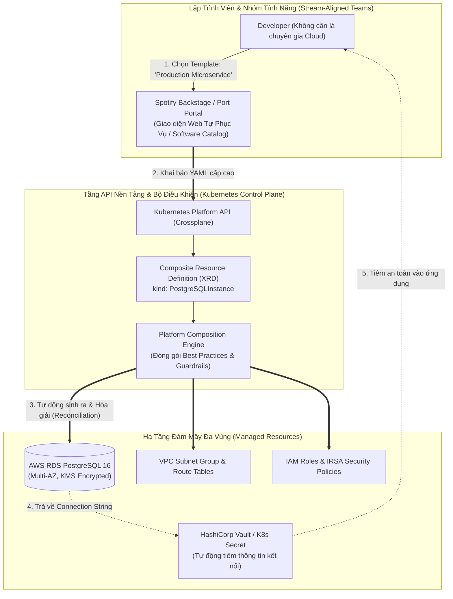

# 16.1. Platform Engineering, Golden Paths, and Self-Service (Kỹ nghệ Nền tảng, Con đường Hoàng kim & Tự phục vụ)

> [!IMPORTANT]
> **Nếu bạn chỉ được nhớ một điều duy nhất:** Nền tảng Nội bộ (Internal Developer Platform - IDP) không phải là một công cụ hay một tập hợp các script Terraform đơn lẻ, mà là một **Sản phẩm (Platform as a Product)** phục vụ khách hàng nội bộ (Lập trình viên); mục tiêu cốt lõi của nó là giảm tải nhận thức (Cognitive Load) thông qua Con đường Hoàng kim (Golden Paths) tự phục vụ, biến các cấu hình hạ tầng phức tạp thành các API khai báo cấp cao (Crossplane / Kubernetes Control Planes).

---

## 1. Kiến trúc Tổng quan & Mô hình Tư duy (Mental Model)

### 1.1. Phép loại suy thực tế: Cửa hàng Tiện lợi Tự động & Dịch vụ Nấu ăn Tự phục vụ

Hãy hình dung sự khác biệt giữa hai mô hình phục vụ bữa ăn:
- **Mô hình Vận hành Kiểu cũ (Ticket-based Ops as Traditional Bureaucracy):** Mỗi khi một lập trình viên muốn một cốc cà phê, họ phải viết phiếu yêu cầu Jira gửi lên Ban Quản trị Tòa nhà. Trưởng phòng phê duyệt, chuyển cho Nhân viên Mua sắm, nhân viên mua hạt cà phê, xay hạt, pha chế rồi mang đến bàn làm việc sau... 5 ngày làm việc. Quá trình này gây ức chế tột độ, làm đứt gãy mạch tư duy sáng tạo của kỹ sư và tạo ra nút thắt cổ chai khổng lồ tại đội ngũ SysAdmin.
- **Nền tảng Tự phục vụ & Con đường Hoàng kim (Golden Path as Modern Vending Machine):** Đội ngũ Kỹ nghệ Nền tảng (Platform Team) đóng vai trò là nhà sản xuất máy bán hàng tự động thông minh. Họ thiết kế sẵn một nút bấm duy nhất: "Cà phê Espresso Chuẩn Doanh nghiệp". Lập trình viên chỉ cần bấm nút (hoặc đẩy tệp cấu hình `catalog-info.yaml`), máy bán hàng tự động (IDP / Backstage) sẽ tự động kiểm tra quyền hạn, kết nối nguồn điện, nguồn nước, pha đúng tỷ lệ chuẩn bảo mật, tuân thủ mọi chính sách của công ty và trao tận tay cốc cà phê trong vòng 60 giây. Nếu lập trình viên muốn tự pha chế một công thức đặc thù, họ vẫn có thể đi đường vòng, nhưng "Con đường Hoàng kim" (Golden Path) luôn là con đường nhanh nhất, an toàn nhất và ít tốn sức nhất.



---

## 2. Chi tiết từng Keyword (Under-the-Hood Deep Dive)

### 2.1. Internal Developer Platforms (IDP) & Developer Portals

Nền tảng Phát triển Nội bộ (IDP) là lớp trừu tượng nằm giữa các lập trình viên sản phẩm và hạ tầng đám mây phức tạp bên dưới:

- **Bản chất của IDP (Platform as a Product):**
  - Không xây dựng nền tảng dựa trên suy nghĩ áp đặt của kỹ sư SysAdmin. Đội ngũ Platform phải coi lập trình viên là **Khách hàng (Customers)**.
  - Nền tảng thành công khi nó được đón nhận tự nguyện nhờ trải nghiệm người dùng tuyệt vời (Product Adoption), chứ không phải bằng các mệnh lệnh hành chính ép buộc.

- **Developer Portals & Spotify Backstage:**
  - *Cổng thông tin tập trung (Single Pane of Glass):* Thay vì phải mở đồng thời 15 tab trình duyệt (AWS Console, Datadog, PagerDuty, ArgoCD, SonarQube, Jira), lập trình viên quản trị toàn bộ vòng đời dịch vụ tại một nơi duy nhất.
  - *Service Catalog (`catalog-info.yaml`):* Mỗi repository chứa một bản kê khai metadata xác định rõ: dịch vụ này thuộc về ai (Owner), phụ thuộc vào những dịch vụ nào (Dependencies), tài liệu kỹ thuật nằm ở đâu (TechDocs), và endpoint kiểm tra sức khỏe ở đâu.
  - *Phần mềm Mẫu (Software Templates):* Cho phép khởi tạo một vi dịch vụ hoàn chỉnh (bao gồm mã nguồn mẫu, CI/CD pipeline, GitOps repository, Kubernetes manifest và kênh cảnh báo Slack) chỉ sau 3 cú nhấp chuột.

- **Giảm tải Nhận thức (Cognitive Load Reduction):**
  - Khái niệm từ lý thuyết *Team Topologies* (Skelton & Pais):
    1. *Intrinsic Cognitive Load:* Kiến thức chuyên môn cần thiết để viết code nghiệp vụ (ví dụ: cách tính lãi suất ngân hàng).
    2. *Extraneous Cognitive Load:* Những gánh nặng không cần thiết mà lập trình viên bị ép phải nhớ (ví dụ: cú pháp viết IAM Role trust policy, cách cấu hình Calico NetworkPolicy, cách vượt qua VPC peering CIDR overlap).
  - Mục tiêu tối thượng của IDP là triệt tiêu hoàn toàn **Extraneous Cognitive Load**, giải phóng 100% năng lượng tinh thần của kỹ sư cho việc tạo ra giá trị kinh doanh.

---

### 2.2. Golden Paths & Golden Templates

Con đường Hoàng kim (Golden Path hay Paved Road - do Netflix tiên phong) là lối đi được lát đá bằng phẳng, định hình các quy chuẩn tốt nhất của doanh nghiệp:

- **Bản chất của Golden Path ("Paved Road, Not a Golden Cage"):**
  - *Không phải là chiếc lồng vàng:* Lập trình viên không bị cấm đi con đường khác. Nếu dự án có yêu cầu kỹ thuật đặc thù (ví dụ: cần dùng Rust thay vì Golang, hoặc cần dùng Cassandra thay vì PostgreSQL), họ được phép tự do khám phá. Tuy nhiên, khi rời khỏi Con đường Hoàng kim, họ phải tự chịu trách nhiệm về việc bảo mật, sao lưu và trực ca sự cố (You build it, you run it).
  - Ngược lại, nếu đi trên Con đường Hoàng kim, họ được hưởng toàn bộ dịch vụ tự động: sao lưu định kỳ, vá lỗi bảo mật tầng cơ sở, giám sát APM và trực cảnh báo 24/7 từ đội ngũ hạ tầng.

- **Golden Templates & Quản trị Khuôn mẫu (Scaffolding):**
  - Khuôn mẫu không phải là một kho mã nguồn copy-paste tĩnh (Static boilerplate), mà là các mô-đun được phiên bản hóa (Versioned Scaffolding Engines).
  - Tích hợp sẵn các hàng rào bảo vệ (Guardrails):
    - Tự động gắn nhãn chi phí FinOps (`cost-center`, `environment`, `owner`).
    - Tự động tích hợp linter bảo mật SAST (SonarQube/Trivy) trong pipeline.
    - Tự động kích hoạt cơ chế zero-downtime rolling update và cấu hình `topologySpreadConstraints` chống sập chùm.

---

### 2.3. Infrastructure APIs & Cross-Plane Orchestration

Xu hướng hiện đại đang dịch chuyển mạnh mẽ từ việc chạy các tệp lệnh Terraform rời rạc trên máy trạm sang việc sử dụng **Mặt phẳng Điều khiển (Control Planes) liên tục**:

- **Giới hạn của Terraform CLI truyền thống:**
  - Terraform là một công cụ khởi chạy một lần (Point-in-time CLI execution). Sau khi lệnh `terraform apply` hoàn tất, nếu có ai đó đăng nhập vào AWS Console và sửa đổi cấu hình hạ tầng bằng tay (Configuration Drift), Terraform không hề hay biết cho đến lần chạy tiếp theo.
  - Chia sẻ quyền hạn quá rộng: Việc cấp quyền truy cập AWS Cloud Administrator cho hàng trăm lập trình viên để chạy Terraform là một lỗ hổng bảo mật chết người.

- **Crossplane & Kiến trúc Control Plane K8s-Native:**
  - Crossplane biến Kubernetes thành một Siêu Mặt phẳng Điều khiển Đa đám mây (Universal Control Plane).
  - **Managed Resources (MR):** Các Custom Resource Definitions (CRDs) đại diện cho tài nguyên đám mây chi tiết (ví dụ: `RDSInstance`, `Bucket`, `SecurityGroup`).
  - **Composite Resource Definitions (XRD):** Cho phép kỹ sư Platform tự định nghĩa một API hạ tầng của riêng tổ chức mình. Ví dụ: Tạo ra một định nghĩa mới mang tên `DatabaseInstance` với giao diện cực kỳ đơn giản:
    ```yaml
    apiVersion: database.company.com/v1alpha1
    kind: DatabaseInstance
    spec:
      storageGB: 50
      engine: postgres
      tier: production
    ```
  - **Compositions (Động cơ Thực thi):** Phía sau định nghĩa đơn giản trên, Platform Engineer viết một Composition để phân giải nó thành 15 tài nguyên phức tạp bên dưới: 1 AWS RDS Multi-AZ, 1 Subnet Group, 3 Security Groups, 1 KMS Encryption Key, 1 IAM Role và 1 Secret đẩy ngược vào Kubernetes Namespace của lập trình viên.
  - **Vòng lặp Hòa giải Liên tục (Continuous Reconciliation Loop):** Giống như etcd và K8s Controller, Crossplane kiểm tra trạng thái hạ tầng thực tế trên AWS cứ mỗi 60 giây. Nếu ai đó sửa tay trên Cloud Console, Crossplane sẽ tự động hòa giải và khôi phục hạ tầng về đúng trạng thái khai báo trong Git (GitOps True Self-Healing).

---

## 3. Thực thi Mã nguồn & Mô phỏng Chuyên sâu (Dual-Engine Implementation)

### 3.1. C++20 Platform Custom Resource Schema & Guardrail Policy Enforcement Engine

Chương trình C++20 dưới đây mô phỏng một Engine kiểm định chính sách hạ tầng (Platform Admission Webhook Engine). Nó phân tích các yêu cầu cấp phát tài nguyên tự phục vụ của lập trình viên, áp đặt các quy tắc rào chắn an toàn (Guardrails: cấm CIDR nguy hiểm, bắt buộc mã hóa dữ liệu lưu trữ, kiểm soát hạn ngạch chi phí tối đa).

```cpp
// platform_policy_engine.cpp
// Compile: g++ -std=c++20 -O3 platform_policy_engine.cpp -o platform_policy_engine

#include <iostream>
#include <string>
#include <vector>
#include <unordered_map>
#include <regex>
#include <memory>
#include <iomanip>

struct DatabaseResourceSpec {
    std::string service_name;
    std::string environment; // "production", "staging", "dev"
    std::string engine;      // "postgres", "mysql"
    uint32_t storage_gb;
    bool encryption_enabled;
    std::string backup_retention_days;
    std::unordered_map<std::string, std::string> tags;
};

struct ValidationResult {
    bool is_allowed;
    std::vector<std::string> violations;
};

class PlatformPolicyValidator {
public:
    static ValidationResult evaluate(const DatabaseResourceSpec& spec) {
        std::vector<std::string> violations;

        // Guardrail 1: Mọi database production bắt buộc phải bật mã hóa lưu trữ (Encryption at Rest)
        if (spec.environment == "production" && !spec.encryption_enabled) {
            violations.push_back("GUARDRAIL_01: Môi trường 'production' bắt buộc encryption_enabled = true (KMS CMK).");
        }

        // Guardrail 2: Giới hạn dung lượng lưu trữ tối đa cho môi trường Non-Prod để chống thâm hụt chi phí
        if (spec.environment == "dev" && spec.storage_gb > 100) {
            violations.push_back("GUARDRAIL_02: Môi trường 'dev' không được phép cấp phát vượt quá 100GB (Yêu cầu: " + 
                                  std::to_string(spec.storage_gb) + "GB).");
        }

        // Guardrail 3: Bắt buộc có đầy đủ Tags quản trị FinOps
        std::vector<std::string> required_tags = {"cost-center", "owner", "service-tier"};
        for (const auto& tag : required_tags) {
            if (spec.tags.find(tag) == spec.tags.end() || spec.tags.at(tag).empty()) {
                violations.push_back("GUARDRAIL_03: Thiếu tag bắt buộc cho FinOps Attribution: '" + tag + "'.");
            }
        }

        // Guardrail 4: Kiểm tra định dạng tên dịch vụ chuẩn RFC 1123 DNS Subdomain
        std::regex dns_regex("^[a-z0-9]([-a-z0-9]*[a-z0-9])?$");
        if (!std::regex_match(spec.service_name, dns_regex)) {
            violations.push_back("GUARDRAIL_04: Tên service '" + spec.service_name + 
                                  "' không tuân thủ chuẩn RFC 1123 (chỉ chứa chữ thường, số, dấu gạch ngang).");
        }

        return {violations.empty(), violations};
    }
};

int main() {
    std::cout << "======================================================================\n";
    std::cout << "C++20 Platform Engineering Guardrail Policy Enforcement Engine\n";
    std::cout << "Kiểm tra tính hợp lệ của Khai báo Hạ tầng Tự phục vụ (IDP Admission)\n";
    std::cout << "======================================================================\n\n";

    // Trường hợp 1: Khai báo vi phạm chính sách của Developer
    DatabaseResourceSpec invalid_request{
        .service_name = "PAYMENT_GATEWAY_DB", // Sai định dạng chữ hoa
        .environment = "production",
        .engine = "postgres",
        .storage_gb = 500,
        .encryption_enabled = false,           // Vi phạm bảo mật prod
        .backup_retention_days = "7",
        .tags = {{"owner", "checkout-squad"}}  // Thiếu cost-center, service-tier
    };

    std::cout << "[TEST CASE 1] Đánh giá Khai báo không hợp lệ (Invalid Spec):\n";
    auto result1 = PlatformPolicyValidator::evaluate(invalid_request);
    if (!result1.is_allowed) {
        std::cerr << ">>> [KẾT QUẢ: TỪ CHỐI (REJECTED)]: Phát hiện " << result1.violations.size() << " lỗi vi phạm chính sách:\n";
        for (const auto& err : result1.violations) {
            std::cerr << "    * " << err << "\n";
        }
    }
    std::cout << "----------------------------------------------------------------------\n\n";

    // Trường hợp 2: Khai báo tuân thủ hoàn toàn Con đường Hoàng kim (Golden Path)
    DatabaseResourceSpec valid_request{
        .service_name = "payment-gateway-db",
        .environment = "production",
        .engine = "postgres",
        .storage_gb = 250,
        .encryption_enabled = true,
        .backup_retention_days = "30",
        .tags = {
            {"cost-center", "fintech-core-09"},
            {"owner", "checkout-squad"},
            {"service-tier", "tier-1-mission-critical"}
        }
    };

    std::cout << "[TEST CASE 2] Đánh giá Khai báo tuân thủ Golden Path (Valid Spec):\n";
    auto result2 = PlatformPolicyValidator::evaluate(valid_request);
    if (result2.is_allowed) {
        std::cout << ">>> [KẾT QUẢ: CHẤP THUẬN (APPROVED)]: Khai báo hoàn toàn hợp lệ!\n";
        std::cout << "    * Tự động kích hoạt Crossplane Composition để provision AWS RDS Multi-AZ.\n";
        std::cout << "    * Khởi tạo liên kết IAM IRSA và phát hành thông tin kết nối tới Vault.\n";
    }
    std::cout << "======================================================================\n";

    return 0;
}
```

```text
======================================================================
C++20 Platform Engineering Guardrail Policy Enforcement Engine
Kiểm tra tính hợp lệ của Khai báo Hạ tầng Tự phục vụ (IDP Admission)
======================================================================

[TEST CASE 1] Đánh giá Khai báo không hợp lệ (Invalid Spec):
>>> [KẾT QUẢ: TỪ CHỐI (REJECTED)]: Phát hiện 3 lỗi vi phạm chính sách:
    * GUARDRAIL_01: Môi trường 'production' bắt buộc encryption_enabled = true (KMS CMK).
    * GUARDRAIL_03: Thiếu tag bắt buộc cho FinOps Attribution: 'cost-center'.
    * GUARDRAIL_03: Thiếu tag bắt buộc cho FinOps Attribution: 'service-tier'.
    * GUARDRAIL_04: Tên service 'PAYMENT_GATEWAY_DB' không tuân thủ chuẩn RFC 1123 (chỉ chứa chữ thường, số, dấu gạch ngang).
----------------------------------------------------------------------

[TEST CASE 2] Đánh giá Khai báo tuân thủ Golden Path (Valid Spec):
>>> [KẾT QUẢ: CHẤP THUẬN (APPROVED)]: Khai báo hoàn toàn hợp lệ!
    * Tự động kích hoạt Crossplane Composition để provision AWS RDS Multi-AZ.
    * Khởi tạo liên kết IAM IRSA và phát hành thông tin kết nối tới Vault.
======================================================================
```

---

### 3.2. Python 3.11+ Crossplane Orchestrator & Golden Path Scaffolding Generator

Chương trình Python 3.11+ dưới đây mô phỏng Động cơ Khởi tạo Khuôn mẫu của Nền tảng Tự phục vụ (Platform Self-Service Scaffolding Engine). Nó nhận các thông số nghiệp vụ tối giản từ lập trình viên, áp dụng các giá trị mặc định chuẩn mực doanh nghiệp và sinh ra tài liệu khai báo Kubernetes-native Crossplane Composite Resource (XR) sẵn sàng triển khai.

```python
#!/usr/bin/env python3
"""
platform_scaffolding_engine.py
Mô phỏng Động cơ Sinh tài nguyên Con đường Hoàng kim (Golden Path Generator) cho Crossplane IDP.
Yêu cầu Python 3.11+
"""

from dataclasses import dataclass, field
import json
from typing import Any, Dict, List
import yaml


@dataclass
class ServiceScaffoldInput:
    service_id: str
    team_owner: str
    business_domain: str
    database_engine: str = "postgresql"
    needs_cache: bool = True
    sla_tier: str = "tier-1"


class GoldenPathOrchestrator:
    def __init__(self, organization: str = "Acme Corp"):
        self.organization = organization

    def generate_crossplane_xr(self, req: ServiceScaffoldInput) -> Dict[str, Any]:
        """Tạo đối tượng Crossplane Composite Resource (XR) cấp cao"""
        is_prod_tier = (req.sla_tier == "tier-1")

        xr_manifest = {
            "apiVersion": "platform.acme.corp/v1alpha1",
            "kind": "AppEnvironment",
            "metadata": {
                "name": f"{req.service_id}-platform-bundle",
                "labels": {
                    "team": req.team_owner,
                    "domain": req.business_domain,
                    "tier": req.sla_tier,
                },
            },
            "spec": {
                "parameters": {
                    "serviceId": req.service_id,
                    "database": {
                        "enabled": True,
                        "engine": req.database_engine,
                        "version": "16.2" if req.database_engine == "postgresql" else "8.0",
                        "highAvailability": is_prod_tier,  # Tự động bật Multi-AZ cho Tier-1
                        "storageGB": 100 if is_prod_tier else 20,
                        "backupRetentionDays": 30 if is_prod_tier else 7,
                    },
                    "cache": {
                        "enabled": req.needs_cache,
                        "engine": "redis",
                        "clusterMode": is_prod_tier,
                        "numNodes": 3 if is_prod_tier else 1,
                    },
                    "networking": {
                        "ingress": {
                            "domain": f"{req.service_id}.internal.acmecorp.net",
                            "tls": True,
                            "mtlsEnabled": True,
                        }
                    },
                },
                "compositionSelector": {
                    "matchLabels": {
                        "provider": "aws",
                        "environment": "production" if is_prod_tier else "development",
                    }
                },
                "writeConnectionSecretToRef": {
                    "namespace": f"apps-{req.team_owner}",
                    "name": f"{req.service_id}-creds",
                },
            },
        }
        return xr_manifest

    def generate_backstage_catalog_info(self, req: ServiceScaffoldInput) -> Dict[str, Any]:
        """Tạo tệp định danh dịch vụ Backstage Service Catalog"""
        return {
            "apiVersion": "backstage.io/v1alpha1",
            "kind": "Component",
            "metadata": {
                "name": req.service_id,
                "description": f"Microservice {req.service_id} quản trị bởi đội {req.team_owner}",
                "annotations": {
                    "github.com/project-slug": f"acmecorp/{req.service_id}",
                    "backstage.io/techdocs-ref": "dir:.",
                },
                "tags": [req.business_domain, req.sla_tier, "golden-path-v2"],
            },
            "spec": {
                "type": "service",
                "lifecycle": "production",
                "owner": req.team_owner,
                "system": req.business_domain,
            },
        }


def main() -> None:
    print("==========================================================================")
    print("MÔ PHỎNG NỀN TẢNG TỰ PHỤC VỤ (INTERNAL DEVELOPER PLATFORM SCAFFOLDER)")
    print("==========================================================================\n")

    orchestrator = GoldenPathOrchestrator()

    developer_input = ServiceScaffoldInput(
        service_id="fraud-detection-engine",
        team_owner="risk-intelligence-squad",
        business_domain="payments",
        database_engine="postgresql",
        needs_cache=True,
        sla_tier="tier-1",
    )

    print(f"[YÊU CẦU TỪ LẬP TRÌNH VIÊN]: Khởi tạo hạ tầng cho '{developer_input.service_id}'...")
    print(f"  - Team: {developer_input.team_owner} | Domain: {developer_input.business_domain} | Tier: {developer_input.sla_tier}\n")

    # Sinh tài liệu Crossplane Composite Resource
    xr = orchestrator.generate_crossplane_xr(developer_input)
    catalog = orchestrator.generate_backstage_catalog_info(developer_input)

    print(">>> 1. CROSSPLANE COMPOSITE RESOURCE MANIFEST (XR):")
    print(yaml.dump(xr, sort_keys=False, default_flow_style=False))
    print(">>> 2. SPOTIFY BACKSTAGE CATALOG-INFO.YAML:")
    print(yaml.dump(catalog, sort_keys=False, default_flow_style=False))
    print("==========================================================================")
    print("[HOÀN TẤT]: Manifest đã sẵn sàng để đẩy tự động vào GitOps Repository (ArgoCD)!")


if __name__ == "__main__":
    main()
```

```text
==========================================================================
MÔ PHỎNG NỀN TẢNG TỰ PHỤC VỤ (INTERNAL DEVELOPER PLATFORM SCAFFOLDER)
==========================================================================

[YÊU CẦU TỪ LẬP TRÌNH VIÊN]: Khởi tạo hạ tầng cho 'fraud-detection-engine'...
  - Team: risk-intelligence-squad | Domain: payments | Tier: tier-1

>>> 1. CROSSPLANE COMPOSITE RESOURCE MANIFEST (XR):
apiVersion: platform.acme.corp/v1alpha1
kind: AppEnvironment
metadata:
  name: fraud-detection-engine-platform-bundle
  labels:
    team: risk-intelligence-squad
    domain: payments
    tier: tier-1
spec:
  parameters:
    serviceId: fraud-detection-engine
    database:
      enabled: true
      engine: postgresql
      version: '16.2'
      highAvailability: true
      storageGB: 100
      backupRetentionDays: 30
    cache:
      enabled: true
      engine: redis
      clusterMode: true
      numNodes: 3
    networking:
      ingress:
        domain: fraud-detection-engine.internal.acmecorp.net
        tls: true
        mtlsEnabled: true
  compositionSelector:
    matchLabels:
      provider: aws
      environment: production
  writeConnectionSecretToRef:
    namespace: apps-risk-intelligence-squad
    name: fraud-detection-engine-creds

>>> 2. SPOTIFY BACKSTAGE CATALOG-INFO.YAML:
apiVersion: backstage.io/v1alpha1
kind: Component
metadata:
  name: fraud-detection-engine
  description: Microservice fraud-detection-engine quản trị bởi đội risk-intelligence-squad
  annotations:
    github.com/project-slug: acmecorp/fraud-detection-engine
    backstage.io/techdocs-ref: dir:.
  tags:
  - payments
  - tier-1
  - golden-path-v2
spec:
  type: service
  lifecycle: production
  owner: risk-intelligence-squad
  system: payments

==========================================================================
[HOÀN TẤT]: Manifest đã sẵn sàng để đẩy tự động vào GitOps Repository (ArgoCD)!
```

---

## 4. Systems Engineering & Production Pitfalls

### 4.1. Những cạm bẫy thực chiến trong Kỹ nghệ Nền tảng (Platform Pitfalls)

1. **Cạm bẫy "Chiếc lồng Vàng" (The Golden Cage Anti-Pattern):**
   - *Hiện tượng:* Đội ngũ Platform quá cứng nhắc, cấm đoán mọi công nghệ nằm ngoài danh mục hỗ trợ. Khi một nhóm nghiên cứu AI cần sử dụng cơ sở dữ liệu đồ thị (Neo4j) hoặc cơ sở dữ liệu vector (Milvus), nền tảng từ chối hỗ trợ và ngăn chặn triển khai. Kết quả: Nhóm kỹ sư AI bí mật thuê hạ tầng Cloud cá nhân bên ngoài (Shadow IT), tạo ra rủi ro bảo mật và thất thoát dữ liệu nghiêm trọng.
   - *Khắc phục:* Con đường Hoàng kim là con đường có khuyến nghị, không phải là bức tường ngăn cấm. Nền tảng phải cung cấp cơ chế "Tự chịu trách nhiệm" (Escape Hatch) cho các trường hợp ngoại lệ.

2. **Sự trôi dạt của các Khuôn mẫu Mẹ (Template Drift):**
   - *Hiện tượng:* Có 200 vi dịch vụ được khởi tạo từ tệp mẫu `service-template-v1` vào năm 2023. Năm 2024, Platform Team cập nhật phiên bản thư viện bảo mật và mẫu CI/CD mới trong `service-template-v2`. Tuy nhiên, 200 dịch vụ cũ vẫn mang cấu hình lạc hậu và không có cơ chế nào để tự động đồng bộ hóa phiên bản mẫu mới.
   - *Khắc phục:* Sử dụng các công cụ quản lý khuôn mẫu có khả năng cập nhật ngược (như Cookiecutter kết hợp Cruft, hoặc Backstage Software Templates hỗ trợ PR Automation) để tự động mở Pull Request nâng cấp cấu hình cho các repository đã tồn tại.

3. **Hiện tượng "Tài nguyên Vô chủ" (Orphaned Cloud Resources):**
   - *Hiện tượng:* Nhờ tính năng tự phục vụ (Self-Service) quá dễ dàng, các kỹ sư tạo ra hàng trăm cụm thử nghiệm (Dev/Test DBs, EKS clusters) chỉ bằng vài cú click. Sau khi dự án kết thúc, không ai nhớ để xóa chúng, khiến hóa đơn Cloud tăng thêm hàng chục ngàn USD mỗi tháng.
   - *Khắc phục:* Bắt buộc áp dụng chính sách **TTL tự động (Time-To-Live)** cho mọi tài nguyên môi trường Non-Production (ví dụ: tự động dọn dẹp sau 14 ngày trừ khi được gia hạn qua Slack bot).

### 4.2. Bảng lệnh CLI Quản trị & Vận hành Control Plane Chuyên sâu

| Lệnh CLI | Mục đích & Phân tích Tầng Thấp |
| :--- | :--- |
| `kubectl get xrds` | Liệt kê tất cả các Composite Resource Definitions đang được đăng ký trên Kubernetes Control Plane. |
| `kubectl get compositions` | Kiểm tra danh sách các Động cơ Hiện thực hóa hạ tầng (Compositions) và các Provider tương ứng (AWS, GCP, Azure). |
| `kubectl get managed` | Kiểm tra trạng thái đồng bộ (`SYNCED`) và tính sẵn sàng (`READY`) của tất cả các tài nguyên đám mây do Crossplane quản lý. |
| `crossplane status <resource_kind> <resource_name>` | Xem chi tiết tiến trình hòa giải (Reconciliation Events) và bắt lỗi trả về từ Cloud API (ví dụ: `AccessDenied`, `QuotaExceeded`). |
| `backstage-cli repo test` | Kiểm tra tính hợp lệ cú pháp của các tệp `catalog-info.yaml` và `template.yaml` trước khi hợp nhất vào Git. |
| `kubectl get events -n crossplane-system --sort-by='.metadata.creationTimestamp'` | Bắt các sự kiện cảnh báo lỗi phân giải IAM hoặc xung đột mạng giữa Control Plane và nhà cung cấp Cloud. |

---

## 5. Bảng So sánh & Decision Matrix

### 5.1. Bảng đối chiếu các Mô hình Vận hành Hạ tầng Doanh nghiệp

| Tiêu chí Đánh giá | Ticket-based Ops (SysAdmin cũ) | DevOps Phân tán (You Build It, You Run It) | Internal Developer Platform (IDP Hiện đại) |
| :--- | :--- | :--- | :--- |
| **Thời gian Cấp phát (Lead Time)** | Nhiều ngày đến Nhiều tuần (Chờ duyệt Jira) | Vài giờ đến Vài ngày (Phụ thuộc trình độ của Dev) | Vài phút (Tự phục vụ tức thì qua API/Web) |
| **Gánh nặng Nhận thức của Dev** | Thấp (Dev không cần biết gì về hạ tầng) | Cực kỳ cao (Dev phải là chuyên gia K8s/Cloud) | Rất thấp (Trừu tượng hóa hoàn toàn qua Golden Path) |
| **Tính Nhất quán & Chuẩn mực** | Trung bình (Tùy thuộc vào người thực hiện) | Rất kém (Mỗi nhóm viết Terraform một kiểu) | Tuyệt đối (Tuân thủ 100% Policy-as-Code) |
| **Nguy cơ Rủi ro Bảo mật** | Thấp (Kiểm soát chặt chẽ qua cửa ải) | Rất cao (Dev vô tình mở cổng 0.0.0.0/0) | Rất thấp (Rào chắn Guardrails tự động khóa lỗi) |
| **Nút thắt Cổ chai Hạ tầng** | Đội ngũ Hạ tầng luôn trong tình trạng quá tải | Nhóm phát triển sản phẩm bị chậm trễ | Triệt tiêu hoàn toàn nút thắt cổ chai |
| **Công nghệ Tiêu biểu** | Jira Service Desk, Script Shell thủ công | Terraform CLI rời rạc, Jenkins tự chế | Backstage, Crossplane, Port, ArgoCD |

### 5.2. Decision Matrix: Khi nào nên đầu tư xây dựng IDP?

- **Quy mô Doanh nghiệp Dưới 30 Lập trình viên:** **KHÔNG NÊN** xây dựng IDP chuyên dụng. Chi phí vận hành một nhóm Platform Team riêng biệt sẽ vượt quá giá trị thu lại. Hãy sử dụng các giải pháp PaaS có sẵn (như Heroku, Render, AWS App Runner).
- **Quy mô Doanh nghiệp Từ 50 đến 200 Lập trình viên:** Thời điểm vàng để xây dựng **Con đường Hoàng kim (Golden Path)** ban đầu. Bắt đầu với Spotify Backstage Service Catalog để tập trung hóa tài liệu và chuẩn hóa các mô-đun Terraform dùng chung.
- **Quy mô Doanh nghiệp Trên 300 Lập trình viên:** Bắt buộc phải triển khai **Kiến trúc Control Plane tự phục vụ hoàn chỉnh (Crossplane + GitOps + Backstage)**. Tại quy mô này, việc giảm 1 giờ chờ đợi hạ tầng mỗi tuần cho mỗi lập trình viên sẽ tiết kiệm hàng triệu USD chi phí nhân sự và gia tăng tốc độ đưa sản phẩm ra thị trường (Time-to-Market) theo cấp số nhân.
