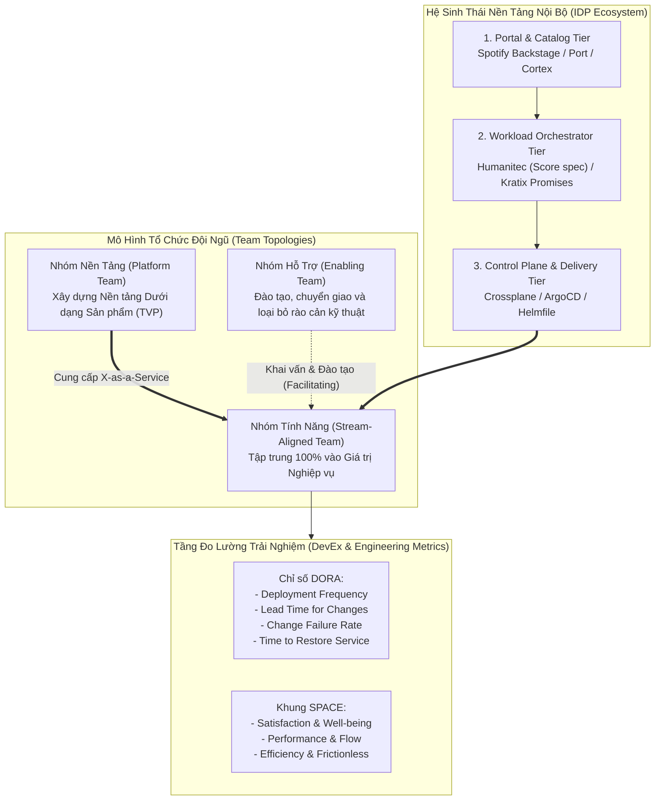

# 16.2. Developer Experience, Platform Adoption, and Ecosystem (Trải nghiệm Nhà phát triển, Tiếp nhận Nền tảng & Hệ sinh thái IDP)

> [!IMPORTANT]
> **Nếu bạn chỉ được nhớ một điều duy nhất:** Một Nền tảng Nội bộ (IDP) dù có công nghệ tối tân đến đâu cũng hoàn toàn vô giá trị nếu không có ai sử dụng; bí quyết thành công của Platform Engineering nằm ở **Trải nghiệm Nhà phát triển (DevEx)** và chiến lược Thúc đẩy Tiếp nhận (Adoption Strategy) dựa trên sự lôi cuốn tự nhiên (Carrots over Sticks), đo lường thông qua các chỉ số DORA và khung đánh giá SPACE thay vì các mệnh lệnh hành chính ép buộc.

---

## 1. Kiến trúc Tổng quan & Mô hình Tư duy (Mental Model)

### 1.1. Phép loại suy thực tế: Siêu thị Hiện đại vs Bắt buộc Ăn cơm Căng-tin

Hãy hình dung sự khác biệt giữa hai cách thức tiếp cận người dùng nội bộ:
- **Áp đặt Hành chính (The Mandatory Canteen):** Ban Giám đốc ra lệnh: "Kể từ ngày 1/1, toàn bộ 500 nhân viên công ty bắt buộc phải ăn trưa tại căng-tin công ty và không được mang đồ ăn ngoài". Thức ăn nguội ngắt, thực đơn đơn điệu, xếp hàng dài 30 phút. Nhân viên bức xúc, tìm cách trốn ra ngoài ăn vụng hoặc đặt đồ ăn giao tận cửa sau (Hiện tượng **Shadow IT** trong công nghệ: các nhóm kỹ sư tự mở tài khoản AWS cá nhân để lách luật nội bộ).
- **Trải nghiệm Khách hàng & Tăng trưởng Tự thân (The Gourmet Supermarket):** Đội ngũ Platform mở một siêu thị thực phẩm sạch ngay trong sảnh công ty. Món ăn ngon, thanh toán một chạm, giá rẻ hơn bên ngoài 30%, mở cửa 24/7. Không cần bất kỳ mệnh lệnh nào, các kỹ sư tự nguyện kéo đến mua hàng mỗi ngày vì nó giúp họ tiết kiệm thời gian và có trải nghiệm sung sướng. Khi đó, nền tảng hạ tầng đã đạt được trạng thái **Product-Market Fit Nội bộ**.



---

## 2. Chi tiết từng Keyword (Under-the-Hood Deep Dive)

### 2.1. Developer Cognitive Load & Team Topologies

Sự quá tải nhận thức của kỹ sư phần mềm là nguyên nhân hàng đầu dẫn đến tình trạng kiệt sức (Burnout), giảm tốc độ bàn giao mã nguồn và gia tăng lỗi bảo mật:

- **Phân loại Tải trọng Nhận thức (Cognitive Load Classification):**
  1. *Intrinsic Load (Tải trọng Bản thể):* Độ khó vốn có của bài toán lập trình (ví dụ: cách thiết kế thuật toán mã hóa giao dịch hoặc xử lý concurrency trong Golang). Đây là tải trọng có ích.
  2. *Germane Load (Tải trọng Hữu ích):* Nỗ lực tinh thần để học hỏi và áp dụng các mẫu thiết kế mới nhằm giải quyết bài toán nghiệp vụ.
  3. *Extraneous Load (Tải trọng Tạp nham):* Toàn bộ những phiền nhiễu không liên quan đến bài toán cốt lõi: Làm sao viết tệp Dockerfile nhiều tầng? Làm sao sửa lỗi cú pháp YAML Kubernetes 400 dòng? Cấu hình Terraform VPC Peering như thế nào? IDP sinh ra để **triệt tiêu toàn bộ Extraneous Load**.

- **4 Mô hình Đội ngũ trong Team Topologies:**
  - *Stream-Aligned Team (Nhóm Dòng chảy Giá trị):* Nhóm trực tiếp tạo ra sản phẩm cho khách hàng bên ngoài (Checkout Squad, Payment Squad, User Squad). Họ cần di chuyển nhanh nhất có thể.
  - *Platform Team (Nhóm Nền tảng):* Đội ngũ cung cấp các dịch vụ nội bộ (APIs, IDP, K8s, Observability) dưới dạng **Thinnest Viable Platform (TVP - Nền tảng Khả dụng Mỏng nhất)** để hỗ trợ các Stream-Aligned Teams.
  - *Enabling Team (Nhóm Thúc đẩy):* Nhóm chuyên gia cơ động, không trực tiếp viết code tính năng mà đi khai vấn, hướng dẫn các nhóm Stream-Aligned làm chủ công nghệ mới (ví dụ: huấn luyện cách viết Service Mesh Envoy Filter).
  - *Complicated-Subsystem Team (Nhóm Phân hệ Phức tạp):* Chuyên trách các phân hệ đòi hỏi chuyên môn toán học/thuật toán cực sâu (ví dụ: mô hình AI nhận diện giọng nói, động cơ giải thuật đồ thị tài chính).

- **3 Chế độ Tương tác (Interaction Modes):**
  - *X-as-a-Service:* Nền tảng phục vụ hoàn toàn tự động qua API/Web Portal mà không cần gặp mặt hay trao đổi trực tiếp.
  - *Collaboration:* Nhóm Platform hợp tác chặt chẽ với một Stream-Aligned Team tiên phong trong thời gian ngắn để cùng phát triển một tính năng nền tảng mới.
  - *Facilitating:* Hỗ trợ, tháo gỡ khó khăn kỹ thuật thông qua tài liệu, workshop và văn hóa mở.

---

### 2.2. IDP Platform Ecosystem: Backstage, Humanitec, Port, Crossplane & Kratix

Bức tranh công nghệ của Kỹ nghệ Nền tảng hiện đại được cấu thành từ các mảnh ghép chuyên biệt:

- **Spotify Backstage (Cổng thông tin & Danh mục Dịch vụ Mã nguồn mở):**
  - Được Spotify mã nguồn mở năm 2020 và chuyển giao cho CNCF.
  - *Cấu trúc:* Xây dựng trên nền tảng React + Node.js/TypeScript plugin architecture.
  - *Chức năng cốt lõi:* Cung cấp Software Catalog tập trung, TechDocs (Docs-like-code từ Markdown trong git), và Software Templates để scaffolding dự án mới.

- **Port & Cortex (No-Code Developer Portals Thế hệ Mới):**
  - Khác với Backstage đòi hỏi tổ chức phải tự nuôi một đội lập trình frontend TypeScript để bảo trì và code plugins, Port cung cấp mô hình SaaS/Self-hosted No-Code.
  - Định nghĩa Software Catalog thông qua khái niệm Blueprint JSON (Entity, Relation, Action). Tích hợp sẵn hệ thống chấm điểm dịch vụ (Service Scorecards) để đánh giá mức độ hoàn thiện về bảo mật và vận hành (Production Readiness).

- **Humanitec & Score Workload Specification (Bộ Điều phối Môi trường Động):**
  - Humanitec tập trung vào tầng **Platform Orchestrator**.
  - *Đặc tả Score (`score.yaml`):* Một tệp cấu hình trung lập, độc lập với môi trường. Lập trình viên chỉ cần mô tả: "Dịch vụ của tôi cần một cơ sở dữ liệu postgres và cổng lắng nghe 8080". Khi deploy lên máy trạm, Score biên dịch ra Docker Compose; khi deploy lên môi trường Staging/Production, Platform Orchestrator tự động liên kết với Crossplane/Terraform để cấp phát AWS RDS thực tế.

- **Crossplane & Kratix (Tầng Mặt phẳng Điều khiển K8s-Native):**
  - *Crossplane:* Biến đổi hạ tầng đám mây thành các Custom Resource Definitions (CRDs) trên Kubernetes.
  - *Kratix:* Cung cấp khái niệm "Promises" (Lời hứa nền tảng) cho phép đóng gói tài nguyên đa cụm (Multi-Cluster Workload Placement & Pipeline Execution) theo chuẩn kiến trúc nguyên khối dịch vụ.

---

### 2.3. Platform Adoption Strategies & Internal Developer Marketing

Tỷ lệ tiếp nhận nền tảng (Platform Adoption Rate) là thước đo sinh tử quyết định sự tồn tại của Platform Team:

- **Chiến lược "Củ cà rốt và Cây gậy" (Carrots over Sticks):**
  - *Sai lầm phổ biến:* Ép buộc toàn bộ công ty chuyển đổi trong 1 tháng bằng lệnh từ Giám đốc Kỹ thuật (CTO). Lập trình viên sẽ phản kháng ngầm, tìm mọi lỗ hổng để lách luật.
  - *Chiến lược Tiếp cận Chuẩn mực:*
    1. *Tìm kiếm Nhóm Tiên phong (Lighthouse Team):* Chọn một nhóm phát triển sản phẩm cởi mở, có tinh thần đổi mới nhất công ty. Cùng ngồi với họ để xây dựng giải pháp giải quyết đúng nỗi đau lớn nhất của họ.
    2. *Tạo ra Điểm Chứng minh Thành công (Proof of Value):* Khi nhóm Lighthouse giảm được thời gian đưa tính năng mới từ 2 tuần xuống còn 30 phút, tin đồn tích cực sẽ lan tỏa khắp tổ chức.
    3. *Developer Marketing & Internal Evangelism:* Tổ chức các buổi Demo Day, viết bản tin kỹ thuật nội bộ (Internal Tech Newsletter), trao huy hiệu danh dự cho các kỹ sư đóng góp plugin vào IDP.

- **Đo lường DevEx thông qua Khung DORA & SPACE:**
  - *4 Chỉ số Vàng DORA (DevOps Research and Assessment):*
    1. **Deployment Frequency (Tần suất Triển khai):** Nền tảng giúp tăng số lần đẩy code lên Production từ hàng tháng lên nhiều lần mỗi ngày.
    2. **Lead Time for Changes (Thời gian Bàn giao):** Thời gian từ khi commit đầu tiên vào Git tới khi chạy trên Production (Mục tiêu: $< 1$ giờ).
    3. **Change Failure Rate (Tỷ lệ Triển khai Thất bại):** Tỷ lệ % các bản deploy gây sự cố cần rollback (Mục tiêu: $< 5\%$).
    4. **Time to Restore Service (Thời gian Khôi phục Dịch vụ - MTTR):** Tốc độ sửa chữa khi có lỗi xảy ra (Mục tiêu: $< 15$ phút).
  - *Khung Đánh giá Toàn diện SPACE (ACM Queue):*
    - **S**atisfaction and well-being (Mức độ hài lòng của kỹ sư qua khảo sát NPS định kỳ).
    - **P**erformance (Chất lượng mã nguồn, độ tin cậy dịch vụ).
    - **A**ctivity (Số lần commit, số lần PR được review).
    - **C**ommunication and collaboration (Độ minh bạch trong tài liệu TechDocs).
    - **E**fficiency and flow (Số lần kỹ sư bị ngắt quãng dòng suy nghĩ trong ngày).

---

## 3. Thực thi Mã nguồn & Mô phỏng Chuyên sâu (Dual-Engine Implementation)

### 3.1. C++20 High-Throughput DORA Metrics Calculator & Event Stream Aggregator

Chương trình C++20 dưới đây mô phỏng Động cơ Thu thập & Tính toán Chỉ số Kỹ nghệ DORA thời gian thực từ luồng sự kiện CI/CD và Incident. Nó tính toán phân vị P90 Lead Time, tần suất triển khai và tỷ lệ thất bại để phản ánh chính xác hiệu quả vận hành của Nền tảng Nội bộ.

```cpp
// dora_metrics_engine.cpp
// Compile: g++ -std=c++20 -O3 dora_metrics_engine.cpp -o dora_metrics_engine

#include <iostream>
#include <string>
#include <vector>
#include <chrono>
#include <algorithm>
#include <numeric>
#include <iomanip>

struct DeploymentEvent {
    std::string deployment_id;
    std::string service_id;
    double lead_time_minutes; // Thời gian từ commit đến khi chạy trên prod
    bool is_failed;           // Bản deploy có gây lỗi (cần rollback) không?
    double restore_time_minutes; // Thời gian khôi phục nếu failed
};

class DORAMetricsAggregator {
private:
    std::vector<DeploymentEvent> events;

public:
    void record_deployment(const DeploymentEvent& ev) {
        events.push_back(ev);
    }

    void evaluate_dora_report() const {
        if (events.empty()) {
            std::cout << "[DORA ENGINE] Không có sự kiện triển khai nào để đánh giá.\n";
            return;
        }

        size_t total_deployments = events.size();
        size_t failed_deployments = 0;
        std::vector<double> lead_times;
        std::vector<double> restore_times;

        for (const auto& ev : events) {
            lead_times.push_back(ev.lead_time_minutes);
            if (ev.is_failed) {
                failed_deployments++;
                if (ev.restore_time_minutes > 0.0) {
                    restore_times.push_back(ev.restore_time_minutes);
                }
            }
        }

        // 1. Sắp xếp để tính phân vị P50 và P90 Lead Time
        std::sort(lead_times.begin(), lead_times.end());
        double p50_lead = lead_times[lead_times.size() * 50 / 100];
        double p90_lead = lead_times[lead_times.size() * 90 / 100];

        // 2. Change Failure Rate (CFR)
        double cfr = (static_cast<double>(failed_deployments) / total_deployments) * 100.0;

        // 3. Mean Time to Restore (MTTR)
        double mean_mttr = 0.0;
        if (!restore_times.empty()) {
            mean_mttr = std::accumulate(restore_times.begin(), restore_times.end(), 0.0) / restore_times.size();
        }

        std::cout << "======================================================================\n";
        std::cout << "BÁO CÁO CHỈ SỐ KỸ NGHỆ DORA (PLATFORM PERFORMANCE TELEMETRY)\n";
        std::cout << "======================================================================\n";
        std::cout << "Tổng số lượt Triển khai (Deployments) : " << total_deployments << " lần\n";
        std::cout << "Lead Time for Changes (P50 Median)     : " << std::fixed << std::setprecision(1) << p50_lead << " phút\n";
        std::cout << "Lead Time for Changes (P90)            : " << std::fixed << std::setprecision(1) << p90_lead << " phút\n";
        std::cout << "Change Failure Rate (Tỷ lệ Lỗi)        : " << std::fixed << std::setprecision(2) << cfr << "%\n";
        std::cout << "Mean Time to Restore (Thời gian MTTR)  : " << std::fixed << std::setprecision(1) << mean_mttr << " phút\n";
        std::cout << "----------------------------------------------------------------------\n";

        // Xếp hạng đẳng cấp kỹ nghệ theo tiêu chuẩn DORA
        std::string tier = "Low Performer";
        if (p90_lead < 60.0 && cfr < 10.0 && mean_mttr < 30.0) {
            tier = "ELITE PERFORMER (Đẳng cấp Thượng thặng - Tự động hóa hoàn toàn)";
        } else if (p90_lead < 240.0 && cfr < 15.0) {
            tier = "HIGH PERFORMER (Đẳng cấp Cao)";
        }
        std::cout << ">>> [XẾP HẠNG TỔ CHỨC]: " << tier << "\n";
        std::cout << "======================================================================\n\n";
    }
};

int main() {
    DORAMetricsAggregator engine;

    // Giả lập 10 sự kiện triển khai qua Golden Path IDP
    engine.record_deployment({"DEP-01", "checkout-api", 25.0, false, 0.0});
    engine.record_deployment({"DEP-02", "payment-service", 32.0, false, 0.0});
    engine.record_deployment({"DEP-03", "user-profile", 18.0, false, 0.0});
    engine.record_deployment({"DEP-04", "order-processor", 45.0, true, 12.0}); // Failed, rollback in 12m
    engine.record_deployment({"DEP-05", "search-indexer", 15.0, false, 0.0});
    engine.record_deployment({"DEP-06", "notification-gw", 22.0, false, 0.0});
    engine.record_deployment({"DEP-07", "inventory-sync", 28.0, false, 0.0});
    engine.record_deployment({"DEP-08", "auth-identity", 35.0, false, 0.0});
    engine.record_deployment({"DEP-09", "cart-service", 20.0, false, 0.0});
    engine.record_deployment({"DEP-10", "recommendation", 50.0, false, 0.0});

    engine.evaluate_dora_report();
    return 0;
}
```

```text
======================================================================
BÁO CÁO CHỈ SỐ KỸ NGHỆ DORA (PLATFORM PERFORMANCE TELEMETRY)
======================================================================
Tổng số lượt Triển khai (Deployments) : 10 lần
Lead Time for Changes (P50 Median)     : 25.0 phút
Lead Time for Changes (P90)            : 45.0 phút
Change Failure Rate (Tỷ lệ Lỗi)        : 10.00%
Mean Time to Restore (Thời gian MTTR)  : 12.0 phút
----------------------------------------------------------------------
>>> [XẾP HẠNG TỔ CHỨC]: ELITE PERFORMER (Đẳng cấp Thượng thặng - Tự động hóa hoàn toàn)
======================================================================
```

---

### 3.2. Python 3.11+ Backstage Service Catalog & Scorecard Readiness Auditor

Chương trình Python 3.11+ dưới đây mô phỏng một Engine kiểm toán mức độ sẵn sàng vận hành (Service Readiness Scorecard) dựa trên dữ liệu trích xuất từ Spotify Backstage `catalog-info.yaml`. Nó đánh giá tính tuân thủ các tiêu chuẩn bảo mật, tài liệu và mức độ tiếp nhận nền tảng (Adoption Rate) của toàn bộ doanh nghiệp.

```python
#!/usr/bin/env python3
"""
backstage_scorecard_auditor.py
Hệ thống kiểm toán Service Catalog & Chấm điểm Production Readiness Scorecards.
Yêu cầu Python 3.11+
"""

from dataclasses import dataclass
from typing import Any, Dict, List


@dataclass
class ServiceEntity:
    name: str
    owner_team: str
    has_techdocs: bool
    has_pagerduty_integration: bool
    has_sonarqube_badge: bool
    has_slo_defined: bool
    is_on_golden_path: bool


class PlatformAdoptionAuditor:
    def __init__(self, services: List[ServiceEntity]):
        self.services = services

    def calculate_readiness_score(self, svc: ServiceEntity) -> float:
        """Thang điểm 100 dựa trên các tiêu chí vận hành khắt khe"""
        score = 0.0
        if svc.has_techdocs:
            score += 20.0
        if svc.has_pagerduty_integration:
            score += 25.0
        if svc.has_sonarqube_badge:
            score += 20.0
        if svc.has_slo_defined:
            score += 20.0
        if svc.is_on_golden_path:
            score += 15.0
        return score

    def generate_executive_audit(self) -> None:
        total = len(self.services)
        on_golden_path_count = sum(1 for s in self.services if s.is_on_golden_path)
        adoption_pct = (on_golden_path_count / total) * 100.0

        print("==========================================================================================")
        print("BÁO CÁO KIỂM TOÁN CHẤT LƯỢNG NỀN TẢNG (IDP SERVICE SCORECARDS)")
        print("==========================================================================================")
        print(f"{'Tên Dịch vụ':<22} | {'Đội Phụ trách':<18} | {'Golden Path':<12} | {'Điểm Sẵn sàng':<15} | {'Trạng thái'}")
        print("-" * 90)

        gold_tier_count = 0
        for s in self.services:
            score = self.calculate_readiness_score(s)
            status = "BRONZE"
            if score >= 85:
                status = "GOLD (Prod-Ready)"
                gold_tier_count += 1
            elif score >= 60:
                status = "SILVER"

            gp_str = "CÓ" if s.is_on_golden_path else "KHÔNG (Legacy)"
            print(f"{s.name:<22} | {s.owner_team:<18} | {gp_str:<12} | {score:>5.1f} / 100     | {status}")

        print("=" * 90)
        print(f"Tổng số dịch vụ trong Catalog     : {total}")
        print(f"Tỷ lệ Tiếp nhận Nền tảng (Adoption): {adoption_pct:.1f}% ({on_golden_path_count}/{total} services)")
        print(f"Dịch vụ đạt chuẩn Gold Tier        : {(gold_tier_count / total) * 100.0:.1f}%\n")


def main() -> None:
    catalog_database = [
        ServiceEntity("checkout-service", "checkout-squad", True, True, True, True, True),
        ServiceEntity("payment-processor", "fintech-core", True, True, True, True, True),
        ServiceEntity("legacy-erp-adapter", "backoffice-team", False, False, True, False, False),
        ServiceEntity("search-v2-api", "discovery-squad", True, True, True, False, True),
        ServiceEntity("recommendation-ml", "data-science", True, False, True, False, False),
    ]

    auditor = PlatformAdoptionAuditor(catalog_database)
    auditor.generate_executive_audit()


if __name__ == "__main__":
    main()
```

```text
==========================================================================================
BÁO CÁO KIỂM TOÁN CHẤT LƯỢNG NỀN TẢNG (IDP SERVICE SCORECARDS)
==========================================================================================
Tên Dịch vụ            | Đội Phụ trách      | Golden Path  | Điểm Sẵn sàng   | Trạng thái
------------------------------------------------------------------------------------------
checkout-service       | checkout-squad     | CÓ           | 100.0 / 100     | GOLD (Prod-Ready)
payment-processor      | fintech-core       | CÓ           | 100.0 / 100     | GOLD (Prod-Ready)
legacy-erp-adapter     | backoffice-team    | KHÔNG (Legacy)|  20.0 / 100     | BRONZE
search-v2-api          | discovery-squad    | CÓ           |  80.0 / 100     | SILVER
recommendation-ml      | data-science       | KHÔNG (Legacy)|  40.0 / 100     | BRONZE
==========================================================================================
Tổng số dịch vụ trong Catalog     : 5
Tỷ lệ Tiếp nhận Nền tảng (Adoption): 60.0% (3/5 services)
Dịch vụ đạt chuẩn Gold Tier        : 40.0%
```

---

## 4. Systems Engineering & Production Pitfalls

### 4.1. Những cạm bẫy thực chiến trong Trải nghiệm & Tiếp nhận Nền tảng

1. **Biến Đội ngũ Platform thành "Đội SysAdmin Kiểu mới":**
   - *Hiện tượng:* Sau khi ra mắt IDP, mỗi khi lập trình viên gặp lỗi deploy, họ nhảy vào kênh Slack của Platform Team để nhờ gỡ lỗi. Platform Engineers dành cả ngày để làm nhân viên hỗ trợ khách hàng (Customer Support) thay vì tập trung cải tiến tính năng tự động của sản phẩm nền tảng.
   - *Khắc phục:* Bắt buộc triển khai tài liệu tự phục vụ chuẩn hóa (Troubleshooting Guides trên TechDocs), bổ sung thông điệp lỗi tự tường minh (Actionable Error Messages) ngay trên giao diện Web UI, và quy định giờ Office Hours cố định cho việc tư vấn.

2. **Cạm bẫy "Xây dựng những thứ Không ai Cần" (The Build Trap):**
   - *Hiện tượng:* Đội Platform tự đóng cửa phòng làm việc trong 9 tháng để xây dựng một hệ thống đa đám mây (Multi-Cloud Orchestrator) cực kỳ phức tạp với 20 công nghệ đỉnh cao. Nhưng khi ra mắt, các nhóm sản phẩm chỉ đơn giản cần một con đường nhanh hơn để tạo tài khoản S3 bucket. Không ai thèm dùng hệ thống mới, gây lãng phí hàng trăm ngàn USD ngân sách.
   - *Khắc phục:* Luôn xây dựng **Thinnest Viable Platform (TVP)**. Phỏng vấn trực tiếp các nhóm phát triển phần mềm mỗi 2 tuần, phát hành tính năng nhỏ giọt (Iterative MVP) và chỉ xây dựng những gì giải quyết nỗi đau có thật.

3. **Mù lòa DORA do Thao túng Chỉ số (Goodhart's Law):**
   - *Hiện tượng:* Ban lãnh đạo đưa Deployment Frequency vào KPI thưởng. Các nhóm lách luật bằng cách chia nhỏ một commit thành 20 commit rỗng và deploy liên tục để tăng chỉ số.
   - *Khắc phục:* Luôn xem xét đồng thời bộ 4 chỉ số DORA kết hợp với nhau. Deployment Frequency tăng nhưng Change Failure Rate cũng tăng vọt hoặc Lead Time kéo dài chứng tỏ hệ thống đang gặp bất ổn nghiêm trọng.

### 4.2. Bảng lệnh CLI Quản trị & Vận hành Hệ sinh thái IDP

| Lệnh CLI | Mục đích & Phân tích Tầng Thấp |
| :--- | :--- |
| `backstage-cli repo lint` | Kiểm tra tính hợp lệ của toàn bộ mã nguồn plugin Backstage và cú pháp schema `catalog-info.yaml`. |
| `score-compose generate score.yaml` | Biên dịch bản đặc tả Score trung lập thành tệp `docker-compose.yaml` để chạy thử nghiệm trên máy cục bộ. |
| `score-k8s generate score.yaml` | Biên dịch bản đặc tả Score thành Kubernetes Manifests hoàn chỉnh cho môi trường Production. |
| `argocd app list -o wide` | Kiểm tra trạng thái đồng bộ GitOps (`Synced` / `OutOfSync`) của toàn bộ các ứng dụng được tạo từ IDP Templates. |
| `kubectl get promises -A` | Liệt kê các cam kết tài nguyên nền tảng trong hệ sinh thái Kratix. |
| `port-cli scorecard evaluate` | Kích hoạt bộ kiểm toán đánh giá điểm Production Readiness cho toàn bộ microservices qua Port API. |

---

## 5. Bảng So sánh & Decision Matrix

### 5.1. Bảng đối chiếu các Công nghệ Cổng thông tin & Điều phối Nền tảng

| Tiêu chí Đánh giá | Spotify Backstage | Port / Cortex | Humanitec Platform Orchestrator | GitOps Pure (ArgoCD + Helm) |
| :--- | :--- | :--- | :--- | :--- |
| **Bản chất Kiến trúc** | Open-source Developer Portal Framework | No-Code Internal Developer Portal (SaaS/On-Prem) | Dynamic Workload Orchestration Engine | Tầng phân phối GitOps khai báo thuần túy |
| **Yêu cầu Nguồn lực Bảo trì** | Rất cao (Cần đội kỹ sư TypeScript/React riêng) | Rất thấp (Cấu hình kéo thả qua JSON Blueprint) | Trung bình (Tập trung vào đặc tả Score) | Thấp (Chỉ cần kỹ sư DevOps viết Helm charts) |
| **Khả năng Mở rộng & Tùy biến** | Vô hạn (Hàng trăm plugin mã nguồn mở từ cộng đồng) | Cao (Qua REST Webhooks và Integrations) | Rất cao (Tự động hóa sinh môi trường động theo PR) | Giới hạn trong khuôn khổ Kubernetes Manifests |
| **Chi phí Bản quyền** | Miễn phí mã nguồn mở (Tốn chi phí nhân sự duy trì) | Trả phí theo số lượng người dùng (Per-Seat SaaS) | Trả phí Enterprise theo số lượng tài nguyên | Hoàn toàn miễn phí mã nguồn mở |
| **Phù hợp Tốt nhất cho** | Tập đoàn công nghệ lớn (> 500 kỹ sư phần mềm) | Doanh nghiệp vừa và nhỏ (50 đến 300 kỹ sư) | Đội ngũ cần môi trường Ephemeral theo từng Pull Request | Mọi quy mô chỉ cần tự động hóa triển khai K8s |

### 5.2. Decision Matrix: Lộ trình Xây dựng Hệ sinh thái IDP Doanh nghiệp

- **Giai đoạn Khởi động (Phase 1: Foundation):** Bắt đầu bằng việc chuẩn hóa GitOps (ArgoCD) và tạo các kho mã nguồn mẫu (Cookiecutter Templates). Chưa cần cài đặt Backstage.
- **Giai đoạn Tăng tốc (Phase 2: Single Pane of Glass):** Khi số lượng microservices vượt quá con số 50, triển khai **Port** (nếu muốn triển khai nhanh không tốn công nuôi đội maintainer) hoặc **Spotify Backstage** (nếu công ty có văn hóa tự phát triển phần mềm nội bộ mạnh mẽ) để giải quyết bài toán Service Catalog và TechDocs.
- **Giai đoạn Trưởng thành (Phase 3: Dynamic Orchestration & Control Plane):** Kết hợp **Score + Humanitec** hoặc **Crossplane** để tự động hóa hoàn toàn việc tạo lập môi trường thử nghiệm tức thời (Ephemeral Environments) cho mỗi Pull Request, giúp kiểm thử tính năng hoàn chỉnh trước khi hợp nhất vào nhánh chính.
