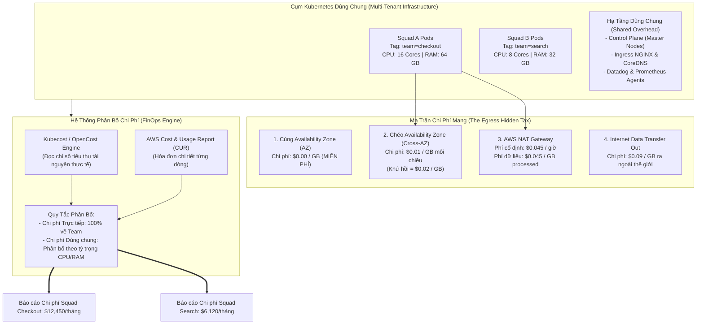

# 17.1. Cloud and Datacenter Cost Modeling and Attribution (Mô hình Hóa Chi phí Đám mây & Phân bổ Chi phí Hạ tầng)

> [!IMPORTANT]
> **Nếu bạn chỉ được nhớ một điều duy nhất:** Chi phí đám mây không phải là một hóa đơn kế toán cố định cuối tháng mà là một chỉ số kỹ thuật vận hành theo thời gian thực; trong đó, chi phí mạng truyền dữ liệu ra ngoài (Network Egress) và phí trung chuyển NAT Gateway là "khoản thuế vô hình" nguy hiểm nhất, đòi hỏi kiến trúc VPC Endpoints và chính sách Gắn nhãn Bắt buộc (Mandatory Tagging) để phân bổ minh bạch từng đồng chi phí về đúng nhóm sở hữu.

---

## 1. Kiến trúc Tổng quan & Mô hình Tư duy (Mental Model)

### 1.1. Phép loại suy thực tế: Đồng hồ Nước sinh hoạt & Khoản Phí Trạm thu phí Cao tốc Ẩn danh

Hãy tưởng tượng một tòa nhà chung cư 50 căn hộ:
- **Phân bổ Chi phí Chung (Cost Attribution):** Nếu tòa nhà chỉ có 1 đồng hồ tổng duy nhất ở cổng vào, cuối tháng ban quản lý chia đều tiền nước cho 50 hộ gia đình. Hộ độc thân đi làm cả ngày chỉ dùng 1 mét khối nước phải trả tiền ngang bằng với hộ kinh doanh tiệm giặt là ngốn 100 mét khối nước. Điều này triệt tiêu mọi động lực tiết kiệm nước (Hiện tượng **Tragedy of the Commons** trong hạ tầng Cloud: các nhóm kỹ sư thoải mái bật máy ảo 64 cores để test rồi bỏ quên vì "chi phí do công ty trả"). Giải pháp là lắp đồng hồ riêng cho từng căn hộ thông qua **Mandatory Tagging** và tính toán chi phí theo từng vi dịch vụ (Kubecost).
- **Khoản Thuế Mạng Ẩn (The Egress Tax):** Tải dữ liệu vào đám mây (Data Ingress) luôn hoàn toàn miễn phí, giống như việc các trung tâm thương mại mở toang cửa miễn phí vé vào cổng để mời gọi khách hàng. Nhưng mỗi byte dữ liệu bạn mang ra ngoài (Egress) hoặc truyền chéo giữa các tầng hầm tòa nhà (Cross-AZ traffic) đều phải trả tiền vé rất đắt. Nếu bạn không xây đường hầm riêng (VPC Gateway Endpoints) mà đi qua cổng trung gian thu phí (NAT Gateway), bạn sẽ phải trả phí xử lý dữ liệu lên tới $0.045 cho mỗi Gigabyte!



---

## 2. Chi tiết từng Keyword (Under-the-Hood Deep Dive)

### 2.1. Cost Attribution, Allocation & Mandatory Tagging

Phân bổ chi phí hạ tầng là nền tảng để thiết lập trách nhiệm tài chính (Financial Accountability) trong tổ chức kỹ thuật:

- **Hai Trường phái Phân bổ Chi phí:**
  - *Showback (Minh bạch Hóa):* Đội ngũ FinOps/Platform hàng tháng gửi báo cáo chi tiết đến từng Giám đốc Kỹ thuật và Trưởng nhóm: "Tháng này nhóm của bạn đã tiêu tốn $15,000 USD tiền hạ tầng". Mục đích là nâng cao nhận thức (Awareness) mà không trực tiếp trừ vào ngân sách của nhóm.
  - *Chargeback (Hạch toán Thực tế):* Chi phí đám mây được trừ trực tiếp vào ngân sách hoạt động (P&L - Profit and Loss) của từng đơn vị kinh doanh. Nếu nhóm tiêu vượt ngân sách, họ phải tự tối ưu hoặc xin cấp vốn bổ sung.

- **Bài toán Phân bổ Hạ tầng Dùng chung (Shared Cost Allocation):**
  - Trong các hệ thống dùng chung như Cụm Kubernetes EKS đa người dùng, cơ sở dữ liệu phân tán Kafka/Elasticsearch, hoặc mạng AWS Transit Gateway:
    - *Cách tiếp cận thô thiển:* Chia đều cho số lượng nhóm (Flat split) dẫn đến bất công.
    - *Cách tiếp cận chuẩn mực:* Phân bổ tỷ lệ thuận dựa trên cam kết tài nguyên (Proportional Allocation based on Resource Requests):
      $$\text{Cost}_{\text{Team } i} = \text{Cost}_{\text{Direct}} + \text{Cost}_{\text{Shared}} \times \left( \frac{\text{Request}_{\text{CPU } i}}{\sum \text{Request}_{\text{CPU}}} \times w_c + \frac{\text{Request}_{\text{RAM } i}}{\sum \text{Request}_{\text{RAM}}} \times w_m \right)$$
      Trong đó $w_c$ và $w_m$ là trọng số phản ánh tỷ trọng chi phí giữa bộ vi xử lý và bộ nhớ RAM.

- **Chính sách Gắn nhãn Bắt buộc (Mandatory Tagging Governance):**
  - Mọi tài nguyên đám mây (EC2, RDS, S3, EBS, K8s Pod) nếu không có nhãn sẽ trở thành "Tài nguyên Vô chủ" (Untagged Spend).
  - *Bộ Nhãn Tiêu chuẩn Bắt buộc:*
    - `CostCenter`: Mã trung tâm chi phí kế toán (ví dụ: `CC-FINTECH-901`).
    - `Environment`: Môi trường (`production`, `staging`, `dev`).
    - `Owner`: Email hoặc tên squad chịu trách nhiệm (`checkout-squad@company.com`).
    - `Project` / `Service`: Tên microservice tương ứng (`payment-gateway`).
  - *Cơ chế Cưỡng chế Tự động (Policy Enforcement):*
    - *AWS Service Control Policies (SCP):* Ngăn chặn hoàn toàn lệnh `ec2:RunInstances` nếu trong request không chứa đủ các thẻ tag bắt buộc.
    - *Kubernetes Admission Webhook (Kyverno / OPA Gatekeeper):* Từ chối triển khai các Deployment/StatefulSet nếu manifest thiếu nhãn quản trị.

---

### 2.2. Network Egress Costs & The "Hidden Tax"

Chi phí mạng truyền dẫn dữ liệu (Data Transfer) thường chiếm từ $15\% - 30\%$ tổng hóa đơn đám mây và là nơi xảy ra các khoản thâm hụt tài chính bất ngờ nhất:

- **Ma trận Chi phí Mạng AWS (The Cost Gradient):**
  1. *Truyền dữ liệu trong cùng 1 Availability Zone (Intra-AZ):* Hoàn toàn $0.00/GB.
  2. *Truyền dữ liệu chéo giữa 2 Availability Zones (Cross-AZ Data Transfer):* Chi phí là $0.01/GB cho chiều gửi đi (Out) VÀ $0.01/GB cho chiều nhận về (In). Tổng chi phí thực tế cho một luồng truyền dữ liệu hai chiều là **$0.02 / GB**!
     - *Hiểm họa tiềm ẩn:* Nếu một cụm Kafka hoặc Cassandra có 3 node nằm trên 3 AZ khác nhau, mỗi khi có 10TB dữ liệu được ghi vào cụm và sao chép qua mạng liên AZ, doanh nghiệp mất thêm $200 USD phí mạng vô hình mà không hề hay biết.
  3. *Truyền dữ liệu ra Internet công cộng (Internet Egress):* Dao động từ $0.08 đến $0.09 / GB.

- **Hiểm họa Đốt tiền từ AWS NAT Gateway:**
  - Để cho phép các máy chủ trong Private Subnet truy cập ra ngoài Internet để tải thư viện hoặc gọi API bên ngoài, doanh nghiệp bắt buộc phải triển khai NAT Gateway.
  - *Cơ chế tính phí hai đầu của NAT Gateway:*
    - Phí duy trì hoạt động máy ảo NAT: $\approx \$0.045 / \text{giờ} \approx \$32.40 / \text{tháng / NAT Gateway}$.
    - **Phí xử lý dữ liệu (Data Processing Fee):** **$0.045 / GB** cho toàn bộ dữ liệu đi qua NAT!
  - *Kịch bản thảm họa:* Một nhóm Data Science chạy tác vụ kéo 50TB dữ liệu huấn luyện từ AWS S3 về cụm Kubernetes trong Private Subnet thông qua NAT Gateway. Hóa đơn bổ sung: $50{,}000 \times \$0.045 = \mathbf{\$2{,}250 \text{ USD}}$ chỉ riêng tiền phí trung chuyển qua NAT Gateway!

- **Giải pháp Khắc phục: VPC Endpoints & PrivateLink:**
  - *S3 / DynamoDB Gateway Endpoints:* Hoàn toàn **MIỄN PHÍ**! Bằng cách thêm một bản ghi định tuyến (Route Table Entry) trỏ tiền tố `pl-xxxx (com.amazonaws.us-east-1.s3)` tới Gateway Endpoint, toàn bộ lưu lượng tới S3 sẽ chạy trực tiếp qua mạng ngầm nội bộ của AWS, vượt qua hoàn toàn NAT Gateway và cắt giảm 100% phí xử lý $0.045/GB.
  - *Interface VPC Endpoints (AWS PrivateLink):* Cung cấp kết nối riêng tư an toàn tới các dịch vụ như ECR, Secrets Manager, CloudWatch mà không cần mở đường truyền Internet.

---

### 2.3. Idle Resource Detection & Rightsizing

Tài nguyên nhàn rỗi (Zombie Infrastructure) là nguyên nhân lãng phí tiền bạc lớn nhất trong môi trường đám mây:

- **Nhận diện Tài nguyên "Ma" (Zombie Resources):**
  - *Unattached EBS Volumes:* Các ổ đĩa cứng EBS bị bỏ lại ở trạng thái `available` sau khi máy ảo EC2 bị hủy (do người dùng quên tích chọn `DeleteOnTermination`). Doanh nghiệp vẫn tiếp tục bị tính phí lưu trữ hàng tháng ($0.08/GB cho gp3, hoặc đắt hơn nhiều cho io2).
  - *Unassociated Elastic IPs (EIP):* AWS phạt tiền các địa chỉ IP tĩnh không được gắn vào máy ảo nào ($0.005/giờ) để chống lãng phí dải địa chỉ IPv4 toàn cầu.
  - *Idle Elastic Load Balancers (ALB/NLB):* Các bộ cân bằng tải không có bất kỳ Healthy Target nào nhưng vẫn âm thầm tiêu tốn $22.50 USD/tháng mỗi bộ.
  - *Mồ chôn Bản sao Chụp ảnh (Old EBS Snapshots):* Các snapshot được tạo từ 3 năm trước cho các máy ảo thử nghiệm không còn tồn tại.

- **Kỹ thuật Điều chỉnh Đúng Kích cỡ (Rightsizing):**
  - *Nguyên tắc Rightsizing:* Phân tích mẫu sử dụng tài nguyên trong 14 ngày liên tiếp. Nếu một máy ảo có mức sử dụng CPU đỉnh (Peak CPU) $< 20\%$ và RAM $< 30\%$, máy ảo đó phải được hạ cấp (Downsize) xuống 1 hoặc 2 bậc (ví dụ: từ `m6i.2xlarge` xuống `m6i.large`, tiết kiệm $75\%$ chi phí).
  - *Chuyển đổi Kiến trúc sang ARM64 (AWS Graviton):* Nâng cấp từ dòng chip Intel x86 sang chip Graviton 3/4 (ví dụ: chuyển từ `c5` sang `c7g`) giúp cải thiện hiệu năng $25\%$ trong khi chi phí rẻ hơn $20\%$, mang lại tỷ lệ Price-Performance vượt trội tới $40\%$.

---

## 3. Thực thi Mã nguồn & Mô phỏng Chuyên sâu (Dual-Engine Implementation)

### 3.1. C++20 High-Speed Cloud Zombie Resource & Cost Leak Detection Engine

Chương trình C++20 dưới đây mô phỏng một Engine quét và phân tích tài nguyên rác (Zombie Infrastructure Scanner). Nó kiểm tra kho dữ liệu thiết bị đám mây, phát hiện các ổ đĩa EBS mồ côi, NAT Gateway truyền tải dư thừa và địa chỉ IP nhàn rỗi, sau đó tính toán chính xác số tiền lãng phí mỗi năm.

```cpp
// zombie_cost_scanner.cpp
// Compile: g++ -std=c++20 -O3 zombie_cost_scanner.cpp -o zombie_cost_scanner

#include <iostream>
#include <string>
#include <vector>
#include <numeric>
#include <iomanip>

struct EBSVolume {
    std::string volume_id;
    int size_gb;
    std::string volume_type; // "gp3", "io2"
    bool is_attached;
    int days_idle;
};

struct ElasticIP {
    std::string allocation_id;
    std::string public_ip;
    bool is_associated;
};

struct NATGatewayAudit {
    std::string nat_gw_id;
    double monthly_gb_processed;
    bool has_s3_vpc_endpoint; // Nếu false, toàn bộ lưu lượng S3 đi qua NAT gây lãng phí
};

class CloudCostLeakDetector {
public:
    static void analyze_waste(
        const std::vector<EBSVolume>& volumes,
        const std::vector<ElasticIP>& eips,
        const std::vector<NATGatewayAudit>& nat_gateways
    ) {
        std::cout << "======================================================================\n";
        std::cout << "C++20 CLOUD ZOMBIE INFRASTRUCTURE & COST LEAK DETECTION ENGINE\n";
        std::cout << "======================================================================\n\n";

        double monthly_waste_total = 0.0;

        // 1. Phân tích Zombie EBS Volumes
        std::cout << ">>> 1. PHÁT HIỆN Ổ ĐĨA EBS KHÔNG GẮN MÁY ẢO (UNATTACHED ZOMBIE VOLUMES):\n";
        double ebs_waste = 0.0;
        for (const auto& v : volumes) {
            if (!v.is_attached && v.days_idle >= 7) {
                double unit_cost_gb = (v.volume_type == "io2") ? 0.125 : 0.08;
                double cost = v.size_gb * unit_cost_gb;
                ebs_waste += cost;
                std::cout << "  - [LÃNG PHÍ] Volume ID: " << v.volume_id << " (" << v.size_gb 
                          << " GB " << v.volume_type << ") nhàn rỗi " << v.days_idle 
                          << " ngày -> Thiệt hại: $" << std::fixed << std::setprecision(2) << cost << " / tháng\n";
            }
        }
        monthly_waste_total += ebs_waste;
        std::cout << "  => Tổng lãng phí từ EBS mồ côi: $" << ebs_waste << " / tháng\n\n";

        // 2. Phân tích Unassociated Elastic IPs
        std::cout << ">>> 2. PHÁT HIỆN ĐỊA CHỈ IP TĨNH NHÀN RỖI (UNASSOCIATED ELASTIC IPS):\n";
        double eip_waste = 0.0;
        for (const auto& eip : eips) {
            if (!eip.is_associated) {
                double cost = 0.005 * 24 * 30; // $0.005/giờ * 720 giờ
                eip_waste += cost;
                std::cout << "  - [LÃNG PHÍ] Allocation ID: " << eip.allocation_id 
                          << " (IP: " << eip.public_ip << ") không gắn vào máy ảo nào -> Thiệt hại: $" 
                          << cost << " / tháng\n";
            }
        }
        monthly_waste_total += eip_waste;
        std::cout << "  => Tổng lãng phí từ EIP phạt: $" << eip_waste << " / tháng\n\n";

        // 3. Phân tích Lãng phí Mạng qua NAT Gateway (Thiếu S3 Endpoint)
        std::cout << ">>> 3. PHÁT HIỆN LÃNG PHÍ BĂNG THÔNG QUA NAT GATEWAY (THIẾU S3 ENDPOINT):\n";
        double nat_waste = 0.0;
        for (const auto& nat : nat_gateways) {
            if (!nat.has_s3_vpc_endpoint) {
                // Giả định 60% lưu lượng NAT thực tế là gọi tới S3 Bucket
                double s3_traffic_gb = nat.monthly_gb_processed * 0.60;
                double unnecessary_nat_cost = s3_traffic_gb * 0.045; // $0.045/GB phí NAT
                nat_waste += unnecessary_nat_cost;
                std::cout << "  - [LÃNG PHÍ] NAT Gateway: " << nat.nat_gw_id << " xử lý " 
                          << nat.monthly_gb_processed << " GB/tháng nhưng KHÔNG BẬT S3 Gateway Endpoint!\n"
                          << "    Lưu lượng S3 ước tính qua NAT: " << s3_traffic_gb 
                          << " GB -> Thiệt hại tiền thuế NAT vô nghĩa: $" << unnecessary_nat_cost << " / tháng\n";
            }
        }
        monthly_waste_total += nat_waste;
        std::cout << "  => Tổng lãng phí từ NAT Gateway: $" << nat_waste << " / tháng\n\n";

        std::cout << "======================================================================\n";
        std::cout << "TỔNG THIỆT HẠI LÃNG PHÍ HẠ TẦNG HÀNG THÁNG : $" << monthly_waste_total << " USD\n";
        std::cout << "DỰ BÁO TIẾT KIỆM NGÂN SÁCH TRONG 1 NĂM (ANNUAL RUNWAY): $" 
                  << (monthly_waste_total * 12.0) << " USD\n";
        std::cout << "======================================================================\n";
    }
};

int main() {
    std::vector<EBSVolume> inventory_vols = {
        {"vol-01a2b3c4d5", 500, "gp3", false, 14},  // Zombie
        {"vol-09f8e7d6c5", 1000, "io2", false, 30}, // Zombie đắt đỏ
        {"vol-1122334455", 200, "gp3", true, 0},    // Đang sử dụng tốt
        {"vol-8877665544", 100, "gp3", false, 3}    // Mới ngắt kết nối 3 ngày (chưa xóa)
    };

    std::vector<ElasticIP> inventory_eips = {
        {"eipalloc-01122", "54.210.12.44", false}, // Zombie
        {"eipalloc-03344", "52.88.99.100", true},
        {"eipalloc-05566", "34.195.40.12", false}  // Zombie
    };

    std::vector<NATGatewayAudit> inventory_nats = {
        {"nat-08899aabb", 45000.0, false}, // 45 TB traffic nhưng thiếu S3 Endpoint!
        {"nat-01122ccdd", 12000.0, true}
    };

    CloudCostLeakDetector::analyze_waste(inventory_vols, inventory_eips, inventory_nats);
    return 0;
}
```

```text
======================================================================
C++20 CLOUD ZOMBIE INFRASTRUCTURE & COST LEAK DETECTION ENGINE
======================================================================

>>> 1. PHÁT HIỆN Ổ ĐĨA EBS KHÔNG GẮN MÁY ẢO (UNATTACHED ZOMBIE VOLUMES):
  - [LÃNG PHÍ] Volume ID: vol-01a2b3c4d5 (500 GB gp3) nhàn rỗi 14 ngày -> Thiệt hại: $40.00 / tháng
  - [LÃNG PHÍ] Volume ID: vol-09f8e7d6c5 (1000 GB io2) nhàn rỗi 30 ngày -> Thiệt hại: $125.00 / tháng
  => Tổng lãng phí từ EBS mồ côi: $165.00 / tháng

>>> 2. PHÁT HIỆN ĐỊA CHỈ IP TĨNH NHÀN RỖI (UNASSOCIATED ELASTIC IPS):
  - [LÃNG PHÍ] Allocation ID: eipalloc-01122 (IP: 54.210.12.44) không gắn vào máy ảo nào -> Thiệt hại: $3.60 / tháng
  - [LÃNG PHÍ] Allocation ID: eipalloc-05566 (IP: 34.195.40.12) không gắn vào máy ảo nào -> Thiệt hại: $3.60 / tháng
  => Tổng lãng phí từ EIP phạt: $7.20 / tháng

>>> 3. PHÁT HIỆN LÃNG PHÍ BĂNG THÔNG QUA NAT GATEWAY (THIẾU S3 ENDPOINT):
  - [LÃNG PHÍ] NAT Gateway: nat-08899aabb xử lý 45000.0 GB/tháng nhưng KHÔNG BẬT S3 Gateway Endpoint!
    Lưu lượng S3 ước tính qua NAT: 27000.0 GB -> Thiệt hại tiền thuế NAT vô nghĩa: $1215.00 / tháng
  => Tổng lãng phí từ NAT Gateway: $1215.00 / tháng

======================================================================
TỔNG THIỆT HẠI LÃNG PHÍ HẠ TẦNG HÀNG THÁNG : $1387.20 USD
DỰ BÁO TIẾT KIỆM NGÂN SÁCH TRONG 1 NĂM (ANNUAL RUNWAY): $16646.40 USD
======================================================================
```

---

### 3.2. Python 3.11+ Kubernetes Multi-Tenant Cost Attribution & Shared Overhead Allocator

Chương trình Python 3.11+ dưới đây mô phỏng Động cơ Phân bổ Chi phí Chuẩn FinOps (OpenCost / Kubecost Model). Nó tính toán chi phí trực tiếp của từng Namespace dựa trên yêu cầu CPU/RAM, đồng thời giải bài toán phân bổ chi phí hạ tầng dùng chung (Control Plane, Ingress, Monitoring Daemons) một cách toán học minh bạch.

```python
#!/usr/bin/env python3
"""
k8s_cost_attribution_engine.py
Mô phỏng Động cơ Phân bổ Chi phí Đa người dùng (Multi-Tenant Cost Attribution) cho Kubernetes.
Yêu cầu Python 3.11+
"""

from dataclasses import dataclass
from typing import Dict, List


@dataclass
class TenantWorkload:
    namespace: str
    team_name: str
    cpu_requested_cores: float
    ram_requested_gib: float


class ClusterCostAttributionEngine:
    def __init__(
        self,
        monthly_node_cost: float,          # Tổng tiền thuê máy ảo EC2 worker nodes
        monthly_control_plane_cost: float, # Tiền thuê EKS Master Node ($73/tháng)
        monthly_shared_monitoring_cost: float, # Datadog / Prometheus storage
        unit_cost_cpu_core_month: float = 25.0, # $25 / core / tháng
        unit_cost_ram_gib_month: float = 3.5,   # $3.5 / GiB / tháng
    ):
        self.monthly_node_cost = monthly_node_cost
        self.monthly_control_plane_cost = monthly_control_plane_cost
        self.monthly_shared_monitoring_cost = monthly_shared_monitoring_cost
        self.unit_cost_cpu = unit_cost_cpu_core_month
        self.unit_cost_ram = unit_cost_ram_gib_month

    def compute_attribution(self, tenants: List[TenantWorkload]) -> Dict[str, Dict[str, float]]:
        # 1. Tính chi phí trực tiếp (Direct Compute Cost) của từng tenant
        direct_costs = {}
        total_cpu_requested = sum(t.cpu_requested_cores for t in tenants)
        total_ram_requested = sum(t.ram_requested_gib for t in tenants)

        for t in tenants:
            c_cost = t.cpu_requested_cores * self.unit_cost_cpu
            m_cost = t.ram_requested_gib * self.unit_cost_ram
            direct_costs[t.namespace] = {
                "team": t.team_name,
                "direct_cpu": c_cost,
                "direct_ram": m_cost,
                "direct_total": c_cost + m_cost,
                "cpu_cores": t.cpu_requested_cores,
                "ram_gib": t.ram_requested_gib,
            }

        # 2. Tổng chi phí dùng chung (Shared Overhead Pool)
        total_shared_overhead = self.monthly_control_plane_cost + self.monthly_shared_monitoring_cost

        # 3. Phân bổ chi phí dùng chung theo tỷ trọng tiêu thụ tài nguyên tổng hợp
        results = {}
        for t in tenants:
            # Tỷ trọng kết hợp 50% CPU + 50% RAM
            cpu_ratio = t.cpu_requested_cores / total_cpu_requested if total_cpu_requested > 0 else 0
            ram_ratio = t.ram_requested_gib / total_ram_requested if total_ram_requested > 0 else 0
            combined_weight = (cpu_ratio * 0.5) + (ram_ratio * 0.5)

            shared_allocated = total_shared_overhead * combined_weight
            direct_tot = direct_costs[t.namespace]["direct_total"]
            grand_total = direct_tot + shared_allocated

            results[t.namespace] = {
                "team": t.team_name,
                "direct_cost": direct_tot,
                "shared_overhead": shared_allocated,
                "grand_total": grand_total,
                "weight_pct": combined_weight * 100.0,
            }

        return results

    def print_monthly_bill(self, tenants: List[TenantWorkload]) -> None:
        report = self.compute_attribution(tenants)
        print("==========================================================================================")
        print("BÁO CÁO PHÂN BỔ CHI PHÍ CỤM KUBERNETES ĐA NGƯỜI DÙNG (FINOPS REPORT)")
        print("==========================================================================================")
        print(f"{'Namespace':<18} | {'Đội Sở Hữu':<18} | {'Chi Phí Trực Tiếp':<18} | {'Phí Dùng Chung':<15} | {'Tổng Cộng'}")
        print("-" * 90)

        total_direct_all = sum(d["direct_cost"] for d in report.values())
        total_shared_all = sum(d["shared_overhead"] for d in report.values())
        grand_total_all = sum(d["grand_total"] for d in report.values())

        for ns, data in report.items():
            print(f"{ns:<18} | {data['team']:<18} | ${data['direct_cost']:>14,.2f}  | ${data['shared_overhead']:>12,.2f} | ${data['grand_total']:>12,.2f}")

        print("=" * 90)
        print(f"Tổng Chi phí Trực tiếp Toàn Cụm : ${total_direct_all:,.2f} USD")
        print(f"Tổng Chi phí Dùng chung Đã Chia : ${total_shared_all:,.2f} USD")
        print(f"TỔNG HÓA ĐƠN HẠ TẦNG THÁNG NÀY  : ${grand_total_all:,.2f} USD\n")


def main() -> None:
    tenants = [
        TenantWorkload(namespace="checkout-prod", team_name="Checkout Squad", cpu_requested_cores=64.0, ram_requested_gib=256.0),
        TenantWorkload(namespace="search-engine", team_name="Search Squad", cpu_requested_cores=128.0, ram_requested_gib=512.0),
        TenantWorkload(namespace="recommend-ml", team_name="Data Science", cpu_requested_cores=96.0, ram_requested_gib=384.0),
        TenantWorkload(namespace="identity-auth", team_name="Security Squad", cpu_requested_cores=16.0, ram_requested_gib=64.0),
    ]

    engine = ClusterCostAttributionEngine(
        monthly_node_cost=12000.0,
        monthly_control_plane_cost=73.0,
        monthly_shared_monitoring_cost=2500.0, # Datadog + Logging
    )

    engine.print_monthly_bill(tenants)


if __name__ == "__main__":
    main()
```

```text
==========================================================================================
BÁO CÁO PHÂN BỔ CHI PHÍ CỤM KUBERNETES ĐA NGƯỜI DÙNG (FINOPS REPORT)
==========================================================================================
Namespace          | Đội Sở Hữu         | Chi Phí Trực Tiếp  | Phí Dùng Chung  | Tổng Cộng
------------------------------------------------------------------------------------------
checkout-prod      | Checkout Squad     | $      2,496.00   | $      508.53   | $    3,004.53
search-engine      | Search Squad       | $      4,992.00   | $    1,017.07   | $    6,009.07
recommend-ml       | Data Science       | $      3,744.00   | $      762.80   | $    4,506.80
identity-auth      | Security Squad     | $        624.00   | $      127.13   | $      751.13
==========================================================================================
Tổng Chi phí Trực tiếp Toàn Cụm : $11,856.00 USD
Tổng Chi phí Dùng chung Đã Chia : $2,573.00 USD
TỔNG HÓA ĐƠN HẠ TẦNG THÁNG NÀY  : $14,429.00 USD
```

---

## 4. Systems Engineering & Production Pitfalls

### 4.1. Những cạm bẫy thực chiến trong Mô hình Hóa Chi phí & Mạng

1. **Hiểm họa Vi dịch vụ "Nói nhiều" xuyên Availability Zone (Chatty Cross-AZ Microservices):**
   - *Hiện tượng:* Một vi dịch vụ xử lý đơn hàng gửi 20 cuộc gọi RPC tuần tự tới dịch vụ tồn kho để xác thực giỏ hàng. Nếu hai dịch vụ này ngẫu nhiên được lập lịch trên hai AZ khác nhau, mỗi đơn hàng sẽ phát sinh 20 lần truyền dữ liệu chéo AZ. Vào đợt khuyến mãi lớn với 10 triệu đơn hàng, công ty nhận hóa đơn phạt truyền dữ liệu Cross-AZ lên tới $40,000 USD!
   - *Khắc phục:* Bắt buộc áp dụng tính năng **Kubernetes Topology Aware Routing (hoặc Topology Aware Hints)**. Tính năng này cấu hình kube-proxy/eBPF ưu tiên giữ các kết nối mạng nội bộ bên trong cùng một Availability Zone, giảm $90\%$ lưu lượng truyền dữ liệu chéo vùng.

2. **Cạm bẫy Thắt cổ chai & Bùng nổ Chi phí NAT Gateway:**
   - *Hiện tượng:* Hàng trăm Pod trong Private Subnet đồng thời kéo Container Image từ Docker Hub hoặc gọi các dịch vụ bên ngoài qua 1 chiếc NAT Gateway duy nhất. NAT Gateway vừa bị nghẽn băng thông (gây timeout kết nối), vừa phát sinh chi phí xử lý dữ liệu hàng ngàn USD.
   - *Khắc phục:* Thiết lập VPC Gateway Endpoints cho S3 (miễn phí), Interface VPC Endpoints cho ECR, và tạo bộ đệm kéo hình ảnh cục bộ (Pull-Through Cache Registry) trong cùng VPC.

3. **Hiện tượng "Tài nguyên Không gắn Nhãn" (Untagged Blackhole):**
   - *Hiện tượng:* Khoảng 30% tài nguyên đám mây không được gắn nhãn hợp lệ, tạo thành một lỗ đen chi phí không thể quy trách nhiệm. Các nhóm đổ lỗi cho nhau khi hóa đơn tăng đột biến.
   - *Khắc phục:* Áp dụng chính sách **Automated Quarantine / Auto-Terminator**: Mọi tài nguyên không có đủ 4 nhãn bắt buộc sau 48 giờ kể từ lúc tạo sẽ tự động bị tắt nguồn và gửi cảnh báo lên kênh Slack quản trị.

### 4.2. Bảng lệnh CLI Chẩn đoán & Quản trị Chi phí Chuyên sâu

| Lệnh CLI | Mục đích & Phân tích Tầng Thấp |
| :--- | :--- |
| `aws ec2 describe-volumes --filters Name=status,Values=available` | Liệt kê tất cả các ổ đĩa cứng EBS không gắn vào máy ảo nào (Zombie storage). |
| `aws ec2 describe-addresses --filters "Name=association-id,Values=null"` | Tìm kiếm các địa chỉ Elastic IP nhàn rỗi đang bị AWS tính phí phạt hàng giờ. |
| `aws ec2 describe-nat-gateways --filter "Name=state,Values=available"` | Kiểm tra danh sách NAT Gateways đang vận hành và lưu lượng bytes truyền qua. |
| `aws ce get-cost-and-usage --time-period Start=...,End=... --granularity MONTHLY --metrics "UnblendedCost" --group-by Type=DIMENSION,Key=SERVICE` | Truy vấn dữ liệu chi phí AWS Cost Explorer theo từng dịch vụ qua dòng lệnh. |
| `kubectl cost namespace --historical --window 30d` | Sử dụng Kubecost CLI để xem chi phí điện toán chi tiết của từng Namespace trong 30 ngày qua. |
| `aws ec2 describe-vpc-endpoints` | Kiểm tra xem VPC đã được cấu hình S3 Gateway Endpoint để miễn phí cước NAT hay chưa. |

---

## 5. Bảng So sánh & Decision Matrix

### 5.1. Bảng đối chiếu các Phương pháp Quản trị Chi phí Hạ tầng

| Tiêu chí Đánh giá | No Governance (Tự do Hoang dã) | Showback (Minh bạch Hóa) | Chargeback (Khấu trừ Ngân sách) | Automated FinOps Policy Enforcement |
| :--- | :--- | :--- | :--- | :--- |
| **Mức độ Nhận thức của Kỹ sư** | Bằng 0 (Không ai quan tâm chi phí) | Cao (Nhìn thấy số tiền nhóm mình tiêu) | Rất cao (Gắn liền với lợi nhuận của nhóm) | Tuyệt đối (Rào chắn chặn đứng lãng phí từ đầu) |
| **Độ phức tạp Kỹ thuật & Kế toán** | Bằng 0 | Trung bình (Cần dashboard Kubecost) | Cực cao (Liên kết với hệ thống ERP kế toán) | Cao (Viết OPA/Kyverno Policies & Auto-tagging) |
| **Tác động đến Tốc độ Phát triển** | Nhanh nhất (Không có rào cản) | Nhanh (Không chặn triển khai) | Có thể chậm (Chờ phê duyệt ngân sách) | Rất nhanh (Guardrails tự động thông báo tức thì) |
| **Khả năng Giảm thiểu Lãng phí** | Kém nhất (Thâm hụt tăng dần đều) | Khá tốt (Giảm 15% - 25% lãng phí) | Rất tốt (Giảm 30% - 40% lãng phí) | Tối đa (Triệt tiêu 95% Zombie Resources) |
| **Giai đoạn Doanh nghiệp Phù hợp** | Seed / Series A Startup | Công ty Tăng trưởng (Scale-up) | Tập đoàn Lớn đa khối kinh doanh | Mọi tổ chức vận hành Cloud quy mô vừa và lớn |

### 5.2. Decision Matrix: Khi nào nên đầu tư công cụ FinOps nào?

- **Khi hóa đơn AWS dưới $5,000 / tháng:** Chưa cần mua bất kỳ phần mềm FinOps nào. Chỉ cần kích hoạt AWS Cost Explorer, bật S3 VPC Gateway Endpoint (tiết kiệm ngay lập tức), và dọn dẹp các ổ đĩa EBS unattached thủ công mỗi tháng một lần.
- **Khi hóa đơn AWS từ $20,000 đến $100,000 / tháng:** Bắt buộc cài đặt **Kubecost / OpenCost** trên các cụm Kubernetes, áp dụng **AWS SCP Mandatory Tagging**, và gửi báo cáo **Showback** hàng tháng cho các Tech Lead.
- **Khi hóa đơn AWS vượt mốc $100,000 / tháng:** Bắt buộc thành lập nhóm chuyên trách **FinOps Practice**, chuyển đổi từ Showback sang **Chargeback**, và thiết lập hệ thống tự động hóa quyền sở hữu tài nguyên (Automated Rightsizing & Spot Orchestration qua Karpenter).
