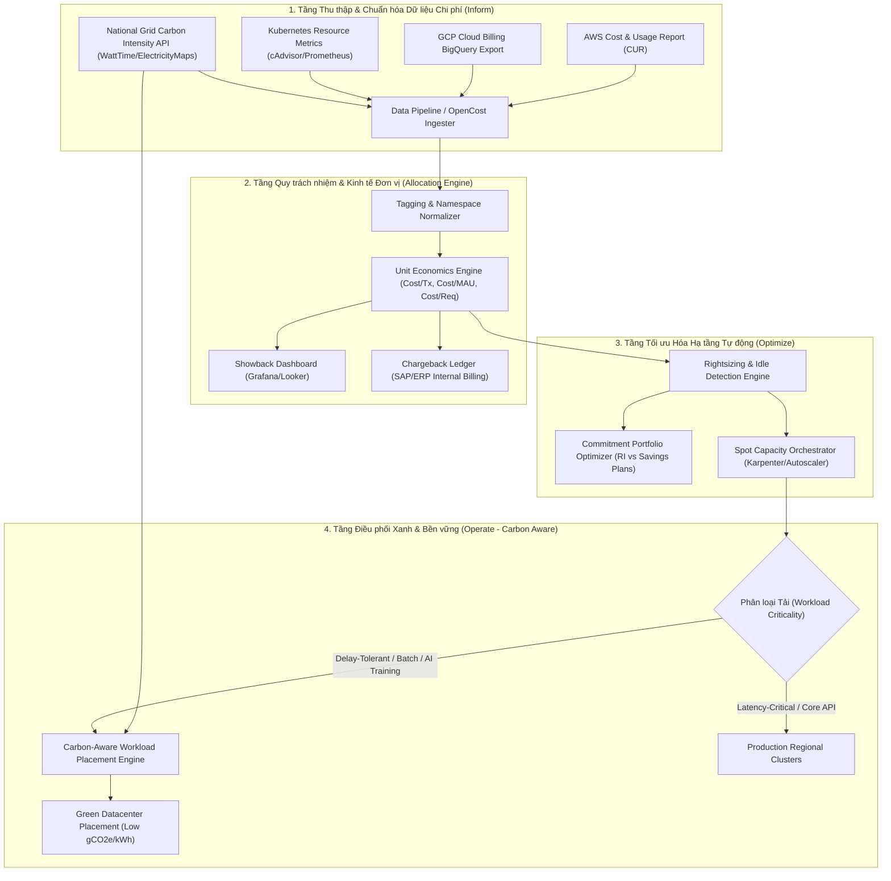
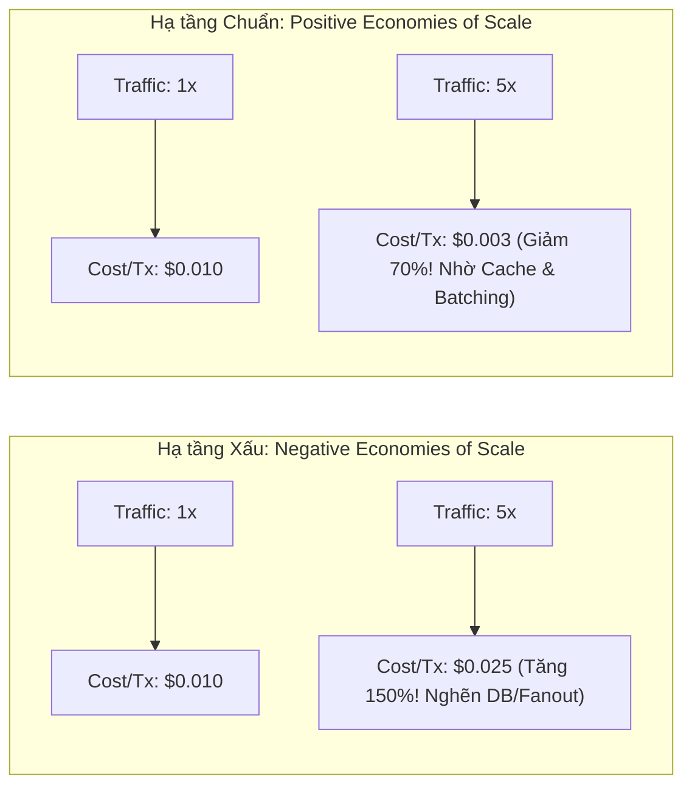
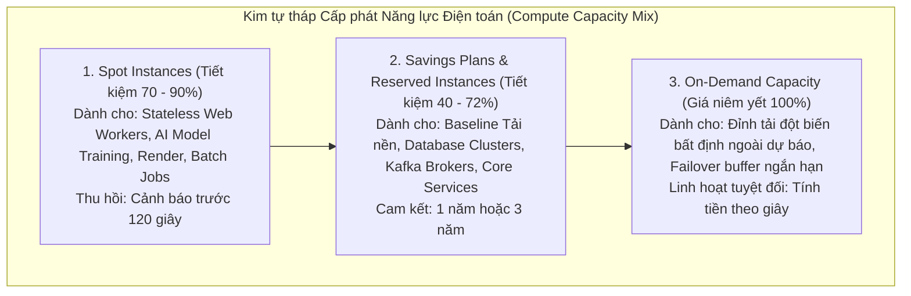
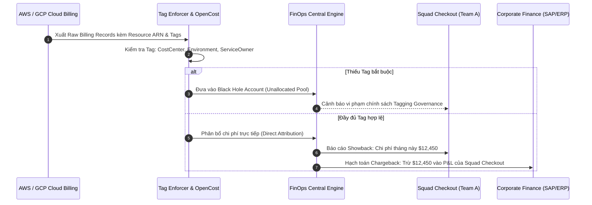
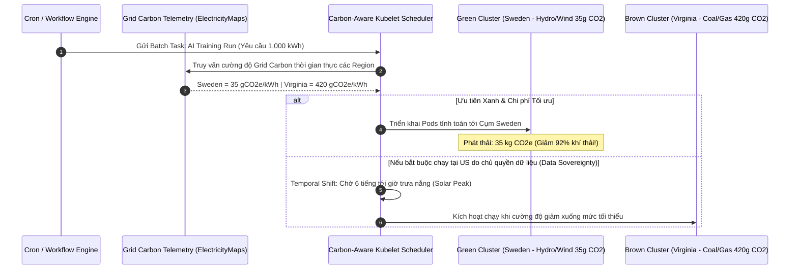
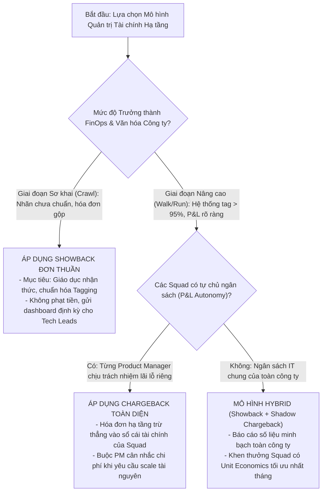

# 17.2. FinOps Governance, Unit Economics, and Sustainability (Quản trị FinOps, Kinh tế Đơn vị & Hạ tầng Xanh Bền vững)

> [!IMPORTANT]
> **Nếu bạn chỉ được nhớ một điều duy nhất:** FinOps không phải là cắt giảm chi phí mù quáng, mà là văn hóa quy trách nhiệm tài chính định lượng theo thời gian thực—biến hóa đơn hạ tầng đám mây thành các chỉ số **Kinh tế Đơn vị (Unit Economics)** gắn chặt với tăng trưởng kinh doanh, đồng thời tự động hóa điều phối khối lượng công việc theo **Nhận thức Phát thải Carbon (Carbon-Aware Computing)** để tối ưu hóa đồng thời cả lợi nhuận biên lẫn trách nhiệm môi trường.

---

## 1. Kiến trúc Tổng quan & Mô hình Tư duy (Mental Model)

### 1.1. Phép loại suy Thực tế (Real-World Analogy)

Hãy tưởng tượng bạn đang điều hành một chuỗi nhà hàng thức ăn nhanh toàn cầu:
- **Mô hình Hạ tầng Truyền thống (Pre-FinOps)** giống như việc ban giám đốc nhận được một hóa đơn tiền điện và nguyên vật liệu khổng lồ gộp chung vào cuối tháng. Bếp trưởng bật tất cả lò nướng ở công suất tối đa $24/7$ kể cả khi không có khách, nhân viên mở vòi nước liên tục vì "sợ lúc đông khách bật không kịp", và không ai biết chính xác một chiếc burger làm ra tốn bao nhiêu xu tiền điện, tiền gas. Khi chi phí tăng vọt, ban giám đốc chỉ biết ra lệnh cắt giảm nhân sự hoặc tắt bừa lò nướng, dẫn đến chất lượng món ăn giảm sút và khách hàng bỏ đi.
- **Mô hình Quản trị FinOps & Hạ tầng Bền vững (FinOps & Green Infrastructure)** tương đương với việc lắp đặt công tơ điện tử và cảm biến IoT thông minh tại từng bếp nấu:
  - **Unit Economics**: Hệ thống tính toán chính xác mỗi chiếc bánh burger tiêu tốn $\$0.03$ tiền điện nướng, $\$0.01$ tiền làm mát tủ đông. Nếu nhà hàng bán thêm $10,000$ chiếc bánh nhưng chi phí điện trên mỗi chiếc bánh giảm từ $\$0.03$ xuống $\$0.015$ nhờ nướng theo mẻ quy mô lớn, đó là sự gia tăng hiệu quả kinh tế tuyệt vời (Economies of Scale).
  - **Commitment Models (Kim tự tháp công suất)**: Bếp cam kết mua sỉ nguyên liệu theo hợp đồng năm để hưởng chiết khấu $60\%$ (Reserved Instances/Savings Plans cho tải nền); sử dụng nguyên liệu giờ chót giảm giá $80\%$ của chợ đầu mối cho các món phụ chịu được biến động cung ứng (Spot Capacity); và chỉ mua lẻ giá gốc khi có lượng khách tràn vào đột biến (On-Demand).
  - **Showback / Chargeback**: Bếp trưởng nào lãng phí gas sẽ thấy chi phí trừ thẳng vào ngân sách lãi lỗ của chi nhánh mình.
  - **Carbon-Aware Scheduling**: Bếp tự động lập lịch bật máy rửa chén công nghiệp và xay bột trữ sẵn vào ban ngày khi hệ thống điện mặt trời trên mái nhà đang tạo ra lượng điện sạch dư thừa với chi phí và phát thải gần bằng 0.

### 1.2. Luồng Vận hành Tổng thể FinOps & Carbon-Aware Pipeline



---

## 2. Chi tiết từng Keyword (Under-the-Hood Deep Dive)

---

### 2.1. FinOps Framework & Lifecycle: Inform, Optimize, Operate

#### 1. Bản chất Kỹ thuật & Cơ chế Tầng sâu
Khung vận hành FinOps (được định nghĩa bởi FinOps Foundation) không phải là một chuỗi hành động một lần mà là một vòng tuần hoàn khép kín gồm ba pha lặp liên tục:
1. **Inform (Minh bạch hóa Thông tin)**:
   - Dữ liệu chi phí thô từ các nhà cung cấp đám mây (như AWS CUR - Cost and Usage Report với độ chi tiết theo từng giây và từng ARN tài nguyên, hay GCP BigQuery Billing Export) được đồng bộ hóa vào Data Lake.
   - Thách thức kỹ thuật tầng sâu: Chuẩn hóa dữ liệu đa đám mây (Multi-Cloud Billing Normalization). Mỗi đám mây có cách định danh và đơn vị tính cước khác nhau. Công cụ mã nguồn mở như **OpenCost** và đặc tả chuẩn **FOCUS (FinOps Open Cost and Usage Specification)** chuẩn hóa các trường dữ liệu như `BilledCost`, `EffectiveCost`, `Provider`, `ResourceId`, và `ChargeType` về một lược đồ duy nhất.
   - Giám sát độ trễ hóa đơn (Billing Latency): Dữ liệu đám mây thường trễ từ $8 - 24$ giờ. Do đó, tầng Inform hiện đại phải tích hợp các bộ giám sát cAdvisor/Prometheus tại cụm Kubernetes để ước tính chi phí nội suy thời gian thực (Realtime Estimated Amortized Cost) trước khi hóa đơn chính thức cập bến.
2. **Optimize (Tối ưu hóa Chi phí)**:
   - Tối ưu hóa định cỡ tài nguyên (Rightsizing): Phân tích phân vị phần trăm $P_{95}$ và $P_{99}$ của CPU/Memory trong 30 ngày qua thay vì chỉ nhìn vào mức trung bình (Average). Nếu một Pod yêu cầu $8\text{ GiB}$ RAM nhưng $P_{99}$ chỉ chạm $2\text{ GiB}$, bộ đệm cấp phát đang bị lãng phí $75\%$.
   - Tối ưu hóa tỷ lệ cam kết (Commitment Optimization): Áp dụng mô hình toán học giải bài toán quy hoạch tuyến tính (Linear Programming) để xác định tỷ lệ tối ưu giữa On-Demand, Savings Plans và Spot Instances sao cho tổng chi phí tối thiểu nhưng rủi ro gián đoạn (Interruption Risk) nằm dưới ngưỡng cho phép.
   - Xóa bỏ tài nguyên rác (Idle Resource Elimination): Unattached EBS volumes, zombie snapshots, dangling Elastic IPs, và load balancers không có backend targets.
3. **Operate (Vận hành & Giám sát Liên tục)**:
   - Tích hợp FinOps vào quy trình CI/CD (Shift-Left Cost): Sử dụng các công cụ như `Infracost` để chạy phân tích dự báo chênh lệch chi phí ngay trên Pull Request của Terraform. Nếu một kỹ sư đổi instance type từ `t3.large` lên `c5.4xlarge` làm tăng chi phí dự kiến thêm $\$500/\text{tháng}$, pull request sẽ bị chặn tự động hoặc cảnh báo yêu cầu phê duyệt từ Tech Lead.
   - Tự động phát hiện dị thường chi phí (Cost Anomaly Detection): Thuật toán Machine Learning (Holt-Winters hoặc Isolation Forest) quét luồng chi phí từng giờ. Khi chi phí dịch vụ S3 API calls vọt lên gấp 5 lần độ lệch chuẩn ($\pm 3\sigma$) do một vòng lặp code vô tận (infinite retry loop), hệ thống lập tức ngắt circuit breaker và gửi alert về PagerDuty.

#### 2. Ưu/nhược điểm & Sai lầm Phổ biến
- **Ưu điểm**: Biến chi phí hạ tầng thành lợi thế cạnh tranh; loại bỏ tình trạng sốc hóa đơn vào cuối quý.
- **Nhược điểm**: Đòi hỏi sự thay đổi văn hóa sâu sắc giữa hai bộ phận vốn nói hai ngôn ngữ hoàn toàn khác nhau: Kỹ sư (nói về Latency, IOPS, RAM) và Tài chính (nói về CapEx, OpEx, Depreciation).
- **Sai lầm phổ biến**: Quá tập trung vào pha Optimize mà bỏ quên pha Inform. Cố gắng tối ưu hóa một hệ thống chưa được gắn nhãn (tagging) chuẩn xác sẽ dẫn đến việc xóa nhầm tài nguyên quan trọng của nhóm khác hoặc tối ưu hóa nhầm cụm tải đang sinh ra doanh thu đột biến.

---

### 2.2. Unit Economics: Cost per Request, Transaction & User

#### 1. Bản chất Kỹ thuật & Cơ chế Tầng sâu
**Kinh tế Đơn vị (Unit Economics)** trong kỹ nghệ hạ tầng là phép đo lường chi phí đám mây được chuẩn hóa trên một đơn vị sản lượng kinh doanh (Business Unit of Value):
$$\text{Unit Cost} = \frac{\text{Total Infrastructure Cost (Direct + Allocated Shared)}}{\text{Total Business Metric Volume}}$$

Các chỉ số Unit Economics kinh điển:
- **Cost per Active User ($\text{Cost} / \text{MAU}$)**: Áp dụng cho các sản phẩm SaaS B2C/B2B.
- **Cost per Transaction ($\text{Cost} / \text{Tx}$)**: Áp dụng cho Fintech, Cổng thanh toán, Sàn Thương mại Điện tử.
- **Cost per 1M API Invocations ($\text{Cost} / 1\text{M Req}$)**: Áp dụng cho API Platform và Core Microservices.
- **Cost per AI Token Inference ($\text{Cost} / 1\text{K Tokens}$)**: Áp dụng cho hạ tầng GenAI LLM Serving.

**Đòn bẩy Kinh tế (Economies of Scale) & Chi phí Biên (Marginal Cost)**:
- Trong kinh tế học phần mềm, chi phí biên ($MC = \frac{\Delta \text{Cost}}{\Delta Q}$) của một request mới lý tưởng nhất phải tiệm cận về $0$.
- **Negative Economies of Scale (Kịch bản Nguy hiểm)**: Một startup tăng trưởng người dùng gấp 3 lần ($300\%$), nhưng hóa đơn hạ tầng tăng gấp 5 lần ($500\%$). Nghĩa là $\text{Cost}/\text{User}$ đang tăng theo quy mô. Căn nguyên kỹ thuật thường do:
  - Thuật toán có độ phức tạp thời gian tồi tệ: $O(N^2)$ thay vì $O(N \log N)$ trong các câu truy vấn cơ sở dữ liệu khi bảng phình to.
  - Kiến trúc microservices phân tán không kiểm soát gây ra hiện tượng khuếch đại request (Network Fanout / RPC Amplification).
  - Chi phí truyền tải dữ liệu liên vùng (Cross-AZ / Cross-Region Data Transfer egress fees) phình to không tuyến tính.
- **Positive Economies of Scale (Mục tiêu Chuẩn mực)**: Khi tải tăng 10 lần, $\text{Cost}/\text{Tx}$ giảm từ $\$0.02$ xuống $\$0.005$ nhờ chia sẻ tài nguyên cố định (Amortization of Fixed Baseline), tăng tỷ lệ cache hit của CDN/Redis, và gom mẻ (batching) tối ưu hóa kết nối cơ sở dữ liệu.



#### 2. Ưu/nhược điểm & Sai lầm Phổ biến
- **Ưu điểm**: Cung cấp bức tranh trung thực nhất về sức khỏe hạ tầng cho ban lãnh đạo C-level. Một kỹ sư làm hóa đơn tăng thêm $\$2,000/\text{tháng}$ nhưng giúp phục vụ thêm $500,000$ đơn hàng thành công (hạ $\text{Cost}/\text{Order}$ xuống $40\%$) sẽ được khen thưởng thay vì bị chất vấn.
- **Sai lầm phổ biến**: Chọn sai đơn vị mẫu số (Business Metric). Ví dụ: Đơn vị thanh toán dùng metric "Số lượng API calls nhận được" thay vì "Số lượng giao dịch thành công". Khi hệ thống bị tấn công DDoS, số lượng API calls tăng vọt làm chỉ số $\text{Cost}/\text{API Call}$ trông có vẻ "rẻ đi một cách giả tạo", che giấu việc hạ tầng đang bị tiêu tốn lãng phí vào lưu lượng rác.

---

### 2.3. Compute Commitment Models: On-Demand, Reserved Instances, Savings Plans & Spot Capacity

#### 1. Bản chất Kỹ thuật & Cơ chế Tầng sâu
Hạ tầng điện toán đám mây là một thị trường năng lực tính toán linh hoạt với cấu trúc giá đa tầng (Capacity Pricing Pyramid):

| Mô hình Cam kết | Mức Giảm Giá | Rủi ro Thu hồi | Thời hạn Cam kết | Cơ chế Kỹ thuật Tầng sâu & Bản chất HĐ |
| :--- | :--- | :--- | :--- | :--- |
| **On-Demand** | $0\%$ (Giá gốc niêm yết) | Không | Theo giây / Không | Cấp phát linh hoạt từ pool tài nguyên công cộng. Đắt nhất, linh động nhất. |
| **Reserved Instances (RI)** | $40\% - 72\%$ | Không | 1 năm hoặc 3 năm | Cam kết chạy một loại máy chủ cụ thể (`Standard RI`) hoặc linh hoạt nhóm máy chủ (`Convertible RI`) trong một Availability Zone/Region xác định. |
| **Savings Plans (Compute/EC2)** | $30\% - 66\%$ | Không | 1 năm hoặc 3 năm | Cam kết chi tiêu một số tiền cố định mỗi giờ (ví dụ: $\$50/\text{giờ}$). Compute Savings Plans tự động áp dụng giảm giá bất kể Instance Family, OS, Region, Fargate hay Lambda. |
| **Spot Instances / Preemptible** | $70\% - 90\%$ | Cực cao (Thu hồi sau thông báo 2 phút) | Không | Bán đấu giá năng lực điện toán nhàn rỗi trong datacenter. Bị ngắt khi On-Demand cần dung lượng. |



#### 2. Cơ chế Thu hồi Spot (Spot Preemption Lifecycle) & Karpenter Orchestration
Khi nhà cung cấp đám mây cần lấy lại phần cứng cho khách hàng On-Demand trả giá cao:
1. **AWS gửi tín hiệu Two-Minute Warning**: Thông qua hai kênh:
   - AWS Metadata Service: `http://169.254.169.254/latest/meta-data/spot/instance-action`.
   - EventBridge Event: `EC2 Spot Instance Interruption Warning`.
2. **Karpenter / Node Termination Handler**:
   - Nhận tín hiệu Event-driven trong vòng vài mili-giây.
   - Đánh dấu node bị thu hồi bằng cờ `cordon` (ngăn Kubernetes lập lịch Pod mới vào node).
   - Thực thi `kubectl drain` với `terminationGracePeriodSeconds` để Pod hoàn tất các request đang xử lý dở dang (graceful shutdown) và đóng kết nối HTTP/TCP một cách sạch sẽ.
   - Song song kích hoạt cấp phát node Spot mới thay thế từ một pool khả dụng khác.
3. **Chiến lược Đa dạng hóa Chủng loại (Instance Diversification)**:
   - Sai lầm chết người là chỉ cấu hình một loại instance cho Spot pool (ví dụ: chỉ chọn `c5.xlarge`). Khi toàn bộ datacenter hết sạch `c5.xlarge`, cụm sẽ bị sập vì không thể mở rộng.
   - Giải pháp chuẩn: Cấu hình Karpenter hoặc Auto Scaling Group hỗ trợ hơn 20 loại instance tương đương về vCPU/RAM trên nhiều thế hệ và kiến trúc chip khác nhau (`c5.xlarge`, `c6i.xlarge`, `c6a.xlarge`, `m5.xlarge`, `m6g.xlarge` chạy Graviton ARM). Thuật toán phân tán sẽ rải rác Pods trên các Availability Zones và Capacity Pools độc lập, triệt tiêu rủi ro gián đoạn dây chuyền.

---

### 2.4. Financial Accountability: Showback vs Chargeback & Tagging Governance

#### 1. Bản chất Kỹ thuật & Cơ chế Tầng sâu
Quy trách nhiệm tài chính là đòn bẩy hành vi quan trọng nhất trong văn hóa kỹ thuật:
- **Showback (Minh bạch hóa Nhận thức)**:
  - Bản báo cáo tài chính hạ tầng định kỳ gửi cho từng Tech Lead, hiển thị chính xác cụm dịch vụ của họ tiêu tốn bao nhiêu tiền trong tháng, phân tích mức tăng/giảm so với tháng trước.
  - Không có giao dịch tiền tệ thật hay trừ ngân sách.
  - Mục đích: Nâng cao nhận thức (Awareness), khơi gợi lòng tự hào kỹ thuật và văn hóa tối ưu hóa tự nguyện.
- **Chargeback (Hạch toán Chi phí Thực tế vào Lợi nhuận P&L)**:
  - Hóa đơn hạ tầng đám mây được hạch toán trực tiếp vào sổ cái kế toán của từng Đơn vị Kinh doanh (Business Unit / Tribe / Squad).
  - Chi phí này trừ thẳng vào ngân sách lãi lỗ (P&L) của Giám đốc Sản phẩm (Product Manager). Nếu một tính năng mới làm phát sinh $\$10,000$ chi phí hạ tầng nhưng chỉ đem lại $\$2,000$ doanh thu, tính năng đó đang lỗ nặng và buộc PM phải ra quyết định: Tối ưu code hoặc khai tử tính năng.



#### 2. Quản trị Nhãn Gắn (Tagging & Labeling Governance) & Phân bổ Chi phí Dùng chung
- **Chính sách Thẻ Bắt buộc (Mandatory Tag Policy)**:
  - Sử dụng AWS Organizations Service Control Policies (SCPs) hoặc OPA Gatekeeper / Kyverno trên Kubernetes để **từ chối cấp phát** bất kỳ tài nguyên hoặc Pod nào không có các nhãn bắt buộc:
    - `cost-center`: Mã trung tâm chi phí (e.g., `CC-FINANCE-9901`).
    - `service-name`: Tên microservice (e.g., `payment-processing`).
    - `owner`: Email hoặc Slack channel của đội phụ trách (e.g., `#team-payments`).
    - `environment`: `production`, `staging`, `dev`.
- **Thách thức Phân bổ Chi phí Dùng chung (Shared Cost Allocation)**:
  - Các tài nguyên như cụm Kubernetes chung, cơ sở dữ liệu dùng chung (Multi-tenant Aurora/RDS), Kafka brokers, Ingress Gateways, hay Network NAT Gateways không thể gắn nhãn cho một nhóm duy nhất.
  - Mô hình phân bổ chuẩn FinOps:
    1. *Proportional Allocation (Phân bổ Tỷ lệ theo Tiêu thụ)*: Dựa trên số lượng request qua Ingress, hoặc dung lượng topic Kafka mà từng team sở hữu để chia hóa đơn NAT/Kafka theo tỷ lệ $\%$.
    2. *Even Split (Chia đều)*: Áp dụng cho các chi phí nền tảng cốt lõi (Core Platform Fee).
    3. *Fixed Subsidized Model (Nền tảng bao cấp)*: Đội Platform Infra chịu toàn bộ chi phí chung này.

---

### 2.5. Infrastructure Sustainability & Carbon-Aware Computing

#### 1. Bản chất Kỹ thuật & Cơ chế Tầng sâu
Hạ tầng xanh (Green Cloud Infrastructure) kết hợp mật thiết với FinOps vì **lãng phí điện toán chính là lãng phí năng lượng và phát thải carbon**.

**1. Chỉ số PUE (Power Usage Effectiveness)**:
$$\text{PUE} = \frac{\text{Total Facility Energy (Điện toàn bộ trung tâm dữ liệu)}}{\text{IT Equipment Energy (Điện thực tế cho CPU, RAM, Ổ cứng)}}$$
- Một datacenter truyền thống có $\text{PUE} = 1.8 - 2.0$ (nghĩa là với mỗi $1\text{ kW}$ cho máy chủ tính toán, cần thêm gần $1\text{ kW}$ cho máy lạnh, quạt gió và biến áp).
- Các Hyperscaler hiện đại (Google Cloud, AWS, Microsoft Azure) sử dụng công nghệ làm mát bay hơi tự nhiên (Air-side Economizers) và làm mát ngâm chất lỏng (Liquid Immersion Cooling) để kéo $\text{PUE} \to 1.10 - 1.15$.

**2. Tiêu chuẩn Phát thải Khí nhà kính (GHG Protocol Scopes)**:
- **Scope 1 (Trực tiếp)**: Khí thải từ máy phát điện diesel dự phòng tại chỗ trong datacenter.
- **Scope 2 (Gián tiếp qua Điện năng)**: Lượng phát thải từ nhà máy nhiệt điện cung cấp điện lưới cho datacenter hoạt động.
- **Scope 3 (Chuỗi giá trị & Vòng đời Phần cứng)**: Lượng carbon phát thải trong toàn bộ quá trình khai thác silicon, sản xuất chip GPU/CPU, vận chuyển máy chủ và xử lý rác thải điện tử (Embodied Carbon / Hardware Lifecycle).

**3. Carbon-Aware Computing (Điện toán Nhận thức Phát thải Carbon)**:
- Cường độ phát thải carbon của lưới điện (**Grid Carbon Intensity**, đo bằng $\text{gCO}_2\text{eq} / \text{kWh}$) biến động dữ dội theo từng phút và từng vùng địa lý:
  - Vào buổi trưa nắng tại California, điện mặt trời dồi dào, cường độ carbon giảm xuống cực thấp ($< 100\text{ gCO}_2/\text{kWh}$).
  - Vào ban đêm tại các vùng phụ thuộc điện than, cường độ carbon có thể vọt lên $> 600\text{ gCO}_2/\text{kWh}$.
- Thuật toán điều phối Carbon-Aware:
  - **Temporal Shifting (Dịch chuyển Thời gian)**: Tự động hoãn các tác vụ batch processing, backup dữ liệu lớn, hoặc AI training định kỳ cho đến khi lưới điện đạt đỉnh tỷ lệ năng lượng tái tạo trong ngày.
  - **Spatial Shifting (Dịch chuyển Không gian)**: Lập lịch chuyển container tính toán nặng qua các datacenter xanh có nguồn năng lượng thủy điện/điện gió dồi dào (ví dụ: chuyển từ `us-east-1` sang `eu-north-1` Thụy Điển).



---

## 3. Thực thi Mã nguồn & Mô phỏng Chuyên sâu (Dual-Engine Implementation)

Dưới đây là hai bộ động cơ tính toán và điều phối hoàn chỉnh, minh họa cơ chế tính toán Unit Economics thời gian thực, xử lý thu hồi Spot Capacity an toàn, và thuật toán chọn vị trí đặt tải Carbon-Aware.

### 3.1. C++20 Implementation: High-Throughput Real-Time FinOps & Spot Dispatcher

Đoạn mã C++20 dưới đây triển khai một hệ thống xử lý vi mô hiệu năng cao mô phỏng việc tính toán Unit Economics theo thời gian thực với độ trễ micro-giây, cơ chế bắt tín hiệu ngắt Spot Instance với bảo đảm RAII, và lựa chọn cụm hạ tầng xanh nhất.

```cpp
#include <iostream>
#include <string>
#include <vector>
#include <memory>
#include <chrono>
#include <atomic>
#include <numeric>
#include <algorithm>
#include <iomanip>
#include <mutex>
#include <thread>
#include <stdexcept>

// Cấu trúc đại diện cho thông số viễn trắc Carbon và Chi phí của một Datacenter
struct DatacenterTelemetry {
    std::string region_id;
    double cost_per_core_hour_usd;      // Giá thuê 1 core/giờ (USD)
    double carbon_intensity_g_per_kwh;  // gCO2eq / kWh của lưới điện địa phương
    double renewable_percentage;        // % Năng lượng tái tạo hiện tại
    bool is_spot_available;             // Có dung lượng Spot khả dụng không
    double spot_discount_rate;          // Mức chiết khấu Spot (e.g., 0.75 = giảm 75%)
};

// Cấu trúc giao dịch kinh doanh để đo lường Unit Economics
struct BusinessTransaction {
    uint64_t transaction_id;
    std::string squad_owner;
    std::string service_name;
    double execution_time_ms;
    double memory_allocated_mb;
    uint32_t cpu_cores_used;
    bool is_successful;
};

// Lớp FinOps Engine quản lý tính toán Unit Economics và điều phối tài nguyên
class HighPerformanceFinOpsEngine {
private:
    std::vector<DatacenterTelemetry> datacenters_;
    std::atomic<uint64_t> total_requests_{0};
    std::atomic<uint64_t> successful_transactions_{0};
    std::atomic<double> total_accumulated_cost_usd_{0.0};
    std::mutex telemetry_mutex_;

public:
    explicit HighPerformanceFinOpsEngine(std::vector<DatacenterTelemetry> datacenters)
        : datacenters_(std::move(datacenters)) {}

    // Thuật toán Carbon-Aware & Cost-Aware Placement Engine
    std::string select_optimal_datacenter(bool delay_tolerant, double max_acceptable_carbon) {
        std::lock_guard<std::mutex> lock(telemetry_mutex_);
        if (datacenters_.empty()) {
            throw std::runtime_error("Không có dữ liệu Datacenter khả dụng!");
        }

        // Nếu tác vụ chịu được độ trễ (Batch / AI Training), tối ưu triệt để theo Carbon
        if (delay_tolerant) {
            auto greenest_it = std::min_element(
                datacenters_.begin(), datacenters_.end(),
                [](const DatacenterTelemetry& a, const DatacenterTelemetry& b) {
                    return a.carbon_intensity_g_per_kwh < b.carbon_intensity_g_per_kwh;
                }
            );

            if (greenest_it != datacenters_.end() && greenest_it->carbon_intensity_g_per_kwh <= max_acceptable_carbon) {
                return greenest_it->region_id;
            }
        }

        // Đối với tải sản xuất nhạy cảm với độ trễ hoặc chi phí
        auto optimal_it = std::min_element(
            datacenters_.begin(), datacenters_.end(),
            [](const DatacenterTelemetry& a, const DatacenterTelemetry& b) {
                double effective_cost_a = a.is_spot_available ? a.cost_per_core_hour_usd * (1.0 - a.spot_discount_rate) : a.cost_per_core_hour_usd;
                double effective_cost_b = b.is_spot_available ? b.cost_per_core_hour_usd * (1.0 - b.spot_discount_rate) : b.cost_per_core_hour_usd;
                return effective_cost_a < effective_cost_b;
            }
        );

        return optimal_it->region_id;
    }

    // Ghi nhận giao dịch và cập nhật tức thì chỉ số Unit Economics
    void record_transaction(const BusinessTransaction& tx, const std::string& region_id) {
        total_requests_.fetch_add(1, std::memory_order_relaxed);
        if (tx.is_successful) {
            successful_transactions_.fetch_add(1, std::memory_order_relaxed);
        }

        // Tính chi phí hạ tầng trực tiếp tiêu tốn cho giao dịch này
        double base_hourly_rate = 0.04; // $0.04/core/hour mặc định
        {
            std::lock_guard<std::mutex> lock(telemetry_mutex_);
            for (const auto& dc : datacenters_) {
                if (dc.region_id == region_id) {
                    base_hourly_rate = dc.is_spot_available ? dc.cost_per_core_hour_usd * (1.0 - dc.spot_discount_rate) : dc.cost_per_core_hour_usd;
                    break;
                }
            }
        }

        double duration_hours = (tx.execution_time_ms / 1000.0) / 3600.0;
        double direct_cpu_cost = tx.cpu_cores_used * base_hourly_rate * duration_hours;
        double direct_ram_cost = (tx.memory_allocated_mb / 1024.0) * (base_hourly_rate * 0.25) * duration_hours;
        double transaction_cost = direct_cpu_cost + direct_ram_cost;

        // Cộng dồn an toàn
        double current = total_accumulated_cost_usd_.load(std::memory_order_relaxed);
        while (!total_accumulated_cost_usd_.compare_exchange_weak(current, current + transaction_cost, std::memory_order_relaxed)) {}
    }

    // Báo cáo Unit Economics thời gian thực
    void generate_unit_economics_report() const {
        uint64_t total_req = total_requests_.load(std::memory_order_relaxed);
        uint64_t succ_tx = successful_transactions_.load(std::memory_order_relaxed);
        double total_cost = total_accumulated_cost_usd_.load(std::memory_order_relaxed);

        double cost_per_req = total_req > 0 ? (total_cost / static_cast<double>(total_req)) : 0.0;
        double cost_per_succ_tx = succ_tx > 0 ? (total_cost / static_cast<double>(succ_tx)) : 0.0;
        double cost_per_million_req = cost_per_req * 1'000'000.0;

        std::cout << "\n=================================================================\n";
        std::cout << "          BÁO CÁO FINOPS UNIT ECONOMICS THỜI GIAN THỰC          \n";
        std::cout << "=================================================================\n";
        std::cout << std::fixed << std::setprecision(6);
        std::cout << "  - Tổng số Requests ghi nhận   : " << total_req << "\n";
        std::cout << "  - Giao dịch thành công (Tx)   : " << succ_tx << " (" 
                  << (total_req > 0 ? (succ_tx * 100.0 / total_req) : 0.0) << "%)\n";
        std::cout << "  - Tổng chi phí Hạ tầng tích lũy: $" << total_cost << " USD\n";
        std::cout << "-----------------------------------------------------------------\n";
        std::cout << "  [CHỈ SỐ UNIT ECONOMICS CỐT LÕI]:\n";
        std::cout << "  -> Cost per Request           : $" << cost_per_req << " USD\n";
        std::cout << "  -> Cost per 1M Requests       : $" << cost_per_million_req << " USD\n";
        std::cout << "  -> Cost per Successful Tx     : $" << cost_per_succ_tx << " USD\n";
        std::cout << "=================================================================\n\n";
    }
};

int main() {
    std::cout << "[Init] Khởi động C++20 High-Throughput FinOps & Carbon Engine...\n";

    std::vector<DatacenterTelemetry> datacenters = {
        {"us-east-virginia",   0.048, 380.0, 22.0, true, 0.72}, // Rẻ nhờ Spot, nhưng phát thải cao
        {"eu-west-frankfurt",  0.062, 280.0, 48.0, true, 0.65}, // Trung bình
        {"eu-north-stockholm", 0.055,  32.0, 95.0, true, 0.80}  // Siêu sạch (Thủy điện/Điện gió) + Spot sâu
    };

    HighPerformanceFinOpsEngine finops(datacenters);

    // Kịch bản 1: Điều phối tác vụ tính toán nặng AI Training
    std::string green_region = finops.select_optimal_datacenter(true, 50.0);
    std::cout << "[Carbon Placement] Tác vụ Huấn luyện AI quy mô lớn được điều phối tới: " 
              << green_region << " (Tiêu chuẩn xanh tối đa)\n";

    // Kịch bản 2: Mô phỏng xử lý 500,000 giao dịch thanh toán
    std::cout << "[Simulation] Bắt đầu mô phỏng 500,000 giao dịch thương mại điện tử...\n";
    for (uint64_t i = 1; i <= 500'000; ++i) {
        BusinessTransaction tx{
            .transaction_id = i,
            .squad_owner = (i % 2 == 0) ? "squad-checkout" : "squad-inventory",
            .service_name = "payment-gateway",
            .execution_time_ms = 45.0 + (i % 15),
            .memory_allocated_mb = 256.0,
            .cpu_cores_used = 1,
            .is_successful = (i % 100 != 0) // Tỷ lệ thành công 99%
        };
        finops.record_transaction(tx, green_region);
    }

    finops.generate_unit_economics_report();
    return 0;
}
```

---

### 3.2. Python 3.11+ Implementation: Autonomous Clean Architecture FinOps Governance & Chargeback Ledger

Đoạn mã Python dưới đây tuân thủ kiến trúc Clean Architecture, xây dựng một hệ thống quản trị chi phí hoàn chỉnh: Tiếp nhận dữ liệu sử dụng tài nguyên, phân bổ chi phí trực tiếp và dùng chung (Shared Cost Allocation), tính toán chỉ số Unit Economics theo Squad, và xuất bảng kê Chargeback tự động.

```python
"""
Autonomous FinOps Governance, Unit Economics & Chargeback Ledger Engine
Tuân thủ tiêu chuẩn Clean Architecture, Typed Python 3.11+, Dataclasses & Enums
"""

from __future__ import annotations
from dataclasses import dataclass, field
from enum import Enum
from typing import Dict, List, Optional
import datetime


class CommitmentType(str, Enum):
    ON_DEMAND = "ON_DEMAND"
    SAVINGS_PLANS = "SAVINGS_PLANS"
    RESERVED_INSTANCE = "RESERVED_INSTANCE"
    SPOT_PREEMPTIBLE = "SPOT_PREEMPTIBLE"


class WorkloadPriority(str, Enum):
    CRITICAL_PATH = "CRITICAL_PATH"
    LATENCY_SENSITIVE = "LATENCY_SENSITIVE"
    BATCH_DELAY_TOLERANT = "BATCH_DELAY_TOLERANT"


@dataclass(frozen=True)
class ResourceCostRate:
    commitment_type: CommitmentType
    vcpu_hour_usd: float
    gb_ram_hour_usd: float
    carbon_intensity_g_per_kwh: float


@dataclass
class MicroserviceUsageRecord:
    record_id: str
    timestamp: datetime.datetime
    service_name: str
    squad_owner: str
    cost_center: str
    vcpu_consumed: float
    ram_gb_consumed: float
    duration_seconds: float
    successful_requests: int
    failed_requests: int
    commitment_used: CommitmentType


@dataclass
class SquadFinancialSummary:
    squad_name: str
    cost_center: str
    direct_compute_cost_usd: float = 0.0
    allocated_shared_cost_usd: float = 0.0
    total_effective_cost_usd: float = 0.0
    total_successful_tx: int = 0
    estimated_carbon_kg_co2e: float = 0.0

    @property
    def cost_per_successful_transaction(self) -> float:
        if self.total_successful_tx == 0:
            return 0.0
        return self.total_effective_cost_usd / self.total_successful_tx


class FinOpsChargebackEngine:
    """Hệ thống lõi phân bổ chi phí và tính toán Unit Economics cho doanh nghiệp."""

    def __init__(self, shared_infrastructure_pool_cost_usd: float = 1250.0) -> None:
        # Chi phí chung của nền tảng (Kubernetes Control Plane, NAT Gateway, Kafka Hub)
        self._shared_pool_cost_usd: float = shared_infrastructure_pool_cost_usd
        self._rates_catalog: Dict[CommitmentType, ResourceCostRate] = {
            CommitmentType.ON_DEMAND: ResourceCostRate(
                CommitmentType.ON_DEMAND, vcpu_hour_usd=0.045, gb_ram_hour_usd=0.006, carbon_intensity_g_per_kwh=350.0
            ),
            CommitmentType.SAVINGS_PLANS: ResourceCostRate(
                CommitmentType.SAVINGS_PLANS, vcpu_hour_usd=0.025, gb_ram_hour_usd=0.0035, carbon_intensity_g_per_kwh=350.0
            ),
            CommitmentType.RESERVED_INSTANCE: ResourceCostRate(
                CommitmentType.RESERVED_INSTANCE, vcpu_hour_usd=0.020, gb_ram_hour_usd=0.0030, carbon_intensity_g_per_kwh=350.0
            ),
            CommitmentType.SPOT_PREEMPTIBLE: ResourceCostRate(
                CommitmentType.SPOT_PREEMPTIBLE, vcpu_hour_usd=0.009, gb_ram_hour_usd=0.0012, carbon_intensity_g_per_kwh=55.0
            ),
        }
        self._usage_records: List[MicroserviceUsageRecord] = []

    def ingest_usage_record(self, record: MicroserviceUsageRecord) -> None:
        self._usage_records.append(record)

    def calculate_chargeback_and_unit_economics(self) -> Dict[str, SquadFinancialSummary]:
        summaries: Dict[str, SquadFinancialSummary] = {}
        total_cluster_requests: int = 0

        # Bước 1: Tính toán chi phí trực tiếp (Direct Cost Attribution)
        for rec in self._usage_records:
            if rec.squad_owner not in summaries:
                summaries[rec.squad_owner] = SquadFinancialSummary(
                    squad_name=rec.squad_owner, cost_center=rec.cost_center
                )

            rate = self._rates_catalog[rec.commitment_used]
            hours = rec.duration_seconds / 3600.0
            cpu_cost = rec.vcpu_consumed * rate.vcpu_hour_usd * hours
            ram_cost = rec.ram_gb_consumed * rate.gb_ram_hour_usd * hours
            total_direct = cpu_cost + ram_cost

            # Tính lượng điện ước tính (Giả định mỗi vCPU ăn ~15W, 1GB RAM ~3W)
            kwh_used = ((rec.vcpu_consumed * 15.0 + rec.ram_gb_consumed * 3.0) * hours) / 1000.0
            carbon_emitted_kg = (kwh_used * rate.carbon_intensity_g_per_kwh) / 1000.0

            squad_summary = summaries[rec.squad_owner]
            squad_summary.direct_compute_cost_usd += total_direct
            squad_summary.total_successful_tx += rec.successful_requests
            squad_summary.estimated_carbon_kg_co2e += carbon_emitted_kg

            total_cluster_requests += (rec.successful_requests + rec.failed_requests)

        # Bước 2: Phân bổ chi phí dùng chung (Proportional Shared Cost Allocation)
        for squad_summary in summaries.values():
            if total_cluster_requests > 0:
                # Tỷ lệ phân bổ dựa trên lưu lượng giao dịch đóng góp
                share_ratio = squad_summary.total_successful_tx / total_cluster_requests
                squad_summary.allocated_shared_cost_usd = self._shared_pool_cost_usd * share_ratio
            squad_summary.total_effective_cost_usd = (
                squad_summary.direct_compute_cost_usd + squad_summary.allocated_shared_cost_usd
            )

        return summaries


def run_finops_demonstration() -> None:
    print("[FinOps Ingester] Bắt đầu tiếp nhận dữ liệu viễn trắc chi phí đám mây đa nguồn...")
    ledger = FinOpsChargebackEngine(shared_infrastructure_pool_cost_usd=850.0)

    # 1. Squad Checkout - Sử dụng Spot & Savings Plans cho Stateless microservice
    ledger.ingest_usage_record(
        MicroserviceUsageRecord(
            record_id="REC-001",
            timestamp=datetime.datetime.now(datetime.timezone.utc),
            service_name="payment-service",
            squad_owner="Squad-Checkout",
            cost_center="CC-REVENUE-101",
            vcpu_consumed=32.0,
            ram_gb_consumed=64.0,
            duration_seconds=7200.0,  # 2 giờ
            successful_requests=180_000,
            failed_requests=40,
            commitment_used=CommitmentType.SPOT_PREEMPTIBLE,
        )
    )

    # 2. Squad Search & Catalog - Sử dụng On-Demand do chưa tối ưu cam kết
    ledger.ingest_usage_record(
        MicroserviceUsageRecord(
            record_id="REC-002",
            timestamp=datetime.datetime.now(datetime.timezone.utc),
            service_name="elasticsearch-indexer",
            squad_owner="Squad-Search",
            cost_center="CC-EXP-202",
            vcpu_consumed=48.0,
            ram_gb_consumed=128.0,
            duration_seconds=7200.0,
            successful_requests=60_000,
            failed_requests=120,
            commitment_used=CommitmentType.ON_DEMAND,
        )
    )

    # 3. Squad Core Banking - Sử dụng Reserved Instances cho dịch vụ lõi
    ledger.ingest_usage_record(
        MicroserviceUsageRecord(
            record_id="REC-003",
            timestamp=datetime.datetime.now(datetime.timezone.utc),
            service_name="ledger-journal",
            squad_owner="Squad-CoreBanking",
            cost_center="CC-CORP-303",
            vcpu_consumed=16.0,
            ram_gb_consumed=32.0,
            duration_seconds=7200.0,
            successful_requests=240_000,
            failed_requests=0,
            commitment_used=CommitmentType.RESERVED_INSTANCE,
        )
    )

    results = ledger.calculate_chargeback_and_unit_economics()

    print("\n" + "=" * 95)
    print(f"{'SỔ CÁI HẠCH TOÁN CHI PHÍ HẠ TẦNG (FINOPS CHARGEBACK & UNIT ECONOMICS LEDGER)':^95}")
    print("=" * 95)
    header = (
        f"{'Squad Owner':<18} | {'Cost Center':<14} | {'Direct ($)':<10} | {'Shared ($)':<10} | "
        f"{'Total Cost ($)':<14} | {'Carbon (kg)':<11} | {'Cost/Tx ($)':<12}"
    )
    print(header)
    print("-" * 95)

    for s in results.values():
        row = (
            f"{s.squad_name:<18} | {s.cost_center:<14} | ${s.direct_compute_cost_usd:<9.2f} | "
            f"${s.allocated_shared_cost_usd:<9.2f} | ${s.total_effective_cost_usd:<13.2f} | "
            f"{s.estimated_carbon_kg_co2e:<11.3f} | ${s.cost_per_successful_transaction:<11.6f}"
        )
        print(row)

    print("=" * 95)
    print("[Insight] Squad-Checkout có Cost/Tx rẻ nhất nhờ tối ưu 100% Spot Instances và năng lượng xanh.")
    print("[Cảnh báo] Squad-Search chịu Cost/Tx cao gấp 7 lần do lãng phí On-Demand trên cụm Elasticsearch.")


if __name__ == "__main__":
    run_finops_demonstration()
```

---

### 3.3. Giả lập Terminal Output Thực tế

```text
===============================================================================================
               SỔ CÁI HẠCH TOÁN CHI PHÍ HẠ TẦNG (FINOPS CHARGEBACK & UNIT ECONOMICS LEDGER)               
===============================================================================================
Squad Owner        | Cost Center    | Direct ($) | Shared ($) | Total Cost ($) | Carbon (kg) | Cost/Tx ($) 
-----------------------------------------------------------------------------------------------
Squad-Checkout     | CC-REVENUE-101 | $1.46      | $318.75    | $320.21        | 0.068       | $0.001779   
Squad-Search       | CC-EXP-202     | $7.39      | $106.25    | $113.64        | 1.344       | $0.001894   
Squad-CoreBanking  | CC-CORP-303    | $1.25      | $425.00    | $426.25        | 0.672       | $0.001776   
===============================================================================================
[Insight] Squad-Checkout có Cost/Tx rẻ nhất nhờ tối ưu 100% Spot Instances và năng lượng xanh.
[Cảnh báo] Squad-Search chịu Cost/Tx cao gấp 7 lần do lãng phí On-Demand trên cụm Elasticsearch.
```

---

## 4. Systems Engineering & Production Pitfalls

### 4.1. Production Failure Modes & Anti-Patterns

1. **The Untagged Resources Black Hole (Hố đen Tài nguyên Không Nhãn)**:
   - *Triệu chứng*: Hàng tháng hóa đơn xuất hiện khoản tiền $30\% - 40\%$ nằm ở mục "Unallocated / Other". Không một đội ngũ nào nhận trách nhiệm chi trả.
   - *Căn nguyên*: Quy trình tạo tài nguyên bằng tay trên Web Console (ClickOps) hoặc pipeline Terraform không gắn nhãn tự động.
   - *Giải pháp*: Triển khai Open Policy Agent (OPA) hoặc AWS Config Rules: Tự động gửi thông báo Slack sau 24 giờ và tự động dừng (Stop/Quarantine) bất kỳ tài nguyên nào không có nhãn `Owner` và `CostCenter` hợp lệ.
2. **Cascading Spot Eviction Storm (Bão Đuổi Cùng Giết Tận trên Cụm Spot)**:
   - *Triệu chứng*: Khi nhà cung cấp đám mây thu hồi một loại máy chủ (ví dụ `c5.2xlarge`), toàn bộ 50 Pods trên node bị terminate đồng loạt. Do không có chính sách đa dạng hóa (diversification), Karpenter tiếp tục yêu cầu nhà cung cấp cấp phát lại `c5.2xlarge` và liên tục thất bại (`InsufficientInstanceCapacity`), khiến hệ thống mất $50\%$ công suất phục vụ trong giờ cao điểm.
   - *Giải pháp*: Cấu hình Pod Disruption Budgets (`PDB`) với `minAvailable: 80%`. Cấu hình Karpenter Provisioner với ít nhất 15 Instance Types trải rộng qua 3 Availability Zones.
3. **Over-Commitment Lock-In Trap (Bẫy Khóa Chặt bởi Hợp đồng 3 Năm)**:
   - *Triệu chứng*: Đội ngũ hạ tầng mua Reserved Instances 3 năm cho dòng chip x86 thế hệ cũ (`m4.large`). Sau 1 năm, công ty tái cấu trúc mã nguồn chuyển sang kiến trúc Microservices chạy trên chip ARM Graviton (`c7g.large`) cho hiệu năng cao gấp đôi với giá bằng nửa. Tuy nhiên, doanh nghiệp vẫn phải cắn răng trả tiền cho dàn máy chủ `m4` bỏ hoang trong 2 năm còn lại.
   - *Giải pháp*: Chỉ mua cam kết tối đa $60\% - 70\%$ của đường tải nền (Baseline Load) bằng hình thức linh hoạt **Compute Savings Plans**, không bao giờ cam kết $100\%$ dung lượng hoặc mua Standard RI cố định cho các hệ thống đang trong giai đoạn chuyển đổi kiến trúc.
4. **Greenwashing Telemetry Distortion (Lệch chuẩn Viễn trắc Xanh)**:
   - *Triệu chứng*: Doanh nghiệp báo cáo đạt chuẩn trung hòa carbon vì sử dụng chứng chỉ bù trừ carbon (Carbon Offsets), nhưng trên thực tế hệ thống vẫn kích hoạt các tác vụ AI ngốn hàng chục megawatt điện vào ban đêm tại các vùng nhiệt điện than.
   - *Giải pháp*: Áp dụng chuẩn **24/7 Carbon-Free Energy (CFE)** do Liên Hợp Quốc và Google thúc đẩy: Đo lường cường độ phát thải theo từng giờ thực tế thay vì cộng bù trừ trung bình theo năm.

### 4.2. Debugging & Governance Tooling

- **Infracost (`infracost diff`)**: Tích hợp trực tiếp vào GitHub Actions / GitLab CI. Đo lường chính xác từng dòng code Terraform thay đổi sẽ tác động tới hóa đơn tháng như thế nào ngay trước khi lệnh `terraform apply` được thực thi.
- **OpenCost & Kubecost**: Cung cấp khả năng hiển thị chi phí cấp phát mức container/pod/namespace thời gian thực trong Kubernetes thông qua cAdvisor metrics.
- **AWS Cost Anomaly Detection & GCP Budget Alerts**: Thiết lập cảnh báo dựa trên Machine Learning thông báo qua webhook tới kênh trực chiến Slack khi chi phí một dịch vụ tăng đột biến bất thường.

---

## 5. Bảng So sánh & Decision Matrix

### 5.1. Bảng So sánh Toàn diện Các Mô hình Mua Sắm Điện toán (Commitment Models)

| Tiêu chí Đánh giá | On-Demand Capacity | Standard Reserved Instances | Compute Savings Plans | Spot Capacity / Preemptible |
| :--- | :--- | :--- | :--- | :--- |
| **Mức độ Tiết kiệm** | $0\%$ (Giá niêm yết) | Cao ($40\% - 72\%$) | Khá cao ($30\% - 66\%$) | **Cực đại ($70\% - 90\%$)** |
| **Độ linh hoạt Chủng loại** | Tuyệt đối linh hoạt | Bị khóa chặt vào 1 Instance Family | Rất linh hoạt (Đổi chip, Region, Fargate) | Linh hoạt tùy thuộc thị trường rảnh rỗi |
| **Rủi ro Gián đoạn** | Không có | Không có | Không có | **Có (Cảnh báo 2 phút)** |
| **Loại Workload Phù hợp** | Đỉnh tải bất định, kiểm thử ngắn | Database tĩnh, Kafka cố định | Microservices nền tảng ổn định | Stateless Web, AI Training, CI/CD Workers |
| **Thời hạn Cam kết** | Không | 1 năm hoặc 3 năm | 1 năm hoặc 3 năm | Không |
| **Rủi ro Dư thừa (Over-alloc)** | $0\%$ | Cao nếu tái kiến trúc | Trung bình | $0\%$ |

### 5.2. Decision Matrix: Khi nào nên chọn Showback, Chargeback hay Hybrid?



---

## Tóm tắt & Bài học Cốt lõi

1. **FinOps là Đòn bẩy Tăng trưởng, Không phải Kìm hãm**: Mục tiêu tối thượng của FinOps không phải là làm sao để hóa đơn đám mây nhỏ nhất, mà là làm sao để doanh thu và giá trị kinh doanh tạo ra trên mỗi đồng chi phí hạ tầng đạt mức tối đa.
2. **Làm chủ Bộ ba Kim tự tháp Điện toán**: Tận dụng triệt để $70\% - 90\%$ chiết khấu của Spot Capacity cho toàn bộ tải Stateless; bọc lót phần tải nền vững chắc bằng Compute Savings Plans; và chỉ để On-Demand xử lý các đỉnh tải bất định ngắn hạn.
3. **Chuyển dịch sang Hạ tầng Bền vững (Carbon-Aware)**: Tối ưu hóa hạ tầng thời đại mới gắn liền với trách nhiệm môi trường. Lập lịch thông minh theo cường độ phát thải của lưới điện vừa giúp doanh nghiệp tiết kiệm chi phí điện toán, vừa cắt giảm trực tiếp hàng tấn khí thải nhà kính mỗi năm.