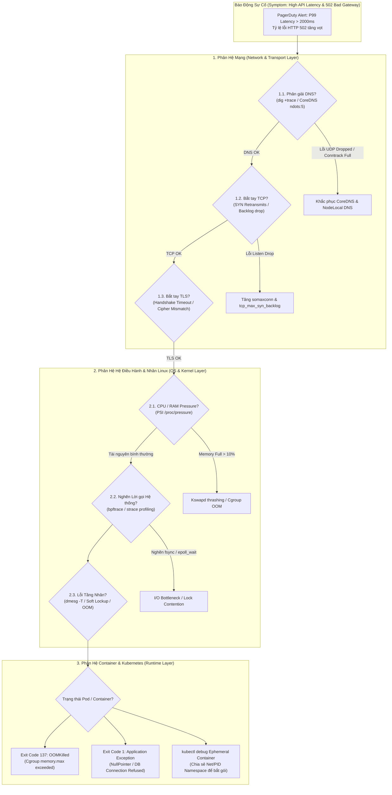

# 18.1. Systematic Diagnostics and Subsystem Debugging (Chẩn đoán Sự cố Có hệ thống & Gỡ lỗi Phân hệ Hạ tầng)

> [!IMPORTANT]
> **Nếu bạn chỉ được nhớ một điều duy nhất:** Đừng bao giờ suy đoán nguyên nhân sự cố bằng trực giác mơ hồ (Intuition-based Guesswork); hãy áp dụng **Phương pháp luận Chẩn đoán Có hệ thống (Systematic Subsystem Debugging)** từ tầng vật lý, mạng (DNS/TCP/TLS), nhân Linux (eBPF/strace/PSI) lên đến tầng Container/Kubernetes để cô lập chính xác nút thắt cổ chai dựa trên bằng chứng đo đạc thực tế tầng thấp.

---

## 1. Kiến trúc Tổng quan & Mô hình Tư duy (Mental Model)

### 1.1. Phép loại suy thực tế: Phòng Cấp cứu Bệnh viện & Phương pháp Chẩn đoán Loại trừ

Hãy hình dung một bệnh nhân được chuyển gấp vào phòng cấp cứu (Hạ tầng Production đang gặp sự cố SEV-1):
- **Sai lầm Chết người (Thử và Sai / Guessing):** Bác sĩ không đo nhịp tim, không chụp X-quang mà ngay lập tức tiêm thuốc an thần, rồi lại chuyển sang tiêm thuốc hạ sốt, hy vọng bệnh nhân sẽ đỡ. Hành động này chỉ làm rối loạn triệu chứng và đẩy bệnh nhân vào cõi chết (tương đương với việc kỹ sư SRE vội vàng khởi động lại hàng loạt cụm máy chủ hoặc sửa đổi bừa bãi các tham số `sysctl` khi chưa hiểu rõ nguyên nhân).
- **Quy trình Chẩn đoán Có hệ thống (Systematic Medical Triage):**
  1. *Kiểm tra Dấu hiệu Sinh tồn (Vital Signs):* Đo huyết áp, nồng độ oxy, nhịp tim (tương ứng với phương pháp USE: Utilization, Saturation, Errors của Brendan Gregg cho CPU, RAM, Disk, Network).
  2. *Chẩn đoán Hình ảnh & Xét nghiệm Chuyên sâu:* Chụp cắt lớp CT hoặc xét nghiệm máu (tương ứng với việc dùng `tcpdump`, `bpftrace`, `perf`, và đọc bản đồ socket `/proc/net/tcp`).
  3. *Khoanh vùng Cơ quan Bị tổn thương:* Xác định chính xác lỗi xuất phát từ tim mạch (Mạng DNS/TCP nghẽn) hay do hệ thần kinh (Kernel Soft Lockup / Deadlock luồng).



---

## 2. Chi tiết từng Keyword (Under-the-Hood Deep Dive)

### 2.1. Network Subsystem Diagnostics: DNS, TCP & TLS Troubleshooting

Các vấn đề về mạng là căn nguyên của hơn $60\%$ các sự cố hạ tầng phân tán:

- **Chẩn đoán Phân hệ DNS & Cái bẫy `ndots:5` trong Kubernetes:**
  - *Cấu hình `/etc/resolv.conf`:* Mặc định bên trong Pods Kubernetes, `ndots` được đặt bằng 5.
  - *Hiện tượng Bùng nổ Truy vấn (Query Explosion):* Khi ứng dụng gọi `api.stripe.com` (chỉ có 2 dấu chấm, $< 5$), trình phân giải DNS của Linux libc sẽ cố gắng gắn thêm các search domain nội bộ trước:
    1. `api.stripe.com.default.svc.cluster.local.` (Trả về NXDOMAIN)
    2. `api.stripe.com.svc.cluster.local.` (Trả về NXDOMAIN)
    3. `api.stripe.com.cluster.local.` (Trả về NXDOMAIN)
    4. Cuối cùng mới truy vấn `api.stripe.com.`
    Mỗi lệnh gọi mạng ngoài phát sinh tới 4-5 truy vấn DNS không cần thiết, làm nghẽn CoreDNS và bùng nổ độ trễ.
  - *Lỗi Conntrack Race Condition:* Nhân Linux xử lý UDP DNS trên cùng socket có thể gặp lỗi race condition trong module Netfilter `nf_conntrack`, khiến các gói tin phản hồi DNS bị đánh rơi âm thầm (Silent UDP Drop), gây trễ 5 giây timeout.
  - *Công cụ:* Dùng `dig +trace`, `mtr -rw <ip>`, và triển khai `NodeLocal DNSCache` để chuyển đổi UDP sang TCP nội bộ node.

- **Chẩn đoán Tầng Vận chuyển TCP (Handshake & Queue Saturation):**
  - *SYN Retransmissions:* Khi client gửi gói tin `TCP SYN` nhưng server không phản hồi `SYN-ACK`. Căn nguyên:
    - Card mạng hoặc Switch bị rớt gói do đầy bộ đệm (Ring Buffer Overrun).
    - Hàng đợi SYN Backlog của server (`net.ipv4.tcp_max_syn_backlog`) bị đầy.
  - *Listen Queue Overflow (Accept Queue Drop):* Khi kết nối đã hoàn tất bắt tay 3 bước nhưng ứng dụng chậm trễ không gọi lệnh `accept()` (ví dụ: Node.js event loop bị nghẽn). Hạt nhân Linux sẽ âm thầm đánh rơi gói tin ACK hoặc gửi cờ `TCP RST`. Kiểm tra bằng lệnh `ss -lnt` để so sánh giữa cột `Send-Q` (kích thước tối đa của hàng đợi) và `Recv-Q` (số kết nối đang chờ `accept()`).

- **Chẩn đoán Bắt tay TLS/SSL (Cryptographic Negotiation Failures):**
  - *Handshake Hang & MTU Blackhole:* Nếu gói tin TLS Server Hello kèm Certificate vượt quá kích thước MTU (1500 bytes) và cờ Don't Fragment (DF) được bật, thiết bị mạng trung gian sẽ đánh rơi gói tin mà không gửi lại thông điệp ICMP Type 3 Code 4 (Fragmentation Needed), khiến kết nối bị treo vĩnh viễn lúc bắt tay TLS.
  - *SNI Mismatch & Certificate Chain Incomplete:* Trình duyệt web có thể tự động tải chứng chỉ trung gian (Intermediate CA) qua AIA fetching, nhưng các thư viện Backend (Go, Python Requests, Java) sẽ lập tức từ chối kết nối với mã lỗi `x509: certificate signed by unknown authority`. Dùng `openssl s_client -connect host:443 -servername host -showcerts` để gỡ lỗi.

---

### 2.2. Linux OS & Kernel Subsystem Diagnostics

Khi mạng hoạt động tốt nhưng ứng dụng vẫn chậm hoặc treo cứng, ta phải soi chiếu vào bên trong hệ điều hành:

- **Tracing Lời gọi Hệ thống (Syscall Tracing: `strace` vs eBPF):**
  - *Hiểm họa của `strace` trên môi trường Production:* `strace` dựa trên lời gọi hệ thống cổ điển `ptrace()`. Mỗi khi tiến trình mục tiêu thực thi một syscall, nhân Linux phải tạm dừng tiến trình (Context Switch), gửi tín hiệu `SIGTRAP` cho `strace`, đọc bộ nhớ, rồi mới cho phép tiến trình chạy tiếp. Việc chạy `strace` trên một tiến trình xử lý hàng ngàn QPS có thể làm sụt giảm hiệu năng từ $50\% - 90\%$, thậm chí làm sập luôn ứng dụng!
  - *Cuộc cách mạng eBPF / `bpftrace`:* eBPF nạp mã bytecode trực tiếp vào nhân Linux và thực thi an toàn thông qua bộ kiểm định (Verifier) với độ trễ chỉ vài microsecond mà không làm gián đoạn tiến trình (Zero-overhead tracing). Ví dụ: Theo dõi độ trễ của hàm `tcp_v4_connect` hoặc theo dõi I/O đĩa cứng bằng công cụ `biolatency`.

- **Chẩn đoán CPU Profiling & On-CPU / Off-CPU Analysis:**
  - *On-CPU Saturation:* CPU chạy $100\%$ do các thuật toán lặp vô tận, tuần tự hóa JSON chậm, hoặc biểu thức chính quy (Regex ReDoS). Dùng `perf record -F 99 -g -p <PID>` và sinh biểu đồ ngọn lửa (FlameGraph) để định vị hàm ngốn chu kỳ CPU.
  - *Off-CPU Blocked Time:* CPU chỉ chạy $5\%$, nhưng ứng dụng vẫn phản hồi cực kỳ chậm. Nguyên nhân là các luồng đang bị khóa chờ (Lock Contention trên Mutex), chờ phản hồi từ cơ sở dữ liệu, hoặc bị hạt nhân đóng băng do **Linux CFS Bandwidth Quota Throttling**.

- **Chẩn đoán Sự cố Tầng Nhân (Kernel Panic & Lockups via `dmesg`):**
  - *Soft Lockup vs Hard Lockup:*
    - `Soft Lockup`: Một CPU core bị kẹt trong không gian nhân (Kernel space) hơn 20 giây mà không nhường quyền cho các tác vụ khác (thường do vòng lặp spinlock bị lỗi).
    - `Hard Lockup`: CPU bị đóng băng hoàn toàn đến mức không thể phản hồi ngắt phần cứng (Hardware Interrupts), được phát hiện bởi bộ đếm thời gian NMI Watchdog.
  - *Cạn kiệt File Descriptors:* Khi hệ thống ghi nhận lỗi `Too many open files`, kiểm tra giới hạn tiến trình tại `/proc/<PID>/limits` (`Max open files`) và giới hạn toàn hệ thống tại `/proc/sys/fs/file-nr`.

---

### 2.3. Container & Kubernetes Subsystem Troubleshooting

Phân hệ điều phối container bổ sung thêm một lớp trừu tượng phức tạp đòi hỏi các công cụ đặc thù:

- **Giải mã các Mã Lỗi Trạng thái Container Kinh điển:**
  - `CrashLoopBackOff (Exit Code 137)`: Tiến trình bị kết liễu bởi tín hiệu `SIGKILL` (Signal 9, $128 + 9 = 137$). Thường do **OOMKilled** (vượt quá `resources.limits.memory` trong cgroups) hoặc do Kubelet gửi lệnh hủy khẩn cấp khi Liveness Probe thất bại quá số lần cho phép.
  - `CrashLoopBackOff (Exit Code 143)`: Tiến trình bị kết liễu bởi tín hiệu `SIGTERM` (Signal 15, $128 + 15 = 143$). Đây là tín hiệu tắt lịch sự thông thường khi Kubelet đang rút lui Pod (Rolling update hoặc Eviction).
  - `CrashLoopBackOff (Exit Code 1)`: Lỗi ứng dụng thông thường (Exception chưa được xử lý, lỗi cấu hình sai đường dẫn tệp, hoặc thiếu biến môi trường kết nối database).
  - `ImagePullBackOff / ErrImagePull`: Sai tên thẻ hình ảnh (Tag), sai kiến trúc máy chủ (kéo image x86 chạy trên máy chủ ARM64 Graviton), hoặc lỗi phân quyền ECR/DockerHub token hết hạn.
  - `Evicted`: Pod bị trục xuất khỏi Node do máy chủ rơi vào trạng thái cạn kiệt tài nguyên cục bộ: `DiskPressure` (ổ đĩa root đầy quá $85\%$), `MemoryPressure`, hoặc `PIDPressure`.

- **Kỹ thuật Gỡ lỗi Đỉnh cao: `kubectl debug` & Ephemeral Containers:**
  - *Vấn đề:* Các Container hình ảnh sản xuất hiện đại được tối ưu hóa theo chuẩn Distroless hoặc Scratch (hoàn toàn không có bash, sh, curl, tcpdump hay netstat) để tăng tính bảo mật. Khi Pod gặp sự cố, kỹ sư không thể dùng `kubectl exec` để vào kiểm tra.
  - *Giải pháp:* Sử dụng tính năng Ephemeral Debug Container của Kubernetes:
    ```bash
    kubectl debug -it target-pod --image=nicolaka/netshoot --target=app-container
    ```
    Lệnh này gắn một container chứa đầy đủ công cụ chẩn đoán mạng (`netshoot`) vào thẳng trong **Network Namespace và Process Namespace (PID)** của Pod đang lỗi mà không cần khởi động lại Pod!

- **Gỡ lỗi Khẩn cấp khi Kubelet Treo qua `crictl`:**
  - Khi Kubelet bị deadlock và lệnh `kubectl` không còn phản hồi, kỹ sư SRE đăng nhập SSH trực tiếp vào node vật lý và sử dụng công cụ `crictl` (Container Runtime Interface CLI) để giao tiếp trực tiếp với daemon `containerd` hoặc `CRI-O`:
    `crictl ps`, `crictl logs <container_id>`, `crictl inspect <container_id>`.

---

## 3. Thực thi Mã nguồn & Mô phỏng Chuyên sâu (Dual-Engine Implementation)

### 3.1. C++20 Linux Kernel TCP Socket Diagnostics & Backlog Queue Analyzer

Chương trình C++20 dưới đây mô phỏng một Engine giám sát sức khỏe socket mạng mức thấp (tương tự như `ss` / `netlink`). Nó đọc và phân tích trạng thái các socket TCP trên hệ thống, phát hiện các kết nối bị kẹt trong hàng đợi `Recv-Q` / `Send-Q` hoặc tỷ lệ truyền lại gói tin (Retransmit Counter) tăng cao để cảnh báo tình trạng thắt cổ chai TCP.

```cpp
// socket_diagnostics_engine.cpp
// Compile: g++ -std=c++20 -O3 socket_diagnostics_engine.cpp -o socket_diagnostics_engine

#include <iostream>
#include <string>
#include <vector>
#include <sstream>
#include <iomanip>
#include <memory>

enum class TCPState {
    ESTABLISHED = 1,
    SYN_SENT,
    SYN_RECV,
    FIN_WAIT1,
    FIN_WAIT2,
    TIME_WAIT,
    CLOSE,
    CLOSE_WAIT,
    LAST_ACK,
    LISTEN,
    CLOSING
};

struct TCPSocketInfo {
    std::string local_addr;
    uint16_t local_port;
    std::string remote_addr;
    uint16_t remote_port;
    TCPState state;
    uint32_t recv_q;       // Bytes hoặc kết nối đang chờ trong hàng đợi nhận
    uint32_t send_q;       // Bytes đang chờ gửi trong buffer
    uint32_t retransmits;  // Số lần gói tin bị truyền lại do rớt mạng
};

class TCPSubsystemAuditor {
public:
    static std::string state_to_string(TCPState s) {
        switch (s) {
            case TCPState::ESTABLISHED: return "ESTABLISHED";
            case TCPState::SYN_SENT:    return "SYN_SENT";
            case TCPState::SYN_RECV:    return "SYN_RECV";
            case TCPState::TIME_WAIT:   return "TIME_WAIT";
            case TCPState::CLOSE_WAIT:  return "CLOSE_WAIT";
            case TCPState::LISTEN:      return "LISTEN";
            default:                    return "OTHER";
        }
    }

    static void diagnose(const std::vector<TCPSocketInfo>& sockets) {
        std::cout << "========================================================================================\n";
        std::cout << "C++20 LINUX KERNEL TCP SOCKET SUBSYSTEM DIAGNOSTICS ENGINE\n";
        std::cout << "========================================================================================\n";
        std::cout << f"{'Địa chỉ Cục bộ':<22} | {'Địa chỉ Đích':<22} | {'Trạng thái':<12} | {'Recv-Q':<8} | {'Send-Q':<8} | {'Retrans':<8}\n";
        std::cout << "----------------------------------------------------------------------------------------\n";

        size_t syn_hang_count = 0;
        size_t close_wait_leak_count = 0;
        size_t retransmit_spike_count = 0;

        for (const auto& sock : sockets) {
            std::string loc = sock.local_addr + ":" + std::to_string(sock.local_port);
            std::string rem = sock.remote_addr + ":" + std::to_string(sock.remote_port);

            std::cout << std::left << std::setw(22) << loc << " | "
                      << std::setw(22) << rem << " | "
                      << std::setw(12) << state_to_string(sock.state) << " | "
                      << std::setw(8) << sock.recv_q << " | "
                      << std::setw(8) << sock.send_q << " | "
                      << std::setw(8) << sock.retransmits << "\n";

            // Bẫy chẩn đoán 1: Kết nối bị kẹt ở SYN_SENT (Firewall Blackhole hoặc sai Routing)
            if (sock.state == TCPState::SYN_SENT) {
                syn_hang_count++;
            }
            // Bẫy chẩn đoán 2: Kết nối bị kẹt ở CLOSE_WAIT (Lập trình viên quên đóng socket trong code)
            if (sock.state == TCPState::CLOSE_WAIT && sock.recv_q > 0) {
                close_wait_leak_count++;
            }
            // Bẫy chẩn đoán 3: Tỷ lệ truyền lại cao (Nghẽn mạng hoặc rớt gói vật lý)
            if (sock.retransmits > 5) {
                retransmit_spike_count++;
            }
        }

        std::cout << "========================================================================================\n";
        std::cout << "BÁO CÁO PHÂN TÍCH NGUYÊN NHÂN GỐC TẦNG MẠNG (RCA FINDINGS):\n";
        if (syn_hang_count > 0) {
            std::cerr << ">>> [NGUY HIỂM]: Phát hiện " << syn_hang_count 
                      << " kết nối ở trạng thái SYN_SENT. Khả năng cao do Security Group chặn cổng hoặc MTU Blackhole!\n";
        }
        if (close_wait_leak_count > 0) {
            std::cerr << ">>> [RÒ RỈ SOCKET]: Phát hiện " << close_wait_leak_count 
                      << " socket kẹt ở CLOSE_WAIT. Ứng dụng Backend bị lỗi rò rỉ File Descriptors do không gọi close()!\n";
        }
        if (retransmit_spike_count > 0) {
            std::cerr << ">>> [SUY HAO MẠNG]: Phát hiện " << retransmit_spike_count 
                      << " luồng có Retransmits > 5. Card mạng máy chủ đang bị drop packet hoặc duplex mismatch!\n";
        }
        if (syn_hang_count == 0 && close_wait_leak_count == 0 && retransmit_spike_count == 0) {
            std::cout << ">>> [KẾT QUẢ]: Toàn bộ phân hệ TCP Socket hoạt động hoàn toàn bình thường.\n";
        }
        std::cout << "========================================================================================\n\n";
    }
};

int main() {
    std::vector<TCPSocketInfo> simulated_sockets = {
        {"10.0.1.15", 8080, "10.0.2.40", 5432, TCPState::ESTABLISHED, 0, 0, 0},
        {"10.0.1.15", 8080, "10.0.2.40", 5433, TCPState::ESTABLISHED, 0, 0, 1},
        {"10.0.1.15", 41200, "198.51.100.22", 443, TCPState::SYN_SENT, 0, 0, 4}, // Treo SYN
        {"10.0.1.15", 38990, "10.0.5.12", 6379, TCPState::CLOSE_WAIT, 1024, 0, 0}, // Rò rỉ CLOSE_WAIT
        {"10.0.1.15", 8080, "203.0.113.88", 51230, TCPState::ESTABLISHED, 0, 14200, 12} // Retransmit cao
    };

    TCPSubsystemAuditor::diagnose(simulated_sockets);
    return 0;
}
```

```text
========================================================================================
C++20 LINUX KERNEL TCP SOCKET SUBSYSTEM DIAGNOSTICS ENGINE
========================================================================================
Địa chỉ Cục bộ         | Địa chỉ Đích           | Trạng thái   | Recv-Q   | Send-Q   | Retrans 
----------------------------------------------------------------------------------------
10.0.1.15:8080         | 10.0.2.40:5432         | ESTABLISHED  | 0        | 0        | 0       
10.0.1.15:8080         | 10.0.2.40:5433         | ESTABLISHED  | 0        | 0        | 1       
10.0.1.15:41200        | 198.51.100.22:443      | SYN_SENT     | 0        | 0        | 4       
10.0.1.15:38990        | 10.0.5.12:6379         | CLOSE_WAIT   | 1024     | 0        | 0       
10.0.1.15:8080         | 203.0.113.88:51230     | ESTABLISHED  | 0        | 14200    | 12      
========================================================================================
BÁO CÁO PHÂN TÍCH NGUYÊN NHÂN GỐC TẦNG MẠNG (RCA FINDINGS):
>>> [NGUY HIỂM]: Phát hiện 1 kết nối ở trạng thái SYN_SENT. Khả năng cao do Security Group chặn cổng hoặc MTU Blackhole!
>>> [RÒ RỈ SOCKET]: Phát hiện 1 socket kẹt ở CLOSE_WAIT. Ứng dụng Backend bị lỗi rò rỉ File Descriptors do không gọi close()!
>>> [SUY HAO MẠNG]: Phát hiện 1 luồng có Retransmits > 5. Card mạng máy chủ đang bị drop packet hoặc duplex mismatch!
========================================================================================
```

---

### 3.2. Python 3.11+ Kubernetes Pod Diagnostics & CrashLoop RCA Decision Engine

Chương trình Python 3.11+ dưới đây mô phỏng một Engine tự động chẩn đoán và phân tích nguyên nhân gốc rễ (Root Cause Analysis - RCA) của các Pod bị lỗi trong cụm Kubernetes. Nó phân tích mã thoát (Exit Code), các sự kiện Pod Events, kiểm tra cgroups OOM và đề xuất chính xác câu lệnh khắc phục tức thì cho kỹ sư trực ca.

```python
#!/usr/bin/env python3
"""
k8s_subsystem_troubleshooter.py
Động cơ tự động chẩn đoán nguyên nhân gốc rễ (RCA) cho Kubernetes Pods & Containers.
Yêu cầu Python 3.11+
"""

from dataclasses import dataclass
from typing import Dict, List, Optional


@dataclass
class ContainerFailureEvent:
    pod_name: str
    namespace: str
    container_name: str
    restart_count: int
    exit_code: int
    last_termination_reason: str
    recent_event_messages: List[str]
    cgroup_memory_limit_mb: int
    cgroup_peak_memory_mb: int


class KubernetesRCADecisionEngine:
    @staticmethod
    def diagnose_pod_failure(event: ContainerFailureEvent) -> Dict[str, str]:
        root_cause = "UNKNOWN_ANOMALY"
        explanation = "Không xác định được nguyên nhân rõ ràng."
        actionable_remediation = "Cần gắn Ephemeral Debug Container để kiểm tra sâu."

        # Kịch bản 1: Exit Code 137 + OOMKilled
        if event.exit_code == 137 or event.last_termination_reason == "OOMKilled":
            root_cause = "LINUX_CGROUP_OOM_KILLER"
            explanation = (
                f"Container tiêu thụ {event.cgroup_peak_memory_mb}MB RAM, vượt quá ngưỡng trần "
                f"cgroups v2 memory.max ({event.cgroup_memory_limit_mb}MB). Nhân Linux gửi tín hiệu SIGKILL -9."
            )
            actionable_remediation = (
                f"1. Tăng 'resources.limits.memory' lên tối thiểu {int(event.cgroup_peak_memory_mb * 1.3)}MB.\n"
                f"2. Bật heap dump phân tích rò rỉ bộ nhớ (Memory Leak) trong ứng dụng."
            )

        # Kịch bản 2: Exit Code 137 nhưng không có OOMKilled -> Liveness Probe Timeout
        elif event.exit_code == 137 and any("Unhealthy" in m and "Liveness probe failed" in m for m in event.recent_event_messages):
            root_cause = "LIVENESS_PROBE_DEADLOCK_KILL"
            explanation = "Ứng dụng bị deadlock hoặc CPU throttling quá nặng, không kịp phản hồi HTTP GET /healthz trong timeout quy định."
            actionable_remediation = (
                "1. Tăng 'initialDelaySeconds' và 'timeoutSeconds' của Liveness Probe.\n"
                "2. Kiểm tra log ứng dụng để tìm điểm tắc nghẽn Database Connection Pool."
            )

        # Kịch bản 3: Exit Code 1 -> Lỗi ứng dụng (Runtime Exception)
        elif event.exit_code == 1:
            root_cause = "APPLICATION_RUNTIME_CRASH"
            explanation = "Tiến trình con trong container gặp lỗi chưa được bắt (Uncaught Exception) hoặc sai cấu hình biến môi trường."
            actionable_remediation = f"Chạy lệnh: 'kubectl logs {event.pod_name} -n {event.namespace} -c {event.container_name} --previous' để đọc stacktrace."

        # Kịch bản 4: Evicted do Node Disk Pressure
        elif any("Evicted" in m or "DiskPressure" in m for m in event.recent_event_messages):
            root_cause = "KUBELET_NODE_DISK_PRESSURE_EVICTION"
            explanation = "Ổ đĩa máy chủ (Root filesystem) bị đầy quá 85%, Kubelet chủ động trục xuất Pod để bảo vệ nhân hệ điều hành."
            actionable_remediation = "Đăng nhập node dọn dẹp '/var/lib/docker/overlay2' hoặc xoay vòng tệp nhật ký (Log rotation)."

        return {
            "root_cause": root_cause,
            "explanation": explanation,
            "remediation": actionable_remediation,
        }


def main() -> None:
    print("==========================================================================================")
    print("KUBERNETES AUTOMATED SUBSYSTEM ROOT-CAUSE ANALYSIS (RCA) ENGINE")
    print("==========================================================================================\n")

    failure_events = [
        ContainerFailureEvent(
            pod_name="payment-processor-78d59f-ab12",
            namespace="production",
            container_name="app",
            restart_count=8,
            exit_code=137,
            last_termination_reason="OOMKilled",
            recent_event_messages=["Killing container with id: oom_killer triggered"],
            cgroup_memory_limit_mb=512,
            cgroup_peak_memory_mb=513,
        ),
        ContainerFailureEvent(
            pod_name="order-api-99bc45-cd34",
            namespace="production",
            container_name="web",
            restart_count=4,
            exit_code=137,
            last_termination_reason="Error",
            recent_event_messages=["Liveness probe failed: HTTP probe failed with statuscode: 500"],
            cgroup_memory_limit_mb=1024,
            cgroup_peak_memory_mb=450,
        ),
    ]

    for ev in failure_events:
        print(f"--- ĐANG CHẨN ĐOÁN SỰ CỐ POD: {ev.pod_name} ---")
        diag = KubernetesRCADecisionEngine.diagnose_pod_failure(ev)
        print(f"  [CĂN NGUYÊN GỐC] : {diag['root_cause']}")
        print(f"  [GIẢI THÍCH]     : {diag['explanation']}")
        print(f"  [HÀNH ĐỘNG KHẮC PHỤC]:\n{diag['remediation']}")
        print("------------------------------------------------------------------------------------------\n")


if __name__ == "__main__":
    main()
```

```text
==========================================================================================
KUBERNETES AUTOMATED SUBSYSTEM ROOT-CAUSE ANALYSIS (RCA) ENGINE
==========================================================================================

--- ĐANG CHẨN ĐOÁN SỰ CỐ POD: payment-processor-78d59f-ab12 ---
  [CĂN NGUYÊN GỐC] : LINUX_CGROUP_OOM_KILLER
  [GIẢI THÍCH]     : Container tiêu thụ 513MB RAM, vượt quá ngưỡng trần cgroups v2 memory.max (512MB). Nhân Linux gửi tín hiệu SIGKILL -9.
  [HÀNH ĐỘNG KHẮC PHỤC]:
1. Tăng 'resources.limits.memory' lên tối thiểu 666MB.
2. Bật heap dump phân tích rò rỉ bộ nhớ (Memory Leak) trong ứng dụng.
------------------------------------------------------------------------------------------

--- ĐANG CHẨN ĐOÁN SỰ CỐ POD: order-api-99bc45-cd34 ---
  [CĂN NGUYÊN GỐC] : LIVENESS_PROBE_DEADLOCK_KILL
  [GIẢI THÍCH]     : Ứng dụng bị deadlock hoặc CPU throttling quá nặng, không kịp phản hồi HTTP GET /healthz trong timeout quy định.
  [HÀNH ĐỘNG KHẮC PHỤC]:
1. Tăng 'initialDelaySeconds' và 'timeoutSeconds' của Liveness Probe.
2. Kiểm tra log ứng dụng để tìm điểm tắc nghẽn Database Connection Pool.
------------------------------------------------------------------------------------------
```

---

## 4. Systems Engineering & Production Pitfalls

### 4.1. Những cạm bẫy thực chiến trong Chẩn đoán & Gỡ lỗi Hạ tầng

1. **Hiểm họa Chạy `strace` trên Tiến trình Đang Quá Tải:**
   - *Hiện tượng:* Khi microservice đang bị nghẽn tải, kỹ sư chạy `strace -p <PID>` để xem hệ thống đang làm gì. Cơ chế `ptrace` chèn các điểm ngắt (Breakpoints) khiến thông lượng của tiến trình lập tức sụt giảm thêm $80\%$, biến một sự cố chập chờn thành sự cố sập nguồn hoàn toàn!
   - *Khắc phục:* Tuyệt đối không dùng `strace` trên Production. Hãy sử dụng các công cụ **eBPF (bpftrace, perf)** để theo dõi mà không làm gián đoạn dòng thực thi của luồng.

2. **Cạm bẫy Đầy Bảng Theo Dõi Kết Nối (`conntrack: table full`):**
   - *Hiện tượng:* Máy chủ CPU chỉ $20\%$, RAM chỉ $30\%$, nhưng toàn bộ các yêu cầu mạng mới gửi tới máy chủ đều bị từ chối hoặc timeout một cách bí ẩn.
   - *Khắc phục:* Kiểm tra log tầng nhân qua `dmesg -T | grep nf_conntrack`. Khi bảng kết nối vượt quá ngưỡng `nf_conntrack_max`, nhân Linux sẽ tự động vứt bỏ (drop) mọi gói tin SYN mới mà không gửi thông báo lỗi. Cần nâng ngưỡng qua `sysctl -w net.netfilter.nf_conntrack_max=1048576`.

3. **Hiện tượng "Ảo ảnh Không gian Đĩa" (Deleted Open Files):**
   - *Hiện tượng:* Lệnh `df -h` báo ổ đĩa root đầy $100\%$, nhưng khi dùng `du -sh /*` quét toàn bộ thư mục thì tổng dung lượng chỉ có $20\%$. Kỹ sư không thể tìm thấy tệp nào để xóa.
   - *Khắc phục:* Một tiến trình (như NGINX hoặc Java) vẫn đang giữ tệp log đang mở (Open File Descriptor) trong khi tệp đó đã bị lệnh `rm` xóa khỏi cây thư mục. Hệ điều hành Linux sẽ không giải phóng các khối đĩa (Disk Blocks) cho đến khi tiến trình đó đóng socket/file hoặc bị kill. Dùng `lsof +L1` để tìm và restart tiến trình đang giữ file ma.

### 4.2. Bảng lệnh CLI Chẩn đoán & Gỡ lỗi Chuyên sâu Toàn diện

| Lệnh CLI | Mục đích & Phân tích Tầng Thấp |
| :--- | :--- |
| `ss -tulpn` | Xem danh sách tất cả các socket đang mở, cổng lắng nghe và tiến trình PID sở hữu. |
| `tcpdump -nnvv -i any port 53` | Bắt và phân tích gói tin DNS thời gian thực để phát hiện hiện tượng bùng nổ `ndots:5` hoặc UDP drop. |
| `dig +trace +nodnssec api.stripe.com` | Thực hiện phân giải DNS lặp (Iterative Resolution) từ 13 cụm máy chủ Root DNS xuống Name Server thực tế. |
| `dmesg -T \| grep -E -i "oom|killed|segfault|error"` | Quét bộ đệm thông điệp của nhân Linux (Kernel Ring Buffer) để bắt các sự kiện OOM Killer hoặc Segfault phần cứng. |
| `cat /proc/pressure/{cpu,memory,io}` | Đọc thông số Linux PSI để biết chính xác phần cứng đang bị tắc nghẽn ở phân hệ nào. |
| `lsof -p <PID> \| wc -l` | Đếm số lượng File Descriptors đang được mở bởi tiến trình mục tiêu so với giới hạn cực đại. |
| `crictl ps -a` | Xem trạng thái toàn bộ containers trên máy chủ cục bộ khi Kubelet API bị treo cứng. |

---

## 5. Bảng So sánh & Decision Matrix

### 5.1. Bảng đối chiếu các Kỹ thuật Điều tra & Giám sát Tầng Thấp

| Tiêu chí Đánh giá | `strace` (Syscall Tracing) | `perf` (Hardware Counters) | eBPF / `bpftrace` (Kernel Hooks) | Application APM (Datadog/OpenTelemetry) |
| :--- | :--- | :--- | :--- | :--- |
| **Mức độ Xâm lấn (Overhead)** | Cực kỳ cao (Có thể làm sập app) | Rất thấp (Lấy mẫu ngẫu nhiên qua CPU) | Cực thấp (Microsecond level) | Thấp đến Trung bình (Tùy thuộc SDK) |
| **Phạm vi Quan sát** | Lời gọi hệ thống (Syscalls) | Chu kỳ CPU, Cache Misses, IPC | Toàn bộ hàm tầng Nhân và Người dùng | Tầng mã nguồn ứng dụng (Traces, Spans) |
| **Độ phức tạp Sử dụng** | Dễ nhất (Chỉ cần truyền PID) | Trung bình (Cần symbol files) | Khá cao (Cần viết cú pháp kprobe/uprobe) | Dễ nhất (Tích hợp qua thư viện SDK) |
| **An toàn trên Production** | TUYỆT ĐỐI NGUY HIỂM | Hoàn toàn an toàn | Hoàn toàn an toàn (Được kernel verify) | Hoàn toàn an toàn |
| **Phù hợp Tốt nhất cho** | Môi trường Dev/Staging để debug tệp | Định vị hàm ngốn 100% CPU | Chẩn đoán độ trễ mạng và I/O đĩa cực sâu | Tìm kiếm truy vấn SQL chậm trong code |

### 5.2. Decision Matrix: Thứ tự Ưu tiên khi Xử lý Sự cố Khẩn cấp (Triage Workflow)

- **Bước 1 (Quan sát Từ ngoài vào trong - Macro View):** Kiểm tra Dashboard APM và Kubernetes Events (`kubectl get events`). Nếu Pods bị `OOMKilled` hoặc `CrashLoopBackOff`, tập trung xử lý phân hệ Container trước.
- **Bước 2 (Kiểm tra Phân hệ Mạng - Transport Layer):** Nếu ứng dụng báo lỗi 502/504 hoặc Connection Timeout, dùng `dig` kiểm tra DNS, dùng `ss -s` kiểm tra số lượng socket và dùng `tcpdump` bắt gói tin xem có bị rớt TCP SYN hay không.
- **Bước 3 (Soi chiếu Phân hệ Hệ điều hành & Phần cứng - Micro View):** Kiểm tra `/proc/pressure` (PSI) và `dmesg -T`. Nếu nghi ngờ ứng dụng bị nghẽn luồng xử lý hoặc tranh chấp I/O đĩa, sử dụng **eBPF (`bpftrace`)** để bắt chính xác hàm đang bị tắc nghẽn mà tuyệt đối không dùng `strace` trên môi trường Production.
