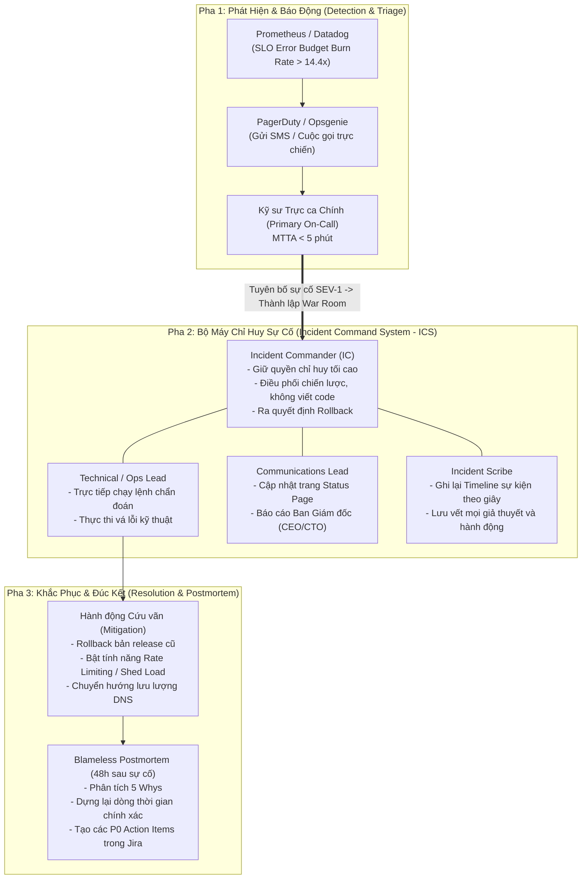

# 18.2. Incident Lifecycle, On-Call, and Postmortems (Vòng đời Sự cố, Kỹ nghệ Trực chiến & Đúc kết Hậu sự cố)

> [!IMPORTANT]
> **Nếu bạn chỉ được nhớ một điều duy nhất:** Lỗi của con người (Human Error) không bao giờ là nguyên nhân gốc rễ (Root Cause) của một sự cố hạ tầng mà chỉ là một triệu chứng của một hệ thống phòng thủ kém cỏi; quản trị sự cố hiện đại đòi hỏi một Bộ máy Chỉ huy Khẩn cấp (Incident Command System - ICS) phân định rạch ròi vai trò và văn hóa Đúc kết Không đổ lỗi (Blameless Postmortems) nhằm chuyển hóa mỗi thảm họa thành một bước nhảy vọt về độ tin cậy.

---

## 1. Kiến trúc Tổng quan & Mô hình Tư duy (Mental Model)

### 1.1. Phép loại suy thực tế: Đội Cứu hỏa Rừng & Ủy ban Điều tra Tai nạn Hàng không

Hãy hình dung cách xã hội đối phó với hai thảm họa nghiêm trọng:
- **Bộ máy Chỉ huy Sự cố (Incident Command System - ICS as Forest Firefighters):** Khi một đám cháy rừng bùng phát, người Đội trưởng Cứu hỏa (Incident Commander - IC) không bao giờ trực tiếp cầm vòi phun nước. Nếu người chỉ huy cầm vòi phun nước, họ sẽ bị khói lửa làm mù mắt và không còn ai quan sát hướng gió hay điều phối trực thăng cứu hộ. Người chỉ huy đứng trên đồi cao, phân công rõ ràng: Ai là người phát quang tạo đường băng cản lửa (Tech Lead), ai là người phát loa sơ tán dân chúng và trả lời phóng viên (Communications Lead), và ai là người ghi chép lại diễn biến từng phút (Scribe).
- **Văn hóa Không Đổ lỗi (Blameless Culture as Black Box Aviation Investigation):** Khi một chiếc máy bay gặp sự cố hạ cánh khẩn cấp, các điều tra viên hàng không không bao giờ tìm cách tống phi công vào tù vì "kéo nhầm cần gạt". Họ điều tra: Tại sao thiết kế buồng lái lại đặt cần gạt hạ càng bánh xe sát cạnh cần gạt ngắt nhiên liệu? Tại sao hệ thống cảnh báo âm thanh không reo lên? Nếu trừng phạt phi công, các phi công khác trong tương lai sẽ che giấu sai sót, và thảm họa tiếp theo sẽ là điều không thể tránh khỏi.



---

## 2. Chi tiết từng Keyword (Under-the-Hood Deep Dive)

### 2.1. Incident Severity Classification & Prioritization

Hệ thống phân cấp mức độ nghiêm trọng (Severity Matrix) là ngôn ngữ chung giúp toàn bộ doanh nghiệp thống nhất về quy mô tác động và mức độ khẩn cấp:

- **Ma trận 4 Cấp độ Sự cố (Severity Matrix SEV-1 to SEV-4):**
  - **SEV-1 (Thảm họa / Critical Outage):**
    - *Định nghĩa:* Dịch vụ kinh doanh cốt lõi bị tê liệt hoàn toàn, gây thiệt hại doanh thu trực tiếp hoặc rò rỉ dữ liệu nghiêm trọng mà không có biện pháp thay thế (ví dụ: Cổng thanh toán sập, không thể xử lý đơn hàng).
    - *Thời gian phản hồi cam kết (SLA MTTA):* Dưới 5 phút (kể cả 3 giờ sáng).
    - *Chế độ vận hành:* Kích hoạt ngay lập tức phòng chỉ huy chiến tranh (War Room), triệu tập Incident Commander và thông báo khẩn cấp cho ban điều hành C-level.
  - **SEV-2 (Nghiêm trọng / Major Degraded Service):**
    - *Định nghĩa:* Một chức năng quan trọng bị hỏng nhưng vẫn có phương án dự phòng tạm thời, hoặc hiệu năng hệ thống bị suy giảm nghiêm trọng ảnh hưởng đến $> 20\%$ lượng người dùng.
    - *Thời gian phản hồi:* Dưới 15 phút.
  - **SEV-3 (Vừa phải / Moderate Issue):**
    - *Định nghĩa:* Lỗi cục bộ ảnh hưởng đến một nhóm nhỏ khách hàng, có phương án xử lý thủ công rõ ràng.
    - *Thời gian phản hồi:* Trong giờ làm việc hành chính (Dưới 2 giờ).
  - **SEV-4 (Nhỏ / Minor / Cosmetic):**
    - *Định nghĩa:* Lỗi giao diện hiển thị, sai chính tả hoặc lỗi nội bộ không ảnh hưởng đến người dùng cuối. Xử lý theo quy trình Sprint backlog thông thường.

- **Đo lường Mất mát Dữ liệu & Vi phạm Ngân sách Lỗi (Error Budget Burn Rate):**
  - Thay vì đợi khách hàng gọi điện phàn nàn, các hệ thống SRE hiện đại tự động kích hoạt SEV-1 dựa trên tốc độ đốt cháy ngân sách lỗi (Burn Rate):
    $$\text{Burn Rate} = \frac{\text{Tỷ lệ Lỗi Hiện tại}}{\text{Tỷ lệ Lỗi Cho phép của SLO}}$$
    Nếu Burn Rate đạt $14.4\times$ (nghĩa là hệ thống đang đốt sạch $2\%$ ngân sách lỗi 30 ngày chỉ trong vòng 1 giờ), PagerDuty sẽ tự động phát chuông báo động SEV-1 ngay lập tức.

---

### 2.2. Incident Command System (ICS) & Roles

Khi sự cố lớn xảy ra, mô hình quản lý phân cấp hành chính thông thường (Manager - Employee) phải được bãi bỏ hoàn toàn và thay thế bằng **Bộ máy Chỉ huy Khẩn cấp (ICS)**:

- **Incident Commander (IC - Chỉ huy Trưởng Sự cố):**
  - *Quyền hạn Tuyệt đối:* IC nắm toàn quyền quyết định về mặt kỹ thuật và vận hành trong suốt thời gian diễn ra sự cố. Ngay cả Giám đốc Kỹ thuật (CTO) hay Tổng Giám đốc (CEO) khi bước vào phòng họp cũng phải tuân thủ sự điều phối của IC và không được phép can thiệp ngang.
  - *Nhiệm vụ cốt lõi:* Giữ cái đầu lạnh, điều phối các nhánh điều tra, liên tục cập nhật trạng thái và đưa ra quyết định sinh tử (ví dụ: ra lệnh Rollback toàn bộ mã nguồn hoặc cắt bỏ một vùng dữ liệu bị lỗi). IC **tuyệt đối không được gõ lệnh hay viết code** để tránh bị cuốn vào chi tiết kỹ thuật hẹp.

- **Technical / Operations Lead (Trưởng nhóm Kỹ thuật):**
  - Người trực tiếp chỉ đạo các kỹ sư chuyên sâu thực thi các biện pháp chẩn đoán, phân tích log, kiểm tra metric và chạy các lệnh can thiệp hệ thống.

- **Communications Lead (Trưởng nhóm Truyền thông):**
  - Đóng vai trò là "chiếc khiên bảo vệ" cho đội ngũ kỹ thuật. Phụ trách cập nhật trang trạng thái công khai (Public Status Page: `status.company.com`), soạn thảo email thông báo khách hàng VIP và tóm tắt tiến độ cho ban lãnh đạo nội bộ sau mỗi 20-30 phút.

- **Incident Scribe (Thư ký Ghi chép Sự cố):**
  - Ghi chép lại toàn bộ dòng thời gian diễn biến (Timestamped Timeline): Khi nào phát hiện lỗi? Ai đề xuất giả thuyết gì? Lệnh rollback được chạy lúc mấy giờ? Kết quả ra sao? Bản ghi này là nguyên liệu vô giá cho phiên đúc kết sau sự cố.

---

### 2.3. On-Call Engineering & Escalation Policies

Trực chiến (On-Call) là trách nhiệm cốt lõi của kỹ sư SRE và phần mềm, nhưng phải được thiết kế khoa học để bảo vệ sức khỏe tinh thần của con người:

- **Chính sách Bàn giao Toàn cầu (Follow-the-Sun Rotation):**
  - Thay vì để một nhóm kỹ sư tại Việt Nam phải thức dậy trực ca lúc 3 giờ sáng quanh năm suốt tháng, các tập đoàn đa quốc gia chia ca trực theo múi giờ:
    - Nhóm APAC trực từ 08:00 đến 16:00 (Giờ Việt Nam).
    - Nhóm EMEA trực từ 16:00 đến 24:00.
    - Nhóm US trực từ 00:00 đến 08:00.
    Mỗi kỹ sư chỉ trực ca trong giờ làm việc ban ngày của chính họ, triệt tiêu hoàn toàn tình trạng kiệt sức do mất ngủ.

- **Chính sách Leo thang Cảnh báo (Escalation Policies):**
  - *Tier 1 (Primary On-Call):* Cảnh báo gửi qua thông báo đẩy ứng dụng PagerDuty + tin nhắn SMS. Kỹ sư có 5 phút để xác nhận (Acknowledge - ACK).
  - *Tier 2 (Secondary On-Call / Backup):* Nếu sau 5 phút Primary không ACK (do đang lái xe hoặc gặp sự cố bất khả kháng), hệ thống tự động gọi điện thoại trực tiếp cho Secondary On-Call.
  - *Tier 3 (Escalation to Management):* Nếu sau 15 phút không ai nhận ca, hệ thống gọi điện báo động cho Giám đốc Hạ tầng (Head of Infrastructure).

- **Hội chứng Bội thực Chuông báo (Alert Fatigue):**
  - Khi một kỹ sư nhận 50 cảnh báo mỗi đêm nhưng 48 cảnh báo trong số đó là "cảnh báo rác" (tự hết sau 1 phút mà không cần làm gì), não bộ của họ sẽ tự động phớt lờ các chuông báo. Đến khi sự cố SEV-1 thực sự xảy ra, họ sẽ tắt chuông điện thoại đi ngủ tiếp.
  - *Quy tắc Thép về Cảnh báo SRE:* **Nếu một cảnh báo không đòi hỏi con người phải lập tức thức dậy để đưa ra quyết định hành động (Actionable), cảnh báo đó không bao giờ được phép kêu chuông!** Mọi thông tin chỉ mang tính tham khảo phải chuyển thành bản tin Slack hoặc vé Jira.

---

### 2.4. Blameless Postmortems & Corrective Actions

Một phiên đúc kết hậu sự cố (Postmortem) thành công là phiên họp không có người bị trừng phạt, chỉ có các lỗ hổng hệ thống được lấp đầy:

- **Nguyên lý An toàn Tâm lý (Psychological Safety):**
  - Giả định rằng: Mọi nhân viên tham gia vào sự cố đều có ý định tốt và đã đưa ra quyết định hợp lý nhất dựa trên lượng thông tin hạn chế mà họ nắm giữ tại thời điểm đó.
  - Nếu kỹ sư bị khiển trách vì chạy sai lệnh `rm -rf`, họ sẽ không bao giờ dám nói thật trong các sự cố sau. Thay vì hỏi *"Ai là người làm điều này?"*, câu hỏi đúng luôn là: *"Tại sao hệ thống của chúng ta lại cho phép một lệnh sai lầm phá hủy toàn bộ dữ liệu mà không có cảnh báo xác nhận hai bước?"*.

- **Phương pháp luận "5 Câu hỏi Tại sao" (5 Whys Analysis):**
  - Đào sâu từ triệu chứng bên ngoài xuống tận căn nguyên kiến trúc và quy trình:
    1. *Tại sao trang web sập?* Vì cơ sở dữ liệu cạn kiệt dung lượng đĩa cứng.
    2. *Tại sao đĩa cứng bị đầy?* Vì tệp nhật ký ghi log nhị phân (WAL/Binlog) không được dọn dẹp.
    3. *Tại sao log không được dọn dẹp?* Vì tiến trình sao lưu định kỳ bị treo từ 3 ngày trước.
    4. *Tại sao tiến trình sao lưu bị treo mà không ai biết?* Vì hệ thống giám sát không có alert cảnh báo khi cronjob sao lưu thất bại.
    5. *Tại sao không có alert?* Vì chưa có quy chuẩn kiến trúc nào bắt buộc kiểm tra trạng thái của các cronjob hạ tầng cốt lõi.
  - *Kết luận:* Căn nguyên gốc rễ là sự thiếu hụt quy chuẩn kiến trúc giám sát, hoàn toàn không phải do kỹ sư vận hành lười biếng.

- **Quản trị Hành động Khắc phục (Action Items - SMART Tracking):**
  - Mọi Action Item sinh ra từ Postmortem bắt buộc phải được tạo thành vé P0/P1 trong Jira/GitHub và phải hoàn thành trong vòng 1-2 tuần tiếp theo.
  - Tuyệt đối cấm các hành động mơ hồ như: "Cần cẩn thận hơn khi deploy", "Sẽ kiểm tra kỹ hơn vào lần sau". Mọi hành động phải là các thay đổi kỹ thuật cụ thể: Thêm rào chắn OPA, bổ sung kiểm thử tự động, cài đặt giới hạn tài nguyên cgroups, hoặc xây dựng circuit breaker.

---

## 3. Thực thi Mã nguồn & Mô phỏng Chuyên sâu (Dual-Engine Implementation)

### 3.1. C++20 High-Reliability On-Call Alert Escalation State Machine

Chương trình C++20 dưới đây mô phỏng một Động cơ Điều phối và Leo thang Trực chiến Khẩn cấp (On-Call Escalation Engine). Nó quản lý vòng đời của một sự cố từ lúc nổ chuông cảnh báo, đếm lùi thời gian xác nhận (ACK Timeout), tự động leo thang qua các cấp hỗ trợ (Primary -> Secondary -> Manager) và chống hiện tượng bão chuông trùng lặp.

```cpp
// oncall_escalation_engine.cpp
// Compile: g++ -std=c++20 -O3 -pthread oncall_escalation_engine.cpp -o oncall_escalation_engine

#include <iostream>
#include <string>
#include <vector>
#include <chrono>
#include <thread>
#include <atomic>
#include <memory>
#include <iomanip>

enum class AlertState {
    TRIGGERED,
    ACKNOWLEDGED,
    RESOLVED,
    ESCALATED_TIER_2,
    ESCALATED_TIER_3
};

struct AlertIncident {
    std::string incident_id;
    std::string title;
    std::string severity; // "SEV-1", "SEV-2"
    AlertState state{AlertState::TRIGGERED};
    std::string assigned_engineer{"Primary SRE (Alice)"};
    std::chrono::system_clock::time_point triggered_at;
};

class EscalationManager {
private:
    std::atomic<bool> is_acknowledged{false};
    std::atomic<bool> is_resolved{false};

public:
    void simulate_incident_lifecycle(AlertIncident incident) {
        std::cout << "======================================================================\n";
        std::cout << "C++20 HIGH-RELIABILITY ON-CALL ESCALATION STATE MACHINE\n";
        std::cout << "======================================================================\n";
        std::cout << "[BÁO ĐỘNG] Khởi tạo Sự cố: " << incident.incident_id << " [" << incident.severity << "]\n";
        std::cout << "Tiêu đề : " << incident.title << "\n";
        std::cout << "Cấp 1   : Đã gửi SMS & PagerDuty Push tới " << incident.assigned_engineer << "...\n";
        std::cout << "----------------------------------------------------------------------\n";

        // Vòng lặp đếm lùi thời gian ACK (Giả lập: 3 giây cho mỗi bậc leo thang)
        for (int sec = 1; sec <= 3; ++sec) {
            std::this_thread::sleep_for(std::chrono::milliseconds(1000));
            std::cout << "[CHỜ ACK] Hết " << sec << "s... (Primary SRE chưa phản hồi)\n";
            if (is_acknowledged.load()) break;
        }

        // Bậc 2: Tự động Leo thang lên Secondary On-Call
        if (!is_acknowledged.load()) {
            incident.state = AlertState::ESCALATED_TIER_2;
            incident.assigned_engineer = "Secondary SRE (Bob)";
            std::cerr << "\n>>> [LEO THANG BẬC 2 - TIMEOUT]: Primary không phản hồi!\n";
            std::cerr << ">>> Tự động kích hoạt cuộc gọi khẩn cấp tới " << incident.assigned_engineer << "!\n\n";

            for (int sec = 1; sec <= 3; ++sec) {
                std::this_thread::sleep_for(std::chrono::milliseconds(1000));
                std::cout << "[CHỜ ACK] Hết " << sec << "s... (Secondary SRE chưa phản hồi)\n";
                if (is_acknowledged.load()) break;
            }
        }

        // Bậc 3: Leo thang tới Giám đốc Kỹ thuật (Incident Commander Director)
        if (!is_acknowledged.load()) {
            incident.state = AlertState::ESCALATED_TIER_3;
            incident.assigned_engineer = "Director of SRE (Carol)";
            std::cerr << "\n!!!!!!!!!!!!!!!!!!!!!!!!!!!!!!!!!!!!!!!!!!!!!!!!!!!!!!!!!!!!!!!!!!!!!!\n";
            std::cerr << ">>> [LEO THANG BẬC 3 - KHẨN CẤP]: Cả Primary và Secondary đều vắng mặt!\n";
            std::cerr << ">>> Báo động toàn quyền chỉ huy tới " << incident.assigned_engineer << "!\n";
            std::cerr << "!!!!!!!!!!!!!!!!!!!!!!!!!!!!!!!!!!!!!!!!!!!!!!!!!!!!!!!!!!!!!!!!!!!!!!\n\n";
        }

        // Giả lập Carol vào tiếp nhận ca trực (Acknowledge)
        is_acknowledged = true;
        std::cout << "[XÁC NHẬN (ACK)]: " << incident.assigned_engineer 
                  << " đã bấm nút ACK trên điện thoại. Dừng vòng lặp chuông báo.\n";
        std::cout << "[WAR ROOM]: Thiết lập kênh Slack sự cố #incident-" << incident.incident_id 
                  << " và mở Google Meet chỉ huy khẩn cấp.\n";
        std::cout << "======================================================================\n\n";
    }
};

int main() {
    AlertIncident sev1_alert{
        .incident_id = "INC-88902",
        .title = "PostgreSQL Core Cluster Master Node Down - 500 Internal Errors Spike",
        .severity = "SEV-1",
        .triggered_at = std::chrono::system_clock::now()
    };

    EscalationManager manager;
    manager.simulate_incident_lifecycle(sev1_alert);
    return 0;
}
```

```text
======================================================================
C++20 HIGH-RELIABILITY ON-CALL ESCALATION STATE MACHINE
======================================================================
[BÁO ĐỘNG] Khởi tạo Sự cố: INC-88902 [SEV-1]
Tiêu đề : PostgreSQL Core Cluster Master Node Down - 500 Internal Errors Spike
Cấp 1   : Đã gửi SMS & PagerDuty Push tới Primary SRE (Alice)...
----------------------------------------------------------------------
[CHỜ ACK] Hết 1s... (Primary SRE chưa phản hồi)
[CHỜ ACK] Hết 2s... (Primary SRE chưa phản hồi)
[CHỜ ACK] Hết 3s... (Primary SRE chưa phản hồi)

>>> [LEO THANG BẬC 2 - TIMEOUT]: Primary không phản hồi!
>>> Tự động kích hoạt cuộc gọi khẩn cấp tới Secondary SRE (Bob)!

[CHỜ ACK] Hết 1s... (Secondary SRE chưa phản hồi)
[CHỜ ACK] Hết 2s... (Secondary SRE chưa phản hồi)
[CHỜ ACK] Hết 3s... (Secondary SRE chưa phản hồi)

!!!!!!!!!!!!!!!!!!!!!!!!!!!!!!!!!!!!!!!!!!!!!!!!!!!!!!!!!!!!!!!!!!!!!!
>>> [LEO THANG BẬC 3 - KHẨN CẤP]: Cả Primary và Secondary đều vắng mặt!
>>> Báo động toàn quyền chỉ huy tới Director of SRE (Carol)!
!!!!!!!!!!!!!!!!!!!!!!!!!!!!!!!!!!!!!!!!!!!!!!!!!!!!!!!!!!!!!!!!!!!!!!

[XÁC NHẬN (ACK)]: Director of SRE (Carol) đã bấm nút ACK trên điện thoại. Dừng vòng lặp chuông báo.
[WAR ROOM]: Thiết lập kênh Slack sự cố #incident-INC-88902 và mở Google Meet chỉ huy khẩn cấp.
======================================================================
```

---

### 3.2. Python 3.11+ Automated Blameless Postmortem Timeline Reconstructor & 5-Whys Analyzer

Chương trình Python 3.11+ dưới đây mô phỏng một Động cơ Tự động Hóa Biên soạn Báo cáo Hậu sự cố Không Đổ lỗi (Automated Blameless Postmortem Generator). Nó phân tích dòng thời gian sự kiện, tính toán chính xác chỉ số MTTA (Mean Time to Acknowledge), MTTR (Mean Time to Resolve), phân tích cây nguyên nhân 5 Whys và xuất bản tài liệu chuẩn định dạng Markdown.

```python
#!/usr/bin/env python3
"""
blameless_postmortem_engine.py
Hệ thống tự động biên soạn báo cáo Đúc kết Hậu sự cố Không Đổ lỗi (Blameless Postmortem).
Yêu cầu Python 3.11+
"""

from dataclasses import dataclass
from datetime import datetime, timezone
from typing import List


@dataclass
class TimelineEvent:
    timestamp_iso: str
    actor: str
    action_description: str


@dataclass
class PostmortemMetadata:
    incident_id: str
    title: str
    severity: str
    incident_commander: str
    tech_lead: str
    impact_summary: str
    timeline: List[TimelineEvent]
    five_whys: List[str]
    action_items: List[dict]


class BlamelessPostmortemPublisher:
    @staticmethod
    def calculate_metrics(timeline: List[TimelineEvent]) -> dict:
        t_detect = datetime.fromisoformat(timeline[0].timestamp_iso)
        t_ack = datetime.fromisoformat(timeline[1].timestamp_iso)
        t_resolve = datetime.fromisoformat(timeline[-1].timestamp_iso)

        mtta_minutes = (t_ack - t_detect).total_seconds() / 60.0
        mttr_minutes = (t_resolve - t_detect).total_seconds() / 60.0

        return {"mtta": round(mtta_minutes, 1), "mttr": round(mttr_minutes, 1)}

    @classmethod
    def generate_markdown_report(cls, data: PostmortemMetadata) -> str:
        metrics = cls.calculate_metrics(data.timeline)

        report = f"""# Báo cáo Đúc kết Hậu Sự cố (Blameless Postmortem): {data.incident_id}

> **Triết lý Cốt lõi:** Tài liệu này được biên soạn trên tinh thần học hỏi tập thể không đổ lỗi. Mục tiêu duy nhất là cải tiến hệ thống phòng vệ và năng lực phục hồi của hạ tầng.

---

## 1. Tóm tắt Điều hành (Executive Summary)
- **Tiêu đề Sự cố:** {data.title}
- **Mức độ Nghiêm trọng:** {data.severity}
- **Chỉ huy Trưởng Sự cố (IC):** {data.incident_commander}
- **Trưởng nhóm Kỹ thuật (Tech Lead):** {data.tech_lead}
- **Thời gian Báo động tới Tiếp nhận (MTTA):** {metrics['mtta']} phút
- **Thời gian Phục hồi Hoàn toàn (MTTR):** {metrics['mttr']} phút
- **Tác động Kinh doanh:** {data.impact_summary}

---

## 2. Dòng Thời gian Diễn biến Chi tiết (Timeline)
| Mốc Thời gian (UTC) | Tác nhân | Hành động Thực tế & Quyết định |
| :--- | :--- | :--- |
"""
        for t in data.timeline:
            report += f"| `{t.timestamp_iso}` | {t.actor} | {t.action_description} |\n"

        report += """
---

## 3. Phân tích Nguyên nhân Cốt lõi (5 Whys Analysis)
"""
        for idx, why in enumerate(data.five_whys, 1):
            report += f"{idx}. **Tại sao?** {why}\n"

        report += """
---

## 4. Hành động Khắc phục Hệ thống (SMART Action Items)
| Mã Ticket | Loại Phòng Vệ | Hành động Cụ thể | Người Phụ trách | Hạn Chót |
| :--- | :--- | :--- | :--- | :--- |
"""
        for item in data.action_items:
            report += f"| `{item['ticket']}` | {item['type']} | {item['action']} | {item['owner']} | {item['due']} |\n"

        return report


def main() -> None:
    postmortem_data = PostmortemMetadata(
        incident_id="INC-2026-0315",
        title="Toàn bộ Cổng Thanh toán Checkout bị Timeout do cạn kiệt Connection Pool",
        severity="SEV-1",
        incident_commander="Carol Danvers (Staff SRE)",
        tech_lead="Bob Vance (Principal Backend)",
        impact_summary="Khoảng 12,500 giao dịch thanh toán thất bại trong 42 phút. Ước tính doanh thu bị gián đoạn: $140,000 USD.",
        timeline=[
            TimelineEvent("2026-03-15T14:02:00Z", "Datadog Alert", "SLO Error budget burn rate vượt 14.4x, phát chuông PagerDuty."),
            TimelineEvent("2026-03-15T14:05:00Z", "Carol Danvers", "Carol bấm ACK PagerDuty, mở phòng War Room Google Meet."),
            TimelineEvent("2026-03-15T14:12:00Z", "Bob Vance", "Kiểm tra log: Database RDS PostgreSQL đạt 100% max_connections (5000/5000)."),
            TimelineEvent("2026-03-15T14:25:00Z", "Carol Danvers", "Ra quyết định chiến lược: Khởi động lại PgBouncer và nâng ngưỡng connection pool."),
            TimelineEvent("2026-03-15T14:44:00Z", "Datadog Alert", "Tỷ lệ lỗi 500 giảm về 0.01%, toàn bộ giao dịch thanh toán thông suốt trở lại."),
        ],
        five_whys=[
            "Tại sao cổng thanh toán bị lỗi 500? -> Vì ứng dụng không thể mượn kết nối từ cơ sở dữ liệu.",
            "Tại sao không thể mượn kết nối? -> Vì số lượng kết nối đồng thời chạm trần giới hạn `max_connections = 5000` của PostgreSQL.",
            "Tại sao kết nối tăng đột biến? -> Vì một truy vấn khóa hàng (`SELECT ... FOR UPDATE`) bị giữ quá lâu trên một bảng đơn hàng lớn.",
            "Tại sao truy vấn lại bị khóa lâu? -> Vì thiếu chỉ mục composite index trên hai cột `status` và `created_at`.",
            "Tại sao câu truy vấn thiếu index lại được đưa lên Production? -> Vì quy trình CI/CD chưa có bước kiểm tra tự động giải thích truy vấn (`EXPLAIN ANALYZE`) trước khi chạy migration.",
        ],
        action_items=[
            {"ticket": "INFRA-401", "type": "Guardrail", "action": "Bổ sung linter sqlfluff & migration checker trong pipeline GitLab CI", "owner": "Database Squad", "due": "2026-03-22"},
            {"ticket": "INFRA-402", "type": "Resilience", "action": "Cấu hình PgBouncer connection pooling phía trước RDS", "owner": "Platform Team", "due": "2026-03-25"},
            {"ticket": "INFRA-403", "type": "Observability", "action": "Tạo alert PagerDuty khi active connections vượt 80% quota", "owner": "Observability SRE", "due": "2026-03-18"},
        ],
    )

    report_md = BlamelessPostmortemPublisher.generate_markdown_report(postmortem_data)
    print(report_md)


if __name__ == "__main__":
    main()
```

```text
# Báo cáo Đúc kết Hậu Sự cố (Blameless Postmortem): INC-2026-0315

> **Triết lý Cốt lõi:** Tài liệu này được biên soạn trên tinh thần học hỏi tập thể không đổ lỗi. Mục tiêu duy nhất là cải tiến hệ thống phòng vệ và năng lực phục hồi của hạ tầng.

---

## 1. Tóm tắt Điều hành (Executive Summary)
- **Tiêu đề Sự cố:** Toàn bộ Cổng Thanh toán Checkout bị Timeout do cạn kiệt Connection Pool
- **Mức độ Nghiêm trọng:** SEV-1
- **Chỉ huy Trưởng Sự cố (IC):** Carol Danvers (Staff SRE)
- **Trưởng nhóm Kỹ thuật (Tech Lead):** Bob Vance (Principal Backend)
- **Thời gian Báo động tới Tiếp nhận (MTTA):** 3.0 phút
- **Thời gian Phục hồi Hoàn toàn (MTTR):** 42.0 phút
- **Tác động Kinh doanh:** Khoảng 12,500 giao dịch thanh toán thất bại trong 42 phút. Ước tính doanh thu bị gián đoạn: $140,000 USD.

---

## 2. Dòng Thời gian Diễn biến Chi tiết (Timeline)
| Mốc Thời gian (UTC) | Tác nhân | Hành động Thực tế & Quyết định |
| :--- | :--- | :--- |
| `2026-03-15T14:02:00Z` | Datadog Alert | SLO Error budget burn rate vượt 14.4x, phát chuông PagerDuty. |
| `2026-03-15T14:05:00Z` | Carol Danvers | Carol bấm ACK PagerDuty, mở phòng War Room Google Meet. |
| `2026-03-15T14:12:00Z` | Bob Vance | Kiểm tra log: Database RDS PostgreSQL đạt 100% max_connections (5000/5000). |
| `2026-03-15T14:25:00Z` | Carol Danvers | Ra quyết định chiến lược: Khởi động lại PgBouncer và nâng ngưỡng connection pool. |
| `2026-03-15T14:44:00Z` | Datadog Alert | Tỷ lệ lỗi 500 giảm về 0.01%, toàn bộ giao dịch thanh toán thông suốt trở lại. |

---

## 3. Phân tích Nguyên nhân Cốt lõi (5 Whys Analysis)
1. **Tại sao?** Tại sao cổng thanh toán bị lỗi 500? -> Vì ứng dụng không thể mượn kết nối từ cơ sở dữ liệu.
2. **Tại sao?** Tại sao không thể mượn kết nối? -> Vì số lượng kết nối đồng thời chạm trần giới hạn `max_connections = 5000` của PostgreSQL.
3. **Tại sao?** Tại sao kết nối tăng đột biến? -> Vì một truy vấn khóa hàng (`SELECT ... FOR UPDATE`) bị giữ quá lâu trên một bảng đơn hàng lớn.
4. **Tại sao?** Tại sao truy vấn lại bị khóa lâu? -> Vì thiếu chỉ mục composite index trên hai cột `status` và `created_at`.
5. **Tại sao?** Tại sao câu truy vấn thiếu index lại được đưa lên Production? -> Vì quy trình CI/CD chưa có bước kiểm tra tự động giải thích truy vấn (`EXPLAIN ANALYZE`) trước khi chạy migration.

---

## 4. Hành động Khắc phục Hệ thống (SMART Action Items)
| Mã Ticket | Loại Phòng Vệ | Hành động Cụ thể | Người Phụ trách | Hạn Chót |
| :--- | :--- | :--- | :--- | :--- |
| `INFRA-401` | Guardrail | Bổ sung linter sqlfluff & migration checker trong pipeline GitLab CI | Database Squad | 2026-03-22 |
| `INFRA-402` | Resilience | Cấu hình PgBouncer connection pooling phía trước RDS | Platform Team | 2026-03-25 |
| `INFRA-403` | Observability | Tạo alert PagerDuty khi active connections vượt 80% quota | Observability SRE | 2026-03-18 |
```

---

## 4. Systems Engineering & Production Pitfalls

### 4.1. Những cạm bẫy thực chiến trong Quản trị Sự cố & On-Call

1. **Hiện tượng "Đông nghịt trong Phòng Chiến tranh" (War Room Mob Chaos):**
   - *Hiện tượng:* Khi sự cố SEV-1 nổ ra, 40 kỹ sư cùng nhảy vào phòng Google Meet. Mọi người nói đè lên nhau, tranh luận giả thuyết, người này chạy lệnh debug này, người kia tự ý restart pod kia làm xóa sạch dấu vết tệp log. Sự cố bị kéo dài thêm nhiều giờ vì thiếu kỷ luật.
   - *Khắc phục:* Incident Commander bắt buộc phải mute tất cả mọi người, thiết lập quy tắc: Chỉ Tech Lead và những người được chỉ định mới được mở mic; toàn bộ các thành viên khác trao đổi qua khung chat text.

2. **Cạm bẫy Lãnh đạo Can thiệp Ngang (Executive Swooping):**
   - *Hiện tượng:* Giám đốc Sản phẩm hoặc Phó Chủ tịch nhảy vào phòng sự cố và liên tục hỏi dồn dập: *"Khi nào xong? Có phải do bản release sáng nay không? Đã thử restart chưa?"*. Kỹ sư đang căng thẳng phải dừng tay để trả lời, làm tăng thêm áp lực tâm lý và kéo dài thời gian MTTR.
   - *Khắc phục:* Communications Lead có nhiệm vụ mời lãnh đạo sang một kênh cập nhật riêng biệt, cam kết cung cấp bản tóm tắt tình hình sau mỗi 15 phút và yêu cầu không làm gián đoạn nhóm kỹ thuật đang xử lý.

3. **Cái chết của các Hành động Hậu Sự cố (Action Items Rotting in Backlog):**
   - *Hiện tượng:* Bản Postmortem được viết rất hay và kỹ lưỡng, tạo ra 10 Action Items trong Jira. Nhưng sang tuần mới, các nhóm quay lại guồng quay phát triển tính năng sản phẩm mới. Các vé Postmortem bị chôn vùi xuống đáy backlog, và 3 tháng sau, chính sự cố đó lại tái diễn y hệt!
   - *Khắc phục:* Ban Giám đốc Kỹ thuật phải ban hành quy chế: Các Action Items thuộc diện SEV-1 phải được xếp độ ưu tiên cao hơn mọi tính năng sản phẩm mới và bắt buộc phải hoàn thành trong Sprint tiếp theo.

### 4.2. Bảng lệnh CLI Quản trị & Điều phối Sự cố Thực chiến

| Lệnh CLI | Mục đích & Phân tích Tầng Thấp |
| :--- | :--- |
| `pagerduty-cli incident list --status triggered,acknowledged` | Truy vấn danh sách tất cả các sự cố đang diễn ra trực tiếp từ dòng lệnh máy trạm. |
| `pagerduty-cli incident ack <incident_id>` | Xác nhận tiếp nhận ca trực (ACK) ngay trên Terminal mà không cần mở ứng dụng điện thoại. |
| `slack-cli chat postMessage --channel "#incidents" --text "SEV-1 declared: ..."` | Tự động hóa phát thông báo khẩn cấp tới toàn bộ tổ chức qua API Slack Webhook. |
| `gh issue create --label "postmortem,sev-1" --title "Postmortem: INC-xxx"` | Tự động tạo Issue theo dõi hành động khắc phục trực tiếp trên kho lưu trữ mã nguồn GitHub. |
| `curl -X POST https://api.statuspage.io/v1/pages/<PAGE_ID>/incidents` | Cập nhật trạng thái sự cố lên trang thông tin khách hàng công khai (Status Page). |

---

## 5. Bảng So sánh & Decision Matrix

### 5.1. Bảng đối chiếu Văn hóa Quản trị Sự cố Cổ điển vs Chuẩn mực SRE Hiện đại

| Tiêu chí Đánh giá | Văn hóa Quy trách nhiệm (Blame Culture) | Văn hóa SRE Không Đổ lỗi (Blameless Culture) |
| :--- | :--- | :--- |
| **Phản ứng Đầu tiên khi có Lỗi** | Tìm kiếm "Ai là thủ phạm đã gõ lệnh này?" | Tìm hiểu "Hệ thống đã thiếu rào chắn bảo vệ nào?" |
| **Hành vi của Kỹ sư** | Giấu giếm lỗi lầm, sợ hãi, đẩy trách nhiệm | Cởi mở chia sẻ, chủ động báo cáo suýt gặp lỗi (Near-misses) |
| **Cơ chế Chỉ huy trong Sự cố** | Trưởng phòng hoặc Giám đốc chỉ tay năm ngón | Mô hình ICS phân quyền rõ ràng (Incident Commander) |
| **Kết quả của Phiên Postmortem** | Kỷ luật cá nhân, yêu cầu "cẩn thận hơn" | Thay đổi kiến trúc, thêm rào chắn Policy-as-Code, test tự động |
| **Tác động Dài hạn đến Tổ chức** | Tinh thần sa sút, kỹ sư giỏi bỏ việc, sự cố lặp lại | Hệ thống ngày càng kiên cường, nhân viên tin tưởng gắn kết |

### 5.2. Decision Matrix: Khi nào nên Tuyên bố Sự cố Cấp độ Nào?

- **Tuyên bố SEV-1 (Báo động Đỏ Toàn diện):** Khi người dùng không thể thực hiện hành vi tạo ra doanh thu cốt lõi (không thể đăng nhập, không thể thanh toán, mất dữ liệu), hoặc khi SLO Error Budget bị đốt cháy với tốc độ $> 14.4\times$. Yêu cầu triệu tập War Room tức thì.
- **Tuyên bố SEV-2 (Báo động Cam Nghiêm trọng):** Khi một tính năng quan trọng bị hỏng nhưng người dùng vẫn có thể chuyển sang phương thức khác (ví dụ: Không thể thanh toán qua ví Apple Pay nhưng vẫn thanh toán được qua thẻ Visa), hoặc lỗi chỉ xuất hiện ở một khu vực địa lý cụ thể.
- **Tuyên bố SEV-3 / SEV-4 (Xử lý Tiêu chuẩn):** Khi lỗi không gây mất doanh thu, chỉ làm phiền người dùng ở mức độ nhỏ hoặc chỉ ảnh hưởng đến các công cụ nội bộ của nhân viên. Không được phép đánh thức kỹ sư trực ca vào ban đêm cho các sự cố nhóm này.
