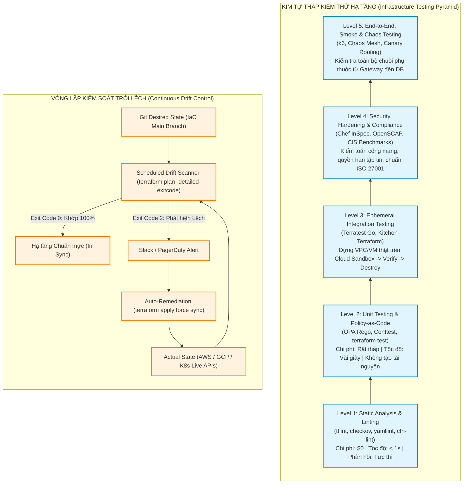
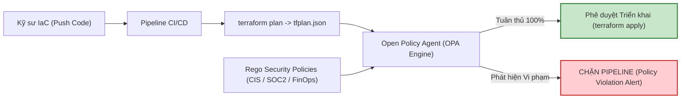
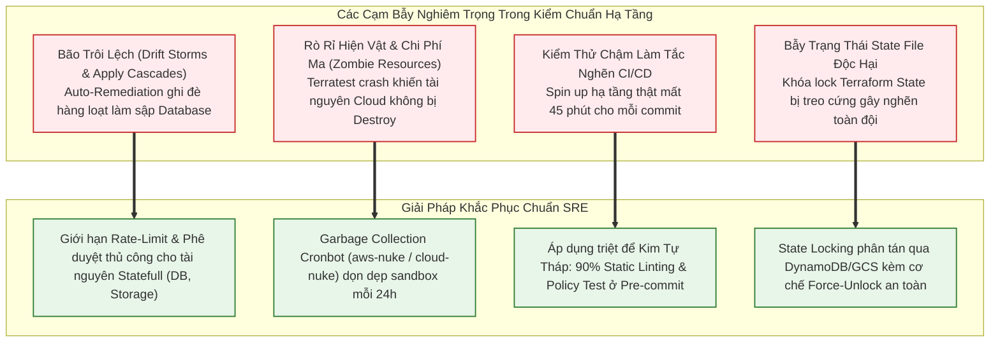

# 19.1. Kim Tự Tháp Kiểm Thử Hạ Tầng, Tuân Thủ và Phát Hiện Trôi Lệch (Testing Pyramid, Compliance & Drift Detection)

> [!IMPORTANT]
> **Nếu bạn chỉ được nhớ một điều duy nhất:** Hạ tầng hiện đại chính là phần mềm (Infrastructure is Software) — **thời đại cấu hình máy chủ thủ công rồi "cầu nguyện cho hệ thống không sập" đã chấm dứt; kiểm chuẩn hạ tầng chuẩn 5★ đòi hỏi áp dụng Kim tự tháp Kiểm thử Hạ tầng (từ Static Linting, Policy-as-Code đến Ephemeral Integration Testing), kết hợp cơ chế Phát hiện Trôi lệch Liên tục (Continuous Drift Detection với Auto-Remediation) để biến hạ tầng thành một trạng thái bất biến, tự chữa lành và có thể tái lập hoàn toàn từ mã nguồn Git**.

---

## 1. Kiến trúc Tổng quan & Mô hình Tư duy (Mental Model)

### Phép loại suy thực tế: Dây chuyền Chế tạo Ô tô & Hệ thống Cân chỉnh Thước lái Tự động

Hãy tưởng tượng quá trình sản xuất và vận hành một đoàn xe đua Công thức 1 (F1):
- **Giai đoạn Thiết kế & Kiểm tra Bản vẽ (Static Linting & Unit Testing - Level 1 & 2)**: Trước khi cắt thép hay đúc động cơ, kỹ sư kiểm tra bản thiết kế CAD trên máy tính. Nếu một con ốc sai kích thước hoặc vi phạm quy chuẩn an toàn khí động học của FIA (Policy-as-Code), phần mềm sẽ cảnh báo ngay lập tức. Chi phí sửa lỗi ở bước này bằng $0$ và tốn vài phần nghìn giây.
- **Giai đoạn Thử nghiệm Hầm gió & Đâm va Khẩn cấp (Integration & E2E Testing - Level 3 & 5)**: Đưa một nguyên mẫu xe vào hầm gió hoặc chạy thử trên đường đua thử nghiệm biệt lập (Ephemeral Sandbox Environment). Sau khi đo đạc xong công suất và độ bám đường (Terratest), chiếc xe thử nghiệm được đưa về xưởng hoặc rã phụ tùng (Destroy Phase) để không gây tốn kém chi phí lưu kho.
- **Hệ thống Cảm biến Cân chỉnh Thước lái Khi Chạy Đường dài (Continuous Drift Detection)**: Khi xe đang lao đi trên đường đua thực tế, một ổ gà có thể làm lệch góc đặt bánh xe ($1^\circ$) mà mắt thường tài xế không thấy được. Nếu để nguyên, lốp sẽ nổ ở khúc cua tốc độ cao! Hệ thống cảm biến viễn trắc đo độ lệch góc lái liên tục so với bản thiết kế chuẩn (Git Desired State). Nếu phát hiện sai lệch (Drift Detected), máy tính trên xe lập tức kích hoạt bộ điều khiển thủy lực kéo bánh xe về lại vị trí cân bằng chuẩn xác (Auto-Remediation).



---

## 2. Chi tiết từng Keyword (Under-the-Hood Deep Dive)

### 2.1. The Infrastructure Testing Levels: Unit, Integration & End-to-End

#### 2.1.1. Level 1: Static Analysis, Syntactic Validation & Linting
- **Bản chất**: Phân tích tĩnh cú pháp file cấu hình mà không cần thông dịch hay kết nối mạng tới Cloud API.
- **Công cụ chủ lực**:
  - `tflint`: Tìm kiếm lỗi cấu hình phổ biến của Terraform (như chọn sai loại instance không tồn tại trong region, biến không khai báo).
  - `yamllint` / `cfn-lint`: Chuẩn hóa định dạng YAML và kiểm tra schema của AWS CloudFormation.
  - `checkov` / `trivy config`: Quét trước các lỗ hổng bảo mật dựa trên danh mục chuẩn (như cổng mở $0.0.0.0/0$, thiếu mã hóa đĩa EBS).
- **Cơ chế hoạt động sâu**: Trình phân tích chuyển mã IaC thành cây cú pháp trừu tượng (**Abstract Syntax Tree - AST**). Các luật (rules) được định nghĩa dưới dạng các phép duyệt cây để phát hiện các mẫu (patterns) nguy hiểm. Quá trình này thực thi trên máy trạm lập trình viên qua Pre-commit hooks trong $< 500\text{ms}$.

#### 2.1.2. Level 2: Infrastructure Unit Testing & Mock Assertions
- **Bản chất**: Kiểm tra logic rẽ nhánh, biểu thức nội suy (interpolation), biến thể môi trường và các hàm tính toán của mã IaC mà **không khởi tạo tài nguyên thật**.
- **Cơ chế hoạt động**: Sử dụng tính năng `terraform test` hiện đại (từ Terraform 1.6+) hoặc các framework kiểm thử unit chuyên dụng:
  - Mock provider data sources và outputs.
  - Xác nhận rằng nếu biến `environment = "prod"` thì số lượng bản sao phải là $3$, còn nếu `environment = "dev"` thì số lượng bản sao là $1$.
  - Đảm bảo tính toán CIDR subnet (`cidrsubnet()`) không bị chồng lấn địa chỉ IP.

#### 2.1.3. Level 3: Infrastructure Integration Testing & Ephemeral Sandboxes
- **Bản chất**: Khởi tạo môi trường đám mây thực tế ngắn hạn (Ephemeral Environment) bằng chính mã IaC đang kiểm thử, gửi các giao thức kiểm tra thực tế, và tự động tiêu hủy hoàn toàn.
- **Framework chuẩn mực - Terratest (Go)**:
  - Terratest do Gruntwork phát triển, tận dụng hệ sinh thái kiểm thử mạnh mẽ của ngôn ngữ Go.
  - *Vòng đời một bài kiểm thử Terratest*:
    1. **Setup**: Nhận mã Terraform, sinh tên tài nguyên ngẫu nhiên (UUID) để tránh xung đột tên trên Cloud Account dùng chung.
    2. **Apply**: Gọi lệnh `terraform init` và `terraform apply` thật tới tài khoản AWS/GCP cô lập (Sandbox Sandbox Account).
    3. **Validate**: Sử dụng Go HTTP client hoặc SSH client kết nối trực tiếp vào máy chủ vừa dựng, kiểm tra: Endpoint `/healthz` có trả về HTTP 200 không? Chứng chỉ SSL có hợp lệ không? Dịch vụ Database có kết nối được không?
    4. **Teardown (`defer terraform.Destroy`)**: Bắt buộc giải phóng toàn bộ tài nguyên đám mây ngay cả khi bài test bị lỗi (FAIL), ngăn chặn thảm họa rò rỉ chi phí (Cost Leakage).

#### 2.1.4. Level 4 & 5: Compliance, Smoke & End-to-End Chaos Testing
- **Compliance & Security Testing (Chef InSpec, OpenSCAP, CIS Benchmarks)**: Đảm bảo máy chủ và cụm hạ tầng tuân thủ các khung quy chuẩn pháp lý quốc tế (ISO/IEC 27001, SOC 2, PCI-DSS, HIPAA).
- **Smoke Testing (Kiểm tra Khói)**: Bộ test siêu ngắn chạy trong $< 2\text{ phút}$ ngay sau khi deploy lên Production. Mục tiêu duy nhất: xác nhận đường truyền mạng cốt lõi (Core Ingress), chứng chỉ TLS và các cổng chính còn sống trước khi mở van lưu lượng khách hàng.
- **End-to-End & Chaos Testing**: Đánh giá khả năng chịu tải và tính kiên cường (Resilience) khi hạ tầng gặp sự cố ngẫu nhiên (ví dụ: Chaos Mesh làm rớt gói tin mạng $20\%$, tắt đột ngột 1 Availability Zone).

---

### 2.2. Configuration & Policy Testing (Policy-as-Code)

#### 2.2.1. Bản chất & Cơ chế Hoạt động của Policy-as-Code (PaC)
- **Vấn đề cốt lõi**: Trong mô hình truyền thống, đội bảo mật (Security Team) phải đọc từng trang tài liệu kiến trúc hoặc duyệt từng PR thủ công. Việc này tạo ra điểm nghẽn nghiêm trọng (Gatekeeping bottleneck) làm chậm chu kỳ phát hành từ vài ngày đến vài tuần.
- **Giải pháp Policy-as-Code**: Chuyển đổi toàn bộ các chính sách bảo mật, quy định tuân thủ và quy chuẩn tài chính thành mã thực thi máy tính tự động:
  - *Chính sách Mạng*: "Không được phép mở Port 22 (SSH) hoặc Port 3389 (RDP) cho toàn thế giới (`0.0.0.0/0`)."
  - *Chính sách Lưu trữ*: "Mọi S3 Bucket hoặc Cloud Storage bắt buộc phải bật mã hóa đĩa tại chỗ (SSE-KMS) và cấm quyền đọc công khai (Public Read Block)."
  - *Chính sách Quản trị Chi phí*: "Mọi tài nguyên EC2, GCE, hoặc RDS phải có tag `CostCenter`, `Owner`, và `Environment`."
- **Open Policy Agent (OPA) & Ngôn ngữ Rego**:
  - OPA nhận đầu vào là bản kế hoạch cấu hình (ví dụ: `terraform show -json tfplan.binary`) và đối chiếu với tập luật viết bằng ngôn ngữ khai báo **Rego**.
  - Nếu bản kế hoạch vi phạm bất kỳ luật nào, pipeline CI/CD lập tức dừng lại (Hard Fail) và xuất ra thông báo rõ ràng về điều khoản bị vi phạm.



---

### 2.3. Continuous Drift Detection & Automated Health Validation

#### 2.3.1. Hiện tượng Trôi lệch Cấu hình (Configuration Drift)
- **Nguồn gốc gây ra Drift**:
  1. *Out-of-Band Manual Changes (Can thiệp tay ngoài luồng)*: Một kỹ sư đăng nhập trực tiếp vào AWS Web Console hoặc SSH vào máy chủ để đổi cổng, nâng dung lượng RAM trong lúc khắc phục sự cố khẩn cấp (Hotfix), nhưng sau đó quên không commit ngược lại mã Git.
  2. *Cloud Provider Auto-Mutations*: Nhà cung cấp đám mây tự động cập nhật phiên bản minor của dịch vụ quản lý (Managed DB, EKS control plane) hoặc tự động thay đổi cấu hình mặc định.
  3. *Hệ thống phần mềm thứ ba*: Các script bảo mật hoặc agent giám sát tự động thêm tài nguyên hoặc chỉnh sửa thẻ định danh.
- **Nguy cơ tiềm tàng**:
  - **Ảo tưởng an toàn (False Sense of Security)**: Mã Git thể hiện hệ thống được bảo mật tuyệt đối, nhưng thực tế cổng mạng nhạy cảm đã bị mở toang ngoài production hàng tháng trời mà không ai hay biết.
  - **Thảm họa ghi đè (Disaster on Next Deploy)**: Lần tiếp theo một kỹ sư chạy `terraform apply`, Terraform phát hiện sự khác biệt và có thể **xóa bỏ máy chủ đang hoạt động** để dựng lại máy chủ mới theo đúng định nghĩa Git cũ, gây ra sự cố sập hệ thống (Outage)!

#### 2.3.2. Cơ chế Phát hiện Trôi lệch Tự động (Automated Drift Detection Pipeline)
- **Lệnh Cốt lõi**: `terraform plan -detailed-exitcode`
  - *Exit Code 0*: Thành công hoàn hảo, không có bất kỳ sự thay đổi nào giữa Git và Cloud thực tế.
  - *Exit Code 1*: Lệnh gặp lỗi (Lỗi cú pháp, mất mạng hoặc quyền hạn IAM bị từ chối).
  - *Exit Code 2*: Lệnh chạy thành công và **PHÁT HIỆN SỰ KHÁC BIỆT CẤU HÌNH (Drift Detected)**!
- **Chiến lược Xử lý Trôi lệch (Drift Remediation Strategies)**:
  1. *Notify-Only (Cảnh báo Giám sát)*: Bắn cảnh báo tức thì vào kênh Slack/PagerDuty của đội SRE kèm file phân tích chi tiết các thuộc tính bị sửa đổi. Phù hợp với các hệ thống nhạy cảm cao đòi hỏi sự phê duyệt của con người.
  2. *Automated Self-Healing / Auto-Remediation (Tự phục hồi Tự động)*: Pipeline CI/CD tự động kích hoạt `terraform apply -auto-approve` để cưỡng bức ghi đè cấu hình đám mây trở về trạng thái chuẩn mực đã định nghĩa trong Git. Mọi can thiệp tay trái phép ngoài luồng sẽ bị dập tắt trong vòng 60 phút.

---

## 3. Thực thi Mã nguồn & Mô phỏng Chuyên sâu (Dual-Engine Implementation)

### 3.1. C++20: IaC Resource Graph Drift Detector & Policy Compliance Engine

Chương trình C++20 mô phỏng hệ thống phân tích trừu tượng IaC:
1. Đọc biểu diễn trạng thái mong muốn (Desired State từ Git) và trạng thái thực tế từ Cloud API (Actual State).
2. Phát hiện trôi lệch chi tiết trên từng thuộc tính tài nguyên (Attribute-Level Drift Detection).
3. Đánh giá chính sách bảo mật bất biến (Policy-as-Code Enforcement) bằng C++20 Predicates.

```cpp
#include <iostream>
#include <string>
#include <vector>
#include <unordered_map>
#include <memory>
#include <functional>
#include <iomanip>
#include <algorithm>

// ============================================================================
// HỆ THỐNG MÔ HÌNH HÓA TRẠNG THÁI TÀI NGUYÊN HẠ TẦNG (IaC STATE MODEL)
// ============================================================================

struct ResourceState {
    std::string resourceType; // "aws_security_group", "aws_s3_bucket", "aws_instance"
    std::string resourceId;   // "sg-01ab9", "prod-financial-data", "i-098234"
    std::unordered_map<std::string, std::string> attributes;

    bool operator==(const ResourceState& other) const {
        return resourceType == other.resourceType &&
               resourceId == other.resourceId &&
               attributes == other.attributes;
    }
};

struct DriftDifference {
    std::string attributeKey;
    std::string desiredValue;
    std::string actualValue;
};

struct ResourceDriftReport {
    std::string resourceId;
    std::string resourceType;
    bool isDrifted{false};
    bool isMissingInActual{false};
    bool isUnexpectedInActual{false};
    std::vector<DriftDifference> attributeDrifts;
};

// ============================================================================
// ENGINE PHÁT HIỆN TRÔI LỆCH CẤU HÌNH LIÊN TỤC (DRIFT DETECTION ENGINE)
// ============================================================================

class DriftDetectionEngine {
public:
    static std::vector<ResourceDriftReport> detectDrift(
        const std::unordered_map<std::string, ResourceState>& desiredState,
        const std::unordered_map<std::string, ResourceState>& actualState) 
    {
        std::vector<ResourceDriftReport> reports;

        // 1. Kiểm tra tài nguyên mong muốn trong Git so với thực tế Cloud
        for (const auto& [id, desiredRes] : desiredState) {
            ResourceDriftReport report;
            report.resourceId = id;
            report.resourceType = desiredRes.resourceType;

            auto it = actualState.find(id);
            if (it == actualState.end()) {
                report.isDrifted = true;
                report.isMissingInActual = true;
                reports.push_back(report);
                continue;
            }

            const auto& actualRes = it->second;
            // So sánh từng thuộc tính cấu hình
            for (const auto& [attrKey, desiredVal] : desiredRes.attributes) {
                auto actualAttrIt = actualRes.attributes.find(attrKey);
                if (actualAttrIt == actualRes.attributes.end()) {
                    report.isDrifted = true;
                    report.attributeDrifts.push_back({attrKey, desiredVal, "[MISSING_IN_CLOUD]"});
                } else if (actualAttrIt->second != desiredVal) {
                    report.isDrifted = true;
                    report.attributeDrifts.push_back({attrKey, desiredVal, actualAttrIt->second});
                }
            }

            // Kiểm tra các thuộc tính xuất hiện ngoài luồng trong Cloud
            for (const auto& [actualKey, actualVal] : actualRes.attributes) {
                if (desiredRes.attributes.find(actualKey) == desiredRes.attributes.end()) {
                    report.isDrifted = true;
                    report.attributeDrifts.push_back({actualKey, "[NOT_IN_GIT]", actualVal});
                }
            }

            if (report.isDrifted) {
                reports.push_back(report);
            }
        }

        // 2. Phát hiện tài nguyên lạ tạo thủ công ngoài Cloud (Ghost Resources)
        for (const auto& [id, actualRes] : actualState) {
            if (desiredState.find(id) == desiredState.end()) {
                ResourceDriftReport ghostReport;
                ghostReport.resourceId = id;
                ghostReport.resourceType = actualRes.resourceType;
                ghostReport.isDrifted = true;
                ghostReport.isUnexpectedInActual = true;
                reports.push_back(ghostReport);
            }
        }

        return reports;
    }
};

// ============================================================================
// POLICY-AS-CODE COMPLIANCE ENGINE (OPA REGO-STYLE VALIDATOR)
// ============================================================================

class PolicyComplianceEngine {
public:
    using PolicyRule = std::function<bool(const ResourceState&, std::string&)>;

private:
    std::vector<std::pair<std::string, PolicyRule>> policies_;

public:
    void registerPolicy(std::string policyName, PolicyRule rule) {
        policies_.emplace_back(std::move(policyName), std::move(rule));
    }

    bool validateCompliance(const std::unordered_map<std::string, ResourceState>& resources) const {
        std::cout << "\n===============================================================\n";
        std::cout << " KIỂM TRA TUÂN THỦ CHÍNH SÁCH BẢO MẬT (POLICY-AS-CODE / OPA)\n";
        std::cout << "===============================================================\n";
        bool allCompliant = true;

        for (const auto& [id, res] : resources) {
            for (const auto& [policyName, rule] : policies_) {
                std::string violationMsg;
                if (!rule(res, violationMsg)) {
                    allCompliant = false;
                    std::cout << "[VIOLATION] Chính sách: " << std::left << std::setw(28) << policyName
                              << " | Resource: " << std::setw(15) << id
                              << " | Lỗi: " << violationMsg << "\n";
                }
            }
        }

        if (allCompliant) {
            std::cout << "[SUCCESS] 100% Tài nguyên hạ tầng tuân thủ tuyệt đối chuẩn CIS & FinOps!\n";
        }
        return allCompliant;
    }
};

int main() {
    // 1. Trạng thái chuẩn mực được định nghĩa trong Git (Desired State)
    std::unordered_map<std::string, ResourceState> gitDesiredState = {
        {"sg-web-ingress", {
            "aws_security_group", "sg-web-ingress",
            {{"allow_port_80", "0.0.0.0/0"}, {"allow_port_443", "0.0.0.0/0"}, {"allow_port_22", "10.0.0.0/16"}}
        }},
        {"s3-customer-bucket", {
            "aws_s3_bucket", "s3-customer-bucket",
            {{"encryption", "AES256"}, {"public_access_block", "true"}, {"tag_Environment", "prod"}}
        }},
        {"ec2-api-server", {
            "aws_instance", "ec2-api-server",
            {{"instance_type", "m6i.large"}, {"monitoring", "enabled"}, {"tag_CostCenter", "fin-001"}}
        }}
    };

    // 2. Trạng thái thực tế trên Cloud sau khi có người can thiệp tay (Actual State)
    std::unordered_map<std::string, ResourceState> cloudActualState = {
        {"sg-web-ingress", {
            "aws_security_group", "sg-web-ingress",
            {
                {"allow_port_80", "0.0.0.0/0"}, 
                {"allow_port_443", "0.0.0.0/0"}, 
                {"allow_port_22", "0.0.0.0/0"}, // DRIFT NGUY HIỂM: Kỹ sư mở Port 22 ra ngoài Internet!
                {"allow_port_3389", "0.0.0.0/0"} // DRIFT: Thêm cổng RDP lạ ngoài luồng
            }
        }},
        {"s3-customer-bucket", {
            "aws_s3_bucket", "s3-customer-bucket",
            {{"encryption", "AES256"}, {"public_access_block", "true"}, {"tag_Environment", "prod"}} // Khớp 100%
        }},
        // ec2-api-server bị xóa thủ công ngoài luồng!
        {"ghost-miner-vm", {
            "aws_instance", "ghost-miner-vm",
            {{"instance_type", "g5.xlarge"}, {"tag_CostCenter", "unknown"}} // Tài nguyên lạ bị hack/tạo ngoài luồng
        }}
    };

    // 3. Thực thi Engine phát hiện trôi lệch
    std::cout << "===============================================================\n";
    std::cout << " BÁO CÁO QUÉT TRÔI LỆCH HẠ TẦNG (CONTINUOUS DRIFT SCANNER)\n";
    std::cout << "===============================================================\n";
    auto driftReports = DriftDetectionEngine::detectDrift(gitDesiredState, cloudActualState);

    for (const auto& rep : driftReports) {
        if (rep.isMissingInActual) {
            std::cout << "[DRIFT - MISSING]  Resource '" << rep.resourceId << "' (" << rep.resourceType 
                      << ") có trong Git nhưng BỊ MẤT trên Cloud!\n";
        } else if (rep.isUnexpectedInActual) {
            std::cout << "[DRIFT - GHOST]    Resource '" << rep.resourceId << "' (" << rep.resourceType 
                      << ") TỒN TẠI TRÁI PHÉP trên Cloud (Không có trong Git)!\n";
        } else if (rep.isDrifted) {
            std::cout << "[DRIFT - MODIFIED] Resource '" << rep.resourceId << "' (" << rep.resourceType 
                      << ") có " << rep.attributeDrifts.size() << " thuộc tính bị trôi lệch:\n";
            for (const auto& diff : rep.attributeDrifts) {
                std::cout << "   -> Thuộc tính: " << std::setw(18) << diff.attributeKey 
                          << " | Git Desired: " << std::setw(14) << diff.desiredValue 
                          << " | Cloud Actual: " << diff.actualValue << "\n";
            }
        }
    }

    // 4. Thực thi Engine kiểm tra tuân thủ chính sách Policy-as-Code
    PolicyComplianceEngine policyEngine;

    // Luật 1: Cấm tuyệt đối mở SSH (Port 22) cho 0.0.0.0/0
    policyEngine.registerPolicy("No_Public_SSH_Port_22", [](const ResourceState& res, std::string& err) {
        if (res.resourceType == "aws_security_group") {
            auto it = res.attributes.find("allow_port_22");
            if (it != res.attributes.end() && it->second == "0.0.0.0/0") {
                err = "Quy định CIS Benchmark bị vi phạm: Không được mở Port 22 cho 0.0.0.0/0!";
                return false;
            }
        }
        return true;
    });

    // Luật 2: Mọi máy chủ EC2 phải có thẻ Tag CostCenter
    policyEngine.registerPolicy("Mandatory_CostCenter_Tag", [](const ResourceState& res, std::string& err) {
        if (res.resourceType == "aws_instance") {
            auto it = res.attributes.find("tag_CostCenter");
            if (it == res.attributes.end() || it->second == "unknown") {
                err = "Quy định FinOps bị vi phạm: Máy chủ thiếu thẻ 'tag_CostCenter' hợp lệ!";
                return false;
            }
        }
        return true;
    });

    policyEngine.validateCompliance(cloudActualState);
    return 0;
}
```

---

### 3.2. Python 3.11+: Ephemeral Integration Lifecycle & Auto-Remediation Loop

Chương trình Python 3.11+ mô phỏng hai thành phần của kim tự tháp kiểm chuẩn:
1. **Terratest Ephemeral Sandbox Runner**: Vòng đời dựng môi trường tạm thời -> gửi request kiểm tra -> dọn dẹp sạch sẽ tài nguyên.
2. **Automated Drift Auto-Remediation Controller**: Tự động sửa chữa sai lệch cấu hình để đưa hạ tầng trở lại trạng thái chuẩn mực.

```python
#!/usr/bin/env python3
"""
Python 3.11+ Implementation:
1. Terratest Ephemeral Sandbox Lifecycle Simulator (Init -> Apply -> Validate -> Destroy)
2. Automated Drift Auto-Remediation Engine with Detailed Exit Codes
"""

from __future__ import annotations
from dataclasses import dataclass, field
from enum import IntEnum
import time
import uuid
from typing import Dict, Any, List, Optional


class TerraformExitCode(IntEnum):
    SUCCESS_NO_CHANGES = 0
    ERROR_OCCURRED = 1
    SUCCESS_DRIFT_DETECTED = 2


@dataclass
class CloudResource:
    resource_id: str
    resource_type: str
    properties: Dict[str, Any]


class EphemeralInfrastructureSandbox:
    """
    Mô phỏng vòng đời kiểm thử tích hợp hạ tầng tạm thời (Terratest Pattern)
    Đảm bảo 100% tài nguyên phải được dọn sạch sẽ (Destroy) ngay cả khi Assert bị FAIL.
    """
    def __init__(self, module_name: str) -> None:
        self.module_name = module_name
        self.sandbox_id = f"test-env-{uuid.uuid4().hex[:8]}"
        self.created_resources: List[CloudResource] = []
        self.is_destroyed = False

    def __enter__(self) -> EphemeralInfrastructureSandbox:
        self._terraform_init_and_apply()
        return self

    def __exit__(self, exc_type, exc_val, exc_tb) -> None:
        self._terraform_destroy()

    def _terraform_init_and_apply(self) -> None:
        print(f"\n[SANDBOX SETUP] Khởi tạo môi trường tạm thời '{self.sandbox_id}' cho module '{self.module_name}'...")
        time.sleep(0.05)  # Giả lập thời gian provisioning
        self.created_resources.append(CloudResource(
            resource_id=f"vm-{self.sandbox_id}",
            resource_type="aws_instance",
            properties={"ip": "198.51.100.42", "port": 8080, "status": "RUNNING"}
        ))
        print(f"  -> Đã tạo máy chủ ảo tạm thời IP: 198.51.100.42:8080 (Môi trường hoàn toàn cách ly)")

    def validate_http_endpoint(self, expected_status: int = 200) -> bool:
        print(f"[TEST VALIDATION] Gửi HTTP GET tới máy chủ tạm thời http://198.51.100.42:8080/healthz...")
        # Giả lập xác thực dịch vụ HTTP
        actual_status = 200
        assert actual_status == expected_status, f"HTTP Status sai lệch: Nhận {actual_status}, mong đợi {expected_status}"
        print(f"  -> [PASS] HTTP Endpoint phản hồi mã {actual_status} (Service Healthy)!")
        return True

    def _terraform_destroy(self) -> None:
        if not self.is_destroyed:
            print(f"[SANDBOX CLEANUP] Hủy bỏ môi trường '{self.sandbox_id}' (terraform destroy)...")
            time.sleep(0.05)
            self.created_resources.clear()
            self.is_destroyed = True
            print(f"  -> Đã giải phóng 100% tài nguyên đám mây! Chi phí dư thừa: $0.00")


class ContinuousDriftController:
    """
    Bộ điều khiển phát hiện và tự động chữa lành trôi lệch cấu hình (Auto-Remediation)
    """
    def __init__(self, desired_state: Dict[str, Dict[str, Any]]) -> None:
        self.desired_state = desired_state
        self.live_cloud_state = desired_state.copy()

    def simulate_manual_unauthorized_tampering(self) -> None:
        """Giả lập việc một kỹ sư can thiệp sửa tay ngoài Web Console"""
        print("\n[EVENT] Một kỹ sư vô tình vào Web Console đổi cổng Security Group sg-orders từ 443 sang 8080!")
        self.live_cloud_state["sg-orders"] = {
            "ingress_port": 8080,  # Bị sửa ngoài luồng
            "cidr": "0.0.0.0/0",
            "tag": "prod"
        }

    def run_drift_scan(self) -> tuple[TerraformExitCode, Optional[str]]:
        print("\n[CRON 02:00 AM] Kích hoạt tiến trình quét trôi lệch: 'terraform plan -detailed-exitcode'...")
        is_drifted = False
        drift_summary = []

        for res_id, desired_props in self.desired_state.items():
            actual_props = self.live_cloud_state.get(res_id)
            if actual_props != desired_props:
                is_drifted = True
                drift_summary.append(f"Resource '{res_id}' trôi lệch: Live={actual_props} != Git={desired_props}")

        if is_drifted:
            return TerraformExitCode.SUCCESS_DRIFT_DETECTED, "; ".join(drift_summary)
        return TerraformExitCode.SUCCESS_NO_CHANGES, None

    def trigger_auto_remediation(self) -> None:
        print("[AUTO-REMEDIATION] Phát hiện Exit Code 2! Tự động chạy 'terraform apply -auto-approve'...")
        # Cưỡng bức đưa trạng thái thực tế về đúng chuẩn Git
        self.live_cloud_state = self.desired_state.copy()
        print("  -> [RESTORED] Đã ghi đè toàn bộ cấu hình thực tế về đúng chuẩn Git! Hạ tầng tự chữa lành thành công.")


def main() -> None:
    print("=" * 70)
    print(" PHẦN 1: KIỂM THỬ TÍCH HỢP HẠ TẦNG TẠM THỜI (TERRATEST INTEGRATION)")
    print("=" * 70)
    with EphemeralInfrastructureSandbox(module_name="modules/web-cluster") as sandbox:
        sandbox.validate_http_endpoint(expected_status=200)

    print("\n" + "=" * 70)
    print(" PHẦN 2: PHÁT HIỆN VÀ TỰ PHỤC HỒI TRÔI LỆCH CẤU HÌNH LIÊN TỤC (DRIFT)")
    print("=" * 70)
    git_master_state = {
        "sg-orders": {"ingress_port": 443, "cidr": "0.0.0.0/0", "tag": "prod"},
        "rds-db": {"instance_class": "db.r6g.xlarge", "multi_az": True}
    }

    controller = ContinuousDriftController(desired_state=git_master_state)

    # 1. Quét khi hệ thống đang đồng bộ
    code, msg = controller.run_drift_scan()
    print(f"Kết quả quét: Exit Code = {code.value} ({code.name}) -> Hệ thống toàn vẹn.")

    # 2. Giả lập can thiệp ngoài luồng
    controller.simulate_manual_unauthorized_tampering()

    # 3. Quét lại khi có sự cố trôi lệch
    code, msg = controller.run_drift_scan()
    print(f"Kết quả quét: Exit Code = {code.value} ({code.name})")
    print(f"Chi tiết cảnh báo: {msg}")

    # 4. Kích hoạt tự phục hồi
    if code == TerraformExitCode.SUCCESS_DRIFT_DETECTED:
        controller.trigger_auto_remediation()

    # 5. Quét xác nhận sau khi tự phục hồi
    code_final, _ = controller.run_drift_scan()
    print(f"Xác thực cuối cùng: Exit Code = {code_final.value} ({code_final.name}) -> Trôi lệch đã bị dập tắt 100%.")


if __name__ == "__main__":
    main()
```

---

### 3.3. Kết quả Thực thi Giả lập Thực tế (Simulated Terminal Outputs)

#### Terminal Output C++20:
```text
$ g++ -std=c++20 -O3 iac_drift_policy.cpp -o iac_drift_policy && ./iac_drift_policy

===============================================================
 BÁO CÁO QUÉT TRÔI LỆCH HẠ TẦNG (CONTINUOUS DRIFT SCANNER)
===============================================================
[DRIFT - MODIFIED] Resource 'sg-web-ingress' (aws_security_group) có 2 thuộc tính bị trôi lệch:
   -> Thuộc tính:      allow_port_22 | Git Desired:    10.0.0.0/16 | Cloud Actual: 0.0.0.0/0
   -> Thuộc tính:    allow_port_3389 | Git Desired:   [NOT_IN_GIT] | Cloud Actual: 0.0.0.0/0
[DRIFT - MISSING]  Resource 'ec2-api-server' (aws_instance) có trong Git nhưng BỊ MẤT trên Cloud!
[DRIFT - GHOST]    Resource 'ghost-miner-vm' (aws_instance) TỒN TẠI TRÁI PHÉP trên Cloud (Không có trong Git)!

===============================================================
 KIỂM TRA TUÂN THỦ CHÍNH SÁCH BẢO MẬT (POLICY-AS-CODE / OPA)
===============================================================
[VIOLATION] Chính sách: No_Public_SSH_Port_22        | Resource: sg-web-ingress  | Lỗi: Quy định CIS Benchmark bị vi phạm: Không được mở Port 22 cho 0.0.0.0/0!
[VIOLATION] Chính sách: Mandatory_CostCenter_Tag     | Resource: ghost-miner-vm  | Lỗi: Quy định FinOps bị vi phạm: Máy chủ thiếu thẻ 'tag_CostCenter' hợp lệ!
```

#### Terminal Output Python 3.11+:
```text
$ python3 ephemeral_drift_test.py

======================================================================
 PHẦN 1: KIỂM THỬ TÍCH HỢP HẠ TẦNG TẠM THỜI (TERRATEST INTEGRATION)
======================================================================

[SANDBOX SETUP] Khởi tạo môi trường tạm thời 'test-env-8a4b2c1f' cho module 'modules/web-cluster'...
  -> Đã tạo máy chủ ảo tạm thời IP: 198.51.100.42:8080 (Môi trường hoàn toàn cách ly)
[TEST VALIDATION] Gửi HTTP GET tới máy chủ tạm thời http://198.51.100.42:8080/healthz...
  -> [PASS] HTTP Endpoint phản hồi mã 200 (Service Healthy)!
[SANDBOX CLEANUP] Hủy bỏ môi trường 'test-env-8a4b2c1f' (terraform destroy)...
  -> Đã giải phóng 100% tài nguyên đám mây! Chi phí dư thừa: $0.00

======================================================================
 PHẦN 2: PHÁT HIỆN VÀ TỰ PHỤC HỒI TRÔI LỆCH CẤU HÌNH LIÊN TỤC (DRIFT)
======================================================================

[CRON 02:00 AM] Kích hoạt tiến trình quét trôi lệch: 'terraform plan -detailed-exitcode'...
Kết quả quét: Exit Code = 0 (SUCCESS_NO_CHANGES) -> Hệ thống toàn vẹn.

[EVENT] Một kỹ sư vô tình vào Web Console đổi cổng Security Group sg-orders từ 443 sang 8080!

[CRON 02:00 AM] Kích hoạt tiến trình quét trôi lệch: 'terraform plan -detailed-exitcode'...
Kết quả quét: Exit Code = 2 (SUCCESS_DRIFT_DETECTED)
Chi tiết cảnh báo: Resource 'sg-orders' trôi lệch: Live={'ingress_port': 8080, 'cidr': '0.0.0.0/0', 'tag': 'prod'} != Git={'ingress_port': 443, 'cidr': '0.0.0.0/0', 'tag': 'prod'}
[AUTO-REMEDIATION] Phát hiện Exit Code 2! Tự động chạy 'terraform apply -auto-approve'...
  -> [RESTORED] Đã ghi đè toàn bộ cấu hình thực tế về đúng chuẩn Git! Hạ tầng tự chữa lành thành công.

[CRON 02:00 AM] Kích hoạt tiến trình quét trôi lệch: 'terraform plan -detailed-exitcode'...
Xác thực cuối cùng: Exit Code = 0 (SUCCESS_NO_CHANGES) -> Trôi lệch đã bị dập tắt 100%.
```

---

## 4. Systems Engineering & Production Pitfalls



### 4.1. Bão Trôi Lệch và Cạm bẫy Tự Động Ghi Đè (Drift Storms on Stateful Workloads)
- **Hội chứng**: Một tiến trình quét trôi lệch tự động (Auto-Remediation) kích hoạt vào ban đêm. Nó phát hiện tham số `allocated_storage` của cơ sở dữ liệu PostgreSQL trên production không khớp với Git (do kỹ sư DBA đã nâng dung lượng khẩn cấp từ 500GB lên 2TB lúc 22:00 để tránh tràn đĩa). Auto-remediation tự ý chạy `terraform apply`, hạ dung lượng đĩa về lại 500GB, khiến database bị treo cứng và hỏng phân vùng dữ liệu!
- **Giải pháp**:
  - Tách bạch rõ ràng giữa **Stateless Resources** (Web pods, Security Groups, Route tables $\to$ Được phép Auto-Remediate tự động) và **Stateful Resources** (Databases, EFS, S3 Buckets $\to$ Chỉ gửi cảnh báo cấp bách `CRITICAL DRIFT ALERT` để con người xác nhận).
  - Sử dụng thuộc tính `lifecycle { ignore_changes = [allocated_storage] }` cho các trường được phép mở rộng tự động.

### 4.2. Hiện Vật Ma và Rò Rỉ Chi Phí Kiểm Thử (Zombie Resources Leakage)
- **Hội chứng**: Kỹ sư viết bài kiểm thử tích hợp bằng Terratest. Trong quá trình chạy, pipeline CI/CD bị người dùng nhấn "Cancel" hoặc máy chủ CI hết bộ nhớ (OOMKilled) trước khi câu lệnh `terraform.Destroy` kịp thực thi. Kết quả: Hàng chục cụm máy ảo GPU, NAT Gateways và Load Balancers tạm thời vẫn âm thầm chạy trên Cloud trong nhiều tháng, ngốn hàng chục nghìn USD ngân sách!
- **Giải pháp**:
  - Không bao giờ chỉ trông đợi vào lệnh `defer terraform.Destroy` trong mã nguồn.
  - Thiết lập **Cloud Garbage Collector Robot** (`cloud-nuke` hoặc `aws-nuke`) chạy tự động mỗi đêm trên tài khoản Sandbox: Tự động quét và xóa sạch không điều kiện bất kỳ tài nguyên nào có tuổi thọ (TTL) vượt quá 4 giờ.

### 4.3. Sự Đánh Đổi giữa Tốc Độ CI/CD và Độ Bao Phủ Kiểm Thử (Testing Latency)
- **Hội chứng**: Đưa toàn bộ các bài kiểm thử Terratest và E2E vào mọi nhánh Pull Request. Mỗi commit nhỏ sửa README cũng kích hoạt việc dựng toàn bộ hạ tầng kéo dài 45 phút, triệt tiêu vận tốc phát triển của đội ngũ.
- **Giải pháp**:
  - Áp dụng nguyên tắc Kim tự tháp:
    - *Pull Request (Mỗi commit)*: Chỉ chạy Level 1 & 2 (Static Linting, Checkov, OPA Policy) hoàn thành trong $< 60\text{ giây}$.
    - *Nightly / Merge vào Main*: Chạy Level 3 (Terratest Ephemeral Integration Testing).
    - *Weekly / Pre-release*: Chạy Level 4 & 5 (Security Hardening, Compliance, Chaos Drills).

---

## 5. Bảng So sánh & Decision Matrix

### 5.1. Ma trận Lựa chọn Công cụ Kiểm chuẩn Hạ tầng (Infrastructure Testing Tooling Matrix)

| Tiêu chí So sánh | Static Linting (TFLint / Checkov) | Policy-as-Code (OPA / Conftest) | Ephemeral Integration (Terratest) | Server Spec (Goss / Testinfra) |
| :--- | :--- | :--- | :--- | :--- |
| **Tầng kiểm thử** | Level 1: Cú pháp & Mẫu bảo mật | Level 2: Tuân thủ quy tắc doanh nghiệp | Level 3: Tính đúng đắn hạ tầng Cloud | Level 4: Trạng thái máy chủ nội bộ |
| **Thời gian thực thi** | $< 1\text{ giây}$ | $1 - 5\text{ giây}$ | $5 - 20\text{ phút}$ | $50\text{ms} - 5\text{ giây}$ |
| **Chi phí Cloud phát sinh** | **$0.00** | **$0.00** | Chi phí tài nguyên chạy trong 15 phút | Cần máy ảo thật hoặc container để quét |
| **Ngôn ngữ định nghĩa** | YAML / HCL Rules | Rego (Declarative Logic) | **Go (Golang)** | YAML (Goss) / Python (Testinfra) |
| **Khả năng phát hiện** | Sai chính tả, thiếu mã hóa cơ bản | Vi phạm ranh giới mạng, thiếu nhãn Tag | Lỗi phân bổ IP, timeout dịch vụ, lỗi TLS | Cổng mạng chưa mở, tiến trình bị chết |
| **Giai đoạn tối ưu** | Pre-commit Hook & CI Pull Request | CI Pipeline Gatekeeper (Trước Apply) | Nightly Build & Release Staging | Khởi động Container / AMI Baking Pipeline |

### 5.2. Ma trận Ra quyết định Xử lý Trôi lệch Cấu hình (Drift Remediation Decision Matrix)

| Phân loại Tài nguyên | Mức độ Nghiêm trọng | Phương thức Khắc phục Khuyến nghị | Cơ chế Báo động | Ví dụ Thực tế |
| :--- | :--- | :--- | :--- | :--- |
| **Mạng & An ninh (Firewall, SG)** | **CRITICAL** | **Auto-Remediate Tức thì (Apply)** | Slack Alert + PagerDuty SEV-2 | Phát hiện mở Port 22 SSH hoặc Port 3389 RDP ra `0.0.0.0/0` |
| **Dịch vụ Không Lưu Trạng Thái (Pods, ASG)** | **MEDIUM** | **Auto-Remediate trong Chu kỳ Quét** | Ghi log kiểm toán + Slack Notification | Số lượng máy ảo ASG bị ai đó kéo lệch khỏi ngưỡng min/max |
| **Cơ sở Dữ liệu & Lưu trữ (RDS, S3, EBS)** | **HIGH (Risk)** | **Notify Only & Con người Phê duyệt** | PagerDuty SEV-1 (Chờ DBA duyệt) | Dung lượng đĩa tăng, tham số buffer pool MySQL bị sửa tay |
| **Tài nguyên Lạ Ngoài Luồng (Ghost Resources)** | **HIGH** | **Tự động Cách ly & Xóa sau 24h** | Cảnh báo An ninh (Potential Hack) | Xuất hiện máy ảo đào coin gắn GPU trong tài khoản Staging |

---

## 6. Tổng kết & Lộ trình Tiếp theo

Kim tự tháp kiểm chuẩn hạ tầng là lá chắn vững chắc nhất bảo vệ tổ chức kỹ thuật khỏi các sự cố sập hệ thống bất ngờ:
- **Ngăn chặn rủi ro từ trong trứng nước**: Áp dụng triệt để Static Linting và Policy-as-Code (OPA) để chặn đứng $80\%$ lỗi cấu hình ngay tại máy trạm lập trình viên.
- **Xác thực toàn diện bằng môi trường tạm thời**: Sử dụng Terratest để kiểm thử tích hợp thực tế mà không để lại rác đĩa hay chi phí dư thừa.
- **Duy trì kỷ luật bất biến**: Tự động hóa phát hiện và chữa lành trôi lệch cấu hình (Continuous Drift Detection) để biến mã nguồn Git thành nguồn chân lý duy nhất (Single Source of Truth).

**Lộ trình phát triển tiếp theo**:
- Đọc tiếp [19.2_DR_Drills_Dependency_Simulation_and_Tooling.md](file:///Users/ductri0981/Documents/Studying/Studying-Computer-Science/19.Infrastructure_Engineering/19_Infrastructure_Testing_and_Validation/19.2_DR_Drills_Dependency_Simulation_and_Tooling.md) để làm chủ kỹ thuật diễn tập thảm họa thực chiến (DR Drills) và bộ công cụ Goss/InSpec.
- Khám phá các nguyên lý chẩn đoán hệ thống tại [18.1_Systematic_Diagnostics_and_Subsystem_Debugging.md](file:///Users/ductri0981/Documents/Studying/Studying-Computer-Science/19.Infrastructure_Engineering/18_Infrastructure_Troubleshooting_and_Incident_Management/18.1_Systematic_Diagnostics_and_Subsystem_Debugging.md).
