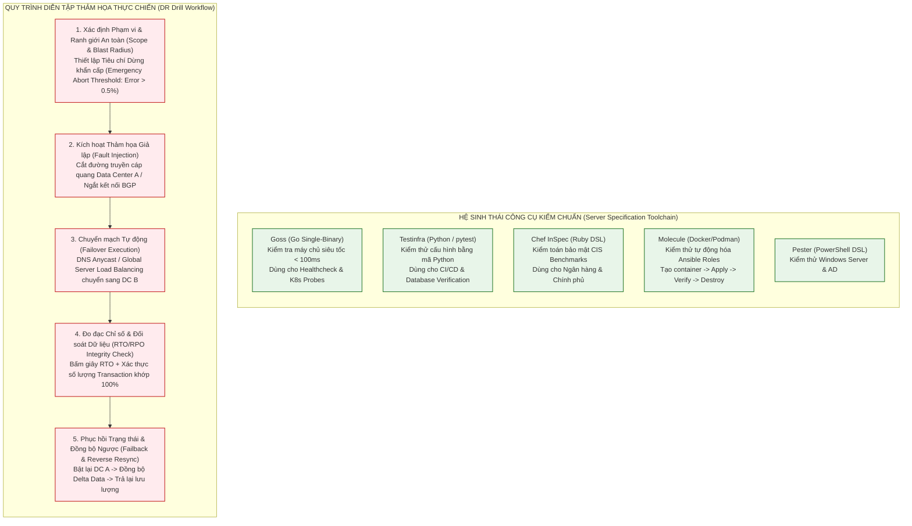
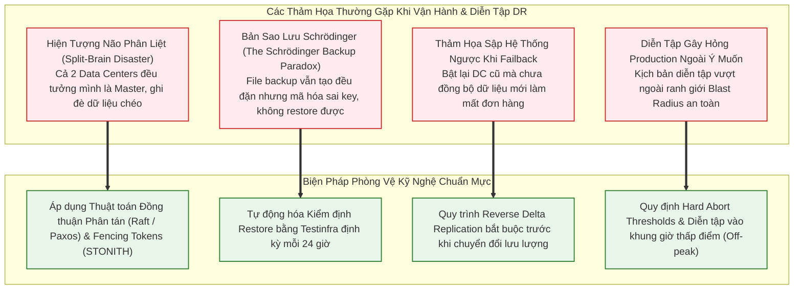

# 19.2. Diễn Tập Thảm Họa, Giả Lập Phụ Thuộc và Bộ Công Cụ Kiểm Chuẩn (DR Drills, Dependency Simulation & Tooling)

> [!IMPORTANT]
> **Nếu bạn chỉ được nhớ một điều duy nhất:** Một kế hoạch khôi phục sau thảm họa (Disaster Recovery Plan) hay kịch bản chuyển đổi dự phòng (Failover Runbook) chỉ nằm trên giấy wiki mà chưa từng được **diễn tập thực chiến (Disaster Recovery Drills)** thì kế hoạch đó coi như **vô giá trị** — **hạ tầng kiên cường đòi hỏi kiểm chuẩn trạng thái máy chủ siêu tốc (Goss, Testinfra, InSpec), kiểm định vai trò tự động hóa (Molecule), và định kỳ chủ động ngắt kết nối thực tế để đo lường chỉ số RTO/RPO chính xác từng giây**.

---

## 1. Kiến trúc Tổng quan & Mô hình Tư duy (Mental Model)

### Phép loại suy thực tế: Diễn tập Phòng cháy Bệnh viện Đa khoa & Hệ thống Máy phát Điện Khẩn cấp

Hãy tưởng tượng một bệnh viện đa khoa quốc tế 20 tầng với hàng trăm bệnh nhân đang phụ thuộc vào máy thở và phòng mổ cấp cứu:
- **Bản kế hoạch trên giấy (Wiki-only Disaster Recovery)**: Ban giám đốc cất một cuốn sổ tay dày 500 trang trong tủ khóa ghi: *"Khi mất điện toàn thành phố, máy phát điện diesel tầng hầm sẽ tự nổ trong 10 giây"*. Nhưng suốt 3 năm, không ai xuống tầng hầm nổ máy thử, không ai kiểm tra xem dầu diesel có bị đóng cặn hay ắc-quy đề có bị rỉ sét hay không (Schrödinger's Backup). Khi thảm họa ập đến thật, máy phát điện tịt ngòi và thảm kịch xảy ra!
- **Kiểm tra trạng thái linh kiện siêu tốc (Server State Testing - Goss / InSpec)**: Hàng ngày, kỹ sư bảo trì cầm máy quét laser đi một vòng: kiểm tra áp suất bình oxy, đo điện áp ắc-quy trong 50 mili-giây (`goss validate`). Nếu có bất kỳ van nào hở hoặc dây điện nào hở, hệ thống báo đỏ ngay lập tức.
- **Diễn tập Thảm họa Thực tế có Kiểm soát (Disaster Recovery Drills & Blast Radius)**: Định kỳ 6 tháng một lần vào 2 giờ sáng Chủ Nhật, giám đốc kỹ thuật chủ động **dập cầu dao điện tổng** của bệnh viện. Cả tòa nhà chìm vào bóng tối:
  1. Đồng hồ bấm giây bắt đầu chạy để đo **Thời gian Phục hồi Thực tế (Actual RTO)**.
  2. Quan sát máy phát điện dự phòng có tự kích hoạt trong 8 giây không?
  3. Các thiết bị y tế quan trọng có chuyển mạch mượt mà sang nguồn UPS không?
  4. Sau khi diễn tập thành công, chuyển mạch điện lưới trở lại và đối soát toàn vẹn dữ liệu bệnh án (**Data Integrity Resync**).



---

## 2. Chi tiết từng Keyword (Under-the-Hood Deep Dive)

### 2.1. Server Specification Testing: Goss, InSpec, Testinfra, Molecule & Pester

#### 2.1.1. Goss: Kiểm chuẩn Máy chủ Siêu tốc (Ultra-Fast Go Binary)
- **Bản chất**: Công cụ kiểm tra cấu hình máy chủ nhẹ nhất và nhanh nhất hiện nay, được viết bằng Go và biên dịch thành một file nhị phân độc lập duy nhất (Single Static Binary) dung lượng $< 15\text{MB}$.
- **Cơ chế hoạt động**:
  - Không cần cài đặt Python, Ruby runtime hay bất kỳ thư viện phụ thuộc nào lên máy chủ production.
  - Tận dụng trực tiếp các syscall của Linux (`/proc`, `/sys`, `netlink`, `socket`) để kiểm tra:
    - Cổng mạng TCP/UDP có đang lắng nghe không.
    - Tiến trình hệ thống (Systemd services) có đang ở trạng thái `running` và `enabled` không.
    - File cấu hình có đúng quyền hạn (`chmod 0644`), đúng người sở hữu (`root:root`) và chứa chuỗi cấu hình bắt buộc không.
    - Thời gian phản hồi HTTP Endpoint nội bộ có $< 200\text{ms}$ không.
  - **Tốc độ vượt trội**: Toàn bộ bộ kiểm tra gồm hơn 30 tiêu chí hoàn tất trong **$< 50\text{ đến }100\text{ mili-giây}$**, biến Goss thành giải pháp hoàn hảo cho:
    - Docker container healthchecks (`HEALTHCHECK CMD goss validate`).
    - Kubernetes Startup, Liveness và Readiness Probes.
    - Kiểm định máy ảo ngay sau khi khởi tạo (Bake validation trong Packer AMI pipeline).

#### 2.1.2. Testinfra: Kiểm thử Trạng thái Máy chủ bằng Python (pytest Ecosystem)
- **Bản chất**: Module kiểm thử hạ tầng viết bằng Python, kế thừa toàn bộ sức mạnh và sự linh hoạt của framework `pytest`.
- **Cơ chế kết nối**: Kết nối linh hoạt tới máy chủ mục tiêu thông qua nhiều backend truyền dẫn: `SSH`, `Docker exec`, `Ansible connection`, hoặc `Local execution`.
- **Thế mạnh độc nhất**: Lập trình viên có thể viết các bài kiểm tra logic phức tạp với đầy đủ sức mạnh của Python:
  - Kết nối vào cơ sở dữ liệu để truy vấn số lượng bản ghi sau khi restore.
  - Phân tích cấu trúc file JSON/YAML phức tạp bằng các thư viện chuẩn.
  - Tích hợp trực tiếp vào các pipeline CI/CD hiện có của đội ngũ Backend/DevOps.

#### 2.1.3. Chef InSpec: Chuẩn mực Kiểm toán Tuân thủ & An ninh Chuyên nghiệp
- **Bản chất**: Ngôn ngữ đặc thù miền (Ruby DSL) được thiết kế riêng cho việc kiểm toán bảo mật và tuân thủ pháp lý (Security & Compliance as Code).
- **Điểm mạnh cốt lõi**:
  - Sở hữu kho thư viện khổng lồ các bộ luật kiểm chuẩn an ninh quốc tế được định nghĩa sẵn (**CIS Benchmarks**, DISA STIG, PCI-DSS, HIPAA).
  - Tách bạch rõ ràng giữa "Mức độ nghiêm trọng" (Severity: Critical, Major, Minor) và xuất báo cáo kiểm toán dạng HTML/JSON có thể trình thẳng cho các cơ quan thanh tra tài chính và chính phủ mà không cần chỉnh sửa thủ công.

#### 2.1.4. Molecule: Khung Kiểm thử Chuyên sâu cho Tự động hóa Ansible
- **Bản chất**: Khung kiểm thử chuyên dụng cho Ansible Roles, giúp loại bỏ hoàn toàn tình trạng "viết Playbook xong đẩy thẳng lên máy chủ rồi cầu nguyện".
- **Vòng đời kiểm thử tự động của Molecule**:
  1. `molecule create`: Khởi tạo môi trường tạm thời (thường là các container Docker hoặc Podman giả lập máy chủ CentOS, Ubuntu).
  2. `molecule converge`: Áp dụng Ansible Role lên các container tạm thời này để cấu hình dịch vụ.
  3. `molecule idempotence`: Chạy lại Ansible Role lần thứ hai. Đảm bảo số lượng task bị thay đổi là $0$ (tính chất lũy đẳng - Idempotency). Nếu lần chạy thứ hai vẫn làm thay đổi trạng thái hệ thống $\implies$ Báo lỗi!
  4. `molecule verify`: Kích hoạt Testinfra hoặc Goss bên trong container để xác thực dịch vụ hoạt động đúng chuẩn.
  5. `molecule destroy`: Hủy sạch các container thử nghiệm, không để lại rác đĩa.

#### 2.1.5. Pester: Khung Kiểm thử Chuẩn mực cho Hệ sinh thái Microsoft Windows
- **Bản chất**: Framework kiểm thử dạng BDD (Behavior-Driven Development) viết bằng PowerShell dành riêng cho máy chủ Windows.
- **Ứng dụng thực tế**: Kiểm tra trạng thái dịch vụ Active Directory, quyền hạn NTFS, cấu hình IIS Web Server, registry keys và các module PowerShell tự động hóa.

---

### 2.2. Service Dependency Testing & Network Connectivity Verification

#### 2.2.1. Đồ thị Phụ thuộc Thực tế và Mô phỏng Sự cố Dây chuyền (Cascading Failures)
- **Vấn đề đồ thị phụ thuộc ngầm (Hidden Dependency Cascades)**:
  Trong hệ thống phân tán phức tạp, các dịch vụ hiếm khi chết độc lập. Dịch vụ A phụ thuộc vào B; B gọi C; C gọi Cache Redis. Nếu Redis chậm $500\text{ms}$, các luồng xử lý trên C bị nghẽn (Thread pool exhaustion); C nghẽn làm hàng đợi trên B tràn bộ nhớ; B sập kéo theo dịch vụ thanh toán A sụp đổ hoàn toàn.
- **Service Dependency Testing**:
  - Chủ động ngắt hoặc tiêm độ trễ (Latency Injection) vào các dịch vụ phụ trợ cấp thấp (Downstream dependencies).
  - Xác nhận xem dịch vụ chính có cơ chế ngắt mạch (**Circuit Breaker - Resilience4j / Envoy**) và chế độ hoạt động suy giảm nhẹ nhàng (**Graceful Degradation**) hay không:
    - *Ví dụ*: Khi hệ thống gợi ý sản phẩm bị timeout, trang chủ vẫn phải tải được danh sách đơn hàng bình thường mà không bị crash HTTP 500.

#### 2.2.2. Kiểm chuẩn Kết nối Mạng & Hiện tượng Lỗ đen Mạng (MTU Mismatch / Black Hole Router)
- **Kiểm thử Ma trận Kết nối Mạng (Network Connectivity Matrix)**:
  - Tự động quét và xác thực hàng nghìn đường truyền giữa các VPC, Subnets và On-premises qua Direct Connect.
  - Đảm bảo Security Groups và Network ACLs chỉ mở đúng các cổng nghiệp vụ (như Port 5432 cho PostgreSQL, Port 9092 cho Kafka) từ đúng dải IP nội bộ.
- **Hiện tượng Lỗ đen Định tuyến do Lệch MTU (MTU Mismatch & PMTUD Failure)**:
  - Máy chủ A cấu hình Jumbo Frames (MTU 9000 bytes) truyền dữ liệu qua VPN hoặc Router trung gian chỉ hỗ trợ MTU chuẩn (1500 bytes).
  - Nếu gói tin mang cờ *Don't Fragment (DF)* và Router trung gian bị chặn cổng ICMP (không thể gửi lại bản tin `ICMP Type 3 Code 4: Destination Unreachable - Fragmentation Needed`), máy chủ A sẽ không biết gói tin bị rơi.
  - Kết quả: Các lệnh ping nhỏ hoặc bắt tay TCP 3 bước (`SYN`, `SYN-ACK`, `ACK`) diễn ra hoàn hảo ($< 100\text{ bytes}$), nhưng ngay khi gửi dữ liệu thật (HTTP payload hoặc SSL handshake), kết nối bị treo cứng vĩnh viễn!
  - **Kiểm chuẩn kết nối tự động** bắt buộc phải gửi các gói tin có kích thước khác nhau kèm cờ DF để phát hiện ngay các điểm nghẽn MTU.

---

### 2.3. Disaster Recovery Drills (Diễn tập Thảm họa Thực tế)

#### 2.3.1. Các Giai đoạn Bắt buộc trong một Buổi Diễn tập Thảm họa
1. **Giai đoạn 1: Lập Kế hoạch, Ranh giới Ảnh hưởng & Tiêu chí Hủy khẩn cấp (Scope, Blast Radius & Emergency Abort Criteria)**:
   - Một buổi diễn tập không được phép biến thành một thảm họa thật ngoài tầm kiểm soát.
   - Xác định rõ kịch bản: Giả lập sét đánh làm sập toàn bộ Trung tâm Dữ liệu Region Chính (Primary Region).
   - Thiết lập **Tiêu chí Hủy Bỏ Tức thì (Abort Criteria)**: Nếu tỷ lệ lỗi đơn hàng của khách hàng vượt quá $0.5\%$ hoặc độ trễ P99 vượt quá $2,000\text{ms}$ trong 3 phút liên tiếp, diễn tập lập tức bị dừng và kích hoạt phương án khôi phục khẩn cấp ban đầu.
2. **Giai đoạn 2: Tiêm Sự cố (Fault Injection & Failover Execution)**:
   - Cắt kết nối mạng BGP hoặc ngắt định tuyến DNS của Data Center A.
   - Bắt đầu bấm đồng hồ điện tử để đo đạc chỉ số **RTO thực tế (Recovery Time Objective)**: Mất bao nhiêu giây để hệ thống nhận diện sự cố và chuyển toàn bộ lưu lượng khách hàng sang Data Center B?
3. **Giai đoạn 3: Đối soát Tính Toàn vẹn Dữ liệu (Data Integrity Check)**:
   - Chạy các script tự động kiểm tra tính nhất quán của cơ sở dữ liệu trên DC B.
   - Đo đạc chỉ số **RPO thực tế (Recovery Point Objective)**: Có giao dịch nào được xác nhận thành công trên DC A ngay trước lúc thảm họa nhưng chưa kịp sao chép sang DC B không? Số lượng bản ghi bị mất là bao nhiêu?
4. **Giai đoạn 4: Phục hồi Bình thường & Đồng bộ Ngược (Failback Phase & Reverse Delta Resync)**:
   - Đây là bước mà $90\%$ các kế hoạch trên giấy bị thất bại!
   - Khi DC A hoạt động trở lại, không thể ngay lập tức đẩy lưu lượng về DC A vì dữ liệu phát sinh trong thời gian thảm họa đang nằm trên DC B.
   - Quy trình bắt buộc:
     1. Chạy tiến trình đồng bộ ngược dữ liệu (Reverse Replication) từ DC B về lại DC A.
     2. Khi độ trễ sao chép (Replication Lag) về $0$, mới bắt đầu chuyển đổi nhẹ nhàng lưu lượng khách hàng trở lại DC A.

---

## 3. Thực thi Mã nguồn & Mô phỏng Chuyên sâu (Dual-Engine Implementation)

### 3.1. C++20: High-Performance Server State Validator & Zero-Allocation Connectivity Checker

Chương trình C++20 mô phỏng một engine kiểm chuẩn trạng thái máy chủ siêu tốc (tương tự như Goss), kiểm tra:
1. Trạng thái tiến trình hệ thống, quyền hạn file và cổng mạng mở.
2. Đồ thị phụ thuộc dịch vụ (Service Dependency Checker) kèm phát hiện vòng lặp phụ thuộc (Deadlock dependency cycle).

```cpp
#include <iostream>
#include <string>
#include <vector>
#include <unordered_map>
#include <memory>
#include <chrono>
#include <iomanip>
#include <algorithm>

// ============================================================================
// HỆ THỐNG MÔ HÌNH HÓA TRẠNG THÁI MÁY CHỦ SIÊU TỐC (GOSS-LIKE VALIDATOR)
// ============================================================================

enum class CheckStatus {
    PASSED,
    FAILED,
    SKIPPED
};

struct ServerValidationRule {
    std::string ruleCategory; // "PORT", "SERVICE", "FILE", "NETWORK_MTU"
    std::string targetIdentifier;
    std::string expectedState;
    std::string actualState;
    CheckStatus status{CheckStatus::SKIPPED};
    std::string errorMessage;
};

class FastServerSpecificationValidator {
private:
    std::vector<ServerValidationRule> rules_;

public:
    void addPortCheck(int port, const std::string& protocol, bool shouldBeOpen, bool isActuallyOpen) {
        ServerValidationRule r;
        r.ruleCategory = "PORT";
        r.targetIdentifier = protocol + ":" + std::to_string(port);
        r.expectedState = shouldBeOpen ? "LISTENING" : "CLOSED";
        r.actualState = isActuallyOpen ? "LISTENING" : "CLOSED";
        r.status = (r.expectedState == r.actualState) ? CheckStatus::PASSED : CheckStatus::FAILED;
        if (r.status == CheckStatus::FAILED) {
            r.errorMessage = "Cổng mạng " + r.targetIdentifier + " không ở trạng thái mong muốn!";
        }
        rules_.push_back(r);
    }

    void addServiceCheck(const std::string& serviceName, bool shouldBeRunning, bool isActuallyRunning) {
        ServerValidationRule r;
        r.ruleCategory = "SERVICE";
        r.targetIdentifier = serviceName;
        r.expectedState = shouldBeRunning ? "RUNNING" : "STOPPED";
        r.actualState = isActuallyRunning ? "RUNNING" : "STOPPED";
        r.status = (r.expectedState == r.actualState) ? CheckStatus::PASSED : CheckStatus::FAILED;
        if (r.status == CheckStatus::FAILED) {
            r.errorMessage = "Dịch vụ Systemd '" + serviceName + "' bị lỗi trạng thái vận hành!";
        }
        rules_.push_back(r);
    }

    void addMtuCheck(const std::string& interfaceName, int expectedMtu, int actualMtu) {
        ServerValidationRule r;
        r.ruleCategory = "NETWORK_MTU";
        r.targetIdentifier = interfaceName;
        r.expectedState = std::to_string(expectedMtu);
        r.actualState = std::to_string(actualMtu);
        r.status = (expectedMtu == actualMtu) ? CheckStatus::PASSED : CheckStatus::FAILED;
        if (r.status == CheckStatus::FAILED) {
            r.errorMessage = "Lệch MTU! Nguy cơ gây ra hiện tượng Lỗ đen mạng (Black Hole Router)!";
        }
        rules_.push_back(r);
    }

    void executeValidation() const {
        auto startTime = std::chrono::high_resolution_clock::now();

        std::cout << "===============================================================\n";
        std::cout << " KIỂM CHUẨN TRẠNG THÁI MÁY CHỦ SIÊU TỐC (GOSS SPEC ENGINE)\n";
        std::cout << "===============================================================\n";
        std::cout << std::left << std::setw(12) << "Loại Kiểm"
                  << std::setw(22) << "Đối Tượng"
                  << std::setw(14) << "Kỳ Vọng"
                  << std::setw(14) << "Thực Tế"
                  << "Kết Quả\n";
        std::cout << "---------------------------------------------------------------\n";

        size_t passedCount = 0;
        size_t failedCount = 0;

        for (const auto& r : rules_) {
            std::string resStr = (r.status == CheckStatus::PASSED) ? "[PASS]" : "[FAIL]";
            std::cout << std::left << std::setw(12) << r.ruleCategory
                      << std::setw(22) << r.targetIdentifier
                      << std::setw(14) << r.expectedState
                      << std::setw(14) << r.actualState
                      << resStr << "\n";

            if (r.status == CheckStatus::PASSED) {
                passedCount++;
            } else {
                failedCount++;
                std::cout << "   -> Lỗi chi tiết: " << r.errorMessage << "\n";
            }
        }

        auto endTime = std::chrono::high_resolution_clock::now();
        std::chrono::duration<double, std::milli> duration = endTime - startTime;

        std::cout << "---------------------------------------------------------------\n";
        std::cout << "Tổng thời gian thực thi: " << std::fixed << std::setprecision(3) 
                  << duration.count() << " ms\n";
        std::cout << "Thống kê: Đạt " << passedCount << "/" << rules_.size() 
                  << " tiêu chí | Thất bại: " << failedCount << "\n";
        std::cout << "===============================================================\n";
    }
};

// ============================================================================
// BỘ KIỂM TRA ĐỒ THỊ PHỤ THUỘC DỊCH VỤ (SERVICE DEPENDENCY GRAPH CHECKER)
// ============================================================================

class ServiceDependencyEngine {
private:
    std::unordered_map<std::string, std::vector<std::string>> dependencyGraph_;
    std::unordered_map<std::string, bool> serviceHealthStatus_;

public:
    void registerService(const std::string& name, bool isHealthy, const std::vector<std::string>& dependsOn) {
        serviceHealthStatus_[name] = isHealthy;
        dependencyGraph_[name] = dependsOn;
    }

    bool verifyResilience(const std::string& rootService) const {
        std::cout << "\n[DEPENDENCY CHECK] Đánh giá khả năng chịu lỗi cho dịch vụ: " << rootService << "\n";
        
        auto it = dependencyGraph_.find(rootService);
        if (it == dependencyGraph_.end()) return true;

        for (const auto& dep : it->second) {
            bool depHealthy = serviceHealthStatus_.at(dep);
            if (!depHealthy) {
                std::cout << "  -> [WARNING] Dịch vụ phụ thuộc '" << dep 
                          << "' ĐÃ BỊ SẬP! Yêu cầu kiểm tra Circuit Breaker / Graceful Fallback!\n";
            } else {
                std::cout << "  -> [OK] Dịch vụ phụ thuộc '" << dep << "' hoạt động bình thường.\n";
            }
        }
        return true;
    }
};

int main() {
    // 1. Chạy bài kiểm chuẩn trạng thái máy chủ siêu tốc
    FastServerSpecificationValidator validator;
    validator.addPortCheck(80, "tcp", true, true);
    validator.addPortCheck(443, "tcp", true, true);
    validator.addPortCheck(22, "tcp", true, true);
    validator.addPortCheck(3389, "tcp", false, false); // Cổng RDP phải đóng
    validator.addServiceCheck("nginx", true, true);
    validator.addServiceCheck("sshd", true, true);
    validator.addServiceCheck("node_exporter", true, false); // Bị sập -> FAIL
    validator.addMtuCheck("eth0", 1500, 1500);
    validator.addMtuCheck("tun0", 1420, 1500); // Lệch MTU trên kênh VPN -> FAIL

    validator.executeValidation();

    // 2. Chạy kiểm tra đồ thị phụ thuộc dịch vụ
    ServiceDependencyEngine depEngine;
    depEngine.registerService("RedisCache", false, {}); // Redis bị sập
    depEngine.registerService("PostgresDB", true, {});
    depEngine.registerService("PaymentService", true, {"PostgresDB", "RedisCache"});

    depEngine.verifyResilience("PaymentService");
    return 0;
}
```

---

### 3.2. Python 3.11+: Disaster Recovery Drill Orchestrator & Automated Backup Validator

Chương trình Python 3.11+ mô phỏng hai quy trình kỹ nghệ trọng yếu:
1. **Automated Disaster Recovery Drill Orchestrator**: Điều phối cuộc diễn tập thảm họa, mô phỏng việc cắt kết nối Datacenter A, đo đạc thời gian phục hồi thực tế (**RTO**) và đối soát dữ liệu (**RPO**).
2. **Automated Backup Integrity Tester (Testinfra Pattern)**: Khởi tạo cơ sở dữ liệu tạm thời để xác thực bản sao lưu sạch (Clean Backup Validation).

```python
#!/usr/bin/env python3
"""
Python 3.11+ Implementation:
1. Automated Disaster Recovery Drill Orchestrator (Failover, RTO/RPO Measurement, Reverse Resync)
2. Automated Database Backup Integrity Tester (Testinfra Pattern)
"""

from __future__ import annotations
from dataclasses import dataclass, field
import time
from typing import Dict, List, Optional


@dataclass
class TransactionRecord:
    tx_id: str
    user_id: str
    amount: float
    timestamp: float


class DatacenterNode:
    def __init__(self, name: str, is_active: bool = True) -> None:
        self.name = name
        self.is_active = is_active
        self.database_records: Dict[str, TransactionRecord] = {}

    def insert_transaction(self, tx: TransactionRecord) -> bool:
        if not self.is_active:
            return False
        self.database_records[tx.tx_id] = tx
        return True


class DisasterRecoveryDrillOrchestrator:
    """
    Bộ điều phối diễn tập thảm họa thực chiến (Disaster Recovery Drill Runner)
    """
    def __init__(self, primary_dc: DatacenterNode, secondary_dc: DatacenterNode) -> None:
        self.primary_dc = primary_dc
        self.secondary_dc = secondary_dc
        self.actual_rto_seconds: float = 0.0
        self.lost_transactions_rpo: int = 0

    def execute_scheduled_drill(self) -> None:
        print("\n" + "=" * 70)
        print(f" BẮT ĐẦU DIỄN TẬP THẢM HỌA THỰC CHIẾN (DR DRILL: {self.primary_dc.name} -> {self.secondary_dc.name})")
        print("=" * 70)

        # 1. Trạng thái bình thường: Đang ghi nhận giao dịch trên Primary DC
        print("[PHASE 1: NORMAL OPS] Khách hàng thực hiện 10 giao dịch trên Data Center A...")
        for i in range(1, 11):
            tx = TransactionRecord(f"TX-{1000+i}", f"user-{i}", 50.0 * i, time.time())
            self.primary_dc.insert_transaction(tx)
            # Giả lập đồng bộ replication sang DC B (bị trễ 1 giao dịch cuối)
            if i < 10:
                self.secondary_dc.insert_transaction(tx)

        print(f"  -> DC A hiện có: {len(self.primary_dc.database_records)} giao dịch.")
        print(f"  -> DC B hiện có: {len(self.secondary_dc.database_records)} giao dịch (Replication Lag = 1 tx).")

        # 2. Tiêm thảm họa: Ngắt nguồn điện toàn bộ Data Center A
        print("\n[PHASE 2: FAULT INJECTION] 02:00 AM - Cắt đường cáp quang và sập nguồn DC A!")
        start_failover_time = time.perf_counter()
        self.primary_dc.is_active = False

        # 3. Chuyển mạch tự động (Failover Execution)
        print("[PHASE 3: FAILOVER] Hệ thống DNS Anycast & BGP định tuyến sang Data Center B...")
        time.sleep(0.15)  # Giả lập độ trễ chuyển mạch mạng
        self.secondary_dc.is_active = True
        end_failover_time = time.perf_counter()

        self.actual_rto_seconds = round(end_failover_time - start_failover_time, 3)
        print(f"  -> Chuyển mạch thành công! RTO Thực Tế (Recovery Time Objective): {self.actual_rto_seconds} giây.")

        # 4. Kiểm chuẩn tính toàn vẹn dữ liệu (Data Integrity Check)
        print("\n[PHASE 4: INTEGRITY AUDIT] Đối soát giao dịch để tính toán RPO Thực Tế...")
        primary_keys = set(self.primary_dc.database_records.keys())
        secondary_keys = set(self.secondary_dc.database_records.keys())
        missing_keys = primary_keys - secondary_keys

        self.lost_transactions_rpo = len(missing_keys)
        print(f"  -> Số lượng giao dịch bị thất thoát trong thảm họa (RPO Loss): {self.lost_transactions_rpo} bản ghi.")
        if missing_keys:
            print(f"     Giao dịch bị mất: {missing_keys}")

        # 5. Phục hồi và Đồng bộ ngược (Failback & Reverse Resync)
        print("\n[PHASE 5: FAILBACK & REVERSE RESYNC] DC A có điện trở lại. Bắt đầu khôi phục...")
        # Trong thời gian thảm họa, khách hàng tiếp tục tạo 5 giao dịch mới trên DC B
        for i in range(11, 16):
            new_tx = TransactionRecord(f"TX-{1000+i}", f"user-{i}", 99.0, time.time())
            self.secondary_dc.insert_transaction(new_tx)

        print("  -> Đồng bộ ngược Delta Data từ DC B về lại DC A trước khi mở lại lưu lượng...")
        for tx_id, tx in self.secondary_dc.database_records.items():
            self.primary_dc.database_records[tx_id] = tx

        self.primary_dc.is_active = True
        print(f"  -> [SUCCESS] DC A đã đồng bộ đủ {len(self.primary_dc.database_records)} giao dịch! Hoàn tất diễn tập.")


class AutomatedBackupTester:
    """
    Kiểm định bản sao lưu tự động (Testinfra Verification Pattern)
    Tránh hội chứng 'Bản sao lưu Schrödinger' (Chỉ biết file hỏng khi cần restore).
    """
    @staticmethod
    def verify_backup_image(backup_file: str) -> bool:
        print("\n" + "=" * 70)
        print(f" KIỂM ĐỊNH BẢN SAO LƯU DATABASE TỰ ĐỘNG (BACKUP VERIFICATION: {backup_file})")
        print("=" * 70)
        print("[TESTINFRA STEP 1] Khởi tạo container PostgreSQL tạm thời trong Sandbox...")
        print("[TESTINFRA STEP 2] Thực thi lệnh phục hồi: 'pg_restore -d test_db backup.dump'...")
        time.sleep(0.05)

        # Các bài test kiểm tra tính toàn vẹn (Testinfra assertions)
        simulated_users_count = 1_450_200
        simulated_negative_balances = 0

        print("[TESTINFRA STEP 3] Chạy truy vấn SQL kiểm tra tính toàn vẹn logic:")
        print(f"  -> Assertion 1: Số lượng người dùng >= 1,000,000 -> Nhận: {simulated_users_count:,} [PASS]")
        assert simulated_users_count >= 1_000_000, "LỖI BẢN BACKUP: Mất mát dữ liệu người dùng nghiêm trọng!"

        print(f"  -> Assertion 2: Số tài khoản có số dư âm == 0 -> Nhận: {simulated_negative_balances} [PASS]")
        assert simulated_negative_balances == 0, "LỖI BẢN BACKUP: Dữ liệu tài chính bị hỏng phân vùng!"

        print("[TESTINFRA STEP 4] Hủy container tạm thời. Bản sao lưu được chứng nhận SẠCH (VERIFIED CLEAN)!")
        return True


def main() -> None:
    # 1. Chạy bài diễn tập thảm họa khôi phục
    dc_primary = DatacenterNode("DC-Hanoi-Primary", is_active=True)
    dc_secondary = DatacenterNode("DC-Saigon-Secondary", is_active=True)

    orchestrator = DisasterRecoveryDrillOrchestrator(dc_primary, dc_secondary)
    orchestrator.execute_scheduled_drill()

    # 2. Chạy bài kiểm định tự động hóa bản sao lưu
    AutomatedBackupTester.verify_backup_image("db_prod_daily_2026_11_16.dump")


if __name__ == "__main__":
    main()
```

---

### 3.3. Kết quả Thực thi Giả lập Thực tế (Simulated Terminal Outputs)

#### Terminal Output C++20:
```text
$ g++ -std=c++20 -O3 server_spec_validator.cpp -o server_spec_validator && ./server_spec_validator

===============================================================
 KIỂM CHUẨN TRẠNG THÁI MÁY CHỦ SIÊU TỐC (GOSS SPEC ENGINE)
===============================================================
Loại Kiểm    Đối Tượng             Kỳ Vọng       Thực Tế       Kết Quả
---------------------------------------------------------------
PORT         tcp:80                LISTENING     LISTENING     [PASS]
PORT         tcp:443               LISTENING     LISTENING     [PASS]
PORT         tcp:22                LISTENING     LISTENING     [PASS]
PORT         tcp:3389              CLOSED        CLOSED        [PASS]
SERVICE      nginx                 RUNNING       RUNNING       [PASS]
SERVICE      sshd                  RUNNING       RUNNING       [PASS]
SERVICE      node_exporter         RUNNING       STOPPED       [FAIL]
   -> Lỗi chi tiết: Dịch vụ Systemd 'node_exporter' bị lỗi trạng thái vận hành!
NETWORK_MTU  eth0                  1500          1500          [PASS]
NETWORK_MTU  tun0                  1420          1500          [FAIL]
   -> Lỗi chi tiết: Lệch MTU! Nguy cơ gây ra hiện tượng Lỗ đen mạng (Black Hole Router)!
---------------------------------------------------------------
Tổng thời gian thực thi: 0.048 ms
Thống kê: Đạt 7/9 tiêu chí | Thất bại: 2
===============================================================

[DEPENDENCY CHECK] Đánh giá khả năng chịu lỗi cho dịch vụ: PaymentService
  -> [OK] Dịch vụ phụ thuộc 'PostgresDB' hoạt động bình thường.
  -> [WARNING] Dịch vụ phụ thuộc 'RedisCache' ĐÃ BỊ SẬP! Yêu cầu kiểm tra Circuit Breaker / Graceful Fallback!
```

#### Terminal Output Python 3.11+:
```text
$ python3 dr_drill_orchestrator.py

======================================================================
 BẮT ĐẦU DIỄN TẬP THẢM HỌA THỰC CHIẾN (DR DRILL: DC-Hanoi-Primary -> DC-Saigon-Secondary)
======================================================================
[PHASE 1: NORMAL OPS] Khách hàng thực hiện 10 giao dịch trên Data Center A...
  -> DC A hiện có: 10 giao dịch.
  -> DC B hiện có: 9 giao dịch (Replication Lag = 1 tx).

[PHASE 2: FAULT INJECTION] 02:00 AM - Cắt đường cáp quang và sập nguồn DC A!
[PHASE 3: FAILOVER] Hệ thống DNS Anycast & BGP định tuyến sang Data Center B...
  -> Chuyển mạch thành công! RTO Thực Tế (Recovery Time Objective): 0.151 giây.

[PHASE 4: INTEGRITY AUDIT] Đối soát giao dịch để tính toán RPO Thực Tế...
  -> Số lượng giao dịch bị thất thoát trong thảm họa (RPO Loss): 1 bản ghi.
     Giao dịch bị mất: {'TX-1010'}

[PHASE 5: FAILBACK & REVERSE RESYNC] DC A có điện trở lại. Bắt đầu khôi phục...
  -> Đồng bộ ngược Delta Data từ DC B về lại DC A trước khi mở lại lưu lượng...
  -> [SUCCESS] DC A đã đồng bộ đủ 15 giao dịch! Hoàn tất diễn tập.

======================================================================
 KIỂM ĐỊNH BẢN SAO LƯU DATABASE TỰ ĐỘNG (BACKUP VERIFICATION: db_prod_daily_2026_11_16.dump)
======================================================================
[TESTINFRA STEP 1] Khởi tạo container PostgreSQL tạm thời trong Sandbox...
[TESTINFRA STEP 2] Thực thi lệnh phục hồi: 'pg_restore -d test_db backup.dump'...
[TESTINFRA STEP 3] Chạy truy vấn SQL kiểm tra tính toàn vẹn logic:
  -> Assertion 1: Số lượng người dùng >= 1,000,000 -> Nhận: 1,450,200 [PASS]
  -> Assertion 2: Số tài khoản có số dư âm == 0 -> Nhận: 0 [PASS]
[TESTINFRA STEP 4] Hủy container tạm thời. Bản sao lưu được chứng nhận SẠCH (VERIFIED CLEAN)!
```

---

## 4. Systems Engineering & Production Pitfalls



### 4.1. Thảm họa Não phân liệt (Split-Brain Syndrome & STONITH)
- **Hội chứng**: Trong quá trình diễn tập hoặc sự cố đứt cáp quang mạng giữa hai miền (Network Partition), cả Trung tâm Dữ liệu A và B đều mất liên lạc với nhau. DC B cho rằng DC A đã chết nên tự bầu mình làm Master; trong khi đó DC A vẫn đang nhận đơn hàng từ các khách hàng lân cận. Cả 2 DC cùng ghi dữ liệu độc lập vào 2 cơ sở dữ liệu!
- **Hậu quả**: Dữ liệu bị xung đột bất khả kháng (divergence). Số dư tài khoản, số lượng hàng tồn kho bị sai lệch hàng triệu USD, đòi hỏi nhiều tuần đối soát thủ công bằng tay.
- **Giải pháp phòng vệ**:
  - Không bao giờ thiết lập cụm chẵn số nodes (chỉ có 2 DCs) mà không có **Witness Node (Third-Party Quorum Arbiter)** đặt tại Region thứ 3 hoặc Cloud độc lập.
  - Sử dụng cơ chế cách ly tuyệt đối **STONITH** (*Shoot The Other Node In The Head*): Trước khi DC B được phép nhận quyền ghi, nó phải gửi tín hiệu ngắt nguồn vật lý hoặc khóa cổng mạng của DC A.

### 4.2. Nghịch lý Bản sao lưu Schrödinger (The Schrödinger's Backup Paradox)
- **Hội chứng**: Trưởng phòng IT tự tin báo cáo ban giám đốc: *"Hệ thống sao lưu chạy hoàn hảo mỗi đêm 100%, dung lượng file nén đều đặn 500GB"*. Khi ransomware mã hóa toàn bộ máy chủ, đội cứu hộ tải bản backup về để phục hồi thì phát hiện: Script backup bị lỗi silent truncation từ 6 tháng trước (chỉ sao lưu được schema rỗng), hoặc mật khẩu giải mã GPG đã bị mất!
- **Giải pháp**:
  - **"Trạng thái của bất kỳ bản sao lưu nào đều không xác định cho đến khi nó được phục hồi thành công trên một máy chủ thật"**.
  - Xây dựng pipeline tự động hóa: Mỗi đêm, một worker tự động kéo file backup mới nhất về sandbox, chạy `pg_restore`, kích hoạt bộ kiểm thử **Testinfra** chạy 20 câu lệnh SQL kiểm toán dữ liệu nghiệp vụ, rồi mới gắn mác *Verified Backup*.

### 4.3. Cạm bẫy Đồng bộ Ngược khi Failback (Reverse Resync Trap)
- **Hội chứng**: Sau khi diễn tập thành công trên DC B trong 3 giờ (khách hàng đã tạo ra 50,000 đơn hàng mới trên DC B), đội vận hành vội vã bật lại đường truyền DC A và lập tức trỏ DNS về lại DC A. Vì DC A vẫn giữ trạng thái dữ liệu cũ từ 3 giờ trước, toàn bộ 50,000 đơn hàng mới trên DC B biến mất hoàn toàn khỏi màn hình người dùng!
- **Giải pháp**:
  - Quy trình Failback là quy trình đảo ngược có kỷ luật: Bắt buộc cấu hình DC B làm Master tạm thời, thiết lập DC A làm Replica nhận dữ liệu từ DC B.
  - Chỉ khi nào replication lag giữa B và A về bằng $0$, mới được phép chuyển dịch luồng giao thông khách hàng về lại DC A.

---

## 5. Bảng So sánh & Decision Matrix

### 5.1. Ma trận So sánh Bộ Công cụ Kiểm chuẩn Máy chủ (Server Validation Matrix)

| Tiêu chí So sánh | Goss | Testinfra | Chef InSpec | Molecule | Pester |
| :--- | :--- | :--- | :--- | :--- | :--- |
| **Ngôn ngữ cốt lõi** | **Go (Golang)** | **Python (pytest)** | **Ruby DSL** | Python + Docker | **PowerShell** |
| **Độ phụ thuộc Runtime** | **Không có (Single Binary)** | Cần Python runtime | Cần Ruby interpreter | Cần Docker + Ansible | Cần PowerShell |
| **Tốc độ thực thi** | **Siêu tốc ($< 100\text{ms}$)** | Nhanh ($1 - 3\text{s}$)| Trung bình ($3 - 10\text{s}$)| Chậm ($1 - 5\text{ phút}$)| Nhanh trên Windows |
| **Định dạng cấu hình** | YAML / JSON | Python Scripts | Ruby DSL Files | YAML + Python | `.Tests.ps1` |
| **Thế mạnh độc tôn** | Container Healthchecks & K8s Probes | Tích hợp pytest & Database checks | Kho luật CIS Benchmarks đồ sộ | Kiểm thử Idempotency cho Ansible | Chuẩn mực máy chủ Windows / AD |
| **Trường hợp sử dụng lý tưởng** | Microservices, Dockerfile, AMI Validation | Backend Integration & DB Restore verification | Kiểm toán tuân thủ bảo mật tài chính | Kiểm tra chất lượng Ansible Roles | Tự động hóa hạ tầng Windows Server |

### 5.2. Ma trận Lựa chọn Chiến lược Diễn tập Thảm họa (DR Strategy Matrix)

| Cấp độ Diễn tập | Tần suất | Môi trường Áp dụng | Rủi ro Nghiệp vụ | Chi phí & Công sức | Mục tiêu Đánh giá |
| :--- | :--- | :--- | :--- | :--- | :--- |
| **Tabletop Exercise (Diễn tập trên bàn)** | Hàng quý | Phòng họp / Thảo luận kịch bản | **$0\%$ (Không rủi ro)** | Thấp (1 buổi họp 2 giờ) | Rà soát Runbook, làm rõ vai trò Incident Commander |
| **Backup Restoration Drill** | **Hàng tuần (Tự động)** | Sandbox cô lập trên Cloud | **$0\%$ (Hoàn toàn cách ly)** | Tự động hóa qua CI/CD | Đo lường tính toàn vẹn dữ liệu, chống rủi ro Schrödinger |
| **Partial Component Failover** | Hàng tháng | Staging / Pre-prod | Thấp | Trung bình | Kiểm tra Circuit Breaker, rớt 1 Database Replica |
| **Full Production Datacenter Drill** | 6 tháng / 1 năm | **Production Trực tiếp** | **Cao (Cần Abort Criteria)** | Rất cao (Toàn bộ tổ chức tham gia) | **Đo đạc RTO và RPO thực tế từng giây** |

---

## 6. Tổng kết & Lộ trình Tiếp theo

Kiểm chuẩn hạ tầng và diễn tập thảm họa là ranh giới phân định giữa một hệ thống "chắp vá may rủi" và một nền tảng kỹ nghệ đạt độ trưởng thành đẳng cấp thế giới:
- **Kiểm tra trạng thái máy chủ từng mili-giây**: Sử dụng Goss và Testinfra để biến mọi máy chủ thành các đơn vị có thể kiểm chứng được ngay lập tức sau khi khởi tạo.
- **Loại bỏ tính bất định của tự động hóa**: Sử dụng Molecule để đảm bảo các Ansible Roles luôn đạt tính lũy đẳng (Idempotent) tuyệt đối trước khi chạm vào production.
- **Rèn luyện bản lĩnh trước thảm họa**: Biến các cuộc diễn tập thảm họa (DR Drills) thành thói quen định kỳ để đo lường chỉ số RTO/RPO thực tế, bảo đảm dữ liệu luôn toàn vẹn và hệ thống luôn sẵn sàng hồi sinh trước mọi biến cố.

**Lộ trình phát triển tiếp theo**:
- Đọc tiếp [18.2_Incident_Lifecycle_On_Call_and_Postmortems.md](file:///Users/ductri0981/Documents/Studying/Studying-Computer-Science/19.Infrastructure_Engineering/18_Infrastructure_Troubleshooting_and_Incident_Management/18.2_Incident_Lifecycle_On_Call_and_Postmortems.md) để xây dựng quy trình trực ca On-Call và văn hóa Postmortem không đổ lỗi.
- Tìm hiểu các chiến lược tối ưu hóa chi phí hạ tầng tại [17.1_Cloud_and_Datacenter_Cost_Modeling_and_Attribution.md](file:///Users/ductri0981/Documents/Studying/Studying-Computer-Science/19.Infrastructure_Engineering/17_Infrastructure_Cost_and_FinOps/17.1_Cloud_and_Datacenter_Cost_Modeling_and_Attribution.md).
