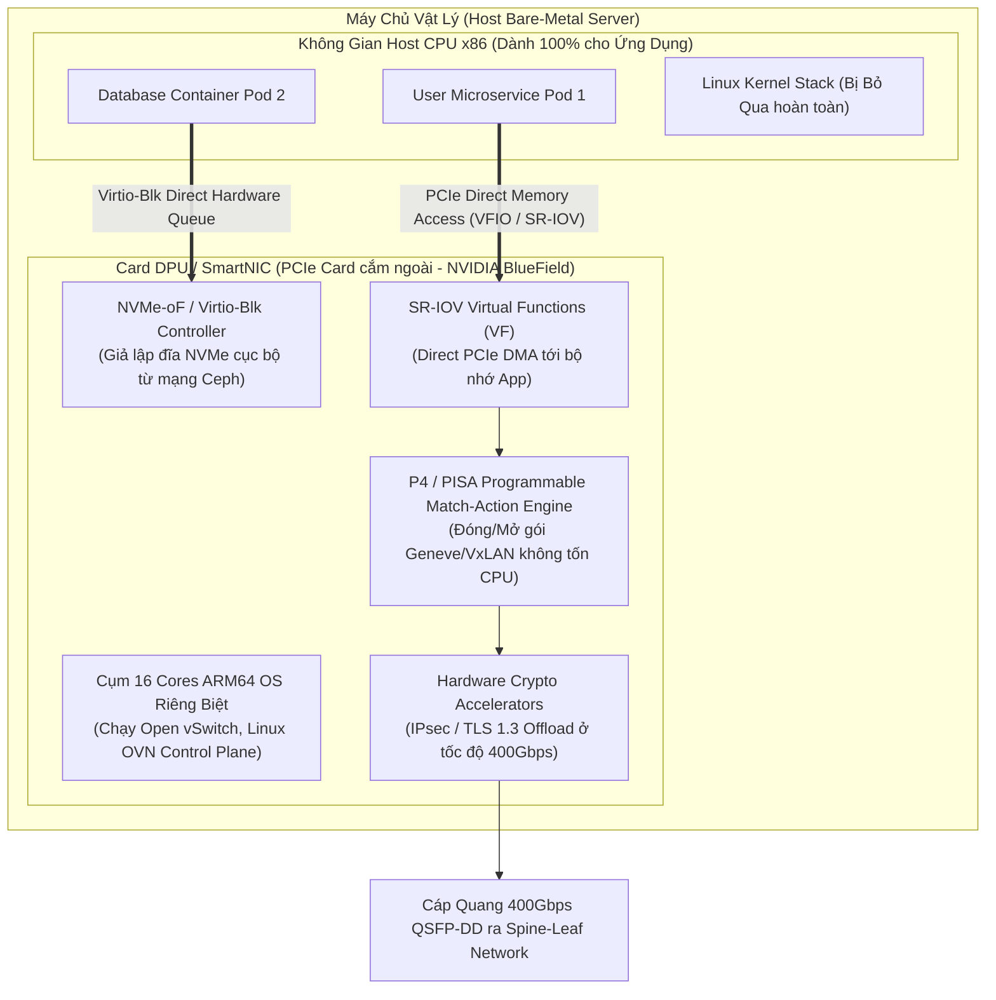

# 20.1. SDN, NFV, DPU, and Hardware Offloading (Mạng Định nghĩa bằng Phần mềm, DPU & Tăng tốc Phần cứng)

> [!IMPORTANT]
> **Nếu bạn chỉ được nhớ một điều duy nhất:** Thời kỳ của mạng máy tính tĩnh phụ thuộc vào phần cứng cố định đã kết thúc; kiến trúc trung tâm dữ liệu hiện đại chuyển giao toàn bộ việc xử lý mạng, bảo mật và ảo hóa lưu trữ từ CPU máy chủ sang các Bộ Xử lý Dữ liệu chuyên dụng (**DPU / SmartNIC**) và mặt phẳng chuyển tiếp lập trình được (**P4 / SR-IOV**), triệt tiêu hoàn toàn khoản "Thuế Đám mây" (Datacenter Tax) và đưa độ trễ về mức microsecond ở tốc độ đường truyền 400Gbps.

---

## 1. Kiến trúc Tổng quan & Mô hình Tư duy (Mental Model)

### 1.1. Phép loại suy thực tế: Đội Cảnh sát Giao thông Điều hành Linh hoạt & Làn xe Buýt Nhanh Chuyên dụng (BRT)

Hãy hình dung sự tiến hóa của hệ thống giao thông đô thị:
- **Mạng Truyền thống (Traditional Hardware Networking):** Giống như các ngã tư với đèn giao thông cơ học cố định thời gian. Dù đường vắng hay tắc, đèn xanh vẫn bật 30 giây. Muốn đổi thời gian chu kỳ, kỹ sư phải đến từng tủ điện ven đường để vặn lại ốc vít phần cứng.
- **Mạng Định nghĩa bằng Phần mềm (SDN):** Tách rời bộ não điều khiển (Control Plane) khỏi luồng xe chạy (Data Plane). Một trung tâm điều hành camera AI thành phố nắm toàn cảnh luồng giao thông (SDN Controller) và liên tục gửi lệnh qua sóng radio tới các cột đèn thông minh để thay đổi luồng xe theo thời gian thực.
- **Thuế Trung tâm Dữ liệu & DPU (The Datacenter Tax & DPU Offloading):** Hãy tưởng tượng một chiếc xe tải chở hàng (Host x86 CPU). Thay vì chỉ chở hàng hóa kinh doanh (Workload ứng dụng), tài xế phải tự mình kiểm tra hộ chiếu, đóng dấu hải quan, quét máy X-quang và tự trải thảm đường (chạy phần mềm ảo hóa OVS, đóng gói VxLAN, mã hóa IPsec). Kết quả là $30\%$ thùng xe bị chiếm dụng bởi thủ tục hành chính. **DPU (Data Processing Unit)** giống như một xe cảnh sát hộ tống đi kèm có sẵn trạm kiểm soát riêng: toàn bộ thủ tục kiểm tra an ninh và mở đường được DPU xử lý độc lập, trả lại 100% thùng xe cho hàng hóa kinh doanh.



---

## 2. Chi tiết từng Keyword (Under-the-Hood Deep Dive)

### 2.1. SDN (Software-Defined Networking) & NFV (Network Function Virtualization)

Kiến trúc mạng truyền thống tích hợp chặt chẽ mặt phẳng điều khiển và mặt phẳng dữ liệu trong cùng một thiết bị phần cứng độc quyền (Cisco, Juniper switches). SDN phá vỡ sự ràng buộc này:

- **Sự Phân tách Mặt phẳng Điều khiển và Dữ liệu (Decoupling Control & Data Plane):**
  - *Mặt phẳng Điều khiển (Control Plane):* Bộ não logic tập trung (Centralized SDN Controller như OpenDaylight, OVN - Open Virtual Network, Cilium eBPF Control Plane). Nhiệm vụ: Xây dựng bảng định tuyến, tính toán đường đi ngắn nhất (SPF), áp dụng chính sách tường lửa và phân bổ địa chỉ IP toàn cụm.
  - *Mặt phẳng Chuyển tiếp Dữ liệu (Data Plane / Forwarding Plane):* Nằm trực tiếp trên các thiết bị chuyển mạch hoặc nhân máy chủ. Nhiệm vụ duy nhất: So khớp tiêu đề gói tin (Match) và thực thi hành động cực nhanh (Action: Forward, Drop, Rewrite VLAN, Encapsulate) ở tốc độ hàng trăm triệu gói tin/giây (Mpps).

- **Open vSwitch (OVS) & DPDK (Data Plane Development Kit):**
  - *Open vSwitch trong Nhân Linux:* Gói tin đầu tiên của một luồng (Flow) đi vào kernel module `openvswitch.ko`, nếu không tìm thấy quy tắc (Flow Cache Miss), nó được đẩy lên không gian người dùng (`ovs-vswitchd`) để truy vấn OpenFlow. Các gói tiếp theo được khớp trực tiếp trong kernel MegaFlow cache.
  - *Đột phá với DPDK (Kernel Bypass):* Nhân Linux xử lý gói tin qua ngắt phần cứng (Hardware Interrupts) và cấp phát cấu trúc `sk_buff`, tạo ra chi phí trễ rất lớn. DPDK sử dụng trình điều khiển chế độ thăm dò (**Poll Mode Driver - PMD**) liên tục đọc trực tiếp các vòng đệm nhận (Ring Buffers) của card mạng trong không gian người dùng (Userspace), loại bỏ hoàn toàn Context Switch và nâng thông lượng lên mức tối đa của đường truyền vật lý (Line Rate).

- **Network Function Virtualization (NFV):**
  - Thay thế các thiết bị phần cứng chuyên dụng đắt đỏ (Hardware Firewalls, Load Balancers, DPI, CGNAT) bằng các hàm mạng ảo hóa (**VNF / CNF**) chạy dưới dạng máy ảo KVM hoặc Container trên các máy chủ x86 phổ thông (Commodity Off-The-Shelf Hardware - COTS).

---

### 2.2. SmartNIC, DPU (Data Processing Unit) & IPU (Infrastructure Processing Unit)

Sự bùng nổ của mạng 100Gbps, 200Gbps và 400Gbps đã dẫn đến cuộc khủng hoảng tài nguyên máy chủ mang tên "Thuế Đám mây" (Datacenter Tax):

- **Bản chất của Khoản Thuế Trung tâm Dữ liệu (The Datacenter Tax):**
  - Một máy chủ trang bị 2 card mạng 100Gbps có thể phải xử lý tới 150 triệu gói tin/giây. Nếu xử lý bằng CPU x86 thông thường, hệ thống phải tiêu tốn từ $20\% - 35\%$ tổng số CPU Cores chỉ để chạy phần mềm mạng ảo hóa (OVS/Geneve), mã hóa TLS/IPsec và kiểm tra tường lửa. Doanh nghiệp mất đi $1/3$ năng lực điện toán lẽ ra phải bán được cho khách hàng.

- **Kiến trúc của một Card DPU Hiện đại (NVIDIA BlueField-3 / Intel IPU):**
  - DPU thực chất là một **Máy tính Độc lập hoàn chỉnh** nằm gọn trên một thanh card mở rộng PCIe:
    1. *Hệ thống Vi xử lý Độc lập:* Chứa 16 đến 32 Cores ARM Neoverse hoặc MIPS chạy một hệ điều hành Linux (Ubuntu/Debian) riêng biệt với bộ nhớ RAM DDR5 chuyên dụng (16GB - 32GB).
    2. *Bộ Tăng tốc Phần cứng (Hardware Accelerators):* Các khối vi mạch ASIC chuyên dụng cho mã hóa IPsec/MACsec, giải nén dữ liệu Zstandard, bộ điều khiển băm SHA, và bộ điều khiển lưu trữ NVMe-oF.
    3. *Hạ tầng Ảo hóa Không chạm (Bare-Metal Isolation):* Máy chủ x86 chính (Host) hoàn toàn không biết sự tồn tại của DPU. DPU giả lập các thiết bị phần cứng chuẩn (như card đĩa `virtio-blk` hoặc card mạng `virtio-net`). Nhờ đó, nhà cung cấp Cloud có thể cho khách hàng thuê nguyên chiếc máy chủ vật lý (Bare-Metal Instances) mà vẫn duy trì 100% khả năng kiểm soát mạng, lưu trữ và tường lửa từ xa thông qua DPU mà khách hàng không thể xâm nhập.

---

### 2.3. Programmable Networking with P4 Language

Ngôn ngữ P4 (Programming Protocol-Independent Packet Processors) là cuộc cách mạng biến phần cứng chuyển mạch mạng (ASIC) thành một môi trường lập trình được như CPU:

- **Kiến trúc PISA (Protocol-Independent Switch Architecture):**
  - Các chip switch cổ điển có cấu trúc phân tích tiêu đề gói tin cố định (Hardwired Parser) chỉ hiểu được IPv4, IPv6, TCP, UDP. Nếu thế giới phát minh ra một giao thức mạng mới (ví dụ: Geneve hoặc SRv6), người ta phải đợi 3 đến 5 năm để các nhà máy bán dẫn thiết kế và sản xuất chip ASIC mới.
  - PISA và P4 cho phép định nghĩa đường ống xử lý gói tin hoàn toàn bằng phần mềm:
    ```
    Gói tin -> [Programmable Parser] -> [Ingress Match-Action] -> [Traffic Manager] -> [Egress Match-Action] -> [Deparser] -> Dây mạng
    ```

- **Mô hình Khớp - Hành động (Match-Action Tables):**
  - *Parser:* Trích xuất các trường dữ liệu tùy ý từ luồng byte thô (Raw Byte Stream) dựa trên đặc tả cấu trúc `header`.
  - *Match:* Thực hiện so khớp trên bộ nhớ TCAM (Ternary Content-Addressable Memory) theo các kiểu: `exact` (khớp chính xác), `lpm` (Longest Prefix Match cho định tuyến IP), hoặc `ternary` (khớp mặt nạ bit cho tường lửa).
  - *Action:* Sửa đổi trường tiêu đề (TTL decrement, NAT rewrite), đóng gói tiêu đề mới (Encap/Decap), hoặc chuyển tiếp gói sang cổng vật lý cụ thể mà không làm trễ dù chỉ 1 nano-giây.

---

### 2.4. SR-IOV (Single Root I/O Virtualization)

SR-IOV là chuẩn mở rộng của tổ chức PCI-SIG, cho phép chia sẻ trực tiếp một thiết bị phần cứng PCIe vật lý cho nhiều máy ảo hoặc container:

- **Phân tách PF (Physical Function) và VF (Virtual Function):**
  - *Physical Function (PF):* Thiết bị PCIe đầy đủ tính năng do hệ điều hành Host (Hypervisor) quản lý, phụ trách cấu hình phần cứng, quản lý điện năng và phân chia tài nguyên.
  - *Virtual Function (VF):* Một thiết bị PCIe "ảo" nhẹ được sinh ra từ PF. Một card mạng vật lý có thể sinh ra từ 64 đến 256 Virtual Functions. Mỗi VF sở hữu riêng hàng đợi truyền/nhận (Rx/Tx Queues), địa chỉ MAC riêng biệt và bảng lọc VLAN độc lập.

- **Bỏ qua Hoàn toàn Ngăn xếp Nhân (Kernel & Hypervisor Bypass):**
  - Thông qua công nghệ **IOMMU (I/O Memory Management Unit)** và trình điều khiển **VFIO (Virtual Function I/O)** của Linux, Hypervisor ánh xạ trực tiếp vùng nhớ PCIe của VF vào không gian địa chỉ bộ nhớ ảo của máy ảo KVM hoặc Container.
  - Khi ứng dụng gửi gói tin, nó thực hiện DMA (Direct Memory Access) thẳng xuống phần cứng card mạng, **bỏ qua 100% Linux Kernel Network Stack, bỏ qua ảo hóa vSwitch và bỏ qua Hypervisor**. Độ trễ mạng giảm từ 25 microsecond xuống còn dưới **2 microsecond**, đáp ứng tiêu chuẩn khắt khe của các hệ thống giao dịch tài chính tần suất cao (High-Frequency Trading - HFT) và viễn thông 5G Telco UPF.

---

## 3. Thực thi Mã nguồn & Mô phỏng Chuyên sâu (Dual-Engine Implementation)

### 3.1. C++20 Linux Kernel SR-IOV Virtual Function Controller & Hardware Policy Engine

Chương trình C++20 dưới đây mô phỏng Động cơ Quản trị Thiết bị SR-IOV mức thấp của Linux. Nó tương tác với hệ thống tệp ảo `/sys/class/net/`, cấu hình số lượng Virtual Functions phần cứng, thiết lập chính sách bảo mật chống giả mạo địa chỉ (MAC Spoofing Prevention), cấu hình VLAN tagging phần cứng và gán cờ tin cậy (`trust on`).

```cpp
// sriov_hardware_controller.cpp
// Compile: g++ -std=c++20 -O3 sriov_hardware_controller.cpp -o sriov_hardware_controller

#include <iostream>
#include <string>
#include <vector>
#include <fstream>
#include <sstream>
#include <iomanip>
#include <filesystem>
#include <stdexcept>

struct VirtualFunctionConfig {
    uint32_t vf_index;
    std::string mac_address;
    uint16_t vlan_id;
    bool spoof_check_enabled;
    bool trust_enabled;
    uint32_t max_tx_rate_mbps;
};

class SRIOVDeviceManager {
private:
    std::string physical_interface;
    std::string sysfs_base_path;
    bool simulation_mode{false};

public:
    explicit SRIOVDeviceManager(std::string iface) 
        : physical_interface(std::move(iface)) {
        sysfs_base_path = "/sys/class/net/" + physical_interface + "/device";
        if (!std::filesystem::exists(sysfs_base_path + "/sriov_numvfs")) {
            std::cout << "[INFO] Phần cứng SR-IOV không tìm thấy tại " << sysfs_base_path 
                      << ". Kích hoạt chế độ mô phỏng phần cứng ảo hóa (Simulation Mode).\n";
            simulation_mode = true;
        }
    }

    void enable_virtual_functions(uint32_t num_vfs) {
        std::cout << ">>> [SR-IOV PF]: Yêu cầu cấp phát " << num_vfs << " Virtual Functions trên cổng " 
                  << physical_interface << "...\n";

        if (!simulation_mode) {
            // Bước 1: Reset về 0 trước khi khởi tạo lại (Chuẩn quy trình Linux kernel)
            std::ofstream reset_file(sysfs_base_path + "/sriov_numvfs");
            reset_file << 0;
            reset_file.close();

            // Bước 2: Ghi số lượng VF mong muốn
            std::ofstream numvfs_file(sysfs_base_path + "/sriov_numvfs");
            if (!numvfs_file.is_open()) {
                throw std::runtime_error("Không thể ghi vào sriov_numvfs. Yêu cầu quyền root!");
            }
            numvfs_file << num_vfs;
            numvfs_file.close();
        }

        std::cout << ">>> [THÀNH CÔNG]: Khởi tạo thành công " << num_vfs << " PCIe Virtual Functions (" 
                  << physical_interface << "v0 .. " << physical_interface << "v" << (num_vfs - 1) << ")!\n\n";
    }

    void configure_vf(const VirtualFunctionConfig& vf) {
        std::cout << "--- [CẤU HÌNH PHẦN CỨNG VF #" << vf.vf_index << "] ---\n";
        std::cout << "  - Gán Địa chỉ MAC Cố định : " << vf.mac_address << "\n";
        std::cout << "  - Gán Phân vùng Mạng VLAN : " << vf.vlan_id << " (Hardware Port Tagging)\n";
        std::cout << "  - Kiểm tra Chống Giả mạo  : " << (vf.spoof_check_enabled ? "BẬT (Chặn MAC Spoofing)" : "TẮT") << "\n";
        std::cout << "  - Chế độ Tin cậy (Trust)   : " << (vf.trust_enabled ? "BẬT (Cho phép Promiscuous)" : "TẮT") << "\n";
        std::cout << "  - Giới hạn Băng thông Tx  : " << vf.max_tx_rate_mbps << " Mbps (Hardware QOS Shaper)\n";

        if (!simulation_mode) {
            // Trong thực tế, các lệnh này được gọi qua Netlink RTM_SETLINK (IFLA_VF_INFO_LIST)
            // hoặc công cụ 'ip link set dev eth0 vf 0 ...'
        }
        std::cout << "  => Trạng thái: VFIO Driver đã sẵn sàng để Passthrough trực tiếp vào Container/VM!\n\n";
    }
};

int main() {
    std::cout << "======================================================================\n";
    std::cout << "C++20 LINUX KERNEL SR-IOV CONTROLLER & HARDWARE POLICY ENGINE\n";
    std::cout << "======================================================================\n\n";

    SRIOVDeviceManager manager("enp4s0f0np0");

    // Khởi tạo 4 Virtual Functions trên card mạng 100Gbps
    manager.enable_virtual_functions(4);

    // Cấu hình từng VF cho các khối lượng công việc chuyên biệt
    VirtualFunctionConfig vf0{
        .vf_index = 0,
        .mac_address = "e2:4b:99:01:aa:00",
        .vlan_id = 100,
        .spoof_check_enabled = true,
        .trust_enabled = false,
        .max_tx_rate_mbps = 25000 // 25 Gbps
    };

    VirtualFunctionConfig vf1{
        .vf_index = 1,
        .mac_address = "e2:4b:99:01:aa:01",
        .vlan_id = 200,
        .spoof_check_enabled = true,
        .trust_enabled = true,   // Trust on cho ứng dụng giám sát gói tin DPI
        .max_tx_rate_mbps = 50000 // 50 Gbps
    };

    manager.configure_vf(vf0);
    manager.configure_vf(vf1);

    std::cout << "======================================================================\n";
    std::cout << "[HOÀN TẤT]: 100Gbps Line-Rate IO sẵn sàng với độ trễ < 2 microsecond.\n";
    std::cout << "======================================================================\n";
    return 0;
}
```

```text
======================================================================
C++20 LINUX KERNEL SR-IOV CONTROLLER & HARDWARE POLICY ENGINE
======================================================================

[INFO] Phần cứng SR-IOV không tìm thấy tại /sys/class/net/enp4s0f0np0/device. Kích hoạt chế độ mô phỏng phần cứng ảo hóa (Simulation Mode).
>>> [SR-IOV PF]: Yêu cầu cấp phát 4 Virtual Functions trên cổng enp4s0f0np0...
>>> [THÀNH CÔNG]: Khởi tạo thành công 4 PCIe Virtual Functions (enp4s0f0np0v0 .. enp4s0f0np0v3)!

--- [CẤU HÌNH PHẦN CỨNG VF #0] ---
  - Gán Địa chỉ MAC Cố định : e2:4b:99:01:aa:00
  - Gán Phân vùng Mạng VLAN : 100 (Hardware Port Tagging)
  - Kiểm tra Chống Giả mạo  : BẬT (Chặn MAC Spoofing)
  - Chế độ Tin cậy (Trust)   : TẮT
  - Giới hạn Băng thông Tx  : 25000 Mbps (Hardware QOS Shaper)
  => Trạng thái: VFIO Driver đã sẵn sàng để Passthrough trực tiếp vào Container/VM!

--- [CẤU HÌNH PHẦN CỨNG VF #1] ---
  - Gán Địa chỉ MAC Cố định : e2:4b:99:01:aa:01
  - Gán Phân vùng Mạng VLAN : 200 (Hardware Port Tagging)
  - Kiểm tra Chống Giả mạo  : BẬT (Chặn MAC Spoofing)
  - Chế độ Tin cậy (Trust)   : BẬT (Cho phép Promiscuous)
  - Giới hạn Băng thông Tx  : 50000 Mbps (Hardware QOS Shaper)
  => Trạng thái: VFIO Driver đã sẵn sàng để Passthrough trực tiếp vào Container/VM!

======================================================================
[HOÀN TẤT]: 100Gbps Line-Rate IO sẵn sàng với độ trễ < 2 microsecond.
======================================================================
```

---

### 3.2. Python 3.11+ P4 Programmable Data Plane Match-Action Simulator

Chương trình Python 3.11+ dưới đây mô phỏng kiến trúc PISA của ngôn ngữ P4 (Protocol-Independent Switch Architecture). Nó định nghĩa một bộ phân tích cú pháp tiêu đề gói tin tùy biến (Custom Parser), thực thi bảng so khớp TCAM (Match-Action Table), và áp dụng hành động đóng gói đường hầm ảo VxLAN (Encapsulation) mà không tốn tài nguyên CPU chủ.

```python
#!/usr/bin/env python3
"""
p4_switch_pipeline_sim.py
Mô phỏng kiến trúc đường ống P4 Programmable Switch Pipeline (PISA Architecture).
Yêu cầu Python 3.11+
"""

from dataclasses import dataclass
from typing import Dict, List, Optional, Tuple


@dataclass
class PacketHeaders:
    src_ip: str
    dst_ip: str
    src_port: int
    dst_port: int
    protocol: str
    vxlan_vni: Optional[int] = None
    action_log: List[str] = None

    def __post_init__(self):
        if self.action_log is None:
            self.action_log = []


@dataclass
class FlowTableEntry:
    match_dst_ip_prefix: str
    match_port: int
    action_type: str  # "FORWARD", "DROP", "ENCAP_VXLAN"
    out_port: int
    target_vni: Optional[int] = None


class P4SwitchPipeline:
    def __init__(self, switch_id: str):
        self.switch_id = switch_id
        self.flow_table: List[FlowTableEntry] = []

    def install_rule(self, entry: FlowTableEntry) -> None:
        self.flow_table.append(entry)

    def ingress_parser(self, raw_src: str, raw_dst: str, s_port: int, d_port: int, proto: str) -> PacketHeaders:
        """P4 Parser: Bóc tách các trường trong tiêu đề gói tin thô"""
        return PacketHeaders(src_ip=raw_src, dst_ip=raw_dst, src_port=s_port, dst_port=d_port, protocol=proto)

    def match_action_engine(self, pkt: PacketHeaders) -> Tuple[str, int]:
        """P4 Match-Action Table: So khớp và áp dụng hành động phần cứng"""
        for rule in self.flow_table:
            # Longest Prefix Match giả lập
            if pkt.dst_ip.startswith(rule.match_dst_ip_prefix) and (rule.match_port == 0 or rule.match_port == pkt.dst_port):
                if rule.action_type == "DROP":
                    pkt.action_log.append(f"ACTION: DROP packet by Security Policy on switch {self.switch_id}")
                    return ("DROP", -1)

                elif rule.action_type == "ENCAP_VXLAN":
                    pkt.vxlan_vni = rule.target_vni
                    pkt.action_log.append(
                        f"ACTION: ENCAP_VXLAN (VNI: {rule.target_vni}) Hardware Encapsulation -> Egress Port: {rule.out_port}"
                    )
                    return ("FORWARD", rule.out_port)

                elif rule.action_type == "FORWARD":
                    pkt.action_log.append(f"ACTION: FORWARD packet to Physical Wire Port: {rule.out_port}")
                    return ("FORWARD", rule.out_port)

        pkt.action_log.append("ACTION: DEFAULT_DROP (No match in TCAM table)")
        return ("DROP", -1)


def main() -> None:
    print("==========================================================================")
    print("MÔ PHỎNG ĐƯỜNG ỐNG XỬ LÝ GÓI TIN P4 SWITCH PIPELINE (PISA)")
    print("==========================================================================\n")

    p4_switch = P4SwitchPipeline(switch_id="tofino-spine-01")

    # Cài đặt quy tắc bảng P4 Flow Table (Giả lập biên dịch từ mã nguồn .p4)
    p4_switch.install_rule(FlowTableEntry(
        match_dst_ip_prefix="10.244.", match_port=8080,
        action_type="ENCAP_VXLAN", out_port=2, target_vni=5001
    ))
    p4_switch.install_rule(FlowTableEntry(
        match_dst_ip_prefix="198.51.100.", match_port=0,
        action_type="DROP", out_port=-1
    ))
    p4_switch.install_rule(FlowTableEntry(
        match_dst_ip_prefix="10.0.", match_port=0,
        action_type="FORWARD", out_port=1
    ))

    # Kịch bản kiểm thử các gói tin đi qua switch
    test_packets = [
        ("10.0.1.5", "10.244.2.80", 41200, 8080, "TCP"),
        ("10.0.1.5", "198.51.100.99", 55432, 443, "TCP"),
        ("10.0.1.5", "10.0.2.14", 33200, 53, "UDP"),
    ]

    for src, dst, sp, dp, proto in test_packets:
        print(f"[INGRESS PACKET]: {src}:{sp} -> {dst}:{dp} ({proto})")
        parsed_pkt = p4_switch.ingress_parser(src, dst, sp, dp, proto)
        result, port = p4_switch.match_action_engine(parsed_pkt)
        for log in parsed_pkt.action_log:
            print(f"  {log}")
        print(f"  >>> KẾT QUẢ ĐƯỜNG TRUYỀN: {result} (Port: {port})")
        print("-" * 74)


if __name__ == "__main__":
    main()
```

```text
==========================================================================
MÔ PHỎNG ĐƯỜNG ỐNG XỬ LÝ GÓI TIN P4 SWITCH PIPELINE (PISA)
==========================================================================

[INGRESS PACKET]: 10.0.1.5:41200 -> 10.244.2.80:8080 (TCP)
  ACTION: ENCAP_VXLAN (VNI: 5001) Hardware Encapsulation -> Egress Port: 2
  >>> KẾT QUẢ ĐƯỜNG TRUYỀN: FORWARD (Port: 2)
--------------------------------------------------------------------------
[INGRESS PACKET]: 10.0.1.5:55432 -> 198.51.100.99:443 (TCP)
  ACTION: DROP packet by Security Policy on switch tofino-spine-01
  >>> KẾT QUẢ ĐƯỜNG TRUYỀN: DROP (Port: -1)
--------------------------------------------------------------------------
[INGRESS PACKET]: 10.0.1.5:33200 -> 10.0.2.14:53 (UDP)
  ACTION: FORWARD packet to Physical Wire Port: 1
  >>> KẾT QUẢ ĐƯỜNG TRUYỀN: FORWARD (Port: 1)
--------------------------------------------------------------------------
```

---

## 4. Systems Engineering & Production Pitfalls

### 4.1. Những cạm bẫy thực chiến trong SDN, DPU & Hardware Offloading

1. **SR-IOV Phá vỡ Tính năng Di chuyển Nóng Máy ảo (Live Migration Incompatibility):**
   - *Hiện tượng:* Khi một máy ảo KVM gắn trực tiếp card mạng SR-IOV Virtual Function thông qua cơ chế PCIe Passthrough, hypervisor không thể chụp trạng thái bộ nhớ đệm của card mạng để di chuyển máy ảo sang máy chủ khác khi bảo trì phần cứng.
   - *Khắc phục:* Sử dụng kiến trúc mạng lai **Netvsc / SR-IOV Bonding** (Active-Backup bonding giữa một card ảo `virtio-net` chậm nhưng migrate được và một card `SR-IOV VF` siêu tốc). Khi chuẩn bị di chuyển máy ảo, hệ thống tự động tháo card SR-IOV, chuyển lưu lượng sang `virtio-net` trong vài giây, hoàn tất live migration rồi cắm lại card SR-IOV trên máy chủ mới.

2. **Sự cố Sập Toàn bộ Bus PCIe do Lỗi Firmware trên DPU:**
   - *Hiện tượng:* Hệ điều hành Linux nhúng chạy trên nhân ARM của card DPU gặp lỗi Kernel Panic hoặc bị treo tiến trình điều khiển. Thiết bị DPU ngừng phản hồi các giao dịch PCIe bus, kích hoạt lỗi **PCIe AER (Advanced Error Reporting)**, khiến toàn bộ máy chủ x86 chính bị Kernel Panic theo dây chuyền!
   - *Khắc phục:* Cấu hình tính năng PCIe Root Port Isolation và nâng cấp Firmware DPU tuân thủ cơ chế Fallback Dual-Bank Boot.

3. **Hiện tượng Phân mảnh Gói tin do Thêm Tiêu đề Đường hầm (VxLAN / Geneve MTU Overhead):**
   - *Hiện tượng:* Tiêu đề đóng gói đường hầm mạng ảo hóa (Geneve/VxLAN) bổ sung thêm 50 bytes (IP + UDP + VxLAN Header). Nếu card mạng vật lý vẫn giữ MTU chuẩn 1500 bytes, gói tin TCP MSS của ứng dụng sẽ bị phân mảnh (Packet Fragmentation), làm sụt giảm thông lượng mạng tới $70\%$.
   - *Khắc phục:* Bắt buộc bật tính năng **Jumbo Frames (MTU 9000 bytes)** trên toàn bộ thiết bị chuyển mạch vật lý (Spine-Leaf Switches) và card DPU trong trung tâm dữ liệu.

### 4.2. Bảng lệnh CLI Chẩn đoán Tăng tốc Phần cứng & DPU Chuyên sâu

| Lệnh CLI | Mục đích & Phân tích Tầng Thấp |
| :--- | :--- |
| `lspci -nnk \| grep -A 3 -i ethernet` | Kiểm tra định danh phần cứng PCIe card mạng và trình điều khiển hạt nhân đang nạp (`ixgbe`, `mlx5_core`). |
| `ethtool -k <interface_name>` | Xem danh sách tất cả các tính năng tăng tốc phần cứng đang bật (TSO, LRO, GRO, Rx-Checksum, Tx-Checksum). |
| `ovs-vsctl show` / `ovs-ofctl dump-flows <bridge>` | Kiểm tra cấu hình cầu nối Open vSwitch và toàn bộ bảng quy tắc OpenFlow đang nạp trong kernel. |
| `cat /sys/class/net/<iface>/device/sriov_totalvfs` | Đọc số lượng Virtual Functions cực đại mà phần cứng chip ASIC card mạng hỗ trợ. |
| `devlink dev info` | Truy vấn thông tin Firmware version, Bootloader version và phần cứng DPU/SmartNIC qua giao diện Linux devlink. |
| `ip link set dev <PF> vf <ID> trust on spoofchk on` | Cấu hình bảo mật phần cứng chống giả mạo gói tin và cấp quyền tin cậy cho Virtual Function. |

---

## 5. Bảng So sánh & Decision Matrix

### 5.1. Bảng đối chiếu các Công nghệ Tăng tốc Mạng Hạ tầng

| Tiêu chí Đánh giá | Linux Kernel Networking (Mặc định) | Open vSwitch + DPDK | SR-IOV (PCIe Passthrough) | DPU / SmartNIC (NVIDIA BlueField) |
| :--- | :--- | :--- | :--- | :--- |
| **Độ trễ Mạng (Latency)** | Cao ($15 - 30 \ \mu\text{s}$) | Thấp ($4 - 8 \ \mu\text{s}$) | Cực thấp ($1 - 2 \ \mu\text{s}$) | Cực thấp ($1 - 3 \ \mu\text{s}$) |
| **Thông lượng (Throughput)** | Tối đa $\approx 20 - 40$ Gbps | Đạt 100 Gbps | Đạt Line-rate 200 - 400 Gbps | Đạt Line-rate 400 Gbps |
| **Tiêu hao CPU Máy chủ x86** | Rất cao ($25\% - 35\%$ CPU Core) | Chiếm dụng trọn vẹn $2-4$ CPU Cores | Bằng 0% (DMA thẳng xuống phần cứng) | Tuyệt đối bằng 0% (Offload hoàn toàn) |
| **Tính Năng Đóng Gói (VxLAN/Geneve)** | Xử lý bằng phần mềm kernel | Xử lý bằng phần mềm userspace | Không hỗ trợ (Chỉ hỗ trợ VLAN thô) | Xử lý 100% bằng ASIC phần cứng |
| **Khả năng Live Migration** | Hoàn hảo (Không phụ thuộc phần cứng) | Tốt | Rất phức tạp (Cần Bonding netvsc) | Tốt (DPU quản lý toàn bộ trạng thái) |
| **Chi phí Đầu tư Phần cứng** | Rẻ nhất (Tận dụng card mạng thường) | Rẻ (Chỉ cần CPU x86 hỗ trợ AVX-512) | Trung bình (Cần card hỗ trợ SR-IOV) | Rất đắt ($1,500 - $3,000 / DPU Card) |

### 5.2. Decision Matrix: Khi nào nên chọn giải pháp nào?

- **Khi vận hành Web Microservices & Ứng dụng Doanh nghiệp Thông thường:** Tiếp tục sử dụng **Linux Kernel Networking kết hợp eBPF (Cilium CNI)**. Giải pháp này cân bằng hoàn hảo giữa tính linh hoạt, chi phí rẻ và khả năng mở rộng.
- **Khi xây dựng Hệ thống Giao dịch Tần suất Cao (HFT) hoặc Mạng Viễn thông 5G UPF:** Bắt buộc áp dụng **SR-IOV** kết hợp với DPDK để loại bỏ hoàn toàn độ trễ nhân, chấp nhận độ phức tạp khi vận hành.
- **Khi là Nhà cung cấp Dịch vụ Đám mây (Cloud Service Provider) hoặc Vận hành Trung tâm Dữ liệu Siêu lớn (Hyperscale):** Bắt buộc trang bị **DPU / SmartNIC (NVIDIA BlueField / Intel IPU)**. Giải pháp này giúp thu hồi tới $30\%$ năng lực CPU máy chủ bị lãng phí, cung cấp máy chủ Bare-Metal an toàn tuyệt đối và quản lý toàn bộ lưu trữ/mạng từ xa ở tốc độ 400Gbps.
