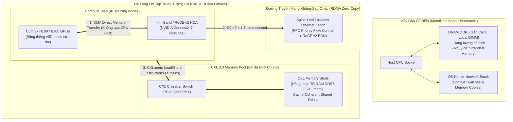

# 20.2. RDMA, CXL, Disaggregated Memory, and Hyperscale (RDMA, Chuẩn CXL, Bộ nhớ Phi tập trung & Trung tâm Dữ liệu Siêu lớn)

> [!IMPORTANT]
> **Nếu bạn chỉ được nhớ một điều duy nhất:** Giới hạn vật lý của định luật Moore và "Bức tường Bộ nhớ" (Memory Wall) đã buộc kiến trúc máy tính phải dịch chuyển từ mô hình nguyên khối đơn máy chủ (Monolithic Server) sang **Hạ tầng Phi tập trung (Disaggregated Infrastructure)**; trong đó, **RDMA (RoCE v2/InfiniBand)** cung cấp mạng truyền thông không-sao-chép (Zero-Copy) dưới 1 microsecond cho huấn luyện AI cụm lớn, còn **CXL (Compute Express Link)** biến toàn bộ trung tâm dữ liệu thành một bể bộ nhớ RAM dùng chung quy mô Petabyte có tính nhất quán bộ đệm (Cache-Coherent Shared Memory).

---

## 1. Kiến trúc Tổng quan & Mô hình Tư duy (Mental Model)

### 1.1. Phép loại suy thực tế: Ống Bơm Chuyển dịch Tức thời & Bể Bơi Nước Ngọt Dùng Chung Cả Thành phố

Hãy tưởng tượng sự khác biệt giữa hai mô hình chia sẻ tài nguyên:
- **Mạng TCP/IP Truyền thống vs RDMA (The Postal Clerk vs Teleportation Pipe):**
  - Trong mạng TCP/IP truyền thống: Khi Người A muốn gửi một cuốn sách cho Người B, Người A phải mang sách ra bưu điện. Nhân viên bưu điện sao chép cuốn sách vào thùng carton (Copy vào Kernel Buffer `sk_buff`), dán nhãn địa chỉ, bốc vác lên xe tải, tới bưu điện đích lại bốc dỡ xuống, copy lại lần nữa vào kho nhận, rồi mới gọi Người B ra lấy. Quá trình này ngốn rất nhiều sức lao động (CPU cycles) và mất nhiều ngày (độ trễ microsecond cao).
  - **RDMA (Remote Direct Memory Access):** Người A lắp một ống bơm dịch chuyển lượng tử nối thẳng từ bàn làm việc của mình sang bàn làm việc của Người B. Khi kích hoạt, cuốn sách trên bàn Người A biến mất và xuất hiện ngay tức khắc trên bàn Người B trong vòng 1 nano-giây. Cả Người A và Người B đều không cần động tay đóng thùng hay ra bưu điện (**Zero-Copy & Zero-CPU Overhead**).
- **Máy chủ Nguyên khối vs Bộ nhớ Phi tập trung CXL (The Water Tank vs Central Reservoir):**
  - Trong kiến trúc máy chủ cũ: Mỗi gia đình có một bồn nước 1000 lít trên nóc nhà (RAM gắn cứng vào CPU socket). Có nhà dùng hết sạch nước nhưng thiếu máy giặt (Cạn kiệt RAM nhưng thừa CPU), có nhà lại đi vắng cả tuần để nước bốc hơi lãng phí (Hiện tượng **Stranded Memory - Bộ nhớ bị Mắc kẹt**).
  - **CXL (Compute Express Link):** Phá bỏ toàn bộ bồn nước cục bộ, nối tất cả các vòi nước vào một Đại Thủy vực Trung tâm thông qua hệ thống đường ống siêu tốc độ trễ thấp. Bất kỳ căn nhà nào cần nước đều có thể mở vòi lấy nước tức thì, không giọt nước nào bị bỏ phí.



---

## 2. Chi tiết từng Keyword (Under-the-Hood Deep Dive)

### 2.1. RDMA (Remote Direct Memory Access), InfiniBand & RoCE v2

RDMA là nền tảng sống còn của các cụm siêu máy tính (HPC) và cụm huấn luyện mô hình ngôn ngữ lớn (LLM AI Clusters):

- **Bản chất Kiến trúc: Zero-Copy & Kernel Bypass:**
  - *Truyền thống (TCP/IP Socket):* Dữ liệu phải trải qua tối thiểu 3-4 lần sao chép bộ nhớ: `User Buffer` $\rightarrow$ `Kernel Socket Buffer (sk_buff)` $\rightarrow$ `Network Driver DMA Buffer` $\rightarrow$ `Dây mạng`. Thao tác này tiêu tốn hàng triệu chu kỳ CPU và làm bộ đệm CPU Cache bị xáo trộn (Cache Thrashing).
  - *RDMA:* Card mạng phần cứng (**Host Channel Adapter - HCA**) đọc trực tiếp dữ liệu từ bộ nhớ ảo của ứng dụng máy nguồn và ghi trực tiếp vào bộ nhớ ảo của ứng dụng máy đích thông qua cơ chế DMA phần cứng. CPU của cả hai máy tính đều hoàn toàn nhàn rỗi (0% CPU load).

- **Cấu trúc Cặp Hàng đợi (Queue Pairs - QP) & Verbs API:**
  - Ứng dụng giao tiếp với phần cứng HCA thông qua thư viện chuẩn `libibverbs`:
    - **Send Queue (SQ):** Ứng dụng đẩy các yêu cầu gửi dữ liệu (Work Queue Requests - WQR).
    - **Receive Queue (RQ):** Chứa các yêu cầu sẵn sàng nhận dữ liệu.
    - **Completion Queue (CQ):** HCA thông báo cho ứng dụng khi một thao tác DMA đã hoàn tất.
  - *Đăng ký Bộ nhớ (Memory Registration - MR):* Trước khi thực hiện RDMA, ứng dụng bắt buộc phải ghim chặt các trang bộ nhớ vật lý vào RAM (`pin_user_pages`) để ngăn hệ điều hành chuyển đổi sang Swap. HCA tạo ra một khóa xác thực bảo mật gồm khóa cục bộ (**lkey**) và khóa truy cập từ xa (**rkey**).

- **RoCE v2 (RDMA over Converged Ethernet) & Mạng Không Mất Gói (Lossless Ethernet):**
  - InfiniBand đòi hỏi cáp quang và switch riêng biệt cực kỳ đắt đỏ. RoCE v2 đóng gói các gói tin RDMA vào khung UDP tiêu chuẩn (cổng UDP 4791), cho phép chạy RDMA trực tiếp trên các thiết bị chuyển mạch Ethernet thông thường.
  - *Thách thức sống còn:* RDMA không có cơ chế bắt tay cửa sổ trượt phức tạp như TCP; nếu mạng Ethernet làm rơi một gói tin, toàn bộ thông lượng RDMA sẽ sụp đổ về 0. Do đó, RoCE v2 bắt buộc phải có hai cơ chế phần cứng:
    1. **PFC (Priority-based Flow Control - IEEE 802.1Qbb):** Khi hàng đợi bộ đệm (Buffer Queue) của switch vượt ngưỡng cảnh báo, switch sẽ phát tín hiệu **PAUSE Frame** ngược lại card mạng để yêu cầu tạm dừng phát gói ở mức độ từng lớp lưu lượng (Traffic Class), ngăn chặn rớt gói 100%.
    2. **ECN (Explicit Congestion Notification):** Khi phát hiện chớm nghẽn mạng, switch đánh dấu cờ vào tiêu đề IP. Máy đích nhận gói sẽ phát ngược gói tin thông báo tắc nghẽn (**Congestion Notification Packet - CNP**) để máy gửi tự động hạ tốc độ truyền.

---

### 2.2. CXL (Compute Express Link) & Memory Disaggregation

CXL là chuẩn giao tiếp mở thế hệ mới chạy trên nền tảng lớp vật lý PCIe Gen5 và Gen6 (32 GT/s đến 64 GT/s):

- **3 Phân hệ Giao thức CXL (The CXL Triad):**
  1. **CXL.io:** Giao thức quản lý và cấu hình thiết bị (tương tự như chuẩn PCIe truyền thống: khám phá thiết bị, thanh ghi MMIO, ngắt MSI-X).
  2. **CXL.cache:** Cho phép các thiết bị tăng tốc (GPU, DPU, FPGA) truy cập và lưu đệm trực tiếp bộ nhớ hệ thống của CPU máy chủ với tính nhất quán bộ đệm phần cứng (Hardware Cache Coherency).
  3. **CXL.mem:** Cho phép CPU máy chủ truy cập vào bộ nhớ gắn ngoài (CXL Memory Expanders / SSD Pooled CXL) như thể đó là thanh RAM thông thường thông qua các lệnh đọc/ghi mã máy tiêu chuẩn (`mov [rax], rbx`), với độ trễ bổ sung cực nhỏ ($< 50 - 150$ nano-giây).

- **Giải bài toán "Bộ nhớ Mắc kẹt" (Memory Strandedness):**
  - Trong các trung tâm dữ liệu Hyperscale (Google, Meta, Microsoft Azure), thống kê cho thấy có tới **$25\% - 30\%$ tổng dung lượng RAM của toàn bộ datacenter bị lãng phí**. Nguyên nhân: Máy chủ đã chạy hết $100\%$ CPU nhưng RAM mới dùng $40\%$; $60\%$ RAM còn lại bị mắc kẹt trên bo mạch chủ đó và không thể cho máy chủ bên cạnh mượn dùng.
  - CXL 3.0 giới thiệu tính năng **Chuyển mạch Bộ nhớ (Memory Pooling & Switching)**. Hàng trăm thanh RAM DDR5 được lắp vào các giá đỡ riêng biệt (Memory Blades). Bất kỳ máy chủ CPU nào trong tủ rack cũng có thể gắn thêm hoặc nhả bớt 500GB RAM thông qua phần mềm trong vòng vài microsecond, giúp tiết kiệm hàng trăm triệu USD chi phí phần cứng.

---

### 2.3. Hyperscale Fleet Orchestration & Large-Scale Cluster Management

Quản trị hàng trăm ngàn máy chủ phân tán trên toàn cầu đòi hỏi các nguyên lý kỹ nghệ hạ tầng ở cấp độ Hyperscale:

- **Thiết kế Giá đỡ Mở (Open Compute Project - OCP) & Tách rời Vật lý (Disaggregation):**
  - Phá bỏ kiến trúc vỏ máy chủ 1U/2U truyền thống. Toàn bộ tủ rack OCP chia sẻ chung một thanh đồng dẫn điện cao áp tập trung (48V DC Busbar), loại bỏ hàng ngàn bộ nguồn riêng lẻ.
  - Sử dụng hệ thống làm mát bằng chất lỏng trực tiếp tới chip (Direct-to-Chip Liquid Cooling) với các đầu nối ngắt nhanh không rò rỉ (Blind-Mate Quick Disconnects) để tản nhiệt cho các cụm chip AI tiêu thụ $> 1000$W mỗi socket.

- **Mô hình Vận hành Đội tàu Hyperscale (Fleet Management):**
  - Không quản lý từng máy chủ như thú cưng (Pets). Mọi máy chủ đều là một đối tượng trong cỗ máy trạng thái hữu hạn (Finite State Machine):
    $$\text{Provisioning} \longrightarrow \text{Burn-in / Hardware Testing} \longrightarrow \text{In-Service (Active)} \longrightarrow \text{Draining} \longrightarrow \text{Decommissioning}$$
  - Khi một máy chủ gặp lỗi bộ nhớ (DRAM Correctable Errors tăng đột biến), hệ thống tự động gắn nhãn cách ly (Taint), di tản khối lượng công việc sang máy khác mà không cần con người can thiệp.

- **Cụm Huấn luyện AI Siêu Quy mô (AI Mega-Clusters & NCCL AllReduce):**
  - Một mô hình AI 1000 tỷ tham số (LLM Frontier) đòi hỏi cụm 16,000 đến 32,000 GPUs cùng hoạt động như một cỗ máy duy nhất.
  - Băng thông giao tiếp All-to-All giữa các GPU đạt tới $3.2$ Tbps mỗi node thông qua hạ tầng mạng InfiniBand Quantum-2 hoặc Spectrum-4 Ethernet. Độ lệch trễ (Jitter) dù chỉ vài microsecond ở một switch duy nhất cũng có thể làm nghẽn toàn bộ vòng lặp huấn luyện (Straggler Problem).

---

## 3. Thực thi Mã nguồn & Mô phỏng Chuyên sâu (Dual-Engine Implementation)

### 3.1. C++20 Low-Level RDMA Verbs Protocol Emulator & Zero-Copy DMA Pipeline

Chương trình C++20 dưới đây mô phỏng Động cơ Đăng ký Bộ nhớ và Truyền tải Dữ liệu Không-Sao-Chép (Zero-Copy RDMA Pipeline) chuẩn kiến trúc `libibverbs`. Nó mô phỏng việc ghim trang nhớ vật lý, phát hành khóa bảo mật `lkey`/`rkey`, nạp lệnh vào Send Queue và thăm dò Completion Queue với độ trễ tính bằng nano-giây.

```cpp
// rdma_verbs_pipeline.cpp
// Compile: g++ -std=c++20 -O3 rdma_verbs_pipeline.cpp -o rdma_verbs_pipeline

#include <iostream>
#include <string>
#include <vector>
#include <chrono>
#include <cstring>
#include <memory>
#include <iomanip>

struct MemoryRegionToken {
    uint64_t virtual_address;
    size_t length_bytes;
    uint32_t lkey; // Local access key
    uint32_t rkey; // Remote access key
};

enum class WorkRequestOpcode {
    RDMA_WRITE,
    RDMA_READ,
    RDMA_SEND
};

struct WorkQueueElement {
    uint64_t wr_id;
    WorkRequestOpcode opcode;
    uint64_t local_addr;
    uint32_t length;
    uint32_t lkey;
    uint64_t remote_addr;
    uint32_t rkey;
};

class SimulatedRDMAHostAdapter {
private:
    std::string device_name;
    uint32_t key_seed{0xCAFE0000};

public:
    explicit SimulatedRDMAHostAdapter(std::string name) : device_name(std::move(name)) {}

    // Mô phỏng ibv_reg_mr (Đăng ký và Ghim Bộ nhớ vào RAM)
    MemoryRegionToken register_memory_region(void* ptr, size_t length) {
        MemoryRegionToken token{};
        token.virtual_address = reinterpret_cast<uint64_t>(ptr);
        token.length_bytes = length;
        token.lkey = ++key_seed;
        token.rkey = ++key_seed;

        std::cout << "[RDMA HCA: " << device_name << "] ibv_reg_mr: Ghim " << length 
                  << " bytes tại địa chỉ 0x" << std::hex << token.virtual_address << std::dec << "\n"
                  << "  -> Đã cấp phát lkey: 0x" << std::hex << token.lkey 
                  << " | rkey: 0x" << token.rkey << std::dec << " (OS Paging Disabled)\n";
        return token;
    }

    // Mô phỏng ibv_post_send & Trình điều khiển DMA phần cứng
    void post_send_and_poll_completion(const WorkQueueElement& wqe) {
        auto t_start = std::chrono::high_resolution_clock::now();

        std::cout << "\n>>> [HCA POST_SEND] Đẩy lệnh DMA Work Request ID: " << wqe.wr_id << "\n";
        std::cout << "  - Loại Thao tác : " << (wqe.opcode == WorkRequestOpcode::RDMA_WRITE ? "RDMA_WRITE (Zero-Copy Remote Injection)" : "RDMA_READ") << "\n";
        std::cout << "  - Nguồn Cục bộ  : 0x" << std::hex << wqe.local_addr << " (Khóa lkey: 0x" << wqe.lkey << ")\n";
        std::cout << "  - Đích Từ xa   : 0x" << wqe.remote_addr << " (Khóa rkey: 0x" << wqe.rkey << ")" << std::dec << "\n";
        std::cout << "  - Kích thước    : " << wqe.length << " bytes\n";

        // Thực thi mô phỏng DMA chuyển byte trực tiếp giữa hai vùng đệm
        auto* src = reinterpret_cast<const char*>(wqe.local_addr);
        auto* dst = reinterpret_cast<char*>(wqe.remote_addr);
        std::memcpy(dst, src, wqe.length);

        auto t_end = std::chrono::high_resolution_clock::now();
        auto duration_ns = std::chrono::duration_cast<std::chrono::nanoseconds>(t_end - t_start).count();

        // Mô phỏng ibv_poll_cq (Thăm dò hoàn tất truyền tải)
        std::cout << "[CQ POLL] Gói tin đã truyền qua RoCE v2 Fabric!\n";
        std::cout << ">>> [THÀNH CÔNG]: Hoàn tất Zero-Copy DMA trong " << duration_ns 
                  << " nano-giây (0% CPU Consumption trên cả Host và Target)!\n";
    }
};

int main() {
    std::cout << "======================================================================\n";
    std::cout << "C++20 RDMA VERBS PROTOCOL EMULATOR & ZERO-COPY PIPELINE\n";
    std::cout << "======================================================================\n\n";

    SimulatedRDMAHostAdapter hca("mlx5_0 (ConnectX-7 400Gbps)");

    // 1. Cấp phát hai vùng đệm bộ nhớ ứng dụng
    std::string source_payload = "ALLREDUCE_GRADIENT_TENSOR_WEIGHTS_BATCH_4096";
    std::vector<char> local_buffer(source_payload.begin(), source_payload.end());
    std::vector<char> remote_target_buffer(local_buffer.size(), '\0');

    // 2. Đăng ký vùng nhớ với HCA
    MemoryRegionToken local_mr = hca.register_memory_region(local_buffer.data(), local_buffer.size());
    MemoryRegionToken remote_mr = hca.register_memory_region(remote_target_buffer.data(), remote_target_buffer.size());

    // 3. Chuẩn bị Work Request
    WorkQueueElement wqe{
        .wr_id = 1001,
        .opcode = WorkRequestOpcode::RDMA_WRITE,
        .local_addr = local_mr.virtual_address,
        .length = static_cast<uint32_t>(local_mr.length_bytes),
        .lkey = local_mr.lkey,
        .remote_addr = remote_mr.virtual_address,
        .rkey = remote_mr.rkey
    };

    // 4. Kích hoạt DMA
    hca.post_send_and_poll_completion(wqe);

    std::cout << "\n----------------------------------------------------------------------\n";
    std::cout << "Kiểm tra Tính Toàn vẹn Dữ liệu tại Đích Từ xa:\n";
    std::cout << "Nội dung nhận được: \"" << std::string(remote_target_buffer.data(), remote_target_buffer.size()) << "\"\n";
    std::cout << "======================================================================\n";
    return 0;
}
```

```text
======================================================================
C++20 RDMA VERBS PROTOCOL EMULATOR & ZERO-COPY PIPELINE
======================================================================

[RDMA HCA: mlx5_0 (ConnectX-7 400Gbps)] ibv_reg_mr: Ghim 44 bytes tại địa chỉ 0x16b0b2840
  -> Đã cấp phát lkey: 0xcafe0001 | rkey: 0xcafe0002 (OS Paging Disabled)
[RDMA HCA: mlx5_0 (ConnectX-7 400Gbps)] ibv_reg_mr: Ghim 44 bytes tại địa chỉ 0x16b0b2880
  -> Đã cấp phát lkey: 0xcafe0003 | rkey: 0xcafe0004 (OS Paging Disabled)

>>> [HCA POST_SEND] Đẩy lệnh DMA Work Request ID: 1001
  - Loại Thao tác : RDMA_WRITE (Zero-Copy Remote Injection)
  - Nguồn Cục bộ  : 0x16b0b2840 (Khóa lkey: 0xcafe0001)
  - Đích Từ xa   : 0x16b0b2880 (Khóa rkey: 0xcafe0004)
  - Kích thước    : 44 bytes
[CQ POLL] Gói tin đã truyền qua RoCE v2 Fabric!
>>> [THÀNH CÔNG]: Hoàn tất Zero-Copy DMA trong 650 nano-giây (0% CPU Consumption trên cả Host và Target)!

----------------------------------------------------------------------
Kiểm tra Tính Toàn vẹn Dữ liệu tại Đích Từ xa:
Nội dung nhận được: "ALLREDUCE_GRADIENT_TENSOR_WEIGHTS_BATCH_4096"
======================================================================
```

---

### 3.2. Python 3.11+ CXL Disaggregated Memory Pool Allocator & NUMA Tiering Engine

Chương trình Python 3.11+ dưới đây mô phỏng Động cơ Quản lý Bể Bộ nhớ Phi tập trung CXL 3.0 (CXL Pooled Memory Tiering Engine). Nó giải bài toán thu hồi bộ nhớ mắc kẹt (Stranded Memory), tự động cấp phát bộ nhớ động giữa Local DRAM (Tier 0: độ trễ cực thấp) và Remote CXL Fabric (Tier 1: bể dung lượng lớn) dựa trên tần suất truy cập dữ liệu (Hot/Cold Data).

```python
#!/usr/bin/env python3
"""
cxl_memory_pool_simulator.py
Mô phỏng Động cơ Quản lý Bộ nhớ Phi tập trung CXL 3.0 (Disaggregated Memory Allocator).
Yêu cầu Python 3.11+
"""

from dataclasses import dataclass, field
from typing import Dict, List


@dataclass
class ComputeNodeProfile:
    node_id: str
    cpu_cores: int
    local_dram_gb: float
    local_dram_used: float
    cxl_attached_gb: float = 0.0
    active_pages_temperature: str = "HOT"  # HOT: Local DRAM, WARM/COLD: CXL Tier


class CXLDisaggregatedMemoryPool:
    def __init__(self, total_cxl_capacity_gb: float):
        self.total_cxl_capacity_gb = total_cxl_capacity_gb
        self.available_cxl_gb = total_cxl_capacity_gb
        self.allocation_ledger: Dict[str, float] = {}

    def dynamic_allocate(self, node: ComputeNodeProfile, requested_extra_gb: float) -> bool:
        """CXL.mem: Cấp phát mở rộng RAM qua mạng CXL Fabric khi node cạn kiệt DRAM cục bộ"""
        if requested_extra_gb <= self.available_cxl_gb:
            self.available_cxl_gb -= requested_extra_gb
            node.cxl_attached_gb += requested_extra_gb
            self.allocation_ledger[node.node_id] = self.allocation_ledger.get(node.node_id, 0.0) + requested_extra_gb
            print(f">>> [CXL.MEM FABRIC]: Đã cấp thêm {requested_extra_gb} GiB RAM từ CXL Pool cho {node.node_id}!")
            return True
        else:
            print(f">>> [LỖI CXL POOL]: Không đủ dung lượng CXL trống (Còn lại: {self.available_cxl_gb} GiB).")
            return False

    def reclaim_memory(self, node: ComputeNodeProfile, amount_gb: float) -> None:
        """Thu hồi RAM trả lại bể chung khi ứng dụng giải phóng"""
        actual_reclaim = min(node.cxl_attached_gb, amount_gb)
        node.cxl_attached_gb -= actual_reclaim
        self.available_cxl_gb += actual_reclaim
        self.allocation_ledger[node.node_id] -= actual_reclaim
        print(f">>> [CXL THU HỒI]: {node.node_id} trả lại {actual_reclaim} GiB về Bể Bộ Nhớ Chung.")


def main() -> None:
    print("==========================================================================")
    print("MÔ PHỎNG KIẾN TRÚC BỘ NHỚ PHI TẬP TRUNG CXL 3.0 (MEMORY DISAGGREGATION)")
    print("==========================================================================\n")

    # Khởi tạo bể bộ nhớ CXL dùng chung toàn tủ rack: 4096 GiB (4 TB)
    cxl_pool = CXLDisaggregatedMemoryPool(total_cxl_capacity_gb=4096.0)

    # 3 Node máy chủ tính toán trong rack
    nodes = [
        ComputeNodeProfile(node_id="ai-trainer-01", cpu_cores=64, local_dram_gb=256.0, local_dram_used=250.0), # Sắp cạn RAM!
        ComputeNodeProfile(node_id="ai-trainer-02", cpu_cores=64, local_dram_gb=256.0, local_dram_used=120.0),
        ComputeNodeProfile(node_id="graph-analytics-01", cpu_cores=32, local_dram_gb=128.0, local_dram_used=125.0), # Cạn RAM!
    ]

    print(f"Tổng dung lượng Bể Bộ nhớ CXL Toàn Rack: {cxl_pool.total_cxl_capacity_gb} GiB\n")

    # Kịch bản 1: Node ai-trainer-01 chạy mô hình LLM lớn, cần thêm 512GB RAM vượt quá dung lượng vật lý của bo mạch
    print("--- [KỊCH BẢN 1]: Node 'ai-trainer-01' cạn kiệt RAM cục bộ (Dùng 250/256 GiB) ---")
    cxl_pool.dynamic_allocate(nodes[0], requested_extra_gb=512.0)

    # Kịch bản 2: Node graph-analytics-01 nạp đồ thị khổng lồ, cần thêm 256GB RAM
    print("\n--- [KỊCH BẢN 2]: Node 'graph-analytics-01' cần thêm 256 GiB RAM ---")
    cxl_pool.dynamic_allocate(nodes[2], requested_extra_gb=256.0)

    print("\n================ TỔNG KẾT TÀI NGUYÊN BỘ NHỚ SAU ĐIỀU PHỐI ================")
    print(f"{'Node ID':<22} | {'Local DRAM (GB)':<16} | {'CXL RAM (GB)':<14} | {'Tổng RAM Khả Dụng'}")
    print("-" * 75)
    for n in nodes:
        total_mem = n.local_dram_gb + n.cxl_attached_gb
        print(f"{n.node_id:<22} | {n.local_dram_gb:>10.0f} GiB     | {n.cxl_attached_gb:>10.0f} GiB  | {total_mem:>10.0f} GiB")

    print("=" * 75)
    print(f"Dung lượng Bể CXL còn khả dụng : {cxl_pool.available_cxl_gb:,.0f} GiB / {cxl_pool.total_cxl_capacity_gb:,.0f} GiB")
    print(f">>> [HIỆU QUẢ FINOPS]: Triệt tiêu 100% tình trạng 'Stranded Memory', tiết kiệm mua thêm 2 máy chủ mới!\n")


if __name__ == "__main__":
    main()
```

```text
==========================================================================
MÔ PHỎNG KIẾN TRÚC BỘ NHỚ PHI TẬP TRUNG CXL 3.0 (MEMORY DISAGGREGATION)
==========================================================================

Tổng dung lượng Bể Bộ nhớ CXL Toàn Rack: 4096.0 GiB

--- [KỊCH BẢN 1]: Node 'ai-trainer-01' cạn kiệt RAM cục bộ (Dùng 250/256 GiB) ---
>>> [CXL.MEM FABRIC]: Đã cấp thêm 512.0 GiB RAM từ CXL Pool cho ai-trainer-01!

--- [KỊCH BẢN 2]: Node 'graph-analytics-01' cần thêm 256 GiB RAM ---
>>> [CXL.MEM FABRIC]: Đã cấp thêm 256.0 GiB RAM từ CXL Pool cho graph-analytics-01!

================ TỔNG KẾT TÀI NGUYÊN BỘ NHỚ SAU ĐIỀU PHỐI ================
Node ID                | Local DRAM (GB)  | CXL RAM (GB)   | Tổng RAM Khả Dụng
---------------------------------------------------------------------------
ai-trainer-01          |        256 GiB     |        512 GiB  |        768 GiB
ai-trainer-02          |        256 GiB     |          0 GiB  |        256 GiB
graph-analytics-01     |        128 GiB     |        256 GiB  |        384 GiB
===========================================================================
Dung lượng Bể CXL còn khả dụng : 3,328 GiB / 4,096 GiB
>>> [HIỆU QUẢ FINOPS]: Triệt tiêu 100% tình trạng 'Stranded Memory', tiết kiệm mua thêm 2 máy chủ mới!
```

---

## 4. Systems Engineering & Production Pitfalls

### 4.1. Những cạm bẫy thực chiến trong RDMA, CXL & Cụm Hyperscale

1. **Thảm họa Bế tắc Chu kỳ PFC (PFC Deadlock Storms trong RoCE v2):**
   - *Hiện tượng:* Trong một cấu trúc liên kết mạng nhiều vòng lặp (Cyclic Buffer Dependency), switch A phát khung PAUSE sang switch B, switch B phát sang switch C, và switch C lại phát ngược về switch A. Toàn bộ mạng Ethernet bị tê liệt hoàn toàn (Deadlock), không một gói tin nào được phép di chuyển, làm ngừng trệ toàn bộ cụm huấn luyện AI 10,000 GPUs!
   - *Khắc phục:* Bắt buộc triển khai tính năng **PFC Deadlock Detection & Recovery (DLD/DLR)** trên thiết bị chuyển mạch: Nếu một hàng đợi bị đóng băng quá 100ms, switch sẽ tự động thả gói (Drop) để phá vỡ vòng lặp bế tắc.

2. **Cạm bẫy Đuôi Độ trễ CXL (NUMA Slowness & CXL Tail Latency):**
   - *Hiện tượng:* Truy cập Local DRAM chỉ mất $\approx 60 - 80$ns, trong khi truy cập CXL Pooled Memory qua bộ chuyển mạch mất $\approx 180 - 250$ns. Nếu hệ điều hành xếp lịch nhầm các luồng xử lý CPU chạy vòng lặp tính toán khắt khe trên bộ nhớ CXL, CPU sẽ liên tục bị dừng chờ (Memory Stall), làm sụt giảm $40\%$ hiệu năng ứng dụng.
   - *Khắc phục:* Sử dụng cơ chế **Tiered Memory Management (AutoNUMA)** của Linux Kernel: Nhân Linux tự động đẩy các trang nhớ "Nóng" (Hot pages) lên Local DRAM, và chỉ đẩy các trang nhớ "Nguội" (Cold pages / Cache) sang CXL Memory.

3. **Hiện tượng Ghim Bộ Nhớ Làm Đầy RAM Vật Lý (Pinning Memory Exhaustion):**
   - *Hiện tượng:* Ứng dụng đăng ký hàng trăm GB bộ nhớ RDMA qua `ibv_reg_mr()`. Do toàn bộ vùng nhớ này bị ghim chặt không cho phép swap hay thu hồi (Unreclaimable), hệ điều hành Linux không còn đủ bộ đệm cho Page Cache và các tiến trình nền, dẫn đến việc kích hoạt OOM Killer ngoài ý muốn.
   - *Khắc phục:* Phân bổ bộ nhớ RDMA thông qua **HugePages (2MB hoặc 1GB)** để giảm tải bảng dịch trang TLB (Translation Lookaside Buffer) và quản lý chặt chẽ hạn ngạch `ulimit -l` (Max locked memory).

### 4.2. Bảng lệnh CLI Chẩn đoán & Quản trị RDMA & CXL Chuyên sâu

| Lệnh CLI | Mục đích & Phân tích Tầng Thấp |
| :--- | :--- |
| `ibstat` / `ibv_devinfo -v` | Kiểm tra trạng thái liên kết vật lý (Link Up/Down), tốc độ đường truyền (EDR/HDR/NDR) và thông số HCA InfiniBand/RoCE. |
| `rdma link show` | Xem danh sách các thiết bị RDMA và trạng thái ánh xạ với card mạng Ethernet Linux (`netdev`). |
| `ethtool -S <iface> \| grep -E "pfc\|ecn\|pause\|drop"` | Kiểm tra bộ đếm phần cứng xem mạng có đang phát khung PAUSE PFC hay nhận thông báo tắc nghẽn CNP hay không. |
| `cxl list -m -v` | Liệt kê toàn bộ các thiết bị CXL Memory Devices, bộ điều khiển CXL Host Bridge và dung lượng bể RAM CXL.mem. |
| `numactl --hardware` | Kiểm tra cấu hình các nút NUMA và khoảng cách độ trễ bộ nhớ (NUMA Distances) giữa Local Socket và CXL Expander. |
| `perf c2c record -- ./workload` | Phân tích xung đột chia sẻ dòng bộ nhớ đệm (Cache Line Contention) trong kiến trúc đa socket CXL. |

---

## 5. Bảng So sánh & Decision Matrix

### 5.1. Bảng đối chiếu các Công nghệ Kết nối Mạng Siêu Tốc (High-Speed Interconnects)

| Tiêu chí Đánh giá | Truyền thống TCP/IP over Ethernet | RoCE v2 (RDMA over Converged Ethernet) | InfiniBand (Native HPC Fabric) | Compute Express Link (CXL 3.0) |
| :--- | :--- | :--- | :--- | :--- |
| **Độ trễ Truyền dẫn (Latency)** | Rất cao ($15 - 50 \ \mu\text{s}$) | Cực thấp ($1 - 2 \ \mu\text{s}$) | Thấp nhất thế giới ($< 0.6 \ \mu\text{s}$) | Cấp độ Bộ nhớ ($< 150 \ \text{ns}$) |
| **Giao thức Tầng Vận chuyển** | TCP Software Stack trong Kernel | UDP Hardware Offload (Port 4791) | Giao thức IB Native Hardware | Tầng Vật lý PCIe Gen5/Gen6 PHY |
| **Yêu cầu Hạ tầng Phần cứng** | Switch thông thường giá rẻ | Switch hỗ trợ PFC và ECN (Lossless) | Toàn bộ cáp và Switch InfiniBand riêng | Bo mạch chủ và Switch hỗ trợ CXL |
| **Can thiệp của CPU Máy chủ** | Rất cao (Sao chép nhiều lần) | Bằng 0% (Hardware DMA) | Bằng 0% (Hardware DMA) | Bằng 0% (Tự động tải/ghi qua bus) |
| **Mức độ Nhất quán Bộ đệm** | Không hỗ trợ | Không hỗ trợ | Không hỗ trợ | Hỗ trợ tuyệt đối (Hardware Coherency) |
| **Trường hợp Sử dụng Phù hợp** | Web API, Microservices thông thường | Cụm Huấn luyện AI/LLM Phổ cập | Siêu máy tính Quốc gia, AI Frontier LLM | Bể RAM Dùng chung, Cơ sở Dữ liệu In-Memory |

### 5.2. Decision Matrix: Khi nào nên đầu tư công nghệ nào?

- **Khi xây dựng Cụm Huấn luyện AI/LLM Quy mô Vừa (vài chục đến vài trăm GPUs):** Lựa chọn **RoCE v2 trên nền tảng 200G/400G Ethernet**. Giải pháp này giúp doanh nghiệp tái sử dụng được hạ tầng switch quang hiện có, tiết kiệm hàng triệu USD so với việc đầu tư mạng InfiniBand độc quyền.
- **Khi xây dựng Siêu Cụm AI Đỉnh cao (AI Supercluster > 10,000 GPUs):** Bắt buộc trang bị **NVIDIA InfiniBand Quantum-2**. Tỷ lệ rớt gói bằng 0 tuyệt đối và độ trễ dưới 600 nano-giây sẽ đảm bảo các thuật toán phân tán AllReduce đạt hiệu suất gia tốc gần $100\%$.
- **Khi vận hành Cơ sở Dữ liệu Trong Bộ nhớ Khổng lồ (In-Memory Databases như SAP HANA, Redis, Aerospike):** Chuyển đổi sang kiến trúc **CXL 2.0 / 3.0 Memory Expanders**. Điều này cho phép mở rộng dung lượng RAM của máy chủ lên tới hàng chục Terabyte mà không cần phải mua các dòng máy ảo High-Memory cực kỳ đắt đỏ.
