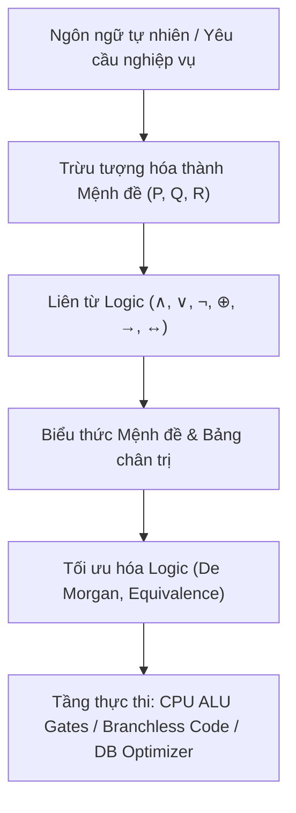
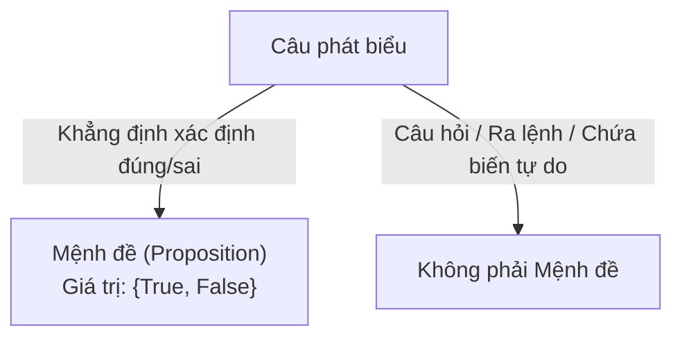
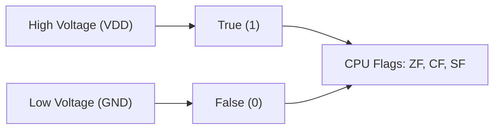
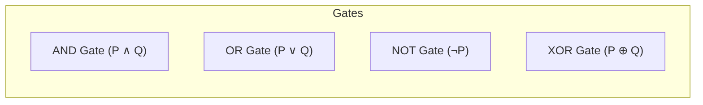

# 1.1. Propositional Logic (Logic Mệnh đề)

## Tổng quan về Propositional Logic
**Logic mệnh đề (Propositional Logic / Sentential Logic)** là một phân nhánh sơ cấp và nền tảng nhất của logic toán học, nghiên cứu về các phát biểu (mệnh đề) có chân trị xác định và các phương thức kết hợp chúng thông qua các liên từ logic.
- **Tư tưởng cốt lõi**: Trừu tượng hóa các câu khẳng định trong ngôn ngữ tự nhiên thành các biến logic mang giá trị Nhị phân (Boolean: Đúng / Sai), từ đó thiết lập các quy tắc suy diễn hình thức không phụ thuộc vào ngữ nghĩa chi tiết của từng đối tượng bên trong câu.
- **Bản chất dưới tầng máy tính (Hardware & Compiler Level)**: Toàn bộ vi kiến trúc CPU hiện đại (ALU, Logic Gates: AND, OR, NOT, XOR, NAND, NOR) và hệ thống rẽ nhánh của trình biên dịch đều vận hành trực tiếp dựa trên các định luật của logic mệnh đề. Một biểu thức logic phức tạp trong code cấp cao sẽ được Compiler tối ưu hóa bằng các luật logic tương đương (Boolean Simplification) để giảm thiểu số lượng lệnh nhảy rẽ nhánh (`JNE`, `JE`, `CMP`) hoặc chuyển hóa thành SIMD bitwise mask không rẽ nhánh (branchless programming).



---

## 2. Chi tiết từng Keyword (Under-the-Hood Deep Dive)

### 1. Proposition (Mệnh đề)

#### 1. Khái niệm bản chất (What & Why)
- **Mệnh đề (Proposition)** là một câu khẳng định mang một giá trị chân lý duy nhất và dứt khoát: hoặc **Đúng (True)** hoặc **Sai (False)**, không thể vừa đúng vừa sai, và không thể mập mờ không xác định.
- Các câu hỏi, câu mệnh lệnh, câu cảm thán, hoặc các biểu thức chứa biến chưa định lượng (ví dụ: "$x + 2 = 5$") **không** phải là mệnh đề.
- Ký hiệu quy ước: $P, Q, R, S \dots$

#### 2. Cơ chế hoạt động sâu (Under the hood)
- Trong bộ nhớ máy tính, một mệnh đề nguyên tử được biểu diễn tối thiểu bằng 1 bit (`1` tương ứng với `True`, `0` tương ứng với `False`). Tuy nhiên, do kiến trúc byte-addressable của vi xử lý (x86_64, ARM64), một biến kiểu `bool` trong C++ thường chiếm 1 byte (8 bits) để đảm bảo CPU có thể đánh địa chỉ trực tiếp mà không cần dùng lệnh mặt nạ bit (bitmask).
- Khi xử lý hàng triệu mệnh đề, các cấu trúc nén như `std::vector<bool>` hoặc `std::bitset` sẽ gom 64 mệnh đề vào một thanh ghi 64-bit (`uint64_t`) để tận dụng tính toán song song ở cấp độ bitwise.

#### 3. Sơ đồ minh họa


#### 4. Code ví dụ thực chiến (C++ > TypeScript)
```cpp
#include <iostream>
#include <type_traits>

// Minh họa kích thước ô nhớ của Proposition (bool) trong C++20
int main() {
    bool is_service_healthy = true;  // Mệnh đề P
    bool is_disk_full = false;       // Mệnh đề Q

    std::cout << "Kích thước của bool: " << sizeof(is_service_healthy) << " byte(s)\n";
    // Mặc dù chỉ cần 1 bit thông tin, kiến trúc x86_64 cấp phát 1 byte để tối ưu tốc độ định địa chỉ
    
    return 0;
}
```

```typescript
// TypeScript: Định nghĩa mệnh đề với kiểu hằng ngữ nghĩa
const isDatabaseConnected: boolean = true;
const isMemoryExceeded: boolean = false;
```

#### 5. Pitfalls & Anti-patterns
- Nhầm lẫn giữa câu chứa biến tự do ("$x > 0$") với mệnh đề: Trong code, nếu biến `x` chưa được khởi tạo (uninitialized variable trong C++), việc đánh giá mệnh đề sẽ dẫn đến hành vi bất định (Undefined Behavior).

#### 6. Ứng dụng thực tế trong Backend
- Đánh giá trạng thái Health-check của microservices (Liveness probe, Readiness probe trong Kubernetes).

---

### 2. Truth Value (Giá trị chân lý / Chân trị)

#### 1. Khái niệm bản chất
- Chân trị của một mệnh đề là sự phản ánh tính đúng đắn khách quan của mệnh đề đó so với thực tế. Trong logic nhị phân kinh điển (Classical Boolean Logic), tập chân trị chỉ gồm hai phần tử: $\mathbb{B} = \{\text{True}, \text{False}\}$, ký hiệu toán học là $T / F$ hoặc $1 / 0$.

#### 2. Cơ chế hoạt động sâu
- Trong CPU, chân trị ánh xạ trực tiếp tới mức điện áp: điện áp cao ($V_{dd} \approx 1.8V - 5V$) biểu thị mức logic $1$, điện áp thấp ($GND \approx 0V$) biểu thị mức logic $0$.
- Cờ trạng thái `ZF` (Zero Flag) trong thanh ghi `EFLAGS` của CPU thường được thiết lập dựa trên chân trị của phép so sánh (`TEST`, `CMP`). Nếu kết quả là $0$, `ZF = 1`, CPU sẽ quyết định thực hiện bước nhảy (`JZ`/`JE`).

#### 3. Sơ đồ minh họa


#### 4. Code ví dụ thực chiến (C++)
```cpp
#include <iostream>

int main() {
    bool p = (10 > 5); // Chân trị: True
    bool q = (2 + 2 == 5); // Chân trị: False

    std::cout << std::boolalpha;
    std::cout << "P truth value: " << p << " (Numeric: " << +p << ")\n";
    std::cout << "Q truth value: " << q << " (Numeric: " << +q << ")\n";
    return 0;
}
```

#### 5. Pitfalls & Anti-patterns
- Trong SQL hoặc JavaScript, khái niệm 3-valued logic (True, False, `NULL`/`undefined`) thường gây ra lỗi tiềm tàng khi so sánh `NULL = NULL` trả về `UNKNOWN` thay vì `TRUE`.

#### 6. Ứng dụng thực tế trong Backend
- Triển khai hệ thống đánh cờ (Feature Flags), hệ thống đánh giá tính toàn vẹn dữ liệu (Data Integrity Constraints).

---

### 3. Logical Connectives & Basic Operators (Các liên từ logic cơ bản)

Mệnh đề phức hợp được xây dựng từ các mệnh đề sơ cấp thông qua các liên từ logic:

#### A. AND (Conjunction - Hội) $\land$
- **Định nghĩa**: $P \land Q$ chỉ đúng khi và chỉ khi cả $P$ và $Q$ đều đúng.
- **Under the hood**: Tương ứng với cổng logic `AND`. Trong mã máy, Compiler tối ưu biểu thức $P \land Q$ bằng cơ chế Short-circuit evaluation: nếu $P$ sai, CPU sẽ nhảy qua không tính toán $Q$.

#### B. OR (Disjunction - Tuyển) $\lor$
- **Định nghĩa**: $P \lor Q$ đúng khi ít nhất một trong hai mệnh đề $P$ hoặc $Q$ đúng.
- **Under the hood**: Tương ứng với cổng logic `OR`. Nếu $P$ đúng, CPU bỏ qua việc đánh giá $Q$.

#### C. NOT (Negation - Phủ định) $\neg$ hoặc $\sim$
- **Định nghĩa**: Phủ định của $P$ ($\neg P$) đảo ngược chân trị của $P$. Đúng thành Sai, Sai thành Đúng.
- **Under the hood**: Tương ứng với cổng `NOT` (Inverter gate) hoặc lệnh CPU `NOT`/`XOR reg, 1`.

#### D. XOR (Exclusive OR - Tuyển loại trừ) $\oplus$
- **Định nghĩa**: $P \oplus Q$ đúng khi và chỉ khi chính xác một trong hai mệnh đề $P, Q$ đúng (hai mệnh đề có chân trị khác nhau).
- **Under the hood**: Tương ứng với cổng `XOR`. Lệnh CPU `XOR RAX, RAX` là cách nhanh nhất và tốn ít bytes nhất để set thanh ghi về `0` (Zeroing register).

#### Sơ đồ minh họa Cổng Logic


#### Code ví dụ thực chiến (C++ Bitwise vs Logical)
```cpp
#include <iostream>
#include <cstdint>

int main() {
    uint8_t P = 0b1100;
    uint8_t Q = 0b1010;

    // Bitwise AND: 0b1000
    uint8_t and_res = P & Q;
    // Bitwise OR:  0b1110
    uint8_t or_res  = P | Q;
    // Bitwise XOR: 0b0110
    uint8_t xor_res = P ^ Q;
    // Bitwise NOT: ~P
    uint8_t not_p   = ~P;

    std::cout << "AND: " << std::hex << (int)and_res << "\n";
    std::cout << "OR:  " << std::hex << (int)or_res << "\n";
    std::cout << "XOR: " << std::hex << (int)xor_res << "\n";
    return 0;
}
```

---

### 4. Implication & Biconditional (Kéo theo và Tương đương)

#### A. Implication (Conditional - Mệnh đề kéo theo) $P \to Q$
- **Định nghĩa**: "Nếu $P$ thì $Q$". Mệnh đề $P \to Q$ **chỉ sai duy nhất khi tiền đề $P$ đúng nhưng kết luận $Q$ sai**. Khi tiền đề $P$ sai, bất kể $Q$ đúng hay sai thì mệnh đề kéo theo luôn đúng (Vacuous Truth - Đúng chân không).
- **Quy đổi tương đương**:
  $$P \to Q \equiv \neg P \lor Q$$

#### B. Biconditional (Mệnh đề tương đương / Hai chiều) $P \leftrightarrow Q$
- **Định nghĩa**: "$P$ khi và chỉ khi $Q$" ($P \text{ iff } Q$). Mệnh đề này đúng khi cả $P$ và $Q$ có cùng chân trị (cùng đúng hoặc cùng sai).
- **Quy đổi tương đương**:
  $$P \leftrightarrow Q \equiv (P \to Q) \land (Q \to P) \equiv (P \land Q) \lor (\neg P \land \neg Q) \equiv \neg(P \oplus Q)$$

#### Code minh họa (C++)
```cpp
#include <iostream>

// Hàm mô phỏng toán tử kéo theo P -> Q
constexpr bool implies(bool p, bool q) noexcept {
    return !p || q;
}

// Hàm mô phỏng toán tử tương đương P <-> Q
constexpr bool biconditional(bool p, bool q) noexcept {
    return p == q;
}

int main() {
    std::cout << std::boolalpha;
    std::cout << "False implies True: " << implies(false, true) << " (Vacuous truth)\n";
    std::cout << "True implies False:  " << implies(true, false) << " (False)\n";
    std::cout << "True iff True:       " << biconditional(true, true) << "\n";
    return 0;
}
```

---

### 5. Truth Tables (Bảng chân trị)

#### 1. Khái niệm bản chất
- Bảng chân trị là một bảng toán học liệt kê toàn bộ các tổ hợp chân trị có thể có của các biến mệnh đề đầu vào và kết quả chân trị tương ứng của biểu thức logic phức hợp.
- Với $n$ biến mệnh đề độc lập, bảng chân trị sẽ có chính xác $2^n$ hàng.

#### 2. Bảng chân trị tổng hợp của các liên từ
| $P$ | $Q$ | $\neg P$ | $P \land Q$ | $P \lor Q$ | $P \oplus Q$ | $P \to Q$ | $P \leftrightarrow Q$ |
|:---:|:---:|:---:|:---:|:---:|:---:|:---:|:---:|
| $T$ | $T$ | $F$ | $T$ | $T$ | $F$ | $T$ | $T$ |
| $T$ | $F$ | $F$ | $F$ | $T$ | $T$ | $F$ | $F$ |
| $F$ | $T$ | $T$ | $F$ | $T$ | $T$ | $T$ | $F$ |
| $F$ | $F$ | $T$ | $F$ | $F$ | $F$ | $T$ | $T$ |

---

### 6. Logical Equivalence, Tautology, Contradiction, Contingency

#### 1. Tautology (Hằng đúng)
- Một biểu thức mệnh đề luôn nhận chân trị **True** với mọi cách gán chân trị cho các biến thành phần.
- Ví dụ kinh điển: Luật bài trung (Law of Excluded Middle): $P \lor \neg P \equiv T$.

#### 2. Contradiction (Mâu thuẫn / Hằng sai)
- Một biểu thức mệnh đề luôn nhận chân trị **False** với mọi tổ hợp chân trị của các biến.
- Ví dụ: $P \land \neg P \equiv F$.

#### 3. Contingency (Mệnh đề tiếp định)
- Biểu thức mệnh đề có thể nhận chân trị True trong một số trường hợp và False trong các trường hợp khác (không phải Tautology cũng không phải Contradiction).

#### 4. Logical Equivalence (Tương đương logic $\equiv$ hoặc $\iff$)
- Hai biểu thức $A$ và $B$ tương đương logic khi và chỉ khi biểu thức $A \leftrightarrow B$ là một **Tautology** (bảng chân trị của $A$ và $B$ hoàn toàn giống hệt nhau ở mọi dòng).

#### 5. Logical Consequence (Hệ quả logic $\models$)
- Biểu thức $Q$ là hệ quả logic của tập các mệnh đề tiền đề $\{P_1, P_2, \dots, P_k\}$ nếu trong mọi trường hợp mà tất cả $P_i$ đều True, $Q$ cũng bắt buộc phải True. Ký hiệu: $P_1, P_2, \dots, P_k \models Q$.

---

### 7. De Morgan's Laws & Logical Simplification (Định luật De Morgan và Rút gọn logic)

#### 1. Định luật De Morgan
Định luật mô tả mối quan hệ đối ngẫu sâu sắc giữa phép hội (AND) và phép tuyển (OR) thông qua phép phủ định:
$$\neg (P \land Q) \equiv \neg P \lor \neg Q$$
$$\neg (P \lor Q) \equiv \neg P \land \neg Q$$

#### 2. Bảng các định luật logic cơ bản phục vụ rút gọn
- **Luật nuốt (Domination)**: $P \lor T \equiv T$, $P \land F \equiv F$
- **Luật đồng nhất (Identity)**: $P \land T \equiv P$, $P \lor F \equiv P$
- **Luật lũy đẳng (Idempotent)**: $P \lor P \equiv P$, $P \land P \equiv P$
- **Luật bù trừ (Complement)**: $P \lor \neg P \equiv T$, $P \land \neg P \equiv F$
- **Luật phân phối (Distributive)**:
  - $P \land (Q \lor R) \equiv (P \land Q) \lor (P \land R)$
  - $P \lor (Q \land R) \equiv (P \lor Q) \land (P \lor R)$
- **Luật hấp thụ (Absorption)**: $P \lor (P \land Q) \equiv P$, $P \land (P \lor Q) \equiv P$

#### 3. Code ví dụ thực chiến (C++: Rút gọn điều kiện phức tạp)
```cpp
#include <iostream>

// Bài toán kiểm tra quyền truy cập hệ thống
// Biểu thức ban đầu chưa tối ưu:
// !( !isAuthenticated || !hasPermission || isBanned )
// Sử dụng De Morgan và luật phủ định kép:
// = !(!isAuthenticated) && !(!hasPermission) && !(isBanned)
// = isAuthenticated && hasPermission && !isBanned

struct UserContext {
    bool isAuthenticated;
    bool hasPermission;
    bool isBanned;
};

// Phiên bản chưa tối ưu: nhiều lệnh phủ định và rẽ nhánh
bool canAccessOriginal(const UserContext& u) {
    return !(!u.isAuthenticated || !u.hasPermission || u.isBanned);
}

// Phiên bản tối ưu sau rút gọn logic: Clean code, dễ đọc, sinh ra mã máy gọn gàng
bool canAccessOptimized(const UserContext& u) {
    return u.isAuthenticated && u.hasPermission && !u.isBanned;
}

int main() {
    UserContext user{true, true, false};
    std::cout << std::boolalpha;
    std::cout << "Original access:  " << canAccessOriginal(user) << "\n";
    std::cout << "Optimized access: " << canAccessOptimized(user) << "\n";
    return 0;
}
```

#### 4. Ứng dụng Backend & Pitfalls
- **SQL Query Optimization**: Trình tối ưu hóa truy vấn (Query Optimizer) của PostgreSQL / MySQL sử dụng các luật tương đương logic để đẩy các điều kiện lọc (Pushdown Predicates) xuống tầng lưu trữ, giảm thiểu số lượng index scan hoặc table scan.
- **Cạm bẫy De Morgan trong câu lệnh `IF`**: Khi viết điều kiện phủ định của mệnh đề kép, lập trình viên thường quên đổi toán tử từ `&&` sang `||` (hoặc ngược lại), gây ra lỗi logic nghiêm trọng khi validate input.
