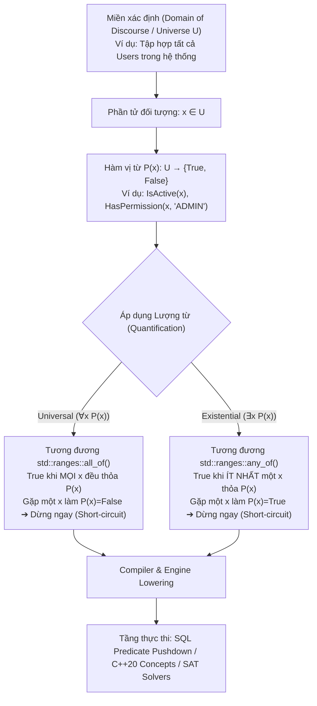

# 1.2. Predicate Logic (Logic Vị từ / Logic Bậc Nhất)

> [!IMPORTANT]
> **Nếu bạn chỉ được nhớ một điều duy nhất:** Logic mệnh đề chỉ biết một câu là đúng hay sai một cách tĩnh tại, còn **Logic vị từ (First-Order Logic - FOL)** là "ngôn ngữ lập trình hàm" của toán học: vị từ $P(x)$ là hàm nhận đối tượng $x$ và trả về kiểu `bool`, còn lượng từ $\forall$ và $\exists$ là các vòng lặp kiểm tra toàn bộ (`all()`) hoặc tìm kiếm phần tử thỏa mãn (`any()`) trên tập dữ liệu.

---

## 1. Kiến trúc Tổng quan & Mô hình Tư duy (Mental Model)

Hãy tưởng tượng bạn đang xây dựng một công cụ tìm kiếm và lọc dữ liệu (SQL Engine) cho hệ thống thương mại điện tử quy mô hàng triệu người dùng:
- Nếu chỉ có **Logic mệnh đề (Propositional Logic)**, bạn chỉ có thể phát biểu các câu tĩnh mang tính nhị phân: *"Hệ thống đang hoạt động"* ($P$), *"Đang có đợt Flash Sale"* ($Q$). Bạn hoàn toàn bất lực khi muốn phát biểu các quy tắc nghiệp vụ cơ bản như: *"Mọi đơn hàng trên 1.000.000 VNĐ đều được miễn phí vận chuyển"* hoặc *"Tồn tại ít nhất một tài khoản gian lận trong phiên làm việc hiện tại"*.
- **Logic vị từ (Predicate Logic hay First-Order Logic - FOL)** ra đời để giải phóng giới hạn này bằng cách mổ xẻ cấu trúc bên trong của một phát biểu: phân rã thành **Đối tượng (Objects/Terms)**, **Thuộc tính và Quan hệ giữa các đối tượng (Predicates)**, và **Phạm vi áp dụng (Quantifiers)**.

Trong kiến trúc máy tính và kỹ thuật phần mềm hiện đại, Logic vị từ hiện diện ở khắp mọi tầng công nghệ:
1. **Hệ thống Kiểu dữ liệu & Type Constraints (C++20 Concepts, Rust Traits)**: Biểu thức `template<typename T> requires std::integral<T> && (sizeof(T) >= 4)` chính là một vị từ biên dịch (Compile-time Predicate) $P(T) = \text{True}$ để ràng buộc kiểu dữ liệu được phép đi vào hàm template.
2. **Cơ sở dữ liệu & Tối ưu hóa Truy vấn (Query Optimizer & Predicate Pushdown)**: Mệnh đề `WHERE age >= 18 AND status = 'ACTIVE'` trong SQL là một vị từ liên hợp áp dụng trên từng bộ dữ liệu ($tuple \in Table$). Bộ tối ưu hóa truy vấn (Cost-based Optimizer) sẽ thực hiện kỹ thuật **Predicate Pushdown** — đẩy việc đánh giá vị từ xuống sát ổ đĩa lưu trữ nhất có thể nhằm giảm thiểu I/O đọc dữ liệu vào RAM.
3. **Kiểm thử Hình thức & Phân tích Tĩnh (Formal Verification - Z3 SMT Solver, TLA+)**: Kiểm chứng các bất biến an toàn của hệ thống phân tán thông qua biểu thức vị từ lồng nhau: $\forall t \in Time, \forall n_1, n_2 \in Nodes, (Leader(t, n_1) \land Leader(t, n_2) \implies n_1 = n_2)$ (tại bất kỳ thời điểm nào, cụm phân tán chỉ có tối đa một Leader duy nhất).



---

## 2. Chi tiết từng Keyword (Under-the-Hood Deep Dive)

### 2.1. Predicate & Predicate Function (Vị từ và Hàm vị từ)
- **Định nghĩa toán học**: Một vị từ bậc $n$ (n-ary predicate) là một ánh xạ toán học $P: D_1 \times D_2 \times \dots \times D_n \to \{0, 1\}$, trong đó $D_i$ là các tập hợp đối tượng đại diện cho miền xác định (Domain of Discourse). Khi thay thế các biến bằng các giá trị đối tượng cụ thể $a_1 \in D_1, \dots, a_n \in D_n$, ta thu được một mệnh đề mang chân trị dứt khoát là Đúng ($1$) hoặc Sai ($0$).
- **Trực giác kỹ thuật**: Vị từ tương đương chính xác với một hàm thuần khiết (pure function) không gây side-effect và trả về kiểu `bool` trong lập trình hàm:
  $$\text{Predicate} \equiv \texttt{std::function<bool(Args...)>}$$
- **Phân loại cấp độ vị từ**:
  - **Vị từ 1 ngôi (Unary Predicate)**: Biểu diễn một thuộc tính nội tại của đối tượng, ví dụ: $IsPrime(x)$, $IsNotNull(ptr)$, $IsAuthenticated(user)$.
  - **Vị từ 2 ngôi (Binary Predicate)**: Biểu diễn mối quan hệ hai chiều giữa hai đối tượng, ví dụ: $LessThan(x, y)$, $FriendOf(u_1, u_2)$, $HasPermission(user, resource)$.
  - **Vị từ n-ngôi (N-ary Predicate)**: Biểu diễn quan hệ bảng nhiều thuộc tính trong RDBMS, ví dụ: $Transaction(id, from, to, amount, timestamp)$.
- **Cơ chế biên dịch dưới tầng CPU (Hardware & Compiler Lowering)**:
  - Khi biên dịch một vị từ như `bool is_adult(int age) { return age >= 18; }`, một trình biên dịch ngây thơ sẽ sinh lệnh so sánh kèm rẽ nhánh có điều kiện (`cmp` + `jl` / `jge`).
  - Trình biên dịch hiện đại tối ưu hóa vị từ thành các lệnh không rẽ nhánh (branchless assembly) bằng lệnh **`setge` (Set Byte on Condition)** hoặc **`cmov` (Conditional Move)**:
    ```assembly
    cmp    edi, 18
    setge  al              ; Ghi trực tiếp 1 hoặc 0 vào thanh ghi al mà không rẽ nhánh
    ret
    ```
  - Điều này triệt tiêu hoàn toàn nguy cơ đoán sai nhánh (Branch Misprediction Penalty: 15-20 chu kỳ CPU) trên các pipeline của vi xử lý Intel/ARM.

### 2.2. Universal Quantifier ($\forall$) & Existential Quantifier ($\exists$)
- **Universal Quantifier ($\forall$ - Lượng từ Phổ quát / Với mọi)**:
  - Công thức hình thức: $\forall x \in D, P(x)$.
  - Ngữ nghĩa: Biểu thức nhận chân trị Đúng khi và chỉ khi vị từ $P(x) = \text{True}$ với **toàn bộ** mọi phần tử $x$ thuộc miền $D$. Nếu tồn tại dù chỉ một phần tử $a \in D$ sao cho $P(a) = \text{False}$, biểu thức lập tức nhận chân trị Sai ($a$ được gọi là một **phản ví dụ - counterexample**).
  - Biểu diễn trên miền hữu hạn $D = \{x_1, x_2, \dots, x_n\}$:
    $$\forall x \in D, P(x) \iff P(x_1) \land P(x_2) \land \dots \land P(x_n)$$
  - **Hiện tượng Chân lý Rỗng (Vacuous Truth)**: Nếu miền $D = \emptyset$ (tập rỗng), mệnh đề $\forall x \in \emptyset, P(x)$ luôn luôn có chân trị là **True**, bất kể $P(x)$ là gì. Đây là nguồn gốc của rất nhiều lỗi logic kiểm tra bảo mật trong phần mềm.
- **Existential Quantifier ($\exists$ - Lượng từ Tồn tại)**:
  - Công thức hình thức: $\exists x \in D, P(x)$.
  - Ngữ nghĩa: Biểu thức nhận chân trị Đúng khi có **ít nhất một** phần tử $x \in D$ thỏa mãn $P(x) = \text{True}$. Phần tử này được gọi là một **nhân chứng (witness)**. Biểu thức chỉ Sai khi và chỉ khi $P(x) = \text{False}$ với tất cả mọi $x \in D$.
  - Biểu diễn trên miền hữu hạn $D = \{x_1, x_2, \dots, x_n\}$:
    $$\exists x \in D, P(x) \iff P(x_1) \lor P(x_2) \lor \dots \lor P(x_n)$$
  - Với tập rỗng: $\exists x \in \emptyset, P(x)$ luôn nhận chân trị là **False**.

### 2.3. Negation of Quantifiers (Phủ định của Lượng từ / Luật De Morgan Mở rộng)
- **Định lý toán học**: Phủ định của một lượng từ biến đổi lượng từ đó thành lượng từ đối ngẫu và đẩy dấu phủ định vào vị từ bên trong:
  $$\neg (\forall x \in D, P(x)) \equiv \exists x \in D, \neg P(x)$$
  $$\neg (\exists x \in D, P(x)) \equiv \forall x \in D, \neg P(x)$$
- **Giải thích biến**:
  - $D$: Miền xác định chung của đối tượng.
  - $P(x)$: Vị từ thuộc tính cần kiểm chứng.
  - $\neg P(x)$: Phủ định giá trị logic của vị từ $P(x)$.
- **Ứng dụng sâu sắc trong Kỹ thuật Kiểm thử Phần mềm (Testing & Fuzzing)**:
  - Khi cần bác bỏ phát biểu của Product Owner: *"Tất cả các giao dịch thanh toán đều hoàn tất trong vòng 100ms"* ($\forall t, Duration(t) \le 100ms$), kỹ sư QA không cần phải chứng minh tất cả giao dịch đều chậm. Ta chỉ cần tìm ra duy nhất **một phản ví dụ** (a single counterexample): $\exists t, Duration(t) > 100ms$.
  - Kỹ thuật **Property-Based Testing (QuickCheck, Hypothesis)** tự động sinh ngẫu nhiên hàng triệu ca kiểm thử nhằm tìm kiếm một witness $x$ sao cho $\neg P(x)$ xuất hiện, từ đó thu gọn (shrink) về ca kiểm thử nhỏ nhất làm hỏng hệ thống.

### 2.4. Nested Quantifiers (Lượng từ Lồng nhau và Thứ tự Lượng từ)
- Khi một biểu thức chứa nhiều biến, thứ tự xuất hiện của các lượng từ quyết định hoàn toàn ngữ nghĩa logic của phát biểu:
  - **Trường hợp 1**: $\forall x \exists y, P(x, y)$
    - Diễn giải: Với mỗi $x$ bất kỳ được chọn, ta luôn có thể tìm ra một $y$ tương ứng thỏa mãn $P(x, y)$. Giá trị của $y$ được phép **phụ thuộc** vào $x$ ($y = f(x)$).
    - Ví dụ: *"Mọi người dùng trên hệ thống đều có một mật khẩu"* (mỗi người có một mật khẩu riêng).
  - **Trường hợp 2**: $\exists y \forall x, P(x, y)$
    - Diễn giải: Tồn tại một đối tượng $y$ phổ quát dùng chung cho **toàn bộ** mọi $x$. Đây là một khẳng định cực kỳ mạnh, trong đó $y$ hoàn toàn độc lập với $x$.
    - Ví dụ: *"Tồn tại một mật khẩu mở được tài khoản của mọi người dùng"* (Master Key / Backdoor bí mật).
- **Quy tắc tráo đổi vị trí (Commutativity Rules)**:
  $$\forall x \forall y, P(x, y) \equiv \forall y \forall x, P(x, y)$$
  $$\exists x \exists y, P(x, y) \equiv \exists y \exists x, P(x, y)$$
  $$\exists y \forall x, P(x, y) \implies \forall x \exists y, P(x, y) \quad (\text{Chiều ngược lại TUYỆT ĐỐI SAI!})$$
- **Ứng dụng trong Định nghĩa Tiệm cận Giải thuật (Big-O Notation)**:
  $$f(n) \in O(g(n)) \iff \exists c \in \mathbb{R}^+, \exists n_0 \in \mathbb{N}, \forall n \ge n_0, |f(n)| \le c \cdot |g(n)|$$
  Thứ tự lượng từ ở đây thể hiện: bạn phải chọn trước hằng số $c$ và mốc bắt đầu $n_0$, sau đó bất đẳng thức phải đúng với toàn bộ các phần tử $n$ tiếp theo.

### 2.5. Domain of Discourse, Free & Bound Variables, Quantifier Scope (Miền xác định, Biến tự do và Biến liên kết)
- **Domain of Discourse (Miền biện luận / Vũ trụ đối tượng $U$)**: Tập hợp chứa toàn bộ các thực thể hợp lệ mà biến có thể nhận. Cùng một phát biểu $\forall x, (x^2 \ge 0)$ sẽ có chân trị là **True** nếu miền $U = \mathbb{R}$, nhưng lại có chân trị là **False** nếu miền $U = \mathbb{C}$ (vì trong số phức, $i^2 = -1 < 0$).
- **Bound Variable (Biến bị liên kết / Biến bị ràng buộc)**: Biến nằm dưới sự quản lý của một lượng từ ($\forall$ hoặc $\exists$). Tương tự như biến tham số cục bộ trong một hàm lambda:
  $$(\forall x, P(x)) \equiv (\forall y, P(y)) \equiv \texttt{[](const auto& param){ return P(param); }}$$
  Tên gọi của biến liên kết không ảnh hưởng đến chân trị của mệnh đề (quy tắc $\alpha$-conversion trong Lambda Calculus).
- **Free Variable (Biến tự do)**: Biến không chịu sự chi phối của bất kỳ lượng từ nào. Biểu thức chứa biến tự do không phải là mệnh đề hoàn chỉnh mà là một vị từ mở. Nó tương đương với biến closure hoặc biến toàn cục bị capture từ phạm vi bên ngoài (Outer Scope).
- **Quantifier Scope (Phạm vi của lượng từ)**: Vùng biểu thức mà lượng từ có hiệu lực. Trong biểu thức:
  $$(\forall x, P(x)) \lor Q(x)$$
  Biến $x$ trong $P(x)$ là biến bị liên kết (Bound), trong khi biến $x$ trong $Q(x)$ là biến tự do (Free). Để tránh nhầm lẫn trong phân tích tĩnh và compiler, ta luôn chuẩn hóa đổi tên biến tự do để tách biệt phạm vi.

---

## 3. Thực thi Mã nguồn & Mô phỏng Chuyên sâu (Dual-Engine Implementation)

Dưới đây là mô phỏng động cơ đánh giá Predicate Logic trên hệ thống quản lý quyền truy cập người dùng và cơ sở dữ liệu (User Access Management Engine), kiểm chứng các lượng từ $\forall$, $\exists$, lượng từ lồng nhau và định luật De Morgan.

### C++20 Implementation (Sử dụng Concepts & Range Projections)

```cpp
#include <iostream>
#include <vector>
#include <string>
#include <ranges>
#include <algorithm>
#include <cstdint>
#include <concepts>

// Định nghĩa cấu trúc User Entity trong hệ thống
struct User {
    uint32_t id;
    std::string username;
    uint32_t age;
    bool is_verified;
    std::vector<std::string> roles;
};

// Vị từ bậc 1: Kiểm tra người dùng đã trưởng thành
auto IsAdult = [](const User& u) -> bool {
    return u.age >= 18;
};

// Vị từ bậc 1: Kiểm tra người dùng có quyền Quản trị viên (Admin)
auto IsAdmin = [](const User& u) -> bool {
    return std::ranges::any_of(u.roles, [](const std::string& r) { 
        return r == "ADMIN"; 
    });
};

// Vị từ bậc 2: Kiểm tra User A có quyền đọc hồ sơ cá nhân của User B
auto CanAccessProfile = [](const User& requester, const User& target) -> bool {
    if (requester.id == target.id) return true; // Tự truy cập dữ liệu của chính mình
    return IsAdmin(requester);                  // Admin có quyền xem tất cả
};

int main() {
    std::vector<User> database = {
        {1, "alice", 25, true,  {"USER", "ADMIN"}},
        {2, "bob",   17, false, {"USER"}},
        {3, "carol", 22, true,  {"USER"}},
        {4, "david", 30, true,  {"MODERATOR"}}
    };

    std::cout << "=== PREDICATE LOGIC EVALUATION ENGINE (C++20) ===\n\n";

    // 1. Universal Quantifier: ∀x ∈ Users, IsAdult(x)
    bool forall_adult = std::ranges::all_of(database, IsAdult);
    std::cout << "[Universal Check: ∀x IsAdult(x)]\n";
    std::cout << "  Result: " << (forall_adult ? "TRUE" : "FALSE");
    if (!forall_adult) {
        auto it = std::ranges::find_if_not(database, IsAdult);
        std::cout << " -> Counterexample found: " << it->username 
                  << " (Age: " << it->age << ")\n";
    }

    // 2. Existential Quantifier: ∃x ∈ Users, IsAdmin(x)
    bool exists_admin = std::ranges::any_of(database, IsAdmin);
    std::cout << "\n[Existential Check: ∃x IsAdmin(x)]\n";
    std::cout << "  Result: " << (exists_admin ? "TRUE" : "FALSE");
    if (exists_admin) {
        auto it = std::ranges::find_if(database, IsAdmin);
        std::cout << " -> Witness found: " << it->username 
                  << " (Roles: ADMIN)\n";
    }

    // 3. De Morgan Law Verification: ¬(∀x IsAdult(x)) ≡ ∃x ¬IsAdult(x)
    bool lhs = !std::ranges::all_of(database, IsAdult);
    bool rhs = std::ranges::any_of(database, [](const User& u) { return !IsAdult(u); });
    std::cout << "\n[De Morgan Law Check: ¬(∀x P(x)) ≡ ∃x ¬P(x)]\n";
    std::cout << "  LHS = " << lhs << ", RHS = " << rhs 
              << " -> " << (lhs == rhs ? "VERIFIED EQUIVALENT" : "FAILED") << "\n";

    // 4. Nested Quantifier: ∃y ∈ Users, ∀x ∈ Users, CanAccessProfile(y, x)
    // Tồn tại một SuperUser y có thể truy cập hồ sơ của TẤT CẢ mọi người x
    auto super_user = std::ranges::find_if(database, [&](const User& y) {
        return std::ranges::all_of(database, [&](const User& x) {
            return CanAccessProfile(y, x);
        });
    });

    std::cout << "\n[Nested Quantifier: ∃y ∀x CanAccessProfile(y, x)]\n";
    if (super_user != database.end()) {
        std::cout << "  Result: TRUE (SuperUser Identified: " << super_user->username << ")\n";
    } else {
        std::cout << "  Result: FALSE (No omnipotent user exists)\n";
    }

    return 0;
}
```

### Python 3.11+ Implementation (AST-Style Predicate Evaluator)

```python
from dataclasses import dataclass, field
from typing import Callable, Iterable, TypeVar

T = TypeVar("T")

@dataclass(frozen=True)
class User:
    id: int
    name: str
    age: int
    is_active: bool
    roles: list[str] = field(default_factory=list)

def forall(domain: Iterable[T], predicate: Callable[[T], bool]) -> tuple[bool, T | None]:
    # Universal quantification (∀x P(x)) với short-circuit và counterexample tracer
    for item in domain:
        if not predicate(item):
            return False, item  # Tìm thấy counterexample làm sập ∀
    return True, None

def exists(domain: Iterable[T], predicate: Callable[[T], bool]) -> tuple[bool, T | None]:
    # Existential quantification (∃x P(x)) với witness tracer
    for item in domain:
        if predicate(item):
            return True, item   # Tìm thấy witness thỏa mãn ∃
    return False, None

if __name__ == "__main__":
    users = [
        User(id=101, name="Alice",   age=28, is_active=True,  roles=["ADMIN"]),
        User(id=102, name="Bob",     age=16, is_active=True,  roles=["USER"]),
        User(id=103, name="Charlie", age=35, is_active=False, roles=["USER"]),
        User(id=104, name="Diana",   age=19, is_active=True,  roles=["USER"])
    ]

    print("=== PYTHON FIRST-ORDER LOGIC VERIFIER ===")

    is_adult: Callable[[User], bool] = lambda u: u.age >= 18
    is_admin: Callable[[User], bool] = lambda u: "ADMIN" in u.roles

    # ∀x (is_adult(x))
    res_all, counterexample = forall(users, is_adult)
    print(f"\n1. [∀x Adult(x)]: {res_all}")
    if counterexample:
        print(f"   Counterexample: {counterexample.name} (age={counterexample.age})")

    # ∃x (is_admin(x))
    res_ex, witness = exists(users, is_admin)
    print(f"\n2. [∃x Admin(x)]: {res_ex}")
    if witness:
        print(f"   Witness: {witness.name} (roles={witness.roles})")

    # Phủ định De Morgan: ¬(∀x P(x)) == ∃x ¬P(x)
    neg_forall = not res_all
    exists_not_adult, not_adult_witness = exists(users, lambda u: not is_adult(u))
    print(f"\n3. [De Morgan Law Check]:")
    print(f"   ¬(∀x Adult(x)) = {neg_forall}")
    print(f"   ∃x ¬Adult(x)   = {exists_not_adult} (Witness: {not_adult_witness.name})")

    # Lượng từ lồng nhau: ∀x ∃y (y.age > x.age)
    all_has_older = True
    for x in users:
        has_older, _ = exists(users, lambda y, curr_x=x: y.age > curr_x.age)
        if not has_older:
            all_has_older = False
            print(f"\n4. [Nested Check: ∀x ∃y (Age(y) > Age(x))] -> FAILED at oldest: {x.name} (age {x.age})")
            break
```

### Simulated Terminal Output

```text
=== PREDICATE LOGIC EVALUATION ENGINE (C++20) ===

[Universal Check: ∀x IsAdult(x)]
  Result: FALSE -> Counterexample found: bob (Age: 17)

[Existential Check: ∃x IsAdmin(x)]
  Result: TRUE -> Witness found: alice (Roles: ADMIN)

[De Morgan Law Check: ¬(∀x P(x)) ≡ ∃x ¬P(x)]
  LHS = 1, RHS = 1 -> VERIFIED EQUIVALENT

[Nested Quantifier: ∃y ∀x CanAccessProfile(y, x)]
  Result: TRUE (SuperUser Identified: alice)

=== PYTHON FIRST-ORDER LOGIC VERIFIER ===

1. [∀x Adult(x)]: False
   Counterexample: Bob (age=16)

2. [∃x Admin(x)]: True
   Witness: Alice (roles=['ADMIN'])

3. [De Morgan Law Check]:
   ¬(∀x Adult(x)) = True
   ∃x ¬Adult(x)   = True (Witness: Bob)

4. [Nested Check: ∀x ∃y (Age(y) > Age(x))] -> FAILED at oldest: Charlie (age 35)
```

---

## 4. Systems Engineering & Production Pitfalls

### 4.1. Cạm bẫy Chân lý Rỗng (Vacuous Truth) trên Tập dữ liệu Rỗng
- **Bản chất toán học**: Trong lý thuyết tập hợp và logic vị từ, biểu thức $\forall x \in \emptyset, P(x)$ luôn luôn trả về chân trị **True**, bất kể vị từ $P(x)$ có phi lý đến mức nào (ví dụ: *"Mọi phần tử trong tập rỗng đều là số nguyên tố chẵn lớn hơn 100"* là một mệnh đề ĐÚNG).
- **Hiểm họa Bảo mật trong Backend**:
  ```python
  # Lỗi bảo mật nghiêm trọng do Vacuous Truth
  def check_user_authorization(user: User, action: str) -> bool:
      # Lấy danh sách quyền của người dùng đối với hành động này
      permissions = user.get_permissions_for(action)
      # Lập trình viên ngây thơ dùng all()
      return all(p.is_valid and p.is_active for p in permissions)
  ```
  Nếu một người dùng mới tạo chưa có bất kỳ quyền nào trong danh sách (`permissions == []`), hàm `all()` của Python sẽ trả về ngay lập tức `True`! Hệ thống cho phép người dùng lạ mặt thực hiện thao tác xóa dữ liệu hoặc thay đổi cấu hình hệ thống.
- **Biện pháp Phòng ngừa**: Luôn kiểm tra điều kiện tập không rỗng trước khi đánh giá lượng từ phổ quát:
  $$IsAuthorized(u) \equiv (|Permissions(u)| > 0) \land (\forall p \in Permissions(u), IsActive(p))$$

### 4.2. Bùng nổ Tổ hợp khi Đánh giá Lượng từ Lồng nhau (Cartesian Product Trap)
- Khi lồng ghép $k$ lượng từ trên tập dữ liệu kích thước $N$:
  $$\forall x_1 \in D_1, \exists x_2 \in D_2, \dots, \forall x_k \in D_k, P(x_1, \dots, x_k)$$
  Thuật toán duyệt ngây thơ sẽ có độ phức tạp thời gian lên tới $O(N^k)$. Khi $N = 10^5$ và $k = 2$, phép duyệt đòi hỏi $10^{10}$ phép tính — làm treo hoàn toàn luồng xử lý của server và gây timeout kết nối cơ sở dữ liệu.
- **Kỹ thuật Tối ưu hóa**:
  - Chuyển đổi vị từ lồng nhau thành các phép tra cứu qua **Hash Map** hoặc **B+ Tree Index** để giảm độ phức tạp từ $O(N^2)$ xuống $O(N)$.
  - Trong SQL, chuyển mệnh đề `WHERE EXISTS (SELECT 1 FROM ...)` thành `INNER JOIN` có index trên khóa ngoại.

### 4.3. Logic Ba Giá trị (Three-Valued Logic - 3VL) và Vị từ NULL trong SQL
- Khác với lý thuyết toán học chỉ có hai chân trị $\{True, False\}$, đại số quan hệ thực tế trong hệ quản trị cơ sở dữ liệu (PostgreSQL, MySQL, Oracle) sử dụng logic 3 giá trị: $\{True, False, Unknown\}$ do sự hiện diện của giá trị `NULL` (đại diện cho dữ liệu bị thiếu hoặc chưa biết).
- Khi đánh giá biểu thức: `WHERE NOT (status = 'ACTIVE')`
  - Nếu bản ghi có `status = NULL`, biểu thức `status = 'ACTIVE'` cho kết quả `Unknown`.
  - Phép phủ định `NOT Unknown` vẫn cho kết quả là `Unknown`.
  - Do mệnh đề `WHERE` chỉ chọn các bản ghi có chân trị chính xác là `True`, bản ghi này sẽ bị loại bỏ hoàn toàn, gây sai lệch thống kê tài chính.

---

## 5. Bảng So sánh & Decision Matrix

| Tiêu chí So sánh | Logic Mệnh đề (Propositional Logic) | Logic Vị từ (Predicate Logic - FOL) | Logic Bậc Cao (Higher-Order Logic - HOL) |
| :--- | :--- | :--- | :--- |
| **Đơn vị biểu diễn cơ bản** | Toàn bộ câu khẳng định nguyên tử ($P, Q, R$) | Đối tượng, Vị từ, Hàm ($x, P(x), f(x)$) | Vị từ trên vị từ, Hàm nhận hàm làm tham số |
| **Hỗ trợ Lượng từ** | Không hỗ trợ | Lượng từ trên biến đối tượng ($\forall x, \exists x$) | Lượng từ trên cả hàm và vị từ ($\forall P, \exists f$) |
| **Khả năng diễn đạt (Expressiveness)** | Thấp (chỉ mô tả được bảng chân trị tĩnh) | Chuẩn mực vàng cho CS, RDBMS, Type Systems | Cực cao (biểu diễn mọi định lý toán học hình thức) |
| **Tính quyết định (Decidability)** | Quyết định được (Decidable qua Bảng chân trị) | Bán quyết định (Semi-decidable - Định lý Gödel) | Hoàn toàn không quyết định được (Undecidable) |
| **Độ phức tạp bài toán thỏa mãn** | NP-Complete (SAT Problem - Cook-Levin) | Undecidable (Bài toán dừng của Turing) | Nằm ngoài tháp phân cấp Arithmetical Hierarchy |
| **Ánh xạ kiến trúc phần mềm** | Mạch số ALU CPU, Bitmask flags, Boolean branching | SQL Query Engines, C++20 Concepts, Rust Traits | Generic Type Systems, Category Theory, Monads |
