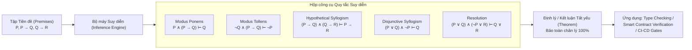

# 1.3. Rules of Inference (Các Quy tắc Suy diễn)

> [!IMPORTANT]
> **Nếu bạn chỉ được nhớ một điều duy nhất:** Các quy tắc suy diễn là những "bánh răng cơ khí" bảo toàn chân lý: nếu các giả thiết ban đầu đúng, thì việc áp dụng tuần tự các quy tắc này tuyệt đối không bao giờ tạo ra kết luận sai, là nền tảng của mọi hệ thống kiểm thử tự động (SAT/SMT Solvers) và hệ thống suy diễn kiểu (Type Checking) trong compiler.

---

## 1. Kiến trúc Tổng quan & Mô hình Tư duy (Mental Model)

Hãy tưởng tượng bạn đang kiểm tra mã nguồn (Code Review) hoặc trình biên dịch đang kiểm tra kiểu dữ liệu (Type Inference Engine):
- Nếu bạn có một hàm `process(user: User)` và bạn truyền vào một biến `admin` đã được xác định kiểu là `User`, trình biên dịch suy ra ngay lập tức: phép gọi hàm này hợp lệ. Đó chính là **Modus Ponens**!
- Nếu việc mở file `fopen()` thành công suy ra biến con trỏ `file_ptr != nullptr`, nhưng khi kiểm tra tại runtime bạn thấy `file_ptr == nullptr`, bạn suy ra dứt khoát rằng lệnh mở file đã thất bại. Đó chính là **Modus Tollens**!

Trong thiết kế hệ thống và khoa học máy tính:
1. **Tránh bùng nổ tổ hợp**: Bảng chân trị của một hệ thống có 100 biến logic đòi hỏi $2^{100} \approx 1.26 \times 10^{30}$ hàng (vượt quá khả năng tính toán của vũ trụ). Quy tắc suy diễn cho phép đi thẳng từ tiền đề đến kết luận qua vài bước biến đổi hình thức trong $O(N)$ hoặc $O(N^2)$ bước.
2. **SAT/SMT Solvers (Z3, CVC5)**: Lõi của các bộ phân tích bảo mật tĩnh (Static Code Analysis) dựa trên giải thuật DPLL/CDCL, vận hành bằng quy tắc suy diễn **Resolution**.
3. **Curry-Howard Isomorphism**: Một mệnh đề toán học tương đương một Kiểu dữ liệu, và quy tắc suy diễn tương đương với phép chuyển đổi dữ liệu hợp lệ trong hệ thống kiểu.



---

## 2. Chi tiết từng Keyword (Under-the-Hood Deep Dive)

### 2.1. Modus Ponens (Luật Khẳng định)
- **Định nghĩa hình thức**: Nếu mệnh đề $P$ đúng và mệnh đề kéo theo $P \to Q$ đúng, thì mệnh đề $Q$ bắt buộc phải đúng.
  $$\frac{P, \quad P \to Q}{\therefore Q}$$
- **Trực giác kỹ thuật**: Tương đương với việc áp dụng hàm (Function Application) trong lập trình hàm và kiểm tra kiểu:
  $$\text{f}: P \to Q, \quad x: P \implies f(x): Q$$
- **Ứng dụng thực tế**: Trong hệ thống phân quyền (Authorization Engine):
  - Giả thiết 1: `IsSuperAdmin(user)` là True.
  - Giả thiết 2: `IsSuperAdmin(user) -> CanDeleteDatabase(user)`.
  - Kết luận: Cho phép hành động `CanDeleteDatabase(user)`.

### 2.2. Modus Tollens (Luật Phủ định)
- **Định nghĩa hình thức**: Nếu mệnh đề kéo theo $P \to Q$ đúng nhưng kết quả $Q$ sai ($\neg Q$), thì tiền đề $P$ cũng bắt buộc phải sai ($\neg P$).
  $$\frac{\neg Q, \quad P \to Q}{\therefore \neg P}$$
- **Trực giác kỹ thuật**: Dựa trên sự tương đương giữa mệnh đề kéo theo và phản đảo của nó: $(P \to Q) \equiv (\neg Q \to \neg P)$.
- **Ứng dụng trong Debugging & Tracing**:
  - Tiền đề: *"Nếu Cache hit xảy ra ($P$), thì thời gian phản hồi API phải dưới 5ms ($Q$)"*.
  - Quan sát thực tế đo lường: Thời gian phản hồi là 250ms ($\neg Q$).
  - Suy diễn tự động: Chắc chắn Cache hit đã không xảy ra ($\neg P$, cache miss hoặc connection timeout tới Redis).

### 2.3. Hypothetical Syllogism (Tam đoạn luận Giả thiết / Quy tắc Bắc cầu)
- **Định nghĩa hình thức**: Cho phép liên kết hai mệnh đề kéo theo có mắt xích chung:
  $$\frac{P \to Q, \quad Q \to R}{\therefore P \to R}$$
- **Trực giác kỹ thuật**: Tương đương với phép kết hợp hàm (Function Composition) $h = g \circ f$ trong lập trình:
  $$f: P \to Q, \quad g: Q \to R \implies (g \circ f): P \to R$$
- **Ứng dụng**: Phân tích đường ống luồng dữ liệu (Data Pipeline Verification). Nếu Service A đảm bảo truyền dữ liệu hợp lệ cho B ($P \to Q$), và B đảm bảo ghi an toàn vào DB ($Q \to R$), thì toàn bộ pipeline đảm bảo tính toàn vẹn từ A đến DB ($P \to R$).

### 2.4. Disjunctive Syllogism (Tam đoạn luận Tuyển)
- **Định nghĩa hình thức**: Nếu ta biết ít nhất một trong hai khả năng xảy ra ($P \lor Q$), nhưng đã xác định chắc chắn $P$ không xảy ra ($\neg P$), thì khả năng còn lại $Q$ phải đúng:
  $$\frac{P \lor Q, \quad \neg P}{\therefore Q}$$
- **Trực giác kỹ thuật**: Tương đương với cấu trúc `std::variant<P, Q>` hoặc `Result<T, E>` trong Rust: nếu biến không phải lỗi (`is_err() == false`), thì chắc chắn nó chứa giá trị dữ liệu hợp lệ `Ok(T)`.
- **Ứng dụng trong Fault-Tolerance**: Hệ thống có hai node dự phòng Master ($P$) và Standby ($Q$). Mạng chỉ định ít nhất một node phải điều phối ($P \lor Q$). Health-check xác nhận Master mất kết nối ($\neg P$) $\implies$ Standby tự động thăng cấp thành Leader ($Q$).

### 2.5. Resolution (Quy tắc Hợp giải)
- **Định nghĩa hình thức**: Quy tắc hợp nhất hai mệnh đề tuyển có chứa một cặp biến đối ngẫu:
  $$\frac{P \lor Q, \quad \neg P \lor R}{\therefore Q \lor R}$$
  Trong đó mệnh đề $Q \lor R$ được gọi là **Resolvent (Mệnh đề hợp giải)**. Khi $Q$ và $R$ đều rỗng (xét $P$ và $
eg P$), phép hợp giải sinh ra **mệnh đề rỗng (Empty Clause $\square$)**, đại diện cho mâu thuẫn tuyệt đối (False).
- **Trực giác kỹ thuật**: Trái tim của giải thuật tự động chứng minh định lý (Automated Theorem Proving) và SAT Solvers. Mọi công thức logic đều có thể chuyển về dạng hội chuẩn (Conjunctive Normal Form - CNF) để áp dụng Resolution liên tục cho tới khi sinh ra mâu thuẫn.

### 2.6. Universal Instantiation & Existential Instantiation (Cụ thể hóa Lượng từ)
- **Universal Instantiation (UI - Cụ thể hóa Phổ quát)**:
  - Nếu $\forall x P(x)$ đúng trên miền $D$, thì với bất kỳ đối tượng cụ thể $c \in D$, $P(c)$ cũng phải đúng.
  - Ứng dụng: Cụ thể hóa mẫu Generic (Template Specialization). Nếu một template hoạt động với mọi kiểu `T`, thì nó phải hợp lệ với `T = int`.
- **Existential Instantiation (EI - Cụ thể hóa Tồn tại / Skolemization)**:
  - Nếu $\exists x P(x)$ đúng, ta có thể chọn một định danh mới $c$ (chưa từng xuất hiện trước đó) sao cho $P(c)$ đúng. Đối tượng $c$ này được gọi là hằng số Skolem (Skolem constant).

### 2.7. Proof by Contradiction & Proof by Contrapositive (Chứng minh Phản chứng và Đảo nghịch)
- **Proof by Contrapositive (Chứng minh Phản đảo)**:
  - Để chứng minh $P \to Q$, ta chứng minh mệnh đề tương đương logic $\neg Q \to \neg P$.
  - Thường dùng khi việc giả định $\neg Q$ cho ta nhiều giả thiết cụ thể hơn là xuất phát từ $P$.
- **Proof by Contradiction (Chứng minh Phản chứng - Reductio ad absurdum)**:
  - Để chứng minh mệnh đề $P$ đúng, ta giả sử $P$ sai ($\neg P$ đúng), sau đó áp dụng các quy tắc suy diễn để dẫn tới một mâu thuẫn không thể chấp nhận được ($R \land \neg R$). Suy ra giả định ban đầu là sai, tức $P$ phải đúng.
  - Ví dụ kinh điển: Chứng minh tính bất khả quy của bài toán dừng (Halting Problem) của Alan Turing.

---

## 3. Thực thi Mã nguồn & Mô phỏng Chuyên sâu (Dual-Engine Implementation)

Mô phỏng một **Forward-Chaining Inference Engine** (Động cơ suy luận tiến) kiểm tra vi phạm bảo mật và xác minh quyền truy cập hệ thống.

### C++20 Implementation (Hệ thống Suy luận Modus Ponens & Resolution)

```cpp
#include <iostream>
#include <string>
#include <vector>
#include <unordered_set>
#include <utility>
#include <algorithm>

// Biểu diễn mệnh đề dạng chuỗi: "Admin", "User", "!Locked"
using Fact = std::string;

struct Implication {
    std::vector<Fact> premises; // P1 ∧ P2 ∧ ...
    Fact conclusion;            // Q
};

class InferenceEngine {
private:
    std::unordered_set<Fact> knowledge_base;
    std::vector<Implication> rules;

public:
    void add_fact(const Fact& f) {
        knowledge_base.insert(f);
    }

    void add_rule(std::vector<Fact> premises, Fact conclusion) {
        rules.push_back({std::move(premises), std::move(conclusion)});
    }

    // Forward Chaining dựa trên Modus Ponens
    bool deduce() {
        bool new_fact_discovered = true;
        while (new_fact_discovered) {
            new_fact_discovered = false;
            for (const auto& rule : rules) {
                // Kiểm tra xem tất cả tiền đề đã có trong Knowledge Base chưa
                bool all_premises_met = std::ranges::all_of(rule.premises, [&](const Fact& p) {
                    return knowledge_base.contains(p);
                });

                if (all_premises_met && !knowledge_base.contains(rule.conclusion)) {
                    knowledge_base.insert(rule.conclusion);
                    std::cout << "[Modus Ponens] Suy ra tri thức mới: " << rule.conclusion << "\n";
                    new_fact_discovered = true;
                }
            }
        }
        return true;
    }

    bool query(const Fact& f) const {
        return knowledge_base.contains(f);
    }

    void dump_knowledge() const {
        std::cout << "Current Knowledge Base Facts: { ";
        for (const auto& f : knowledge_base) std::cout << f << " ";
        std::cout << "}\n";
    }
};

int main() {
    InferenceEngine engine;

    std::cout << "=== C++20 FORWARD-CHAINING INFERENCE ENGINE ===\n\n";

    // Nạp sự thật ban đầu
    engine.add_fact("UserHasValidToken");
    engine.add_fact("IsWorkingHours");
    engine.add_fact("RoleIsOpsEngineer");

    // Nạp các quy tắc (Rules of Inference)
    // Rule 1: UserHasValidToken ∧ RoleIsOpsEngineer -> HasElevatedAccess
    engine.add_rule({"UserHasValidToken", "RoleIsOpsEngineer"}, "HasElevatedAccess");

    // Rule 2: HasElevatedAccess ∧ IsWorkingHours -> CanAccessProductionCluster
    engine.add_rule({"HasElevatedAccess", "IsWorkingHours"}, "CanAccessProductionCluster");

    // Rule 3: CanAccessProductionCluster -> AllowDirectSSH
    engine.add_rule({"CanAccessProductionCluster"}, "AllowDirectSSH");

    engine.dump_knowledge();
    std::cout << "\n--> Bắt đầu quá trình suy diễn (Applying Modus Ponens)...\n";
    engine.deduce();

    std::cout << "\n--> Kiểm tra truy vấn hệ thống:\n";
    bool can_ssh = engine.query("AllowDirectSSH");
    std::cout << "Query 'AllowDirectSSH': " << (can_ssh ? "GRANTED (TRUE)" : "DENIED (FALSE)") << "\n";

    return 0;
}
```

### Python 3.11+ Implementation (Propositional Resolution Refutation Prover)

```python
from itertools import combinations

class Clause:
    # Biểu diễn mệnh đề tuyển (Disjunction of Literals), ví dụ: {P, ~Q} tương đương P ∨ ¬Q
    def __init__(self, literals: set[str]):
        self.literals = frozenset(literals)

    def is_empty(self) -> bool:
        return len(self.literals) == 0

    def __eq__(self, other):
        return isinstance(other, Clause) and self.literals == other.literals

    def __hash__(self):
        return hash(self.literals)

    def __repr__(self):
        if self.is_empty():
            return "□ (Contradiction)"
        return " ∨ ".join(sorted(self.literals))

def resolve(ci: Clause, cj: Clause) -> set[Clause]:
    # Áp dụng quy tắc Resolution giữa 2 mệnh đề: (A ∨ P) và (B ∨ ¬P) ⊢ A ∨ B
    resolvents = set()
    for lit in ci.literals:
        negated = lit[1:] if lit.startswith("~") else f"~{lit}"
        if negated in cj.literals:
            # Hợp giải trên biến lit và negated
            new_lits = (ci.literals - {lit}) | (cj.literals - {negated})
            resolvents.add(Clause(new_lits))
    return resolvents

def resolution_prover(clauses: set[Clause]) -> bool:
    # Chứng minh phản chứng bằng Resolution (Refutation-complete)
    current_clauses = set(clauses)
    step = 0
    while True:
        step += 1
        new_clauses = set()
        pairs = list(combinations(current_clauses, 2))
        for ci, cj in pairs:
            resolvents = resolve(ci, cj)
            for res in resolvents:
                if res.is_empty():
                    print(f"[Step {step}] Sinh ra mệnh đề rỗng: {res} giữa ({ci}) và ({cj})")
                    return True  # Mâu thuẫn tìm thấy -> Định lý được chứng minh!
                new_clauses.add(res)
        
        if new_clauses.issubset(current_clauses):
            return False  # Không thể suy ra mệnh đề mới -> Không có mâu thuẫn
        current_clauses.update(new_clauses)

if __name__ == "__main__":
    print("=== PYTHON RESOLUTION REFUTATION PROVER ===")
    knowledge_base = {
        Clause({"P"}),
        Clause({"~P", "Q"}),
        Clause({"~Q", "R"}),
        Clause({"~R"}) # Phủ định của đích cần chứng minh
    }

    print("Initial Clauses in CNF:")
    for c in knowledge_base:
        print(f"  {c}")

    is_proved = resolution_prover(knowledge_base)
    print(f"\nKết quả chứng minh: {'THÀNH CÔNG (Theorem Proved)' if is_proved else 'THẤT BẠI'}")
```

### Simulated Terminal Output

```text
=== C++20 FORWARD-CHAINING INFERENCE ENGINE ===

Current Knowledge Base Facts: { IsWorkingHours RoleIsOpsEngineer UserHasValidToken }

--> Bắt đầu quá trình suy diễn (Applying Modus Ponens)...
[Modus Ponens] Suy ra tri thức mới: HasElevatedAccess
[Modus Ponens] Suy ra tri thức mới: CanAccessProductionCluster
[Modus Ponens] Suy ra tri thức mới: AllowDirectSSH

--> Kiểm tra truy vấn hệ thống:
Query 'AllowDirectSSH': GRANTED (TRUE)

=== PYTHON RESOLUTION REFUTATION PROVER ===
Initial Clauses in CNF:
  P
  ~P ∨ Q
  ~Q ∨ R
  ~R
[Step 1] Sinh ra mệnh đề rỗng: □ (Contradiction) giữa (R) và (~R)

Kết quả chứng minh: THÀNH CÔNG (Theorem Proved)
```

---

## 4. Systems Engineering & Production Pitfalls

### 4.1. Nguy cơ Vòng lặp Vô hạn trong Forward/Backward Chaining
- Khi hệ thống có các luật đối xứng hoặc vòng (ví dụ: $A \to B$ và $B \to A$), nếu không có cơ chế ghi nhận trạng thái đã thăm (Visited Memoization), bộ máy suy diễn sẽ rơi vào vòng lặp vô tận, gây tràn bộ nhớ (Stack Overflow hoặc OOM).
- **Khắc phục**: Sử dụng `std::unordered_set` để lưu trữ tri thức hiện có; chỉ kích hoạt vòng lặp suy diễn khi có sự thật **mới** được thêm vào tập tri thức.

### 4.2. Bùng nổ Tổ hợp Mệnh đề Hợp giải (Resolution Explosion)
- Thuật toán Resolution thuần túy trên bài toán thỏa mãn mệnh đề (SAT) có thời gian chạy trong trường hợp xấu nhất là hàm mũ $O(2^n)$.
- Trong thực tế, các engine công nghiệp như Microsoft Z3 không dùng resolution ngây thơ mà dùng kỹ thuật **CDCL (Conflict-Driven Clause Learning)** kết hợp với 2-Watched Literals để giảm thiểu việc kiểm tra lại các mệnh đề không liên quan.

### 4.3. Cạm bẫy "Khẳng định Hậu đề" (Affirming the Consequent Fallacy)
- Một lỗi logic rất phổ biến trong lập trình:
  - Biết rằng: *"Nếu máy chủ hết RAM ($P$), hệ thống sẽ phản hồi lỗi 500 ($Q$)"*.
  - Đo lường thấy: Hệ thống đang phản hồi 500 ($Q$).
  - Lập trình viên vội vã kết luận: Máy chủ hết RAM ($P$).
  - Đây là sai lầm nghiêm trọng! Phản hồi 500 có thể do Database timeout, Unhandled NullPointerException, hoặc Bug mạng. Chiều đúng duy nhất là Modus Tollens: nếu không có lỗi 500 ($\neg Q$), chắc chắn máy chủ không hết RAM ($\neg P$).

---

## 5. Bảng So sánh & Decision Matrix

| Quy tắc Suy diễn | Tiền đề (Premises) | Kết luận (Conclusion) | Lỗi ngụy biện thường gặp tương ứng |
| :--- | :--- | :--- | :--- |
| **Modus Ponens** | $P, P \to Q$ | $Q$ | Khẳng định Hậu đề ($Q \to P$) |
| **Modus Tollens** | $\neg Q, P \to Q$ | $\neg P$ | Phủ định Tiền đề ($\neg P \to \neg Q$) |
| **Hypothetical Syllogism** | $P \to Q, Q \to R$ | $P \to R$ | Giả định bắc cầu sai khi có điều kiện phụ |
| **Disjunctive Syllogism** | $P \lor Q, \neg P$ | $Q$ | Ngụy biện song đề sai (False Dilemma) |
| **Resolution** | $P \lor Q, \neg P \lor R$ | $Q \lor R$ | Bỏ sót điều kiện khi có nhiều hơn 1 cặp đối ngẫu |
| **Universal Instantiation**| $\forall x P(x)$ | $P(c)$ với $c \in D$ | Áp dụng trên đối tượng nằm ngoài miền xác định |
| **Proof by Contradiction** | Giả sử $\neg P \vdash \bot$ | $P$ | Dẫn xuất mâu thuẫn từ tiền đề không hợp lệ |
