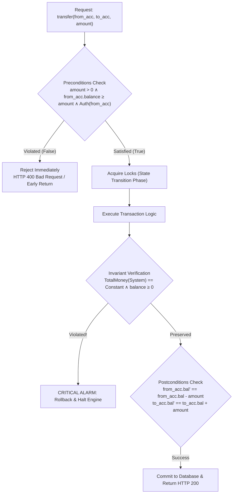

# 1.4. Logic in Software Engineering (Ứng dụng Logic trong Kỹ thuật Phần mềm)

> [!IMPORTANT]
> **Nếu bạn chỉ được nhớ một điều duy nhất:** Mọi hệ thống phần mềm đáng tin cậy đều là hiện thân vật lý của logic hình thức: **Preconditions** bảo vệ đầu vào, **Invariants** bảo toàn tính đúng đắn xuyên suốt của trạng thái hệ thống, và **Postconditions** cam kết kết quả đầu ra; vi phạm logic ở bất kỳ mắt xích nào sẽ dẫn đến thảm họa bảo mật hoặc lỗi dữ liệu không thể phục hồi.

---

## 1. Kiến trúc Tổng quan & Mô hình Tư duy (Mental Model)

Hãy tưởng tượng bạn đang thiết kế hệ thống giao dịch tài chính liên ngân hàng (Core Banking & Fintech Platform):
- Một tài khoản thanh toán không bao giờ được phép có số dư âm (trừ khi có hạn mức thấu chi được phê duyệt bằng hợp đồng riêng). Đây là một **Bất biến (Invariant)** sống còn của ngân hàng.
- Khi người dùng gửi yêu cầu chuyển tiền: người gửi phải được xác thực danh tính, tài khoản nguồn không bị khóa, số tiền chuyển phải là số dương ($> 0$), và số dư khả dụng phải lớn hơn hoặc bằng số tiền chuyển cộng phí giao dịch. Đây là tập hợp các **Tiền điều kiện (Preconditions)**.
- Sau khi giao dịch thực thi thành công: số dư tài khoản người gửi giảm chính xác bằng số tiền chuyển, số dư tài khoản người nhận tăng chính xác bằng số tiền đó, và một bản ghi nhật ký kiểm toán (Audit Log) bất biến được ghi nhận vào sổ cái. Đây là các **Hậu điều kiện (Postconditions)**.

Nếu kỹ sư phần mềm không chuyển đổi các quy tắc nghiệp vụ thành các vị từ toán học nghiêm ngặt:
1. **Race Conditions & Double-spending Attack**: Hai yêu cầu rút tiền song song cùng đọc số dư tại một thời điểm, cùng vượt qua bước kiểm tra tiền điều kiện ngây thơ, dẫn đến việc rút tiền gấp đôi và làm sập bất biến số dư của hệ thống.
2. **Access Control Bypass (Bẻ gãy Phân quyền)**: Logic phân biệt vai trò bị mập mờ hoặc rẽ nhánh sai thứ tự cho phép tài khoản người dùng bình thường truy cập vào API quản trị tối cao (Privilege Escalation).
3. **Data Corruption (Thối rữa Dữ liệu)**: Thiếu các ràng buộc toàn vẹn ở tầng cơ sở dữ liệu khiến dữ liệu mồ côi (orphaned records) tích tụ, làm sai lệch báo cáo tài chính hạ nguồn.



---

## 2. Chi tiết từng Keyword (Under-the-Hood Deep Dive)

### 2.1. Access Control Logic & Authorization Rules (Kiểm soát truy cập và Phân quyền)
- **Định nghĩa hình thức**: Một hệ thống phân quyền an toàn là một hàm vị từ đa ngôi ánh xạ ngữ cảnh yêu cầu sang quyết định cho phép hoặc từ chối:
  $$Authorize: \mathcal{U} \times \mathcal{R} \times \mathcal{A} \times \mathcal{E} \to \{0, 1\}$$
  Trong đó:
  - $\mathcal{U}$: Không gian chủ thể gửi yêu cầu (Subject/User).
  - $\mathcal{R}$: Không gian tài nguyên mục tiêu (Resource: Document, Server, Database Record).
  - $\mathcal{A}$: Hành động dự định thực hiện (Action: `READ`, `WRITE`, `EXECUTE`, `DELETE`).
  - $\mathcal{E}$: Môi trường ngữ cảnh (Environment: Client IP, Thời gian trong ngày, Geo-location, Trạng thái MFA).
- **Mô hình RBAC (Role-Based Access Control)**: Phân quyền dựa trên vai trò trung gian:
  $$Authorize(u, r, a) \equiv \exists role \in Roles(u), HasPermission(role, r, a)$$
  - *Hạn chế*: Dẫn đến hiện tượng bùng nổ vai trò (Role Explosion) khi hệ thống phát triển quy mô lớn.
- **Mô hình ABAC (Attribute-Based Access Control)**: Đánh giá vị từ bậc nhất linh hoạt trên các thuộc tính của Subject, Resource và Environment:
  $$Authorize(u, r, a) \equiv (u.department == r.department) \land (u.clearance \ge r.classification) \land (e.is\_secure\_vpn == \text{True})$$
- **Mô hình ReBAC (Relationship-Based Access Control - Google Zanzibar)**:
  - Phân quyền dựa trên đồ thị quan hệ giữa các thực thể: Người dùng $U$ có quyền truy cập tài nguyên $R$ nếu tồn tại một đường đi quan hệ (Path) từ $U$ tới $R$ trên đồ thị phân quyền.

### 2.2. Validation Rules & Boolean Conditions (Quy tắc Xác thực Dữ liệu)
- **Định nghĩa**: Tập hợp các vị từ kiểm tra tính toàn vẹn và phạm vi hợp lệ của dữ liệu đầu vào trước khi dữ liệu đó được đưa vào lõi nghiệp vụ.
- **Cơ chế Đánh giá Đoản mạch (Short-Circuit Evaluation)**:
  - Đối với phép hội $A \land B$: Nếu $A$ nhận giá trị `False`, biểu thức $B$ **tuyệt đối không bao giờ được đánh giá**.
  - Đối với phép tuyển $A \lor B$: Nếu $A$ nhận giá trị `True`, biểu thức $B$ **tuyệt đối không bao giờ được đánh giá**.
- **Ý nghĩa sống còn trong An toàn Bộ nhớ**:
  ```cpp
  // An toàn tuyệt đối nhờ short-circuit evaluation của toán tử &&
  if (ptr != nullptr && ptr->is_valid()) {
      ptr->execute();
  }
  ```
  Nếu compiler không hỗ trợ short-circuit hoặc lập trình viên sử dụng nhầm toán tử bitwise (`&`), CPU sẽ đánh giá cả hai vế. Khi `ptr == nullptr`, thao tác `ptr->is_valid()` sẽ gây lỗi giải tham chiếu con trỏ null (Null Pointer Dereference), dẫn tới lỗi chết người `SIGSEGV` (Segmentation Fault).

### 2.3. Invariants (Bất biến)
- **Định nghĩa toán học**: Một vị từ $Inv(S)$ được gọi là bất biến của hệ thống nếu chân trị của nó luôn luôn là **True** tại mọi thời điểm hệ thống ở trạng thái ổn định (quiescent state):
  $$\forall S \in ValidStates, Inv(S) = \text{True}$$
- **Phân loại Bất biến trong Kỹ thuật Phần mềm**:
  - **Class Invariant (Bất biến Lớp trong OOP)**: Ràng buộc phải thỏa mãn sau khi hàm khởi tạo (constructor) chạy xong và trước/sau mỗi phương thức public. Ví dụ: trong cấu trúc `std::vector`, bất biến là $0 \le size \le capacity$.
  - **Loop Invariant (Bất biến Vòng lặp)**: Một mệnh đề logic đúng trước khi bước vào vòng lặp, đúng sau mỗi bước lặp, và khi vòng lặp kết thúc kết hợp với điều kiện dừng sẽ chứng minh tính đúng đắn của giải thuật (ví dụ: mảng đã sắp xếp trong Binary Search).
  - **System-level Invariant (Bất biến Toàn cục Hệ thống)**: Tổng số tiền lưu hành trong hệ thống ngân hàng phải được bảo toàn qua mọi giao dịch nội bộ:
    $$\sum_{acc \in Accounts} Balance(acc) = \text{Constant}$$

### 2.4. Database Constraints (Ràng buộc Cơ sở Dữ liệu)
- **Định nghĩa**: Các vị từ logic được khai báo ở tầng Schema và được bộ máy lưu trữ (Storage Engine) thực thi bắt buộc tại mỗi thao tác thay đổi dữ liệu (`INSERT`, `UPDATE`, `DELETE`).
- **Các loại ràng buộc kinh điển**:
  - `CHECK (predicate)`: Ép buộc mọi dòng dữ liệu phải thỏa mãn vị từ logic, ví dụ:
    ```sql
    CHECK (age >= 18 AND salary > 0 AND email LIKE '%@%.%')
    ```
  - `UNIQUE (columns)`: Đảm bảo tính đơn ánh (Injective mapping) của tập thuộc tính trên quan hệ bảng:
    $$\forall t_1, t_2 \in Table, (t_1.email = t_2.email \implies t_1.id = t_2.id)$$
  - `FOREIGN KEY (fk) REFERENCES Parent(pk)`: Đảm bảo tính toàn vẹn tham chiếu (Referential Integrity), loại bỏ hoàn toàn tình trạng bản ghi mồ côi:
    $$\forall r \in Orders, (r.user\_id \ne NULL \implies \exists u \in Users, u.id = r.user\_id)$$

### 2.5. Preconditions, Postconditions & State Transition Conditions (Thiết kế theo Hợp đồng - Design by Contract)
- Được tiên phong bởi Bertrand Meyer, trường phái **Design by Contract (DbC)** xem sự giao tiếp giữa caller và callee như một hợp đồng ràng buộc pháp lý:
  - **Tiền điều kiện (Preconditions - $P$)**: Ràng buộc mà bên gọi (Caller) có nghĩa vụ phải đáp ứng trước khi kích hoạt hàm. Nếu $P = \text{False}$, bên được gọi (Callee) hoàn toàn không có nghĩa vụ phải thực thi và có quyền ném ngoại lệ lập tức.
  - **Hậu điều kiện (Postconditions - $Q$)**: Cam kết mà bên được gọi (Callee) bảo đảm sẽ thỏa mãn sau khi hàm kết thúc thành công, với điều kiện Caller đã đáp ứng đúng tiền điều kiện.
  - **Ký hiệu Tam bộ Hoare (Hoare Triple)**:
    $$\{P\} \quad C \quad \{Q\}$$
    Ý nghĩa: Nếu trạng thái trước khi thực thi đoạn mã $C$ thỏa mãn tiền điều kiện $P$, thì sau khi $C$ thực thi kết thúc, trạng thái mới chắc chắn thỏa mãn hậu điều kiện $Q$.

---

## 3. Thực thi Mã nguồn & Mô phỏng Chuyên sâu (Dual-Engine Implementation)

Mô phỏng động cơ quản lý ví điện tử tài chính tuân thủ nghiêm ngặt mô hình **Design by Contract (DbC)** và kiểm soát bất biến số dư qua các ranh giới giao dịch.

### C++20 Implementation (Hệ thống Giao dịch với Assertion & Pre/Post Conditions)

```cpp
#include <iostream>
#include <cstdint>
#include <cassert>
#include <stdexcept>
#include <string>
#include <format>

class BankAccount {
private:
    uint64_t account_id;
    int64_t balance; // Bất biến hệ thống: balance >= 0 (ngăn chặn thấu chi)

    // Hàm xác thực Class Invariant
    void verify_invariant() const {
        assert(balance >= 0 && "CRITICAL INVARIANT VIOLATION: Balance dropped below zero!");
    }

public:
    BankAccount(uint64_t id, int64_t initial_deposit) 
        : account_id(id), balance(initial_deposit) {
        // Precondition khi khởi tạo
        if (initial_deposit < 0) {
            throw std::invalid_argument("Precondition failed: Initial deposit cannot be negative.");
        }
        verify_invariant();
    }

    uint64_t get_id() const { return account_id; }
    int64_t get_balance() const { return balance; }

    // Rút tiền với Design by Contract chuẩn mực
    bool withdraw(int64_t amount) {
        // 1. KIỂM TRA TIỀN ĐIỀU KIỆN (PRECONDITIONS)
        if (amount <= 0) {
            std::cerr << "[Contract Violation] Precondition failed: Withdraw amount must be > 0.\n";
            return false;
        }
        if (amount > balance) {
            std::cerr << std::format("[Contract Violation] Precondition failed: Insufficient funds (Bal: {}, Req: {})\n",
                                     balance, amount);
            return false;
        }

        // Lưu vết trạng thái cũ để kiểm tra hậu điều kiện
        int64_t old_balance = balance;

        // 2. CHUYỂN DỊCH TRẠNG THÁI (STATE TRANSITION)
        balance -= amount;

        // 3. KIỂM TRA HẬU ĐIỀU KIỆN (POSTCONDITIONS)
        assert(balance == old_balance - amount && "Postcondition failed: Balance deducted incorrectly!");

        // 4. KIỂM TRA BẤT BIẾN (CLASS INVARIANT)
        verify_invariant();

        std::cout << std::format("[Tx Success] Account #{} withdrew ${} | New Balance: ${}\n",
                                 account_id, amount, balance);
        return true;
    }
};

int main() {
    std::cout << "=== C++20 DESIGN BY CONTRACT BANKING SIMULATOR ===\n\n";

    try {
        BankAccount account(1001, 500);

        // Ca 1: Giao dịch hợp lệ
        account.withdraw(200);

        // Ca 2: Vi phạm tiền điều kiện: số tiền âm
        account.withdraw(-50);

        // Ca 3: Vi phạm tiền điều kiện: rút vượt quá số dư hiện tại
        account.withdraw(400);

        // Ca 4: Rút hết sạch tiền về 0 (vẫn đảm bảo Invariant balance >= 0)
        account.withdraw(300);

        std::cout << std::format("\nFinal Verification: Account #{} is sound with balance ${}\n",
                                 account.get_id(), account.get_balance());
    } catch (const std::exception& e) {
        std::cerr << "Fatal Exception: " << e.what() << "\n";
    }

    return 0;
}
```

### Python 3.11+ Implementation (Hoare Logic Decorators & Attribute-Based Access Control)

```python
from functools import wraps
from typing import Callable, Any

class ContractError(Exception):
    # Ngoại lệ ném ra khi vi phạm hợp đồng logic.
    pass

def requires(predicate: Callable[..., bool], message: str):
    # Decorator kiểm tra Tiền điều kiện (Precondition)
    def decorator(func: Callable[..., Any]):
        @wraps(func)
        def wrapper(*args, **kwargs):
            if not predicate(*args, **kwargs):
                raise ContractError(f"Precondition Violated: {message}")
            return func(*args, **kwargs)
        return wrapper
    return decorator

class Wallet:
    def __init__(self, owner: str, balance: float):
        self.owner = owner
        self._balance = balance
        self._verify_invariant()

    def _verify_invariant(self):
        # Bất biến: Số dư không thể âm
        assert self._balance >= 0.0, f"INVARIANT BROKEN: {self.owner} has negative balance!"

    @property
    def balance(self) -> float:
        return self._balance

    @requires(lambda self, target, amount: amount > 0, "Amount must be strictly positive")
    @requires(lambda self, target, amount: self.balance >= amount, "Insufficient balance for transfer")
    def transfer(self, target: "Wallet", amount: float) -> None:
        # Ghi nhận trạng thái trước chuyển dịch
        total_money_before = self._balance + target._balance
        sender_initial = self._balance
        receiver_initial = target._balance

        # Chuyển dịch trạng thái (State Transition)
        self._balance -= amount
        target._balance += amount

        # Kiểm tra Hậu điều kiện (Postconditions)
        assert self._balance == sender_initial - amount, "Postcondition: Sender balance incorrect!"
        assert target._balance == receiver_initial + amount, "Postcondition: Receiver balance incorrect!"

        # Kiểm tra Bất biến hệ thống bảo toàn tổng tiền (Conservation Law)
        total_money_after = self._balance + target._balance
        assert total_money_before == total_money_after, "Conservation of money violated!"

        # Xác thực bất biến từng thực thể
        self._verify_invariant()
        target._verify_invariant()

        print(f"Transfer Successful: ${amount:.2f} from {self.owner} to {target.owner}")

if __name__ == "__main__":
    print("=== PYTHON CONTRACT-DRIVEN SECURE WALLET ===")
    w1 = Wallet("Alice", 1000.0)
    w2 = Wallet("Bob", 200.0)

    # Giao dịch hợp lệ
    w1.transfer(w2, 350.0)

    # Thử nghiệm vi phạm tiền điều kiện
    try:
        print("\nAttempting invalid transfer (amount > balance)...")
        w1.transfer(w2, 10000.0)
    except ContractError as e:
        print(f"[REJECTED BY CONTRACT]: {e}")
```

### Simulated Terminal Output

```text
=== C++20 DESIGN BY CONTRACT BANKING SIMULATOR ===

[Tx Success] Account #1001 withdrew $200 | New Balance: $300
[Contract Violation] Precondition failed: Withdraw amount must be > 0.
[Contract Violation] Precondition failed: Insufficient funds (Bal: 300, Req: 400)
[Tx Success] Account #1001 withdrew $300 | New Balance: $0

Final Verification: Account #1001 is sound with balance $0

=== PYTHON CONTRACT-DRIVEN SECURE WALLET ===
Transfer Successful: $350.00 from Alice to Bob

Attempting invalid transfer (amount > balance)...
[REJECTED BY CONTRACT]: Precondition Violated: Insufficient balance for transfer
```

---

## 4. Systems Engineering & Production Pitfalls

### 4.1. Nguy cơ Vô hiệu hóa `assert()` khi Biên dịch Release (`-DNDEBUG`)
- **Nguyên nhân cốt lõi**: Trong chuẩn C/C++, macro `assert(expression)` được định nghĩa sao cho nếu cờ `NDEBUG` được bật trong quá trình build release (`-O3 -DNDEBUG`), toàn bộ các lệnh `assert` sẽ bị bộ tiền xử lý (preprocessor) xóa bỏ hoàn toàn thành chuỗi rỗng:
  ```c
  #ifdef NDEBUG
  #define assert(condition) ((void)0)
  #endif
  ```
- **Hậu quả thảm khốc**: Nếu lập trình viên đặt logic kiểm tra quyền truy cập hoặc kiểm tra con trỏ null bên trong `assert()`, hệ thống khi chạy trên môi trường Production sẽ chạy trần không hề có bất kỳ lớp bảo vệ nào.
- **Quy tắc Vàng**: `assert()` chỉ được phép dùng để kiểm tra lỗi của lập trình viên và bất biến nội bộ (Internal Developer Invariants). Mọi kiểm tra dữ liệu đầu vào của người dùng, quyền hạn, và tiền điều kiện nghiệp vụ **bắt buộc phải sử dụng câu lệnh `if` tường minh kèm ném ngoại lệ hoặc trả mã lỗi**.

### 4.2. Lỗ hổng Tranh chấp TOCTOU (Time-of-Check to Time-of-Use)
- **Vấn đề**: Việc kiểm tra tiền điều kiện (Check) và hành động thực thi (Use) diễn ra không nguyên tử (non-atomic).
- **Kịch bản tấn công**:
  1. Luồng A kiểm tra: `if (balance >= 100)` -> Vị từ trả về `True`.
  2. Ngay trước khi Luồng A kịp trừ tiền, Luồng B nhảy vào và rút sạch toàn bộ số tiền trong tài khoản về 0.
  3. Hệ điều hành chuyển ngữ cảnh (Context switch) lại cho Luồng A. Luồng A tiếp tục trừ 100 vì tin rằng bước kiểm tra ở dòng trước đã thành công.
  4. Số dư tài khoản bị âm, làm sập hoàn toàn bất biến của hệ thống ngân hàng.
- **Giải pháp**: Gom thao tác kiểm tra vị từ và chuyển dịch trạng thái vào một khối khóa nguyên tử (Atomic CAS, Mutex Lock, hoặc Database Transaction với mức cô lập `SERIALIZABLE`).

### 4.3. Bẫy Tác dụng Phụ (Side-Effects) trong Vị từ Kiểm tra
- Một vị từ logic chuẩn mực phải là một **Hàm thuần khiết (Pure Function)**: cùng đầu vào luôn trả về cùng đầu ra và tuyệt đối không làm thay đổi trạng thái bên ngoài.
- Nếu vị từ kiểm tra vô tình chứa thao tác ghi dữ liệu:
  ```python
  # NGUY HIỂM: Vị từ kiểm tra có side-effect làm thay đổi trạng thái!
  if validate_and_increment_counter(user):
      proceed()
  ```
  Khi biểu thức bị đánh giá nhiều lần (do retry) hoặc bị bỏ qua do cơ chế Short-Circuit Evaluation, trạng thái hệ thống sẽ rơi vào tình trạng bất đồng bộ và không thể phục hồi.

---

## 5. Bảng So sánh & Decision Matrix

| Khái niệm Hợp đồng Logic | Thời điểm Đánh giá | Trách nhiệm thuộc về | Hành vi khi Bị vi phạm | Ánh xạ Công nghệ trong SE |
| :--- | :--- | :--- | :--- | :--- |
| **Preconditions** | Trước khi thực thi thân hàm | Bên gọi (Caller) | Từ chối ngay lập tức (HTTP 400 / Exception) | `std::invalid_argument`, Guard Clauses |
| **Postconditions** | Ngay khi thân hàm kết thúc | Bên được gọi (Callee) | Rollback giao dịch & Báo lỗi hệ thống (HTTP 500) | Integration Tests, Contract Assertions |
| **Class Invariant** | Ranh giới trước/sau public method | Lớp quản lý trạng thái | Ngắt chương trình (Abort / Corrupted State) | C++20 Contracts, Invariant Validators |
| **Database Constraints** | Tại thời điểm `INSERT/UPDATE` | Database Storage Engine | Hủy bỏ Transaction (SQL State Error 23514) | SQL `CHECK`, `FOREIGN KEY`, `UNIQUE` |
| **Access Control (ABAC)** | Tại API Gateway / Security Filter | Bộ lọc bảo mật | Từ chối truy cập (HTTP 403 Forbidden) | Spring Security, AWS IAM, OPA (Open Policy Agent) |
