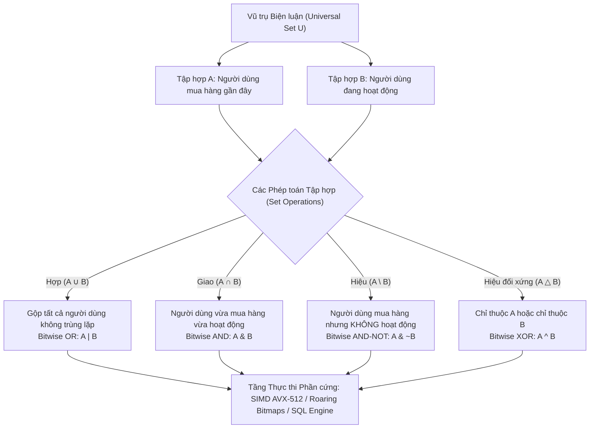

# 2.1. Set Fundamentals and Operations (Nguyên lý và Phép toán Tập hợp)

> [!IMPORTANT]
> **Nếu bạn chỉ được nhớ một điều duy nhất:** Tập hợp (Set) là khái niệm nguyên thủy tối cao của khoa học máy tính: từ các bảng cơ sở dữ liệu quan hệ (RDBMS), hệ thống kiểu (Type Systems), cho đến cấu trúc nén bộ nhớ cao tốc (Bitsets / Roaring Bitmaps) đều chỉ là các dạng biểu diễn vật lý khác nhau của các phần tử độc nhất và các phép toán hợp, giao, hiệu.

---

## 1. Kiến trúc Tổng quan & Mô hình Tư duy (Mental Model)

Hãy tưởng tượng bạn đang xây dựng một nền tảng thương mại điện tử với hàng chục triệu người dùng:
- Bạn muốn gửi thông báo khuyến mãi tới nhóm người dùng: *"Đã mua hàng trong 30 ngày qua ($A$)"* NHƯNG *"Chưa mở ứng dụng trong 7 ngày gần nhất ($B$)"*.
- Trong toán học, tập hợp này chính là **Phép hiệu tập hợp (Set Difference)** $A \setminus B$.
- Khi bạn cần xác định danh sách các danh mục hàng hóa chung giữa hai đối tác bán lẻ, bạn thực hiện **Phép giao tập hợp (Intersection)** $A \cap B$.
- Khi bạn cần gộp toàn bộ danh mục sản phẩm từ hai kho hàng mà không bị trùng lặp, bạn thực hiện **Phép hợp tập hợp (Union)** $A \cup B$.

Dưới tầng vật lý của hệ thống máy tính:
1. **Dung lượng & Tổ chức Bộ nhớ**: Một tập hợp có thể được hiện thực bằng **Hash Set** (`std::unordered_set` với độ phức tạp $O(1)$ amortized lookup), **Cây đỏ-đen (Red-Black Tree)** (`std::set` với $O(\log N)$ ordered lookup), hoặc **Vector Bit** (`std::bitset` / Roaring Bitmaps) tận dụng các lệnh SIMD 256/512-bit để tính toán hàng triệu phép giao/hợp trong vài nanogiây.
2. **Cơ sở dữ liệu Quan hệ (RDBMS)**: Edgar F. Codd đã định hình toàn bộ thế giới cơ sở dữ liệu hiện đại bằng cách chứng minh rằng mỗi bảng (Table) thực chất là một tập hợp các bộ dữ liệu (Tuples), và các câu truy vấn SQL `UNION`, `INTERSECT`, `EXCEPT` phản ánh trực tiếp các phép toán tập hợp Cantor.



---

## 2. Chi tiết từng Keyword (Under-the-Hood Deep Dive)

### 2.1. Set, Element & Cardinality (Tập hợp, Phần tử và Lực lượng)
- **Định nghĩa toán học**: Tập hợp $A$ là một tập hợp các đối tượng xác định, phân biệt (không có phần tử trùng lặp) và không có thứ tự.
  - Quan hệ thuộc về: $x \in A$ biểu thị phần tử $x$ thuộc tập $A$; $x \notin A$ biểu thị $x$ không thuộc $A$.
  - **Lực lượng của tập hợp (Cardinality)**: Ký hiệu $|A|$, là số lượng phần tử phân biệt chứa trong tập $A$.
- **Trực giác kỹ thuật**:
  - Tập hữu hạn (Finite Set): Tương đương các container dữ liệu trong bộ nhớ có kích thước đếm được.
  - Tập vô hạn đếm được (Countably Infinite): Tập số tự nhiên $\mathbb{N}$, tương đương tập hợp các chuỗi bit nhị phân mà máy Turing có thể sinh ra.
  - Tập vô hạn không đếm được (Uncountable): Tập số thực $\mathbb{R}$, chứng minh bằng phương pháp đường chéo của Cantor (Cantor's Diagonal Argument), tương đương tập hợp mọi hàm tính toán (cho thấy có những hàm máy tính không bao giờ tính được).

### 2.2. Subset, Proper Subset, Empty Set & Universal Set (Tập con, Tập rỗng và Vũ trụ)
- **Tập con (Subset)**: $A \subseteq B \iff \forall x, (x \in A \implies x \in B)$. Mọi tập hợp đều là tập con của chính nó ($A \subseteq A$).
- **Tập con thực sự (Proper Subset)**: $A \subset B \iff A \subseteq B \land A \ne B$. Tức $B$ chứa toàn bộ $A$ và tồn tại ít nhất một phần tử của $B$ không nằm trong $A$.
- **Tập rỗng (Empty Set)**: Ký hiệu $\emptyset$ hoặc $\{\}$, là tập hợp không chứa bất kỳ phần tử nào ($|\emptyset| = 0$). Tập rỗng là tập con của mọi tập hợp: $\forall A, \emptyset \subseteq A$.
- **Tập Vũ trụ (Universal Set)**: Ký hiệu $U$, là tập hợp chứa toàn bộ các đối tượng đang được xét trong một bài toán cụ thể. Mọi tập hợp trong ngữ cảnh đó đều là tập con của $U$.

### 2.3. Power Set (Tập lũy thừa / Tập các tập con $\mathcal{P}(A)$)
- **Định nghĩa toán học**: Tập lũy thừa của tập $A$, ký hiệu $\mathcal{P}(A)$ hoặc $2^A$, là tập hợp chứa tất cả các tập con có thể có của $A$, bao gồm cả tập rỗng $\emptyset$ và chính tập $A$:
  $$\mathcal{P}(A) = \{S \mid S \subseteq A\}$$
- **Định lý Lực lượng**: Nếu $|A| = n$, thì lực lượng của tập lũy thừa là:
  $$|\mathcal{P}(A)| = 2^n$$
- **Bản chất dưới tầng vi xử lý (Bitmask Mapping)**:
  - Mỗi tập con của một tập hợp $n$ phần tử ánh xạ 1-1 với một số nguyên không dấu $n$-bit (từ $0$ đến $2^n - 1$).
  - Bit thứ $i$ có giá trị `1` nếu phần tử thứ $i$ xuất hiện trong tập con, và `0` nếu vắng mặt.
  - Kỹ thuật này là cốt lõi của **Quy hoạch động trạng thái Bitmask (Bitmask DP)** trong các bài toán tối ưu tổ hợp (Traveling Salesperson Problem, Set Cover).

### 2.4. Basic Set Operations (Các Phép toán Tập hợp Cơ bản)
- **Phép hợp (Union - $A \cup B$)**:
  $$A \cup B = \{x \mid x \in A \lor x \in B\}$$
  Tương đương với lệnh `OR` bitwise trên bitset hoặc phép gộp danh sách kèm khử trùng lặp.
- **Phép giao (Intersection - $A \cap B$)**:
  $$A \cap B = \{x \mid x \in A \land x \in B\}$$
  Tương đương với lệnh `AND` bitwise trên bitset hoặc thuật toán Two-pointer Merge trên hai mảng đã sắp xếp.
- **Phép hiệu (Set Difference - $A \setminus B$ hoặc $A - B$)**:
  $$A \setminus B = \{x \mid x \in A \land x \notin B\}$$
  Tương đương với thao tác bitwise `A & (~B)`.
- **Phép bù (Complement - $\overline{A}$ hoặc $A^c$)**:
  $$\overline{A} = U \setminus A = \{x \in U \mid x \notin A\}$$
  Tương đương với phép đảo bit `~A` trên toàn bộ không gian bit biểu diễn của vũ trụ $U$.
- **Phép hiệu đối xứng (Symmetric Difference - $A \oplus B$ hoặc $A \triangle B$)**:
  $$A \triangle B = (A \setminus B) \cup (B \setminus A) = (A \cup B) \setminus (A \cap B)$$
  Tương đương chính xác với phép toán `XOR` bitwise (`A ^ B`).

### 2.5. Venn Diagram (Biểu đồ Venn) & Các Đẳng thức Tập hợp
- Biểu đồ Venn là mô hình hình học không gian phẳng biểu diễn trực quan các quan hệ bao hàm và giao thoa giữa các tập hợp.
- **Các đẳng thức Đại số Tập hợp quan trọng**:
  - Luật Giao hoán (Commutative): $A \cup B = B \cup A$, $A \cap B = B \cap A$.
  - Luật Kết hợp (Associative): $(A \cup B) \cup C = A \cup (B \cup C)$.
  - Luật Phân phối (Distributive): $A \cap (B \cup C) = (A \cap B) \cup (A \cap C)$.
  - **Luật De Morgan cho Tập hợp**:
    $$\overline{A \cup B} = \overline{A} \cap \overline{B}$$
    $$\overline{A \cap B} = \overline{A} \cup \overline{B}$$

---

## 3. Thực thi Mã nguồn & Mô phỏng Chuyên sâu (Dual-Engine Implementation)

Mô phỏng động cơ xử lý tập hợp hiệu năng cao (High-Performance Set Engine) so sánh giữa `std::unordered_set` (Hash Table) và `std::bitset` (Bit Manipulation) trong C++20 cùng cấu trúc tập hợp tương đương trong Python 3.11+.

### C++20 Implementation (Dual-Engine: STL Hash Set vs Bitmask Engine)

```cpp
#include <iostream>
#include <vector>
#include <unordered_set>
#include <bitset>
#include <string>
#include <format>
#include <cstdint>

// Động cơ biểu diễn tập hợp bằng 64-bit Bitmask (Tối ưu hóa cache L1)
class FastBitSet {
private:
    uint64_t mask;

public:
    FastBitSet() : mask(0) {}
    explicit FastBitSet(uint64_t initial_mask) : mask(initial_mask) {}

    void insert(uint8_t element) {
        if (element < 64) mask |= (1ULL << element);
    }

    void remove(uint8_t element) {
        if (element < 64) mask &= ~(1ULL << element);
    }

    bool contains(uint8_t element) const {
        if (element >= 64) return false;
        return (mask & (1ULL << element)) != 0;
    }

    uint32_t cardinality() const {
        return __builtin_popcountll(mask); // Lệnh phần cứng CPU đếm bit 1
    }

    FastBitSet set_union(const FastBitSet& other) const {
        return FastBitSet(this->mask | other.mask);
    }

    FastBitSet set_intersection(const FastBitSet& other) const {
        return FastBitSet(this->mask & other.mask);
    }

    FastBitSet set_difference(const FastBitSet& other) const {
        return FastBitSet(this->mask & (~other.mask));
    }

    FastBitSet set_sym_difference(const FastBitSet& other) const {
        return FastBitSet(this->mask ^ other.mask);
    }

    void print(const std::string& name) const {
        std::cout << std::format("{:<20}: {{ ", name);
        for (uint8_t i = 0; i < 64; ++i) {
            if (contains(i)) std::cout << (int)i << " ";
        }
        std::cout << std::format("}} (Cardinality = {})
", cardinality());
    }
};

int main() {
    std::cout << "=== HIGH-PERFORMANCE BITMASK SET ENGINE (C++20) ===

";

    // Khởi tạo Tập A (các ID quyền hạn: 1, 2, 5, 8, 10)
    FastBitSet set_A;
    set_A.insert(1); set_A.insert(2); set_A.insert(5); set_A.insert(8); set_A.insert(10);
    set_A.print("Set A");

    // Khởi tạo Tập B (các ID quyền hạn: 2, 5, 9, 12)
    FastBitSet set_B;
    set_B.insert(2); set_B.insert(5); set_B.insert(9); set_B.insert(12);
    set_B.print("Set B");

    std::cout << "
--> THỰC THI CÁC PHÉP TOÁN TẬP HỢP CƠ BẢN:
";
    
    // 1. Phép Hợp (Union: A ∪ B)
    FastBitSet union_set = set_A.set_union(set_B);
    union_set.print("A ∪ B (Union)");

    // 2. Phép Giao (Intersection: A ∩ B)
    FastBitSet inter_set = set_A.set_intersection(set_B);
    inter_set.print("A ∩ B (Intersection)");

    // 3. Phép Hiệu (Difference: A \ B)
    FastBitSet diff_set = set_A.set_difference(set_B);
    diff_set.print("A \ B (Difference)");

    // 4. Phép Hiệu Đối Xứng (Symmetric Difference: A △ B)
    FastBitSet sym_diff = set_A.set_sym_difference(set_B);
    sym_diff.print("A △ B (Sym Diff)");

    // 5. Kiểm tra Tập con (Subset: A ∩ B ⊆ A)
    bool is_subset = (inter_set.set_difference(set_A).cardinality() == 0);
    std::cout << std::format("
Subset Verification ((A ∩ B) ⊆ A): {}
", 
                             is_subset ? "TRUE" : "FALSE");

    return 0;
}
```

### Python 3.11+ Implementation (Power Set Generator & Set Algebra Engine)

```python
from itertools import combinations
from typing import TypeVar

T = TypeVar("T")

def power_set(iterable: list[T]) -> list[tuple[T, ...]]:
    # Sinh toàn bộ tập lũy thừa P(A) với độ dài từ 0 đến n
    s = list(iterable)
    result = []
    for r in range(len(s) + 1):
        result.extend(combinations(s, r))
    return result

if __name__ == "__main__":
    print("=== PYTHON NATIVE SET THEORY ENGINE ===")

    # Tập hợp khách hàng nhóm A và nhóm B
    group_A = {"Alice", "Bob", "Charlie", "David"}
    group_B = {"Charlie", "David", "Eve", "Frank"}

    print(f"Group A (n={len(group_A)}): {group_A}")
    print(f"Group B (n={len(group_B)}): {group_B}")

    print("
--- PHÉP TOÁN ĐẠI SỐ TẬP HỢP ---")
    print(f"A | B (Union)               : {group_A | group_B}")
    print(f"A & B (Intersection)        : {group_A & group_B}")
    print(f"A - B (Difference)          : {group_A - group_B}")
    print(f"A ^ B (Symmetric Difference): {group_A ^ group_B}")

    # Kiểm tra đẳng thức De Morgan trên tập Universe
    universe = group_A | group_B | {"Grace", "Heidi"}
    comp_A = universe - group_A
    comp_B = universe - group_B

    lhs = universe - (group_A | group_B)
    rhs = comp_A & comp_B
    print(f"
De Morgan Verification (Universe - (A | B) == Comp(A) & Comp(B)): {lhs == rhs}")

    # Sinh tập lũy thừa của tập con 3 phần tử
    sub_elements = ["Auth", "Cache", "DB"]
    p_set = power_set(sub_elements)
    print(f"
Power Set P({sub_elements}) -> Size 2^{len(sub_elements)} = {len(p_set)}:")
    for subset in p_set:
        print(f"  {subset if subset else '∅'}")
```

### Simulated Terminal Output

```text
=== HIGH-PERFORMANCE BITMASK SET ENGINE (C++20) ===

Set A               : { 1 2 5 8 10 } (Cardinality = 5)
Set B               : { 2 5 9 12 } (Cardinality = 4)

--> THỰC THI CÁC PHÉP TOÁN TẬP HỢP CƠ BẢN:
A ∪ B (Union)       : { 1 2 5 8 9 10 12 } (Cardinality = 7)
A ∩ B (Intersection): { 2 5 } (Cardinality = 2)
A \ B (Difference)  : { 1 8 10 } (Cardinality = 3)
A △ B (Sym Diff)    : { 1 8 9 10 12 } (Cardinality = 5)

Subset Verification ((A ∩ B) ⊆ A): TRUE

=== PYTHON NATIVE SET THEORY ENGINE ===
Group A (n=4): {'Alice', 'David', 'Charlie', 'Bob'}
Group B (n=4): {'Eve', 'David', 'Charlie', 'Frank'}

--- PHÉP TOÁN ĐẠI SỐ TẬP HỢP ---
A | B (Union)               : {'Alice', 'Eve', 'David', 'Charlie', 'Frank', 'Bob'}
A & B (Intersection)        : {'David', 'Charlie'}
A - B (Difference)          : {'Alice', 'Bob'}
A ^ B (Symmetric Difference): {'Alice', 'Eve', 'Frank', 'Bob'}

De Morgan Verification (Universe - (A | B) == Comp(A) & Comp(B)): True

Power Set P(['Auth', 'Cache', 'DB']) -> Size 2^3 = 8:
  ∅
  ('Auth',)
  ('Cache',)
  ('DB',)
  ('Auth', 'Cache')
  ('Auth', 'DB')
  ('Cache', 'DB')
  ('Auth', 'Cache', 'DB')
```

---

## 4. Systems Engineering & Production Pitfalls

### 4.1. Bùng nổ Bộ nhớ Tập Lũy Thừa (Power Set Exponential Disaster)
- **Vấn đề**: Kích thước của tập lũy thừa tăng theo hàm số mũ $2^N$.
- Khi $N = 10$, $|\mathcal{P}(A)| = 1024$ phần tử (nhỏ).
- Khi $N = 30$, $|\mathcal{P}(A)| = 2^{30} \approx 1.07 \times 10^9$ phần tử (tiêu tốn ít nhất 8GB RAM).
- Khi $N = 64$, $|\mathcal{P}(A)| = 2^{64} \approx 1.84 \times 10^{19}$ phần tử (vượt quá dung lượng toàn bộ trung tâm dữ liệu thế giới).
- **Quy tắc**: Tuyệt đối không bao giờ sinh toàn bộ tập lũy thừa trong bộ nhớ nếu $N > 25$. Trong các bài toán cấu hình hoặc tổ hợp, sử dụng kỹ thuật duyệt lười (Lazy Generator / Iterator) hoặc thuật toán cắt tỉa nhánh cận (Branch and Bound).

### 4.2. Suy giảm Hiệu năng Băm (Hash Table Bucket Collision Degradation)
- Mặc dù `std::unordered_set` và Python `set` có thời gian tìm kiếm trên lý thuyết là $O(1)$, nhưng nếu hàm băm (Hash Function) kém chất lượng hoặc gặp phải cuộc tấn công **Hash Flooding DoS**, hàng triệu khóa sẽ rơi vào cùng một bucket.
- Khi đó, độ phức tạp của phép kiểm tra $x \in A$ bị suy biến nghiêm trọng từ $O(1)$ về $O(N)$ (duyệt danh sách liên kết), làm nghẽn hoàn toàn CPU server.
- **Giải pháp**: Sử dụng các hàm băm chất lượng cao có tính ngẫu nhiên hóa hạt giống (SipHash trong Python, xxHash/CityHash trong C++) hoặc cấu trúc cây cân bằng $O(\log N)$.

### 4.3. Bẫy Biến tính Đối tượng trong Tập hợp (Mutable Object in Set Bug)
- Trong Python hoặc Java, nếu một đối tượng được thêm vào `Set`, sau đó các trường dữ liệu dùng để tính mã băm (hash code) của đối tượng đó bị thay đổi (mutate), vị trí bucket của đối tượng sẽ bị sai lệch.
- Hậu quả: Đối tượng vẫn nằm trong tập hợp nhưng lệnh kiểm tra `obj in my_set` sẽ trả về `False`, gây thất thoát bộ nhớ (Memory Leak) và lỗi trạng thái logic ngầm.
- **Quy tắc**: Chỉ lưu các đối tượng bất biến (Immutable Objects - `frozen=True` trong Python, `const` trong C++) vào tập hợp.

---

## 5. Bảng So sánh & Decision Matrix

| Cấu trúc / Triển khai | Thời gian Tra cứu (Membership) | Thời gian Phép Giao (A ∩ B) | Mức tiêu thụ Bộ nhớ | Đặc tính Thứ tự | Trường hợp Sử dụng Tối ưu |
| :--- | :--- | :--- | :--- | :--- | :--- |
| **`std::unordered_set`** | $O(1)$ amortized | $O(|A|)$ (duyệt tập nhỏ hơn) | Cao (Con trỏ bucket + overhead node) | Không có thứ tự | Tập dữ liệu chuỗi, đối tượng phức tạp |
| **`std::set` (Red-Black)** | $O(\log N)$ strict | $O(|A| + |B|)$ qua 2-pointer | Trung bình (2 con trỏ con + 1 bit màu) | Có thứ tự tăng dần | Cần truy vấn khoảng (`lower_bound`), min/max |
| **`std::bitset<N>`** | $O(1)$ (1 phép dịch bit) | $O(N / 64)$ (lệnh CPU `AND`) | Cực thấp (1 bit / phần tử) | Có thứ tự bit | Tập vũ trụ nguyên tĩnh nhỏ ($N \le 10^5$) |
| **Roaring Bitmap** | $O(1) - O(\log K)$ | $O(\text{Array/Bitset/Run})$ | Nén siêu tối ưu (Adaptive containers) | Có thứ tự nguyên | Elasticsearch, Big Data, Inverted Index |
