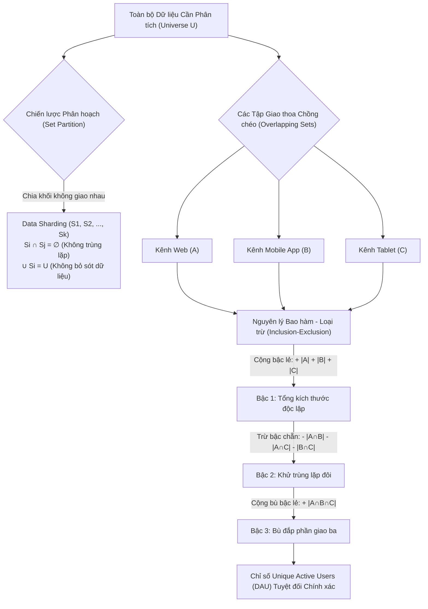

# 2.2. Advanced Sets & Inclusion-Exclusion Principle (Phân hoạch Tập hợp và Nguyên lý Bao hàm - Loại trừ)

> [!IMPORTANT]
> **Nếu bạn chỉ được nhớ một điều duy nhất:** Phân hoạch tập hợp (Set Partition) là bản thiết kế toán học của việc chia để trị và Sharding dữ liệu (không chồng chéo, không bỏ sót), trong khi **Nguyên lý Bao hàm - Loại trừ (Inclusion-Exclusion Principle)** là "chiếc kính hiển vi" triệt tiêu hoàn toàn lỗi đếm trùng lặp khi tính toán hợp của nhiều tập dữ liệu giao nhau.

---

## 1. Kiến trúc Tổng quan & Mô hình Tư duy (Mental Model)

Hãy tưởng tượng bạn đang là kiến trúc sư trưởng cho hệ thống phân tích người dùng hoạt động (User Analytics Engine):
- Bạn muốn tính chỉ số **Daily Active Users (DAU)** của một hệ thống có 3 kênh tương tác: Web ($A$), Mobile App ($B$), và Tablet ($C$).
- Nếu bạn chỉ cộng ngây thơ $|A| + |B| + |C|$, kết quả sẽ bị phóng đại nghiêm trọng vì có những người dùng vừa lướt web trên công ty, vừa mở app điện thoại trên đường về nhà.
- Để tính chính xác số người dùng độc nhất (Unique Active Users) $|A \cup B \cup C|$, bạn bắt buộc phải cộng kích thước từng kênh, trừ đi các phần giao đôi, rồi cộng bù lại phần giao ba:
  $$|A \cup B \cup C| = |A| + |B| + |C| - (|A \cap B| + |A \cap C| + |B \cap C|) + |A \cap B \cap C|$$
- Đây chính là biểu thức cụ thể của **Nguyên lý Bao hàm - Loại trừ (Inclusion-Exclusion Principle)**.

Trong kiến trúc hệ thống phân tán:
1. **Database Sharding & Data Partitioning**: Chia 1 tỷ bản ghi vào $k$ phân vùng vật lý độc lập sao cho không bản ghi nào xuất hiện ở 2 shard khác nhau và không bản ghi nào bị mất mát. Đây là định nghĩa thuần túy của **Set Partition**.
2. **Disjoint Set Union (DSU / Kruskal's Algorithm)**: Quản lý các nhóm máy chủ kết nối trong mạng máy tính để phát hiện chu trình mạng (Network Cycles).
3. **Đếm Độc nhất Tầm vóc Big Data**: Khi số lượng tập hợp lên tới hàng trăm nghìn, việc áp dụng công thức đầy đủ sẽ gây bùng nổ hàm mũ $2^k$; các kỹ sư chuyển sang dùng xấp xỉ xác suất (HyperLogLog) để thay thế.



---

## 2. Chi tiết từng Keyword (Under-the-Hood Deep Dive)

### 2.1. Set Partition (Phân hoạch Tập hợp)
- **Định nghĩa toán học**: Một phân hoạch của tập hợp khác rỗng $S$ là một tập hợp các tập con khác rỗng $\mathcal{P} = \{A_1, A_2, \dots, A_k\}$ thỏa mãn đồng thời hai điều kiện tiên đề:
  1. **Đôi một rời nhau (Mutually Disjoint)**:
     $$\forall i \ne j, \quad A_i \cap A_j = \emptyset$$
  2. **Phủ toàn bộ tập gốc (Exhaustive Union)**:
     $$\bigcup_{i=1}^k A_i = S$$
  Mỗi tập con $A_i$ được gọi là một **Khối phân hoạch (Cell hoặc Block)**.
- **Trực giác kỹ thuật**: Phân hoạch tương đương với việc gán nhãn duy nhất cho từng bản ghi dữ liệu vào đúng một phân lớp (Bucket/Shard/Group) mà không có bất kỳ sự mơ hồ hay trùng lặp nào.
- **Số phân hoạch có thể có (Bell Numbers & Stirling Numbers of the Second Kind)**:
  - Số Stirling loại hai $S(n, k)$ biểu thị số cách phân hoạch một tập $n$ phần tử thành chính xác $k$ khối không rỗng:
    $$S(n, k) = \frac{1}{k!} \sum_{j=0}^k (-1)^{k-j} \binom{k}{j} j^n$$
  - **Số Bell $B_n$**: Tổng số tất cả các phân hoạch có thể có của tập $n$ phần tử:
    $$B_n = \sum_{k=0}^n S(n, k)$$
  - Công thức truy hồi Bell: $B_{n+1} = \sum_{k=0}^n \binom{n}{k} B_k$ với $B_0 = 1$. Tốc độ tăng của $B_n$ là siêu hàm mũ, vượt xa $n!$.

### 2.2. Inclusion-Exclusion Principle (Nguyên lý Bao hàm - Loại trừ)
- **Định lý toán học**: Cho $n$ tập hợp hữu hạn $A_1, A_2, \dots, A_n$. Lực lượng của hợp của chúng được tính bằng tổng kích thước các tập hợp, trừ đi tổng các phần giao của từng cặp hai tập hợp, cộng lại tổng các phần giao của từng nhóm ba tập hợp, và tiếp tục đan dấu cho đến phần giao của toàn bộ $n$ tập hợp:
  $$\left| \bigcup_{i=1}^n A_i \right| = \sum_{k=1}^n (-1)^{k-1} \sum_{1 \le i_1 < i_2 < \dots < i_k \le n} |A_{i_1} \cap A_{i_2} \cap \dots \cap A_{i_k}|$$
- **Giải thích biến**:
  - $n$: Số lượng tập hợp đang được xem xét.
  - $k$: Bậc của phần giao thoa ($k=1$: tập đơn, $k=2$: giao đôi, $k=3$: giao ba, $\dots$).
  - $(-1)^{k-1}$: Hệ số đan dấu (Dấu $+$ cho bậc lẻ, dấu $-$ cho bậc chẵn).
- **Trường hợp 2 tập hợp**:
  $$|A \cup B| = |A| + |B| - |A \cap B|$$
- **Trường hợp 3 tập hợp**:
  $$|A \cup B \cup C| = (|A| + |B| + |C|) - (|A \cap B| + |A \cap C| + |B \cap C|) + |A \cap B \cap C|$$
- **Ứng dụng kinh điển trong Khoa học Máy tính**:
  - **Bài toán Xáo trộn Hoàn toàn (Derangements / Hat-Check Problem)**: Đếm số lượng hoán vị của $n$ phần tử sao cho không phần tử nào nằm ở vị trí ban đầu của nó:
    $$!n = n! \sum_{k=0}^n \frac{(-1)^k}{k!} \approx \frac{n!}{e}$$
  - **Đếm số lượng số nguyên tố cùng nhau (Hàm Phi Euler $\phi(n)$)**: Áp dụng nguyên lý Bao hàm - Loại trừ trên tập các ước nguyên tố của $n$.

### 2.3. Bitmask Inclusion-Exclusion (Kỹ thuật Duyệt Bitmask Bao hàm - Loại trừ)
- Khi lập trình giải thuật trên máy tính, biểu thức tổng đan dấu của nguyên lý Bao hàm - Loại trừ được duyệt tự nhiên bằng **Bitmask**:
  - Với $n$ tập hợp, có $2^n - 1$ trạng thái bitmask khác rỗng từ $1$ đến $2^n - 1$.
  - Trạng thái `mask` đại diện cho một tập con các tập hợp được chọn.
  - Số lượng tập hợp được chọn $k = \text{\_\_builtin\_popcount}(mask)$.
  - Nếu $k$ là số lẻ, ta cộng lực lượng phần giao vào tổng. Nếu $k$ là số chẵn, ta trừ lực lượng phần giao khỏi tổng.

---

## 3. Thực thi Mã nguồn & Mô phỏng Chuyên sâu (Dual-Engine Implementation)

Mô phỏng bộ máy tính toán số lượng phần tử độc nhất (Unique Active Metrics) giữa nhiều kênh dữ liệu bằng kỹ thuật **Bitmask Inclusion-Exclusion** và cấu trúc **Disjoint Set Union (DSU)** để quản lý Set Partition.

### C++20 Implementation (Bitmask Inclusion-Exclusion & DSU Partitioning)

```cpp
#include <iostream>
#include <vector>
#include <numeric>
#include <cstdint>
#include <format>
#include <bit>

// 1. DISJOINT SET UNION (Quản lý Phân hoạch Tập hợp Set Partition)
class DisjointSetUnion {
private:
    std::vector<int32_t> parent;
    std::vector<uint32_t> rank;
    uint32_t num_partitions;

public:
    explicit DisjointSetUnion(uint32_t n) : parent(n), rank(n, 0), num_partitions(n) {
        std::iota(parent.begin(), parent.end(), 0);
    }

    int32_t find(int32_t i) {
        if (parent[i] == i) return i;
        return parent[i] = find(parent[i]); // Path Compression
    }

    bool unite(int32_t i, int32_t j) {
        int32_t root_i = find(i);
        int32_t root_j = find(j);
        if (root_i == root_j) return false;

        // Union by Rank
        if (rank[root_i] < rank[root_j]) {
            parent[root_i] = root_j;
        } else if (rank[root_i] > rank[root_j]) {
            parent[root_j] = root_i;
        } else {
            parent[root_j] = root_i;
            rank[root_i]++;
        }
        num_partitions--;
        return true;
    }

    uint32_t get_partition_count() const { return num_partitions; }
};

// 2. INCLUSION-EXCLUSION SOLVER BẰNG BITMASK
// Tính số lượng số nguyên trong đoạn [1, Limit] chia hết cho ít nhất một số trong mảng primes
uint64_t count_multiples_pie(uint64_t limit, const std::vector<uint64_t>& primes) {
    uint32_t n = primes.size();
    uint64_t total_count = 0;
    uint32_t total_subsets = (1U << n);

    // Duyệt qua tất cả 2^n - 1 tập con khác rỗng
    for (uint32_t mask = 1; mask < total_subsets; ++mask) {
        uint64_t divisor = 1;
        uint32_t bits_set = std::popcount(mask);
        bool overflow = false;

        for (uint32_t i = 0; i < n; ++i) {
            if (mask & (1U << i)) {
                if (__builtin_mul_overflow(divisor, primes[i], &divisor)) {
                    overflow = true;
                    break;
                }
            }
        }

        if (overflow || divisor > limit) continue;

        uint64_t multiples = limit / divisor;

        // Bậc lẻ -> Cộng, Bậc chẵn -> Trừ
        if (bits_set % 2 == 1) {
            total_count += multiples;
        } else {
            total_count -= multiples;
        }
    }
    return total_count;
}

int main() {
    std::cout << "=== ADVANCED SET THEORY & INCLUSION-EXCLUSION (C++20) ===

";

    // Phân hoạch tập hợp (Set Partition) qua DSU
    std::cout << "1. [Disjoint Set Union - Set Partition Simulation]
";
    DisjointSetUnion dsu(6); // Tập gồm 6 node: {0, 1, 2, 3, 4, 5}
    std::cout << "   Ban đầu có 6 phần tử phân lập -> Số khối phân hoạch: " 
              << dsu.get_partition_count() << "
";

    dsu.unite(0, 1);
    dsu.unite(1, 2);
    dsu.unite(3, 4);
    std::cout << "   Sau khi gộp nhóm (0,1,2) và (3,4) -> Số khối phân hoạch: " 
              << dsu.get_partition_count() << "
";
    std::cout << "   Node 0 và Node 2 cùng phân vùng? " 
              << (dsu.find(0) == dsu.find(2) ? "YES" : "NO") << "
";
    std::cout << "   Node 0 và Node 3 cùng phân vùng? " 
              << (dsu.find(0) == dsu.find(3) ? "YES" : "NO") << "

";

    // Nguyên lý Bao hàm - Loại trừ (Inclusion-Exclusion Principle)
    std::cout << "2. [Bitmask Inclusion-Exclusion Principle]
";
    uint64_t N = 1000;
    std::vector<uint64_t> primes = {2, 3, 5}; // Các số chia hết cho 2 HOẶC 3 HOẶC 5 trong [1, 1000]

    uint64_t result = count_multiples_pie(N, primes);
    std::cout << std::format("   Số lượng số trong [1, {}] chia hết cho 2, 3 hoặc 5: {}
", N, result);
    std::cout << "   (Lý thuyết: 500 + 333 + 200 - 166 - 100 - 66 + 33 = 734)
";

    return 0;
}
```

### Python 3.11+ Implementation (Stirling & Bell Numbers & Exact Multi-Set Overlap)

```python
from math import comb

def stirling_second(n: int, k: int) -> int:
    # Tính số Stirling loại hai S(n, k)
    if n == k == 0:
        return 1
    if n == 0 or k == 0 or k > n:
        return 0
    total = 0
    for j in range(k + 1):
        sign = (-1) ** (k - j)
        total += sign * comb(k, j) * (j ** n)
    return total // (1 if k == 0 else math_factorial(k))

def math_factorial(n: int) -> int:
    res = 1
    for i in range(2, n + 1):
        res *= i
    return res

def bell_number(n: int) -> int:
    # Tính số Bell B_n = tổng S(n, k) từ k=0 đến n
    return sum(stirling_second(n, k) for k in range(n + 1))

def inclusion_exclusion_sets(sets_dict: dict[str, set]) -> int:
    # Tính kích thước hợp của n tập hợp bằng nguyên lý Bao hàm - Loại trừ
    keys = list(sets_dict.keys())
    n = len(keys)
    total_unique = 0

    for mask in range(1, 1 << n):
        selected_sets = [sets_dict[keys[i]] for i in range(n) if (mask & (1 << i))]
        
        # Giao toàn bộ các tập đã chọn
        intersection = selected_sets[0].copy()
        for s in selected_sets[1:]:
            intersection &= s

        bits_set = bin(mask).count('1')
        if bits_set % 2 == 1:
            total_unique += len(intersection)
        else:
            total_unique -= len(intersection)

    return total_unique

if __name__ == "__main__":
    print("=== PYTHON ADVANCED SETS & PARTITION ENGINE ===")

    # Phân tích số cách phân hoạch tập hợp
    print("1. [Stirling & Bell Numbers Analysis]")
    for n in range(1, 6):
        b_n = bell_number(n)
        stirlings = [stirling_second(n, k) for k in range(1, n + 1)]
        print(f"   n = {n} -> Bell B_{n} = {b_n:<4} | S({n}, k) = {stirlings}")

    # Kiểm chứng Inclusion-Exclusion trên các kênh truy cập
    print("
2. [Exact Inclusion-Exclusion Multi-channel DAU Check]")
    channels = {
        "Web":    {101, 102, 103, 104, 105, 106},
        "Mobile": {104, 105, 106, 107, 108},
        "Tablet": {105, 106, 109, 110}
    }

    for name, s in channels.items():
        print(f"   Kênh {name:<7}: {len(s)} users")

    pie_result = inclusion_exclusion_sets(channels)
    direct_union_result = len(set().union(*channels.values()))

    print(f"
   Kết quả tính bằng Inclusion-Exclusion : {pie_result}")
    print(f"   Kết quả gộp trực tiếp set.union()     : {direct_union_result}")
    print(f"   Kiểm chứng khớp tuyệt đối             : {pie_result == direct_union_result}")
```

### Simulated Terminal Output

```text
=== ADVANCED SET THEORY & INCLUSION-EXCLUSION (C++20) ===

1. [Disjoint Set Union - Set Partition Simulation]
   Ban đầu có 6 phần tử phân lập -> Số khối phân hoạch: 6
   Sau khi gộp nhóm (0,1,2) và (3,4) -> Số khối phân hoạch: 3
   Node 0 và Node 2 cùng phân vùng? YES
   Node 0 và Node 3 cùng phân vùng? NO

2. [Bitmask Inclusion-Exclusion Principle]
   Số lượng số trong [1, 1000] chia hết cho 2, 3 hoặc 5: 734
   (Lý thuyết: 500 + 333 + 200 - 166 - 100 - 66 + 33 = 734)

=== PYTHON ADVANCED SETS & PARTITION ENGINE ===
1. [Stirling & Bell Numbers Analysis]
   n = 1 -> Bell B_1 = 1    | S(1, k) = [1]
   n = 2 -> Bell B_2 = 2    | S(2, k) = [1, 1]
   n = 3 -> Bell B_3 = 5    | S(3, k) = [1, 3, 1]
   n = 4 -> Bell B_4 = 15   | S(4, k) = [1, 7, 6, 1]
   n = 5 -> Bell B_5 = 52   | S(5, k) = [1, 15, 25, 10, 1]

2. [Exact Inclusion-Exclusion Multi-channel DAU Check]
   Kênh Web    : 6 users
   Kênh Mobile : 5 users
   Kênh Tablet : 4 users

   Kết quả tính bằng Inclusion-Exclusion : 10
   Kết quả gộp trực tiếp set.union()     : 10
   Kiểm chứng khớp tuyệt đối             : True
```

---

## 4. Systems Engineering & Production Pitfalls

### 4.1. Bùng nổ Tổ hợp Hàm mũ của Nguyên lý Bao hàm - Loại trừ ($2^N$ Trap)
- **Vấn đề**: Để tính kích thước hợp của $N$ tập hợp bằng công thức chính xác, thuật toán bắt buộc phải xét $2^N - 1$ giao tập.
- Khi $N = 30$, số phép toán là $2^{30} \approx 10^9$ phép tính.
- Khi $N = 100$, số phép toán là $2^{100} \approx 1.26 \times 10^{30}$ (bất khả thi về mặt vũ trụ).
- **Giải pháp trong Production**:
  - Không bao giờ dùng Inclusion-Exclusion chính xác khi $N > 20$.
  - Thay vào đó, trong Big Data và Distributed Systems (Presto, Trino, BigQuery), các kỹ sư sử dụng giải thuật **HyperLogLog (HLL)**. HyperLogLog cho phép ước lượng lực lượng hợp của hàng ngàn tập hợp với sai số tiêu chuẩn $\approx 1.04 / \sqrt{m}$ chỉ tốn vài kilobyte bộ nhớ và thời gian tuyến tính $O(N)$.

### 4.2. Tràn số Nguyên (Integer Overflow) khi Nhân Mẫu số chung
- Trong bài toán đếm số lượng số chia hết cho các tập số nguyên tố bằng Inclusion-Exclusion, ta phải tính tích của các số nguyên tố: $divisor = p_{i_1} \times p_{i_2} \times \dots \times p_{i_k}$.
- Nếu không kiểm tra tràn số bằng `__builtin_mul_overflow` trong C++, tích $divisor$ sẽ bị tràn số vòng (wrap-around) về một số nhỏ ngẫu nhiên, dẫn đến phép chia $Limit / divisor$ bị thổi phồng khổng lồ và kết quả trả về sai lệch hoàn toàn.

### 4.3. Suy thoái Cây trong Disjoint Set Union khi Quên Path Compression
- Trong thuật toán DSU để quản lý phân hoạch tập hợp, nếu lập trình viên quên kỹ thuật **Nén đường đi (Path Compression)** `parent[i] = find(parent[i])`, cây tập hợp có thể bị suy biến thành một danh sách liên kết tuyến tính dài $N$.
- Khi đó độ phức tạp của mỗi thao tác `find()` bị đẩy từ $O(\alpha(N))$ (gần như $O(1)$) lên tới $O(N)$, làm sập hiệu năng của thuật toán Kruskal khi tìm cây khung nhỏ nhất.

---

## 5. Bảng So sánh & Decision Matrix

| Phương pháp / Cấu trúc | Độ phức tạp Thời gian | Độ phức tạp Không gian | Độ chính xác | Ngưỡng Ứng dụng Thực tế |
| :--- | :--- | :--- | :--- | :--- |
| **Bitmask Inclusion-Exclusion** | $O(2^N)$ | $O(N)$ | Tuyệt đối (100% Exact) | $N \le 20$ (Toán tổ hợp, Xác suất vi mô) |
| **Disjoint Set Union (DSU)** | $O(M \alpha(N))$ | $O(N)$ | Tuyệt đối (Exact Partition) | $N \le 10^7$ (Mạng máy tính, Kruskal MST) |
| **Bitset / Roaring Bitmap Merge**| $O(\sum |A_i| / 64)$ | $O(\max(element))$ | Tuyệt đối | $N \le 10^4$ tập hợp, ID số nguyên hữu hạn |
| **HyperLogLog (HLL)** | $O(N)$ | $O(1)$ (1.5 KB cố định) | Xấp xỉ (Sai số $\approx 1\%$) | $N$ tùy ý, Big Data Analytics (DAU/MAU) |
