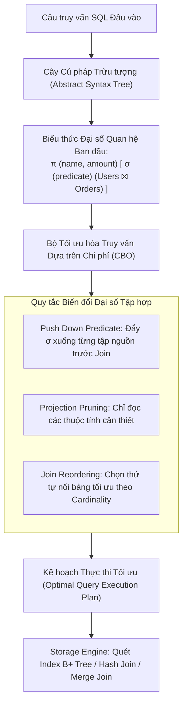

# 2.3. Set Theory in Backend and Databases (Ứng dụng Lý thuyết Tập hợp trong Backend và Cơ sở Dữ liệu)

> [!IMPORTANT]
> **Nếu bạn chỉ được nhớ một điều duy nhất:** Cơ sở dữ liệu quan hệ (RDBMS) không phải là bảng tính Excel cao cấp; nó là hiện thân vật lý của **Đại số quan hệ (Relational Algebra)** và Lý thuyết tập hợp của Edgar F. Codd: mỗi bảng là một tập hợp các bộ dữ liệu (Tuples), câu lệnh SQL là các toán tử tập hợp, và bộ tối ưu hóa truy vấn (Query Optimizer) biến đổi các biểu thức tập hợp tương đương để tiết kiệm hàng giờ I/O ổ đĩa.

---

## 1. Kiến trúc Tổng quan & Mô hình Tư duy (Mental Model)

Hãy tưởng tượng bạn đang gửi một câu truy vấn SQL phức tạp tới PostgreSQL hoặc MySQL:
```sql
SELECT u.name, o.amount 
FROM users u 
JOIN orders o ON u.id = o.user_id 
WHERE u.status = 'ACTIVE' AND o.created_at >= '2026-01-01';
```
Bên dưới tầng động cơ cơ sở dữ liệu:
- Bảng `users` là tập hợp $U$, bảng `orders` là tập hợp $O$.
- Tích Descartes $U \times O$ tạo ra không gian tất cả các cặp có thể có ($|U| \times |O|$ phần tử — cực kỳ khổng lồ!).
- Phép chọn (Selection - $\sigma$) lọc ra các bộ thỏa mãn vị từ `status = 'ACTIVE'` và ngày tạo.
- Phép nối (Join - $\bowtie$) chiếu theo quan hệ đẳng thức khóa ngoại $u.id = o.user_id$.
- Phép chiếu (Projection - $\pi$) chỉ giữ lại 2 cột `name` và `amount`.

Nếu Database Engine thực hiện ngây thơ theo thứ tự trên: nhân toàn bộ bảng trước rồi mới lọc, nó sẽ làm tràn toàn bộ RAM máy chủ!
Thay vào đó, nhờ các định luật của Đại số Tập hợp (Luật Phân phối, Giao hoán), bộ tối ưu hóa truy vấn sẽ **đẩy phép chọn xuống trước (Push Down Predicates)**: lọc các tập con nhỏ trước, rồi mới thực hiện phép Join. Đây chính là sức mạnh của lý thuyết tập hợp ứng dụng trong kỹ thuật backend.



---

## 2. Chi tiết từng Keyword (Under-the-Hood Deep Dive)

### 2.1. Relational Algebra (Đại số Quan hệ)
- Được phát minh bởi Edgar F. Codd vào năm 1970, Đại số quan hệ là một hệ thống toán học hình thức gồm các toán tử nhận một hoặc nhiều quan hệ (quan hệ trong toán học tương ứng với bảng trong RDBMS) làm đầu vào và trả về một quan hệ mới làm đầu ra.
- **6 Toán tử Nguyên thủy Cốt lõi**:
  1. **Selection (Phép chọn - $\sigma_\varphi(R)$)**: Lọc các bộ dữ liệu (rows) trong quan hệ $R$ thỏa mãn vị từ logic $\varphi$.
     $$\sigma_\varphi(R) = \{t \in R \mid \varphi(t) = \text{True}\}$$
     Tương đương SQL: `SELECT * FROM R WHERE φ`.
  2. **Projection (Phép chiếu - $\pi_{a_1, \dots, a_k}(R)$)**: Trích xuất một tập con các thuộc tính (columns) từ quan hệ $R$ và loại bỏ các dòng trùng lặp kết quả.
     Tương đương SQL: `SELECT DISTINCT a1, ..., ak FROM R`.
  3. **Cartesian Product (Tích Descartes - $R \times S$)**: Kết hợp mọi bộ của $R$ với mọi bộ của $S$.
     $$R \times S = \{(r, s) \mid r \in R \land s \in S\}$$
  4. **Set Union (Phép hợp - $R \cup S$)**: Gộp các bộ dữ liệu từ hai quan hệ có cùng lược đồ thuộc tính.
     Tương đương SQL: `UNION`.
  5. **Set Difference (Phép hiệu - $R \setminus S$)**: Lấy các bộ xuất hiện trong $R$ nhưng không xuất hiện trong $S$.
     Tương đương SQL: `EXCEPT` hoặc `MINUS`.
  6. **Rename (Phép đổi tên - $\rho_{S}(R)$)**: Đổi tên quan hệ hoặc thuộc tính.
- **Toán tử Phái sinh Cực kỳ Quan trọng**:
  - **Natural Join / Theta Join (Phép nối - $R \bowtie_\theta S$)**:
    $$R \bowtie_\theta S = \sigma_\theta(R \times S)$$
    Là sự kết hợp của tích Descartes kèm theo phép chọn lọc theo điều kiện $\theta$.

### 2.2. Filtering & Database Queries (Truy vấn và Lọc Dữ liệu)
- **Bản chất dưới tầng Storage Engine**:
  - Khi thực thi phép chọn $\sigma(R)$, nếu bảng không có Index, Database phải thực hiện **Full Table Scan** ($O(|R|)$ I/O reads).
  - Nếu có **B+ Tree Index**, phép lọc vị từ đẳng thức hoặc khoảng ($a \le x \le b$) được giảm xuống còn $O(\log |R| + K)$ I/O reads.
- **Các Thuật toán Thực thi Phép Join giữa hai tập hợp**:
  1. **Nested Loop Join**: Duyệt 2 vòng lặp lồng nhau ngây thơ ($O(|R| \times |S|)$). Thích hợp khi một trong hai tập hợp cực nhỏ.
  2. **Hash Join**: Đọc tập hợp nhỏ hơn vào RAM, xây dựng Hash Table ($O(|R|)$), sau đó quét tập hợp lớn hơn và tra cứu bảng băm ($O(|S|)$). Tổng chi phí tuyến tính $O(|R| + |S|)$.
  3. **Sort-Merge Join**: Sắp xếp cả hai tập hợp theo khóa join ($O(|R| \log |R| + |S| \log |S|)$), sau đó dùng con trỏ kép hợp nhất ($O(|R| + |S|)$). Tối ưu khi dữ liệu đã được index sẵn theo thứ tự.

### 2.3. Authorization, User Groups, Role and Permission (Hệ thống Phân quyền Tập hợp)
- Mọi mô hình bảo mật và phân quyền trong phần mềm đều có thể mô hình hóa chính xác bằng quan hệ tập hợp:
  - Tập người dùng: $\mathcal{U}$, Tập vai trò: $\mathcal{R}$, Tập quyền hạn: $\mathcal{P}$.
  - Người dùng $u$ sở hữu một tập các vai trò: $Roles(u) \subseteq \mathcal{R}$.
  - Mỗi vai trò $r$ chứa một tập các quyền hạn: $Perms(r) \subseteq \mathcal{P}$.
  - Tập quyền hạn hiệu dụng của người dùng $u$ là hợp của toàn bộ quyền hạn từ các vai trò:
    $$EffectivePerms(u) = \bigcup_{r \in Roles(u)} Perms(r)$$
  - Phép kiểm tra người dùng có quyền $p$ hay không là phép kiểm tra phần tử thuộc tập:
    $$CanExecute(u, p) \iff p \in EffectivePerms(u)$$

### 2.4. Data Deduplication & Data Intersection (Khử trùng lặp và Giao tập dữ liệu Quy mô lớn)
- **Data Deduplication (Khử trùng lặp dữ liệu)**:
  - Bản chất là biến đổi một đa tập hợp (Multiset/Bag có phần tử trùng) thành một tập hợp thuần túy (Set).
  - Trong Big Data (MapReduce/Spark), phép khử trùng lặp được thực hiện ở pha Shuffle/Reduce thông qua Group By trên khóa hash.
- **Data Intersection hiệu năng cao (Roaring Bitmaps)**:
  - Khi cần tính giao giữa các tập dữ liệu người dùng khổng lồ (ví dụ: tìm người dùng vừa thích công nghệ vừa thích du lịch), các hệ thống như Elasticsearch, Apache Druid, ClickHouse sử dụng cấu trúc **Roaring Bitmaps**.
  - Roaring Bitmap chia không gian số nguyên 32-bit thành các chunk $2^{16}$ (65.536 phần tử) và lưu trữ thích ứng bằng Array (khi tập thưa), Bitset (khi tập dày), hoặc Run-length Encoding (khi các số liên tiếp nhau), cho phép tính phép giao với tốc độ hàng tỷ bản ghi mỗi giây.

---

## 3. Thực thi Mã nguồn & Mô phỏng Chuyên sâu (Dual-Engine Implementation)

Mô phỏng một **Mini In-Memory Relational Engine** thực thi các toán tử Đại số quan hệ (Selection, Projection, Inner Join) và kiểm chứng tối ưu hóa truy vấn bằng phép biến đổi tập hợp.

### C++20 Implementation (In-Memory Relational Algebra Engine)

```cpp
#include <iostream>
#include <vector>
#include <string>
#include <unordered_map>
#include <format>
#include <algorithm>
#include <ranges>

// Biểu diễn các bản ghi dạng Struct
struct UserRow {
    uint32_t id;
    std::string name;
    std::string department;
};

struct OrderRow {
    uint32_t order_id;
    uint32_t user_id;
    double amount;
};

struct JoinedRow {
    std::string user_name;
    uint32_t order_id;
    double amount;
};

// MINI RELATIONAL ALGEBRA ENGINE
class RelationalEngine {
public:
    // Toán tử Selection (σ): Lọc Users theo phòng ban
    static std::vector<UserRow> select_users_by_dept(const std::vector<UserRow>& users, const std::string& dept) {
        std::vector<UserRow> result;
        for (const auto& u : users) {
            if (u.department == dept) result.push_back(u);
        }
        return result;
    }

    // Toán tử Hash Join (⨝): Nối Users và Orders trên user_id
    static std::vector<JoinedRow> hash_join(const std::vector<UserRow>& users, const std::vector<OrderRow>& orders) {
        std::vector<JoinedRow> result;
        
        // 1. Build Phase: Xây dựng hash table trên tập Users
        std::unordered_map<uint32_t, std::string> user_map;
        for (const auto& u : users) {
            user_map[u.id] = u.name;
        }

        // 2. Probe Phase: Quét tập Orders và tra cứu hash table
        for (const auto& o : orders) {
            auto it = user_map.find(o.user_id);
            if (it != user_map.end()) {
                result.push_back({it->second, o.order_id, o.amount});
            }
        }
        return result;
    }
};

int main() {
    std::cout << "=== IN-MEMORY RELATIONAL ALGEBRA ENGINE (C++20) ===

";

    std::vector<UserRow> users = {
        {1, "Alice",   "Engineering"},
        {2, "Bob",     "Sales"},
        {3, "Charlie", "Engineering"},
        {4, "David",   "Marketing"}
    };

    std::vector<OrderRow> orders = {
        {101, 1, 250.0},
        {102, 1, 120.0},
        {103, 2, 450.0},
        {104, 3, 90.0},
        {105, 5, 300.0} // user_id=5 không tồn tại (sẽ bị loại khỏi Inner Join)
    };

    std::cout << "Executing Query: SELECT u.name, o.id, o.amount FROM users u JOIN orders o WHERE u.dept = 'Engineering'

";

    // Kỹ thuật Tối ưu hóa: Predicate Pushdown (Thực hiện Selection trước khi Join)
    std::cout << "--> Bước 1: Áp dụng Selection σ(department = 'Engineering') trên Users...
";
    auto filtered_users = RelationalEngine::select_users_by_dept(users, "Engineering");
    std::cout << std::format("    Số lượng User sau lọc: {}/4
", filtered_users.size());

    std::cout << "--> Bước 2: Thực thi Hash Join (filtered_users ⨝ orders)...
";
    auto joined_result = RelationalEngine::hash_join(filtered_users, orders);

    std::cout << "
--> KẾT QUẢ CUỐI CÙNG (PROJECTION RESULT):
";
    std::cout << std::format("{:<12} | {:<10} | {:<10}
", "User Name", "Order ID", "Amount");
    std::cout << "----------------------------------------
";
    for (const auto& row : joined_result) {
        std::cout << std::format("{:<12} | {:<10} | ${:<9.2f}
", row.user_name, row.order_id, row.amount);
    }

    return 0;
}
```

### Python 3.11+ Implementation (Role-Based Access Control Set Algebra)

```python
from dataclasses import dataclass, field

@dataclass(frozen=True)
class Permission:
    resource: str
    action: str

    def __repr__(self):
        return f"{self.resource}:{self.action}"

@dataclass
class Role:
    name: str
    permissions: set[Permission] = field(default_factory=set)

@dataclass
class User:
    username: str
    roles: set[Role] = field(default_factory=set)

    def effective_permissions(self) -> set[Permission]:
        # Phép hợp tập hợp toàn bộ quyền từ các vai trò: ⋃ Perms(r)
        return set().union(*(r.permissions for r in self.roles)) if self.roles else set()

    def has_permission(self, perm: Permission) -> bool:
        # Quan hệ thuộc về: perm ∈ EffectivePermissions(u)
        return perm in self.effective_permissions()

if __name__ == "__main__":
    print("=== PYTHON RBAC SET THEORY ENGINE ===")

    # Định nghĩa các quyền nguyên tử
    perm_read_doc   = Permission("DOCUMENT", "READ")
    perm_write_doc  = Permission("DOCUMENT", "WRITE")
    perm_delete_doc = Permission("DOCUMENT", "DELETE")
    perm_deploy_app = Permission("SYSTEM",   "DEPLOY")

    # Định nghĩa các vai trò (Tập hợp quyền)
    role_viewer = Role("Viewer", {perm_read_doc})
    role_editor = Role("Editor", {perm_read_doc, perm_write_doc})
    role_admin  = Role("Admin",  {perm_read_doc, perm_write_doc, perm_delete_doc, perm_deploy_app})

    # Gán vai trò cho người dùng
    alice = User("Alice", {role_viewer, role_editor}) # Alice vừa là Viewer vừa là Editor
    bob   = User("Bob",   {role_admin})

    print(f"Alice's Effective Permissions (Union): {alice.effective_permissions()}")
    print(f"Bob's Effective Permissions (Union)  : {bob.effective_permissions()}")

    # Kiểm tra phân quyền bằng phép thuộc về phần tử
    print("
--- KIỂM TRA PHÂN QUYỀN (MEMBERSHIP CHECK) ---")
    print(f"Alice can DELETE doc? -> {alice.has_permission(perm_delete_doc)}")
    print(f"Bob can DELETE doc?   -> {bob.has_permission(perm_delete_doc)}")
    print(f"Bob can DEPLOY app?   -> {bob.has_permission(perm_deploy_app)}")

    # Tính toán hiệu quyền hạn giữa Bob và Alice: Bob \ Alice
    diff = bob.effective_permissions() - alice.effective_permissions()
    print(f"
Quyền hạn Bob có mà Alice KHÔNG có (Bob \ Alice): {diff}")
```

### Simulated Terminal Output

```text
=== IN-MEMORY RELATIONAL ALGEBRA ENGINE (C++20) ===

Executing Query: SELECT u.name, o.id, o.amount FROM users u JOIN orders o WHERE u.dept = 'Engineering'

--> Bước 1: Áp dụng Selection σ(department = 'Engineering') trên Users...
    Số lượng User sau lọc: 2/4
--> Bước 2: Thực thi Hash Join (filtered_users ⨝ orders)...

--> KẾT QUẢ CUỐI CÙNG (PROJECTION RESULT):
User Name    | Order ID   | Amount    
----------------------------------------
Alice        | 101        | $250.00   
Alice        | 102        | $120.00   
Charlie      | 104        | $90.00    

=== PYTHON RBAC SET THEORY ENGINE ===
Alice's Effective Permissions (Union): {DOCUMENT:READ, DOCUMENT:WRITE}
Bob's Effective Permissions (Union)  : {DOCUMENT:READ, DOCUMENT:DELETE, DOCUMENT:WRITE, SYSTEM:DEPLOY}

--- KIỂM TRA PHÂN QUYỀN (MEMBERSHIP CHECK) ---
Alice can DELETE doc? -> False
Bob can DELETE doc?   -> True
Bob can DEPLOY app?   -> True

Quyền hạn Bob có mà Alice KHÔNG có (Bob \ Alice): {DOCUMENT:DELETE, SYSTEM:DEPLOY}
```

---

## 4. Systems Engineering & Production Pitfalls

### 4.1. Cạm bẫy Bùng nổ Dữ liệu Tích Descartes (Accidental Cartesian Product)
- **Vấn đề**: Khi viết truy vấn SQL có nhiều bảng nhưng người lập trình quên chỉ định điều kiện kết nối (`ON` hoặc `WHERE`), cơ sở dữ liệu sẽ buộc phải thực thi tích Descartes thuần túy ($R \times S$).
- Nếu bảng `Users` có $1.000.000$ dòng và bảng `Orders` có $10.000.000$ dòng, kết quả tích Descartes sẽ sinh ra:
  $$|Users \times Orders| = 10^{13} \text{ dòng dữ liệu}$$
- Điều này sẽ tiêu tốn hàng Terabyte ổ đĩa tạm (Temp Disk Spilling), làm cạn kiệt I/O và đánh sập hoàn toàn cụm cơ sở dữ liệu production.

### 4.2. `UNION` vs `UNION ALL`: Chi phí Ẩn của Phép Khử Trùng lặp
- Trong SQL:
  - `UNION ALL` thực thi thao tác gộp đa tập hợp (Multiset addition) thuần túy mà không kiểm tra trùng lặp: độ phức tạp là $O(|A| + |B|)$ stream thẳng tới client.
  - `UNION` thực thi thao tác hợp tập hợp toán học chuẩn mực: nó bắt buộc Database phải sắp xếp lại toàn bộ dữ liệu hoặc đưa vào một Hash Table khổng lồ để loại bỏ các bản ghi trùng lặp.
- **Hậu quả**: Lập trình viên quen tay dùng `UNION` thay vì `UNION ALL` trên tập dữ liệu hàng triệu dòng khiến câu truy vấn chậm đi hàng trăm lần do chi phí sort/hash không cần thiết.

### 4.3. Bẫy Ngộ nhận về Độ sâu Phân quyền (Hierarchical RBAC Cyclic Traversal)
- Trong các hệ thống phân quyền cho phép nhóm lồng nhóm (User Group nesting): Group A là tập con của Group B, Group B là tập con của Group C.
- Nếu quản trị viên cấu hình nhầm Group C lại là tập con của Group A (tạo chu trình $A \subset B \subset C \subset A$), thuật toán tính toán quyền hạn hiệu dụng (Effective Permissions) sẽ bị rơi vào đệ quy vô hạn (Infinite Recursion), gây Stack Overflow hoặc tiêu thụ $100\%$ CPU.
- **Khắc phục**: Sử dụng thuật toán phát hiện chu trình (Tarjan hoặc DSU) trước khi lưu cấu trúc kế thừa phân quyền vào database.

---

## 5. Bảng So sánh & Decision Matrix

| Toán tử Đại số Quan hệ | Ký hiệu Toán học | Ánh xạ Câu lệnh SQL | Thuật toán Thực thi Engine | Chi phí Tính toán Tiêu biểu |
| :--- | :--- | :--- | :--- | :--- |
| **Selection** | $\sigma_\varphi(R)$ | `WHERE condition` | Index Seek / Full Table Scan | $O(\log N)$ có index, $O(N)$ không index |
| **Projection** | $\pi_A(R)$ | `SELECT DISTINCT col` | Hash Aggregate / Stream Aggregate | $O(N \log N)$ sort hoặc $O(N)$ hash |
| **Cartesian Product** | $R \times S$ | `CROSS JOIN` | Nested Loop Block Scan | $O(|R| \times |S|)$ |
| **Inner Join** | $R \bowtie S$ | `INNER JOIN ... ON` | Hash Join / Merge Join / Index Join | $O(|R| + |S|)$ với Hash Join |
| **Set Union** | $R \cup S$ | `UNION` | Sort-Unique / Hash Deduplication | $O((|R| + |S|) \log(|R| + |S|))$ |
| **Multiset Union** | $R \cup_{all} S$| `UNION ALL` | Append Stream | $O(|R| + |S|)$ cực nhanh |
| **Set Difference**| $R \setminus S$ | `EXCEPT` / `NOT EXISTS`| Anti-Hash Join / Left Join NULL check | $O(|R| + |S|)$ |
