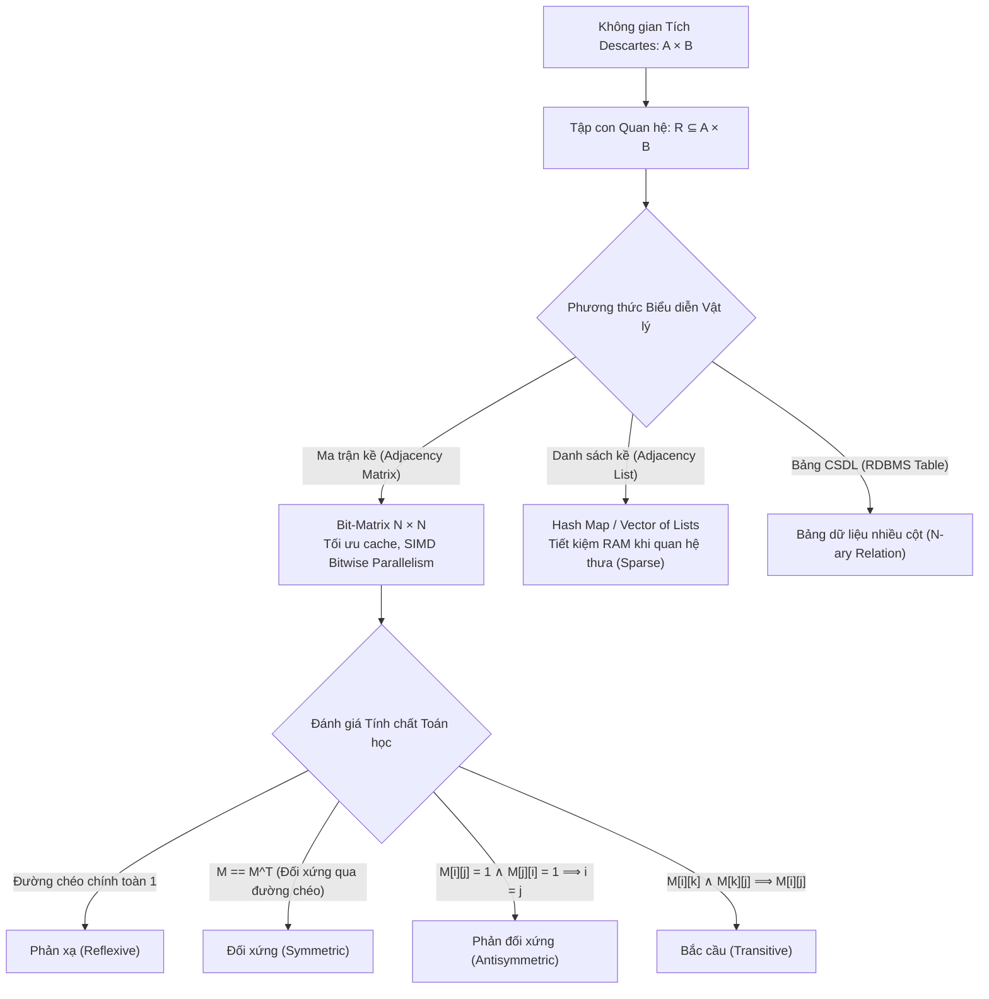

# 3.1. Binary and N-ary Relations (Quan hệ Nhị nguyên và Đa nguyên)

> [!IMPORTANT]
> **Nếu bạn chỉ được nhớ một điều duy nhất:** Quan hệ (Relation) là một tập hợp con của tích Descartes giữa các miền dữ liệu ($R \subseteq A \times B$); trong phần cứng và trình biên dịch, một quan hệ hữu hạn nhị nguyên được biểu diễn chính xác bằng một **Ma trận Bit (Adjacency Bit-Matrix)**, nơi các phép toán kiểm tra tính phản xạ, đối xứng, và bắc cầu được tính toán siêu tốc thông qua các phép toán bitwise `AND`, `OR`, và `XOR`.

---

## 1. Kiến trúc Tổng quan & Mô hình Tư duy (Mental Model)

Hãy tưởng tượng bạn đang xây dựng một mạng xã hội (như Twitter/X hay Facebook):
- Quan hệ *"Kết bạn trên Facebook"* ($Friend$): Nếu Alice là bạn của Bob, thì Bob chắc chắn là bạn của Alice. Quan hệ này có **Tính đối xứng (Symmetric)**. Đồng thời, Alice không thể tự kết bạn với chính mình (**Irreflexive**).
- Quan hệ *"Theo dõi trên X/Twitter"* ($Follow$): Alice theo dõi Bob không có nghĩa là Bob theo dõi Alice. Quan hệ này **Không đối xứng (Non-symmetric)**.
- Quan hệ phân cấp quản lý trong công ty ($ReportsTo$): Nếu Alice báo cáo cho Bob, và Bob báo cáo cho Carol, thì Bob không thể báo cáo ngược lại cho Alice (**Antisymmetric**), và Alice thuộc nhánh dưới của Carol (**Transitive**).

Dưới tầng vật lý của hệ thống:
1. **Biểu diễn Ma trận Bit (Bit-Matrix Representation)**: Quan hệ giữa $N$ đối tượng được lưu trong ma trận $N \times N$ bits. Kiểm tra tính đối xứng tương đương với việc so sánh ma trận với chuyển vị của nó: $M == M^T$.
2. **Cơ sở dữ liệu Đa nguyên (N-ary Relational Model)**: Mối quan hệ giữa nhiều thực thể (ví dụ: Khách hàng - Đơn hàng - Sản phẩm - Shipper) được lưu dưới dạng một bảng gồm $N$ cột, chính là một quan hệ $N$-ngôi $R \subseteq D_1 \times D_2 \times \dots \times D_n$.



---

## 2. Chi tiết từng Keyword (Under-the-Hood Deep Dive)

### 2.1. Binary & N-ary Relations (Quan hệ Nhị nguyên và Đa nguyên)
- **Quan hệ Nhị nguyên (Binary Relation)**:
  - Cho hai tập hợp $A$ và $B$. Một quan hệ nhị nguyên $R$ từ $A$ đến $B$ là một tập con của tích Descartes $A \times B$:
    $$R \subseteq A \times B = \{(a, b) \mid a \in A \land b \in B\}$$
  - Ký hiệu: $(a, b) \in R$ thường được viết là $a R b$ ($a$ có quan hệ $R$ với $b$). Nếu $(a, b) \notin R$, ta viết $a \not\! R b$.
  - Khi $A = B$, $R$ được gọi là một **quan hệ nhị nguyên trên tập $A$** ($R \subseteq A^2$).
- **Quan hệ Đa nguyên (N-ary Relation)**:
  - Cho $n$ tập hợp $D_1, D_2, \dots, D_n$ (được gọi là các miền thuộc tính - Domains). Một quan hệ $n$-ngôi $R$ là một tập con của tích Descartes $D_1 \times D_2 \times \dots \times D_n$:
    $$R \subseteq D_1 \times D_2 \times \dots \times D_n$$
  - Mỗi phần tử $(d_1, d_2, \dots, d_n) \in R$ được gọi là một **bộ dữ liệu $n$-tuple**.
  - Đây chính là nền tảng toán học của mô hình dữ liệu quan hệ (Codd's Relational Database): mỗi bảng là một quan hệ $n$-ngôi, mỗi cột là một miền $D_i$, và mỗi dòng là một tuple.

### 2.2. Các Tính chất Cốt lõi của Quan hệ trên Tập hợp (Properties of Relations)
Xét quan hệ $R$ trên tập hợp $A$:
- **A. Reflexive (Tính Phản xạ)**:
  - Công thức: $\forall x \in A, \quad (x, x) \in R$.
  - Trực giác: Mọi phần tử đều có quan hệ với chính nó (ví dụ: quan hệ bằng $=$, quan hệ $\le$, quan hệ cùng tuổi).
  - Trên ma trận bit: Toàn bộ các bit trên đường chéo chính $M[i][i]$ đều bằng `1`.
- **B. Irreflexive (Tính Phản xạ ngược / Không phản xạ)**:
  - Công thức: $\forall x \in A, \quad (x, x) \notin R$.
  - Trực giác: Không có bất kỳ phần tử nào có quan hệ với chính nó (ví dụ: quan hệ nhỏ hơn ngặt $<$, quan hệ là cha đẻ).
  - Trên ma trận bit: Toàn bộ đường chéo chính $M[i][i]$ đều bằng `0`.
- **C. Symmetric (Tính Đối xứng)**:
  - Công thức: $\forall x, y \in A, \quad (x, y) \in R \implies (y, x) \in R$.
  - Trực giác: Mối quan hệ luôn có tính chất 2 chiều bình đẳng (ví dụ: là bạn bè, sống cùng thành phố, khoảng cách địa lý).
  - Trên ma trận bit: Ma trận $M$ bằng với ma trận chuyển vị của nó: $M = M^T$ ($M[i][j] == M[j][i]$ với mọi $i, j$).
- **D. Antisymmetric (Tính Phản đối xứng)**:
  - Công thức: $\forall x, y \in A, \quad ((x, y) \in R \land (y, x) \in R) \implies x = y$.
  - Phát biểu tương đương: Nếu $x \ne y$, thì không thể đồng thời có cả $(x, y) \in R$ và $(y, x) \in R$.
  - Trực giác: Mối quan hệ một chiều triệt để (ví dụ: $\le$, $\ge$, tập con $\subseteq$, quan hệ kế thừa class).
- **E. Asymmetric (Tính Bất đối xứng)**:
  - Công thức: $\forall x, y \in A, \quad (x, y) \in R \implies (y, x) \notin R$.
  - Quan hệ bất đối xứng thực chất là quan hệ vừa **Phản xạ ngược (Irreflexive)** vừa **Phản đối xứng (Antisymmetric)** (ví dụ: $<$ hoặc $>$).
- **F. Transitive (Tính Bắc cầu)**:
  - Công thức: $\forall x, y, z \in A, \quad ((x, y) \in R \land (y, z) \in R) \implies (x, z) \in R$.
  - Trực giác: Mối quan hệ có khả năng truyền dẫn qua mắt xích trung gian (ví dụ: là tổ tiên của, nhỏ hơn $<$, đứng trước trong hàng đợi).
  - Trên ma trận bit: $M^2 \le M$ (phép nhân ma trận Boolean).

---

## 3. Thực thi Mã nguồn & Mô phỏng Chuyên sâu (Dual-Engine Implementation)

Mô phỏng động cơ phân tích toàn diện tính chất của một quan hệ nhị nguyên biểu diễn dưới dạng ma trận bit nhị phân (Binary Bit-Matrix Analyzer).

### C++20 Implementation (Ma trận Bit & Kiểm tra 6 Tính chất Quan hệ)

```cpp
#include <iostream>
#include <vector>
#include <string>
#include <format>
#include <cstdint>

class RelationMatrix {
private:
    uint32_t n;
    std::vector<std::vector<uint8_t>> mat;

public:
    explicit RelationMatrix(uint32_t size) : n(size), mat(size, std::vector<uint8_t>(size, 0)) {}

    void add_pair(uint32_t u, uint32_t v) {
        if (u < n && v < n) mat[u][v] = 1;
    }

    bool is_reflexive() const {
        for (uint32_t i = 0; i < n; ++i) {
            if (mat[i][i] != 1) return false;
        }
        return true;
    }

    bool is_irreflexive() const {
        for (uint32_t i = 0; i < n; ++i) {
            if (mat[i][i] != 0) return false;
        }
        return true;
    }

    bool is_symmetric() const {
        for (uint32_t i = 0; i < n; ++i) {
            for (uint32_t j = 0; j < n; ++j) {
                if (mat[i][j] != mat[j][i]) return false;
            }
        }
        return true;
    }

    bool is_antisymmetric() const {
        for (uint32_t i = 0; i < n; ++i) {
            for (uint32_t j = 0; j < n; ++j) {
                if (i != j && mat[i][j] == 1 && mat[j][i] == 1) {
                    return false;
                }
            }
        }
        return true;
    }

    bool is_transitive() const {
        for (uint32_t i = 0; i < n; ++i) {
            for (uint32_t j = 0; j < n; ++j) {
                if (mat[i][j] == 1) {
                    for (uint32_t k = 0; k < n; ++k) {
                        if (mat[j][k] == 1 && mat[i][k] != 1) {
                            return false;
                        }
                    }
                }
            }
        }
        return true;
    }

    void print_matrix() const {
        std::cout << "Relation Bit-Matrix:
  ";
        for (uint32_t j = 0; j < n; ++j) std::cout << j << " ";
        std::cout << "
";
        for (uint32_t i = 0; i < n; ++i) {
            std::cout << i << " ";
            for (uint32_t j = 0; j < n; ++j) {
                std::cout << (int)mat[i][j] << " ";
            }
            std::cout << "
";
        }
    }
};

int main() {
    std::cout << "=== BINARY RELATION PROPERTY ANALYZER (C++20) ===

";

    // Khởi tạo tập A = {0, 1, 2, 3} và quan hệ "nhỏ hơn hoặc bằng" (<=)
    RelationMatrix r_leq(4);
    for (uint32_t i = 0; i < 4; ++i) {
        for (uint32_t j = 0; j < 4; ++j) {
            if (i <= j) r_leq.add_pair(i, j);
        }
    }

    std::cout << "1. Phân tích Quan hệ Nhỏ hơn hoặc Bằng (<=) trên {0, 1, 2, 3}:
";
    r_leq.print_matrix();
    std::cout << std::format("   - Reflexive    : {}
", r_leq.is_reflexive());
    std::cout << std::format("   - Irreflexive  : {}
", r_leq.is_irreflexive());
    std::cout << std::format("   - Symmetric    : {}
", r_leq.is_symmetric());
    std::cout << std::format("   - Antisymmetric: {}
", r_leq.is_antisymmetric());
    std::cout << std::format("   - Transitive   : {}
", r_leq.is_transitive());

    // Khởi tạo quan hệ đối xứng (Tình bạn hai chiều)
    RelationMatrix r_friend(3);
    r_friend.add_pair(0, 1); r_friend.add_pair(1, 0);
    r_friend.add_pair(1, 2); r_friend.add_pair(2, 1);

    std::cout << "
2. Phân tích Quan hệ Bạn bè Hai chiều trên {0, 1, 2}:
";
    r_friend.print_matrix();
    std::cout << std::format("   - Reflexive    : {}
", r_friend.is_reflexive());
    std::cout << std::format("   - Symmetric    : {}
", r_friend.is_symmetric());
    std::cout << std::format("   - Transitive   : {} (0 friend 1, 1 friend 2 nhưng 0 NOT friend 2)
", 
                             r_friend.is_transitive());

    return 0;
}
```

### Python 3.11+ Implementation (Relation Composition & Property Verifier)

```python
class BinaryRelation:
    def __init__(self, domain: set, pairs: set[tuple]):
        self.domain = domain
        self.pairs = set(pairs)

    def is_reflexive(self) -> bool:
        return all((x, x) in self.pairs for x in self.domain)

    def is_symmetric(self) -> bool:
        return all((y, x) in self.pairs for (x, y) in self.pairs)

    def is_antisymmetric(self) -> bool:
        return all(x == y for (x, y) in self.pairs if (y, x) in self.pairs)

    def is_transitive(self) -> bool:
        for (x, y1) in self.pairs:
            for (y2, z) in self.pairs:
                if y1 == y2 and (x, z) not in self.pairs:
                    return False
        return True

    def compose(self, other: "BinaryRelation") -> "BinaryRelation":
        # Hợp thành quan hệ: R ∘ S = {(x, z) | ∃y, (x, y) ∈ R ∧ (y, z) ∈ S}
        composed_pairs = set()
        for (x, y1) in self.pairs:
            for (y2, z) in other.pairs:
                if y1 == y2:
                    composed_pairs.add((x, z))
        return BinaryRelation(self.domain | other.domain, composed_pairs)

if __name__ == "__main__":
    print("=== PYTHON RELATION COMPOSITION & VERIFIER ===")

    dom = {1, 2, 3}
    # Quan hệ R: Người cha của
    # Quan hệ S: Anh em của
    R = BinaryRelation(dom, {(1, 2), (2, 3)})
    print(f"Relation R pairs: {R.pairs}")
    print(f"R is Transitive? -> {R.is_transitive()}")

    # Hợp thành R ∘ R (Ông nội của)
    R_squared = R.compose(R)
    print(f"Composed R ∘ R pairs: {R_squared.pairs}") # Sẽ có (1, 3)
```

### Simulated Terminal Output

```text
=== BINARY RELATION PROPERTY ANALYZER (C++20) ===

1. Phân tích Quan hệ Nhỏ hơn hoặc Bằng (<=) trên {0, 1, 2, 3}:
Relation Bit-Matrix:
  0 1 2 3 
0 1 1 1 1 
1 0 1 1 1 
2 0 0 1 1 
3 0 0 0 1 
   - Reflexive    : true
   - Irreflexive  : false
   - Symmetric    : false
   - Antisymmetric: true
   - Transitive   : true

2. Phân tích Quan hệ Bạn bè Hai chiều trên {0, 1, 2}:
Relation Bit-Matrix:
  0 1 2 
0 0 1 0 
1 1 0 1 
2 0 1 0 
   - Reflexive    : false
   - Symmetric    : true
   - Transitive   : false (0 friend 1, 1 friend 2 nhưng 0 NOT friend 2)

=== PYTHON RELATION COMPOSITION & VERIFIER ===
Relation R pairs: {(1, 2), (2, 3)}
R is Transitive? -> False
Composed R ∘ R pairs: {(1, 3)}
```

---

## 4. Systems Engineering & Production Pitfalls

### 4.1. Bùng nổ Bộ nhớ khi Lưu trữ Quan hệ Ma trận Dày ($O(N^2)$ Memory Trap)
- **Vấn đề**: Biểu diễn quan hệ bằng ma trận $N \times N$ đòi hỏi bộ nhớ $O(N^2)$.
- Khi $N = 100.000$ người dùng, ma trận đòi hỏi $10^{10}$ bits $\approx 1.25\text{ GB}$ RAM. Nếu $N = 1.000.000$, ma trận đòi hỏi $\approx 125\text{ GB}$ RAM.
- **Giải pháp**: Trong các mạng quan hệ thực tế (Social Networks, Web Link Graphs), quan hệ có tính chất **cực kỳ thưa (Sparse)**: mỗi người dùng chỉ có trung bình vài trăm mối liên kết. Luôn luôn sử dụng **Danh sách kề (Adjacency List)** hoặc cấu trúc **Compressed Sparse Row (CSR)** để giảm bộ nhớ về $O(N + |R|)$.

### 4.2. Độ phức tạp $O(N^3)$ khi Kiểm tra Tính Bắc cầu
- Thuật toán ngây thơ duyệt 3 vòng lặp lồng nhau để kiểm tra tính bắc cầu có độ phức tạp thời gian $O(N^3)$.
- Trên tập $N = 10.000$ đối tượng, số phép tính là $10^{12}$ thao tác — làm treo hoàn toàn tiến trình khởi động hoặc phân tích cấu hình hệ thống.
- **Tối ưu hóa**: Sử dụng phép nhân ma trận Boolean song song bằng các tập lệnh vector hóa SIMD (AVX2 / AVX-512) hoặc bitset 64-bit word operations.

---

## 5. Bảng So sánh & Decision Matrix

| Quan hệ Mẫu | Tập xác định | Phản xạ (Reflexive) | Đối xứng (Symmetric) | Phản đối xứng (Antisymmetric) | Bắc cầu (Transitive) | Phân loại Toán học |
| :--- | :--- | :--- | :--- | :--- | :--- | :--- |
| **Bằng nhau ($=$)** | $\mathbb{R}$ | Có | Có | Có | Có | Quan hệ Tương đương |
| **Nhỏ hơn hoặc bằng ($\le$)** | $\mathbb{R}$ | Có | Không | Có | Có | Thứ tự bộ phận (Poset) |
| **Nhỏ hơn ngặt ($<$)** | $\mathbb{R}$ | Không | Không | Có (Bất đối xứng) | Có | Thứ tự ngặt (Strict Order)|
| **Đồng dư modulo $m$ ($\equiv$)**| $\mathbb{Z}$ | Có | Có | Không | Có | Quan hệ Tương đương |
| **Chia hết ($a \mid b$)** | $\mathbb{Z}^+$ | Có | Không | Có | Có | Thứ tự bộ phận (Poset) |
| **Bạn bè trên Facebook** | Users | Không | Có | Không | Không | Đồ thị vô hướng tổng quát |
