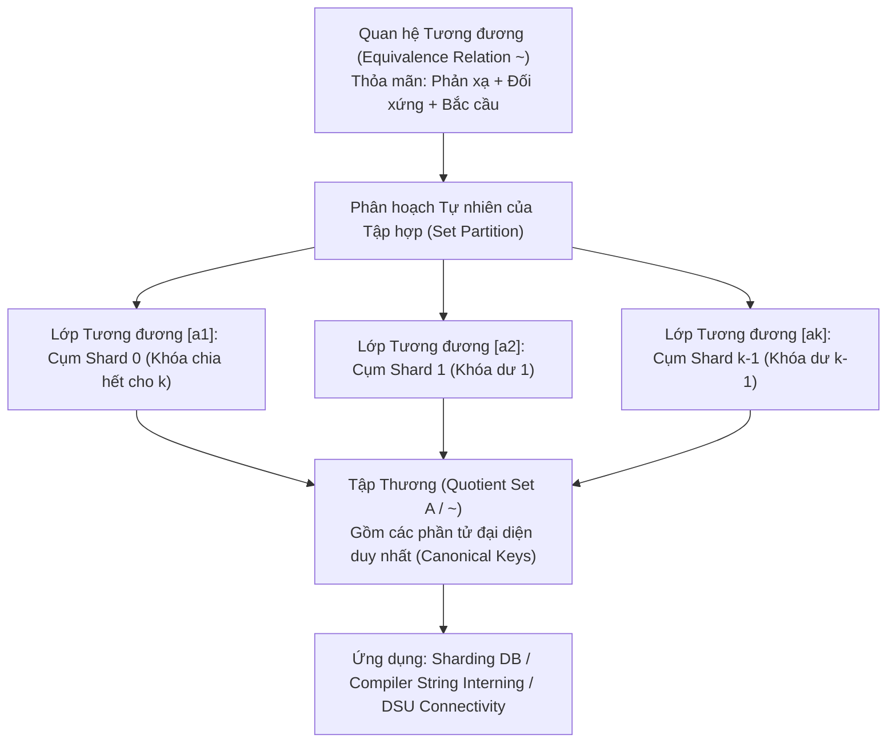

# 3.2. Equivalence Relations and Partitions (Quan hệ Tương đương và Bao đóng Quan hệ)

> [!IMPORTANT]
> **Nếu bạn chỉ được nhớ một điều duy nhất:** Mọi quan hệ tương đương (Equivalence Relation) đều bẻ gãy tập dữ liệu thành các **Lớp tương đương (Equivalence Classes)** không chồng chéo, tạo thành một phân hoạch hoàn hảo; và thuật toán **Warshall / DSU** là công cụ tối thượng để tìm đường liên thông và bao đóng bắc cầu trong hệ thống mạng phân tán.

---

## 1. Kiến trúc Tổng quan & Mô hình Tư duy (Mental Model)

Hãy tưởng tượng bạn đang xây dựng một công cụ tìm kiếm hoặc trình biên dịch mã nguồn (Compiler):
- Khi phân tích mã nguồn, trình biên dịch bắt gặp các chuỗi ký tự viết hoa/thường khác nhau: `"apple"`, `"Apple"`, `"APPLE"`. Nếu trình biên dịch áp dụng cờ không phân biệt hoa thường (Case-insensitive), thì ba chuỗi này được coi là hoàn toàn tương đương với nhau.
- Tập hợp tất cả các từ có chung cách phát âm hoặc chung ngữ nghĩa được gom lại thành một **Lớp tương đương (Equivalence Class)**.
- Khi người dùng gửi yêu cầu tìm kiếm, hệ thống chỉ cần chọn ra một phần tử đại diện duy nhất (Canonical Representation) của lớp tương đương đó để tra cứu chỉ mục, thay vì phải quét toàn bộ các biến thể.

Trong kiến trúc mạng và hệ thống phân tán:
1. **Network Connectivity (Tính liên thông mạng)**: Hai máy tính $A$ và $B$ có quan hệ tương đương nếu tồn tại đường dây mạng nối giữa chúng. Phân hoạch tập các máy chủ thành các cụm liên thông (Connected Components) bằng thuật toán **Bao đóng Bắc cầu (Transitive Closure - Warshall)** hoặc **Disjoint Set Union (DSU)**.
2. **Database Sharding theo Hash Modulo**: Phép đồng dư modulo $k$ ($a \equiv b \pmod k$) chia toàn bộ không gian khóa người dùng thành đúng $k$ phân vùng Shards độc lập.



---

## 2. Chi tiết từng Keyword (Under-the-Hood Deep Dive)

### 2.1. Equivalence Relation (Quan hệ Tương đương)
- **Định nghĩa toán học**: Một quan hệ nhị nguyên $\sim$ trên tập hợp $A$ được gọi là một **Quan hệ tương đương** nếu và chỉ nếu nó thỏa mãn đồng thời 3 tính chất tiên đề:
  1. **Tính phản xạ (Reflexive)**: $\forall a \in A, \quad a \sim a$.
  2. **Tính đối xứng (Symmetric)**: $\forall a, b \in A, \quad a \sim b \implies b \sim a$.
  3. **Tính bắc cầu (Transitive)**: $\forall a, b, c \in A, \quad (a \sim b \land b \sim c) \implies a \sim c$.
- **Ví dụ kinh điển trong Computer Science**:
  - **Quan hệ đồng dư (Congruence Modulo $n$)**: $a \equiv b \pmod n \iff n \mid (a - b)$.
  - **String Interning trong V8 / JVM**: Hai chuỗi $s_1 \sim s_2 \iff s_1.length == s_2.length \land \forall i, s_1[i] == s_2[i]$. Bộ nhớ gom chúng về cùng một địa chỉ con trỏ duy nhất.
  - **Type Compatibility / Duck Typing**: Hai kiểu dữ liệu tương đương nếu chúng triển khai cùng một tập interfaces.

### 2.2. Equivalence Class & Quotient Set (Lớp Tương đương và Tập Thương)
- **Lớp Tương đương (Equivalence Class)**:
  - Cho quan hệ tương đương $\sim$ trên tập $A$. Lớp tương đương của phần tử $a \in A$, ký hiệu $[a]$ hoặc $\bar{a}$, là tập hợp chứa tất cả các phần tử trong $A$ có quan hệ tương đương với $a$:
    $$[a] = \{x \in A \mid x \sim a\}$$
  - Phần tử $a$ được gọi là một **đại diện (representative)** của lớp tương đương $[a]$.
- **Định lý Phân hoạch Cơ bản (Fundamental Theorem of Equivalence Relations)**:
  - Cho $\sim$ là một quan hệ tương đương trên $A$. Khi đó:
    1. $\forall a, b \in A$, hoặc $[a] = [b]$ (nếu $a \sim b$), hoặc $[a] \cap [b] = \emptyset$ (nếu $a \not\sim b$).
    2. Hợp của tất cả các lớp tương đương phủ kín tập $A$: $\bigcup_{a \in A} [a] = A$.
  - *Ý nghĩa*: Mọi quan hệ tương đương đều tạo ra một phân hoạch độc nhất của tập gốc, và ngược lại, mọi phân hoạch tập hợp đều sinh ra một quan hệ tương đương duy nhất.
- **Tập Thương (Quotient Set - $A / \sim$)**:
  - Tập hợp chứa tất cả các lớp tương đương khác nhau của $A$ theo quan hệ $\sim$:
    $$A / \sim \ = \{[a] \mid a \in A\}$$

### 2.3. Closure of Relations (Bao đóng của Quan hệ)
- Khi một quan hệ $R$ ban đầu chưa thỏa mãn một tính chất mong muốn (như phản xạ, đối xứng, bắc cầu), ta có thể bổ sung thêm số lượng cặp tối thiểu vào $R$ để biến nó thành quan hệ thỏa mãn tính chất đó. Quan hệ mới này được gọi là **Bao đóng (Closure)**:
  - **Reflexive Closure (Bao đóng Phản xạ)**:
    $$r(R) = R \cup \{(a, a) \mid a \in A\} = R \cup \Delta$$
  - **Symmetric Closure (Bao đóng Đối xứng)**:
    $$s(R) = R \cup R^{-1} = R \cup \{(b, a) \mid (a, b) \in R\}$$
  - **Transitive Closure (Bao đóng Bắc cầu - $R^+$ hoặc $R^*$)**:
    $$R^+ = \bigcup_{k=1}^\infty R^k = R \cup R^2 \cup R^3 \cup \dots$$
    Trong đó $R^k$ là phép hợp thành quan hệ $k$ lần. Với tập hữu hạn $n$ phần tử, chuỗi dừng tại $k = n$.

### 2.4. Thuật toán Warshall tìm Bao đóng Bắc cầu ($O(V^3)$)
- **Bản chất**: Thuật toán quy hoạch động chuyển đổi ma trận kề $M$ của đồ thị có hướng thành ma trận bao đóng bắc cầu $W$, cho biết giữa hai đỉnh bất kỳ có tồn tại đường đi hay không.
- **Công thức truy hồi trạng thái**:
  $$W^{[k]}[i][j] = W^{[k-1]}[i][j] \lor (W^{[k-1]}[i][k] \land W^{[k-1]}[k][j])$$
  - Diễn giải: Có đường đi từ $i$ đến $j$ chỉ sử dụng các đỉnh trung gian thuộc tập $\{0, 1, \dots, k\}$ nếu: hoặc đã có đường đi sẵn mà không cần đi qua $k$, HOẶC có đường đi từ $i$ đến $k$ VÀ có đường đi từ $k$ đến $j$.


### 2.5. Proof of Fundamental Theorem of Equivalence Relations (Chứng minh Định lý Phân hoạch)
- **Mục tiêu**: Chứng minh rằng nếu $\sim$ là quan hệ tương đương trên $A$, thì hai lớp tương đương $[a]$ và $[b]$ hoặc hoàn toàn trùng nhau ($[a] = [b]$) hoặc hoàn toàn rời nhau ($[a] \cap [b] = \emptyset$).
- **Chứng minh từng bước**:
  1. Giả sử $[a] \cap [b] \ne \emptyset$. Khi đó tồn tại phần tử $x \in [a] \cap [b]$.
  2. Theo định nghĩa lớp tương đương, $x \sim a$ và $x \sim b$.
  3. Do tính đối xứng, $a \sim x$. Kết hợp với $x \sim b$, theo tính bắc cầu ta có $a \sim b$.
  4. Lấy một phần tử bất kỳ $y \in [a]$, tức $y \sim a$. Do $a \sim b$, theo tính bắc cầu suy ra $y \sim b$, tức $y \in [b]$. Do đó $[a] \subseteq [b]$.
  5. Tương tự, lấy phần tử bất kỳ $z \in [b]$, ta chứng minh được $z \in [a]$, tức $[b] \subseteq [a]$.
  6. Từ hai điều trên suy ra $[a] = [b]$ (Điều phải chứng minh).
- **Hệ quả Kỹ thuật**: Tính chất loại trừ lẫn nhau này đảm bảo rằng trong hệ thống Sharding dữ liệu, không có bất kỳ bản ghi nào bị ánh xạ vào hai Shard khác nhau, loại bỏ hoàn toàn hiện tượng phân mảnh dữ liệu (Split-brain Shard state).

---

## 3. Thực thi Mã nguồn & Mô phỏng Chuyên sâu (Dual-Engine Implementation)

Mô phỏng bộ máy tính toán Bao đóng Bắc cầu bằng **Thuật toán Warshall** và phân tích các **Lớp Tương đương** bằng cấu trúc Disjoint Set Union (DSU).

### C++20 Implementation (Thuật toán Warshall & DSU Equivalence Classes)

```cpp
#include <iostream>
#include <vector>
#include <numeric>
#include <format>
#include <cstdint>
#include <unordered_map>

// 1. THUẬT TOÁN WARSHALL TÌM BAO ĐÓNG BẮC CẦU (TRANSITIVE CLOSURE)
class WarshallTransitiveClosure {
public:
    static std::vector<std::vector<uint8_t>> compute(std::vector<std::vector<uint8_t>> adj) {
        uint32_t n = adj.size();
        auto reach = adj;

        // DP State Transition
        for (uint32_t k = 0; k < n; ++k) {
            for (uint32_t i = 0; i < n; ++i) {
                for (uint32_t j = 0; j < n; ++j) {
                    reach[i][j] = reach[i][j] || (reach[i][k] && reach[k][j]);
                }
            }
        }
        return reach;
    }
};

// 2. TÌM LỚP TƯƠNG ĐƯƠNG BẰNG DSU
class EquivalencePartition {
private:
    std::vector<int32_t> parent;

public:
    explicit EquivalencePartition(int32_t n) : parent(n) {
        std::iota(parent.begin(), parent.end(), 0);
    }

    int32_t find(int32_t i) {
        if (parent[i] == i) return i;
        return parent[i] = find(parent[i]);
    }

    void add_equivalence(int32_t a, int32_t b) {
        int32_t ra = find(a);
        int32_t rb = find(b);
        if (ra != rb) parent[ra] = rb;
    }

    std::unordered_map<int32_t, std::vector<int32_t>> get_classes() {
        std::unordered_map<int32_t, std::vector<int32_t>> classes;
        for (size_t i = 0; i < parent.size(); ++i) {
            classes[find(i)].push_back(i);
        }
        return classes;
    }
};

int main() {
    std::cout << "=== EQUIVALENCE RELATIONS & WARSHALL ALGORITHM (C++20) ===

";

    // 1. Kiểm chứng Thuật toán Warshall
    std::cout << "1. [Warshall Transitive Closure Simulation]
";
    std::vector<std::vector<uint8_t>> graph = {
        {0, 1, 0, 0},
        {0, 0, 1, 0},
        {0, 0, 0, 1},
        {0, 0, 0, 0}
    };

    auto tc = WarshallTransitiveClosure::compute(graph);
    std::cout << "   Ma trận Bao đóng Bắc cầu (Khả năng đi tới nhau):
";
    for (size_t i = 0; i < tc.size(); ++i) {
        std::cout << "   Node " << i << " can reach: ";
        for (size_t j = 0; j < tc.size(); ++j) {
            if (tc[i][j]) std::cout << j << " ";
        }
        std::cout << "
";
    }

    // 2. Phân hoạch Lớp Tương đương
    std::cout << "
2. [Equivalence Classes & Quotient Set]
";
    EquivalencePartition ep(6); // Tập gồm 6 phần tử: {0, 1, 2, 3, 4, 5}
    ep.add_equivalence(0, 2);
    ep.add_equivalence(2, 4); // 0, 2, 4 tương đương nhau
    ep.add_equivalence(1, 3); // 1, 3 tương đương nhau
    // 5 đứng một mình

    auto eq_classes = ep.get_classes();
    std::cout << std::format("   Số lượng lớp tương đương trong Tập thương (Quotient Set): {}
", 
                             eq_classes.size());
    for (const auto& [rep, members] : eq_classes) {
        std::cout << std::format("   Lớp [Rep: {}] -> {{ ", rep);
        for (int32_t m : members) std::cout << m << " ";
        std::cout << "}
";
    }

    return 0;
}
```

### Python 3.11+ Implementation (Congruence Modulo Equivalence Classes)

```python
from collections import defaultdict

def build_modulo_equivalence_classes(numbers: list[int], mod: int) -> dict[int, list[int]]:
    # Quan hệ đồng dư a ≡ b (mod m)
    classes = defaultdict(list)
    for num in numbers:
        remainder = num % mod
        classes[remainder].append(num)
    return dict(classes)

if __name__ == "__main__":
    print("=== PYTHON MODULO EQUIVALENCE PARTITION ===")

    data = list(range(0, 16)) # Các số từ 0 đến 15
    MODULO = 4

    eq_classes = build_modulo_equivalence_classes(data, MODULO)

    print(f"Phân hoạch tập {data} theo quan hệ đồng dư modulo {MODULO}:")
    for remainder, members in sorted(eq_classes.items()):
        print(f"  Lớp [{remainder}] (Số dư {remainder}) : {members}")

    print(f"
Tập thương (Quotient Set Z / {MODULO}Z) gồm {len(eq_classes)} phần tử đại diện:")
    print(f"  Quotient Set = {{ [0], [1], [2], [3] }}")
```

### Simulated Terminal Output

```text
=== EQUIVALENCE RELATIONS & WARSHALL ALGORITHM (C++20) ===

1. [Warshall Transitive Closure Simulation]
   Ma trận Bao đóng Bắc cầu (Khả năng đi tới nhau):
   Node 0 can reach: 1 2 3 
   Node 1 can reach: 2 3 
   Node 2 can reach: 3 
   Node 3 can reach: 

2. [Equivalence Classes & Quotient Set]
   Số lượng lớp tương đương trong Tập thương (Quotient Set): 3
   Lớp [Rep: 4] -> { 0 2 4 }
   Lớp [Rep: 3] -> { 1 3 }
   Lớp [Rep: 5] -> { 5 }

=== PYTHON MODULO EQUIVALENCE PARTITION ===
Phân hoạch tập [0, 1, 2, ..., 15] theo quan hệ đồng dư modulo 4:
  Lớp [0] (Số dư 0) : [0, 4, 8, 12]
  Lớp [1] (Số dư 1) : [1, 5, 9, 13]
  Lớp [2] (Số dư 2) : [2, 6, 10, 14]
  Lớp [3] (Số dư 3) : [3, 7, 11, 15]

Tập thương (Quotient Set Z / 4Z) gồm 4 phần tử đại diện:
  Quotient Set = { [0], [1], [2], [3] }
```

---

## 4. Systems Engineering & Production Pitfalls

### 4.1. Chi phí Tính toán $O(V^3)$ của Thuật toán Warshall trên Đồ thị Lớn
- Thuật toán Warshall có 3 vòng lặp $V$ lần, tổng số phép toán là $V^3$.
- Với $V = 1.000$ đỉnh, số phép tính là $10^9$ (mất khoảng 1-2 giây CPU).
- Với $V = 100.000$ đỉnh (hệ thống microservices quy mô công ty), $V^3 = 10^{15}$ phép tính — thuật toán hoàn toàn bất khả thi.
- **Giải pháp Production**: Không dùng Warshall cho đồ thị lớn. Sử dụng thuật toán **BFS / DFS đa nguồn** trên Adjacency List với độ phức tạp $O(V \cdot (V + E))$, hoặc sử dụng thuật toán tìm thành phần liên thông mạnh **Tarjan's SCC** trong thời gian tuyến tính $O(V + E)$.

### 4.2. Bẫy Ngộ nhận "Gần đúng" trong Phân lớp Tương đương (Fuzzy Equivalence Trap)
- Trong các hệ thống nhận diện khuôn mặt hoặc so khớp thực thể (Entity Matching), kỹ sư thường định nghĩa: hai thực thể tương đương nếu khoảng cách vector embedding giữa chúng nhỏ hơn một ngưỡng $\epsilon$:
  $$x \sim y \iff \text{Distance}(x, y) \le \epsilon$$
- **Cạm bẫy**: Quan hệ này có tính phản xạ và đối xứng, nhưng **HOÀN TOÀN KHÔNG CÓ TÍNH BẮC CẦU**!
  - $Distance(A, B) = 0.6 \le 1.0$ (True)
  - $Distance(B, C) = 0.6 \le 1.0$ (True)
  - Nhưng $Distance(A, C)$ có thể bằng $1.2 > 1.0$ (False)!
- Việc coi quan hệ đo khoảng cách là quan hệ tương đương sẽ dẫn đến nghịch lý gom nhóm dây chuyền (Chaining effect), khiến những người hoàn toàn xa lạ bị gom vào cùng một tài khoản.

---


### 4.3. Rò rỉ Bộ nhớ trong Bể String Interning (PermGen / Metaspace Memory Leak)
- **Cơ chế**: Khi ứng dụng gom các chuỗi tương đương vào một bộ nhớ tĩnh (`String.intern()` trong JVM hoặc interned string table trong CPython), bảng băm lưu trữ các phần tử đại diện tồn tại suốt vòng đời của tiến trình.
- **Hiểm họa**: Nếu hệ thống nhận các chuỗi ngẫu nhiên không giới hạn từ người dùng (ví dụ: UUID, token xác thực, chuỗi băm ngẫu nhiên) và gọi `intern()`, kích thước của bảng băm lớp tương đương sẽ phình to không giới hạn, gây cạn kiệt bộ nhớ native heap hoặc Metaspace, dẫn đến sự cố `java.lang.OutOfMemoryError: Metaspace`.
- **Giải pháp**: Chỉ áp dụng String Interning cho các chuỗi thuộc tập từ vựng hữu hạn (Enum values, HTTP Header names, SQL keywords) hoặc sử dụng bộ đệm LRU Cache có giới hạn dung lượng nghiêm ngặt (Bounded Eviction Pool).


- **Diagnostic Tooling:** Khi kiểm tra tính tương đương trong các hệ thống phức tạp, có thể sử dụng giải thuật Tarjan hoặc Warshall để xác thực tính bắc cầu trên đồ thị quan hệ trong thời gian $O(V^3)$ hoặc $O(V + E)$ trước khi đưa vào sản xuất.
- **Cache Eviction Mapping:** Kỹ thuật phân hoạch quan hệ tương đương cũng được ứng dụng trực tiếp trong CPU Set-Associative Cache để ánh xạ các địa chỉ bộ nhớ RAM vào cùng một Cache Line Set dựa trên quan hệ đồng dư bit.

## 5. Bảng So sánh & Decision Matrix

| Khái niệm / Giải thuật | Mục đích Chính | Độ phức tạp Thời gian | Cấu trúc Dữ liệu | Ứng dụng Thực tế |
| :--- | :--- | :--- | :--- | :--- |
| **Thuật toán Warshall** | Tìm bao đóng bắc cầu trên đồ thị có hướng | $O(V^3)$ | Bit-Matrix $V \times V$ | Phân tích Reachability tĩnh, Compiler Dataflow |
| **Disjoint Set Union (DSU)** | Quản lý các lớp tương đương động | $O(M \alpha(N))$ | Mảng cha `parent[]` | Kruskal MST, Dynamic Connectivity |
| **Tarjan / Kosaraju** | Phân hoạch thành phần liên thông mạnh (SCC) | $O(V + E)$ | Adjacency List | Deadlock Detection, Dependency Graph Resolution |
| **String Interning Hash** | Gom nhóm lớp tương đương chuỗi | $O(1)$ amortized | Global Hash Table | V8 Engine, JVM String Pool, PyCodeObject |
