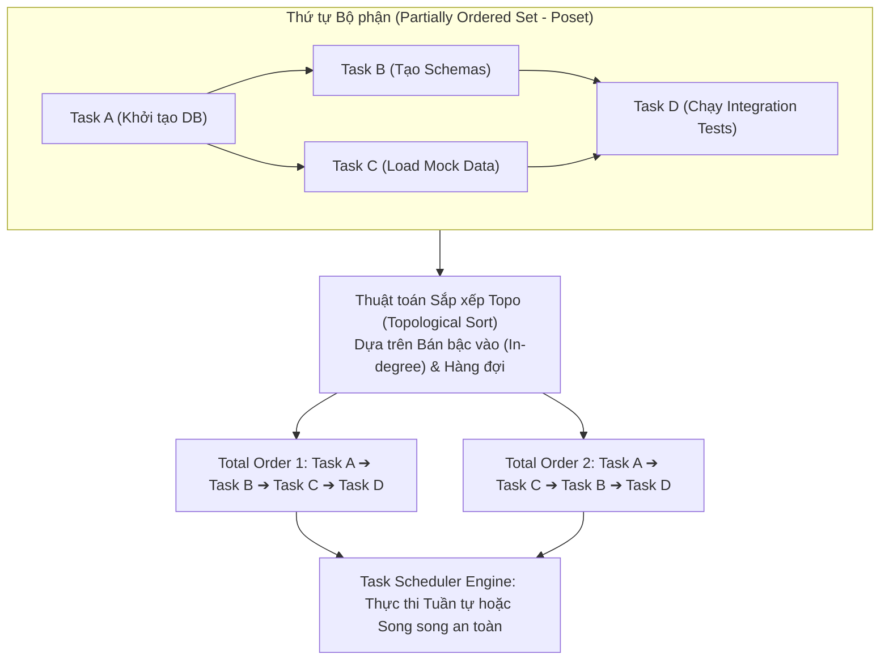

# 3.3. Order Theory and Hasse Diagrams (Lý thuyết Thứ tự và Biểu đồ Hasse)

> [!IMPORTANT]
> **Nếu bạn chỉ được nhớ một điều duy nhất:** Thứ tự bộ phận (Partial Order / Poset) cho phép các tác vụ độc lập chạy song song mà không cần so sánh thứ bậc trước sau; và **Topological Sort** là thuật toán thần kỳ chuyển đổi một thứ tự bộ phận thành một **Thứ tự toàn phần (Total Order)** để các Task Schedulers và Build Systems (Make, Bazel, Airflow) thực thi không bao giờ gặp lỗi thiếu phụ thuộc.

---

## 1. Kiến trúc Tổng quan & Mô hình Tư duy (Mental Model)

Hãy tưởng tượng bạn đang viết một công cụ biên dịch tự động (như Webpack, Vite, hay Cargo) hoặc lập lịch workflow (như Apache Airflow):
- Module A cần được compile trước Module B và C. Nhưng B và C không hề phụ thuộc lẫn nhau: B không cần đứng trước C, và C cũng không cần đứng trước B.
- Đây chính là bản chất của **Thứ tự bộ phận (Partial Order)**: Một số cặp phần tử so sánh được với nhau, nhưng một số cặp khác **không thể so sánh (Incomparable)**.
- Khi Build Tool cần chạy trên máy tính 1 nhân (Single-core CPU), nó phải ép buộc toàn bộ các module thành một đường thẳng duy nhất: $A \to B \to C$ hoặc $A \to C \to B$. Quá trình này được gọi là **Lập lịch Tuyến tính hóa (Linear Extension)** thông qua thuật toán **Topological Sort**.

Trong lý thuyết cấu trúc dữ liệu và hệ điều hành:
1. **Poset & Biểu đồ Hasse**: Biểu diễn trực quan cây phụ thuộc phần mềm, phân cấp quyền hạn, hoặc cấu trúc kế thừa gói thư viện (Package Dependency Tree).
2. **Lattices & Distributed State (CRDTs)**: Trong các cơ sở dữ liệu phân tán không cần khóa (DynamoDB, Cassandra), tính chất Cận trên bé nhất (Least Upper Bound - LUB) của một Lattice đảm bảo mọi bản sao dữ liệu (Replicas) luôn hợp tụ về cùng một trạng thái nhất quán cuối cùng (Eventual Consistency).



---

## 2. Chi tiết từng Keyword (Under-the-Hood Deep Dive)

### 2.1. Preorder, Partial Order, Strict Order, Total Order (Phân loại Thứ tự)
- **A. Preorder (Tiền thứ tự / Quasi-order)**:
  - Thỏa mãn: **Phản xạ** và **Bắc cầu**. (Chưa yêu cầu phản đối xứng).
- **B. Partial Order (Thứ tự bộ phận - Ký hiệu $\le$)**:
  - Thỏa mãn 3 tính chất: **Phản xạ**, **Phản đối xứng**, và **Bắc cầu**.
  - Một tập hợp $P$ đi kèm với quan hệ thứ tự bộ phận $\le$ được gọi là một **Tập sắp thứ tự bộ phận (Partially Ordered Set hay Poset)**, ký hiệu $(P, \le)$.
  - *Tính chất đặc trưng*: Tồn tại những cặp phần tử $x, y$ sao cho cả $x \le y$ và $y \le x$ đều SAI. Ta gọi $x$ và $y$ là **không so sánh được (Incomparable)**, ký hiệu $x \parallel y$.
- **C. Strict Partial Order (Thứ tự bộ phận ngặt - Ký hiệu $<$)**:
  - Thỏa mãn: **Phản xạ ngược (Irreflexive)**, **Bất đối xứng (Asymmetric)**, và **Bắc cầu (Transitive)**. (Ví dụ: quan hệ $<$ trên số thực, quan hệ tổ tiên).
- **D. Total Order (Thứ tự toàn phần / Linear Order / Chain - Ký hiệu $\le$)**:
  - Là một Poset $(P, \le)$ trong đó **mọi cặp phần tử đều so sánh được**:
    $$\forall x, y \in P, \quad x \le y \lor y \le x$$
  - Không có hai phần tử nào là incomparable. Tập hợp tạo thành một chuỗi tuyến tính duy nhất (ví dụ: thứ tự từ điển, thứ tự số nguyên trên $\mathbb{Z}$).

### 2.2. Hasse Diagram (Biểu đồ Hasse)
- **Định nghĩa**: Biểu đồ Hasse là một đồ thị có hướng phi chu trình (DAG) biểu diễn trực quan một Poset hữu hạn, nhưng đã được **cắt tỉa tối đa các thông tin thừa**:
  1. **Loại bỏ tất cả các khuyên phản xạ (Self-loops)**: Mặc định $x \le x$ luôn đúng nên không vẽ cạnh $(x, x)$.
  2. **Loại bỏ tất cả các cạnh bắc cầu (Transitive Reduction)**: Nếu có cạnh $x \to y$ và $y \to z$, ta xóa bỏ cạnh trực tiếp $x \to z$.
  3. **Quy ước chiều hướng lên**: Đỉnh nhỏ hơn được vẽ ở phía dưới, đỉnh lớn hơn vẽ ở phía trên. Hướng của cạnh luôn ngầm hiểu là từ dưới lên trên mà không cần vẽ mũi tên.
- **Quan hệ Bao phủ (Covering Relation)**:
  - Ta nói $y$ bao phủ $x$ ($x \lessdot y$) nếu $x < y$ và không tồn tại phần tử $z$ nào sao cho $x < z < y$. Biểu đồ Hasse chỉ vẽ các cạnh biểu diễn quan hệ bao phủ này.

### 2.3. Maximal, Minimal, Greatest & Least Elements (Các Phần tử Đặc biệt trong Poset)
Cho Poset $(P, \le)$ và tập con $A \subseteq P$:
- **Minimal Element (Phần tử Tối tiểu)**: $a \in A$ là tối tiểu nếu không có phần tử nào trong $A$ nhỏ hơn nó:
  $$\forall x \in A, \quad x \le a \implies x = a$$
  *Chú ý*: Một Poset có thể có **nhiều phần tử tối tiểu** khác nhau (ví dụ: các gốc độc lập trong dependency graph).
- **Maximal Element (Phần tử Tối đại)**: $b \in A$ là tối đại nếu không có phần tử nào trong $A$ lớn hơn nó:
  $$\forall x \in A, \quad b \le x \implies x = b$$
- **Least Element (Phần tử Nhỏ nhất / Bottom $\bot$)**: $a \in A$ là nhỏ nhất nếu nó nhỏ hơn hoặc bằng **mọi** phần tử trong $A$:
  $$\forall x \in A, \quad a \le x$$
  *Chú ý*: Phần tử nhỏ nhất nếu tồn tại thì là **DUY NHẤT**.
- **Greatest Element (Phần tử Lớn nhất / Top $\top$)**: $b \in A$ là lớn nhất nếu nó lớn hơn hoặc bằng **mọi** phần tử trong $A$:
  $$\forall x \in A, \quad x \le b$$
  *Chú ý*: Phần tử lớn nhất nếu tồn tại thì là **DUY NHẤT**.

### 2.4. Lattices & Cận Trên/Dưới (Upper/Lower Bounds)
- **Cận trên bé nhất (Least Upper Bound - LUB hay Supremum / Join $\lor$)**: Phần tử nhỏ nhất trong số tất cả các cận trên của hai phần tử $x$ và $y$.
- **Cận dưới lớn nhất (Greatest Lower Bound - GLB hay Infimum / Meet $\land$)**: Phần tử lớn nhất trong số tất cả các cận dưới của $x$ và $y$.
- **Lattice (Dàn)**: Một Poset mà trong đó bất kỳ cặp hai phần tử nào cũng tồn tại duy nhất một LUB (Join) và một GLB (Meet). Lattice là nền tảng của các giải thuật đồng bộ hóa không xung đột (Conflict-free Replicated Data Types - CRDTs) trong Google Docs và distributed databases.

---

## 3. Thực thi Mã nguồn & Mô phỏng Chuyên sâu (Dual-Engine Implementation)

Mô phỏng động cơ lập lịch tác vụ dựa trên **Topological Sort** (Kahn's Algorithm) và phân tích các phần tử Tối đại/Tối tiểu trong C++20 và Python 3.11+.

### C++20 Implementation (Kahn's Algorithm & Poset Boundary Extractor)

```cpp
#include <iostream>
#include <vector>
#include <queue>
#include <string>
#include <format>
#include <cstdint>

class TaskSchedulerDAG {
private:
    uint32_t num_tasks;
    std::vector<std::string> task_names;
    std::vector<std::vector<uint32_t>> adj;
    std::vector<uint32_t> in_degree;

public:
    explicit TaskSchedulerDAG(const std::vector<std::string>& names) 
        : num_tasks(names.size()), task_names(names), adj(names.size()), in_degree(names.size(), 0) {}

    void add_dependency(uint32_t u, uint32_t v) {
        // u must run BEFORE v (u <= v in Poset)
        adj[u].push_back(v);
        in_degree[v]++;
    }

    void find_poset_boundaries() const {
        std::cout << "--- POSET EXTREMAL ELEMENTS ---
";
        std::cout << "Minimal Elements (No prerequisites, In-degree == 0):
";
        for (uint32_t i = 0; i < num_tasks; ++i) {
            if (in_degree[i] == 0) {
                std::cout << std::format("  * [{}] {}
", i, task_names[i]);
            }
        }

        std::cout << "Maximal Elements (No downstream dependencies, Out-degree == 0):
";
        for (uint32_t i = 0; i < num_tasks; ++i) {
            if (adj[i].empty()) {
                std::cout << std::format("  * [{}] {}
", i, task_names[i]);
            }
        }
    }

    // Topological Sort (Linear Extension from Partial Order to Total Order)
    std::vector<std::string> compute_topological_order() {
        std::vector<uint32_t> temp_in_degree = in_degree;
        std::queue<uint32_t> zero_in_queue;

        for (uint32_t i = 0; i < num_tasks; ++i) {
            if (temp_in_degree[i] == 0) zero_in_queue.push(i);
        }

        std::vector<std::string> execution_plan;

        while (!zero_in_queue.empty()) {
            uint32_t curr = zero_in_queue.front();
            zero_in_queue.pop();
            execution_plan.push_back(task_names[curr]);

            for (uint32_t neighbor : adj[curr]) {
                temp_in_degree[neighbor]--;
                if (temp_in_degree[neighbor] == 0) {
                    zero_in_queue.push(neighbor);
                }
            }
        }

        if (execution_plan.size() != num_tasks) {
            std::cerr << "FATAL ERROR: Cycle detected! Not a valid Partial Order (Poset)!
";
            return {};
        }

        return execution_plan;
    }
};

int main() {
    std::cout << "=== ORDER THEORY & TASK SCHEDULER (C++20) ===

";

    std::vector<std::string> tasks = {
        "Init Database",      // 0
        "Create Schemas",      // 1
        "Generate Mock Data",  // 2
        "Seed Auth Users",     // 3
        "Run Integration Test" // 4
    };

    TaskSchedulerDAG scheduler(tasks);

    // Xây dựng quan hệ thứ tự bộ phận:
    // Init DB (0) -> Create Schemas (1)
    // Init DB (0) -> Generate Mock Data (2)
    // Create Schemas (1) -> Seed Auth Users (3)
    // Generate Mock Data (2) -> Run Integration Test (4)
    // Seed Auth Users (3) -> Run Integration Test (4)
    scheduler.add_dependency(0, 1);
    scheduler.add_dependency(0, 2);
    scheduler.add_dependency(1, 3);
    scheduler.add_dependency(2, 4);
    scheduler.add_dependency(3, 4);

    scheduler.find_poset_boundaries();

    std::cout << "
--- TOPOLOGICAL SORT (TOTAL ORDER LINEAR EXTENSION) ---
";
    auto plan = scheduler.compute_topological_order();
    for (size_t i = 0; i < plan.size(); ++i) {
        std::cout << std::format("Step {}: {}
", i + 1, plan[i]);
    }

    return 0;
}
```

### Python 3.11+ Implementation (Divisibility Lattice Analyzer)

```python
def find_divisibility_poset(elements: list[int]):
    # Xây dựng quan hệ thứ tự bộ phận theo phép chia hết (a | b)
    poset_edges = []
    for a in elements:
        for b in elements:
            if a != b and b % a == 0:
                poset_edges.append((a, b))

    # Transitive Reduction để vẽ biểu đồ Hasse
    hasse_edges = []
    for (a, b) in poset_edges:
        # Cạnh (a, b) chỉ giữ lại nếu KHÔNG tồn tại c trung gian sao cho a | c và c | b
        is_covered = True
        for c in elements:
            if c != a and c != b and (a, c) in poset_edges and (c, b) in poset_edges:
                is_covered = False
                break
        if is_covered:
            hasse_edges.append((a, b))

    return hasse_edges

if __name__ == "__main__":
    print("=== PYTHON HASSE DIAGRAM & DIVISIBILITY LATTICE ===")

    # Tập hợp các ước số của 12: {1, 2, 3, 4, 6, 12}
    subset = [1, 2, 3, 4, 6, 12]
    hasse = find_divisibility_poset(subset)

    print(f"Poset Domain: {subset} với quan hệ chia hết a | b")
    print(f"Các cạnh trong Biểu đồ Hasse (Covering Relations):")
    for (u, v) in sorted(hasse):
        print(f"  {u} ⋖ {v} (Tức {u} được bao phủ trực tiếp bởi {v})")

    # Xác định các phần tử cực trị
    print("
Phần tử Cực trị:")
    print(f"  Least Element (Bottom ⊥)   : {min(subset)} (Vì 1 chia hết cho mọi số)")
    print(f"  Greatest Element (Top ⊤)   : {max(subset)} (Vì mọi số đều chia hết cho 12)")
```

### Simulated Terminal Output

```text
=== ORDER THEORY & TASK SCHEDULER (C++20) ===

--- POSET EXTREMAL ELEMENTS ---
Minimal Elements (No prerequisites, In-degree == 0):
  * [0] Init Database
Maximal Elements (No downstream dependencies, Out-degree == 0):
  * [4] Run Integration Test

--- TOPOLOGICAL SORT (TOTAL ORDER LINEAR EXTENSION) ---
Step 1: Init Database
Step 2: Create Schemas
Step 3: Generate Mock Data
Step 4: Seed Auth Users
Step 5: Run Integration Test

=== PYTHON HASSE DIAGRAM & DIVISIBILITY LATTICE ===
Poset Domain: [1, 2, 3, 4, 6, 12] với quan hệ chia hết a | b
Các cạnh trong Biểu đồ Hasse (Covering Relations):
  1 ⋖ 2 (Tức 1 được bao phủ trực tiếp bởi 2)
  1 ⋖ 3 (Tức 1 được bao phủ trực tiếp bởi 3)
  2 ⋖ 4 (Tức 2 được bao phủ trực tiếp bởi 4)
  2 ⋖ 6 (Tức 2 được bao phủ trực tiếp bởi 6)
  3 ⋖ 6 (Tức 3 được bao phủ trực tiếp bởi 6)
  4 ⋖ 12 (Tức 4 được bao phủ trực tiếp bởi 12)
  6 ⋖ 12 (Tức 6 được bao phủ trực tiếp bởi 12)

Phần tử Cực trị:
  Least Element (Bottom ⊥)   : 1 (Vì 1 chia hết cho mọi số)
  Greatest Element (Top ⊤)   : 12 (Vì mọi số đều chia hết cho 12)
```

---

## 4. Systems Engineering & Production Pitfalls

### 4.1. Deadlock do Chu trình Phụ thuộc (Circular Dependency Failure)
- Một Poset bắt buộc phải thỏa mãn tính phản đối xứng và không có chu trình: nó là một **Directed Acyclic Graph (DAG)**.
- Khi người dùng vô tình khai báo phụ thuộc vòng: Module A phụ thuộc Module B, Module B phụ thuộc Module C, và Module C phụ thuộc Module A ($A \to B \to C \to A$).
- Khi đó, thuật toán Topological Sort sẽ không thể đẩy bất kỳ node nào vào hàng đợi (bán bậc vào của mọi node đều $\ge 1$). Nếu hệ thống scheduler không kiểm tra điều kiện `plan.size() == num_tasks`, nó sẽ rơi vào trạng thái treo vô hạn (**Deadlock**).

### 4.2. Tính Bất định của Thứ tự Sắp xếp Topo (Non-deterministic Build Orders)
- Một thứ tự bộ phận (Poset) thường có **nhiều hơn một** Thứ tự toàn phần (Linear Extension) hợp lệ.
- Ví dụ: Hai module B và C độc lập nhau có thể được sắp theo thứ tự $(B, C)$ hoặc $(C, B)$.
- Nếu hệ thống build sử dụng thứ tự duyệt hash map ngẫu nhiên (non-deterministic iteration), file binary sinh ra sau mỗi lần build sẽ có chữ ký checksum khác nhau, phá vỡ tính năng **Reproducible Builds** (Nix, Bazel) và làm vô hiệu hóa bộ nhớ đệm phân tán.
- **Giải pháp**: Luôn sử dụng hàng đợi ưu tiên có thứ tự từ điển (Lexicographical Priority Queue / Kahn's algorithm với `std::priority_queue`) để đảm bảo thứ tự tuyến tính hóa là duy nhất và tất định.

---

## 5. Bảng So sánh & Decision Matrix

| Cấu trúc Thứ tự | Tính Phản xạ | Tính Phản đối xứng | Tính Bắc cầu | Tính So sánh Toàn phần | Ứng dụng Thực tế |
| :--- | :--- | :--- | :--- | :--- | :--- |
| **Tiền thứ tự (Preorder)** | Có | Không | Có | Không | Mô hình sở thích (Preferences), Graph Reachability |
| **Thứ tự bộ phận (Poset)** | Có | Có | Có | Không | Build Systems (Make/Bazel), CRDT Lattices |
| **Thứ tự ngặt (Strict Poset)**| Không | Có (Bất đối xứng)| Có | Không | DAG Tasks, Phân cấp kế thừa Class |
| **Thứ tự toàn phần (Total Order)**| Có | Có | Có | Có | `std::sort`, B+ Tree Keys, Time-series DB |
