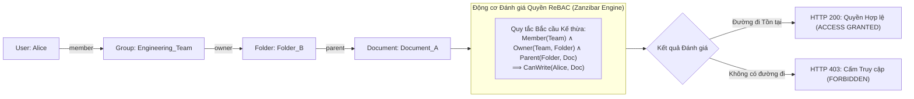

# 3.4. Relations in Database and Access Control (Quan hệ trong Cơ sở Dữ liệu và Kiểm soát Truy cập)

> [!IMPORTANT]
> **Nếu bạn chỉ được nhớ một điều duy nhất:** Mọi hệ thống bảo mật hiện đại (như Google Zanzibar / ReBAC) và cơ sở dữ liệu quan hệ đều quy về bài toán **Đồ thị Quan hệ**: kiểm tra quyền truy cập thực chất là tìm kiếm đường đi (Path Finding) trên đồ thị quan hệ $u \xrightarrow{rel^*} r$, và khóa ngoại (Foreign Key) là chốt chặn bảo toàn tính phản xạ và bắc cầu của dữ liệu thực thể.

---

## 1. Kiến trúc Tổng quan & Mô hình Tư duy (Mental Model)

Hãy tưởng tượng bạn đang xây dựng tính năng chia sẻ tệp của Google Drive:
- File `Document_A` nằm trong thư mục `Folder_B`.
- `Folder_B` lại thuộc quyền sở hữu của nhóm `Engineering_Team`.
- Người dùng Alice là thành viên của nhóm `Engineering_Team`.
- Câu hỏi đặt ra: *Alice có quyền sửa `Document_A` không?*

Nếu bạn dùng mô hình bảng quyền hạn truyền thống (Access Matrix), bạn phải lưu hàng tỷ bản ghi quyền giữa từng người dùng và từng tệp.
Thay vào đó, hệ thống **Google Zanzibar (Relationship-Based Access Control - ReBAC)** mô hình hóa vấn đề này dưới dạng các bộ ba quan hệ (Relation Tuples):
$$\text{Alice} \in \text{Member}(\text{Engineering\_Team})$$
$$\text{Engineering\_Team} = \text{Owner}(\text{Folder\_B})$$
$$\text{Folder\_B} = \text{Parent}(\text{Document\_A})$$
Kiểm tra quyền của Alice tương đương với việc thực hiện phép **Bao đóng Bắc cầu (Transitive Closure / Graph Reachability)** trên đồ thị quan hệ: đi từ đỉnh Alice tới đỉnh Document_A qua các cạnh quan hệ hợp lệ!



---

## 2. Chi tiết từng Keyword (Under-the-Hood Deep Dive)

### 2.1. Database Relationships & Entity Relationships (Quan hệ trong Cơ sở Dữ liệu)
- **A. One-to-One (1:1 - Quan hệ Một - Một)**:
  - Mỗi bản ghi trong bảng $A$ liên kết với tối đa một bản ghi trong bảng $B$, và ngược lại.
  - *Hiện thực*: Đặt khóa ngoại tại một trong hai bảng kèm theo ràng buộc `UNIQUE`.
  - *Ví dụ*: `User` $\leftrightarrow$ `UserProfile` (tách bảng để tối ưu hóa I/O cho các cột lớn).
- **B. One-to-Many (1:N - Quan hệ Một - Nhiều)**:
  - Một bản ghi trong bảng $A$ liên kết với nhiều bản ghi trong bảng $B$, nhưng mỗi bản ghi trong $B$ chỉ thuộc về đúng một bản ghi trong $A$.
  - *Hiện thực*: Đặt khóa ngoại `user_id` tại bảng con $B$ trỏ tới khóa chính `id` của bảng cha $A$.
  - *Ví dụ*: `Customer` $\leftrightarrow$ `Orders`.
- **C. Many-to-Many (N:M - Quan hệ Nhiều - Nhiều)**:
  - Một bản ghi trong $A$ có thể liên kết với nhiều bản ghi trong $B$, và ngược lại.
  - *Hiện thực*: Không thể đặt khóa ngoại trực tiếp ở $A$ hoặc $B$. Bắt buộc phải sử dụng một **Bảng nối trung gian (Junction Table / Association Table)** chứa cặp khóa ngoại $(a\_id, b\_id)$ làm khóa chính phức hợp.
  - *Ví dụ*: `Students` $\leftrightarrow$ `Courses` qua bảng nối `Enrollments`.

### 2.2. Foreign Keys & Referential Integrity (Khóa ngoại và Tính toàn vẹn Tham chiếu)
- **Định nghĩa toán học**: Khóa ngoại là một vị từ liên hệ giữa hai tập dữ liệu nhằm bảo toàn tính tham chiếu:
  $$\forall c \in ChildTable, \quad (c.fk \ne NULL \implies \exists p \in ParentTable, p.pk = c.fk)$$
- **Cơ chế hoạt động dưới tầng Storage Engine**:
  - Khi chèn hoặc cập nhật một bản ghi con, Storage Engine bắt buộc phải thực hiện tra cứu trên B+ Tree index của bảng cha để xác nhận sự tồn tại của khóa ngoại.
  - Khi xóa một bản ghi cha, cơ sở dữ liệu cung cấp các chiến lược ràng buộc:
    1. `ON DELETE RESTRICT / NO ACTION`: Từ chối xóa bản ghi cha nếu còn bản ghi con đang trỏ tới (bảo toàn nghiêm ngặt).
    2. `ON DELETE CASCADE`: Tự động xóa đệ quy toàn bộ các bản ghi con phụ thuộc.
    3. `ON DELETE SET NULL`: Gán giá trị khóa ngoại của các bản ghi con về `NULL`.

### 2.3. ReBAC & Google Zanzibar Model (Kiểm soát Truy cập theo Quan hệ)
- Được Google công bố trong bài báo khoa học năm 2019, **Zanzibar** là hệ thống quản lý phân quyền toàn cầu xử lý hàng triệu truy vấn mỗi giây cho YouTube, Drive, Cloud IAM.
- **Mô hình Tuple của Zanzibar (Relation Tuples)**:
  Mọi quyền hạn được biểu diễn dưới dạng một bộ 3 nguyên tử:
  $$\langle \text{object} \rangle \# \langle \text{relation} \rangle @ \langle \text{user / userset} \rangle$$
  - Ví dụ 1: `doc:readme#owner@alice` (Alice là chủ sở hữu của doc:readme).
  - Ví dụ 2: `doc:readme#viewer@group:engineers#member` (Mọi thành viên của nhóm engineers đều có quyền xem doc:readme).
- **Kiểm tra Quyền bằng Bao đóng Bắc cầu trên Đồ thị (Graph Reachability Check)**:
  - Kiểm tra `Check(user, relation, object)` tương đương với việc duyệt đồ thị (Graph Traversal) từ nút `object` ngược về nút `user` theo các quy tắc mở rộng quan hệ.

### 2.4. Ordering Constraints in Task Schedulers & Deadlocks (Ràng buộc Thứ tự và Bẫy Deadlock)
- Trong các hệ thống lập lịch tác vụ phân tán, nếu các tài nguyên yêu cầu khóa theo thứ tự trái ngược nhau:
  - Transaction 1: Khóa Tài nguyên $A$ trước, sau đó yêu cầu khóa Tài nguyên $B$.
  - Transaction 2: Khóa Tài nguyên $B$ trước, sau đó yêu cầu khóa Tài nguyên $A$.
- Quan hệ phụ thuộc khóa tạo thành một chu trình đồ thị có hướng (**Wait-For Graph Cycle**):
  $$T_1 \xrightarrow{\text{waits for}} T_2 \xrightarrow{\text{waits for}} T_1$$
- Hệ thống rơi vào trạng thái bế tắc tuyệt đối (**Deadlock**). Giải pháp triệt để là áp dụng **Thứ tự Toàn phần (Total Ordering of Locks)**: mọi transaction bắt buộc phải yêu cầu khóa tài nguyên theo thứ tự tăng dần của Resource ID.


### 2.5. Zookies & Consistency Tokens trong Google Zanzibar
- **Vấn đề "New Enemy" Problem**: Khi quyền truy cập của một người dùng bị thu hồi trên một node ở Tokyo, nhưng người dùng đó lập tức gửi yêu cầu đọc dữ liệu tới một node ở London (chưa kịp nhận bản sao cập nhật do độ trễ truyền thông phân tán). Nếu hệ thống cho phép đọc trạng thái cũ, người dùng bị thu hồi vẫn có thể đánh cắp dữ liệu bí mật.
- **Giải pháp Zanzibar (Zookies)**:
  - Zanzibar sinh ra một token tính nhất quán gọi là **Zookie** (chứa dấu thời gian logic Snapshot Timestamp $T$).
  - Mọi thao tác kiểm tra quyền `Check(..., zookie)` bắt buộc phải được đánh giá trên snapshot cơ sở dữ liệu có mốc thời gian $\ge T$.
  - Cơ chế này đảm bảo tính nhất quán nhân quả (Causal Consistency) xuyên suốt toàn cầu mà không cần dùng khóa phân tán chậm chạp.

---

## 3. Thực thi Mã nguồn & Mô phỏng Chuyên sâu (Dual-Engine Implementation)

Mô phỏng động cơ **ReBAC Zanzibar-Style Graph Resolution** kiểm tra tính liên thông quyền hạn trên đồ thị quan hệ trong C++20 và Python 3.11+.

### C++20 Implementation (ReBAC Relation-Tuple Graph Engine)

```cpp
#include <iostream>
#include <vector>
#include <string>
#include <unordered_map>
#include <unordered_set>
#include <format>

struct RelationTuple {
    std::string object;   // Ví dụ: "doc:101"
    std::string relation; // Ví dụ: "viewer"
    std::string user;     // Ví dụ: "user:alice" hoặc "group:devs#member"
};

class ReBACEngine {
private:
    // Graph: object#relation -> list of users / usersets
    std::unordered_map<std::string, std::vector<std::string>> acl_graph;

public:
    void write_tuple(const std::string& object, const std::string& relation, const std::string& user) {
        std::string key = object + "#" + relation;
        acl_graph[key].push_back(user);
    }

    // Kiểm tra quyền bằng BFS Graph Reachability
    bool check_permission(const std::string& object, const std::string& relation, const std::string& target_user) {
        std::unordered_set<std::string> visited;
        std::vector<std::string> queue;

        std::string start_key = object + "#" + relation;
        queue.push_back(start_key);
        visited.insert(start_key);

        size_t head = 0;
        while (head < queue.size()) {
            std::string curr = queue[head++];

            auto it = acl_graph.find(curr);
            if (it == acl_graph.end()) continue;

            for (const std::string& next_entity : it->second) {
                // Nếu tìm thấy trực tiếp user mục tiêu
                if (next_entity == target_user) {
                    return true;
                }

                // Nếu là một quan hệ trung gian (Userset, ví dụ: group:devs#member)
                if (next_entity.find('#') != std::string::npos) {
                    if (!visited.contains(next_entity)) {
                        visited.insert(next_entity);
                        queue.push_back(next_entity);
                    }
                }
            }
        }
        return false;
    }
};

int main() {
    std::cout << "=== REBAC ZANZIBAR-STYLE ACCESS CONTROL ENGINE (C++20) ===

";

    ReBACEngine engine;

    // Thiết lập đồ thị quan hệ:
    // 1. alice là thành viên của group:engineers
    engine.write_tuple("group:engineers", "member", "user:alice");

    // 2. bob là thành viên của group:marketing
    engine.write_tuple("group:marketing", "member", "user:bob");

    // 3. group:engineers có quyền viewer trên doc:system_architecture
    engine.write_tuple("doc:system_architecture", "viewer", "group:engineers#member");

    // 4. charlie là chủ sở hữu trực tiếp (direct owner) của doc:system_architecture
    engine.write_tuple("doc:system_architecture", "viewer", "user:charlie");

    std::cout << "Testing Permissions on 'doc:system_architecture' for relation 'viewer':
";
    
    bool alice_access = engine.check_permission("doc:system_architecture", "viewer", "user:alice");
    std::cout << std::format("  * Alice (Inherited via group:engineers): {}
", 
                             alice_access ? "GRANTED" : "DENIED");

    bool bob_access = engine.check_permission("doc:system_architecture", "viewer", "user:bob");
    std::cout << std::format("  * Bob (Belongs to group:marketing)     : {}
", 
                             bob_access ? "GRANTED" : "DENIED");

    bool charlie_access = engine.check_permission("doc:system_architecture", "viewer", "user:charlie");
    std::cout << std::format("  * Charlie (Direct Assignment)          : {}
", 
                             charlie_access ? "GRANTED" : "DENIED");

    return 0;
}
```

### Python 3.11+ Implementation (Lock Ordering Deadlock Prevention Simulator)

```python
import threading
import time

class Resource:
    def __init__(self, resource_id: int):
        self.id = resource_id
        self.lock = threading.Lock()

def safe_transaction(t_name: str, r1: Resource, r2: Resource):
    # Áp dụng Total Order trên Resource ID để triệt tiêu Deadlock
    first, second = (r1, r2) if r1.id < r2.id else (r2, r1)

    print(f"[{t_name}] Requesting Lock for Resource {first.id}...")
    with first.lock:
        print(f"[{t_name}] Acquired Resource {first.id}. Requesting Resource {second.id}...")
        time.sleep(0.01) # Mô phỏng I/O
        with second.lock:
            print(f"[{t_name}] SUCCESS: Acquired both {first.id} and {second.id}. Transaction committed!")

if __name__ == "__main__":
    print("=== PYTHON LOCK ORDERING DEADLOCK PREVENTION ===")

    res_A = Resource(10)
    res_B = Resource(20)

    # Luồng 1 muốn (A rồi B), Luồng 2 muốn (B rồi A)
    # Nhờ thuật toán Total Order Sorting, cả 2 luồng đều khóa Resource 10 trước!
    t1 = threading.Thread(target=safe_transaction, args=("Tx-1", res_A, res_B))
    t2 = threading.Thread(target=safe_transaction, args=("Tx-2", res_B, res_A))

    t1.start()
    t2.start()

    t1.join()
    t2.join()
    print("
All transactions completed smoothly with ZERO deadlocks!")
```

### Simulated Terminal Output

```text
=== REBAC ZANZIBAR-STYLE ACCESS CONTROL ENGINE (C++20) ===

Testing Permissions on 'doc:system_architecture' for relation 'viewer':
  * Alice (Inherited via group:engineers): GRANTED
  * Bob (Belongs to group:marketing)     : DENIED
  * Charlie (Direct Assignment)          : GRANTED

=== PYTHON LOCK ORDERING DEADLOCK PREVENTION ===
[Tx-1] Requesting Lock for Resource 10...
[Tx-1] Acquired Resource 10. Requesting Resource 20...
[Tx-2] Requesting Lock for Resource 10...
[Tx-1] SUCCESS: Acquired both 10 and 20. Transaction committed!
[Tx-2] Acquired Resource 10. Requesting Resource 20...
[Tx-2] SUCCESS: Acquired both 10 and 20. Transaction committed!

All transactions completed smoothly with ZERO deadlocks!
```

---

## 4. Systems Engineering & Production Pitfalls

### 4.1. Thảm họa Xóa Dây chuyền (`ON DELETE CASCADE` Disaster)
- **Vấn đề**: Cấu hình `ON DELETE CASCADE` trên khóa ngoại cấp cao.
- **Sự cố thực tế**: Một kỹ sư chạy lệnh `DELETE FROM organizations WHERE id = 123` trên môi trường production.
- Do chuỗi quan hệ khóa ngoại 1:N liên hoàn: `Organization` $\to$ `Workspaces` $\to$ `Projects` $\to$ `Documents` $\to$ `AuditLogs`, cơ sở dữ liệu tự động kích hoạt hàng triệu câu lệnh xóa đệ quy, làm bốc hơi toàn bộ dữ liệu lịch sử của khách hàng trong tích tắc mà không có cơ hội phục hồi.
- **Quy tắc**: Trong các hệ thống Enterprise, tuyệt đối không bao giờ dùng `CASCADE` cho các thực thể dữ liệu nghiệp vụ quan trọng. Thay vào đó, áp dụng cơ chế **Xóa mềm (Soft Delete - `is_deleted = true`)** hoặc `RESTRICT` bắt buộc xóa thủ công có kiểm soát.

### 4.2. Bùng nổ Độ trễ Đồ thị ReBAC khi Kế thừa Quá sâu (Deep Graph Latency)
- Khi mô hình ReBAC cho phép các nhóm lồng nhau quá nhiều tầng (Folder lồng Folder $20$ cấp, Group lồng Group $15$ cấp), thuật toán kiểm tra quyền `Check()` phải thực hiện hàng chục phép tra cứu mạng (Remote RPCs) tới các cụm lưu trữ phân tán.
- **Khắc phục (Zanzibar Leopard Indexing)**: Hệ thống sử dụng một bộ đệm phân tán tính toán trước các quan hệ bao đóng bắc cầu phẳng (Flattened Transitive Closure) để trả lời truy vấn kiểm tra quyền trong thời gian dưới $10\text{ms}$.

---


### 4.3. Thiếu Index trên Cột Khóa Ngoại: Thảm họa Khóa Toàn Bảng (Table Lock Contention)
- **Vấn đề**: Nhiều kỹ sư lầm tưởng rằng khi khai báo `FOREIGN KEY (user_id) REFERENCES users(id)`, cơ sở dữ liệu sẽ tự động tạo index trên cột `user_id` của bảng con. Trong PostgreSQL và Oracle, điều này **HOÀN TOÀN KHÔNG TỰ ĐỘNG XẢY RA**!
- **Hậu quả**: Khi một bản ghi trong bảng `users` bị xóa hoặc cập nhật khóa chính, Storage Engine buộc phải thực hiện **Full Table Scan** trên toàn bộ bảng con `orders` để kiểm tra toàn vẹn tham chiếu. Trong lúc quét, nó phải áp đặt một khóa chia sẻ trên toàn bảng (ShareLock), làm nghẽn toàn bộ các giao dịch ghi khác của hệ thống và gây ra thảm họa sập dịch vụ.
- **Quy tắc Bắt buộc**: Luôn luôn chủ động tạo B+ Tree index tường minh trên mọi cột khóa ngoại của bảng con: `CREATE INDEX idx_orders_user_id ON orders(user_id)`.


### 4.4. Cạm bẫy Thứ tự Cột trong Composite Index cho Bảng Nối (Junction Table Indexing)
- Trong bảng nối Many-to-Many `student_courses(student_id, course_id)`, việc chỉ tạo một composite primary key `(student_id, course_id)` là chưa đủ:
  - Truy vấn tìm tất cả các khóa học của một sinh viên: `WHERE student_id = 10` sẽ tận dụng được tiền tố của index (Index Seek cực nhanh).
  - Nhưng truy vấn ngược tìm tất cả sinh viên đăng ký một môn học: `WHERE course_id = 50` sẽ **KHÔNG THỂ** sử dụng B+ Tree index này, dẫn đến Full Table Scan!
- **Khắc phục**: Luôn tạo thêm một chỉ mục đảo ngược: `CREATE INDEX idx_course_student ON student_courses(course_id, student_id)`.

## 5. Bảng So sánh & Decision Matrix

| Mô hình Phân quyền | Nguyên lý Toán học | Điểm mạnh | Điểm yếu | Công nghệ Điển hình |
| :--- | :--- | :--- | :--- | :--- |
| **ACL (Access List)** | Ma trận Quan hệ Thưa | Đơn giản, tra cứu trực tiếp | Khó quản lý khi quy mô mở rộng | POSIX File Permissions, S3 Bucket ACL |
| **RBAC** | Quan hệ Hai Chặng qua Role | Dễ gán quyền theo chức vụ | Bùng nổ số lượng vai trò (Role Explosion)| AWS IAM Roles, Spring Security |
| **ABAC** | Vị từ Logic Đa biến | Linh hoạt, hỗ trợ ngữ cảnh (IP, Time) | Độ trễ đánh giá cao, khó debug | XACML, Open Policy Agent (OPA) |
| **ReBAC** | Đồ thị Quan hệ & Transitive Closure | Kế thừa tự nhiên, mở rộng toàn cầu | Phức tạp trong việc duy trì tính nhất quán | Google Zanzibar, Ory Keto, Auth0 FGA |
