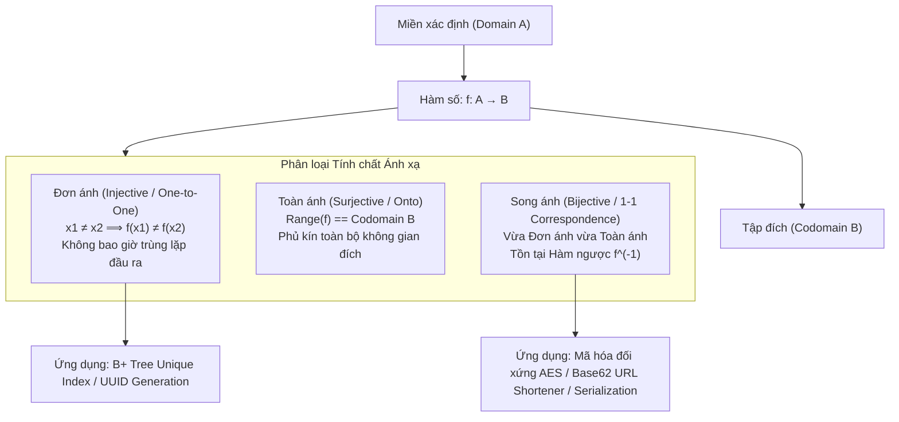

# 4.1. Function Types and Properties (Các Loại Hàm và Đặc tính Ánh xạ)

> [!IMPORTANT]
> **Nếu bạn chỉ được nhớ một điều duy nhất:** Hàm số (Function) là một dạng quan hệ đặc biệt ánh xạ mỗi phần tử đầu vào với DUY NHẤT một phần tử đầu ra; tính chất **Song ánh (Bijective)** là chìa khóa vàng cho phép giải mã dữ liệu và đảo ngược trạng thái ($f^{-1}$), trong khi **Hàm riêng phần (Partial Function)** là cội nguồn của mọi lỗi NullPointerException nếu không được bọc trong `std::optional` hoặc Monad.

---

## 1. Kiến trúc Tổng quan & Mô hình Tư duy (Mental Model)

Hãy tưởng tượng bạn đang thiết kế hệ thống URL Shortener (rút gọn liên kết như bit.ly) hoặc hệ thống sinh định danh định danh toàn cầu:
- Mỗi khi người dùng nhập một URL dài, hệ thống cấp phát một số nguyên ID tự tăng `123456789`. Bạn cần biến số này thành một chuỗi ký tự ngắn gọn `dnh6a` và ngược lại.
- Để người dùng nhập `dnh6a` mở đúng trang web ban đầu, ánh xạ giữa ID số nguyên và chuỗi rút gọn bắt buộc phải là một **Song ánh (Bijection)**:
  1. **Đơn ánh (Injective)**: Không có hai ID khác nhau nào bị nén thành cùng một chuỗi ngắn (tránh va chạm dữ liệu).
  2. **Toàn ánh (Surjective)**: Mọi chuỗi mã ngắn hợp lệ đều giải mã ngược về đúng một số nguyên trong cơ sở dữ liệu.
  3. **Khả nghịch (Invertible)**: Tồn tại hàm giải mã ngược $f^{-1}(\text{"dnh6a"}) = 123456789$.

Ngược lại, trong an ninh mạng và mật mã học:
- Hàm băm mật mã (SHA-256) là một ánh xạ **Nhiều - Một (Many-to-One)** có tập xác định vô hạn (chuỗi byte tùy ý) nhưng tập đích hữu hạn ($2^{256}$ giá trị). Do đó, theo nguyên lý Dirichlet (Pigeonhole Principle), va chạm (Collisions) chắc chắn tồn tại trên lý thuyết, nhưng việc tìm ra tiền ảnh ngược là bất khả thi về mặt tính toán (One-way Function).



---

## 2. Chi tiết từng Keyword (Under-the-Hood Deep Dive)

### 2.1. Domain, Codomain, Range & Image (Miền xác định, Tập đích và Tập giá trị)
- **Định nghĩa hình thức**: Cho hai tập hợp $A$ và $B$. Một hàm $f$ từ $A$ vào $B$ (ký hiệu $f: A \to B$) là một quy tắc gán mỗi phần tử $x \in A$ với **chính xác một** phần tử $y \in B$, viết là $f(x) = y$.
  - **Miền xác định (Domain)**: Tập hợp nguồn $A$, nơi chứa tất cả các đầu vào hợp lệ của hàm.
  - **Tập đích (Codomain)**: Tập hợp $B$, không gian chứa tất cả các giá trị tiềm năng mà hàm có thể trả về theo định nghĩa kiểu dữ liệu.
  - **Ảnh của phần tử (Image)**: Nếu $f(a) = b$, thì $b$ được gọi là ảnh của $a$, và $a$ được gọi là tiền ảnh (pre-image) của $b$.
  - **Tập giá trị / Miền giá trị (Range hay Image của tập $A$)**: Tập con của $B$ chứa các giá trị thực sự được tạo ra:
    $$Range(f) = f(A) = \{f(x) \mid x \in A\} \subseteq B$$
- **Trực giác trong Hệ thống Kiểu (Type Systems)**:
  - Hàm `uint8_t square(uint8_t x) { return x * x; }`:
    - Domain: $\mathbb{Z}_{256}$ (các số nguyên từ 0 đến 255).
    - Codomain: $\mathbb{Z}_{256}$ (kiểu trả về `uint8_t`).
    - Range: Chỉ gồm các số chính phương modulo 256 (tập con nghiêm ngặt của Codomain).

### 2.2. Injective, Surjective & Bijective Functions (Đơn ánh, Toàn ánh và Song ánh)
- **A. Injective Function (Đơn ánh / One-to-One)**:
  - Công thức hình thức:
    $$\forall x_1, x_2 \in A, \quad f(x_1) = f(x_2) \implies x_1 = x_2$$
  - Hoặc dạng phản đảo: $x_1 \ne x_2 \implies f(x_1) \ne f(x_2)$.
  - Trực giác: Mỗi phần tử trong tập giá trị có tối đa một tiền ảnh. Không có hai đầu vào khác nhau nào cho ra cùng một kết quả.
  - Điều kiện kích thước tập hữu hạn: Nếu $f: A \to B$ là đơn ánh thì $|A| \le |B|$.
- **B. Surjective Function (Toàn ánh / Onto)**:
  - Công thức hình thức:
    $$\forall y \in B, \quad \exists x \in A, \quad f(x) = y$$
  - Trực giác: Mọi phần tử trong tập đích đều được "bắn trúng". Tập giá trị trùng khít hoàn toàn với tập đích: $Range(f) = Codomain(B)$.
  - Điều kiện kích thước tập hữu hạn: Nếu $f: A \to B$ là toàn ánh thì $|A| \ge |B|$.
- **C. Bijective Function (Song ánh / One-to-One Correspondence)**:
  - Định nghĩa: Hàm $f$ là song ánh nếu nó **vừa là đơn ánh, vừa là toàn ánh**.
  - Trực giác: Tạo ra một sự kết đôi 1-1 hoàn hảo giữa các phần tử của tập $A$ và tập $B$.
  - Điều kiện kích thước tập hữu hạn: $|A| = |B|$.
  - **Ý nghĩa tối cao**: Hàm $f$ là song ánh khi và chỉ khi nó có **Hàm ngược (Invertible)**.

### 2.3. Inverse Function & Identity Function (Hàm ngược và Hàm đồng nhất)
- **Identity Function (Hàm đồng nhất - $id_A$)**:
  - Ánh xạ mỗi phần tử tới chính nó: $id_A: A \to A$ với $id_A(x) = x$.
  - Đóng vai trò như số $1$ trong phép nhân hoặc ma trận đơn vị $I$ trong đại số tuyến tính: $f \circ id_A = f$ và $id_B \circ f = f$.
- **Inverse Function (Hàm ngược - $f^{-1}$)**:
  - Nếu $f: A \to B$ là song ánh, thì tồn tại duy nhất hàm ngược $f^{-1}: B \to A$ thỏa mãn:
    $$f^{-1}(y) = x \iff f(x) = y$$
    $$(f^{-1} \circ f)(x) = x = id_A(x) \quad \text{và} \quad (f \circ f^{-1})(y) = y = id_B(y)$$
  - Ứng dụng: Mọi giải thuật giải nén dữ liệu (Decompression: Gzip, Zstd) hoặc giải mã đối xứng (AES Decrypt) đều là việc áp dụng hàm ngược toán học:
    $$\text{Decompress}(\text{Compress}(Data)) = Data$$

### 2.4. Total Function vs Partial Function (Hàm Toàn phần và Hàm Riêng phần)
- **Total Function (Hàm Toàn phần)**:
  - Được xác định và trả về giá trị hợp lệ cho **mọi** phần tử trong Domain $A$.
  - Đây là giả định mặc định của toán học cổ điển.
- **Partial Function (Hàm Riêng phần)**:
  - Chỉ được xác định trên một tập con $A' \subset A$. Đối với các phần tử thuộc $A \setminus A'$, hàm không có giá trị trả về hoặc gây lỗi sập chương trình.
  - Ví dụ toán học: $f(x) = 1/x$ là hàm riêng phần trên $\mathbb{R}$ (không xác định tại $x = 0$).
  - Ví dụ lập trình: Phép tra cứu khóa trong Hash Map `map.get(key)`. Nếu `key` không tồn tại, hàm không có giá trị trả về.
- **Xử lý An toàn trong Kỹ thuật Phần mềm**:
  - Ngôn ngữ cũ (C/Java): Trả về con trỏ `NULL` hoặc ngoại lệ `NullPointerException` (Lỗi tỷ đô của Tony Hoare).
  - Ngôn ngữ hiện đại (C++20, Rust, TypeScript): Bọc kết quả trong kiểu dữ liệu Monadic: `std::optional<T>` trong C++, `Option<T>` trong Rust, biến Partial Function thành Total Function ánh xạ tới $B \cup \{None\}$.

### 2.5. Many-to-One vs One-to-One Mapping (So sánh Bản chất Ánh xạ)
- **One-to-One Mapping (Ánh xạ 1-1)**:
  - Bảo toàn thông tin 100%, không mất mát dữ liệu (Lossless).
  - Cho phép truy vết ngược hai chiều (Bidirectional mapping).
  - Ứng dụng: Bảng mã ASCII/Unicode, Mã hóa URL Base62, Khóa chính tự tăng RDBMS.
- **Many-to-One Mapping (Ánh xạ Nhiều - 1)**:
  - Nén thông tin, giảm chiều dữ liệu (Dimensionality reduction), chấp nhận mất mát thông tin tiền ảnh (Lossy / One-way).
  - Không thể đảo ngược trực tiếp.
  - Ứng dụng: Hàm băm Hash Table, Hàm băm mật mã (Argon2, bcrypt), Phép chiếu cơ sở dữ liệu (`SELECT department FROM employees`).

---

## 3. Thực thi Mã nguồn & Mô phỏng Chuyên sâu (Dual-Engine Implementation)

Mô phỏng bộ mã hóa Base62 Bijective ID Mapper (sử dụng trong kiến trúc URL Shortener quy mô lớn) và bộ bao bọc Partial Function an toàn bằng `std::optional` trong C++20 và Python 3.11+.

### C++20 Implementation (Base62 Bijective Mapping Engine & Total Function Wrapper)

```cpp
#include <iostream>
#include <string>
#include <vector>
#include <optional>
#include <algorithm>
#include <format>
#include <cstdint>

// 1. BASE62 BIJECTIVE ID MAPPING ENGINE (Ánh xạ Song ánh giữa uint64_t và Short String)
class Base62Bijection {
private:
    static constexpr std::string_view BASE62_ALPHABET = 
        "0123456789abcdefghijklmnopqrstuvwxyzABCDEFGHIJKLMNOPQRSTUVWXYZ";

public:
    // Forward Function f: uint64_t -> string (Encode)
    static std::string encode(uint64_t n) {
        if (n == 0) return "0";
        std::string result;
        while (n > 0) {
            result += BASE62_ALPHABET[n % 62];
            n /= 62;
        }
        std::ranges::reverse(result);
        return result;
    }

    // Inverse Function f^(-1): string -> uint64_t (Decode)
    static uint64_t decode(std::string_view str) {
        uint64_t result = 0;
        for (char c : str) {
            size_t idx = BASE62_ALPHABET.find(c);
            if (idx == std::string_view::npos) {
                throw std::invalid_argument(std::format("Invalid character in Base62: {}", c));
            }
            result = result * 62 + idx;
        }
        return result;
    }
};

// 2. PARTIAL FUNCTION SAFETY WRAPPER (std::optional)
// Chuyển đổi Partial Function f(x) = sqrt(x) thành Total Function trả về std::optional
std::optional<double> safe_square_root(double x) {
    if (x < 0.0) return std::nullopt; // Ngoài miền xác định của số thực
    return std::sqrt(x);
}

int main() {
    std::cout << "=== BIJECTIVE FUNCTION & PARTIAL FUNCTION ENGINE (C++20) ===

";

    // 1. Kiểm chứng Tính Song ánh (Bijection Test: f^(-1)(f(x)) == x)
    std::cout << "1. [Testing Base62 Bijective Invertibility]
";
    std::vector<uint64_t> test_ids = {0, 1, 61, 62, 1000000, 9876543210123ULL};

    for (uint64_t original_id : test_ids) {
        std::string encoded_str = Base62Bijection::encode(original_id);
        uint64_t decoded_id = Base62Bijection::decode(encoded_str);

        std::cout << std::format("  ID: {:<14} -> Encoded: {:<9} -> Decoded: {:<14} | Match: {}
",
                                 original_id, encoded_str, decoded_id, 
                                 (original_id == decoded_id ? "EXACT" : "FAILED"));
    }

    // 2. Kiểm chứng Xử lý Partial Function an toàn
    std::cout << "
2. [Testing Partial Function Safety with std::optional]
";
    std::vector<double> inputs = {16.0, 2.0, 0.0, -9.0};

    for (double val : inputs) {
        auto result = safe_square_root(val);
        if (result.has_value()) {
            std::cout << std::format("  sqrt({:>5.1f}) = {:<6.3f} (Valid Total Output)
", val, *result);
        } else {
            std::cout << std::format("  sqrt({:>5.1f}) = std::nullopt (Out of Domain: Handled Gracefully)
", val);
        }
    }

    return 0;
}
```

### Python 3.11+ Implementation (Bijection Verifier & Functional Pipeline)

```python
import string
from typing import Optional

BASE62 = string.digits + string.ascii_lowercase + string.ascii_uppercase

def base62_encode(num: int) -> str:
    # Forward mapping f(x)
    if num == 0:
        return BASE62[0]
    chars = []
    while num > 0:
        num, rem = divmod(num, 62)
        chars.append(BASE62[rem])
    return "".join(reversed(chars))

def base62_decode(s: str) -> int:
    # Inverse mapping f^(-1)(y)
    num = 0
    for char in s:
        num = num * 62 + BASE62.index(char)
    return num

def safe_parse_int(text: str) -> Optional[int]:
    # Biến hàm riêng phần int() thành hàm toàn phần trả về Optional[int]
    try:
        return int(text)
    except ValueError:
        return None

if __name__ == "__main__":
    print("=== PYTHON BIJECTIVE MAPPING & OPTIONAL PATTERN ===")

    # Kiểm tra song ánh trên không gian mẫu
    sample_ids = [42, 3844, 100_000_000, 2**32 - 1]
    print("1. [Base62 Bijection Check]")
    for orig in sample_ids:
        short_url = base62_encode(orig)
        restored = base62_decode(short_url)
        assert orig == restored, "Bijective property broken!"
        print(f"  Original: {orig:<10} -> Short: {short_url:<6} -> Recovered: {restored}")

    print("
2. [Partial Function Handling]")
    user_inputs = ["1024", "45.6", "invalid_number", "-250"]
    for inp in user_inputs:
        parsed = safe_parse_int(inp)
        print(f"  safe_parse_int('{inp}') -> {parsed if parsed is not None else 'None (Rejected Safe)'}")
```

### Simulated Terminal Output

```text
=== BIJECTIVE FUNCTION & PARTIAL FUNCTION ENGINE (C++20) ===

1. [Testing Base62 Bijective Invertibility]
  ID: 0              -> Encoded: 0         -> Decoded: 0              | Match: EXACT
  ID: 1              -> Encoded: 1         -> Decoded: 1              | Match: EXACT
  ID: 61             -> Encoded: Z         -> Decoded: 61             | Match: EXACT
  ID: 62             -> Encoded: 10        -> Decoded: 62             | Match: EXACT
  ID: 1000000        -> Encoded: 4c92      -> Decoded: 1000000        | Match: EXACT
  ID: 9876543210123  -> Encoded: 2Q3J5fN   -> Decoded: 9876543210123  | Match: EXACT

2. [Testing Partial Function Safety with std::optional]
  sqrt( 16.0) = 4.000  (Valid Total Output)
  sqrt(  2.0) = 1.414  (Valid Total Output)
  sqrt(  0.0) = 0.000  (Valid Total Output)
  sqrt( -9.0) = std::nullopt (Out of Domain: Handled Gracefully)

=== PYTHON BIJECTIVE MAPPING & OPTIONAL PATTERN ===
1. [Base62 Bijection Check]
  Original: 42         -> Short: g      -> Recovered: 42
  Original: 3844       -> Short: 100    -> Recovered: 3844
  Original: 100000000  -> Short: 6LA10  -> Recovered: 100000000
  Original: 4294967295 -> Short: 4gfFC3 -> Recovered: 4294967295

2. [Partial Function Handling]
  safe_parse_int('1024') -> 1024
  safe_parse_int('45.6') -> None (Rejected Safe)
  safe_parse_int('invalid_number') -> None (Rejected Safe)
  safe_parse_int('-250') -> -250
```

---

## 4. Systems Engineering & Production Pitfalls

### 4.1. Cạm bẫy Giả định Toàn phần trên Hàm Riêng phần (Null Pointer Trap)
- **Vấn đề**: Lập trình viên đối xử với một Partial Function như thể nó là một Total Function:
  ```cpp
  // Nguy hiểm chết người: Giả định key luôn tồn tại trong cache
  User& user = user_cache.get(user_id); // Trả về nullptr nếu cache miss
  user.update_last_login();             // SEGMENTATION FAULT!
  ```
- **Hậu quả**: Nếu Redis gặp sự cố hoặc cache bị xóa do quá tải bộ nhớ (Eviction Policy), phương thức trả về `nullptr`. Thao tác giải tham chiếu con trỏ null sẽ đánh sập ngay lập tức worker thread của server.
- **Biện pháp**: Luôn ép buộc trả về `std::optional<User*>` hoặc `Result<User, CacheError>`, buộc người gọi phải viết khối xử lý rẽ nhánh khi vắng mặt dữ liệu.

### 4.2. Mất tính Đơn ánh do Cắt ngắn Dữ liệu (Truncation Hash Collision)
- Khi lưu trữ mã hash hoặc token vào cơ sở dữ liệu:
  - Một hash SHA-256 có chiều dài 256 bits (64 ký tự hex).
  - Lập trình viên tạo cột database: `VARCHAR(16)` và cắt ngắn chuỗi hash chỉ lấy 16 ký tự đầu để tiết kiệm dung lượng đĩa.
  - **Hậu quả**: Thao tác cắt ngắn làm suy giảm không gian tập đích từ $2^{256}$ xuống còn $16^{16} = 2^{64}$. Theo nghịch lý ngày sinh (Birthday Paradox), xác suất va chạm (hai người dùng có cùng mã rút gọn) sẽ tăng vọt lên $50\%$ chỉ sau khi có khoảng $2^{32} \approx 4.3$ tỷ bản ghi, làm sập tính toàn vẹn dữ liệu.

---

## 5. Bảng So sánh & Decision Matrix

| Đặc tính Ánh xạ | Tính chất Toán học | Điều kiện Khả nghịch ($f^{-1}$) | Rủi ro Khi Triển khai | Ứng dụng Thực tế Tiêu biểu |
| :--- | :--- | :--- | :--- | :--- |
| **Đơn ánh (Injective)** | $x_1 \ne x_2 \implies f(x_1) \ne f(x_2)$ | Có hàm ngược trên tập giá trị $Range(f)$ | Tràn không gian lưu trữ nếu Codomain quá lớn | Khóa chính tự tăng, UUIDv4 |
| **Toàn ánh (Surjective)** | $Range(f) = Codomain(B)$ | Không đảm bảo duy nhất tiền ảnh | Không thể đảo ngược nếu không phải đơn ánh | Phân cụm Hash Sharding (Hashing onto Shards) |
| **Song ánh (Bijective)** | Vừa Đơn ánh vừa Toàn ánh | **Có hàm ngược hoàn hảo $f^{-1}$** | Yêu cầu kiểm soát chặt chẽ kích thước tập hợp | Base62 URL Shortener, AES, Zstandard |
| **Riêng phần (Partial)**| Chưa xác định trên toàn bộ Domain | Bắt buộc phải xử lý rỗng/lỗi | Null Pointer Dereference, Crash | Tra cứu Hash Table, Chia cho số biến |
| **Nhiều - Một (Many-to-1)** | Tồn tại $x_1 \ne x_2$ sao cho $f(x_1) = f(x_2)$ | Hoàn toàn bất khả nghịch | Va chạm dữ liệu (Hash Collisions) | Hàm băm bảo mật (SHA-256), CRC32 |
