# 4.2. Function Composition and Growth (Hợp thành Hàm và Tốc độ Tăng trưởng)

> [!IMPORTANT]
> **Nếu bạn chỉ được nhớ một điều duy nhất:** Hợp thành hàm $(g \circ f)(x) = g(f(x))$ là nền tảng của đường ống xử lý dữ liệu (Data Pipelines) và Unix Pipes; trong khi **Ký hiệu Tiệm cận (Big-O)** không đo lường thời gian chạy bằng giây mà đo lường **Tốc độ Tiêu hao Tài nguyên** khi kích thước dữ liệu $N$ tiến tới vô cực.

---

## 1. Kiến trúc Tổng quan & Mô hình Tư duy (Mental Model)

Hãy tưởng tượng bạn đang xử lý một luồng dữ liệu khổng lồ (Event Streaming Pipeline với Apache Kafka):
- Dữ liệu thô từ IoT thiết bị được tiếp nhận:
  1. Hàm $f$: Giải mã JSON thô thành đối tượng SensorEvent ($JSON \to Event$).
  2. Hàm $g$: Lọc bỏ các giá trị nhiễu hoặc sai số ($Event \to ValidatedEvent$).
  3. Hàm $h$: Tính toán mức tiêu thụ năng lượng trung bình ($ValidatedEvent \to Metric$).
- Bạn có thể kết nối chúng thành một đường ống duy nhất:
  $$\text{Pipeline} = (h \circ g \circ f)(raw\_data) = h(g(f(raw\_data)))$$
- Trong triết lý thiết kế hệ điều hành Unix, điều này chính là toán tử ống dẫn (Pipe Operator):
  `cat access.log | grep "404" | awk '{print $7}' | sort | uniq -c`

Khi khối lượng sự kiện tăng từ $1.000$ lên $1.000.000$ events mỗi giây:
- Một thuật toán có độ phức tạp $O(N)$ chỉ tăng tải thêm $1.000$ lần (vẫn trong tầm kiểm soát).
- Nhưng một thuật toán có độ phức tạp $O(N^2)$ sẽ tăng tải lên tới $1.000.000^2 = 10^{12}$ lần — ngay lập tức biến cụm máy chủ thành "lò sưởi" và làm sập toàn bộ dịch vụ.
- **Ký hiệu tiệm cận (Big-O, Big-Omega, Big-Theta)** chính là công cụ toán học tối thượng giúp kỹ sư dự đoán chính xác hành vi của hệ thống ở quy mô lớn.

```mermaid
flowchart LR
    Input["Dữ liệu Thô (x)"] --> F["Hàm f(x): Parse & Sanitize"]
    F --> Intermediate["Kết quả trung gian: f(x)"]
    Intermediate --> G["Hàm g(y): Process & Enrich"]
    G --> Final["Kết quả cuối cùng: (g ∘ f)(x)"]
    
    subgraph Growth["Phân tích Độ phức tạp Tiệm cận"]
        O1["O(1): Tra cứu Hash Map<br/>Không đổi theo N"]
        OLogN["O(log N): Binary Search<br/>Tăng cực chậm"]
        ON["O(N): Single Pass Stream<br/>Tuyến tính hoàn hảo"]
        ON2["O(N^2): Nested Loops<br/>VÙNG NGUY HIỂM"]
        O2N["O(2^N): Bùng nổ Tổ hợp<br/>KHÔNG THỂ MỞ RỘNG"]
    end
    
    Final --> Growth
```



---

## 2. Chi tiết từng Keyword (Under-the-Hood Deep Dive)

### 2.1. Composition of Functions (Phép Hợp hàm)
- **Định nghĩa hình thức**: Cho hai hàm $f: A \to B$ và $g: B \to C$. Phép hợp thành của $g$ và $f$, ký hiệu là $g \circ f$ (đọc là "$g$ hợp với $f$"), là hàm ánh xạ từ $A$ vào $C$ được định nghĩa bởi:
  $$(g \circ f)(x) = g(f(x)) \quad \forall x \in A$$
  - *Điều kiện tồn tại*: Tập giá trị của hàm đi trước phải là tập con của miền xác định của hàm đi sau: $Range(f) \subseteq Domain(g)$.
- **Các Tính chất Đại số Cốt lõi**:
  - **Tính kết hợp (Associative)**: Cho $f: A \to B$, $g: B \to C$, $h: C \to D$. Khi đó:
    $$(h \circ g) \circ f = h \circ (g \circ f)$$
    Nhờ tính chất này, ta có thể viết chuỗi hợp hàm $h \circ g \circ f$ mà không sợ bị sai lệch thứ tự gom nhóm.
  - **KHÔNG có tính giao hoán (Non-commutative)**: Nói chung:
    $$g \circ f \ne f \circ g$$
    Ví dụ: Với $f(x) = x + 1$ và $g(x) = x^2$:
    - $(g \circ f)(x) = (x + 1)^2 = x^2 + 2x + 1$
    - $(f \circ g)(x) = x^2 + 1$
    Hai kết quả hoàn toàn khác nhau! Thứ tự thực thi trong đường ống dữ liệu quyết định tính đúng đắn của chương trình.
  - **Hợp với hàm đồng nhất**: $f \circ id_A = f$ và $id_B \circ f = f$.

### 2.2. Function Growth & Asymptotic Notations (Tốc độ Tăng trưởng Hàm số)
Khi đánh giá thuật toán, ta không quan tâm tới thời gian thực thi cụ thể trên một máy tính cá nhân (vì phụ thuộc vào tốc độ CPU, RAM, OS), mà quan tâm tới **Tốc độ tăng trưởng tiệm cận (Asymptotic Growth Rate)** khi kích thước đầu vào $n \to \infty$:
- **A. Big-O Notation ($O$ - Chặn Trên Tiệm cận)**:
  - Định nghĩa toán học: $f(n) \in O(g(n))$ nếu tồn tại các hằng số dương $c > 0$ và $n_0 \in \mathbb{N}$ sao cho:
    $$\forall n \ge n_0, \quad |f(n)| \le c \cdot |g(n)|$$
  - Ý nghĩa kỹ thuật: Đảm bảo thời gian chạy trong trường hợp xấu nhất (Worst-case) không vượt quá một ngưỡng tỷ lệ thuận với $g(n)$.
- **B. Big-Omega Notation ($\Omega$ - Chặn Dưới Tiệm cận)**:
  - Định nghĩa toán học: $f(n) \in \Omega(g(n))$ nếu tồn tại các hằng số dương $c > 0$ và $n_0 \in \mathbb{N}$ sao cho:
    $$\forall n \ge n_0, \quad |f(n)| \ge c \cdot |g(n)|$$
  - Ý nghĩa kỹ thuật: Thể hiện giới hạn dưới tốt nhất của bài toán (ví dụ: mọi thuật toán sắp xếp dựa trên so sánh đều cần ít nhất $\Omega(n \log n)$ phép so sánh).
- **C. Big-Theta Notation ($\Theta$ - Chặn Chặt Tiệm cận)**:
  - Định nghĩa toán học: $f(n) \in \Theta(g(n))$ khi và chỉ khi:
    $$f(n) \in O(g(n)) \quad \land \quad f(n) \in \Omega(g(n))$$
  - Tức tồn tại $c_1, c_2 > 0$ và $n_0$ sao cho: $\forall n \ge n_0, \quad c_1 g(n) \le f(n) \le c_2 g(n)$.
  - Ý nghĩa: Đo lường chính xác tuyệt đối bậc tăng trưởng của thuật toán.
- **D. Little-o và Little-omega ($o$ và $\omega$ - Chặn Không Chặt)**:
  - $f(n) \in o(g(n)) \iff \lim_{n \to \infty} \frac{f(n)}{g(n)} = 0$ ($f$ tăng chậm hơn ngặt so với $g$).
  - $f(n) \in \omega(g(n)) \iff \lim_{n \to \infty} \frac{f(n)}{g(n)} = \infty$ ($f$ tăng nhanh hơn ngặt so với $g$).

### 2.3. Hệ thống Cấp bậc Tốc độ Tăng trưởng (Hierarchy of Growth Rates)
Chuỗi bất đẳng thức tiệm cận kinh điển trong khoa học máy tính khi $n \to \infty$:
$$O(1) \subset O(\log \log n) \subset O(\log n) \subset O(\sqrt{n}) \subset O(n) \subset O(n \log n) \subset O(n^2) \subset O(n^3) \subset O(2^n) \subset O(n!) \subset O(n^n)$$
- $O(1)$: Hằng số (Tra cứu Hash Map, Đẩy vào Stack).
- $O(\log n)$: Logarithmic (Binary Search, Tra cứu B+ Tree).
- $O(n)$: Tuyến tính (Duyệt mảng, Single-pass Filter).
- $O(n \log n)$: Tuyến tính - Logarithm (MergeSort, QuickSort trung bình, HeapSort).
- $O(n^2)$: Đa thức bậc hai (Vòng lặp lồng nhau ngây thơ, Bubble Sort).
- $O(2^n)$ và $O(n!)$: Hàm mũ và Giai thừa (Bài toán NP-hard, Traveling Salesperson, Duyệt tập lũy thừa).


### 2.4. Phương pháp Đánh giá Tiệm cận bằng Giới hạn (Limit Test for Asymptotics)
- Khi so sánh tốc độ tăng trưởng của hai hàm số phức tạp $f(n)$ và $g(n)$, phương pháp định nghĩa trực tiếp bằng $c$ và $n_0$ thường khó biến đổi. Thay vào đó, ta sử dụng **Phương pháp giới hạn tỷ số** khi $n \to \infty$:
  $$L = \lim_{n \to \infty} \frac{f(n)}{g(n)}$$
  - **Trường hợp 1**: Nếu $0 < L < \infty$, thì $f(n) \in \Theta(g(n))$ (hai hàm có cùng bậc tăng trưởng).
  - **Trường hợp 2**: Nếu $L = 0$, thì $f(n) \in o(g(n))$ và do đó $f(n) \in O(g(n))$ nhưng $f(n) \notin \Omega(g(n))$.
  - **Trường hợp 3**: Nếu $L = \infty$, thì $f(n) \in \omega(g(n))$ và do đó $f(n) \in \Omega(g(n))$ nhưng $f(n) \notin O(g(n))$.
- Khi gặp dạng vô định $\frac{\infty}{\infty}$, ta áp dụng **Quy tắc L'Hôpital**:
  $$\lim_{n \to \infty} \frac{f(n)}{g(n)} = \lim_{n \to \infty} \frac{f'(n)}{g'(n)}$$
  Ví dụ chứng minh hàm đa thức luôn tăng nhanh hơn hàm logarit:
  $$\lim_{n \to \infty} \frac{\ln n}{n^k} = \lim_{n \to \infty} \frac{1/n}{k n^{k-1}} = \lim_{n \to \infty} \frac{1}{k n^k} = 0 \implies \ln n \in o(n^k) \quad (\forall k > 0)$$

---

## 3. Thực thi Mã nguồn & Mô phỏng Chuyên sâu (Dual-Engine Implementation)

Mô phỏng cơ chế Function Composition Pipeline bằng toán tử Pipe (`|`) trong C++20 và Python 3.11+, kèm theo công cụ đo lường tốc độ tăng trưởng thời gian thực thi thực tế.

### C++20 Implementation (Functional Pipeline & Execution Profiler)

```cpp
#include <iostream>
#include <vector>
#include <string>
#include <ranges>
#include <chrono>
#include <format>
#include <functional>

// Khởi tạo các hàm xử lý dữ liệu nguyên tử
auto clean_whitespace = [](std::string s) -> std::string {
    s.erase(0, s.find_first_not_of(" 	

"));
    s.erase(s.find_last_not_of(" 	

") + 1);
    return s;
};

auto to_uppercase = [](std::string s) -> std::string {
    for (char& c : s) c = std::toupper(c);
    return s;
};

auto add_audit_prefix = [](std::string s) -> std::string {
    return "[AUDIT_LOG] " + s;
};

// C++20 Composition Helper (g ∘ f)
template <typename F, typename G>
auto compose(F f, G g) {
    return [=](auto x) {
        return g(f(x));
    };
}

int main() {
    std::cout << "=== FUNCTION COMPOSITION & GROWTH ENGINE (C++20) ===

";

    // 1. Kiểm chứng Hợp thành hàm (g ∘ f)
    std::string raw_input = "   user_transaction_confirmed_2026   ";
    std::cout << "1. [Function Composition Pipeline]
";
    std::cout << "   Raw Input: '" << raw_input << "'
";

    // Hợp thành 3 bước: clean -> uppercase -> add_prefix
    auto pipeline = compose(compose(clean_whitespace, to_uppercase), add_audit_prefix);
    std::string processed = pipeline(raw_input);
    std::cout << "   Pipeline Output (h ∘ g ∘ f): " << processed << "

";

    // 2. Mô phỏng Thực nghiệm Tốc độ Tăng trưởng O(N) vs O(N^2)
    std::cout << "2. [Empirical Growth Rate Demonstration]
";
    std::vector<size_t> test_sizes = {1000, 5000, 10000, 20000};

    for (size_t n : test_sizes) {
        // Thuật toán Tuyến tính O(N)
        auto start_linear = std::chrono::high_resolution_clock::now();
        volatile uint64_t sum_linear = 0;
        for (size_t i = 0; i < n; ++i) sum_linear += i;
        auto end_linear = std::chrono::high_resolution_clock::now();
        auto dur_linear = std::chrono::duration_cast<std::chrono::microseconds>(end_linear - start_linear).count();

        // Thuật toán Bậc hai O(N^2)
        auto start_quad = std::chrono::high_resolution_clock::now();
        volatile uint64_t sum_quad = 0;
        for (size_t i = 0; i < n; ++i) {
            for (size_t j = 0; j < n; ++j) {
                sum_quad += (i + j);
            }
        }
        auto end_quad = std::chrono::high_resolution_clock::now();
        auto dur_quad = std::chrono::duration_cast<std::chrono::microseconds>(end_quad - start_quad).count();

        std::cout << std::format("   N = {:<6} | O(N) Time: {:<6} µs | O(N^2) Time: {:<10} µs
", 
                                 n, dur_linear, dur_quad);
    }

    return 0;
}
```

### Python 3.11+ Implementation (Functional Monad & Pipeline Composition)

```python
from functools import reduce
from typing import Callable, Any

def compose_all(*functions: Callable[[Any], Any]) -> Callable[[Any], Any]:
    # Hợp thành danh sách nhiều hàm: f_n ∘ ... ∘ f_2 ∘ f_1
    return reduce(lambda f, g: lambda x: g(f(x)), functions)

if __name__ == "__main__":
    print("=== PYTHON FUNCTION COMPOSITION PIPELINE ===")

    # Định nghĩa các hàm xử lý
    strip_text   = lambda s: s.strip()
    mask_secret  = lambda s: s[:4] + "****" + s[-4:] if len(s) > 8 else "****"
    tag_envelope = lambda s: f"<Payload secret='{s}'/>"

    # Xây dựng Pipeline
    data_sanitizer = compose_all(strip_text, mask_secret, tag_envelope)

    raw_token = "   9876-SECRET-TOKEN-1234   "
    clean_result = data_sanitizer(raw_token)

    print(f"Raw Input Token : '{raw_token}'")
    print(f"Sanitized Result: {clean_result}")

    # Minh họa tính chất không giao hoán: f ∘ g != g ∘ f
    f = lambda x: x + 2
    g = lambda x: x * 3

    fog = f(g(5)) # 5 * 3 + 2 = 17
    gof = g(f(5)) # (5 + 2) * 3 = 21
    print(f"
Non-commutativity Check for f(x)=x+2, g(x)=3x:")
    print(f"  (f ∘ g)(5) = {fog}")
    print(f"  (g ∘ f)(5) = {gof} (fog != gof -> Verified!)")
```

### Simulated Terminal Output

```text
=== FUNCTION COMPOSITION & GROWTH ENGINE (C++20) ===

1. [Function Composition Pipeline]
   Raw Input: '   user_transaction_confirmed_2026   '
   Pipeline Output (h ∘ g ∘ f): [AUDIT_LOG] USER_TRANSACTION_CONFIRMED_2026

2. [Empirical Growth Rate Demonstration]
   N = 1000   | O(N) Time: 2      µs | O(N^2) Time: 850        µs
   N = 5000   | O(N) Time: 10     µs | O(N^2) Time: 21450      µs
   N = 10000  | O(N) Time: 19     µs | O(N^2) Time: 86300      µs
   N = 20000  | O(N) Time: 38     µs | O(N^2) Time: 345000     µs

=== PYTHON FUNCTION COMPOSITION PIPELINE ===
Raw Input Token : '   9876-SECRET-TOKEN-1234   '
Sanitized Result: <Payload secret='9876****1234'/>

Non-commutativity Check for f(x)=x+2, g(x)=3x:
  (f ∘ g)(5) = 17
  (g ∘ f)(5) = 21 (fog != gof -> Verified!)
```

---

## 4. Systems Engineering & Production Pitfalls

### 4.1. Bẫy Hằng số Ẩn trong Big-O ($O(N)$ nhưng Chậm hơn $O(N^2)$)
- **Vấn đề**: Ký hiệu Big-O loại bỏ hoàn toàn các hằng số nhân $c$: $f(n) = 1.000.000 n \in O(n)$ và $g(n) = 2 n^2 \in O(n^2)$.
- Khi $n = 100$:
  - Thuật toán $O(n)$ mất $100.000.000$ thao tác (ví dụ: gọi RPC mạng qua từng phần tử).
  - Thuật toán $O(n^2)$ chỉ mất $2 \times 100^2 = 20.000$ thao tác (ví dụ: chạy trên bộ đệm L1 cache của CPU).
- **Quy tắc**: Với tập dữ liệu nhỏ ($N < 50$), các thuật toán đơn giản có hằng số nhỏ (như Insertion Sort) thường chạy nhanh hơn nhiều so với các thuật toán phức tạp như QuickSort hoặc MergeSort. Do đó, hàm `std::sort` trong C++ STL sử dụng thuật toán lai **Introsort** (tự động chuyển sang Insertion Sort khi mảng con nhỏ hơn 16 phần tử).

### 4.2. Vấn đề Tạo Bản sao Rác khi Hợp thành Hàm (Intermediate Allocation Overhead)
- Khi hợp thành các hàm ngây thơ:
  ```python
  # Nguy hiểm: Mỗi bước hợp hàm tạo ra một danh sách trung gian khổng lồ trong RAM
  result = step3(step2(step1(huge_list)))
  ```
- Nếu `huge_list` có dung lượng 2GB, việc tạo các bản sao trung gian giữa các hàm sẽ ngốn 6GB RAM, kích hoạt Garbage Collector dọn dẹp liên tục và làm sập ứng dụng.
- **Khắc phục**: Sử dụng các cơ chế **Lazy Evaluation** (C++20 `std::views`, Python Generators, Rust Iterators) để biến đường ống thành một luồng xử lý phần tử đơn lẻ (Streaming Single-Pass) mà không cấp phát bộ nhớ trung gian.

---


### 4.3. Bùng nổ Stack Frame khi Đệ quy Không Tối ưu (Stack Overflow Growth Trap)
- Khi thực hiện hợp thành hàm qua cơ chế đệ quy: một hàm đệ quy có độ sâu $N$ sẽ tạo ra $N$ stack frames trên Call Stack.
- Nếu kích thước Call Stack của hệ điều hành là 8MB (mặc định trên Linux), mỗi stack frame tốn khoảng 48 bytes, thì chỉ cần $N \approx 170.000$, chương trình sẽ bị ngắt đột ngột bởi lỗi `SIGSEGV` (**Stack Overflow**).
- **Khắc phục**: Chuyển đổi đệ quy thành **Đệ quy đuôi (Tail Recursion)** để trình biên dịch C++/Rust có thể tối ưu hóa thành một vòng lặp phẳng (Tail Call Optimization - TCO) với độ phức tạp không gian giảm từ $O(N)$ về $O(1)$.


- **Diagnostic Tooling:** Khi phân tích độ phức tạp tiệm cận trong hệ thống lớn, sử dụng công cụ Benchmark chuẩn hóa như Google Benchmark (C++) hoặc thư viện `timeit` và `asv` (Python) để đo thời gian CPU thực tế và kiểm chứng tốc độ tăng trưởng $O(n \log n)$ so với $O(n^2)$.
- **Strict Monotonicity in Clock Synchronization:** Trong các hệ thống phân tán, hàm tăng đơn điệu ngặt (strictly monotonically increasing) như `std::chrono::steady_clock` là điều kiện bắt buộc để đo đạc thời gian mà không bị ảnh hưởng bởi việc điều chỉnh giờ NTP.

## 5. Bảng So sánh & Decision Matrix

| Ký hiệu Tiệm cận | Tên gọi Kỹ thuật | Điều kiện Toán học | Ý nghĩa trong Đánh giá Hệ thống |
| :--- | :--- | :--- | :--- |
| **$O(g(n))$** | Big-O (Chặn trên) | $|f(n)| \le c \cdot g(n)$ với $n \ge n_0$ | Đảm bảo hiệu năng tình huống xấu nhất (Worst-case Upper Bound) |
| **$\Omega(g(n))$** | Big-Omega (Chặn dưới) | $|f(n)| \ge c \cdot g(n)$ với $n \ge n_0$ | Giới hạn lý thuyết không thể vượt qua (Lower Bound) |
| **$\Theta(g(n))$** | Big-Theta (Chặn chặt) | $c_1 g(n) \le f(n) \le c_2 g(n)$ | Đánh giá chính xác tốc độ thực tế (Tight Bound) |
| **$o(g(n))$** | Little-o | $\lim_{n \to \infty} f(n) / g(n) = 0$ | Tăng chậm hơn nghiêm ngặt (Strictly Slower) |
| **$\omega(g(n))$** | Little-omega | $\lim_{n \to \infty} f(n) / g(n) = \infty$| Tăng nhanh hơn nghiêm ngặt (Strictly Faster) |
