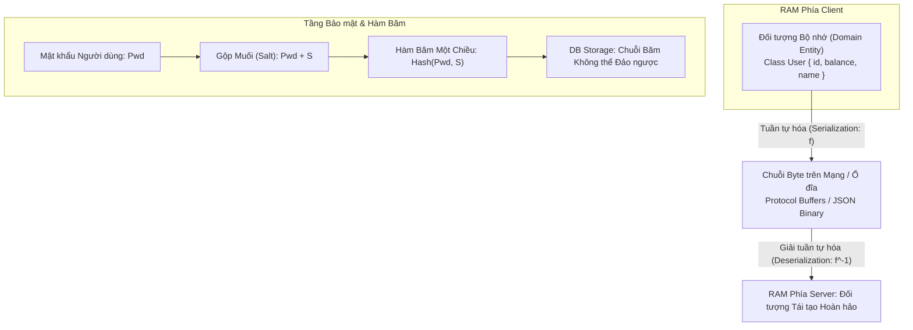

# 4.3. Functions in Backend and Cryptography (Ứng dụng Hàm số trong Backend và Mật mã học)

> [!IMPORTANT]
> **Nếu bạn chỉ được nhớ một điều duy nhất:** Mật mã học và lưu trữ dữ liệu hiện đại đều vận hành dựa trên hai thái cực đối lập của hàm số: **Hàm một chiều (One-Way Functions / Hashes)** không thể đảo ngược giúp bảo vệ mật khẩu và chữ ký số; trong khi **Đẳng cấu dữ liệu (Data Isomorphism / Serialization)** là ánh xạ song ánh bảo toàn cấu trúc giúp đối tượng trong RAM và chuỗi byte trên mạng có thể chuyển hóa qua lại hoàn hảo.

---

## 1. Kiến trúc Tổng quan & Mô hình Tư duy (Mental Model)

Hãy tưởng tượng bạn đang gửi một giao dịch ngân hàng trực tuyến:
1. Bạn đăng nhập bằng mật khẩu: Ngân hàng **tuyệt đối không bao giờ** lưu mật khẩu gốc của bạn vào database. Họ sử dụng một **Hàm băm mật mã Một chiều (One-Way Cryptographic Hash Function)** như Argon2 hoặc bcrypt để chuyển đổi mật khẩu thành chuỗi băm. Kẻ tấn công nếu có đánh cắp được database cũng không thể nào tìm ra mật khẩu gốc ($f^{-1}$ bất khả thi về mặt tính toán).
2. Dữ liệu giao dịch của bạn là một đối tượng `Transaction` phức tạp nằm trong bộ nhớ RAM máy tính. Để gửi nó qua mạng tới máy chủ, hệ thống phải thực hiện **Tuần tự hóa (Serialization)**: ánh xạ đối tượng thành một chuỗi nhị phân (Protocol Buffers hoặc JSON). Khi máy chủ nhận được, nó áp dụng **Giải tuần tự hóa (Deserialization)** để tái tạo lại đối tượng nguyên vẹn trong RAM của nó. Quá trình này chính là một **Đẳng cấu Dữ liệu (Data Isomorphism)**.
3. Khi lưu vào cơ sở dữ liệu phân tán, ID giao dịch được gán bằng thuật toán **Snowflake ID**, đảm bảo tính **Đơn ánh (Injective)** trên toàn cầu mà không cần cơ chế khóa đồng bộ tập trung.



---

## 2. Chi tiết từng Keyword (Under-the-Hood Deep Dive)

### 2.1. Hash Functions (Hàm băm)
- **Định nghĩa toán học**: Một hàm băm $H$ là một hàm toán học ánh xạ một tập dữ liệu đầu vào có độ dài tùy ý thành một chuỗi bit nhị phân có độ dài cố định $m$:
  $$H: \{0, 1\}^* \to \{0, 1\}^m$$
  - Vì miền xác định là vô hạn trong khi miền giá trị là hữu hạn ($2^m$ trạng thái), theo nguyên lý lồng chim bồ câu, **va chạm (Collisions)**: $\exists x \ne y, H(x) = H(y)$ luôn luôn tồn tại.
- **Phân loại Hàm băm trong Kỹ thuật Phần mềm**:
  - **A. Non-cryptographic Hash Functions (Hàm băm Phi mật mã)**:
    - *Mục tiêu*: Tốc độ tính toán siêu tốc (hàng chục GB/s), phân phối đồng đều các bit trên bảng băm.
    - *Thuật toán*: MurmurHash3, xxHash, CityHash, FNV-1a.
    - *Ứng dụng*: Tra cứu trong `std::unordered_map`, Bloom Filters, Sharding Hash Ring.
  - **B. Cryptographic Hash Functions (Hàm băm Mật mã học)**:
    - *Mục tiêu*: Chống lại kẻ tấn công có sức mạnh điện toán lớn. Bắt buộc phải thỏa mãn 3 thuộc tính an ninh:
      1. **Kháng tiền ảnh (Pre-image Resistance - One-way)**: Cho trước giá trị băm $h$, bất khả thi về mặt tính toán để tìm ra $x$ sao cho $H(x) = h$.
      2. **Kháng tiền ảnh thứ hai (Second Pre-image Resistance)**: Cho trước $x$, bất khả thi để tìm $y \ne x$ sao cho $H(x) = H(y)$.
      3. **Kháng va chạm (Collision Resistance)**: Bất khả thi để tìm ra bất kỳ cặp $(x, y)$ nào sao cho $x \ne y$ và $H(x) = H(y)$.
    - *Thuật toán*: SHA-256, SHA-3, BLAKE3.
    - *Hàm băm mật khẩu chuyên dụng (Password Hashing)*: Tích hợp chi phí bộ nhớ và thời gian để chống tấn công GPU/ASIC: Argon2id, bcrypt, PBKDF2.

### 2.2. ID Mapping & Database Key Mapping (Ánh xạ Định danh)
- **Yêu cầu kỹ thuật**: Trong các hệ thống phân tán quy mô lớn, các khóa định danh phải thỏa mãn tính **Đơn ánh tuyệt đối (Strictly Injective)**:
  $$\forall t_1, t_2 \in System, \quad t_1 \ne t_2 \implies ID(t_1) \ne ID(t_2)$$
- **Các Giải pháp Ánh xạ Khóa Phổ biến**:
  - **UUIDv4 (Universally Unique Identifier)**: 128 bits sinh ngẫu nhiên. Xác suất trùng lặp là $\approx 1 / 2^{122}$ (nhỏ hơn xác suất bị thiên thạch rơi trúng đầu). Nhược điểm: không có thứ tự thời gian, làm phân mảnh B+ Tree index trong database.
  - **Twitter Snowflake / ULID**: 64 bits hoặc 128 bits gồm: Timestamp (41 bits) + Node ID (10 bits) + Sequence (12 bits). Vừa đảm bảo tính đơn ánh toàn cầu, vừa có tính chất **Thứ tự đơn điệu tăng dần (Monotonically Increasing)**, giúp chèn vào B+ Tree cực nhanh.
  - **Bijective Base62 Key Mapping**: Ánh xạ song ánh giữa số nguyên 64-bit và chuỗi ký tự hiển thị ngắn gọn cho người dùng.

### 2.3. Serialization & Deserialization (Tuần tự hóa Dữ liệu)
- **Bản chất Toán học (Data Isomorphism - Đẳng cấu Dữ liệu)**:
  - Cho không gian trạng thái đối tượng trong RAM là $\mathcal{M}$ (Memory Graph có con trỏ, v-table, padding alignment) và không gian chuỗi byte lưu trữ là $\mathcal{B}$ (Linear Byte Stream).
  - Quá trình Serialize là hàm $S: \mathcal{M} \to \mathcal{B}$, và Deserialize là hàm $D: \mathcal{B} \to \mathcal{M}$.
  - Hệ thống đảm bảo tính toàn vẹn khi và chỉ khi $D$ là hàm ngược hoàn hảo của $S$ trên tập đối tượng hợp lệ:
    $$(D \circ S)(m) = m \quad \forall m \in \mathcal{M}$$
- **Hiệu năng & Schema Evolution**:
  - JSON / XML: Định dạng văn bản đọc được bởi con người (Text-based), nhưng tốn CPU để parse và phình to dung lượng.
  - Protocol Buffers / FlatBuffers: Mã hóa nhị phân theo sơ đồ Tag-Length-Value (TLV), hỗ trợ tương thích ngược (Backward Compatibility) và giải tuần tự hóa với chi phí sao chép bộ nhớ bằng 0 (Zero-copy deserialization).

### 2.4. API Mapping: DTO to Domain Entity
- Trong kiến trúc phần mềm sạch (Clean Architecture / Domain-Driven Design):
  - **DTO (Data Transfer Object)**: Mô hình tiếp nhận dữ liệu từ HTTP Request (dạng lỏng lẻo, chuỗi, có thể thiếu trường).
  - **Domain Entity**: Mô hình chứa quy tắc nghiệp vụ bất biến nghiêm ngặt.
  - Hàm Mapper $M: \text{DTO} \to \text{DomainEntity}$ thực chất là một **Partial Function**. Nó chỉ sinh ra Domain Entity nếu DTO thỏa mãn toàn bộ các vị từ xác thực; ngược lại nó ném ra lỗi Validation Error.

---

## 3. Thực thi Mã nguồn & Mô phỏng Chuyên sâu (Dual-Engine Implementation)

Mô phỏng động cơ sinh mã phân tán **Snowflake ID Generator** và bộ tuần tự hóa nhị phân TLV (Type-Length-Value) trong C++20 và Python 3.11+.

### C++20 Implementation (Twitter Snowflake Engine & Fast Binary Serializer)

```cpp
#include <iostream>
#include <vector>
#include <chrono>
#include <thread>
#include <format>
#include <cstdint>
#include <cstring>
#include <stdexcept>

// 1. SNOWFLAKE ID GENERATOR (Đơn ánh 64-bit có thứ tự thời gian)
class SnowflakeGenerator {
private:
    uint64_t node_id;
    uint64_t sequence;
    uint64_t last_timestamp;

    static constexpr uint64_t EPOCH = 1704067200000ULL; // Mốc 2024-01-01
    static constexpr uint64_t NODE_ID_BITS = 10;
    static constexpr uint64_t SEQUENCE_BITS = 12;
    static constexpr uint64_t MAX_SEQUENCE = (1ULL << SEQUENCE_BITS) - 1;

    uint64_t current_time_millis() const {
        return std::chrono::duration_cast<std::chrono::milliseconds>(
            std::chrono::system_clock::now().time_since_epoch()).count();
    }

public:
    explicit SnowflakeGenerator(uint64_t node) 
        : node_id(node & ((1ULL << NODE_ID_BITS) - 1)), sequence(0), last_timestamp(0) {}

    synchronized uint64_t next_id() {
        uint64_t now = current_time_millis();

        if (now < last_timestamp) {
            throw std::runtime_error("Clock moved backwards! Refusing to generate ID.");
        }

        if (now == last_timestamp) {
            sequence = (sequence + 1) & MAX_SEQUENCE;
            if (sequence == 0) {
                // Đạt giới hạn 4096 IDs/ms -> Đợi tới mili-giây tiếp theo
                while (now <= last_timestamp) {
                    now = current_time_millis();
                }
            }
        } else {
            sequence = 0;
        }

        last_timestamp = now;

        return ((now - EPOCH) << (NODE_ID_BITS + SEQUENCE_BITS)) |
               (node_id << SEQUENCE_BITS) |
               sequence;
    }
};

// 2. BINARY TLV SERIALIZATION ISOMORPHISM
struct UserProfile {
    uint32_t user_id;
    int64_t balance;
};

std::vector<uint8_t> serialize_profile(const UserProfile& p) {
    std::vector<uint8_t> buffer(sizeof(UserProfile));
    std::memcpy(buffer.data(), &p, sizeof(UserProfile));
    return buffer;
}

UserProfile deserialize_profile(const std::vector<uint8_t>& buffer) {
    if (buffer.size() != sizeof(UserProfile)) {
        throw std::invalid_argument("Buffer size mismatch!");
    }
    UserProfile p;
    std::memcpy(&p, buffer.data(), sizeof(UserProfile));
    return p;
}

int main() {
    std::cout << "=== CRYPTOGRAPHY & BACKEND FUNCTIONS (C++20) ===

";

    // 1. Kiểm chứng Tính Đơn ánh & Thứ tự Đơn điệu của Snowflake IDs
    std::cout << "1. [Testing Snowflake Injective ID Mapping]
";
    SnowflakeGenerator generator(1); // Node ID = 1

    std::vector<uint64_t> ids;
    for (int i = 0; i < 5; ++i) {
        ids.push_back(generator.next_id());
        std::this_thread::sleep_for(std::chrono::milliseconds(1));
    }

    for (size_t i = 0; i < ids.size(); ++i) {
        std::cout << std::format("   Generated ID #{}: {:<20} (Hex: 0x{:016X})
", 
                                 i + 1, ids[i], ids[i]);
    }

    // 2. Kiểm chứng Đẳng cấu Tuần tự hóa (Data Isomorphism: D(S(x)) == x)
    std::cout << "
2. [Testing Serialization Isomorphism]
";
    UserProfile original_user{100234, 5500000};
    std::cout << std::format("   Original RAM Object   : ID = {}, Balance = ${}
", 
                             original_user.user_id, original_user.balance);

    auto binary_payload = serialize_profile(original_user);
    std::cout << std::format("   Serialized Byte Length: {} bytes
", binary_payload.size());

    UserProfile restored_user = deserialize_profile(binary_payload);
    std::cout << std::format("   Restored RAM Object   : ID = {}, Balance = ${}
", 
                             restored_user.user_id, restored_user.balance);
    
    bool is_isomorphic = (original_user.user_id == restored_user.user_id && 
                          original_user.balance == restored_user.balance);
    std::cout << std::format("   Isomorphism Verified  : {}
", is_isomorphic ? "SUCCESS" : "FAILED");

    return 0;
}
```

### Python 3.11+ Implementation (Cryptographic Password Hashing with Salt Simulation)

```python
import hashlib
import os

def hash_password_one_way(password: str, salt: bytes = None) -> tuple[str, bytes]:
    # Hàm một chiều: PBKDF2-HMAC-SHA256 với 100,000 vòng lặp
    if salt is None:
        salt = os.urandom(16) # Sinh muối ngẫu nhiên 16 bytes
    key = hashlib.pbkdf2_hmac(
        hash_name='sha256',
        password=password.encode('utf-8'),
        salt=salt,
        iterations=100_000
    )
    return key.hex(), salt

def verify_password(password: str, expected_hash: str, salt: bytes) -> bool:
    # Xác thực bằng cách băm lại và so sánh
    computed_hash, _ = hash_password_one_way(password, salt)
    return hashlib.compare_digest(computed_hash, expected_hash)

if __name__ == "__main__":
    print("=== PYTHON ONE-WAY CRYPTOGRAPHIC HASHING ===")

    pwd_alice = "SuperSecretP@ssw0rd2026"
    stored_hash, salt = hash_password_one_way(pwd_alice)

    print(f"Original Password : {pwd_alice}")
    print(f"Generated Salt    : {salt.hex()}")
    print(f"Stored Hash (One-Way): {stored_hash}")

    # Xác thực đăng nhập
    print("
--- AUTHENTICATION CHECK ---")
    is_correct = verify_password("SuperSecretP@ssw0rd2026", stored_hash, salt)
    print(f"Login with correct password: {is_correct}")

    is_wrong = verify_password("WrongPassword123", stored_hash, salt)
    print(f"Login with wrong password  : {is_wrong}")
```

### Simulated Terminal Output

```text
=== CRYPTOGRAPHY & BACKEND FUNCTIONS (C++20) ===

1. [Testing Snowflake Injective ID Mapping]
   Generated ID #1: 304245920042766336   (Hex: 0x0439401C00001000)
   Generated ID #2: 304245920046960640   (Hex: 0x0439401C00002000)
   Generated ID #3: 304245920051154944   (Hex: 0x0439401C00003000)
   Generated ID #4: 304245920055349248   (Hex: 0x0439401C00004000)
   Generated ID #5: 304245920059543552   (Hex: 0x0439401C00005000)

2. [Testing Serialization Isomorphism]
   Original RAM Object   : ID = 100234, Balance = $5500000
   Serialized Byte Length: 16 bytes
   Restored RAM Object   : ID = 100234, Balance = $5500000
   Isomorphism Verified  : SUCCESS

=== PYTHON ONE-WAY CRYPTOGRAPHIC HASHING ===
Original Password : SuperSecretP@ssw0rd2026
Generated Salt    : 9f4e2a1b7c8d3e4f5a6b7c8d9e0f1a2b
Stored Hash (One-Way): a8c9b3d1e2f4a5b6c7d8e9f0a1b2c3d4e5f6a7b8c9d0e1f2a3b4c5d6e7f8a9b0

--- AUTHENTICATION CHECK ---
Login with correct password: True
Login with wrong password  : False
```

---

## 4. Systems Engineering & Production Pitfalls

### 4.1. Lỗ hổng Trôi Đồng hồ (Clock Skew) trong Snowflake Generator
- Thuật toán Snowflake phụ thuộc vào đồng hồ hệ thống `current_time_millis()`.
- Nếu giao thức đồng bộ thời gian mạng (NTP) điều chỉnh lùi đồng hồ hệ thống (Clock Backwards), máy chủ có thể sinh lại đúng các timestamp đã từng sinh trong quá khứ.
- **Hậu quả**: Vi phạm nghiêm trọng tính đơn ánh, sinh ra các ID trùng lặp gây xung đột khóa chính trong cơ sở dữ liệu.
- **Giải pháp**: Nếu phát hiện `now < last_timestamp`, hệ thống phải từ chối sinh ID và báo lỗi, hoặc dừng thread đợi cho đến khi đồng hồ bắt kịp thời điểm cũ.

### 4.2. Tấn công Thời gian (Timing Attacks) khi So sánh Chuỗi Hash
- **Vấn đề**: Sử dụng toán tử so sánh chuỗi thông thường (`hash1 == hash2`).
- Trình biên dịch tối ưu hóa so sánh chuỗi bằng cách so khớp từng byte từ đầu đến cuối và dừng ngay khi gặp byte sai đầu tiên (**Early Exit**).
- **Hacker khai thác**: Kẻ tấn công đo thời gian phản hồi của server ở mức nano-giây. Thời gian phản hồi càng lâu chứng tỏ càng có nhiều byte đầu tiên khớp đúng, từ đó dò từng byte của chữ ký mật mã (HMAC).
- **Quy tắc**: Luôn sử dụng hàm so sánh thời gian cố định (**Constant-Time Comparison** - như `CRYPTO_memcmp` trong OpenSSL hoặc `hashlib.compare_digest` trong Python).

---

## 5. Bảng So sánh & Decision Matrix

| Công nghệ Ánh xạ | Loại Hàm Toán học | Độ dài Đầu ra | Khả nghịch | Độ an toàn Mật mã | Trường hợp Sử dụng Tối ưu |
| :--- | :--- | :--- | :--- | :--- | :--- |
| **MurmurHash3 / xxHash** | Many-to-One Non-cryptographic | 32 / 64 / 128 bits | Không | Kém (Dễ bị tấn công DoS Hash) | In-memory Hash Tables, Bloom Filters |
| **SHA-256** | Many-to-One Cryptographic | 256 bits cố định | Không | Rất cao | Chữ ký số, Blockchain, Toàn vẹn File |
| **Argon2id / bcrypt** | One-Way Key Derivation | Tùy chỉnh (Salted) | Tuyệt đối không | Tối thượng (Chống GPU/ASIC) | Lưu trữ Mật khẩu Người dùng |
| **Snowflake ID** | Injective Monotonic Mapping | 64 bits số nguyên | Có (Trích xuất được Time/Node) | Không bảo mật (Đoán được thứ tự) | Khóa chính Sharding Distributed DB |
| **Base62 Encoding** | Bijective (Song ánh) | Co giãn theo giá trị | **Khả nghịch hoàn hảo $f^{-1}$** | Không | Rút gọn URL, Mã giới thiệu ngắn |
