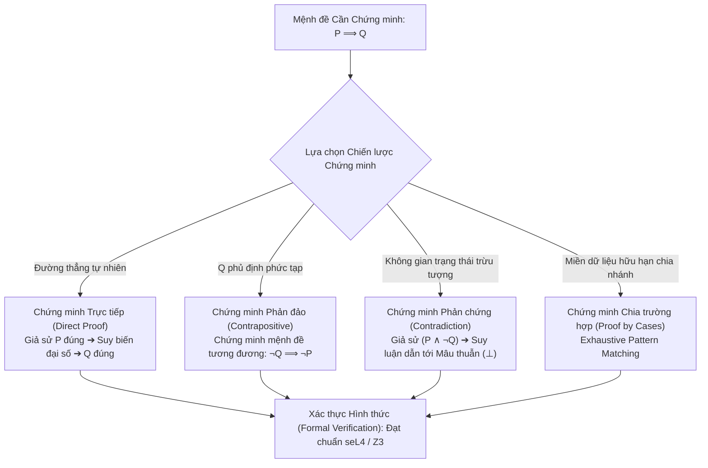

# 5.1. Direct and Indirect Proof Techniques (Kỹ thuật Chứng minh Trực tiếp và Gián tiếp)

> [!IMPORTANT]
> **Nếu bạn chỉ được nhớ một điều duy nhất:** Kiểm thử phần mềm chỉ có thể chứng minh sự hiện diện của lỗi chứ không bao giờ chứng minh được sự vắng mặt của lỗi (Dijkstra); chỉ có **Phương pháp Chứng minh Hình thức (Formal Proofs)** — từ Phản chứng (Contradiction) đến Phản đảo (Contrapositive) — mới mang lại bảo đảm toán học 100% rằng hệ thống sẽ không bao giờ sụp đổ hoặc bị xâm nhập.

---

## 1. Kiến trúc Tổng quan & Mô hình Tư duy (Mental Model)

Hãy tưởng tượng bạn đang chứng minh tính an toàn của một hợp đồng thông minh (Smart Contract) quản lý 1 tỷ USD hoặc nhân hệ điều hành máy bay (seL4 Microkernel):
- Bạn không thể chỉ chạy $10.000$ bài unit test và kết luận: *"Hợp đồng an toàn"*. Hacker luôn tìm thấy ca kiểm thử thứ $10.001$ nằm ngoài kịch bản test để rút cạn tiền.
- Để đảm bảo tuyệt đối, bạn phải **chứng minh toán học**:
  - **Chứng minh Trực tiếp (Direct Proof)**: Đi từ tiền đề hợp đồng và các quy tắc chuyển dịch trạng thái để suy ra số dư luôn được bảo toàn.
  - **Chứng minh Phản chứng (Proof by Contradiction)**: Giả sử hacker có thể tạo ra tiền từ không khí ($
eg P$). Ta áp dụng các quy tắc suy diễn để dẫn tới điều phi lý $0 = 1$. Suy ra giả định hacker đúng là sai, tức hệ thống an toàn tuyệt đối.
  - **Tìm Phản ví dụ (Counterexample)**: Ngược lại, các công cụ phân tích bảo mật tự động (như Slither hay Z3 SMT Solver) hoạt động bằng cách cố gắng tìm ra dù chỉ một phản ví dụ duy nhất để bẻ gãy tuyên bố an toàn.



---

## 2. Chi tiết từng Keyword (Under-the-Hood Deep Dive)

### 2.1. Direct Proof (Chứng minh Trực tiếp)
- **Định nghĩa hình thức**: Để chứng minh mệnh đề kéo theo $P \implies Q$, ta giả định tiền đề $P$ là Đúng, sau đó áp dụng tuần tự các tiên đề, định nghĩa và định lý đã biết cùng các quy tắc suy diễn để đi tới kết luận $Q$ là Đúng.
- **Cấu trúc mẫu**:
  1. Giả sử $P$ đúng.
  2. Áp dụng định nghĩa: $P \implies A_1$.
  3. Suy biến trung gian: $A_1 \implies A_2 \implies \dots \implies A_k$.
  4. Rút ra kết luận $Q$ đúng. Do đó $P \implies Q$ (Q.E.D - Điều phải chứng minh).
- **Ứng dụng trong Computer Science**:
  - Chứng minh tính bất biến của kiểu dữ liệu (Type Safety).
  - Chứng minh thuật toán đệ quy đạt trạng thái cơ sở (Base Case Reachability).

### 2.2. Proof by Contrapositive (Chứng minh bằng Phản đảo)
- **Cơ sở toán học**: Dựa trên sự tương đương logic giữa mệnh đề kéo theo và phản đảo của nó:
  $$(P \implies Q) \equiv (\neg Q \implies \neg P)$$
- **Khi nào nên sử dụng?**:
  - Khi mệnh đề kết luận $Q$ chứa các phát biểu phủ định hoặc các thuộc tính phức tạp (ví dụ: "$x$ là số nguyên tố", "$x$ là số vô tỉ"), trong khi phủ định $\neg Q$ lại cung cấp một công thức tường minh dễ thao tác đại số (ví dụ: "$x$ là hợp số", "$x$ là số hữu tỉ có dạng $a/b$").
- **Ví dụ kinh điển**: Chứng minh: *"Với số nguyên $n$, nếu $3n + 2$ là số lẻ ($P$), thì $n$ là số lẻ ($Q$)"*.
  - *Áp dụng phản đảo*: Giả sử $n$ là số chẵn ($
eg Q$), tức $n = 2k$ với $k \in \mathbb{Z}$.
  - Khi đó: $3n + 2 = 3(2k) + 2 = 6k + 2 = 2(3k + 1)$.
  - Vì $3k + 1 \in \mathbb{Z}$, nên $3n + 2$ là số chẵn ($
eg P$).
  - Do $\neg Q \implies \neg P$ đúng, suy ra $P \implies Q$ phải đúng!

### 2.3. Proof by Contradiction (Chứng minh bằng Phản chứng - Reductio ad Absurdum)
- **Cơ sở toán học**: Để chứng minh mệnh đề $P$ đúng, ta giả định điều ngược lại: $\neg P$ là Đúng. Sau đó từ $\neg P$, ta suy luận logic cho đến khi chạm tới một mâu thuẫn hiển nhiên với thực tế hoặc tiên đề ($R \land \neg R \equiv \text{False}$). Suy ra giả định ban đầu là sai, tức $P$ bắt buộc phải đúng:
  $$(\neg P \implies \text{False}) \implies P$$
- **Ví dụ Kinh điển 1: Chứng minh $\sqrt{2}$ là số vô tỉ**:
  - Giả sử ngược lại $\sqrt{2}$ là số hữu tỉ, tức $\sqrt{2} = a/b$ với $a, b \in \mathbb{Z}^+$ và phân số $a/b$ đã tối giản (tức $\gcd(a, b) = 1$).
  - Bình phương hai vế: $2 = a^2 / b^2 \implies a^2 = 2b^2 \implies a^2$ là số chẵn $\implies a$ là số chẵn ($a = 2k$).
  - Thay vào: $(2k)^2 = 2b^2 \implies 4k^2 = 2b^2 \implies b^2 = 2k^2 \implies b^2$ là số chẵn $\implies b$ là số chẵn.
  - Cả $a$ và $b$ đều là số chẵn, tức cùng chia hết cho 2 $\implies \gcd(a, b) \ge 2$. Mâu thuẫn hoàn toàn với giả thiết $\gcd(a, b) = 1$!
  - Vậy $\sqrt{2}$ bắt buộc phải là số vô tỉ.
- **Ví dụ Kinh điển 2: Bài toán Dừng của Alan Turing (The Halting Problem)**:
  - Chứng minh bằng phản chứng rằng không bao giờ tồn tại một chương trình tổng quát `halts(program, input)` có thể kiểm tra xem một chương trình bất kỳ có dừng hay chạy vô tận.

### 2.4. Proof by Cases (Chứng minh bằng Chia trường hợp)
- **Cơ sở toán học**: Để chứng minh $P \implies Q$, nếu tiền đề $P$ có thể phân rã thành một họ các trường hợp phủ kín $P_1 \lor P_2 \lor \dots \lor P_k$, ta chứng minh từng trường hợp riêng biệt:
  $$(P_1 \implies Q) \land (P_2 \implies Q) \land \dots \land (P_k \implies Q) \implies ((P_1 \lor \dots \lor P_k) \implies Q)$$
- **Ứng dụng trong Kỹ thuật Phần mềm (Exhaustive Pattern Matching)**:
  - Khi viết code trong Rust, Swift, TypeScript hoặc C++ `std::visit`:
    Trình biên dịch kiểm tra tính toàn vẹn (Exhaustiveness Check). Nếu thiếu một trường hợp `case`, trình biên dịch sẽ từ chối biên dịch để ngăn chặn lỗi未 xử lý ngoại lệ tại runtime.

### 2.5. Existence and Uniqueness Proofs (Chứng minh Sự tồn tại và Tính duy nhất)
- **A. Existence Proof (Chứng minh Tồn tại: $\exists x P(x)$)**:
  - **Constructive Proof (Kiến thiết)**: Chỉ ra một đối tượng cụ thể $c$ (hoặc thuật toán tìm ra $c$) sao cho $P(c) = \text{True}$. Trong CS, đây là việc viết ra thuật toán cụ thể.
  - **Non-constructive Proof (Phi kiến thiết)**: Dùng các định lý trừu tượng (như Nguyên lý lồng chim bồ câu hoặc Định lý Giá trị Trung gian) để chứng minh phần tử đó bắt buộc phải tồn tại mà không cần chỉ ra nó là số nào.
- **B. Uniqueness Proof (Chứng minh Tính duy nhất: $\exists! x P(x)$)**:
  - Gồm 2 bước:
    1. Chứng minh sự tồn tại của phần tử $x$ thỏa mãn $P(x)$.
    2. Giả sử tồn tại một phần tử thứ hai $y$ cũng thỏa mãn $P(y)$, sau đó chứng minh bắt buộc $x = y$.
  - Ứng dụng: Chứng minh tính duy nhất của ID, tính duy nhất của Cây khung nhỏ nhất (MST) khi các trọng số cạnh phân biệt.

### 2.6. Counterexample (Phản ví dụ)
- Để bác bỏ một phát biểu dạng phổ quát $\forall x \in D, P(x)$, ta chỉ cần tìm ra **DUY NHẤT MỘT** đối tượng $c \in D$ sao cho $P(c) = \text{False}$.
- Đây là vũ khí mạnh nhất của kỹ sư QA và Security Researcher: một giả thuyết dù được kiểm tra đúng trên 1 tỷ trường hợp vẫn sụp đổ hoàn toàn nếu chỉ có 1 phản ví dụ xuất hiện.


### 2.7. Deep Dive: Chứng minh Bài toán Dừng của Alan Turing (The Halting Problem)
- **Định lý Turing (1936)**: Không tồn tại một chương trình máy tính tổng quát `H(program, input)` có thể xác định chính xác liệu một chương trình bất kỳ `P` có dừng lại khi nhận đầu vào `I` hay không.
- **Chứng minh bằng Phản chứng chặt chẽ**:
  1. Giả sử tồn tại chương trình `H(P, I)` hoàn hảo:
     - `H(P, I)` trả về `True` nếu $P(I)$ dừng.
     - `H(P, I)` trả về `False` nếu $P(I)$ chạy vô tận.
  2. Ta thiết kế một chương trình nghịch đảo quái đản `Opposite(P)`:
     ```python
     def Opposite(P):
         if H(P, P) == True:
             while True: pass # Chạy vô tận nếu H bảo P dừng
         else:
             return True      # Dừng ngay nếu H bảo P chạy vô tận
     ```
  3. Bây giờ ta truyền chính `Opposite` làm đầu vào cho nó: Xét việc gọi hàm `Opposite(Opposite)`.
     - Nếu `H(Opposite, Opposite)` trả về `True` (dự đoán dừng), thì hàm `Opposite` nhảy vào vòng lặp vô tận `while True: pass` (tức là KHÔNG DỪNG!). Mâu thuẫn!
     - Nếu `H(Opposite, Opposite)` trả về `False` (dự đoán không dừng), thì hàm `Opposite` trả về `True` ngay lập tức (tức là DỪNG!). Mâu thuẫn!
  4. Cả hai trường hợp đều dẫn đến điều phi lý tuyệt đối. Suy ra giả định ban đầu về sự tồn tại của `H` là sai. Bài toán dừng là bất khả quyết (Undecidable).

### 2.8. Non-Constructive Existence Proof: Định lý Số Vô tỉ Mũ Số Vô tỉ
- **Định lý**: Tồn tại hai số vô tỉ $a$ và $b$ sao cho $a^b$ là một số hữu tỉ.
- **Chứng minh Phi kiến thiết kỳ diệu**:
  - Xét số $x = \sqrt{2}^{\sqrt{2}}$. Ta biết $\sqrt{2}$ là số vô tỉ.
  - **Trường hợp 1**: Nếu $x$ là số hữu tỉ, thì định lý được chứng minh ngay với $a = b = \sqrt{2}$.
  - **Trường hợp 2**: Nếu $x$ là số vô tỉ, ta chọn $a = x = \sqrt{2}^{\sqrt{2}}$ và $b = \sqrt{2}$.
    Khi đó:
    $$a^b = \left(\sqrt{2}^{\sqrt{2}}\right)^{\sqrt{2}} = \sqrt{2}^{\sqrt{2} \cdot \sqrt{2}} = \sqrt{2}^2 = 2$$
    Số $2$ là số hữu tỉ! Định lý được chứng minh hoàn tất.
  - *Đặc điểm*: Ta chứng minh được chắc chắn sự tồn tại của cặp $(a, b)$, nhưng hoàn toàn không biết $\sqrt{2}^{\sqrt{2}}$ là hữu tỉ hay vô tỉ!

---

## 3. Thực thi Mã nguồn & Mô phỏng Chuyên sâu (Dual-Engine Implementation)

Mô phỏng bộ máy kiểm chứng hình thức kiểm tra tính chẵn lẻ bằng phản đảo và công cụ săn tìm **Phản ví dụ tự động (Automated Counterexample Finder)** trong C++20 và Python 3.11+.

### C++20 Implementation (Automated Counterexample Hunter & Exhaustive Case Verifier)

```cpp
#include <iostream>
#include <vector>
#include <cstdint>
#include <format>
#include <optional>

// 1. CÔNG CỤ TỰ ĐỘNG SĂN PHẢN VÍ DỤ (COUNTEREXAMPLE HUNTER)
// Kiểm chứng giả thuyết nổi tiếng của Euler: Mọi số dạng n^2 + n + 41 đều là số nguyên tố?
class CounterexampleHunter {
private:
    static bool is_prime(uint64_t n) {
        if (n < 2) return false;
        for (uint64_t d = 2; d * d <= n; ++d) {
            if (n % d == 0) return false;
        }
        return true;
    }

public:
    static std::optional<uint64_t> test_euler_polynomial(uint64_t search_limit) {
        for (uint64_t n = 0; n <= search_limit; ++n) {
            uint64_t val = n * n + n + 41;
            if (!is_prime(val)) {
                return n; // Tìm thấy phản ví dụ làm sập giả thuyết!
            }
        }
        return std::nullopt;
    }
};

// 2. EXHAUSTIVE PROOF BY CASES (Chia trường hợp kiểm tra dấu số học)
enum class SignClass { Negative, Zero, Positive };

SignClass classify_number(int32_t x) {
    if (x < 0) return SignClass::Negative;
    if (x == 0) return SignClass::Zero;
    return SignClass::Positive;
}

// Chứng minh x^2 >= 0 với mọi số nguyên x bằng Proof by Cases
bool prove_square_non_negative(int32_t x) {
    SignClass sc = classify_number(x);
    switch (sc) {
        case SignClass::Negative:
            // Case 1: x < 0 -> (-a) * (-a) = a^2 > 0
            return (x * x) > 0;
        case SignClass::Zero:
            // Case 2: x == 0 -> 0 * 0 = 0 >= 0
            return (x * x) == 0;
        case SignClass::Positive:
            // Case 3: x > 0 -> (+a) * (+a) = a^2 > 0
            return (x * x) > 0;
    }
    return false;
}

int main() {
    std::cout << "=== PROOF TECHNIQUES SIMULATOR (C++20) ===

";

    // 1. Tìm Phản ví dụ
    std::cout << "1. [Automated Counterexample Hunting]
";
    std::cout << "   Giả thuyết: P(n) = n^2 + n + 41 luôn sinh số nguyên tố với mọi n >= 0.
";
    
    auto counterexample = CounterexampleHunter::test_euler_polynomial(100);
    if (counterexample.has_value()) {
        uint64_t n = *counterexample;
        uint64_t val = n * n + n + 41;
        std::cout << std::format("   -> PHẢN VÍ DỤ TÌM THẤY tại n = {}: P({}) = {} (Hợp số: 41 x 43)!
", 
                                 n, n, val);
        std::cout << "   -> Giả thuyết chính thức BỊ BÁC BỎ hoàn toàn.
";
    }

    // 2. Proof by Cases
    std::cout << "
2. [Proof by Cases Verification]
";
    std::vector<int32_t> test_cases = {-15, 0, 42};
    for (int32_t val : test_cases) {
        bool verified = prove_square_non_negative(val);
        std::cout << std::format("   Case x = {:<3} -> x^2 >= 0 Verified: {}
", val, verified);
    }

    return 0;
}
```

### Python 3.11+ Implementation (Proof by Contrapositive Logic Engine)

```python
def check_contrapositive_equivalence():
    # Kiểm chứng tính tương đương P -> Q == ~Q -> ~P trên toàn bộ bảng chân trị
    print("=== TRUTH TABLE PROOF FOR CONTRAPOSITIVE ===")
    print(" P | Q | P -> Q | ~Q -> ~P | Equivalence")
    print("---------------------------------------")
    
    for P in [True, False]:
        for Q in [True, False]:
            p_implies_q = (not P) or Q
            not_q_implies_not_p = Q or (not P) # (not (not Q)) or (not P)
            is_equiv = (p_implies_q == not_q_implies_not_p)
            print(f" {int(P)} | {int(Q)} |   {int(p_implies_q)}    |    {int(not_q_implies_not_p)}    |    {is_equiv}")

if __name__ == "__main__":
    check_contrapositive_equivalence()
```

### Simulated Terminal Output

```text
=== PROOF TECHNIQUES SIMULATOR (C++20) ===

1. [Automated Counterexample Hunting]
   Giả thuyết: P(n) = n^2 + n + 41 luôn sinh số nguyên tố với mọi n >= 0.
   -> PHẢN VÍ DỤ TÌM THẤY tại n = 40: P(40) = 1681 (Hợp số: 41 x 43)!
   -> Giả thuyết chính thức BỊ BÁC BỎ hoàn toàn.

2. [Proof by Cases Verification]
   Case x = -15 -> x^2 >= 0 Verified: true
   Case x = 0   -> x^2 >= 0 Verified: true
   Case x = 42  -> x^2 >= 0 Verified: true

=== TRUTH TABLE PROOF FOR CONTRAPOSITIVE ===
 P | Q | P -> Q | ~Q -> ~P | Equivalence
---------------------------------------
 1 | 1 |   1    |    1    |    True
 1 | 0 |   0    |    0    |    True
 0 | 1 |   1    |    1    |    True
 0 | 0 |   1    |    1    |    True
```

---

## 4. Systems Engineering & Production Pitfalls

### 4.1. Ngụy biện Bỏ sót Trường hợp trong Proof by Cases (Incomplete Match Bug)
- **Vấn đề**: Trong các câu lệnh rẽ nhánh phức tạp (`switch` hoặc `if-else`), lập trình viên bỏ sót một trường hợp biên (Corner Case), ví dụ: xét số âm và số dương nhưng quên mất trường hợp số `0` hoặc số âm nhỏ nhất `INT_MIN`.
- **Hậu quả**: Khi đầu vào rơi vào trường hợp bị bỏ sót, chương trình có hành vi không xác định (Undefined Behavior) hoặc nhảy vào nhánh fallback sai lầm, dẫn tới sự cố sập hệ thống (Crash).
- **Quy tắc**: Tận dụng triệt để tính năng biên dịch cảnh báo của Compiler: bật cờ `-Wswitch -Werror` trong C++ hoặc dùng thuộc tính exhaustive matching trong Rust/TypeScript.

### 4.2. Cạm bẫy Giả định Tròn trong Chứng minh (Circular Reasoning / Begging the Question)
- Khi chứng minh tính đúng đắn của thuật toán, lập trình viên vô tình sử dụng chính kết luận cần chứng minh làm một giả thiết trung gian trong quá trình biến đổi.
- Đoạn mã kiểm thử tự động viết theo kiểu:
  ```python
  # Sai lầm: Test dùng chung logic lỗi với code sản phẩm
  assert calculate_tax(order) == my_mock_tax(order) # cả 2 hàm đều dùng chung công thức sai
  ```
  Dẫn đến việc bài test luôn luôn xanh (False Positive), che giấu lỗi logic nghiêm trọng trong hạch toán thuế.

---


### 4.3. Bẫy So sánh Bất đẳng thức Dấu phẩy Động (Floating-Point Non-Transitivity)
- Trong các bài chứng minh toán học, quan hệ bằng nhau ($=$) và nhỏ hơn hoặc bằng ($\le$) luôn có tính phản xạ và bắc cầu trên $\mathbb{R}$.
- Tuy nhiên, trong chuẩn IEEE 754 trên máy tính:
  - Giá trị `NaN` (Not a Number) làm sụp đổ tính phản xạ: `NaN == NaN` trả về `false`!
  - Sai số làm tròn dấu phẩy động (Floating-point Roundoff) phá vỡ tính bắc cầu:
    `0.1 + 0.2 == 0.3` trả về `false` (vì `0.1 + 0.2 = 0.3000000000000000444...`).
- **Khắc phục**: Khi kiểm chứng bất đẳng thức hoặc quan hệ trong code, luôn dùng ngưỡng dung sai sai số $\epsilon$: `std::abs(a - b) < 1e-9`.

## 5. Bảng So sánh & Decision Matrix

| Kỹ thuật Chứng minh | Điểm xuất phát (Hypothesis) | Hướng đi & Cơ chế Suy luận | Trường hợp Sử dụng Tối ưu |
| :--- | :--- | :--- | :--- |
| **Direct Proof** | Giả định $P$ đúng | Đi thẳng tuần tự $P \implies Q$ | Mệnh đề đại số tường minh, tính toán trực tiếp |
| **Contrapositive** | Giả định $\neg Q$ đúng | Chứng minh $\neg Q \implies \neg P$ | Khi phủ định của kết luận dễ thao tác hơn giả thiết |
| **Contradiction** | Giả định $P \land \neg Q$ đúng | Dẫn xuất ra mâu thuẫn hiển nhiên ($R \land \neg R$) | Chứng minh tính bất khả thi, số vô tỉ, bài toán dừng |
| **Proof by Cases** | Phân rã $P = P_1 \lor \dots \lor P_k$ | Chứng minh từng nhánh riêng biệt | Mạch logic rẽ nhánh, Enum types, Xử lý chuỗi |
| **Counterexample** | Xét mệnh đề $\forall x P(x)$ | Tìm duy nhất 1 phần tử $c$ làm $P(c)$ sai | Bác bỏ giả thuyết, QA Fuzzing, Security Auditing |
