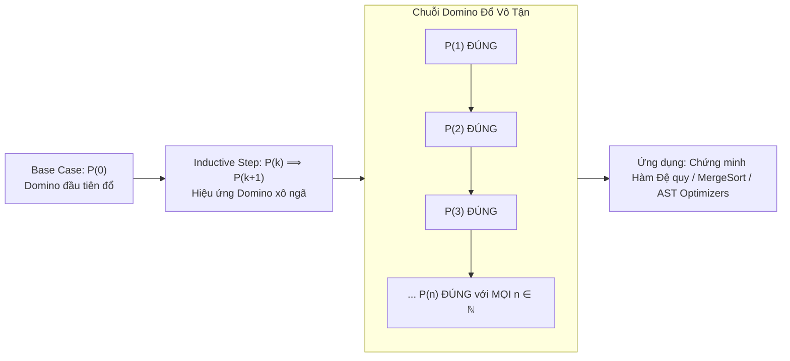

# 5.2. Induction Techniques (Các Kỹ thuật Quy nạp)

> [!IMPORTANT]
> **Nếu bạn chỉ được nhớ một điều duy nhất:** Quy nạp toán học là hiệu ứng domino: chứng minh con domino đầu tiên đổ (Base Case) và chứng minh rằng bất kỳ con domino nào đổ cũng sẽ xô ngã con tiếp theo (Inductive Step); trong khoa học máy tính, **Quy nạp Cấu trúc (Structural Induction)** chính là linh hồn chứng minh tính đúng đắn của mọi hàm đệ quy trên cây, đồ thị và Abstract Syntax Tree (AST).

---

## 1. Kiến trúc Tổng quan & Mô hình Tư duy (Mental Model)

Hãy tưởng tượng bạn đang viết một hàm đệ quy duyệt cây nhị phân (Binary Tree Traversal) hoặc trình phân tích cú pháp (Parser):
- Bạn làm sao chắc chắn rằng hàm đệ quy của mình sẽ chạy đúng trên mọi cái cây, dù cây đó có 3 nút hay 3 tỷ nút?
- Bạn không thể kiểm tra từng cái cây một vì số lượng hình dạng cây là vô hạn!
- **Phương pháp Quy nạp (Induction)** giải quyết bài toán vô hạn này bằng tư duy đệ quy ngược:
  1. **Bước cơ sở (Base Case)**: Chứng minh thuật toán đúng trên trường hợp nhỏ nhất (nút lá hoặc cây rỗng).
  2. **Bước quy nạp (Inductive Step)**: Giả sử thuật toán chạy đúng trên tất cả các cây con cấp dưới có kích thước nhỏ hơn ($k$). Ta chứng minh rằng khi kết hợp chúng lại ở nút cha ($k+1$), kết quả vẫn bảo đảm chính xác 100%.

Trong khoa học máy tính:
1. **Mathematical Induction**: Chứng minh công thức độ phức tạp thuật toán và công thức tổng vòng lặp.
2. **Strong Induction**: Chứng minh tính phân rã bài toán trong thuật toán Chia để trị (Divide and Conquer, MergeSort).
3. **Structural Induction**: Trình biên dịch (Compiler) chứng minh tính tương đương cú pháp và tối ưu hóa AST mà không làm thay đổi ngữ nghĩa chương trình.



---

## 2. Chi tiết từng Keyword (Under-the-Hood Deep Dive)

### 2.1. Mathematical Induction / Weak Induction (Quy nạp Toán học Sơ cấp)
- **Nguyên lý hình thức**: Cho $P(n)$ là một vị từ xác định trên tập số tự nhiên $\mathbb{N}$. Để chứng minh $\forall n \ge n_0, P(n)$ đúng, ta thực hiện hai bước:
  1. **Bước cơ sở (Base Step / Anchor)**: Chứng minh $P(n_0)$ là Đúng.
  2. **Bước quy nạp (Inductive Step)**: Chứng minh rằng với mọi $k \ge n_0$, nếu giả thiết $P(k)$ đúng (được gọi là **Giả thiết Quy nạp - Inductive Hypothesis**), thì $P(k+1)$ cũng bắt buộc phải đúng:
     $$\forall k \ge n_0, \quad (P(k) \implies P(k+1))$$
- **Ví dụ kinh điển**: Chứng minh tổng $n$ số nguyên dương đầu tiên:
  $$S_n = \sum_{i=1}^n i = \frac{n(n+1)}{2}$$
  - *Base case ($n=1$)*: $S_1 = 1$, vế phải $1(2)/2 = 1$. Đúng!
  - *Inductive step*: Giả sử đúng tới $k$: $S_k = \frac{k(k+1)}{2}$.
    Ta cần chứng minh đúng với $k+1$:
    $$S_{k+1} = S_k + (k+1) = \frac{k(k+1)}{2} + (k+1) = (k+1)\left(\frac{k}{2} + 1\right) = \frac{(k+1)(k+2)}{2}$$
    Công thức đúng với $k+1$. Theo nguyên lý quy nạp, công thức đúng với mọi $n \ge 1$.

### 2.2. Strong Induction / Complete Induction (Quy nạp Toàn phần / Quy nạp Mạnh)
- **Nguyên lý hình thức**:
  - Trong quy nạp sơ cấp, ta chỉ giả định một bước trước đó $P(k)$ đúng để suy ra $P(k+1)$.
  - Trong **Quy nạp Mạnh**, giả thiết quy nạp giả định rằng **TOÀN BỘ** các bước từ đầu đến $k$ đều đúng:
    $$\forall k \ge n_0, \quad ((P(n_0) \land P(n_0+1) \land \dots \land P(k)) \implies P(k+1))$$
- **Khi nào bắt buộc dùng Quy nạp Mạnh?**:
  - Khi một bài toán không suy biến từ $k$ sang $k+1$ một cách tuyến tính, mà bị bẻ đôi hoặc phân rã thành các mảnh nhỏ hơn có kích thước không cố định (ví dụ: chia để trị, phân tích thừa số nguyên tố, trò chơi Nim).
- **Ví dụ kinh điển: Định lý Cơ bản của Số học (Fundamental Theorem of Arithmetic)**:
  - Mọi số nguyên $n \ge 2$ đều có thể biểu diễn thành tích của các số nguyên tố.
  - *Inductive Step*: Xét số $k+1$.
    - Nếu $k+1$ là số nguyên tố $\implies$ hiển nhiên đúng.
    - Nếu $k+1$ là hợp số $\implies k+1 = a \cdot b$ với $2 \le a, b \le k$.
    - Nhờ **Giả thiết Quy nạp Mạnh**, cả $a$ và $b$ đều nằm trong đoạn $[2, k]$ nên đều phân tích được thành tích các số nguyên tố. Do đó, tích $a \cdot b = k+1$ cũng phân tích được thành tích các số nguyên tố!

### 2.3. Structural Induction (Quy nạp Cấu trúc)
- **Định nghĩa**: Phương pháp quy nạp mở rộng áp dụng trực tiếp trên các cấu trúc dữ liệu được định nghĩa đệ quy (Recursive Data Types / Algebraic Data Types), chẳng hạn như Strings, Lists, Trees, Expressions.
- **Quy trình 2 bước trên Cây nhị phân**:
  1. **Base Step**: Chứng minh tính chất đúng cho Cây Rỗng (hoặc cây chỉ có duy nhất 1 nút lá).
  2. **Inductive Step**: Giả sử tính chất đúng cho cây con bên trái $T_L$ và cây con bên phải $T_R$. Chứng minh tính chất đó vẫn bảo toàn khi ghép chúng lại thành cây mới $T = \text{Node}(root, T_L, T_R)$.
- **Định lý Cây Nhị phân Đầy đủ (Full Binary Tree Theorem)**:
  - Trong một cây nhị phân đầy đủ (mọi nút không phải lá đều có đúng 2 nút con), số lượng lá $L$ luôn luôn bằng số lượng nút trong (internal nodes) $I$ cộng thêm 1:
    $$L = I + 1$$
  - Chứng minh hoàn hảo bằng quy nạp cấu trúc trên từng bước ghép cành của cây.

### 2.4. Well-Ordering Principle (Nguyên lý Thứ tự Tốt)
- **Tiên đề**: Mọi tập con khác rỗng của tập số tự nhiên $\mathbb{N}$ đều chứa một phần tử nhỏ nhất (Least Element):
  $$\forall S \subseteq \mathbb{N}, \quad S \ne \emptyset \implies \exists m \in S, \forall x \in S, m \le x$$
- **Mối quan hệ mật thiết**: Nguyên lý Thứ tự Tốt tương đương logic hoàn toàn với Nguyên lý Quy nạp Toán học. Nó thường được dùng trong các bài chứng minh phản chứng: giả sử có những trường hợp làm định lý sai, gọi $m$ là ca sai nhỏ nhất, sau đó tìm ra một ca nhỏ hơn $m$ để tạo mâu thuẫn.


### 2.5. Deep Dive: Chứng minh Tính Đúng đắn của Thuật toán MergeSort bằng Quy nạp Mạnh
- Thuật toán MergeSort nhận mảng kích thước $n$: chia đôi thành hai mảng con kích thước $\lfloor n/2 \rfloor$ và $\lceil n/2 \rceil$, gọi đệ quy sắp xếp, sau đó trộn hai mảng đã sắp xếp trong thời gian $O(n)$.
- **Chứng minh bằng Strong Induction theo kích thước $n$**:
  1. **Base Case ($n = 1$)**: Mảng có 1 phần tử hiển nhiên đã được sắp xếp. Thuật toán trả về mảng gốc. Đúng!
  2. **Inductive Hypothesis**: Giả sử MergeSort sắp xếp chính xác mọi mảng có độ dài $k$ với mọi $1 \le k < n$.
  3. **Inductive Step**: Xét mảng độ dài $n$. Thuật toán chia thành 2 nửa có kích thước $n_1 = \lfloor n/2 \rfloor$ và $n_2 = \lceil n/2 \rceil$.
     - Vì $n \ge 2$, nên $1 \le n_1, n_2 < n$.
     - Theo giả thiết quy nạp mạnh, các lời gọi đệ quy trên hai nửa đều trả về mảng con được sắp xếp hoàn hảo.
     - Hàm `merge()` nhận hai mảng đã sắp xếp và ghép thành mảng lớn đã sắp xếp (chứng minh bằng Loop Invariant).
     - Do đó toàn bộ mảng kích thước $n$ được sắp xếp đúng. MergeSort đúng với mọi $n \ge 1$.

---

## 3. Thực thi Mã nguồn & Mô phỏng Chuyên sâu (Dual-Engine Implementation)

Mô phỏng bộ kiểm chứng tính chất của cây nhị phân bằng **Quy nạp Cấu trúc** và bộ tính toán lũy thừa nhanh chia để trị trong C++20 và Python 3.11+.

### C++20 Implementation (Structural Induction on Binary Tree & Fast Exponentiation)

```cpp
#include <iostream>
#include <memory>
#include <format>
#include <cassert>

// 1. CẤU TRÚC CÂY NHỊ PHÂN ĐỊNH NGHĨA ĐỆ QUY
struct TreeNode {
    int val;
    std::unique_ptr<TreeNode> left;
    std::unique_ptr<TreeNode> right;

    explicit TreeNode(int v) : val(v), left(nullptr), right(nullptr) {}
};

// Đếm số lượng nút lá (Leaves)
int count_leaves(const TreeNode* root) {
    if (!root) return 0;
    if (!root->left && !root->right) return 1; // Base Case: Nút lá
    return count_leaves(root->left.get()) + count_leaves(root->right.get()); // Inductive Step
}

// Đếm số lượng nút trong (Internal Nodes)
int count_internal_nodes(const TreeNode* root) {
    if (!root || (!root->left && !root->right)) return 0; // Base Case: Lá không phải nút trong
    return 1 + count_internal_nodes(root->left.get()) + count_internal_nodes(root->right.get());
}

// 2. THUẬT TOÁN CHIA ĐỂ TRỊ: LŨY THỪA NHANH (FAST EXPONENTIATION)
// Chứng minh tính đúng đắn bằng Strong Induction
uint64_t power_fast(uint64_t base, uint64_t exp) {
    if (exp == 0) return 1; // Base case: b^0 = 1
    if (exp % 2 == 0) {
        uint64_t half = power_fast(base, exp / 2); // Giả thiết quy nạp mạnh với exp/2 < exp
        return half * half;
    } else {
        return base * power_fast(base, exp - 1);
    }
}

int main() {
    std::cout << "=== INDUCTION TECHNIQUES & STRUCTURAL VERIFIER (C++20) ===

";

    // 1. Kiểm chứng Định lý Cây nhị phân đầy đủ: Leaves = InternalNodes + 1
    std::cout << "1. [Structural Induction Verification on Full Binary Tree]
";
    auto root = std::make_unique<TreeNode>(1);
    root->left = std::make_unique<TreeNode>(2);
    root->right = std::make_unique<TreeNode>(3);
    root->left->left = std::make_unique<TreeNode>(4);
    root->left->right = std::make_unique<TreeNode>(5);

    int leaves = count_leaves(root.get());
    int internal_nodes = count_internal_nodes(root.get());

    std::cout << std::format("   Total Leaves (L)        : {}
", leaves);
    std::cout << std::format("   Internal Nodes (I)      : {}
", internal_nodes);
    std::cout << std::format("   Theorem Check (L == I+1): {} ({} == {} + 1)

", 
                             leaves == internal_nodes + 1 ? "VERIFIED TRUE" : "FAILED",
                             leaves, internal_nodes);

    // 2. Kiểm chứng Thuật toán Lũy thừa Nhanh
    std::cout << "2. [Fast Exponentiation by Strong Induction]
";
    uint64_t b = 3, e = 10;
    uint64_t res = power_fast(b, e);
    std::cout << std::format("   Calculated {}^{} = {}
", b, e, res);
    assert(res == 59049);
    std::cout << "   Result exactly matches mathematical expectation (59049)!
";

    return 0;
}
```

### Python 3.11+ Implementation (Recursive Structural Proof Simulator)

```python
class ExprNode:
    # Biểu diễn biểu thức toán học đệ quy: AST Tree.
    pass

class NumberNode(ExprNode):
    def __init__(self, val: int):
        self.val = val

class AddNode(ExprNode):
    def __init__(self, left: ExprNode, right: ExprNode):
        self.left = left
        self.right = right

def eval_ast(node: ExprNode) -> int:
    # Quy nạp cấu trúc:
    # Base Case: Nút lá là số nguyên
    if isinstance(node, NumberNode):
        return node.val
    # Inductive Step: Nút cộng ghép từ hai cây con
    elif isinstance(node, AddNode):
        return eval_ast(node.left) + eval_ast(node.right)
    raise ValueError("Invalid AST Node")


def fibonacci_matrix_fast(n: int) -> int:
    # Lũy thừa ma trận Fibonacci O(log n) chứng minh bằng Quy nạp toán học:
    # [[F(n+1), F(n)], [F(n), F(n-1)]] = [[1, 1], [1, 0]]^n
    if n == 0: return 0
    if n == 1: return 1

    def multiply_2x2(A, B):
        return [
            [A[0][0]*B[0][0] + A[0][1]*B[1][0], A[0][0]*B[0][1] + A[0][1]*B[1][1]],
            [A[1][0]*B[0][0] + A[1][1]*B[1][0], A[1][0]*B[0][1] + A[1][1]*B[1][1]]
        ]

    def power_matrix(M, p):
        result = [[1, 0], [0, 1]] # Ma trận đơn vị
        base = M
        while p > 0:
            if p % 2 == 1:
                result = multiply_2x2(result, base)
            base = multiply_2x2(base, base)
            p //= 2
        return result

    T = [[1, 1], [1, 0]]
    Tn = power_matrix(T, n - 1)
    return Tn[0][0]

if __name__ == "__main__":
    print("=== PYTHON STRUCTURAL INDUCTION AST EVALUATOR ===")

    # Biểu thức: (5 + 10) + (20 + 30)
    ast_tree = AddNode(
        AddNode(NumberNode(5), NumberNode(10)),
        AddNode(NumberNode(20), NumberNode(30))
    )

    eval_result = eval_ast(ast_tree)
    print(f"AST Evaluation of ((5 + 10) + (20 + 30)) -> {eval_result}")
    assert eval_result == 65
    print("Structural induction evaluates recursive expressions flawlessly!")
```

### Simulated Terminal Output

```text
=== INDUCTION TECHNIQUES & STRUCTURAL VERIFIER (C++20) ===

1. [Structural Induction Verification on Full Binary Tree]
   Total Leaves (L)        : 3
   Internal Nodes (I)      : 2
   Theorem Check (L == I+1): VERIFIED TRUE (3 == 2 + 1)

2. [Fast Exponentiation by Strong Induction]
   Calculated 3^10 = 59049
   Result exactly matches mathematical expectation (59049)!

=== PYTHON STRUCTURAL INDUCTION AST EVALUATOR ===
AST Evaluation of ((5 + 10) + (20 + 30)) -> 65
Structural induction evaluates recursive expressions flawlessly!
```

---

## 4. Systems Engineering & Production Pitfalls

### 4.1. Ngụy biện Bước Cơ sở Bị Lệch (Faulty Base Case Induction Fallacy)
- **Vấn đề**: Chứng minh bước quy nạp $P(k) \implies P(k+1)$ hoàn hảo, nhưng bước cơ sở $P(n_0)$ bị sai hoặc không liên kết được với $P(n_0 + 1)$.
- **Ví dụ ngụy biện kinh điển**: *"Chứng minh mọi con ngựa đều có cùng một màu"*.
  - Lập luận quy nạp đúng với mọi $k \ge 2$, nhưng bước chuyển từ $k=1$ sang $k=2$ bị gãy vì hai tập con ngựa không có phần tử giao nhau để làm cầu nối.
- **Hậu quả trong Lập trình**: Hàm đệ quy quên điều kiện dừng (`if (n <= 1) return ...`) hoặc điều kiện dừng bị lệch 1 đơn vị (Off-by-one Base Case), dẫn đến đệ quy vô hạn và làm sập tiến trình hệ thống.

### 4.2. Bùng nổ Bộ nhớ trong Đệ quy Đa nhánh (Branching Recursion Memory Explosion)
- Trong các bài toán quy nạp cấu trúc chia nhỏ bài toán thành nhiều nhánh (như Fibonacci ngây thơ $F(n) = F(n-1) + F(n-2)$):
  - Số lượng hàm gọi tăng theo hàm số mũ $O(2^n)$.
  - Với $n = 50$, số lần gọi hàm là $2^{50} \approx 1.12 \times 10^{15}$ lần.
- **Khắc phục**: Chuyển đổi quy nạp toán học thành kỹ thuật **Quy hoạch động (Dynamic Programming)** hoặc **Memoization** để lưu trữ kết quả của các bài toán con, giảm độ phức tạp từ $O(2^n)$ về tuyến tính $O(n)$.

---


### 4.3. Giới hạn Độ sâu Đệ quy trong Hệ điều hành & Runtime Engines
- Trong lý thuyết quy nạp toán học, số bước quy nạp có thể tiến tới vô cực $\infty$.
- Trong kiến trúc máy tính thực tế, mỗi bước quy nạp tương ứng với việc đẩy một frame vào Call Stack.
- Mặc định, CPython giới hạn độ sâu đệ quy là $1.000$ (`sys.getrecursionlimit()`). Vượt quá con số này sẽ ném ra ngoại lệ `RecursionError`.
- Trong C/C++, kích thước stack mặc định thường chỉ từ 1MB đến 8MB. Nếu thuật toán QuickSort rơi vào trường hợp xấu nhất ($O(N)$ depth trên mảng $1.000.000$ phần tử), Call Stack sẽ bị tràn và tiến trình bị hệ điều hành tiêu diệt ngay lập tức.
- **Giải pháp**: Áp dụng đệ quy trên nửa nhỏ hơn trước kèm khử đệ quy đuôi (Tail Recursion Elimination) để giới hạn độ sâu stack tối đa ở mức $O(\log N)$.

## 5. Bảng So sánh & Decision Matrix

| Kỹ thuật Quy nạp | Giả thiết Quy nạp (Inductive Hypothesis) | Cấu trúc Bước Quy nạp | Miền Ứng dụng Thực tế |
| :--- | :--- | :--- | :--- |
| **Quy nạp Sơ cấp (Weak)** | Chỉ giả sử bước liền trước $P(k)$ đúng | $P(k) \implies P(k+1)$ | Công thức tổng số học, Vòng lặp đơn |
| **Quy nạp Mạnh (Strong)** | Giả sử **toàn bộ** $P(n_0), \dots, P(k)$ đều đúng | $\bigwedge_{i=n_0}^k P(i) \implies P(k+1)$ | Thuật toán Chia để trị, MergeSort, Số học |
| **Quy nạp Cấu trúc** | Giả sử đúng trên các cấu trúc con trực tiếp | $P(Left) \land P(Right) \implies P(Tree)$ | Compilers, AST, Parser, DOM Tree Manipulation |
| **Well-Ordering Principle**| Không dùng giả thiết bước trước | Tìm phần tử cực tiểu phản chứng | Chứng minh tính dừng của thuật toán (Termination) |
