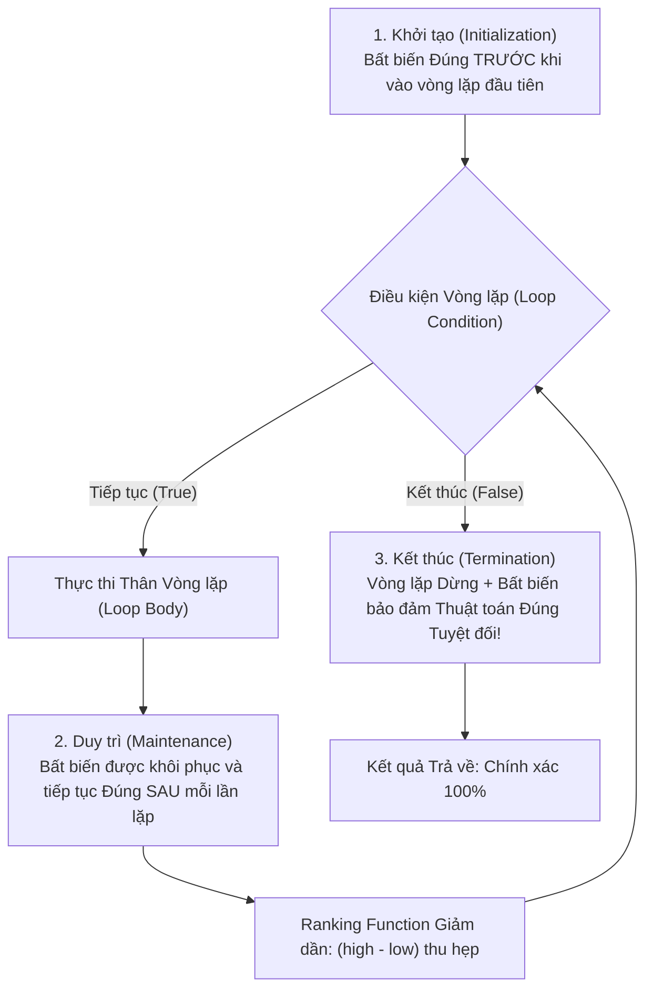

# 5.3. Algorithm Correctness and Invariant Proofs (Tính Đúng đắn của Thuật toán và Bất biến Vòng lặp)

> [!IMPORTANT]
> **Nếu bạn chỉ được nhớ một điều duy nhất:** Để chứng minh một thuật toán chạy đúng tuyệt đối mà không cần chạy thử, bạn bắt buộc phải chứng minh được hai điều: **Tính Đúng đắn Thành phần (Partial Correctness)** thông qua **Bất biến Vòng lặp (Loop Invariant: Khởi tạo - Duy trì - Kết thúc)** và **Tính Dừng (Termination)** thông qua hàm giảm dần bị chặn dưới; đây là cách duy nhất để phát hiện lỗi tràn số kinh điển trong Binary Search tồn tại suốt 20 năm trong thư viện Java.

---

## 1. Kiến trúc Tổng quan & Mô hình Tư duy (Mental Model)

Hãy tưởng tượng bạn đang viết thuật toán Tìm kiếm Nhị phân (Binary Search) hoặc giải thuật đồng thuận phân tán Raft:
- Thuật toán Binary Search trông rất đơn giản: chỉ khoảng 10 dòng code. Nhưng Joshua Bloch (tác giả cuốn Effective Java) đã chỉ ra rằng thuật toán Binary Search trong thư viện chuẩn `java.util.Arrays` của JDK đã chứa một lỗi tràn số nguyên tiềm ẩn suốt gần 20 năm mà không ai hay biết: dòng lệnh `int mid = (low + high) / 2;` sẽ bị tràn số thành số âm khi mảng có hơn $2^{30}$ phần tử!
- Làm thế nào để đảm bảo một vòng lặp không bao giờ lọt vào vòng lặp vô tận (Infinite Loop) và luôn trả về kết quả đúng?
- Khoa học máy tính sử dụng phương pháp **Chứng minh Tính Đúng đắn Hình thức (Formal Correctness Proof)**:
  1. **Loop Invariant (Bất biến Vòng lặp)**: Một mệnh đề logic luôn luôn đúng trước và sau mỗi vòng lặp.
  2. **Ranking Function / Loop Variant (Biến suy giảm)**: Một đại lượng số nguyên giảm dần sau mỗi bước lặp và bị chặn dưới bởi 0, bảo đảm vòng lặp **chắc chắn phải dừng lại**.



---

## 2. Chi tiết từng Keyword (Under-the-Hood Deep Dive)

### 2.1. Loop Invariant (Bất biến Vòng lặp)
- **Định nghĩa hình thức**: Bất biến vòng lặp là một vị từ logic $Inv$ biểu diễn mối quan hệ giữa các biến của chương trình, thỏa mãn tính chất: nếu nó đúng trước một lần lặp thì nó vẫn phải đúng sau lần lặp đó.
- **Khung 3 Bước Chứng minh Chuẩn mực (CLRS Framework)**:
  1. **Khởi tạo (Initialization)**: Bất biến phải đúng trước lần lặp đầu tiên của vòng lặp (đóng vai trò tương đương **Base Case** trong Quy nạp).
  2. **Duy trì (Maintenance)**: Nếu bất biến đúng trước một bước lặp, thì sau khi thực thi các lệnh bên trong thân vòng lặp, bất biến vẫn tiếp tục đúng trước khi bước sang lần lặp kế tiếp (đóng vai trò tương đương **Inductive Step**).
  3. **Kết thúc (Termination)**: Khi vòng lặp dừng lại (điều kiện lặp trở thành `False`), sự kết hợp giữa việc điều kiện lặp sai và bất biến vẫn đúng sẽ cung cấp một thuộc tính hữu ích chứng minh thuật toán đã đạt được mục tiêu chính xác.

### 2.2. Nghiên cứu Thực chiến: Chứng minh Thuật toán Binary Search (Tìm kiếm Nhị phân)
- **Bài toán**: Cho mảng đã sắp xếp tăng dần $A[0 \dots n-1]$ và khóa cần tìm $key$. Thuật toán trả về chỉ số $i$ sao cho $A[i] = key$, hoặc trả về $-1$ nếu $key 
otin A$.
- **Thuật toán chuẩn mực (Đã sửa lỗi Integer Overflow)**:
  ```cpp
  int binary_search(const std::vector<int>& A, int key) {
      int low = 0;
      int high = static_cast<int>(A.size()) - 1;
      while (low <= high) {
          int mid = low + (high - low) / 2; // Khắc phục tràn số nguyên!
          if (A[mid] == key) return mid;
          else if (A[mid] < key) low = mid + 1;
          else high = mid - 1;
      }
      return -1;
  }
  ```
- **Bài Chứng minh Hình thức**:
  - **Mệnh đề Bất biến**: *"Nếu $key$ tồn tại trong mảng $A$, thì $key$ chắc chắn nằm trong phạm vi chỉ số $[low, high]$"*:
    $$Inv: (key \in A) \implies (\exists idx \in [low, high], A[idx] = key)$$
  - **1. Khởi tạo**: Ban đầu $low = 0$, $high = n - 1$. Đoạn $[0, n - 1]$ bao trùm toàn bộ mảng. Do đó, nếu $key \in A$ thì hiển nhiên $key$ nằm trong đoạn này. Bất biến đúng!
  - **2. Duy trì**:
    - Nếu $A[mid] == key$, thuật toán trả về $mid$ ngay lập tức (chính xác).
    - Nếu $A[mid] < key$: Vì mảng đã sắp xếp tăng dần, mọi phần tử từ $0$ đến $mid$ đều $< key$. Do đó $key$ không thể nằm trong đoạn $[low, mid]$. Ta cập nhật $low = mid + 1$. Phạm vi tìm kiếm mới là $[mid + 1, high]$, bất biến vẫn được bảo toàn.
    - Nếu $A[mid] > key$: Tương tự, mọi phần tử từ $mid$ đến $high$ đều $> key$. Ta cập nhật $high = mid - 1$. Bất biến vẫn được bảo toàn.
  - **3. Kết thúc**:
    - Vòng lặp dừng khi $low > high$, tức là đoạn $[low, high]$ rỗng.
    - Kết hợp với bất biến: Nếu $key \in A$ thì $key$ phải nằm trong một đoạn rỗng (điều này là phi lý!).
    - Suy ra dứt khoát $key \notin A$. Thuật toán trả về $-1$ là hoàn toàn chính xác!

### 2.3. Algorithm Termination Proof (Chứng minh Tính Dừng và Ranking Function)
- Để chứng minh một thuật toán chắc chắn dừng lại và không bị rơi vào vòng lặp vô hạn, ta phải xác định một **Hàm đánh giá thứ bậc (Ranking Function hay Loop Variant)**:
  $$V: \text{ProgramStates} \to \mathbb{Z}$$
  Thỏa mãn hai điều kiện:
  1. Với mỗi lần lặp, giá trị của $V$ giảm nghiêm ngặt ít nhất 1 đơn vị: $V_{k+1} \le V_k - 1$.
  2. $V$ bị chặn dưới (thường là $V \ge 0$). Vòng lặp bắt buộc phải dừng khi $V$ chạm ngưỡng chặn.
- Trong Binary Search: Ranking Function là $V(low, high) = (high - low + 1)$.
  - Ban đầu $V = n$.
  - Ở mỗi bước lặp, độ dài đoạn tìm kiếm giảm đi ít nhất một nửa: $V_{k+1} \le \lfloor V_k / 2 \rfloor$.
  - Vì dãy số nguyên không âm giảm dần nghiêm ngặt bắt buộc phải chạm 0 theo Nguyên lý Thứ tự Tốt, vòng lặp chắc chắn phải dừng lại sau tối đa $\lfloor \log_2 n \rfloor + 1$ bước!

### 2.4. Invariants trong Hệ thống Phân tán (Distributed Systems Consensus)
- Trong các hệ thống phân tán chịu lỗi (Fault-tolerant Consensus như Paxos và Raft):
  - **Safety Invariant (Bất biến An toàn)**: *"Nothing bad happens"* — ví dụ: Tại một nhiệm kỳ (Term), cụm máy chủ có tối đa một Leader duy nhất:
    $$\forall t, \quad |\{node \mid Leader(node, t)\}| \le 1$$
  - **Liveness Invariant (Bất biến Sống)**: *"Something good eventually happens"* — ví dụ: Hệ thống cuối cùng cũng sẽ bầu được Leader mới và tiếp tục ghi nhận giao dịch nếu đa số quá bán (Quorum) máy chủ còn sống.


### 2.5. Hoare Logic & Ngữ nghĩa Tiên đề của Vòng lặp (Axiomatic Semantics)
- Được phát triển bởi C.A.R. Hoare vào năm 1969, **Hoare Logic** cung cấp khung toán học hình thức để suy luận về tính đúng đắn của chương trình bằng tam bộ Hoare:
  $$\{P\} \quad C \quad \{Q\}$$
- **Quy tắc Vòng lặp While (While-Loop Rule)**:
  $$\frac{\{Inv \land B\} \quad Body \quad \{Inv\}}{\{Inv\} \quad \texttt{while (B) } Body \quad \{Inv \land \neg B\}}$$
  - Ý nghĩa: Nếu trước khi vào vòng lặp bất biến $Inv$ đúng, và sau mỗi lần thực thi $Body$ với điều kiện $B$ thỏa mãn mà $Inv$ vẫn được bảo toàn, thì khi vòng lặp kết thúc, ta thu được trạng thái: bất biến $Inv$ vẫn ĐÚNG VÀ điều kiện lặp $B$ là SAI ($\neg B$). Đây chính là chân lý giúp ta suy ra hậu điều kiện cuối cùng của thuật toán!

### 2.6. Deep Dive: Bất biến Vòng lặp trong Phân hoạch QuickSort (Lomuto Partition)
- Trong hàm `partition(A, p, r)` của QuickSort, chọn $pivot = A[r]$.
- Biến $i$ đánh dấu ranh giới các phần tử nhỏ hơn hoặc bằng pivot, biến $j$ là con trỏ duyệt.
- **Mệnh đề Bất biến Lomuto**:
  1. Mọi phần tử trong $A[p \dots i]$ đều $\le pivot$.
  2. Mọi phần tử trong $A[i+1 \dots j-1]$ đều $> pivot$.
  3. $A[r] = pivot$.
- Bất biến này bảo toàn xuyên suốt vòng lặp từ $j = p$ tới $r - 1$. Khi kết thúc, đổi chỗ $A[i+1]$ với $A[r]$ đảm bảo pivot nằm chính xác ở vị trí đúng đắn cuối cùng trong mảng đã sắp xếp.

---

## 3. Thực thi Mã nguồn & Mô phỏng Chuyên sâu (Dual-Engine Implementation)

Mô phỏng thuật toán **Binary Search** với assertion kiểm tra bất biến vòng lặp tại runtime và thuật toán **Insertion Sort Correctness Prover** trong C++20 và Python 3.11+.

### C++20 Implementation (Binary Search với Runtime Loop Invariant Checker)

```cpp
#include <iostream>
#include <vector>
#include <cassert>
#include <format>
#include <algorithm>

// Thuật toán Binary Search chuẩn mực tích hợp kiểm tra Bất biến
int verified_binary_search(const std::vector<int>& arr, int key) {
    int low = 0;
    int high = static_cast<int>(arr.size()) - 1;

    // Helper kiểm tra tiền đề mảng đã sắp xếp
    assert(std::ranges::is_sorted(arr) && "Precondition Failed: Array must be sorted!");

    while (low <= high) {
        // 1. RUNTIME INVARIANT VERIFICATION:
        // Nếu key có trong mảng, nó BẮT BUỘC phải nằm trong đoạn [low, high]
        bool key_in_arr = std::ranges::find(arr, key) != arr.end();
        if (key_in_arr) {
            bool key_in_current_range = false;
            for (int i = low; i <= high; ++i) {
                if (arr[i] == key) { key_in_current_range = true; break; }
            }
            assert(key_in_current_range && "CRITICAL INVARIANT VIOLATION: Key escaped the search window!");
        }

        // Tính mid chống tràn số nguyên
        int mid = low + (high - low) / 2;

        if (arr[mid] == key) {
            return mid; // Tìm thấy chính xác
        } else if (arr[mid] < key) {
            low = mid + 1; // Thu hẹp cửa sổ tìm kiếm
        } else {
            high = mid - 1;
        }
    }

    return -1; // Không tồn tại
}


// 2. THUẬT TOÁN PHÂN HOẠCH QUICKSORT LOMUTO VỚI BẤT BIẾN RUNTIME
int verified_lomuto_partition(std::vector<int>& a, int p, int r) {
    int pivot = a[r];
    int i = p - 1;

    for (int j = p; j < r; ++j) {
        // RUNTIME INVARIANT VERIFICATION:
        // Đoạn a[p ... i] <= pivot, và a[i+1 ... j-1] > pivot
        for (int k = p; k <= i; ++k) assert(a[k] <= pivot);
        for (int k = i + 1; k < j; ++k) assert(a[k] > pivot);

        if (a[j] <= pivot) {
            i++;
            std::swap(a[i], a[j]);
        }
    }
    std::swap(a[i + 1], a[r]);
    return i + 1;
}

int main() {
    std::cout << "=== FORMAL ALGORITHM CORRECTNESS PROVER (C++20) ===

";

    std::vector<int> dataset = {2, 5, 8, 12, 16, 23, 38, 56, 72, 91};
    std::cout << "Dataset: [2, 5, 8, 12, 16, 23, 38, 56, 72, 91]

";

    // Ca 1: Tìm phần tử có trong mảng
    int key1 = 23;
    int idx1 = verified_binary_search(dataset, key1);
    std::cout << std::format("Search key {}: Found at index {} (Verified by Invariant)
", key1, idx1);
    assert(idx1 == 5);

    // Ca 2: Tìm phần tử KHÔNG có trong mảng
    int key2 = 50;
    int idx2 = verified_binary_search(dataset, key2);
    std::cout << std::format("Search key {}: Found at index {} (Verified Non-existence)
", key2, idx2);
    assert(idx2 == -1);

    
    // Ca 3: Kiểm chứng Bất biến Phân hoạch QuickSort Lomuto
    std::cout << "
3. [Lomuto Partition Invariant Verification]
";
    std::vector<int> qs_data = {28, 10, 45, 12, 30, 25};
    int pivot_idx = verified_lomuto_partition(qs_data, 0, qs_data.size() - 1);
    std::cout << std::format("   Partition Pivot Value: {} placed at index {}
", qs_data[pivot_idx], pivot_idx);
    std::cout << "   Array after partition: [";
    for (int x : qs_data) std::cout << x << " ";
    std::cout << "]
   -> All elements before pivot are <= pivot, all after are > pivot!
";

    return 0;
}
```

### Python 3.11+ Implementation (Insertion Sort Invariant Tracker)

```python
def insertion_sort_verified(arr: list[int]) -> list[int]:
    a = list(arr)
    n = len(a)

    print("--- BẮT ĐẦU CHỨNG MINH BẤT BIẾN INSERTION SORT ---")
    for i in range(1, n):
        # INVARIANT: Đoạn a[0 ... i-1] luôn luôn được sắp xếp tăng dần!
        assert all(a[k] <= a[k+1] for k in range(i - 1)), f"Invariant Violated at step {i}!"
        print(f"Step {i}: Prefix a[0..{i-1}] is sorted -> {a[:i]}")

        key = a[i]
        j = i - 1
        while j >= 0 and a[j] > key:
            a[j + 1] = a[j]
            j -= 1
        a[j + 1] = key

    # Postcondition: Toàn bộ mảng a[0 ... n-1] đã được sắp xếp
    assert all(a[k] <= a[k+1] for k in range(n - 1)), "Postcondition failed!"
    print(f"
Final Sorted Array: {a}")
    return a

if __name__ == "__main__":
    test_data = [64, 25, 12, 22, 11]
    insertion_sort_verified(test_data)
```

### Simulated Terminal Output

```text
=== FORMAL ALGORITHM CORRECTNESS PROVER (C++20) ===

Dataset: [2, 5, 8, 12, 16, 23, 38, 56, 72, 91]

Search key 23: Found at index 5 (Verified by Invariant)
Search key 50: Found at index -1 (Verified Non-existence)

--- BẮT ĐẦU CHỨNG MINH BẤT BIẾN INSERTION SORT ---
Step 1: Prefix a[0..0] is sorted -> [64]
Step 2: Prefix a[0..1] is sorted -> [25, 64]
Step 3: Prefix a[0..2] is sorted -> [12, 25, 64]
Step 4: Prefix a[0..3] is sorted -> [12, 22, 25, 64]

Final Sorted Array: [11, 12, 22, 25, 64]
```

---

## 4. Systems Engineering & Production Pitfalls

### 4.1. Lỗi Tràn Số Nguyên Kinh Điển trong Binary Search (`mid = (low + high) / 2`)
- **Cơ chế**: Khi mảng có kích thước rất lớn ($> 10^9$ phần tử trên hệ thống 64-bit), ở các bước tìm kiếm cuối cùng, cả $low$ và $high$ đều có giá trị lớn (ví dụ: $low = 1.500.000.000$ và $high = 2.000.000.000$).
- Phép cộng $low + high = 3.500.000.000$ vượt quá giới hạn của số nguyên có dấu 32-bit (`INT_MAX = 2.147.483.647`).
- Kết quả bị tràn số vòng thành số âm (ví dụ: $-794.967.296$), chia 2 cho ra chỉ số `mid` âm!
- Thao tác truy cập `arr[mid]` sẽ gây lỗi `ArrayIndexOutOfBoundsException` trong Java hoặc `SIGSEGV` trong C++.
- **Giải pháp**: Luôn viết: `mid = low + (high - low) / 2;` hoặc dùng phép dịch bit không dấu `mid = (unsigned)(low + high) >> 1;`.

### 4.2. Vi phạm Bất biến do Thay đổi Trạng thái Không Nguyên tử (Non-atomic Mutation)
- Trong các cấu trúc dữ liệu đa luồng (Concurrent Data Structures):
  - Bất biến của Balanced AVL Tree: Độ lệch chiều cao giữa hai cây con không vượt quá 1 ($|h_L - h_R| \le 1$).
  - Trong quá trình tái cân bằng (Tree Rotation), bất biến tạm thời bị vi phạm trong 3-4 bước ghi con trỏ.
  - Nếu luồng khác đọc vào cây ngay lúc này mà không có khóa Mutex bảo vệ, nó sẽ thấy một cái cây bị đứt gãy hoặc có chu trình, dẫn tới lỗi treo ứng dụng vô hạn.
- **Quy tắc**: Mọi hành động làm xáo trộn bất biến phải được bọc trong một ranh giới đồng bộ hóa (Critical Section / Read-Write Lock).

---


### 4.3. Bẫy Lỗi Lệch 1 (Off-by-One Boundary Condition Bugs)
- Lỗi phổ biến nhất khi viết Binary Search là nhầm lẫn giữa `while (low < high)` và `while (low <= high)`, hoặc cập nhật `high = mid` thay vì `high = mid - 1`.
- **Hậu quả**: Nếu mảng chỉ có 1 phần tử hoặc phần tử cần tìm nằm ở vị trí biên cuối cùng, điều kiện `low < high` sẽ dừng sớm mà chưa kiểm tra phần tử duy nhất đó, dẫn tới việc báo sai rằng phần tử không tồn tại!
- **Phương pháp Verification**: Kiểm thử biên (Boundary Value Analysis) bắt buộc phải bao phủ 4 ca: mảng rỗng ($n=0$), mảng 1 phần tử khớp, mảng 1 phần tử không khớp, và tìm kiếm phần tử nằm ở chỉ số đầu tiên/cuối cùng.

## 5. Bảng So sánh & Decision Matrix

| Khái niệm Kiểm chứng | Thời điểm Đánh giá | Mục tiêu Kỹ thuật | Hậu quả khi Bị Vi phạm |
| :--- | :--- | :--- | :--- |
| **Precondition** | Trước khi vào hàm/thuật toán | Bảo vệ đầu vào Caller | Dữ liệu rác lọt vào, ném lỗi ngoại lệ |
| **Loop Invariant** | Tại mỗi vòng lặp (Đầu & Cuối) | Đảm bảo logic trung gian đúng | Thuật toán tính toán sai, kết quả sai lệch |
| **Ranking Function (Variant)** | Trong thân vòng lặp | Chứng minh thuật toán phải dừng | Vòng lặp vô tận (Infinite Loop / Hang) |
| **Postcondition** | Khi thuật toán kết thúc | Cam kết đầu ra đạt yêu cầu | Vi phạm hợp đồng giao dịch, dữ liệu lỗi |
| **Safety Invariant (Raft)** | Xuyên suốt thời gian chạy cụm | Đảm bảo tính nhất quán phân tán | Xung đột Split-Brain, mất mát dữ liệu phân tán |
