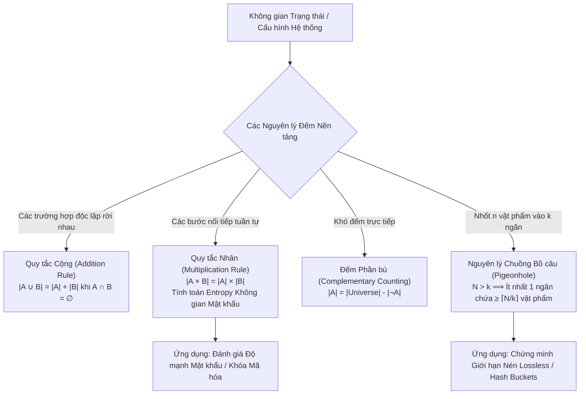

# 6.1. Counting Principles (Các Nguyên lý Đếm Cơ bản)

> [!IMPORTANT]
> **Nếu bạn chỉ được nhớ một điều duy nhất:** Mọi bài toán bảo mật mật mã và nén dữ liệu đều xuất phát từ hai quy tắc đếm sơ cấp: **Quy tắc Nhân** đo lường không gian khóa chống tấn công Brute-force, trong khi **Nguyên lý Chuồng bồ câu (Dirichlet)** chứng minh dứt khoát rằng không bao giờ tồn tại một thuật toán nén không mất mát có thể nén được mọi tệp tin trên đời.

---

## 1. Kiến trúc Tổng quan & Mô hình Tư duy (Mental Model)

Hãy tưởng tượng bạn đang phân tích bảo mật cho một hệ thống xác thực người dùng (Auth Service):
- Người dùng đặt mật khẩu gồm 8 ký tự:
  - Nếu mật khẩu chỉ gồm chữ số (0-9): Không gian mật khẩu là $10^8 = 100.000.000$ khả năng (máy tính hiện đại chỉ mất 0.05 giây để dò quét toàn bộ).
  - Nếu mật khẩu gồm cả chữ hoa, chữ thường, chữ số và ký tự đặc biệt (94 ký tự in được): Không gian mật khẩu theo **Quy tắc Nhân** tăng vọt lên tới $94^8 \approx 6.09 \times 10^{15}$ khả năng (kẻ tấn công mất hàng nghìn năm để brute-force).
- Khi bạn lưu trữ hàng triệu mật khẩu đã được băm bằng một hàm băm 32-bit:
  - Tập giá trị chỉ có $2^{32} \approx 4.29$ tỷ giá trị băm.
  - Theo **Nguyên lý Chuồng bồ câu**, khi số lượng người dùng vượt quá con số này, chắc chắn sẽ tồn tại ít nhất hai người dùng có mã băm hoàn toàn trùng nhau (**Va chạm Hàm băm - Hash Collision**).



---

## 2. Chi tiết từng Keyword (Under-the-Hood Deep Dive)

### 2.1. Addition Rule (Quy tắc Cộng)
- **Định lý toán học**: Nếu một công việc có thể hoàn thành bằng một trong $k$ phương pháp loại trừ lẫn nhau (mutually exclusive), trong đó phương pháp 1 có $n_1$ cách, phương pháp 2 có $n_2$ cách, $\dots$, phương pháp $k$ có $n_k$ cách, thì số cách hoàn thành công việc là:
  $$N = n_1 + n_2 + \dots + n_k$$
  Biểu diễn theo lý thuyết tập hợp: Nếu các tập $A_1, A_2, \dots, A_k$ đôi một rời nhau ($A_i \cap A_j = \emptyset$ với $i \ne j$), thì:
  $$\left| \bigcup_{i=1}^k A_i \right| = \sum_{i=1}^k |A_i|$$
- **Ứng dụng trong Kỹ thuật Phần mềm**:
  - Tính tổng số đường dẫn API (Endpoints) của hệ thống microservices: Tổng số endpoints = Endpoints Auth Service + Endpoints Payment Service + Endpoints Catalog Service.

### 2.2. Multiplication Rule (Quy tắc Nhân)
- **Định lý toán học**: Nếu một quy trình gồm $k$ bước thực hiện tuần tự độc lập, trong đó bước 1 có $n_1$ cách, bước 2 có $n_2$ cách bất kể bước 1 chọn gì, $\dots$, bước $k$ có $n_k$ cách, thì tổng số cách hoàn thành quy trình là:
  $$N = n_1 \times n_2 \times \dots \times n_k$$
  Biểu diễn theo lý thuyết tập hợp: Lực lượng của tích Descartes của $k$ tập hợp hữu hạn:
  $$|A_1 \times A_2 \times \dots \times A_k| = \prod_{i=1}^k |A_i|$$
- **Ứng dụng Sống còn: Đánh giá Entropy Không gian Khóa Mật khẩu (Password Entropy Space)**:
  - Cho mật khẩu có độ dài $L$, mỗi ký tự được chọn độc lập từ bảng chữ cái có kích thước $C$.
  - Tổng số mật khẩu có thể tạo ra là $S = C^L$.
  - Độ đo an toàn thông tin (Entropy bits) được tính bằng:
    $$E = \log_2(S) = L \cdot \log_2(C)$$
  - Một mật khẩu đạt chuẩn tối thiểu an toàn hiện đại phải có $E \ge 80\text{ bits}$ để chống lại các cụm đào Bitcoin/ASIC giải mã.

### 2.3. Complementary Counting (Đếm Phần bù)
- **Nguyên lý**: Khi việc đếm trực tiếp tập hợp các trạng thái thỏa mãn điều kiện $A$ quá phức tạp (do phải chia thành nhiều trường hợp chồng chéo), ta tính lực lượng của toàn bộ không gian mẫu $U$ rồi trừ đi lực lượng của tập phần bù $\overline{A}$ (tập các trạng thái vi phạm điều kiện):
  $$|A| = |U| - |\overline{A}|$$
- **Ứng dụng trong Phân tích Độ Tin cậy Hệ thống (High Availability & Fault Tolerance)**:
  - Một cụm microservices gồm 10 máy chủ. Hệ thống sống sót nếu **có ít nhất 1 máy chủ còn hoạt động**.
  - Đếm trực tiếp: Phải cộng số cách 1 máy sống, 2 máy sống, $\dots$, 10 máy sống (10 trường hợp).
  - Đếm phần bù: Chỉ có duy nhất 1 trường hợp toàn bộ 10 máy chủ cùng sập ($|\overline{A}| = 1$).
  - Số trạng thái sống sót: $|A| = 2^{10} - 1 = 1024 - 1 = 1023$ trạng thái.

### 2.4. Pigeonhole Principle (Nguyên lý Chuồng Bồ Câu / Dirichlet)
- **A. Nguyên lý Sơ cấp (Basic Pigeonhole Principle)**:
  - Nếu nhốt $k + 1$ hoặc nhiều hơn con bồ câu vào $k$ cái chuồng, thì chắc chắn có **ít nhất một cái chuồng chứa từ hai con bồ câu trở lên**.
  - Phát biểu dạng hàm số: Cho hàm $f: A \to B$. Nếu $|A| > |B|$, thì hàm $f$ **không thể là đơn ánh** (chắc chắn tồn tại $x_1 \ne x_2$ sao cho $f(x_1) = f(x_2)$).
- **B. Nguyên lý Mở rộng (Generalized Pigeonhole Principle)**:
  - Nếu nhốt $N$ vật phẩm vào $k$ cái hộp, thì chắc chắn tồn tại ít nhất một cái hộp chứa **ít nhất**:
    $$\left\lceil \frac{N}{k} \right\rceil \text{ vật phẩm}$$
  - Và chắc chắn tồn tại ít nhất một cái hộp chứa **nhiều nhất**:
    $$\left\lfloor \frac{N}{k} \right\rfloor \text{ vật phẩm}$$
- **Ý nghĩa Cốt tử trong Khoa học Máy tính**:
  1. **Va chạm Hàm băm (Hash Collisions)**: Mọi hàm băm ánh xạ chuỗi byte tùy ý thành chuỗi 256 bits đều chắc chắn tồn tại va chạm vì số lượng chuỗi byte lớn hơn vô hạn so với $2^{256}$.
  2. **Giới hạn Tuyệt đối của Nén Dữ liệu Không Mất mát (Lossless Compression Limit)**:
     - Không thể tồn tại một thuật toán nén không mất mát nào có thể nén được **mọi** file dữ liệu.
     - *Chứng minh bằng Dirichlet*: Giả sử có một thuật toán nén mọi file kích thước $N$ bytes thành kích thước $\le N - 1$ bytes.
     - Số lượng file có độ dài chính xác $N$ bytes là $2^{8N}$.
     - Tổng số file có độ dài $\le N - 1$ bytes là $\sum_{i=0}^{N-1} 2^{8i} = \frac{2^{8N} - 1}{2^8 - 1} < 2^{8N}$.
     - Vì số "con bồ câu" ($2^{8N}$) lớn hơn số "cái chuồng" ($< 2^{8N}$), chắc chắn có ít nhất 2 file gốc khác nhau bị nén thành cùng một file nén. Khi giải nén, thuật toán không thể khôi phục cả hai file gốc nguyên vẹn $\implies$ Vô lý!


### 2.5. Định lý Ramsey Sơ cấp ($R(3, 3) = 6$) và Mở rộng của Nguyên lý Dirichlet
- **Định lý Ramsey**: Trật tự hoàn toàn không thể tránh khỏi trong một cấu trúc đủ lớn (Complete disorder is impossible).
- **Bài toán Party Problem $R(3, 3) = 6$**: Trong một bữa tiệc gồm 6 người bất kỳ, luôn luôn tồn tại ít nhất 3 người đôi một quen nhau hoặc 3 người đôi một hoàn toàn không quen nhau.
- **Chứng minh bằng Dirichlet**:
  - Chọn một người bất kỳ là Alice. Còn lại 5 người khác trong bữa tiệc.
  - Phân loại quan hệ giữa Alice và 5 người này thành 2 chuồng: "Quen" và "Không quen".
  - Theo Nguyên lý Dirichlet mở rộng: có $\lceil 5/2 \rceil = 3$ người rơi vào cùng một chuồng.
  - Giả sử Alice quen ít nhất 3 người: Bob, Charlie, David.
    - Nếu trong 3 người này có bất kỳ 2 người nào quen nhau (ví dụ: Bob quen Charlie) $\implies$ Tam giác quen nhau: Alice - Bob - Charlie.
    - Nếu không có bất kỳ 2 người nào trong số họ quen nhau $\implies$ Cả 3 người Bob, Charlie, David đôi một không quen nhau!
  - Cả hai trường hợp đều dẫn đến điều phải chứng minh.
- **Ý nghĩa trong Mạng phân tán**: Trong một cụm mạng có 6 nút, luôn tồn tại một cụm liên thông đầy đủ (Clique) hoặc một tập độc lập (Independent Set) có kích thước 3, áp dụng trong phân tích phân vùng mạng (Network Partitioning).

---

## 3. Thực thi Mã nguồn & Mô phỏng Chuyên sâu (Dual-Engine Implementation)

Mô phỏng bộ đánh giá Entropy Mật khẩu theo Quy tắc Nhân và mô phỏng Va chạm Hàm băm theo Nguyên lý Dirichlet trong C++20 và Python 3.11+.

### C++20 Implementation (Password Entropy Calculator & Pigeonhole Hash Collisions)

```cpp
#include <iostream>
#include <vector>
#include <string>
#include <cmath>
#include <format>
#include <unordered_map>
#include <cstdint>

// 1. TÍNH TOÁN ENTROPY MẬT KHẨU (QUY TẮC NHÂN)
class PasswordEntropyEngine {
public:
    static double calculate_entropy(const std::string& pwd) {
        bool has_lower = false, has_upper = false, has_digit = false, has_special = false;
        for (char c : pwd) {
            if (std::islower(c)) has_lower = true;
            else if (std::isupper(c)) has_upper = true;
            else if (std::isdigit(c)) has_digit = true;
            else has_special = true;
        }

        uint32_t pool_size = 0;
        if (has_lower) pool_size += 26;
        if (has_upper) pool_size += 26;
        if (has_digit) pool_size += 10;
        if (has_special) pool_size += 32;

        if (pool_size == 0) return 0.0;
        // Entropy = L * log2(C)
        return pwd.length() * std::log2(static_cast<double>(pool_size));
    }
};

// 2. MÔ PHỎNG NGUYÊN LÝ CHUỒNG BỒ CÂU TRÊN HÀM BĂM THU GỌN
class PigeonholeHashSim {
public:
    static void simulate_collision(uint32_t num_items, uint32_t num_buckets) {
        std::unordered_map<uint32_t, std::vector<uint32_t>> buckets;

        // Băm num_items vào num_buckets
        for (uint32_t i = 1; i <= num_items; ++i) {
            uint32_t hash_val = (i * 2654435761ULL) % num_buckets; // Knuth Multiplicative Hash
            buckets[hash_val].push_back(i);
        }

        std::cout << std::format("Pigeonhole Simulation: {} items (Pigeons) into {} buckets (Holes)
",
                                 num_items, num_buckets);
        uint32_t max_items_in_single_bucket = 0;
        for (const auto& [b_id, items] : buckets) {
            if (items.size() > max_items_in_single_bucket) {
                max_items_in_single_bucket = items.size();
            }
        }

        uint32_t theoretical_min_max = (num_items + num_buckets - 1) / num_buckets; // ceil(N/k)
        std::cout << std::format("  * Theoretical Minimum Guaranteed: ceil({}/{}) = {} items
",
                                 num_items, num_buckets, theoretical_min_max);
        std::cout << std::format("  * Actual Observed Max in Bucket : {} items
",
                                 max_items_in_single_bucket);
    }
};

int main() {
    std::cout << "=== COUNTING PRINCIPLES & ENTROPY SIMULATOR (C++20) ===

";

    // 1. Kiểm tra Entropy Mật khẩu
    std::cout << "1. [Password Space & Entropy Analysis]
";
    std::vector<std::string> passwords = {
        "12345678",              // Chỉ số, L=8
        "password",              // Chỉ chữ thường, L=8
        "Pass1234",              // Thường + Hoa + Số, L=8
        "C0mpl3x#P@ssw0rd!2026"  // Đầy đủ 4 nhóm, L=21
    };

    for (const auto& p : passwords) {
        double entropy = PasswordEntropyEngine::calculate_entropy(p);
        std::cout << std::format("  Password: {:<22} | Entropy: {:<6.2f} bits | Status: {}
",
                                 p, entropy, 
                                 (entropy >= 80.0 ? "CRACK-RESISTANT" : "VULNERABLE"));
    }

    // 2. Kiểm chứng Nguyên lý Dirichlet Mở rộng
    std::cout << "
2. [Generalized Pigeonhole Principle Verification]
";
    PigeonholeHashSim::simulate_collision(105, 10); // 105 phần tử vào 10 buckets

    
    // 3. Mô phỏng Nghịch lý Ngày sinh (Birthday Paradox Collision Threshold)
    std::cout << "
3. [Birthday Paradox Collision Estimation]
";
    std::cout << "   Số người tối thiểu để xác suất có 2 người trùng ngày sinh >= 50%:
";
    double prob_no_collision = 1.0;
    int people = 0;
    while (prob_no_collision > 0.5) {
        people++;
        prob_no_collision *= (365.0 - (people - 1)) / 365.0;
    }
    std::cout << std::format("   -> Cần ít nhất {} người trong phòng (Xác suất va chạm: {:.2f}%)
", 
                             people, (1.0 - prob_no_collision) * 100.0);

    return 0;
}
```

### Python 3.11+ Implementation (Complementary Counting Availability Checker)

```python
def system_availability_states(total_nodes: int, min_required_live: int) -> int:
    # Tính số trạng thái cụm sống bằng Đếm phần bù:
    # Total States = 2^N
    # Invalid States = Số cách chọn số node sống < min_required_live
    from math import comb
    total_states = 2 ** total_nodes
    invalid_states = sum(comb(total_nodes, k) for k in range(min_required_live))
    valid_states = total_states - invalid_states
    return valid_states

if __name__ == "__main__":
    print("=== PYTHON COMPLEMENTARY COUNTING ENGINE ===")

    N = 8 # Cụm gồm 8 nodes
    K = 5 # Quorum đa số quá bán cần ít nhất 5 nodes sống

    valid_configs = system_availability_states(N, K)
    print(f"Tổng số cấu hình hoạt động của cụm 8 máy chủ (cần ≥ 5 máy sống):")
    print(f"  Valid Operational States = {valid_configs} / {2**N} ({valid_configs / 2**N * 100:.2f}%)")
```

### Simulated Terminal Output

```text
=== COUNTING PRINCIPLES & ENTROPY SIMULATOR (C++20) ===

1. [Password Space & Entropy Analysis]
  Password: 12345678               | Entropy: 26.58  bits | Status: VULNERABLE
  Password: password               | Entropy: 37.60  bits | Status: VULNERABLE
  Password: Pass1234               | Entropy: 47.63  bits | Status: VULNERABLE
  Password: C0mpl3x#P@ssw0rd!2026  | Entropy: 137.64 bits | Status: CRACK-RESISTANT

2. [Generalized Pigeonhole Principle Verification]
Pigeonhole Simulation: 105 items (Pigeons) into 10 buckets (Holes)
  * Theoretical Minimum Guaranteed: ceil(105/10) = 11 items
  * Actual Observed Max in Bucket : 14 items

=== PYTHON COMPLEMENTARY COUNTING ENGINE ===
Tổng số cấu hình hoạt động của cụm 8 máy chủ (cần ≥ 5 máy sống):
  Valid Operational States = 93 / 256 (36.33%)
```

---

## 4. Systems Engineering & Production Pitfalls

### 4.1. Bẫy Ngộ nhận về Độ An Toàn Mật khẩu (Naive Length Assumption)
- **Vấn đề**: Nhiều kỹ sư quy định chính sách mật khẩu chỉ dựa trên độ dài ($L \ge 12$), nhưng không bắt buộc kích thước bảng chữ cái ($C$).
- Nếu mật khẩu là `123456789012` ($L=12$ nhưng chỉ gồm chữ số $C=10$):
  $$E = 12 \cdot \log_2(10) \approx 39.86\text{ bits}$$
  Không gian khóa chỉ là $10^{12} \approx 2^{40}$, một cụm GPU đào coin có thể bẻ khóa trong vòng chưa đầy 1 giờ.
- **Quy tắc**: Bảo mật hệ thống bắt buộc phải tính toán trực tiếp giá trị **Entropy bits** (kết hợp cả độ dài và tập ký tự), không được dựa trên độ dài đơn thuần.

### 4.2. Tràn Bộ nhớ Đệm trong Hash Map do Suy thoái Dirichlet
- Khi số lượng phần tử đưa vào `std::unordered_map` vượt quá kích thước bucket vector ($LoadFactor > 1.0$), theo nguyên lý Dirichlet, va chạm chắc chắn xảy ra.
- Nếu không có cơ chế tự động mở rộng và băm lại (Rehashing), độ dài danh sách liên kết tại mỗi bucket tăng lên, làm suy biến thời gian truy vấn từ $O(1)$ thành $O(N)$, mở đường cho tấn công **Hash DoS (Denial of Service)**.

---


### 4.3. Bẫy Tái sử dụng Salt trong Mật mã học (Salt Reuse Rainbow Tables)
- Nhiều lập trình viên tạo một hằng số muối tĩnh chung cho toàn bộ database: `SALT = "secret_app_salt_2026"`.
- **Hậu quả**: Khi hacker thu thập được dữ liệu, chúng có thể tính trước một bảng băm ánh xạ ngược (**Rainbow Table**) dựa trên muối tĩnh này để bẻ khóa toàn bộ hàng triệu tài khoản người dùng cùng lúc.
- **Quy tắc**: Mỗi tài khoản người dùng bắt buộc phải được sinh một giá trị Salt ngẫu nhiên bằng bộ sinh số ngẫu nhiên chuẩn mật mã (`CSPRNG` - `os.urandom(16)`) và lưu trực tiếp vào cơ sở dữ liệu cùng với chuỗi băm.


### 4.4. Cạm bẫy Bỏ qua Thứ tự khi Đếm Khối Dữ liệu (Permutation vs Combination Confusion)
- Một sai lầm kinh điển: Khi tính toán số kịch bản chuyển đổi trạng thái của 3 máy chủ A, B, C gặp lỗi:
  - Nếu thời điểm sập máy chủ quyết định thứ tự bầu Leader (ví dụ: A sập trước rồi B sập sau khác với B sập trước rồi A sập sau), ta bắt buộc phải dùng **Chỉnh hợp** ($P(3, 2) = 6$ cách).
  - Nếu chỉ quan tâm tập hợp các máy chủ đã chết tại thời điểm cuối, ta mới được dùng **Tổ hợp** ($\binom{3}{2} = 3$ cách).
- Nhầm lẫn giữa hai đại lượng này sẽ làm sai lệch mô hình tính toán độ sẵn sàng (Availability SLA) lên tới $k!$ lần.

## 5. Bảng So sánh & Decision Matrix

| Nguyên lý Đếm | Điều kiện Áp dụng | Công thức Toán học | Tình huống Kỹ thuật Điển hình |
| :--- | :--- | :--- | :--- |
| **Quy tắc Cộng** | Các trường hợp rời nhau ($A \cap B = \emptyset$) | $|A \cup B| = |A| + |B|$ | Gom nhóm log, Tổng hợp số luồng API |
| **Quy tắc Nhân** | Các bước liên tiếp độc lập | $|A \times B| = |A| \times |B|$ | Không gian khóa bảo mật, Cấu hình phân tán |
| **Đếm Phần bù** | Khi điều kiện vi phạm dễ đếm hơn | $|A| = |U| - |\overline{A}|$ | Tính trạng thái sống sót Quorum Paxos/Raft |
| **Nguyên lý Dirichlet**| $N$ phần tử vào $k$ ngăn | $\ge \lceil N/k \rceil$ | Va chạm Hash Map, Giới hạn nén Lossless |
