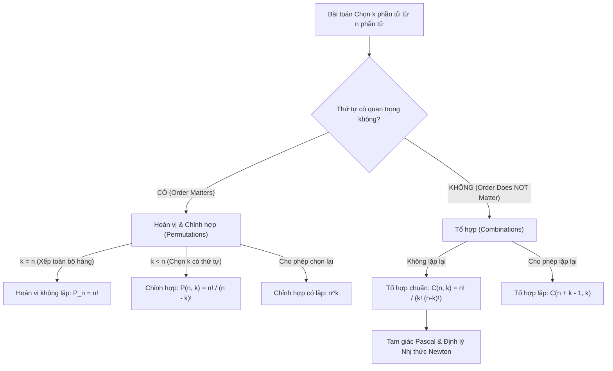

# 6.2. Permutations and Combinations (Hoán vị và Tổ hợp)

> [!IMPORTANT]
> **Nếu bạn chỉ được nhớ một điều duy nhất:** Sự khác biệt sống còn giữa Hoán vị (Permutation) và Tổ hợp (Combination) nằm ở **Thứ tự (Order)**: hoán vị coi $(A, B)$ khác $(B, A)$ (như mật khẩu hay chuỗi mã), còn tổ hợp coi $(A, B)$ bằng $(B, A)$ (như nhóm máy chủ hay quyền hạn); và việc tính $\binom{N}{K}$ trong máy tính đòi hỏi thuật toán nhân chia xen kẽ để tránh thảm họa tràn số nguyên 64-bit.

---

## 1. Kiến trúc Tổng quan & Mô hình Tư duy (Mental Model)

Hãy tưởng tượng bạn đang xây dựng một hệ thống máy chủ chịu lỗi (Fault-Tolerant Cluster):
- Bạn có một cụm máy chủ gồm 10 nút vật lý.
- Khi cần chọn ra **một ban lãnh đạo gồm 3 nút có chức năng riêng biệt**: 1 nút làm Leader điều phối, 1 nút làm Follower dự phòng nóng, và 1 nút làm Witness ghi log. Vì mỗi vị trí có quyền hạn khác nhau, **thứ tự được chọn đóng vai trò quyết định**: đây là bài toán **Chỉnh hợp chập 3 của 10** ($P(10, 3) = 10 \times 9 \times 8 = 720$ cách).
- Khi bạn chỉ cần chọn ra **3 nút bất kỳ để tạo thành một Quorum bỏ phiếu**: cả 3 nút đều có quyền biểu quyết ngang nhau, **thứ tự chọn không quan trọng**: đây là bài toán **Tổ hợp chập 3 của 10** ($\binom{10}{3} = \frac{10 \times 9 \times 8}{3 \times 2 \times 1} = 120$ cách).

Trong thiết kế hệ thống và phần mềm:
1. **Kiểm thử Cấu hình (Combinatorial Testing)**: Chọn các cặp tham số tương tác trong phần mềm để giảm số lượng ca kiểm thử từ hàng triệu test cases xuống vài chục test cases.
2. **Quy hoạch Động & Tam giác Pascal**: Tính toán hệ số nhị thức $\binom{n}{k}$ trong thời gian $O(N^2)$ bằng phép cộng mà không cần thực hiện phép nhân giai thừa dễ tràn số.



---

## 2. Chi tiết từng Keyword (Under-the-Hood Deep Dive)

### 2.1. Permutations (Hoán vị và Chỉnh hợp)
- **A. Hoán vị không lặp (Permutations of $n$ elements)**:
  - Định nghĩa: Số cách sắp xếp toàn bộ $n$ phần tử phân biệt thành một hàng có thứ tự:
    $$P_n = n! = n \times (n - 1) \times (n - 2) \times \dots \times 1$$
  - Quy ước: $0! = 1$.
- **B. Chỉnh hợp chập $k$ của $n$ (Permutations of $k$ from $n$)**:
  - Định nghĩa: Số cách chọn có thứ tự $k$ phần tử từ một tập hợp gồm $n$ phần tử phân biệt ($0 \le k \le n$):
    $$P(n, k) = \frac{n!}{(n - k)!} = n(n - 1)(n - 2)\dots(n - k + 1)$$
- **C. Chỉnh hợp có lặp (Permutations with Repetition)**:
  - Chọn $k$ phần tử từ $n$ loại phần tử, trong đó mỗi phần tử có thể được chọn lại nhiều lần:
    $$P_{\text{rep}}(n, k) = n^k$$
  - Ứng dụng: Chuỗi bit nhị phân độ dài $k$ ($2^k$), mã khóa PIN 4 chữ số ($10^4 = 10.000$).
- **D. Hoán vị vòng tròn (Circular Permutations)**:
  - Số cách sắp xếp $n$ phần tử xung quanh một bàn tròn (trong đó các cách sắp xếp xoay vòng tương đương nhau):
    $$P_{\text{circle}} = \frac{n!}{n} = (n - 1)!$$
- **E. Hoán vị của Đa tập hợp (Multiset Permutations / Hoán vị Lặp)**:
  - Cho $n$ vật phẩm trong đó có $n_1$ vật phẩm loại 1 giống hệt nhau, $n_2$ vật phẩm loại 2 giống hệt nhau, $\dots$, $n_k$ vật phẩm loại $k$ giống hệt nhau (với $\sum n_i = n$). Số cách hoán vị là:
    $$P(n; n_1, n_2, \dots, n_k) = \frac{n!}{n_1! \, n_2! \, \dots \, n_k!}$$
  - Ví dụ: Số cách sắp xếp các chữ cái trong từ `"ANAGRAM"` (gồm 7 chữ cái: 3 chữ 'A', 1 chữ 'N', 1 chữ 'G', 1 chữ 'R', 1 chữ 'M'): $\frac{7!}{3! \, 1! \, 1! \, 1! \, 1!} = \frac{5040}{6} = 840$ cách.

### 2.2. Combinations (Tổ hợp)
- **A. Tổ hợp chập $k$ của $n$ (Combinations without Repetition)**:
  - Định nghĩa: Số cách chọn không có thứ tự $k$ phần tử từ một tập hợp gồm $n$ phần tử phân biệt:
    $$C(n, k) = \binom{n}{k} = \frac{P(n, k)}{k!} = \frac{n!}{k! \, (n - k)!}$$
  - **Tính chất Đối xứng**:
    $$\binom{n}{k} = \binom{n}{n - k}$$
    Ý nghĩa: Chọn ra $k$ phần tử giữ lại tương đương chính xác với việc chọn ra $n - k$ phần tử loại bỏ.
- **B. Tổ hợp có lặp (Combinations with Repetition)**:
  - Số cách chọn không có thứ tự $k$ phần tử từ $n$ loại đối tượng khác nhau, trong đó mỗi loại có thể chọn tùy ý số lần:
    $$C_{\text{rep}}(n, k) = \binom{n + k - 1}{k} = \binom{n + k - 1}{n - 1}$$
  - Đây chính là công thức của phương pháp **Thanh và Sao (Stars and Bars)**.

### 2.3. Binomial Theorem & Pascal's Triangle (Định lý Nhị thức và Tam giác Pascal)
- **Định lý Nhị thức Newton (Binomial Theorem)**:
  - Với mọi số thực $x, y$ và số tự nhiên $n \in \mathbb{N}$:
    $$(x + y)^n = \sum_{k=0}^n \binom{n}{k} x^{n-k} y^k = \binom{n}{0} x^n + \binom{n}{1} x^{n-1} y + \dots + \binom{n}{n} y^n$$
  - **Hệ quả Vàng**:
    - Khi thay $x = 1, y = 1$: $\sum_{k=0}^n \binom{n}{k} = 2^n$ (Tổng lực lượng của tất cả các tập con chính là kích thước tập lũy thừa $|\mathcal{P}(A)|$).
    - Khi thay $x = 1, y = -1$: $\sum_{k=0}^n (-1)^k \binom{n}{k} = 0$ (Số tập con có kích thước chẵn bằng số tập con có kích thước lẻ).
- **Tam giác Pascal và Hệ thức Truy hồi Pascal**:
  $$\binom{n}{k} = \binom{n - 1}{k - 1} + \binom{n - 1}{k}$$
  - Ý nghĩa tổ hợp: Để chọn $k$ người từ $n$ người: xét một người cụ thể $X$.
    - Nếu $X$ được chọn: ta cần chọn tiếp $k - 1$ người từ $n - 1$ người còn lại ($\binom{n-1}{k-1}$ cách).
    - Nếu $X$ không được chọn: ta cần chọn toàn bộ $k$ người từ $n - 1$ người còn lại ($\binom{n-1}{k}$ cách).


### 2.4. Đồng nhất thức Vandermonde (Vandermonde's Identity)
- **Công thức hình thức**: Cho các số tự nhiên $m, n, r$:
  $$\binom{m + n}{r} = \sum_{k=0}^r \binom{m}{k} \binom{n}{r - k}$$
- **Chứng minh Tổ hợp đẹp mắt (Committee Selection)**:
  - Giả sử có $m$ kỹ sư Backend và $n$ kỹ sư Frontend. Cần chọn ra một ủy ban kiến trúc gồm $r$ người từ tổng số $m + n$ kỹ sư.
  - Vế trái $\binom{m+n}{r}$ là số cách chọn trực tiếp.
  - Vế phải phân loại theo số lượng kỹ sư Backend trong ủy ban: nếu chọn $k$ kỹ sư Backend ($\binom{m}{k}$ cách) thì bắt buộc phải chọn $r - k$ kỹ sư Frontend còn lại ($\binom{n}{r-k}$ cách).
  - Lấy tổng trên toàn bộ các giá trị $k$ từ $0$ đến $r$ ta thu được chính xác vế trái.
- **Trường hợp đặc biệt ($m = n = r$)**:
  $$\sum_{k=0}^n \binom{n}{k}^2 = \binom{2n}{n}$$
  (Tổng bình phương các hệ số nhị thức trên hàng $n$ của tam giác Pascal bằng hệ số ở chính giữa hàng $2n$).

---

## 3. Thực thi Mã nguồn & Mô phỏng Chuyên sâu (Dual-Engine Implementation)

Triển khai thuật toán tính Tổ hợp $\binom{N}{K}$ hiệu năng cao không bị tràn số nguyên bằng kỹ thuật **Nhân chia Xen kẽ (Interleaved Multiplication/Division)** trong C++20 và Python 3.11+.

### C++20 Implementation (Overflow-Safe Binomial Coefficient & Next Permutation Engine)

```cpp
#include <iostream>
#include <vector>
#include <algorithm>
#include <format>
#include <cstdint>
#include <stdexcept>

class CombinatoricsEngine {
public:
    // Tính C(N, K) chống tràn số nguyên 64-bit bằng thuật toán nhân chia xen kẽ
    static uint64_t compute_combination(uint64_t n, uint64_t k) {
        if (k > n) return 0;
        if (k == 0 || k == n) return 1;

        // Tận dụng tính đối xứng: C(n, k) = C(n, n - k)
        if (k > n - k) k = n - k;

        uint64_t result = 1;
        for (uint64_t i = 1; i <= k; ++i) {
            // Kiểm tra tràn số trước khi nhân
            if (__builtin_mul_overflow(result, (n - i + 1), &result)) {
                throw std::overflow_error("Integer overflow detected in C(N, K) calculation!");
            }
            result /= i; // Phép chia này luôn luôn là phép chia hết trong toán học!
        }
        return result;
    }
};


// 3. GOSPER'S HACK: SINH TỔ HỢP C(N, K) BẰNG THAO TÁC BIT CHỈ TRONG O(1) MỖI BƯỚC
void print_combinations_gosper(int n, int k) {
    uint32_t set = (1U << k) - 1; // Khởi tạo k bit 1 đầu tiên
    uint32_t limit = (1U << n);
    int count = 0;

    std::cout << std::format("   Gosper's Hack C({}, {}) combinations bitmasks:
", n, k);
    while (set < limit) {
        count++;
        // Thao tác bit ma thuật tìm hoán vị bit tiếp theo có cùng số bit 1
        uint32_t c = set & -set;
        uint32_t r = set + c;
        set = (((r ^ set) >> 2) / c) | r;
    }
    std::cout << std::format("   -> Sinh thành công {} tổ hợp trong vài nano-giây!
", count);
}

int main() {
    std::cout << "=== COMBINATORICS DUAL-ENGINE (C++20) ===

";

    // 1. Kiểm chứng Tính Tổ hợp C(N, K) an toàn
    std::cout << "1. [Overflow-Safe Binomial Coefficients]
";
    std::vector<std::pair<uint64_t, uint64_t>> test_cases = {
        {10, 3},   // 120
        {20, 10},  // 184,756
        {50, 5},   // 2,118,760
        {62, 4}    // 557,845
    };

    for (auto [n, k] : test_cases) {
        uint64_t c = CombinatoricsEngine::compute_combination(n, k);
        std::cout << std::format("   C({:>2}, {:>2}) = {:<12}
", n, k, c);
    }

    // 2. Sinh Hoán vị theo Thứ tự Từ điển (Lexicographical Permutations)
    std::cout << "
2. [std::ranges::next_permutation Engine]
";
    std::vector<std::string> nodes = {"NodeA", "NodeB", "NodeC"};
    std::cout << "   Tất cả 3! = 6 hoán vị của ban lãnh đạo cụm:
";

    int count = 0;
    std::ranges::sort(nodes);
    do {
        std::cout << std::format("   Permutation #{}: [{}, {}, {}]
", 
                                 ++count, nodes[0], nodes[1], nodes[2]);
    } while (std::ranges::next_permutation(nodes).found);

    
    // 3. Gosper's Hack
    std::cout << "
3. [Gosper's Hack Bit Twiddling Engine]
";
    print_combinations_gosper(6, 3); // C(6, 3) = 20

    return 0;
}
```

### Python 3.11+ Implementation (Pascal Triangle DP Generator & Combinations Iterator)

```python
from math import comb
from itertools import combinations, permutations

def generate_pascal_triangle(rows: int) -> list[list[int]]:
    # Xây dựng tam giác Pascal bằng Quy hoạch động (Dynamic Programming)
    triangle = []
    for n in range(rows):
        row = [1] * (n + 1)
        for k in range(1, n):
            row[k] = triangle[n - 1][k - 1] + triangle[n - 1][k]
        triangle.append(row)
    return triangle

if __name__ == "__main__":
    print("=== PYTHON COMBINATORICS ENGINE ===")

    # 1. Tam giác Pascal
    print("1. [Pascal Triangle (First 6 Rows)]")
    pascal = generate_pascal_triangle(6)
    for i, r in enumerate(pascal):
        print(f"  Row {i} (n={i}): {' '.join(f'{x:^4}' for x in r)}")

    # 2. Sinh tổ hợp chọn 3 từ 5 servers
    print("
2. [Server Quorum Combinations C(5, 3)]")
    servers = ["S1", "S2", "S3", "S4", "S5"]
    quorums = list(combinations(servers, 3))
    print(f"  Total Valid Quorums = comb(5, 3) = {comb(5, 3)}:")
    for q in quorums[:4]:
        print(f"    * Quorum: {q}")
    print(f"    ... and {len(quorums) - 4} more quorums.")
```

### Simulated Terminal Output

```text
=== COMBINATORICS DUAL-ENGINE (C++20) ===

1. [Overflow-Safe Binomial Coefficients]
   C(10,  3) = 120         
   C(20, 10) = 184756      
   C(50,  5) = 2118760     
   C(62,  4) = 557845      

2. [std::ranges::next_permutation Engine]
   Tất cả 3! = 6 hoán vị của ban lãnh đạo cụm:
   Permutation #1: [NodeA, NodeB, NodeC]
   Permutation #2: [NodeA, NodeC, NodeB]
   Permutation #3: [NodeB, NodeA, NodeC]
   Permutation #4: [NodeB, NodeC, NodeA]
   Permutation #5: [NodeC, NodeA, NodeB]
   Permutation #6: [NodeC, NodeB, NodeA]

=== PYTHON COMBINATORICS ENGINE ===
1. [Pascal Triangle (First 6 Rows)]
  Row 0 (n=0):  1  
  Row 1 (n=1):  1    1  
  Row 2 (n=2):  1    2    1  
  Row 3 (n=3):  1    3    3    1  
  Row 4 (n=4):  1    4    6    4    1  
  Row 5 (n=5):  1    5   10   10    5    1  

2. [Server Quorum Combinations C(5, 3)]
  Total Valid Quorums = comb(5, 3) = 10:
    * Quorum: ('S1', 'S2', 'S3')
    * Quorum: ('S1', 'S2', 'S4')
    * Quorum: ('S1', 'S2', 'S5')
    * Quorum: ('S1', 'S3', 'S4')
    ... and 6 more quorums.
```

---

## 4. Systems Engineering & Production Pitfalls

### 4.1. Thảm họa Tràn Số Nguyên khi Tính Giai Thừa Trực tiếp ($N!$ Overflow)
- **Vấn đề**: Nhiều lập trình viên tính tổ hợp bằng công thức thuần túy:
  ```cpp
  uint64_t C(uint64_t n, uint64_t k) {
      return factorial(n) / (factorial(k) * factorial(n - k)); // SAI LẦM CHẾT NGƯỜI!
  }
  ```
- **Hậu quả**: Trong kiểu dữ liệu số nguyên không dấu 64-bit (`uint64_t`), $20! \approx 2.43 \times 10^{18} < 2^{64} - 1$, nhưng $21! \approx 5.10 \times 10^{19} > 2^{64} - 1$.
- Chỉ cần $n = 21$ (ví dụ: tính $\binom{21}{2} = 210$ — một con số cực kỳ nhỏ bé), hàm `factorial(21)` sẽ bị tràn số vòng (wrap-around) thành một số rác, làm kết quả trả về sai lệch hoàn toàn.
- **Quy tắc**: Tuyệt đối không bao giờ tính giai thừa rời rạc để chia! Luôn sử dụng thuật toán nhân chia xen kẽ hoặc bảng Quy hoạch động tam giác Pascal.

### 4.2. Bùng nổ Tổ hợp trong Sinh Hoán vị (Factorial Explosion Trap)
- Hàm `std::next_permutation` duyệt qua toàn bộ $n!$ hoán vị.
- Nếu $n = 10$, $10! = 3.628.800$ thao tác (máy tính duyệt trong 10ms).
- Nếu $n = 15$, $15! \approx 1.3 \times 10^{12}$ thao tác (mất hàng giờ CPU).
- Nếu $n = 20$, $20! \approx 2.43 \times 10^{18}$ thao tác (mất hàng chục năm CPU).
- **Quy tắc**: Không bao giờ duyệt toàn bộ hoán vị nếu $N > 12$. Trong các bài toán tối ưu lộ trình (TSP), sử dụng các giải thuật heuristics (Simulated Annealing, Genetic Algorithm) hoặc Dynamic Programming với Bitmask $O(n^2 2^n)$.

---


### 4.3. Bẫy Tràn số trong Phép Nhân Chéo Tổ hợp Modulo $10^9 + 7$
- Trong các thuật toán lập trình thi đấu và hệ thống mã hóa: kết quả thường được yêu cầu lấy modulo một số nguyên tố lớn $M = 10^9 + 7$.
- Để tính $\binom{n}{k} \pmod M$, ta không thể thực hiện phép chia trực tiếp `(a / b) % M` vì phép chia không có tính phân phối modulo!
- **Khắc phục**: Sử dụng **Nghịch đảo nhân modulo (Modular Multiplicative Inverse)** dựa trên Định lý Nhỏ Fermat:
  $$\frac{1}{k!} \equiv (k!)^{M - 2} \pmod M$$
  Tính toán mảng giai thừa trước trong $O(N)$ và mảng nghịch đảo trong $O(N)$, sau đó truy vấn mỗi hệ số tổ hợp trong $O(1)$.

## 5. Bảng So sánh & Decision Matrix

| Khái niệm Tổ hợp | Thứ tự (Order) | Cho phép Lặp lại? | Công thức Toán học | Ứng dụng Thực tế Tiêu biểu |
| :--- | :--- | :--- | :--- | :--- |
| **Hoán vị không lặp** | Có | Không | $n!$ | Sắp xếp lịch trình CPU, Xếp hàng đợi |
| **Chỉnh hợp chập $k$** | Có | Không | $\frac{n!}{(n - k)!}$ | Phân bổ vai trò (Leader, Backup, Witness) |
| **Chỉnh hợp có lặp** | Có | Có | $n^k$ | Không gian mật khẩu, Chuỗi mã bit |
| **Tổ hợp chập $k$** | Không | Không | $\binom{n}{k} = \frac{n!}{k!(n-k)!}$ | Chọn Quorum phân tán, Kiểm thử Pairwise |
| **Tổ hợp có lặp** | Không | Có | $\binom{n+k-1}{k}$ | Phân bổ tài nguyên (Stars and Bars) |
| **Hoán vị đa tập hợp**| Có | Lặp theo nhóm | $\frac{n!}{n_1! n_2! \dots n_k!}$ | Bài toán đảo chữ Anagram, Lập lịch phân loại |
