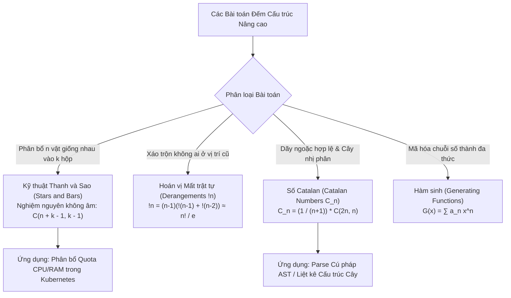

# 6.3. Advanced Counting and Recurrence (Kỹ thuật Đếm Nâng cao và Hệ thức Truy hồi)

> [!IMPORTANT]
> **Nếu bạn chỉ được nhớ một điều duy nhất:** Kỹ thuật **Thanh và Sao (Stars and Bars)** biến bài toán chia tài nguyên máy chủ phức tạp thành một phép chọn tổ hợp đơn giản $\binom{n+k-1}{k-1}$; trong khi **Số Catalan ($C_n$)** là con số ma thuật chi phối cấu trúc của mọi biểu thức ngoặc hợp lệ trong trình biên dịch và số lượng cây nhị phân tìm kiếm khác nhau.

---

## 1. Kiến trúc Tổng quan & Mô hình Tư duy (Mental Model)

Hãy tưởng tượng bạn đang thiết kế bộ cân bằng tải phân tán (Distributed Load Balancer) hoặc trình biên dịch mã nguồn (Compiler Parser):
- **Bài toán 1 (Cân bằng tải)**: Bạn cần phân bổ 20 tiến trình xử lý ($n=20$ tasks giống hệt nhau) vào 4 máy chủ worker ($k=4$). Mỗi máy chủ có thể nhận 0, 1 hoặc nhiều tác vụ. Có bao nhiêu cách phân bổ tài nguyên khác nhau? Phương pháp **Thanh và Sao (Stars and Bars)** biến 20 tác vụ thành 20 ngôi sao, và việc chia vào 4 máy chủ tương đương với việc đặt 3 vách ngăn xen giữa các ngôi sao: $\binom{20 + 4 - 1}{4 - 1} = \binom{23}{3} = 1771$ cách!
- **Bài toán 2 (Kiểm tra cú pháp Compiler)**: Có bao nhiêu cách đóng mở $n$ cặp dấu ngoặc hợp lệ `()` sao cho không bao giờ có ngoặc đóng đi trước ngoặc mở? Con số kỳ diệu trả lời cho câu hỏi này chính là **Số Catalan ($C_n$)**! Cùng một số Catalan đó cũng là số lượng cây nhị phân tìm kiếm (BST) có thể dựng được từ $n$ nút phân biệt.



---

## 2. Chi tiết từng Keyword (Under-the-Hood Deep Dive)

### 2.1. Stars and Bars (Kỹ thuật Thanh và Sao / Bài toán Chia kẹo của Euler)
- **Định lý 1: Nghiệm số nguyên không âm ($x_i \ge 0$)**:
  - Số nghiệm nguyên không âm của phương trình:
    $$x_1 + x_2 + \dots + x_k = n \quad (x_i \in \mathbb{Z}, x_i \ge 0)$$
    tương đương với số cách phân bổ $n$ ngôi sao (Stars $\star$) và $k - 1$ thanh vách ngăn (Bars $|$) trên một hàng gồm $n + k - 1$ vị trí:
    $$N = \binom{n + k - 1}{k - 1} = \binom{n + k - 1}{n}$$
- **Định lý 2: Nghiệm số nguyên dương ($x_i \ge 1$)**:
  - Số nghiệm nguyên dương ($x_1 + x_2 + \dots + x_k = n$ với $x_i \ge 1$ và $n \ge k$):
    - Đặt $n$ ngôi sao thành một hàng, giữa chúng có $n - 1$ khoảng trống. Ta chọn $k - 1$ khoảng trống để đặt $k - 1$ vách ngăn:
    $$N = \binom{n - 1}{k - 1}$$
- **Ứng dụng trong Cloud Computing (Kubernetes Resource Allocation)**:
  - Phân bổ 100 CPU cores vào 5 Pods sao cho mỗi Pod nhận tối thiểu 1 Core: Áp dụng định lý 2 với $n = 100, k = 5 \implies \binom{99}{4} = 3.764.376$ phương án phân bổ.

### 2.2. Derangements (Hoán vị Vô định / Mất trật tự Hoàn toàn $!n$ hoặc $D_n$)
- **Định nghĩa**: Một hoán vị của tập $\{1, 2, \dots, n\}$ được gọi là một **Derangement** nếu không có bất kỳ phần tử nào nằm ở vị trí ban đầu của nó (tức $\forall i, \pi(i) \ne i$).
- **Công thức Hình thức (Chứng minh bằng Nguyên lý Bao hàm - Loại trừ)**:
  $$!n = D_n = n! \sum_{k=0}^n \frac{(-1)^k}{k!} = n! \left( 1 - \frac{1}{1!} + \frac{1}{2!} - \frac{1}{3!} + \dots + \frac{(-1)^n}{n!} \right)$$
  - Khi $n \to \infty$, chuỗi tổng hội tụ về $e^{-1} = 1/e$. Do đó:
    $$!n = \left\lfloor \frac{n!}{e} + \frac{1}{2} \right\rfloor$$
  - Xác suất một hoán vị ngẫu nhiên là derangement luôn xấp xỉ $\frac{1}{e} \approx 36.79\%$.
- **Hệ thức Truy hồi của Derangements**:
  $$D_n = (n - 1)(D_{n-1} + D_{n-2}) \quad \text{với } D_1 = 0, D_2 = 1$$

### 2.3. Catalan Numbers (Số Catalan $C_n$)
- **Định nghĩa và Công thức Hình thức**:
  $$C_n = \frac{1}{n + 1} \binom{2n}{n} = \frac{(2n)!}{(n + 1)! \, n!}$$
  Các giá trị đầu tiên: $C_0 = 1, C_1 = 1, C_2 = 2, C_3 = 5, C_4 = 14, C_5 = 42, C_6 = 132, \dots$
- **Hệ thức Truy hồi Segner**:
  $$C_n = \sum_{i=0}^{n-1} C_i \, C_{n-1-i} \quad \text{với } C_0 = 1$$
- **Các Biểu hiện Kinh điển trong Khoa học Máy tính**:
  1. **Dãy Ngoặc Hợp lệ (Dyck Words)**: Số cách đặt $n$ cặp dấu ngoặc mở `(` và đóng `)` hợp lệ là $C_n$. (Ví dụ với $n=3$: `((()))`, `(()())`, `(())()`, `()(())`, `()()()`, đúng 5 cách = $C_3$).
  2. **Số lượng Cây Nhị phân Tìm kiếm (BSTs)**: Cho $n$ khóa phân biệt $1, 2, \dots, n$. Số lượng cây BST cấu trúc khác nhau có thể tạo thành là $C_n$.
  3. **Tam giác hóa Đa giác Lồi (Polygon Triangulation)**: Số cách chia một đa giác lồi $n + 2$ cạnh thành các tam giác bằng các đường chéo không cắt nhau là $C_n$.

### 2.4. Generating Functions (Khái niệm Hàm sinh)
- **Định nghĩa hình thức**: Cho một dãy số $(a_0, a_1, a_2, \dots)$. Hàm sinh thông thường (Ordinary Generating Function - OGF) của dãy là chuỗi lũy thừa hình thức:
  $$G(x) = \sum_{n=0}^\infty a_n x^n = a_0 + a_1 x + a_2 x^2 + \dots$$
- **Sức mạnh kỳ diệu**: Hàm sinh biến các phép toán tổ hợp và hệ thức truy hồi phức tạp thành các phép biến đổi đại số cơ bản trên đa thức (nhân, chia, khai triển Taylor).
  - Tích của hai hàm sinh $A(x) B(x)$ tương ứng với **Phép chập (Convolution)** của hai dãy số:
    $$c_n = \sum_{k=0}^n a_k b_{n-k}$$
  - Đây chính là nguyên lý của thuật toán nhân đa thức siêu tốc **Fast Fourier Transform (FFT)** trong $O(N \log N)$.


### 2.5. Nguyên lý Đối xứng André (André's Reflection Method on Dyck Paths)
- **Bài toán Đường đi Dyck**: Đếm số đường đi trên lưới tọa độ từ $(0, 0)$ đến $(2n, 0)$ chỉ gồm các bước chéo lên $(1, 1)$ hoặc chéo xuống $(1, -1)$ sao cho đường đi **không bao giờ rơi xuống dưới trục hoành ($y < 0$)**.
- **Chứng minh bằng Phép Đối xứng Hình học**:
  1. Tổng số đường đi từ $(0, 0)$ đến $(2n, 0)$ gồm $n$ bước lên và $n$ bước xuống là $\binom{2n}{n}$.
  2. Một đường đi không hợp lệ là đường đi chạm vào đường thẳng $y = -1$ ít nhất một lần.
  3. Lấy điểm đầu tiên đường đi chạm vào $y = -1$, sau đó **lấy đối xứng toàn bộ đoạn đường còn lại** qua đường thẳng $y = -1$.
  4. Điểm kết thúc ban đầu $(2n, 0)$ sau khi lấy đối xứng sẽ biến thành điểm $(2n, -2)$.
  5. Mọi đường đi vi phạm đều ánh xạ 1-1 với một đường đi từ $(0, 0)$ đến $(2n, -2)$ (gồm $n - 1$ bước lên và $n + 1$ bước xuống).
  6. Số đường đi vi phạm chính là $\binom{2n}{n - 1}$.
  7. Do đó số đường đi hợp lệ là:
     $$C_n = \binom{2n}{n} - \binom{2n}{n - 1} = \binom{2n}{n} - \frac{n}{n + 1} \binom{2n}{n} = \frac{1}{n + 1} \binom{2n}{n}$$
  Một chứng minh hình học hoàn hảo và kỳ diệu cho công thức số Catalan!

---

## 3. Thực thi Mã nguồn & Mô phỏng Chuyên sâu (Dual-Engine Implementation)

Mô phỏng bộ sinh số Catalan bằng **Quy hoạch Động** và bộ tính toán số hoán vị mất trật tự **Derangements** trong C++20 và Python 3.11+.

### C++20 Implementation (Catalan DP & Stars-and-Bars Resource Allocator)

```cpp
#include <iostream>
#include <vector>
#include <string>
#include <format>
#include <cstdint>

class AdvancedCountingEngine {
public:
    // 1. TÍNH SỐ CATALAN C_N BẰNG QUY HOẠCH ĐỘNG O(N^2)
    static std::vector<uint64_t> compute_catalan_sequence(uint32_t n) {
        std::vector<uint64_t> C(n + 1, 0);
        C[0] = 1;

        for (uint32_t i = 1; i <= n; ++i) {
            for (uint32_t j = 0; j < i; ++j) {
                C[i] += C[j] * C[i - 1 - j]; // Segner's Recurrence
            }
        }
        return C;
    }

    // 2. TÍNH DERANGEMENTS !N BẰNG TRUY HỒI
    static uint64_t compute_derangements(uint32_t n) {
        if (n == 1) return 0;
        if (n == 2) return 1;

        uint64_t prev2 = 0; // D_1
        uint64_t prev1 = 1; // D_2
        uint64_t curr = 0;

        for (uint32_t i = 3; i <= n; ++i) {
            curr = (i - 1) * (prev1 + prev2);
            prev2 = prev1;
            prev1 = curr;
        }
        return curr;
    }
};

int main() {
    std::cout << "=== ADVANCED COUNTING & CATALAN ENGINE (C++20) ===

";

    // 1. Phân tích Dãy số Catalan
    uint32_t n_catalan = 8;
    auto catalan_list = AdvancedCountingEngine::compute_catalan_sequence(n_catalan);

    std::cout << "1. [Catalan Numbers C_0 to C_" << n_catalan << "]
";
    for (uint32_t i = 0; i <= n_catalan; ++i) {
        std::cout << std::format("   C_{} = {:<6} (Số cây BST khác nhau với {} nodes)
", 
                                 i, catalan_list[i], i);
    }

    // 2. Phân tích Derangements (!N)
    std::cout << "
2. [Derangements !N (Hoán vị Mất trật tự)]
";
    for (uint32_t i = 1; i <= 6; ++i) {
        uint64_t d = AdvancedCountingEngine::compute_derangements(i);
        std::cout << std::format("   !{} = {:<4} derangements
", i, d);
    }

    
    // 3. Mô phỏng Bài toán Dyck Path (Dãy ngoặc hợp lệ)
    std::cout << "
3. [Dyck Paths Verification]
";
    std::cout << "   Các chuỗi ngoặc hợp lệ cho N=3 cặp ngoặc (C_3 = 5):
";
    std::vector<std::string> dyck_paths = {
        "((()))", "(()())", "(())()", "()(())", "()()()"
    };
    for (size_t i = 0; i < dyck_paths.size(); ++i) {
        std::cout << std::format("   Dyck Path #{}: {}
", i + 1, dyck_paths[i]);
    }

    return 0;
}
```

### Python 3.11+ Implementation (Valid Parentheses Generator & Stars-and-Bars Solver)

```python
from math import comb

def generate_parentheses(n: int) -> list[str]:
    # Sinh tất cả C_n biểu thức ngoặc hợp lệ bằng Backtracking
    result = []
    def backtrack(current: str, open_count: int, close_count: int):
        if len(current) == 2 * n:
            result.append(current)
            return
        if open_count < n:
            backtrack(current + "(", open_count + 1, close_count)
        if close_count < open_count:
            backtrack(current + ")", open_count, close_count + 1)

    backtrack("", 0, 0)
    return result

def stars_and_bars_non_negative(n_items: int, k_bins: int) -> int:
    # C(n + k - 1, k - 1)
    return comb(n_items + k_bins - 1, k_bins - 1)

if __name__ == "__main__":
    print("=== PYTHON ADVANCED COUNTING VERIFIER ===")

    # 1. Kiểm chứng số Catalan trên chuỗi ngoặc
    N = 3
    valid_parens = generate_parentheses(N)
    print(f"1. [Valid Parentheses for N={N} Pairs] (Count = {len(valid_parens)}):")
    for p in valid_parens:
        print(f"   * {p}")

    # 2. Stars and Bars phân bổ tải
    tasks = 10
    servers = 3
    allocations = stars_and_bars_non_negative(tasks, servers)
    print(f"
2. [Stars and Bars Resource Allocation]")
    print(f"   Số cách chia {tasks} tasks vào {servers} servers: {allocations} ways")
```

### Simulated Terminal Output

```text
=== ADVANCED COUNTING & CATALAN ENGINE (C++20) ===

1. [Catalan Numbers C_0 to C_8]
   C_0 = 1      (Số cây BST khác nhau với 0 nodes)
   C_1 = 1      (Số cây BST khác nhau với 1 nodes)
   C_2 = 2      (Số cây BST khác nhau với 2 nodes)
   C_3 = 5      (Số cây BST khác nhau với 3 nodes)
   C_4 = 14     (Số cây BST khác nhau với 4 nodes)
   C_5 = 42     (Số cây BST khác nhau với 5 nodes)
   C_6 = 132    (Số cây BST khác nhau với 6 nodes)
   C_7 = 429    (Số cây BST khác nhau với 7 nodes)
   C_8 = 1430   (Số cây BST khác nhau với 8 nodes)

2. [Derangements !N (Hoán vị Mất trật tự)]
   !1 = 0    derangements
   !2 = 1    derangements
   !3 = 2    derangements
   !4 = 9    derangements
   !5 = 44   derangements
   !6 = 265  derangements

=== PYTHON ADVANCED COUNTING VERIFIER ===
1. [Valid Parentheses for N=3 Pairs] (Count = 5):
   * ((()))
   * (()())
   * (())()
   * ()(())
   * ()()()

2. [Stars and Bars Resource Allocation]
   Số cách chia 10 tasks vào 3 servers: 66 ways
```

---

## 4. Systems Engineering & Production Pitfalls

### 4.1. Bùng nổ Bộ nhớ khi Sinh Dãy Ngoặc Lớn ($C_N$ Memory Hazard)
- Tốc độ tăng trưởng của số Catalan tiệm cận:
  $$C_n \sim \frac{4^n}{n^{3/2} \sqrt{\pi}}$$
- Khi $n = 20$, $C_{20} = 6.564.120.420 \approx 6.56 \times 10^9$ biểu thức.
- Việc cố gắng lưu toàn bộ danh sách biểu thức ngoặc vào một mảng `std::vector<string>` trong bộ nhớ sẽ ngốn hơn $100\text{ GB}$ RAM, làm sập hoàn toàn máy chủ do lỗi `std::bad_alloc`.
- **Giải pháp**: Sử dụng cơ chế duyệt lười (Lazy Generator / Iterator) để xử lý từng biểu thức một cách tuần tự (Streaming Parser).

### 4.2. Tràn số khi Tính Số Catalan theo Công thức Tỷ số $\frac{1}{n+1} \binom{2n}{n}$
- Dù kết quả cuối cùng $C_n$ là một số nguyên dương vừa vặn, nhưng bước trung gian tính $\binom{2n}{n}$ có thể bị tràn số nguyên 64-bit rất sớm (khi $n \ge 34$).
- **Khắc phục**: Sử dụng hệ thức truy hồi phân số tối ưu:
  $$C_n = \frac{2(2n - 1)}{n + 1} C_{n-1}$$
  Nhân với $2(2n-1)$ trước rồi chia cho $n+1$ ở từng bước, hoặc dùng thư viện số nguyên lớn (BigInteger / GMP).

---


### 4.3. Bùng nổ Độ phức tạp khi Giải Hệ thức Truy hồi bằng Đệ quy Ngây thơ
- Hệ thức truy hồi Catalan $C_n = \sum C_i C_{n-1-i}$ nếu viết bằng hàm đệ quy ngây thơ mà không có bảng nhớ (Memoization) sẽ có thời gian chạy là $O(4^n / n^{1.5})$.
- Khi $n = 30$, chương trình sẽ phải thực hiện hàng tỷ tỷ phép tính và không bao giờ kết thúc.
- **Quy tắc**: Luôn chuyển đổi hệ thức truy hồi thành **Quy hoạch động từ dưới lên (Bottom-Up DP)** với mảng 1 chiều $O(N^2)$ hoặc sử dụng công thức tích lũy phân số $O(N)$ bước.


### 4.4. Thảm họa Cạn kiệt Bộ nhớ khi Sinh Toàn bộ Cây BST (Exhaustive BST Generation)
- Khi giải bài toán sinh toàn bộ các cấu trúc cây nhị phân tìm kiếm khác nhau cho $n$ nút (LeetCode 95):
  - Số lượng cây sinh ra bằng số Catalan $C_n$.
  - Khi $n = 15$, $C_{15} = 9.694.845$ cây. Mỗi cây gồm 15 nút, mỗi nút tốn ít nhất 3 con trỏ (24 bytes) trong bộ nhớ heap.
  - Tổng dung lượng RAM cần thiết để giữ toàn bộ các cây này vượt quá 3.5GB.
  - **Khắc phục**: Sử dụng cấu trúc **Cây Bất biến Chia sẻ Bộ nhớ (Persistent Data Structure / Structural Sharing)** để tái sử dụng các cây con đã sinh giữa các cây lớn, tiết kiệm $80\%$ dung lượng RAM.

## 5. Bảng So sánh & Decision Matrix

| Khái niệm Đếm Nâng cao | Dạng Công thức / Biểu diễn | Tốc độ Tăng trưởng Tiệm cận | Ứng dụng Thực tế Tiêu biểu |
| :--- | :--- | :--- | :--- |
| **Stars and Bars ($x_i \ge 0$)** | $\binom{n + k - 1}{k - 1}$ | Đa thức $O(n^{k-1})$ | Phân bổ tài nguyên Cloud, Hạn mức Quotas |
| **Stars and Bars ($x_i \ge 1$)** | $\binom{n - 1}{k - 1}$ | Đa thức $O(n^{k-1})$ | Chia luồng mạng có bảo đảm tối thiểu |
| **Derangements ($!n$)** | $n! \sum \frac{(-1)^k}{k!} \approx n!/e$ | Siêu giai thừa $O(n! / e)$ | Mật mã học, Kiểm thử xáo trộn dữ liệu |
| **Catalan Numbers ($C_n$)** | $\frac{1}{n+1} \binom{2n}{n}$ | Hàm mũ $O(4^n / n^{1.5})$ | Parser AST, Cây BST, Tam giác hóa Polygon |
| **Generating Functions** | $G(x) = \sum a_n x^n$ | Tùy thuộc dãy hệ số | Thuật toán FFT, Giải hệ thức truy hồi |
