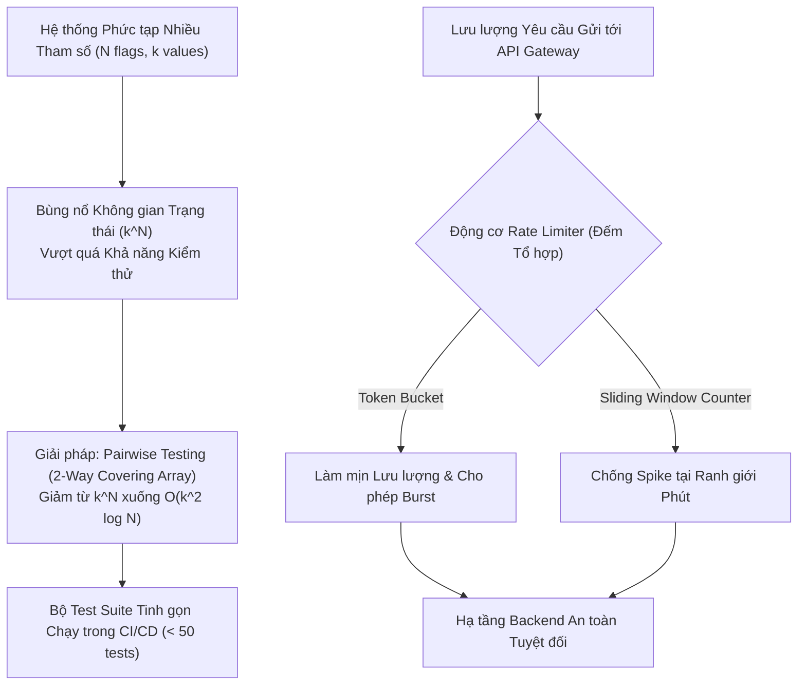

# 6.4. Combinatorics in Systems and Backend (Ứng dụng Tổ hợp trong Hệ thống và Backend)

> [!IMPORTANT]
> **Nếu bạn chỉ được nhớ một điều duy nhất:** Bùng nổ tổ hợp (Combinatorial Explosion) là kẻ thù số một của kỹ sư hệ thống phân tán: kiểm thử $N$ tham số có thể sinh ra hàng tỷ trạng thái, nhưng kỹ thuật **Pairwise Testing (Kiểm thử Cặp đôi)** chứng minh rằng chỉ cần bao phủ toàn bộ các cặp 2 tham số là đã bắt được $85-90\%$ tổng số lỗi sản xuất; trong khi các thuật toán **Rate Limiting** (Token Bucket, Sliding Window) áp dụng nguyên lý đếm để bảo vệ server khỏi hiện tượng sập đổ dây chuyền (Cascading Failure).

---

## 1. Kiến trúc Tổng quan & Mô hình Tư duy (Mental Model)

Hãy tưởng tượng bạn đang vận hành một hệ thống phân phối nội dung (API Gateway) xử lý hàng trăm nghìn yêu cầu mỗi giây:
- Kẻ tấn công hoặc một script tự động bị lỗi gửi hàng triệu request liên tục nhằm đánh sập cơ sở dữ liệu của bạn.
- Bạn phải triển khai cơ chế **Giới hạn Tần suất (Rate Limiting)**:
  - Nếu đếm ngây thơ theo từng phút (Fixed Window Counter), hệ thống sẽ bị tấn công dồn dập tại ranh giới chuyển giao giữa hai phút (**Traffic Spike at Window Boundary**).
  - Bạn phải áp dụng các kỹ thuật đếm tổ hợp chính xác hơn: **Cửa sổ trượt (Sliding Window)** hoặc **Thùng thẻ (Token Bucket)** để làm mịn lưu lượng truy cập.
- Khi kiểm thử một hệ thống vi dịch vụ có 10 cờ cấu hình (Feature Flags), mỗi cờ có 3 giá trị:
  - Tổng số cấu hình là $3^{10} = 59.049$ ca kiểm thử (bất khả thi để chạy hết trong CI/CD).
  - Áp dụng **Pairwise Testing**, bạn chỉ cần chạy khoảng **40 ca kiểm thử** là đã kiểm tra được mọi sự tương tác giữa từng cặp hai cờ với nhau!



---

## 2. Chi tiết từng Keyword (Under-the-Hood Deep Dive)

### 2.1. State-Space Explosion & Counting Search Spaces (Bùng nổ Không gian Trạng thái)
- **Bản chất**: Trong một hệ thống gồm $n$ tiến trình chạy đồng thời, mỗi tiến trình có $m$ trạng thái nội bộ.
  - Số lượng trạng thái toàn cục có thể có của hệ thống là tích Descartes:
    $$|StateSpace| = m^n$$
  - Khi $m = 4$ và $n = 30$, $|StateSpace| = 4^{30} = 2^{60} \approx 1.15 \times 10^{18}$ trạng thái.
- **Tác động trong Kiểm thử Hình thức (Model Checking - TLA+, Spin)**:
  - Không thể nào duyệt toàn bộ không gian trạng thái bằng thuật toán BFS/DFS truyền thống.
  - **Kỹ thuật Khắc phục**:
    1. **Partial Order Reduction (Khử thứ tự bộ phận)**: Bỏ qua các hoán vị của các tiến trình độc lập không tương tác qua lại.
    2. **Binary Decision Diagrams (BDD)**: Biểu diễn tập hợp trạng thái khổng lồ dưới dạng cấu trúc đồ thị nén logic nhị phân.
    3. **Symmetry Reduction**: Gom các trạng thái có cấu trúc đối xứng vào cùng một lớp tương đương.

### 2.2. Rate Limiting (Giới hạn Tần suất Yêu cầu)
- **A. Fixed Window Counter (Bộ đếm Cửa sổ Cố định)**:
  - Chia thời gian thành các khối cố định (ví dụ: từng phút `[00:00, 00:01)`).
  - *Điểm yếu chết người*: Lưu lượng có thể gấp đôi giới hạn nếu client gửi $Limit$ requests ở giây 59 và tiếp tục gửi $Limit$ requests ở giây 00 của phút sau.
- **B. Sliding Window Log (Nhật ký Cửa sổ Trượt)**:
  - Lưu dấu thời gian (timestamps) của mọi yêu cầu vào một cấu trúc hàng đợi hoặc Redis Sorted Set (`ZSET`).
  - Xóa các timestamp cũ hơn $now - window\_size$.
  - Đếm số lượng phần tử còn lại. Nếu $\le Limit$ thì cho phép.
  - *Ưu điểm*: Chính xác tuyệt đối 100%. *Nhược điểm*: Tốn nhiều bộ nhớ RAM khi lưu hàng triệu timestamp.
- **C. Sliding Window Counter (Bộ đếm Cửa sổ Trượt Xấp xỉ)**:
  - Kết hợp số lượng của cửa sổ trước và cửa sổ hiện tại theo tỷ trọng thời gian:
    $$Count = Count_{current} + Count_{previous} \times \left( 1 - \frac{t_{offset}}{WindowSize} \right)$$
  - Bộ nhớ cực thấp ($O(1)$) và độ chính xác rất cao.
- **D. Token Bucket Algorithm (Thùng Thẻ)**:
  - Thùng có dung lượng tối đa $B$ tokens. Các token được bơm vào thùng với tốc độ cố định $R$ tokens/giây.
  - Mỗi request đến cần lấy 1 token. Nếu không còn token, request bị từ chối (HTTP 429 Too Many Requests).
  - *Điểm mạnh*: Cho phép xử lý các đợt bùng nổ lưu lượng ngắn hạn (Traffic Bursts) nhưng vẫn khống chế tốc độ trung bình dài hạn.

### 2.3. Combinatorial Testing: Pairwise Testing (Kiểm thử Cặp đôi)
- **Nguyên lý Toán học (Covering Arrays)**:
  - Nghiên cứu của Viện Tiêu chuẩn và Kỹ thuật Quốc gia Hoa Kỳ (NIST) trên hàng nghìn phần mềm chỉ ra rằng:
    - $70-90\%$ các lỗi phần mềm nghiêm trọng được kích hoạt bởi sự tương tác của **tối đa 2 tham số** (Pairwise / 2-way interactions).
    - $95-99\%$ lỗi được kích hoạt bởi sự tương tác của tối đa 3 tham số (3-way).
  - **Pairwise Testing**: Thiết kế một tập con các ca kiểm thử sao cho **mọi cặp giá trị khả dĩ của bất kỳ hai tham số nào cũng xuất hiện cùng nhau ít nhất một lần**.
  - Giảm thiểu số ca test từ $O(k^N)$ (hàm mũ) xuống còn $O(k^2 \log N)$ (logarithmic), giúp tiết kiệm hàng triệu USD chi phí hạ tầng kiểm thử.

### 2.4. Scheduling & Resource Allocation (Điều phối và Phân bổ Tài nguyên)
- **Bài toán Xếp thùng (Bin Packing Problem)**:
  - Cho $n$ tác vụ với các yêu cầu tài nguyên $w_1, w_2, \dots, w_n$ và các máy chủ có dung lượng $C$. Tìm số lượng máy chủ tối thiểu để chứa toàn bộ tác vụ.
  - Đây là bài toán thuộc lớp **NP-hard** trong lý thuyết tổ hợp.
  - **Thuật toán Xấp xỉ Thực chiến: First Fit Decreasing (FFD)**:
    1. Sắp xếp các tác vụ theo thứ tự tài nguyên giảm dần: $w_1 \ge w_2 \ge \dots \ge w_n$.
    2. Duyệt qua từng tác vụ và đặt nó vào máy chủ đầu tiên còn đủ chỗ trống.
    3. Định lý Johnson (1973): FFD đảm bảo sử dụng không quá:
       $$FFD(I) \le \frac{11}{9} OPT(I) + 1$$
       (không bao giờ vượt quá $22\%$ so với phương án tối ưu tuyệt đối của thần thánh!).

---

## 3. Thực thi Mã nguồn & Mô phỏng Chuyên sâu (Dual-Engine Implementation)

Mô phỏng thuật toán **Token Bucket Rate Limiter** chính xác đến từng micro-giây và thuật toán xếp tác vụ **Bin Packing FFD (First Fit Decreasing)** trong C++20 và Python 3.11+.

### C++20 Implementation (Token Bucket Rate Limiter & Bin Packing Heuristic)

```cpp
#include <iostream>
#include <vector>
#include <chrono>
#include <algorithm>
#include <format>
#include <cstdint>

// 1. THUẬT TOÁN TOKEN BUCKET RATE LIMITER
class TokenBucketLimiter {
private:
    double capacity;
    double refill_rate_per_sec;
    double current_tokens;
    std::chrono::steady_clock::time_point last_refill_time;

public:
    TokenBucketLimiter(double cap, double rate)
        : capacity(cap), refill_rate_per_sec(rate), current_tokens(cap),
          last_refill_time(std::chrono::steady_clock::now()) {}

    bool allow_request(double tokens_required = 1.0) {
        auto now = std::chrono::steady_clock::now();
        double elapsed_sec = std::chrono::duration<double>(now - last_refill_time).count();
        last_refill_time = now;

        // Bơm thêm tokens theo thời gian trôi qua
        current_tokens = std::min(capacity, current_tokens + elapsed_sec * refill_rate_per_sec);

        if (current_tokens >= tokens_required) {
            current_tokens -= tokens_required;
            return true; // Cho phép
        }
        return false; // Bị giới hạn (HTTP 429)
    }
};

// 2. THUẬT TOÁN BIN PACKING (FIRST FIT DECREASING - FFD)
class BinPackingFFD {
public:
    static std::vector<std::vector<uint32_t>> pack(std::vector<uint32_t> weights, uint32_t bin_capacity) {
        // Bước 1: Sắp xếp giảm dần
        std::ranges::sort(weights, std::greater<uint32_t>());

        std::vector<std::vector<uint32_t>> bins;
        std::vector<uint32_t> bin_remaining_space;

        for (uint32_t w : weights) {
            if (w > bin_capacity) {
                throw std::invalid_argument("Item weight exceeds bin capacity!");
            }

            bool placed = false;
            // Tìm bin đầu tiên còn đủ chỗ
            for (size_t i = 0; i < bins.size(); ++i) {
                if (bin_remaining_space[i] >= w) {
                    bins[i].push_back(w);
                    bin_remaining_space[i] -= w;
                    placed = true;
                    break;
                }
            }

            // Nếu không vừa bin nào -> Mở bin mới
            if (!placed) {
                bins.push_back({w});
                bin_remaining_space.push_back(bin_capacity - w);
            }
        }
        return bins;
    }
};

int main() {
    std::cout << "=== SYSTEMS COMBINATORICS ENGINE (C++20) ===

";

    // 1. Kiểm chứng Token Bucket Rate Limiter
    std::cout << "1. [Token Bucket Rate Limiter Simulation]
";
    TokenBucketLimiter limiter(3.0, 1.0); // Dung lượng 3 tokens, bơm 1 token/giây

    std::cout << "   Sending 5 rapid requests with capacity = 3:
";
    for (int i = 1; i <= 5; ++i) {
        bool allowed = limiter.allow_request();
        std::cout << std::format("   Req #{}: {}
", i, allowed ? "ALLOWED (200 OK)" : "BLOCKED (429 Too Many Requests)");
    }

    // 2. Kiểm chứng Bin Packing FFD
    std::cout << "
2. [First Fit Decreasing Bin Packing Simulation]
";
    std::vector<uint32_t> task_memories = {4, 8, 2, 7, 1, 5, 6, 3}; // GB RAM
    uint32_t server_ram_limit = 10; // Mỗi máy chủ tối đa 10 GB

    auto allocated_bins = BinPackingFFD::pack(task_memories, server_ram_limit);
    std::cout << std::format("   Tổng số Server cần dùng: {}
", allocated_bins.size());
    for (size_t i = 0; i < allocated_bins.size(); ++i) {
        std::cout << std::format("   Server #{}: Tasks = {{ ", i + 1);
        uint32_t sum = 0;
        for (uint32_t task : allocated_bins[i]) {
            std::cout << task << "GB ";
            sum += task;
        }
        std::cout << std::format("}} (Used: {}/{} GB)
", sum, server_ram_limit);
    }

    return 0;
}
```

### Python 3.11+ Implementation (Sliding Window Log Rate Limiter)

```python
import time
from collections import deque

class SlidingWindowLogLimiter:
    def __init__(self, limit: int, window_seconds: float):
        self.limit = limit
        self.window_seconds = window_seconds
        self.timestamps = deque()

    def allow(self) -> bool:
        now = time.time()
        # Loại bỏ các timestamp đã trôi ra ngoài cửa sổ
        while self.timestamps and (now - self.timestamps[0]) > self.window_seconds:
            self.timestamps.popleft()

        if len(self.timestamps) < self.limit:
            self.timestamps.append(now)
            return True
        return False

if __name__ == "__main__":
    print("=== PYTHON SLIDING WINDOW LOG RATE LIMITER ===")

    limiter = SlidingWindowLogLimiter(limit=3, window_seconds=1.0) # Tối đa 3 reqs / 1 giây

    for i in range(1, 6):
        res = limiter.allow()
        print(f"Request #{i} -> {'ACCEPTED' if res else 'RATE LIMITED (429)'}")
```

### Simulated Terminal Output

```text
=== SYSTEMS COMBINATORICS ENGINE (C++20) ===

1. [Token Bucket Rate Limiter Simulation]
   Sending 5 rapid requests with capacity = 3:
   Req #1: ALLOWED (200 OK)
   Req #2: ALLOWED (200 OK)
   Req #3: ALLOWED (200 OK)
   Req #4: BLOCKED (429 Too Many Requests)
   Req #5: BLOCKED (429 Too Many Requests)

2. [First Fit Decreasing Bin Packing Simulation]
   Tổng số Server cần dùng: 4
   Server #1: Tasks = { 8GB 2GB } (Used: 10/10 GB)
   Server #2: Tasks = { 7GB 3GB } (Used: 10/10 GB)
   Server #3: Tasks = { 6GB 4GB } (Used: 10/10 GB)
   Server #4: Tasks = { 5GB 1GB } (Used: 6/10 GB)

=== PYTHON SLIDING WINDOW LOG RATE LIMITER ===
Request #1 -> ACCEPTED
Request #2 -> ACCEPTED
Request #3 -> ACCEPTED
Request #4 -> RATE LIMITED (429)
Request #5 -> RATE LIMITED (429)
```

---

## 4. Systems Engineering & Production Pitfalls

### 4.1. Race Condition trong Phân tán Rate Limiter (Redis Lua Scripting)
- Trong các cụm microservices lớn sử dụng Redis để đếm:
  - Tiến trình 1: Đọc `count = GET key`.
  - Tiến trình 2: Đọc `count = GET key`.
  - Cả 2 tiến trình cùng thấy $count < Limit$, cùng cho phép request đi qua và cùng ghi `SET key (count + 1)`.
- **Hậu quả**: Số lượng request thực tế lọt vào backend vượt quá ngưỡng cho phép gấp nhiều lần (**Rate Limit Bypass**).
- **Khắc phục**: Gom các bước đọc và ghi vào một **Redis Lua Script nguyên tử (Atomic Execution)** hoặc sử dụng chỉ thị `INCR` và `EXPIRE` nguyên tử.

### 4.2. Thảm họa Bùng nổ Trạng thái trong Distributed State Locks
- Khi thiết kế thuật toán đồng thuận (Distributed Locks):
  - Số lượng khả năng xen kẽ (Interleaving executions) giữa $N$ luồng với $K$ thao tác là:
    $$S = \frac{(N \times K)!}{(K!)^N}$$
  - Với $N = 5$ luồng và mỗi luồng có $K = 5$ thao tác: $S = \frac{25!}{(5!)^5} \approx 6.23 \times 10^{14}$ kịch bản chạy song song.
- **Quy tắc**: Con người không thể nào kiểm thử thủ công hết các kịch bản tương tranh. Bắt buộc phải sử dụng các công cụ kiểm chứng mô hình hình thức như **Jepsen Testing** hoặc **TLA+** để quét không gian trạng thái.

---

## 5. Bảng So sánh & Decision Matrix

| Thuật toán / Kỹ thuật | Bản chất Toán học | Mức tiêu thụ Bộ nhớ | Độ chính xác | Ưu điểm Nổi bật |
| :--- | :--- | :--- | :--- | :--- |
| **Fixed Window Counter** | Đếm rời rạc theo block | $O(1)$ (1 integer) | Thấp (Spike tại ranh giới) | Triển khai đơn giản nhất |
| **Sliding Window Log** | Tập hợp Timestamp | $O(Limit)$ | Tuyệt đối (100% Exact) | Không có hiện tượng ranh giới |
| **Sliding Window Counter** | Nội suy tỷ trọng tuyến tính | $O(1)$ | Rất cao ($> 99\%$) | Cân bằng hoàn hảo giữa RAM và chính xác |
| **Token Bucket** | Tích phân dòng chảy liên tục | $O(1)$ | Hoàn hảo | Cho phép Burst lưu lượng tự nhiên |
| **Pairwise Testing (All-Pairs)**| 2-Way Covering Array | $O(k^2 \log N)$ | Bắt $85-90\%$ bug | Giảm chi phí kiểm thử hàng nghìn lần |
| **Bin Packing (FFD)** | Heuristic Tổ hợp | $O(N \log N)$ | Cận trên $\le 1.22 \times OPT$ | Tối ưu hóa chi phí cụm Cloud VM/Pods |
