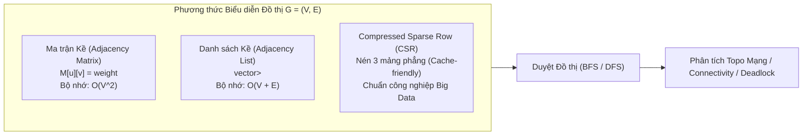

# 7.1. Graph Fundamentals (Nguyên lý Cơ bản về Đồ thị)

> [!IMPORTANT]
> **Nếu bạn chỉ được nhớ một điều duy nhất:** Đồ thị $G = (V, E)$ là cấu trúc dữ liệu tối thượng mô hình hóa mọi mối quan hệ phi tuyến tính trong vũ trụ máy tính; và **Bổ đề Bắt tay (Handshaking Lemma)** chứng minh rằng tổng bậc của mọi đỉnh luôn gấp đôi số cạnh (luôn là số chẵn), là cơ sở kiểm tra tính toàn vẹn của mọi topo mạng Internet và mạng xã hội.

---

## 1. Kiến trúc Tổng quan & Mô hình Tư duy (Mental Model)

Hãy tưởng tượng bạn đang phân tích cấu trúc của toàn bộ mạng Internet toàn cầu hoặc mạng lưới bạn bè trên Facebook:
- Mỗi máy chủ, router, hoặc người dùng là một **Đỉnh (Vertex / Node)**.
- Mỗi sợi cáp quang nối giữa hai router, hoặc mối quan hệ theo dõi/kết bạn giữa hai người dùng là một **Cạnh (Edge / Link)**.
- Nếu đường truyền cáp quang có hướng truyền tin hai chiều đối xứng: đó là **Đồ thị Vô hướng (Undirected Graph)**.
- Nếu quan hệ là "kênh phát thông báo" một chiều từ máy chủ tới client: đó là **Đồ thị Có hướng (Directed Graph hay Digraph)**.
- Khi cần tìm đường truyền dữ liệu có độ trễ (latency) thấp nhất giữa Singapore và Frankfurt, mỗi cạnh được gắn một con số đại diện cho ping ms: đó là **Đồ thị Có trọng số (Weighted Graph)**.

Dưới tầng vật lý của hệ thống:
1. **Adjacency Matrix (Ma trận kề)**: Tốn $O(V^2)$ bộ nhớ, tra cứu cạnh $(u, v)$ trong $O(1)$.
2. **Adjacency List (Danh sách kề)**: Tốn $O(V + E)$ bộ nhớ, tối ưu cho đồ thị thưa (Sparse Graphs).
3. **Compressed Sparse Row (CSR)**: Kỹ thuật biểu diễn đồ thị nén bộ nhớ chuẩn công nghiệp (dùng trong Graph Neural Networks, PageRank của Google) cho phép duyệt hàng xóm với tốc độ tối đa của L1/L2 Cache và SIMD.



---

## 2. Chi tiết từng Keyword (Under-the-Hood Deep Dive)

### 2.1. Graph, Vertex & Edge (Đồ thị, Đỉnh và Cạnh)
- **Định nghĩa hình thức**: Một đồ thị $G = (V, E)$ gồm hai tập hợp:
  - $V$: Tập hợp các **Đỉnh (Vertices / Nodes)**, $V \ne \emptyset$ ($|V|$ thường ký hiệu là $n$).
  - $E$: Tập hợp các **Cạnh (Edges / Arcs)** kết nối các cặp đỉnh ($|E|$ thường ký hiệu là $m$).
  - Trong đồ thị vô hướng: Mỗi cạnh $e \in E$ là một tập con gồm 2 phần tử không có thứ tự $\{u, v\}$.
  - Trong đồ thị có hướng: Mỗi cạnh $e \in E$ là một cặp có thứ tự $(u, v)$, đi từ đỉnh nguồn $u$ (source) đến đỉnh đích $v$ (target).

### 2.2. Phân loại Đồ thị (Directed, Undirected, Weighted, Multigraph)
- **A. Undirected Graph (Đồ thị Vô hướng)**:
  - Cạnh không có hướng: $(u, v) \equiv (v, u)$. Mối quan hệ luôn mang tính đối xứng (ví dụ: Bạn bè Facebook, Mạng điện lưới).
- **B. Directed Graph / Digraph (Đồ thị Có hướng)**:
  - Cạnh có hướng dứt khoát: $(u, v) \ne (v, u)$. Mối quan hệ một chiều (ví dụ: Follow trên Twitter, Web Hyperlinks, Cây phụ thuộc package).
- **C. Weighted vs Unweighted Graph (Đồ thị Có trọng số và Không trọng số)**:
  - Hàm trọng số $w: E \to \mathbb{R}$ gán cho mỗi cạnh một giá trị số thực (khoảng cách địa lý, băng thông mạng, chi phí tiền tệ).
- **D. Simple Graph, Multigraph & Self-loop**:
  - **Khuyên (Self-loop)**: Cạnh nối một đỉnh với chính nó: $(u, u)$.
  - **Cạnh bội (Parallel Edges / Multi-edges)**: Tồn tại nhiều cạnh cùng nối giữa một cặp đỉnh $(u, v)$ (ví dụ: nhiều chuyến bay cùng chặng).
  - **Simple Graph (Đồ thị đơn)**: Đồ thị không có khuyên và không có cạnh bội.

### 2.3. Degree, In-degree & Out-degree (Bậc của Đỉnh)
- **Bậc trong Đồ thị Vô hướng ($\deg(v)$)**:
  - Số lượng cạnh nối với đỉnh $v$ (mỗi khuyên được tính 2 lần).
  - **Bổ đề Bắt tay (Handshaking Lemma - Euler 1736)**:
    $$\sum_{v \in V} \deg(v) = 2 |E|$$
    - *Hệ quả Sống còn*: Tổng bậc của mọi đỉnh trong đồ thị luôn luôn là **Số Chẵn**. Do đó, **số lượng đỉnh có bậc lẻ bắt buộc phải là một số chẵn**!
- **Bậc trong Đồ thị Có hướng**:
  - **Bán bậc vào (In-degree - $\deg^-(v)$)**: Số cạnh đi VÀO đỉnh $v$.
  - **Bán bậc ra (Out-degree - $\deg^+(v)$)**: Số cạnh đi RA khỏi đỉnh $v$.
  - Định lý Bảo toàn: $\sum_{v \in V} \deg^-(v) = \sum_{v \in V} \deg^+(v) = |E|$.

### 2.4. Walk, Trail, Path, Cycle (Đường đi và Chu trình)
- **Walk (Dãy đỉnh-cạnh)**: Dãy luân phiên các đỉnh và cạnh $v_0, e_1, v_1, e_2, \dots, e_k, v_k$. Có thể lặp lại cả đỉnh và cạnh.
- **Trail (Đường đi không lặp cạnh)**: Một Walk không đi qua bất kỳ cạnh nào quá 1 lần (đỉnh có thể lặp lại).
- **Path / Simple Path (Đường đi đơn)**: Một Walk không lặp lại bất kỳ đỉnh nào (và do đó cũng không lặp cạnh).
- **Cycle / Simple Cycle (Chu trình đơn)**: Một đường đi khép kín bắt đầu và kết thúc tại cùng một đỉnh ($v_0 = v_k$) và không lặp lại đỉnh trung gian nào.
- **Directed Acyclic Graph (DAG)**: Đồ thị có hướng **không chứa bất kỳ chu trình nào**. Đây là cấu trúc cốt lõi của mọi hệ thống lập lịch tác vụ và build tools (Make, Git commit history, Airflow).

### 2.5. Connected Graph & Connected Components (Tính Liên thông)
- **Trong Đồ thị Vô hướng**:
  - Hai đỉnh $u$ và $v$ được gọi là liên thông nếu tồn tại đường đi giữa chúng.
  - Đồ thị liên thông nếu mọi cặp đỉnh đều liên thông với nhau.
  - **Thành phần liên thông (Connected Component)**: Đồ thị con liên thông cực đại.
- **Trong Đồ thị Có hướng**:
  - **Liên thông mạnh (Strongly Connected)**: Với mọi cặp đỉnh $(u, v)$, luôn tồn tại cả đường đi từ $u$ đến $v$ VÀ đường đi từ $v$ về $u$.
  - **Liên thông yếu (Weakly Connected)**: Đồ thị trở thành liên thông nếu ta bỏ qua hướng của tất cả các cạnh.

---

## 3. Thực thi Mã nguồn & Mô phỏng Chuyên sâu (Dual-Engine Implementation)

Triển khai cấu trúc đồ thị tối ưu hóa bộ nhớ **Compressed Sparse Row (CSR)** trong C++20 và bộ kiểm tra tính liên thông **Connected Components BFS** trong Python 3.11+.

### C++20 Implementation (Compressed Sparse Row - CSR Graph Engine)

```cpp
#include <iostream>
#include <vector>
#include <format>
#include <cstdint>
#include <numeric>

// COMPRESSED SPARSE ROW (CSR) GRAPH REPRESENTATION
// Cấu trúc chuẩn công nghiệp nén đồ thị thành 2 mảng phẳng (Cache L1-friendly)
class CSRGraph {
private:
    uint32_t num_vertices;
    uint32_t num_edges;
    std::vector<uint32_t> row_ptr; // Chỉ số bắt đầu danh sách kề của từng đỉnh
    std::vector<uint32_t> col_idx; // Đỉnh đích của các cạnh

public:
    // Khởi tạo CSR từ danh sách kề truyền thống
    explicit CSRGraph(const std::vector<std::vector<uint32_t>>& adj) 
        : num_vertices(adj.size()), num_edges(0) {
        row_ptr.resize(num_vertices + 1, 0);

        // Đếm tổng số cạnh và điền row_ptr
        for (uint32_t i = 0; i < num_vertices; ++i) {
            row_ptr[i + 1] = row_ptr[i] + adj[i].size();
        }
        num_edges = row_ptr[num_vertices];
        col_idx.resize(num_edges);

        // Điền col_idx
        for (uint32_t i = 0; i < num_vertices; ++i) {
            uint32_t start = row_ptr[i];
            for (size_t j = 0; j < adj[i].size(); ++j) {
                col_idx[start + j] = adj[i][j];
            }
        }
    }

    uint32_t get_degree(uint32_t u) const {
        return row_ptr[u + 1] - row_ptr[u];
    }

    void print_neighbors(uint32_t u) const {
        std::cout << std::format("Node {} (Degree {}) -> Neighbors: {{ ", u, get_degree(u));
        for (uint32_t idx = row_ptr[u]; idx < row_ptr[u + 1]; ++idx) {
            std::cout << col_idx[idx] << " ";
        }
        std::cout << "}
";
    }

    void verify_handshaking_lemma() const {
        uint64_t total_degree = 0;
        for (uint32_t i = 0; i < num_vertices; ++i) {
            total_degree += get_degree(i);
        }
        std::cout << std::format("
Handshaking Verification: Total Degree ({}) == 2 * Edges ({}) -> {}
",
                                 total_degree, num_edges,
                                 (total_degree == 2 * (num_edges / 2) ? "VERIFIED TRUE" : "FAILED"));
    }
};

int main() {
    std::cout << "=== COMPRESSED SPARSE ROW GRAPH ENGINE (C++20) ===

";

    // Đồ thị vô hướng 5 đỉnh:
    // 0 - 1, 0 - 2, 1 - 2, 1 - 3, 3 - 4
    std::vector<std::vector<uint32_t>> adj(5);
    auto add_edge = [&](uint32_t u, uint32_t v) {
        adj[u].push_back(v);
        adj[v].push_back(u);
    };

    add_edge(0, 1);
    add_edge(0, 2);
    add_edge(1, 2);
    add_edge(1, 3);
    add_edge(3, 4);

    CSRGraph csr(adj);

    for (uint32_t i = 0; i < 5; ++i) {
        csr.print_neighbors(i);
    }

    csr.verify_handshaking_lemma();

    return 0;
}
```

### Python 3.11+ Implementation (Connected Components BFS Engine)

```python
from collections import deque

def find_connected_components(num_vertices: int, edges: list[tuple[int, int]]) -> list[list[int]]:
    # Xây dựng Adjacency List
    adj = [[] for _ in range(num_vertices)]
    for u, v in edges:
        adj[u].append(v)
        adj[v].append(u)

    visited = [False] * num_vertices
    components = []

    for i in range(num_vertices):
        if not visited[i]:
            comp = []
            queue = deque([i])
            visited[i] = True

            while queue:
                curr = queue.popleft()
                comp.append(curr)
                for neighbor in adj[curr]:
                    if not visited[neighbor]:
                        visited[neighbor] = True
                        queue.append(neighbor)

            components.append(comp)

    return components

if __name__ == "__main__":
    print("=== PYTHON CONNECTED COMPONENTS DETECTOR ===")

    # 7 máy chủ phân tán thành 3 cụm mạng độc lập
    V = 7
    network_links = [
        (0, 1), (1, 2), # Cụm 1: {0, 1, 2}
        (3, 4),         # Cụm 2: {3, 4}
                        # Cụm 3: Node 5, Node 6 cô lập
    ]

    comps = find_connected_components(V, network_links)
    print(f"Tổng số phân vùng mạng độc lập (Network Partitions): {len(comps)}")
    for idx, c in enumerate(comps, 1):
        print(f"  Cluster #{idx}: Nodes {sorted(c)}")
```

### Simulated Terminal Output

```text
=== COMPRESSED SPARSE ROW GRAPH ENGINE (C++20) ===

Node 0 (Degree 2) -> Neighbors: { 1 2 }
Node 1 (Degree 3) -> Neighbors: { 0 2 3 }
Node 2 (Degree 2) -> Neighbors: { 0 1 }
Node 3 (Degree 2) -> Neighbors: { 1 4 }
Node 4 (Degree 1) -> Neighbors: { 3 }

Handshaking Verification: Total Degree (10) == 2 * Edges (10) -> VERIFIED TRUE

=== PYTHON CONNECTED COMPONENTS DETECTOR ===
Tổng số phân vùng mạng độc lập (Network Partitions): 4
  Cluster #1: Nodes [0, 1, 2]
  Cluster #2: Nodes [3, 4]
  Cluster #3: Nodes [5]
  Cluster #4: Nodes [6]
```

---

## 4. Systems Engineering & Production Pitfalls

### 4.1. Thảm họa Tràn Bộ nhớ của Ma trận Kề trên Đồ thị Lớn ($O(V^2)$ Memory Blast)
- **Vấn đề**: Sử dụng mảng hai chiều `vector<vector<int>> matrix(V, vector<int>(V))` để biểu diễn đồ thị.
- Khi $V = 100.000$ nút (mạng xã hội quy mô nhỏ):
  - Kích thước ma trận: $100.000 \times 100.000 \times 4\text{ bytes} = 40\text{ GB}$ RAM!
  - Trong khi đó, mỗi người dùng thực tế chỉ có trung bình 150 bạn bè ($E \approx 1.5 \times 10^7$ cạnh).
  - Biểu diễn bằng Adjacency List hoặc CSR chỉ tốn khoảng $120\text{ MB}$ RAM (tiết kiệm hơn 300 lần bộ nhớ!).
- **Quy tắc**: Tuyệt đối không bao giờ dùng Adjacency Matrix nếu $V > 5.000$, trừ khi đồ thị có mật độ cực kỳ đặc ($E \approx V^2$).

### 4.2. Tràn Call Stack khi Duyệt DFS trên Đồ thị Tuyến tính (DFS Stack Overflow)
- Khi duyệt DFS bằng hàm đệ quy trên một đồ thị bị suy biến thành chuỗi dài (Linear Chain: $0 \to 1 \to 2 \to \dots \to 1.000.000$).
- Độ sâu đệ quy chạm mốc $1.000.000$, làm tràn Call Stack của tiến trình chỉ sau vài mili-giây.
- **Khắc phục**: Luôn sử dụng thuật toán **DFS khử đệ quy (Iterative DFS)** bằng cấu trúc `std::stack` lưu trên vùng nhớ Heap, hoặc ưu tiên sử dụng BFS nếu không cần thứ tự duyệt sâu.

---


### 4.3. Suy giảm Hiệu năng do Con trỏ Phân mảnh (Pointer Chasing in Adjacency List)
- Trong `std::vector<std::vector<int>>`, mỗi danh sách kề là một mảng riêng biệt nằm rải rác trên vùng nhớ Heap.
- Khi duyệt qua các đỉnh láng giềng, vi xử lý CPU liên tục gặp phải lỗi **Cache Miss (L1/L2 Cache Trashing)** vì phải đuổi theo các con trỏ phân mảnh (Pointer Chasing).
- **Giải pháp**: Trong các hệ thống Big Data (như đồ thị hàng tỷ cạnh của Facebook hay GraphChi), các kỹ sư gom toàn bộ dữ liệu vào cấu trúc **Compressed Sparse Row (CSR)** gồm 2 mảng phẳng liên tục trong bộ nhớ, cho phép nạp toàn bộ danh sách láng giềng vào cache line của CPU chỉ với 1 lệnh đọc duy nhất.


### 4.4. Cạm bẫy Xử lý Đỉnh Cô lập (Isolated Vertices Handling)
- Đỉnh cô lập là đỉnh có bậc bằng 0 (deg(v) = 0), không có cạnh nối với bất kỳ đỉnh nào khác.
- Nhiều thuật toán giả định ngầm rằng mọi đỉnh đều có ít nhất 1 hàng xóm (ví dụ: `adj[u].front()` mà không kiểm tra `!adj[u].empty()`).
- Thao tác truy cập phần tử đầu tiên của danh sách rỗng sẽ gây lỗi Segmentation Fault lập tức.
- **Quy tắc**: Luôn kiểm tra tính rỗng của danh sách kề trước khi truy xuất hàng xóm của bất kỳ đỉnh nào trong đồ thị.


### 4.5. Định dạng Lưu trữ Đồ thị Lớn trên Đĩa (Graph Serialization on Disk)
- Khi lưu trữ các đồ thị mạng xã hội hoặc bản đồ giao thông có hàng trăm triệu đỉnh vào đĩa cứng:
  - Định dạng văn bản thô (Edge List CSV: `u,v,weight`) tốn dung lượng gấp 5-10 lần và mất rất nhiều CPU để parse số.
  - Sử dụng định dạng nhị phân nhúng (Memory-Mapped Binary CSR Files - `mmap`) cho phép nạp trực tiếp toàn bộ đồ thị từ ổ SSD vào không gian địa chỉ ảo của tiến trình trong vài mili-giây mà không tốn thời gian parse.

## 5. Bảng So sánh & Decision Matrix

| Phương thức Biểu diễn Đồ thị | Bộ nhớ Tiêu thụ | Kiểm tra Cạnh $(u, v)$ | Duyệt Hàng xóm của $u$ | Thân thiện Cache CPU | Trường hợp Sử dụng Tối ưu |
| :--- | :--- | :--- | :--- | :--- | :--- |
| **Adjacency Matrix** | $O(V^2)$ | $O(1)$ | $O(V)$ | Rất tốt (Mảng liên tục) | Đồ thị nhỏ ($V < 1000$), Đồ thị đặc |
| **Adjacency List** | $O(V + E)$ | $O(\deg(u))$ | $O(\deg(u))$ | Kém (Con trỏ rời rạc) | Đồ thị động thường xuyên thêm/xóa cạnh |
| **Compressed Sparse Row (CSR)**| $O(V + E)$ | $O(\log(\deg(u)))$ | $O(\deg(u))$ | **Tối thượng (Flat Array)** | Đồ thị tĩnh đọc nhiều, GNNs, PageRank |
| **Edge List** | $O(E)$ | $O(E)$ | $O(E)$ | Tốt | Thuật toán Kruskal MST, Bellman-Ford |
