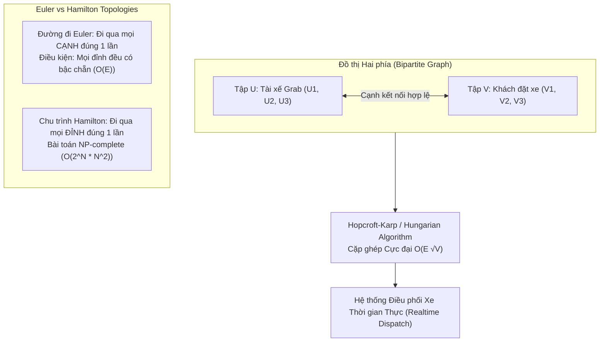

# 7.2. Graph Properties and Topologies (Các Đặc tính và Topo Đồ thị)

> [!IMPORTANT]
> **Nếu bạn chỉ được nhớ một điều duy nhất:** Đồ thị hai phía (Bipartite Graph) là bản thiết kế toán học của mọi bài toán ghép cặp tài nguyên (Matching Problem: Tài xế - Hành khách Grab, Task - Worker); và Định lý Kőnig chứng minh rằng một đồ thị là hai phía khi và chỉ khi nó **không chứa bất kỳ chu trình nào có độ dài lẻ**.

---

## 1. Kiến trúc Tổng quan & Mô hình Tư duy (Mental Model)

Hãy tưởng tượng bạn đang xây dựng thuật toán điều phối xe công nghệ (như Grab hay Uber):
- Bạn có tập hợp các **Tài xế đang sẵn sàng** ($U$) và tập hợp các **Khách hàng đang đặt xe** ($V$).
- Không có bất kỳ tài xế nào chở tài xế khác, và cũng không có hành khách nào chở hành khách khác. Các cạnh kết nối chỉ có thể đi từ tập $U$ sang tập $V$.
- Đây chính là một **Đồ thị Hai phía (Bipartite Graph)**!
- Nhiệm vụ tìm cách ghép tối đa số cặp tài xế - hành khách sao cho tổng quãng đường ngắn nhất chính là bài toán **Cặp ghép Cực đại trên Đồ thị Hai phía (Maximum Bipartite Matching)**, giải quyết bằng thuật toán **Hopcroft-Karp** hoặc **Hungarian Algorithm**.

Ngược lại, trong bài toán logistics giao hàng:
- Người giao hàng muốn xuất phát từ kho, đi qua mọi con đường trong thành phố đúng 1 lần rồi trở về kho: đó là bài toán **Chu trình Euler (Eulerian Circuit)** — giải quyết được trong thời gian tuyến tính $O(E)$.
- Nhưng nếu người giao hàng muốn đi qua mọi **địa điểm giao hàng (đỉnh)** đúng 1 lần với quãng đường ngắn nhất: đó là bài toán **Người giao hàng (Traveling Salesperson Problem - TSP / Hamiltonian Cycle)** — bài toán NP-hard kinh điển làm đau đầu các siêu máy tính suốt nửa thế kỷ qua!



---

## 2. Chi tiết từng Keyword (Under-the-Hood Deep Dive)

### 2.1. Complete Graph ($K_n$) & Regular Graph (Đồ thị Đầy đủ và Chính quy)
- **A. Complete Graph ($K_n$ - Đồ thị Đầy đủ)**:
  - Đồ thị đơn vô hướng gồm $n$ đỉnh, trong đó giữa hai đỉnh bất kỳ **luôn có một cạnh nối trực tiếp**.
  - Tổng số cạnh của $K_n$:
    $$|E| = \binom{n}{2} = \frac{n(n - 1)}{2}$$
  - Mỗi đỉnh trong $K_n$ đều có bậc là $n - 1$.
  - Ứng dụng: Mạng lưới Full-Mesh trong kiến trúc viễn thông (đảm bảo độ trễ tối thiểu nhưng chi phí đường truyền đạt mức $O(N^2)$).
- **B. Regular Graph ($k$-Regular - Đồ thị Chính quy)**:
  - Đồ thị mà trong đó **toàn bộ mọi đỉnh đều có cùng bậc là $k$**:
    $$\forall v \in V, \quad \deg(v) = k$$
  - Tổng số cạnh: $|E| = \frac{n \cdot k}{2}$ (do đó tích $n \cdot k$ bắt buộc phải là số chẵn).
  - Ứng dụng: Mạng Hypercube ($n$-cube) trong kiến trúc siêu máy tính song song, cấu trúc đồ thị mở rộng (Expander Graphs).

### 2.2. Bipartite Graph ($K_{m,n}$ - Đồ thị Hai phía / Đồ thị Phân đôi)
- **Định nghĩa toán học**: Đồ thị $G = (V, E)$ được gọi là hai phía nếu tập đỉnh $V$ có thể phân hoạch thành hai tập con rời nhau $V_1$ và $V_2$ ($V_1 \cap V_2 = \emptyset$ và $V_1 \cup V_2 = V$) sao cho **mọi cạnh trong $E$ đều nối một đỉnh thuộc $V_1$ với một đỉnh thuộc $V_2$**:
  $$\forall e = \{u, v\} \in E, \quad u \in V_1 \land v \in V_2$$
  (Tuyệt đối không có cạnh nào nối hai đỉnh cùng nằm trong $V_1$ hoặc cùng nằm trong $V_2$).
- **Định lý Nhận diện Bipartite (Định lý Kőnig 1936)**:
  - Một đồ thị là đồ thị hai phía **KHI VÀ CHỈ KHI nó không chứa bất kỳ chu trình nào có độ dài lẻ (Odd-length Cycle)**.
  - *Thuật toán kiểm tra*: Sử dụng thuật toán tô 2 màu (2-Coloring BFS/DFS). Nếu tô màu đồ thị bằng 2 màu (Đỏ và Xanh) mà không có hai đỉnh kề nhau nào cùng màu, đồ thị là Bipartite.
- **Complete Bipartite Graph ($K_{m,n}$ - Đồ thị Hai phía Đầy đủ)**:
  - Mọi đỉnh trong $V_1$ ($|V_1|=m$) đều nối với tất cả các đỉnh trong $V_2$ ($|V_2|=n$).
  - Số cạnh: $|E| = m \times n$.

### 2.3. Sparse Graph vs Dense Graph (Đồ thị Thưa và Đồ thị Đặc)
- **Sparse Graph (Đồ thị Thưa)**: Số lượng cạnh $|E|$ tỷ lệ tuyến tính với số lượng đỉnh ($|E| \approx O(V)$). Ví dụ: Mạng lưới đường bộ, mạng lưới xã hội, web graph.
- **Dense Graph (Đồ thị Đặc)**: Số lượng cạnh $|E|$ tiệm cận mức tối đa $|E| \approx O(V^2)$.
- **Ý nghĩa Lựa chọn Thuật toán**:
  - Tìm cây khung nhỏ nhất (MST):
    - Đồ thị Thưa: Dùng thuật toán **Kruskal** với DSU ($O(E \log E)$ nhanh hơn).
    - Đồ thị Đặc: Dùng thuật toán **Prim** với ma trận kề ($O(V^2)$ nhanh hơn Prim với Binary Heap).

### 2.4. Subgraph & Induced Subgraph (Đồ thị con và Đồ thị con Cảm sinh)
- **Subgraph (Đồ thị con $G' = (V', E')$)**: $V' \subseteq V$ và $E' \subseteq E$ sao cho mọi cạnh trong $E'$ đều có hai đầu mút thuộc $V'$.
- **Induced Subgraph (Đồ thị con Cảm sinh $G[S]$)**: Cho tập con đỉnh $S \subseteq V$. Đồ thị con cảm sinh bởi $S$ gồm các đỉnh thuộc $S$ và **toàn bộ các cạnh ban đầu trong $G$ có hai đầu mút nằm trong $S$**.

### 2.5. Graph Isomorphism (Đẳng cấu Đồ thị)
- Hai đồ thị $G_1 = (V_1, E_1)$ và $G_2 = (V_2, E_2)$ được gọi là đẳng cấu ($G_1 \simeq G_2$) nếu tồn tại một **Song ánh (Bijection)** $f: V_1 \to V_2$ bảo toàn mối quan hệ kề:
  $$\{u, v\} \in E_1 \iff \{f(u), f(v)\} \in E_2$$
- Hai đồ thị đẳng cấu thực chất là một đồ thị duy nhất nhưng được đổi tên đỉnh hoặc vẽ lại vị trí không gian.
- **Bài toán Đẳng cấu Đồ thị (GI Problem)**: Là một trong số rất ít bài toán nằm trong lớp độ phức tạp NP-Intermediate (không biết thuộc P hay NP-complete, giải được trong thời gian Quasi-polynomial bởi László Babai năm 2015).

### 2.6. Eulerian vs Hamiltonian Paths and Circuits (Đường đi Euler và Hamilton)
- **A. Eulerian Path & Circuit (Đường đi và Chu trình Euler)**:
  - **Đường đi Euler**: Đi qua **mọi CẠNH** của đồ thị đúng 1 lần.
  - **Chu trình Euler**: Đường đi Euler khép kín (bắt đầu và kết thúc tại cùng một đỉnh).
  - **Định lý Euler (1736 - Khởi sinh của Lý thuyết Đồ thị)**:
    - Một đồ thị liên thông có chu trình Euler khi và chỉ khi **MỌI đỉnh đều có bậc chẵn**.
    - Có đường đi Euler (không khép kín) khi và chỉ khi có **chính xác 2 đỉnh có bậc lẻ** (điểm xuất phát và điểm kết thúc).
    - Độ phức tạp tìm kiếm: $O(V + E)$ bằng thuật toán **Hierholzer**.
- **B. Hamiltonian Path & Cycle (Đường đi và Chu trình Hamilton)**:
  - Đi qua **mọi ĐỈNH** của đồ thị đúng 1 lần.
  - **Độ phức tạp**: Bài toán xác định xem một đồ thị có chu trình Hamilton hay không là **NP-complete**. Không có điều kiện cần và đủ đơn giản như Euler!

---

## 3. Thực thi Mã nguồn & Mô phỏng Chuyên sâu (Dual-Engine Implementation)

Mô phỏng bộ kiểm tra đồ thị hai phía bằng **Thuật toán Tô 2 Màu (2-Coloring BFS)** và thuật toán tìm chu trình **Eulerian Circuit (Hierholzer's Algorithm)** trong C++20 và Python 3.11+.

### C++20 Implementation (Bipartite 2-Coloring Checker & Hierholzer Euler Engine)

```cpp
#include <iostream>
#include <vector>
#include <queue>
#include <stack>
#include <format>
#include <cstdint>

class GraphTopologyVerifier {
public:
    // 1. KIỂM TRA ĐỒ THỊ HAI PHÍA (BIPARTITE 2-COLORING CHECK)
    static bool is_bipartite(const std::vector<std::vector<uint32_t>>& adj) {
        uint32_t n = adj.size();
        std::vector<int8_t> color(n, -1); // -1: Chưa tô, 0: Màu Đỏ, 1: Màu Xanh

        for (uint32_t i = 0; i < n; ++i) {
            if (color[i] == -1) {
                std::queue<uint32_t> q;
                q.push(i);
                color[i] = 0;

                while (!q.empty()) {
                    uint32_t u = q.front();
                    q.pop();

                    for (uint32_t v : adj[u]) {
                        if (color[v] == -1) {
                            color[v] = 1 - color[u]; // Tô màu đối nghịch
                            q.push(v);
                        } else if (color[v] == color[u]) {
                            return false; // Hai đỉnh kề cùng màu -> Có chu trình lẻ -> Không Bipartite!
                        }
                    }
                }
            }
        }
        return true;
    }

    // 2. TÌM CHU TRÌNH EULER BẰNG THUẬT TOÁN HIERHOLZER
    static std::vector<uint32_t> find_eulerian_circuit(std::vector<std::vector<uint32_t>> adj) {
        // Kiểm tra điều kiện mọi đỉnh có bậc chẵn
        for (size_t i = 0; i < adj.size(); ++i) {
            if (adj[i].size() % 2 != 0) return {}; // Không có chu trình Euler
        }

        std::stack<uint32_t> current_path;
        std::vector<uint32_t> circuit;

        current_path.push(0);

        while (!current_path.empty()) {
            uint32_t u = current_path.top();
            if (!adj[u].empty()) {
                uint32_t v = adj[u].back();
                adj[u].pop_back();

                // Xóa cạnh hai chiều u - v
                auto it = std::ranges::find(adj[v], u);
                if (it != adj[v].end()) adj[v].erase(it);

                current_path.push(v);
            } else {
                circuit.push_back(u);
                current_path.pop();
            }
        }
        return circuit;
    }
};

int main() {
    std::cout << "=== GRAPH TOPOLOGY & BIPARTITE VERIFIER (C++20) ===

";

    // 1. Kiểm chứng Bipartite Graph
    // Đồ thị chu trình 4 đỉnh C_4: 0 - 1 - 2 - 3 - 0 (Chu trình chẵn -> Bipartite!)
    std::vector<std::vector<uint32_t>> c4 = {
        {1, 3}, {0, 2}, {1, 3}, {0, 2}
    };
    bool c4_bipartite = GraphTopologyVerifier::is_bipartite(c4);
    std::cout << "1. [Bipartite Graph Check]
";
    std::cout << std::format("   Chu trình C_4 (độ dài 4 chẵn) là Bipartite? {}
", c4_bipartite ? "TRUE" : "FALSE");

    // Đồ thị tam giác K_3: 0 - 1 - 2 - 0 (Chu trình lẻ 3 -> KHÔNG Bipartite!)
    std::vector<std::vector<uint32_t>> k3 = {
        {1, 2}, {0, 2}, {0, 1}
    };
    bool k3_bipartite = GraphTopologyVerifier::is_bipartite(k3);
    std::cout << std::format("   Chu trình K_3 (tam giác độ dài 3) là Bipartite? {}

", k3_bipartite ? "TRUE" : "FALSE");

    // 2. Kiểm chứng Chu trình Euler
    std::cout << "2. [Hierholzer Eulerian Circuit]
";
    // Đồ thị con bướm 5 đỉnh (tất cả các đỉnh đều có bậc chẵn: 0, 1, 3, 4 bậc 2, đỉnh 2 bậc 4)
    std::vector<std::vector<uint32_t>> butterfly = {
        {1, 2}, {0, 2}, {0, 1, 3, 4}, {2, 4}, {2, 3}
    };

    auto circuit = GraphTopologyVerifier::find_eulerian_circuit(butterfly);
    std::cout << "   Eulerian Circuit found (Đi qua mọi CẠNH đúng 1 lần):
   ";
    for (size_t i = 0; i < circuit.size(); ++i) {
        std::cout << circuit[i] << (i + 1 < circuit.size() ? " -> " : "");
    }
    std::cout << "
";

    return 0;
}
```

### Python 3.11+ Implementation (Bipartite Matching Simulation)

```python
def check_bipartite_dfs(graph: dict[int, list[int]]) -> tuple[bool, dict[int, int]]:
    # Tô 2 màu bằng DFS
    color = {}
    for node in graph:
        if node not in color:
            color[node] = 0
            stack = [node]
            while stack:
                u = stack.pop()
                for v in graph[u]:
                    if v not in color:
                        color[v] = 1 - color[u]
                        stack.append(v)
                    elif color[v] == color[u]:
                        return False, {}
    return True, color

if __name__ == "__main__":
    print("=== PYTHON BIPARTITE 2-COLORING ANALYZER ===")

    # Mô phỏng bài toán gán Job cho Worker
    # Workers: {1, 2}, Jobs: {10, 20}
    bipartite_system = {
        1: [10, 20],
        2: [10],
        10: [1, 2],
        20: [1]
    }

    is_bi, partition_colors = check_bipartite_dfs(bipartite_system)
    print(f"Hệ thống phân bổ công việc có cấu trúc Bipartite? {is_bi}")
    if is_bi:
        set_A = [n for n, c in partition_colors.items() if c == 0]
        set_B = [n for n, c in partition_colors.items() if c == 1]
        print(f"  Phân hoạch Tập V1 (Workers): {set_A}")
        print(f"  Phân hoạch Tập V2 (Jobs)   : {set_B}")
```

### Simulated Terminal Output

```text
=== GRAPH TOPOLOGY & BIPARTITE VERIFIER (C++20) ===

1. [Bipartite Graph Check]
   Chu trình C_4 (độ dài 4 chẵn) là Bipartite? TRUE
   Chu trình K_3 (tam giác độ dài 3) là Bipartite? FALSE

2. [Hierholzer Eulerian Circuit]
   Eulerian Circuit found (Đi qua mọi CẠNH đúng 1 lần):
   0 -> 1 -> 2 -> 3 -> 4 -> 2 -> 0

=== PYTHON BIPARTITE 2-COLORING ANALYZER ===
Hệ thống phân bổ công việc có cấu trúc Bipartite? True
  Phân hoạch Tập V1 (Workers): [1, 2]
  Phân hoạch Tập V2 (Jobs)   : [10, 20]
```

---

## 4. Systems Engineering & Production Pitfalls

### 4.1. Sai lầm Tưởng nhầm Hamiltonian Cycle có Thuật toán Tuyến tính
- Rất nhiều kỹ sư mới vào nghề nhầm lẫn giữa **Eulerian Circuit** ($O(V + E)$) và **Hamiltonian Cycle** (NP-complete).
- Họ cố gắng viết giải thuật vét cạn đệ quy ngây thơ để tìm lộ trình đi qua toàn bộ các máy chủ trong mạng WAN gồm $50$ nút.
- Kết quả: Không gian tìm kiếm là $50! \approx 3 \times 10^{64}$ phép toán — tiến trình chạy mãi mãi mà không bao giờ kết thúc, làm đóng băng toàn bộ server lập lịch.
- **Giải pháp**: Với bài toán TSP quy mô lớn, luôn sử dụng các thuật toán xấp xỉ như **Christofides Algorithm** (đảm bảo kết quả trong phạm vi $1.5 \times OPT$ trên metric graph) hoặc giải thuật di truyền Genetic / Ant Colony Optimization.

### 4.2. Bẫy Rò rỉ Bộ nhớ khi Xóa Cạnh trong Hierholzer Algorithm
- Trong thuật toán Hierholzer trên C++, việc xóa cạnh vô hướng $u - v$ đòi hỏi phải xóa $v$ khỏi danh sách của $u$ VÀ xóa $u$ khỏi danh sách của $v$.
- Nếu lập trình viên dùng `std::vector::erase()` trên danh sách kề lồng nhau, thao tác xóa ở giữa vector tốn $O(V)$ dịch chuyển phần tử, đẩy độ phức tạp từ $O(E)$ lên thành $O(E \cdot V)$.
- **Khắc phục**: Sử dụng `std::unordered_set` cho các cạnh động hoặc đánh dấu mảng boolean `visited_edges` để bỏ qua các cạnh đã duyệt trong $O(1)$.

---

## 5. Bảng So sánh & Decision Matrix

| Khái niệm Topo | Tiêu chí Nhận diện Toán học | Độ phức tạp Thuật toán | Thuật toán Tiêu biểu | Ứng dụng Thực tế Tiêu biểu |
| :--- | :--- | :--- | :--- | :--- |
| **Đồ thị Hai phía (Bipartite)** | Không có chu trình độ dài lẻ | $O(V + E)$ | 2-Coloring BFS | Grab matching, Phân bổ CPU Core |
| **Đồ thị Đầy đủ ($K_n$)** | $|E| = n(n-1)/2$, mọi cặp nối nhau | $O(V^2)$ | Kiểm tra ma trận kề | Mạng viễn thông Full-Mesh |
| **Chu trình Euler** | Mọi đỉnh đều có bậc chẵn | $O(V + E)$ (Đa thức) | Hierholzer's Algorithm | Xe quét rác, Lập trình máy in 3D |
| **Chu trình Hamilton** | Đi qua mọi đỉnh đúng 1 lần | NP-complete ($O(2^n n^2)$)| Held-Karp / Heuristics | Logistics giao hàng, Lắp ráp mạch vi điện tử |
| **Đẳng cấu Đồ thị (Isomorphism)** | Tồn tại song ánh bảo toàn cạnh | Quasi-polynomial | Babai's Algorithm / VF2 | Nhận diện cấu trúc hóa học, Phân tích mã độc |
