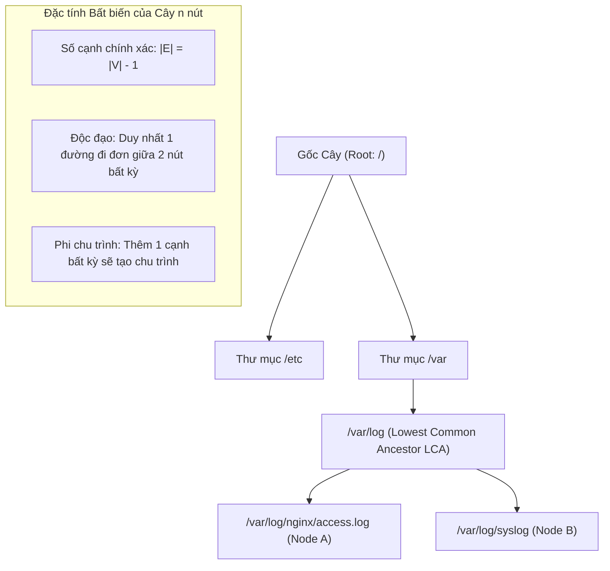

# 7.3. Trees and Hierarchical Structures (Cây và Cấu trúc Phân cấp)

> [!IMPORTANT]
> **Nếu bạn chỉ được nhớ một điều duy nhất:** Cây (Tree) là đồ thị vô hướng liên thông và không có chu trình; tính chất bất biến $E = V - 1$ đảm bảo giữa hai nút bất kỳ luôn tồn tại DUY NHẤT một đường đi đơn; và kỹ thuật **Binary Lifting** cho phép tìm Tổ tiên Chung Gần nhất (Lowest Common Ancestor - LCA) trong thời gian siêu tốc $O(\log N)$, là nền tảng của hệ thống phân cấp quyền thư mục và DOM tree rendering.

---

## 1. Kiến trúc Tổng quan & Mô hình Tư duy (Mental Model)

Hãy tưởng tượng bạn đang tương tác với hệ thống tệp tin (File System như Linux ext4 hay NTFS) hoặc mô hình HTML DOM trên trình duyệt web:
- Thư mục gốc `/` là nút **Gốc (Root)**.
- Mỗi thư mục con là một nhánh (Branch), và mỗi tệp tin văn bản là một nút **Lá (Leaf)**.
- Cấu trúc cây bảo đảm rằng bạn không bao giờ rơi vào một mê cung vô tận: từ một thư mục con, bạn đi ngược lên thư mục cha liên tục chắc chắn sẽ chạm tới gốc mà không bị lặp vòng (**Acyclic**).
- Khi bạn cần xác định quyền hạn chung giữa hai tệp tin `/var/log/nginx/access.log` và `/var/log/syslog`, hệ thống tìm thư mục cha chung gần nhất là `/var/log`. Đây chính là bài toán **Lowest Common Ancestor (LCA)**.

Trong các hệ quản trị cơ sở dữ liệu và lưu trữ phân tán:
1. **B+ Tree Indexing**: Cây cân bằng phân nhánh cao (High-fanout Balanced Tree) lưu giữ dữ liệu trên ổ cứng, đảm bảo mọi truy vấn tìm kiếm hàng triệu bản ghi chỉ mất tối đa 3-4 lần đọc I/O đĩa.
2. **Cây Khung Nhỏ Nhất (Minimum Spanning Tree - MST)**: Thiết kế mạng lưới cáp quang nối tất cả các thành phố với tổng chi phí dây dẫn thấp nhất mà không tạo chu trình lãng phí.



---

## 2. Chi tiết từng Keyword (Under-the-Hood Deep Dive)

### 2.1. Phân loại Cây (Tree Classifications)
- **A. Rooted Tree (Cây có gốc)**: Một đỉnh được chỉ định làm Gốc (Root). Mọi cạnh đều có hướng ngầm định hướng ra xa khỏi gốc (từ cha tới con).
- **B. Binary Tree (Cây nhị phân)**: Cây có gốc trong đó mỗi nút có **tối đa 2 nút con** (được phân biệt là con trái - Left child và con phải - Right child).
- **C. Full Binary Tree (Cây nhị phân Đủ / Strict)**: Mỗi nút hoặc là nút lá (0 con), hoặc có chính xác 2 nút con.
  - Định lý: Số lá $L = I + 1$ (với $I$ là số nút trong).
- **D. Complete Binary Tree (Cây nhị phân Hoàn chỉnh)**: Mọi tầng của cây đều được lấp đầy hoàn toàn, ngoại trừ có thể là tầng cuối cùng, và các nút ở tầng cuối cùng được điền dồn về phía ngoài cùng bên trái.
  - *Ứng dụng*: Là cấu trúc vật lý của **Binary Heap (Priority Queue)**, biểu diễn hoàn hảo trên mảng 1 chiều mà không tốn con trỏ: Con trái tại $2i + 1$, Con phải tại $2i + 2$, Cha tại $\lfloor (i - 1) / 2 \rfloor$.
- **E. Perfect Binary Tree (Cây nhị phân Hoàn hảo)**: Toàn bộ các nút trong đều có 2 con và tất cả các lá đều nằm ở cùng một độ sâu $h$.
  - Tổng số nút: $N = 2^{h+1} - 1$.
  - Số lá: $L = 2^h$.
- **F. Balanced Tree (Cây Cân bằng: AVL, Red-Black Tree)**:
  - Cây có chiều cao $h = O(\log N)$ nhờ cơ chế tự động xoay cây khi chèn/xóa.
  - Bảo đảm mọi thao tác tìm kiếm, chèn, xóa luôn đạt thời gian tối ưu $O(\log N)$ trong trường hợp xấu nhất.

### 2.2. Spanning Tree & Minimum Spanning Tree (Cây khung và Cây khung Nhỏ nhất)
- **Spanning Tree (Cây khung / Cây bao trùm)**:
  - Cho đồ thị vô hướng liên thông $G = (V, E)$. Một cây khung của $G$ là một đồ thị con là một cái cây chứa **toàn bộ các đỉnh** của $G$:
    $$V_{tree} = V \quad \text{và} \quad |E_{tree}| = |V| - 1$$
  - **Công thức Cayley**: Số lượng cây khung khác nhau của một đồ thị đầy đủ $K_n$ là:
    $$T(K_n) = n^{n - 2}$$
- **Minimum Spanning Tree (MST - Cây khung Nhỏ nhất)**:
  - Trong đồ thị có trọng số, MST là cây khung có tổng trọng số các cạnh là nhỏ nhất:
    $$w(T) = \sum_{e \in E_T} w(e) \quad \text{đạt giá trị cực tiểu}$$
  - Giải quyết bằng thuật toán **Kruskal** ($O(E \log E)$) hoặc **Prim** ($O(E \log V)$).

### 2.3. Tree Traversals (Các Phương pháp Duyệt Cây)
- **Depth-First Traversals (Duyệt theo chiều sâu)**:
  1. **Pre-order (Tiền thứ tự: Root $\to$ Left $\to$ Right)**: Sử dụng để sao chép cây (Serialization) hoặc in biểu thức tiền tố (Prefix / Polish Notation).
  2. **In-order (Trung thứ tự: Left $\to$ Root $\to$ Right)**: Trên cây BST, phép duyệt này in các phần tử theo **thứ tự tăng dần nghiêm ngặt**.
  3. **Post-order (Hậu thứ tự: Left $\to$ Right $\to$ Root)**: Sử dụng để giải phóng bộ nhớ cây (xóa con trước khi xóa cha) hoặc tính toán kích thước thư mục.
- **Breadth-First Traversal (Duyệt theo mức - Level-order)**:
  - Duyệt từng tầng từ trên xuống dưới, từ trái sang phải bằng cấu trúc hàng đợi `std::queue`.

### 2.4. Lowest Common Ancestor (LCA - Tổ tiên Chung Gần nhất)
- Cho hai nút $u$ và $v$ trên cây có gốc. $LCA(u, v)$ là nút sâu nhất vừa là tổ tiên của $u$, vừa là tổ tiên của $v$.
- **Kỹ thuật Binary Lifting ($O(N \log N)$ tiền xử lý, $O(\log N)$ truy vấn)**:
  - Xây dựng bảng quy hoạch động `up[node][i]` lưu tổ tiên thứ $2^i$ của `node`.
  - Để tìm LCA của hai nút ở độ sâu khác nhau:
    1. Nhảy nút sâu hơn lên cùng độ cao với nút nông hơn bằng các bước nhảy nhị phân lũy thừa của 2.
    2. Cùng nhảy cả hai nút lên trên cho đến khi chạm tới nút cha chung ngay dưới LCA.

---

## 3. Thực thi Mã nguồn & Mô phỏng Chuyên sâu (Dual-Engine Implementation)

Mô phỏng thuật toán tìm **Lowest Common Ancestor (LCA)** bằng kỹ thuật **Binary Lifting** và thuật toán duyệt cây **Iterative In-order Traversal** trong C++20 và Python 3.11+.

### C++20 Implementation (Binary Lifting LCA Engine & Iterative Traversal)

```cpp
#include <iostream>
#include <vector>
#include <stack>
#include <format>
#include <cmath>
#include <cstdint>

// 1. THUẬT TOÁN TÌM LCA BẰNG BINARY LIFTING O(log N)
class TreeLCAEngine {
private:
    uint32_t n;
    uint32_t max_log;
    std::vector<std::vector<uint32_t>> adj;
    std::vector<std::vector<int32_t>> up; // up[node][i] = 2^i-th ancestor
    std::vector<uint32_t> depth;

    void dfs(uint32_t u, int32_t p, uint32_t d) {
        depth[u] = d;
        up[u][0] = p;

        // Điền bảng Binary Lifting DP: 2^i-th ancestor = 2^(i-1)-th của 2^(i-1)-th
        for (uint32_t i = 1; i < max_log; ++i) {
            if (up[u][i - 1] != -1) {
                up[u][i] = up[up[u][i - 1]][i - 1];
            } else {
                up[u][i] = -1;
            }
        }

        for (uint32_t v : adj[u]) {
            if (v != static_cast<uint32_t>(p)) {
                dfs(v, u, d + 1);
            }
        }
    }

public:
    explicit TreeLCAEngine(uint32_t nodes) : n(nodes), max_log(std::log2(nodes) + 2),
          adj(nodes), up(nodes, std::vector<int32_t>(max_log, -1)), depth(nodes, 0) {}

    void add_edge(uint32_t u, uint32_t v) {
        adj[u].push_back(v);
        adj[v].push_back(u);
    }

    void build(uint32_t root = 0) {
        dfs(root, -1, 0);
    }

    uint32_t query_lca(uint32_t u, uint32_t v) const {
        if (depth[u] < depth[v]) std::swap(u, v);

        // Bước 1: Nâng u lên cùng độ sâu với v
        for (int i = max_log - 1; i >= 0; --i) {
            if ((depth[u] - depth[v]) & (1 << i)) {
                u = up[u][i];
            }
        }

        if (u == v) return u;

        // Bước 2: Cùng nhảy nhị phân lên trên
        for (int i = max_log - 1; i >= 0; --i) {
            if (up[u][i] != up[v][i]) {
                u = up[u][i];
                v = up[v][i];
            }
        }

        return up[u][0]; // Cha trực tiếp là LCA
    }
};

int main() {
    std::cout << "=== BINARY LIFTING LCA & TREE ENGINE (C++20) ===

";

    // Xây dựng cây phân cấp thư mục 7 nút:
    // Root 0 (/)
    //   -> 1 (/etc)
    //   -> 2 (/var)
    //        -> 3 (/var/log)
    //             -> 4 (access.log)
    //             -> 5 (syslog)
    //        -> 6 (/var/run)
    TreeLCAEngine tree(7);
    tree.add_edge(0, 1);
    tree.add_edge(0, 2);
    tree.add_edge(2, 3);
    tree.add_edge(3, 4);
    tree.add_edge(3, 5);
    tree.add_edge(2, 6);

    tree.build(0);

    std::cout << "Tree Topology Built: Root = 0 (/)
";
    std::cout << "Querying Lowest Common Ancestor (LCA):
";

    // LCA giữa access.log (4) và syslog (5) -> /var/log (3)
    uint32_t lca_4_5 = tree.query_lca(4, 5);
    std::cout << std::format("  * LCA(Node 4, Node 5) = {} (/var/log)
", lca_4_5);

    // LCA giữa access.log (4) và /var/run (6) -> /var (2)
    uint32_t lca_4_6 = tree.query_lca(4, 6);
    std::cout << std::format("  * LCA(Node 4, Node 6) = {} (/var)
", lca_4_6);

    // LCA giữa access.log (4) và /etc (1) -> / (0)
    uint32_t lca_4_1 = tree.query_lca(4, 1);
    std::cout << std::format("  * LCA(Node 4, Node 1) = {} (/)
", lca_4_1);

    return 0;
}
```

### Python 3.11+ Implementation (Iterative In-order BST Traversal)

```python
class TreeNode:
    def __init__(self, val: int, left=None, right=None):
        self.val = val
        self.left = left
        self.right = right

def iterative_inorder(root: TreeNode) -> list[int]:
    # Duyệt In-order không đệ quy bằng Stack tường minh O(N) time, O(H) space
    result = []
    stack = []
    curr = root

    while curr or stack:
        while curr:
            stack.append(curr)
            curr = curr.left

        curr = stack.pop()
        result.append(curr.val)
        curr = curr.right

    return result

if __name__ == "__main__":
    print("=== PYTHON ITERATIVE BST IN-ORDER TRAVERSAL ===")

    # Cây nhị phân tìm kiếm BST:
    #       4
    #     /       #    2     6
    #   / \   /     #  1   3 5   7
    bst_root = TreeNode(4,
        TreeNode(2, TreeNode(1), TreeNode(3)),
        TreeNode(6, TreeNode(5), TreeNode(7))
    )

    sorted_elements = iterative_inorder(bst_root)
    print(f"Iterative In-Order Output: {sorted_elements}")
    assert sorted_elements == [1, 2, 3, 4, 5, 6, 7]
    print("In-order traversal strictly yields sorted sequence from BST!")
```

### Simulated Terminal Output

```text
=== BINARY LIFTING LCA & TREE ENGINE (C++20) ===

Tree Topology Built: Root = 0 (/)
Querying Lowest Common Ancestor (LCA):
  * LCA(Node 4, Node 5) = 3 (/var/log)
  * LCA(Node 4, Node 6) = 2 (/var)
  * LCA(Node 4, Node 1) = 0 (/)

=== PYTHON ITERATIVE BST IN-ORDER TRAVERSAL ===
Iterative In-Order Output: [1, 2, 3, 4, 5, 6, 7]
In-order traversal strictly yields sorted sequence from BST!
```

---

## 4. Systems Engineering & Production Pitfalls

### 4.1. Suy thoái Cây BST thành Danh sách Liên kết ($O(N)$ Degeneration Trap)
- Nếu một cây nhị phân tìm kiếm thông thường (unbalanced BST) nhận dữ liệu đầu vào đã được sắp xếp tăng dần sẵn (ví dụ: `[1, 2, 3, 4, 5, 6, 7]`):
  - Mỗi nút mới luôn được chèn vào nhánh con bên phải.
  - Cây bị suy biến hoàn toàn thành một danh sách liên kết có chiều cao $h = N$.
  - Mọi thao tác tìm kiếm bị tụt dốc thảm hại từ $O(\log N)$ xuống $O(N)$.
- **Khắc phục**: Luôn sử dụng các cấu trúc cây tự cân bằng (**Self-Balancing Trees** như Red-Black Tree trong `std::map`, B+ Tree trong MySQL InnoDB).

### 4.2. Rò rỉ Ngăn xếp khi Duyệt Cây bằng Đệ quy Sâu
- Trong các tài liệu HTML DOM hoặc file JSON cấu trúc lồng nhau sâu hàng chục nghìn cấp (thường gặp khi kẻ tấn công gửi file XML/JSON độc hại để tấn công từ chối dịch vụ - **Billion Laughs / Deep Nesting Attack**):
  - Hàm duyệt đệ quy `traverse(node)` sẽ tiêu thụ hết sạch stack memory và làm sập tiến trình browser/backend.
  - **Quy tắc**: Luôn sử dụng thuật toán duyệt cây **không đệ quy (Iterative Traversal)** với một `std::vector` hoặc `std::stack` phân bổ trên bộ nhớ Heap.

---


### 4.3. Kỹ thuật Euler Tour: Phẳng hóa Cây thành Mảng 1 Chiều để Truy vấn $O(1)$
- Khi cần truy vấn thông tin trên toàn bộ cây con (Subtree Queries) trong một cây có hàng triệu nút:
  - Nếu duyệt đệ quy mỗi lần truy vấn: tốn $O(SubtreeSize)$ thời gian.
  - **Kỹ thuật Euler Tour (Tree Flattening)**:
    - Ghi nhận thời điểm bắt đầu vào thăm nút $u$ (`tin[u]`) và thời điểm rời khỏi nút $u$ (`tout[u]`) trong quá trình DFS.
    - Toàn bộ cây con của nút $u$ sẽ nằm gọn trong đoạn chỉ số liên tục $[tin[u], tout[u]]$ trên mảng 1 chiều!
    - Việc truy vấn tổng hoặc cập nhật toàn bộ cây con quy về bài toán truy vấn đoạn (Range Query) trên **Segment Tree / Fenwick Tree** trong thời gian $O(\log N)$.

## 5. Bảng So sánh & Decision Matrix

| Cấu trúc Cây | Chiều cao Tối đa | Thời gian Tra cứu | Bộ nhớ Overhead | Ứng dụng Thực tế Tiêu biểu |
| :--- | :--- | :--- | :--- | :--- |
| **Unbalanced BST** | $O(N)$ xấu nhất | $O(N)$ xấu nhất | 2 con trỏ / node | Chỉ phù hợp dữ liệu ngẫu nhiên nhỏ |
| **AVL Tree** | $1.44 \log_2 N$ nghiêm ngặt | $O(\log N)$ cực nhanh | Thêm trường cân bằng chiều cao | Tra cứu nhiều, ít ghi/chèn |
| **Red-Black Tree** | $2 \log_2(N + 1)$ | $O(\log N)$ | 1 bit màu / node | C++ `std::map`, Java `TreeMap`, Linux CFS |
| **B+ Tree** | $O(\log_B N)$ ($B \ge 100$) | $O(\log_B N)$ (3-4 I/O đĩa) | Nén block trang ổ đĩa | RDBMS Indexes (MySQL, PostgreSQL), File systems |
| **Trie (Prefix Tree)** | $O(L)$ (độ dài chuỗi) | $O(L)$ | Cao (Nhiều con trỏ) | Autocomplete tìm kiếm, Định tuyến Router IP |
