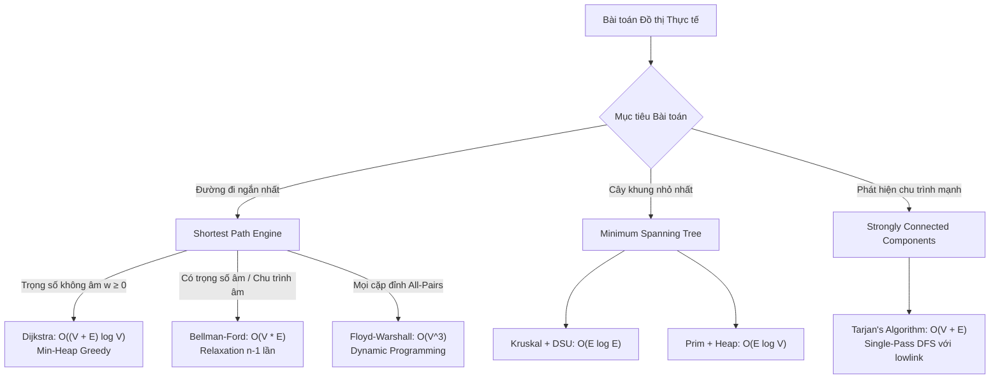

# 7.4. Graph Algorithms (Các Thuật toán Đồ thị Kinh điển)

> [!IMPORTANT]
> **Nếu bạn chỉ được nhớ một điều duy nhất:** Không có thuật toán đồ thị nào vạn năng: **Dijkstra** tìm đường ngắn nhất siêu tốc trong $O((V+E) \log V)$ nhưng sụp đổ hoàn toàn trước trọng số âm; **Bellman-Ford** xử lý được trọng số âm và phát hiện chu trình âm; trong khi **Tarjan SCC** là kiệt tác phân rã thành phần liên thông mạnh chỉ với DUY NHẤT một lần duyệt DFS $O(V + E)$.

---

## 1. Kiến trúc Tổng quan & Mô hình Tư duy (Mental Model)

Hãy tưởng tượng bạn đang xây dựng công cụ định tuyến bản đồ (Google Maps) hoặc động cơ phân tích phụ thuộc mã nguồn:
- **Bài toán Tìm đường**: Người dùng muốn tìm lộ trình lái xe nhanh nhất từ Hà Nội đến Đà Nẵng: mọi cung đường đều có thời gian di chuyển là số dương ($w(e) > 0$). **Thuật toán Dijkstra** với hàng đợi ưu tiên (Min-Priority Queue) sẽ nở hoa các nút theo hình tròn đồng tâm để tìm đích đến với thời gian nhanh nhất.
- **Bài toán Giao dịch Tài chính & Arbitrage**: Tỷ giá hối đoái giữa các đồng tiền có thể biến động. Bằng cách lấy $\log$ tỷ giá, bài toán tìm kiếm cơ hội kiếm lời phi rủi ro (Currency Arbitrage) quy về bài toán tìm **Chu trình có trọng số Âm (Negative Weight Cycle)** trên đồ thị tiền tệ. Dijkstra hoàn toàn bất lực, và chỉ có **Thuật toán Bellman-Ford** mới có thể phát hiện được cơ hội này.
- **Bài toán Phân tích Cụm Lỗi (Microservices Dependency Analysis)**: Các dịch vụ phụ thuộc vòng vo vào nhau. Thuật toán **Tarjan SCC** nén toàn bộ các nhóm dịch vụ có phụ thuộc lẫn nhau thành một đỉnh duy nhất, biến đồ thị phức tạp thành một **DAG (Directed Acyclic Graph)** phẳng.



---

## 2. Chi tiết từng Keyword (Under-the-Hood Deep Dive)

### 2.1. BFS & DFS (Duyệt theo Chiều rộng và Chiều sâu)
- **Breadth-First Search (BFS)**:
  - Sử dụng cấu trúc hàng đợi **FIFO Queue**.
  - Duyệt theo từng lớp khoảng cách tăng dần từ đỉnh xuất phát.
  - *Tính chất vàng*: Tìm đường đi ngắn nhất trên đồ thị **không trọng số** trong thời gian tối ưu $O(V + E)$.
- **Depth-First Search (DFS)**:
  - Sử dụng cấu trúc ngăn xếp **LIFO Stack** (hoặc Call Stack đệ quy).
  - Đi sâu nhất có thể theo một nhánh trước khi quay lui (Backtracking).
  - **Phân loại 4 Loại Cạnh trong Rừng DFS (Edge Classification)**:
    1. **Tree Edge**: Cạnh thuộc cây DFS dẫn tới đỉnh chưa thăm.
    2. **Back Edge**: Cạnh nối ngược về một tổ tiên trên Call Stack $\implies$ **Chỉ thị chắc chắn có CHU TRÌNH**!
    3. **Forward Edge**: Cạnh nối tới một con cháu đã thăm xong.
    4. **Cross Edge**: Cạnh nối giữa hai nhánh cây độc lập.

### 2.2. Shortest Path Algorithms (Các Thuật toán Tìm Đường đi Ngắn nhất)
- **A. Dijkstra's Algorithm ($w(e) \ge 0$)**:
  - Tư tưởng tham lam (Greedy): Duy trì mảng khoảng cách `dist[]` và hàng đợi ưu tiên `std::priority_queue`. Ở mỗi bước, chọn đỉnh $u$ chưa thăm có `dist[u]` nhỏ nhất, sau đó thực hiện thao tác **Thư giãn cạnh (Edge Relaxation)**:
    $$\text{if } dist[u] + w(u, v) < dist[v] \implies dist[v] = dist[u] + w(u, v)$$
  - Độ phức tạp: $O((V + E) \log V)$ với Binary Heap, hoặc $O(E + V \log V)$ với Fibonacci Heap.
  - *Cạm bẫy*: **Sụp đổ hoàn toàn nếu đồ thị có trọng số âm** (thuật toán có thể rơi vào vòng lặp vô hạn hoặc cho ra kết quả sai).
- **B. Bellman-Ford Algorithm (Hỗ trợ Trọng số Âm)**:
  - Thực hiện thư giãn toàn bộ $|E|$ cạnh liên tiếp $|V| - 1$ lần.
  - Độ phức tạp: $O(V \cdot E)$.
  - **Cơ chế Phát hiện Chu trình Âm**: Chạy thêm một lần duyệt cạnh thứ $|V|$. Nếu bất kỳ cạnh nào vẫn có thể được thư giãn tiếp ($dist[u] + w(u, v) < dist[v]$), thì đồ thị **chắc chắn chứa chu trình âm** có thể rút ngắn khoảng cách về âm vô cực $-\infty$.
- **C. Floyd-Warshall Algorithm (Mọi Cặp Đỉnh - All-Pairs Shortest Path)**:
  - Giải thuật Quy hoạch động giải bài toán đường đi ngắn nhất giữa mọi cặp đỉnh $(i, j)$:
    $$dist^{[k]}[i][j] = \min(dist^{[k-1]}[i][j], \; dist^{[k-1]}[i][k] + dist^{[k-1]}[k][j])$$
  - Độ phức tạp: $O(V^3)$ thời gian, $O(V^2)$ không gian.

### 2.3. Minimum Spanning Tree: Kruskal vs Prim
- **Thuật toán Kruskal**:
  - Sắp xếp toàn bộ $E$ cạnh theo trọng số tăng dần: $O(E \log E)$.
  - Duyệt qua từng cạnh: nếu hai đỉnh của cạnh thuộc hai tập hợp phân lập khác nhau (kiểm tra bằng **Disjoint Set Union - DSU** trong $O(\alpha(V))$), ta nạp cạnh vào MST và gộp hai tập hợp lại.
  - Tối ưu cho **Đồ thị Thưa (Sparse Graph)**.
- **Thuật toán Prim**:
  - Xuất phát từ một đỉnh tùy ý, duy trì một cây khung đang lớn dần. Ở mỗi bước, dùng Min-Heap để chọn cạnh có trọng số nhỏ nhất nối giữa một đỉnh **đã thuộc cây** với một đỉnh **chưa thuộc cây**.
  - Tối ưu cho **Đồ thị Đặc (Dense Graph)**.

### 2.4. Strongly Connected Components (SCC - Thành phần Liên thông Mạnh)
- **Thuật toán Tarjan ($O(V + E)$ chỉ với 1 lần DFS duy nhất)**:
  - Duy trì hai mảng chỉ số:
    - `dfn[u]`: Thời điểm đỉnh $u$ được thăm lần đầu trong DFS.
    - `lowlink[u]`: Chỉ số `dfn` nhỏ nhất mà $u$ có thể đi tới thông qua cây DFS và tối đa một back-edge.
  - Đỉnh $u$ là gốc của một SCC khi và chỉ khi: `lowlink[u] == dfn[u]`.
  - Khi đó, toàn bộ các đỉnh trên ngăn xếp từ đỉnh đỉnh stack xuống tới $u$ thuộc về cùng một SCC!

### 2.5. Disjoint Set Union (DSU / Union-Find)
- Cấu trúc dữ liệu quản lý các tập hợp rời nhau với hai tối ưu hóa kinh điển:
  1. **Path Compression (Nén đường đi)**: `find(i) { return parent[i] == i ? i : (parent[i] = find(parent[i])); }`.
  2. **Union by Rank / Size (Gộp theo kích thước)**: Luôn treo cây có độ cao nhỏ hơn vào gốc của cây có độ cao lớn hơn.
  - Hai tối ưu này giảm độ phức tạp thời gian trung bình của mỗi thao tác xuống hàm ngược Ackermann $O(\alpha(N)) < 5$ cho mọi giá trị thực tế của vũ trụ.

---

## 3. Thực thi Mã nguồn & Mô phỏng Chuyên sâu (Dual-Engine Implementation)

Mô phỏng thuật toán **Dijkstra** với Min-Priority Queue trong C++20 và thuật toán tìm thành phần liên thông mạnh **Tarjan SCC** trong Python 3.11+.

### C++20 Implementation (Dijkstra Shortest Path Engine với Min-Heap)

```cpp
#include <iostream>
#include <vector>
#include <queue>
#include <limits>
#include <format>
#include <cstdint>

struct Edge {
    uint32_t to;
    uint32_t weight;
};

struct NodeDist {
    uint32_t u;
    uint64_t dist;

    // Toán tử so sánh cho Min-Heap
    bool operator>(const NodeDist& other) const {
        return dist > other.dist;
    }
};

class DijkstraEngine {
public:
    static std::vector<uint64_t> compute_shortest_paths(uint32_t start_node, 
                                                       const std::vector<std::vector<Edge>>& adj) {
        uint32_t n = adj.size();
        std::vector<uint64_t> dist(n, std::numeric_limits<uint64_t>::max());
        std::priority_queue<NodeDist, std::vector<NodeDist>, std::greater<NodeDist>> pq;

        dist[start_node] = 0;
        pq.push({start_node, 0});

        while (!pq.empty()) {
            auto [u, d] = pq.top();
            pq.pop();

            // Nếu khoảng cách lấy ra từ queue lớn hơn khoảng cách đã tối ưu -> Bỏ qua
            if (d > dist[u]) continue;

            for (const auto& edge : adj[u]) {
                if (dist[u] + edge.weight < dist[edge.to]) {
                    dist[edge.to] = dist[u] + edge.weight;
                    pq.push({edge.to, dist[edge.to]});
                }
            }
        }
        return dist;
    }
};

int main() {
    std::cout << "=== DIJKSTRA SHORTEST PATH ENGINE (C++20) ===

";

    // Đồ thị mạng có trọng số 5 router: 0, 1, 2, 3, 4
    uint32_t V = 5;
    std::vector<std::vector<Edge>> network(V);

    auto add_directed_edge = [&](uint32_t u, uint32_t v, uint32_t w) {
        network[u].push_back({v, w});
    };

    add_directed_edge(0, 1, 10);
    add_directed_edge(0, 2, 3);
    add_directed_edge(2, 1, 1);  // Đi 0 -> 2 -> 1 tốn 3+1=4 ms (tốt hơn đi thẳng 0 -> 1 tốn 10 ms!)
    add_directed_edge(1, 3, 2);
    add_directed_edge(2, 3, 8);
    add_directed_edge(2, 4, 2);
    add_directed_edge(4, 3, 7);
    add_directed_edge(3, 4, 9);

    uint32_t source = 0;
    auto shortest_distances = DijkstraEngine::compute_shortest_paths(source, network);

    std::cout << std::format("Shortest Distances from Gateway Router #{}:
", source);
    for (uint32_t i = 0; i < V; ++i) {
        std::cout << std::format("  * Destination Router #{}: {:<4} ms latency
", 
                                 i, shortest_distances[i]);
    }

    return 0;
}
```

### Python 3.11+ Implementation (Tarjan Strongly Connected Components Engine)

```python
class TarjanSCC:
    def __init__(self, num_nodes: int, adj: list[list[int]]):
        self.n = num_nodes
        self.adj = adj
        self.timer = 0
        self.dfn = [-1] * num_nodes
        self.low = [-1] * num_nodes
        self.in_stack = [False] * num_nodes
        self.stack = []
        self.sccs = []

    def _dfs(self, u: int):
        self.dfn[u] = self.low[u] = self.timer
        self.timer += 1
        self.stack.append(u)
        self.in_stack[u] = True

        for v in self.adj[u]:
            if self.dfn[v] == -1:
                # Tree Edge
                self._dfs(v)
                self.low[u] = min(self.low[u], self.low[v])
            elif self.in_stack[v]:
                # Back Edge to node currently on Call Stack
                self.low[u] = min(self.low[u], self.dfn[v])

        # Gốc của một Thành phần Liên thông Mạnh
        if self.low[u] == self.dfn[u]:
            current_scc = []
            while True:
                w = self.stack.pop()
                self.in_stack[w] = False
                current_scc.append(w)
                if w == u:
                    break
            self.sccs.append(current_scc)

    def find_all_sccs(self) -> list[list[int]]:
        for i in range(self.n):
            if self.dfn[i] == -1:
                self._dfs(i)
        return self.sccs

if __name__ == "__main__":
    print("=== PYTHON TARJAN SCC RESOLVER ===")

    # Đồ thị gồm 5 microservices:
    # Service 0 -> 1 -> 2 -> 0 (Tạo chu trình phụ thuộc vòng giữa 0, 1, 2)
    # Service 1 -> 3 -> 4
    V = 5
    graph = [
        [1],       # 0 -> 1
        [2, 3],    # 1 -> 2, 1 -> 3
        [0],       # 2 -> 0
        [4],       # 3 -> 4
        []         # 4
    ]

    tarjan = TarjanSCC(V, graph)
    sccs = tarjan.find_all_sccs()

    print(f"Tổng số Thành phần Liên thông Mạnh (SCCs) tìm thấy: {len(sccs)}")
    for idx, scc in enumerate(sccs, 1):
        print(f"  SCC #{idx}: Services {sorted(scc)}")
```

### Simulated Terminal Output

```text
=== DIJKSTRA SHORTEST PATH ENGINE (C++20) ===

Shortest Distances from Gateway Router #0:
  * Destination Router #0: 0    ms latency
  * Destination Router #1: 4    ms latency
  * Destination Router #2: 3    ms latency
  * Destination Router #3: 6    ms latency
  * Destination Router #4: 5    ms latency

=== PYTHON TARJAN SCC RESOLVER ===
Tổng số Thành phần Liên thông Mạnh (SCCs) tìm thấy: 3
  SCC #1: Services [4]
  SCC #2: Services [3]
  SCC #3: Services [0, 1, 2]
```

---

## 4. Systems Engineering & Production Pitfalls

### 4.1. Thảm họa Vòng lặp Vô hạn khi Dùng Dijkstra với Cạnh Âm
- **Cơ chế**: Khi đồ thị có cạnh âm, giả định tham lam của Dijkstra: *"Đỉnh được lấy ra khỏi priority queue đã có khoảng cách tối ưu tuyệt đối"* bị sụp đổ hoàn toàn.
- Nếu đồ thị có một chu trình có tổng trọng số âm ($Negative Cycle$), thuật toán Dijkstra sẽ liên tục đẩy đỉnh vào queue với khoảng cách ngày càng giảm ($0, -5, -10, -15, \dots$).
- Hàng đợi ưu tiên sẽ phình to không giới hạn, gây cạn kiệt bộ nhớ RAM và làm sập server do lỗi **OOM Killer**.
- **Quy tắc**: Luôn kiểm tra tiền đề $w(e) \ge 0$ trước khi gọi Dijkstra. Nếu đồ thị có thể chứa trọng số âm, bắt buộc phải dùng **Bellman-Ford** hoặc **SPFA (Shortest Path Faster Algorithm)**.

### 4.2. Quên Kiểm tra Phần tử Rác trong Dijkstra Priority Queue (Lazy Deletion Trap)
- Trong C++, `std::priority_queue` không hỗ trợ thao tác giảm khóa `decrease_key()`. Ta phải dùng kỹ thuật **Lazy Insertion**: đẩy cặp `{node, new_dist}` mới vào queue.
- Khi lấy phần tử ra, nếu không kiểm tra dòng lệnh sống còn:
  ```cpp
  if (d > dist[u]) continue; // BỎ QUA NÚT RÁC
  ```
  Thuật toán sẽ duyệt lại hàng triệu trạng thái đỉnh lỗi thời đã bị thư giãn trước đó, đẩy thời gian chạy từ $O(E \log V)$ lên tới mức số mũ $O(2^V)$ trong các đồ thị dày đặc!

---

## 5. Bảng So sánh & Decision Matrix

| Thuật toán | Vấn đề Giải quyết | Trọng số Âm? | Độ phức tạp Thời gian | Cấu trúc Dữ liệu Cốt lõi |
| :--- | :--- | :--- | :--- | :--- |
| **BFS** | Shortest path trên đồ thị không trọng số | Không | $O(V + E)$ | FIFO Queue |
| **Dijkstra** | Single-Source Shortest Path | **KHÔNG** ($w \ge 0$) | $O((V + E) \log V)$ | Min-Priority Queue |
| **Bellman-Ford**| Single-Source Shortest Path | **CÓ** (Phát hiện chu trình âm) | $O(V \cdot E)$ | Mảng phẳng `dist[]` |
| **Floyd-Warshall**| All-Pairs Shortest Path | Có (Không có chu trình âm)| $O(V^3)$ | Ma trận 2D DP |
| **Kruskal** | Minimum Spanning Tree (MST) | Có | $O(E \log E)$ | Disjoint Set Union (DSU) |
| **Prim** | Minimum Spanning Tree (MST) | Có | $O(E \log V)$ | Min-Priority Queue |
| **Tarjan SCC** | Strongly Connected Components | Không áp dụng trọng số | $O(V + E)$ | DFS Stack + lowlink array |
