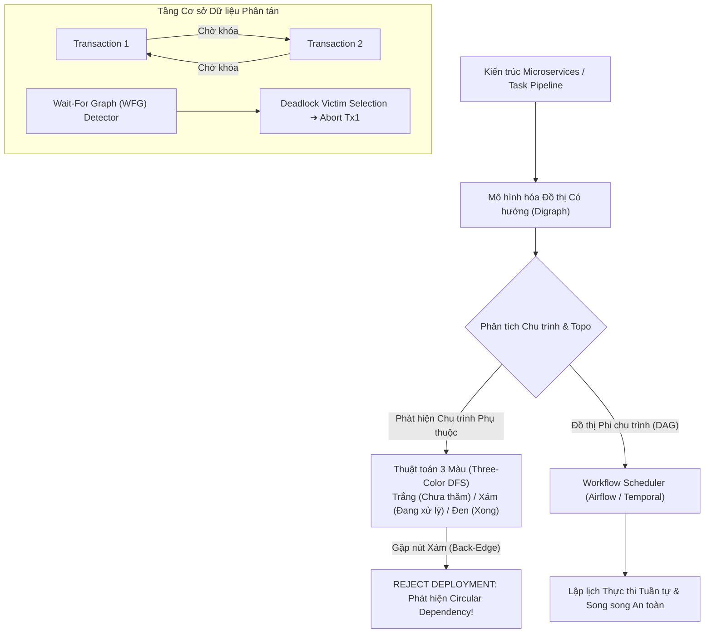

# 7.5. Graph Theory in Distributed Systems and Backend (Ứng dụng Lý thuyết Đồ thị trong Hệ thống Phân tán và Backend)

> [!IMPORTANT]
> **Nếu bạn chỉ được nhớ một điều duy nhất:** Mọi kiến trúc microservices và hạ tầng phân tán đều là một đồ thị động: phát hiện chu trình phụ thuộc bằng **Thuật toán 3 Màu (Three-Color DFS)** giải cứu hệ thống khỏi hiện tượng sập đổ khởi động (Startup Deadlock), và đồ thị **Wait-For Graph (WFG)** là thẩm phán tối cao giải quyết xung đột khóa trong mọi cơ sở dữ liệu ACID.

---

## 1. Kiến trúc Tổng quan & Mô hình Tư duy (Mental Model)

Hãy tưởng tượng bạn đang quản lý một cụm hạ tầng đám mây gồm 500 microservices (Kubernetes cluster):
- Service A gọi Service B; Service B gọi Service C; và Service C vô tình gọi lại Service A.
- Khi toàn bộ data center khởi động lại sau sự cố mất điện (Cold Start):
  - Service A đợi Service B khởi động xong để lấy cấu hình.
  - Service B đợi Service C.
  - Service C lại đợi Service A.
  - Cả 3 dịch vụ treo vô hạn (**Deadlock do Chu trình Phụ thuộc - Circular Dependency**).
- Để ngăn chặn thảm họa này trong pipeline CI/CD:
  - Hệ thống Service Mesh biểu diễn toàn bộ phụ thuộc dưới dạng một **Directed Graph**.
  - Thuật toán **Phát hiện Chu trình 3 Màu (Three-Color DFS)** quét đồ thị trong vài phần nghìn giây và từ chối deploy ngay lập tức nếu phát hiện bất kỳ cạnh ngược (Back-Edge) nào.

Tương tự trong các công cụ điều phối luồng dữ liệu (Apache Airflow, Temporal, AWS Step Functions):
- Mọi workflow đều được ép buộc phải là một **Directed Acyclic Graph (DAG)**. Thuật toán phân tích đường găng (Critical Path Method - CPM) tính toán chính xác chuỗi tác vụ quyết định tổng thời gian hoàn thành pipeline.



---

## 2. Chi tiết từng Keyword (Under-the-Hood Deep Dive)

### 2.1. Service Dependency Graph & Circular Dependency Detection (Đồ thị Phụ thuộc Dịch vụ)
- **Mô hình hóa Đồ thị**:
  - Đỉnh $V$: Danh sách các microservices hoặc thư viện module.
  - Cạnh có hướng $(u, v) \in E$: Dịch vụ $u$ phụ thuộc trực tiếp vào dịch vụ $v$ ($u$ cần $v$ để hoạt động).
- **Thuật toán 3 Màu (Three-Color DFS Cycle Detection)**:
  - Duy trì trạng thái của mỗi đỉnh bằng 3 màu:
    1. **Màu Trắng (WHITE = 0)**: Đỉnh chưa được thăm.
    2. **Màu Xám (GRAY = 1)**: Đỉnh đang nằm trên nhánh đệ quy hiện tại (đang được xử lý trên Call Stack).
    3. **Màu Đen (BLACK = 2)**: Đỉnh và toàn bộ cây con của nó đã được duyệt xong hoàn toàn.
  - **Quy tắc Phát hiện Chu trình**: Trong quá trình DFS, nếu từ đỉnh hiện tại $u$ (GRAY), ta phát hiện một cạnh đi tới đỉnh lân cận $v$ mà $v$ **cũng đang có màu GRAY**, điều đó khẳng định chắc chắn tồn tại một **Cạnh ngược (Back-Edge)** dẫn về chính nhánh tổ tiên đang xử lý. Chu trình đã được phát hiện!

### 2.2. Workflow Engines & Task Scheduling (Temporal, Airflow, Step Functions)
- **Bản chất**: Một workflow xử lý dữ liệu (ETL / Data Pipeline) là một đồ thị DAG $G = (V, E)$, trong đó mỗi đỉnh là một Task và mỗi cạnh là một ràng buộc tiền điều kiện.
- **Critical Path Method (CPM - Phương pháp Đường găng)**:
  - Cho mỗi tác vụ $v$ có thời gian thực thi $duration(v)$.
  - **Đường găng (Critical Path)**: Là đường đi có tổng thời gian thực thi dài nhất từ nút bắt đầu tới nút kết thúc trên DAG.
  - *Ý nghĩa kỹ thuật*: Bất kỳ sự chậm trễ nào của một tác vụ nằm trên Đường găng đều sẽ làm chậm toàn bộ thời gian hoàn thành của cả hệ thống pipeline.

### 2.3. Deadlock Detection: Wait-For Graph (WFG) trong Database Engines
- Trong cơ sở dữ liệu quan hệ (PostgreSQL, MySQL InnoDB):
  - Khi Transaction $T_1$ cố gắng ghi vào dòng dữ liệu đang bị khóa bởi Transaction $T_2$, $T_1$ chuyển sang trạng thái chờ (Wait).
  - Động cơ cơ sở dữ liệu duy trì đồ thị **Wait-For Graph (WFG)**:
    - Đỉnh: Các Transactions đang hoạt động.
    - Cạnh có hướng $T_i \to T_j$: $T_i$ đang chờ $T_j$ nhả khóa tài nguyên.
- **Deadlock Detector Thread**:
  - Định kỳ (mỗi $1\text{s}$ hoặc ngay khi có request chờ lâu hơn `deadlock_timeout`), một tiến trình chạy ngầm quét WFG.
  - Nếu phát hiện chu trình ($T_1 \to T_2 \to \dots \to T_1$), hệ thống chọn ra một **Nạn nhân (Deadlock Victim)** — thường là transaction thực hiện ít thao tác ghi nhất — và ném lỗi `ERROR: deadlock detected`, tự động rollback transaction này để giải phóng khóa cho các transaction còn lại.

### 2.4. Data Lineage & Knowledge Graphs (Nguồn gốc Dữ liệu và Đồ thị Tri thức)
- **Data Lineage (Truy vết Nguồn gốc Dữ liệu)**:
  - Trong các hệ thống Big Data (Apache Atlas, OpenLineage): Theo dõi xem một chỉ số trong báo cáo tài chính được tính toán từ những bảng trung gian nào, qua những công thức ETL nào, và xuất phát từ nguồn dữ liệu thô nào.
  - Biểu diễn bằng DAG đa tầng. Cho phép thực hiện phân tích tác động (Impact Analysis): nếu sửa một cột trong bảng gốc thì những dashboard nào ở hạ nguồn sẽ bị ảnh hưởng.

---

## 3. Thực thi Mã nguồn & Mô phỏng Chuyên sâu (Dual-Engine Implementation)

Mô phỏng bộ kiểm tra phụ thuộc dịch vụ **Three-Color DFS Cycle Detector** trong C++20 và bộ phát hiện bế tắc **Wait-For Graph Deadlock Resolver** trong Python 3.11+.

### C++20 Implementation (Service Mesh Three-Color DFS Cycle Detector)

```cpp
#include <iostream>
#include <vector>
#include <string>
#include <format>
#include <cstdint>

enum class Color : uint8_t { White, Gray, Black };

class ServiceDependencyEngine {
private:
    uint32_t num_services;
    std::vector<std::string> service_names;
    std::vector<std::vector<uint32_t>> adj;

    bool dfs_cycle(uint32_t u, std::vector<Color>& colors, std::vector<uint32_t>& cycle_path) const {
        colors[u] = Color::Gray; // Đang xử lý
        cycle_path.push_back(u);

        for (uint32_t v : adj[u]) {
            if (colors[v] == Color::Gray) {
                // Tìm thấy Back-Edge -> Có Chu trình!
                cycle_path.push_back(v);
                return true;
            }
            if (colors[v] == Color::White) {
                if (dfs_cycle(v, colors, cycle_path)) return true;
            }
        }

        colors[u] = Color::Black; // Đã xử lý xong
        cycle_path.pop_back();
        return false;
    }

public:
    explicit ServiceDependencyEngine(const std::vector<std::string>& names)
        : num_services(names.size()), service_names(names), adj(names.size()) {}

    void add_dependency(uint32_t from_service, uint32_t to_service) {
        adj[from_service].push_back(to_service);
    }

    bool validate_mesh() const {
        std::vector<Color> colors(num_services, Color::White);
        std::vector<uint32_t> cycle_path;

        for (uint32_t i = 0; i < num_services; ++i) {
            if (colors[i] == Color::White) {
                if (dfs_cycle(i, colors, cycle_path)) {
                    std::cerr << "CRITICAL ERROR: Circular dependency detected in Service Mesh!
   Cycle Path: ";
                    for (size_t k = 0; k < cycle_path.size(); ++k) {
                        std::cerr << service_names[cycle_path[k]] << (k + 1 < cycle_path.size() ? " -> " : "");
                    }
                    std::cerr << "
";
                    return false;
                }
            }
        }
        std::cout << "SUCCESS: Service Mesh is a valid Directed Acyclic Graph (DAG)!
";
        return true;
    }
};

int main() {
    std::cout << "=== DISTRIBUTED SYSTEMS GRAPH VERIFIER (C++20) ===

";

    std::vector<std::string> services = {
        "AuthService",     // 0
        "OrderService",    // 1
        "PaymentService",  // 2
        "ShippingService"  // 3
    };

    ServiceDependencyEngine mesh(services);

    // Kịch bản hợp lệ ban đầu:
    // OrderService -> AuthService
    // OrderService -> PaymentService
    // PaymentService -> ShippingService
    mesh.add_dependency(1, 0);
    mesh.add_dependency(1, 2);
    mesh.add_dependency(2, 3);

    std::cout << "1. [Validating Clean DAG Architecture]
";
    mesh.validate_mesh();

    // Vô tình tạo chu trình: ShippingService lại gọi ngược về OrderService!
    std::cout << "
2. [Injecting Circular Dependency: Shipping -> Order]
";
    mesh.add_dependency(3, 1);
    mesh.validate_mesh();

    return 0;
}
```

### Python 3.11+ Implementation (Database Wait-For Graph Deadlock Victim Detector)

```python
class WaitForGraph:
    def __init__(self):
        self.adj = {} # Tx_A -> set of Tx_B it is waiting for

    def add_wait(self, tx_from: str, tx_to: str):
        if tx_from not in self.adj:
            self.adj[tx_from] = set()
        self.adj[tx_from].add(tx_to)

    def detect_deadlock(self) -> list[str] | None:
        visited = set()
        stack = set()
        cycle_found = []

        def dfs(u: str, path: list[str]) -> bool:
            visited.add(u)
            stack.add(u)
            path.append(u)

            for v in self.adj.get(u, []):
                if v not in visited:
                    if dfs(v, path): return True
                elif v in stack:
                    # Tìm thấy chu trình deadlock
                    cycle_start = path.index(v)
                    cycle_found.extend(path[cycle_start:] + [v])
                    return True

            stack.remove(u)
            path.pop()
            return False

        all_nodes = list(self.adj.keys())
        for node in all_nodes:
            if node not in visited:
                if dfs(node, []):
                    return cycle_found
        return None

if __name__ == "__main__":
    print("=== DATABASE WAIT-FOR GRAPH DEADLOCK ENGINE ===")

    wfg = WaitForGraph()
    # Tx1 holds Resource A, waits for Resource B (held by Tx2)
    wfg.add_wait("Tx1", "Tx2")
    # Tx2 holds Resource B, waits for Resource C (held by Tx3)
    wfg.add_wait("Tx2", "Tx3")
    # Tx3 holds Resource C, waits for Resource A (held by Tx1) -> DEADLOCK!
    wfg.add_wait("Tx3", "Tx1")

    deadlock_cycle = wfg.detect_deadlock()
    if deadlock_cycle:
        print(f"DEADLOCK DETECTED! Cycle: {' -> '.join(deadlock_cycle)}")
        victim = deadlock_cycle[-2] # Chọn transaction cuối chu trình làm victim
        print(f"ACTION: Aborting transaction '{victim}' to break the deadlock!")
    else:
        print("No deadlocks detected. System is sound.")
```

### Simulated Terminal Output

```text
=== DISTRIBUTED SYSTEMS GRAPH VERIFIER (C++20) ===

1. [Validating Clean DAG Architecture]
SUCCESS: Service Mesh is a valid Directed Acyclic Graph (DAG)!

2. [Injecting Circular Dependency: Shipping -> Order]
CRITICAL ERROR: Circular dependency detected in Service Mesh!
   Cycle Path: OrderService -> PaymentService -> ShippingService -> OrderService

=== DATABASE WAIT-FOR GRAPH DEADLOCK ENGINE ===
DEADLOCK DETECTED! Cycle: Tx1 -> Tx2 -> Tx3 -> Tx1
ACTION: Aborting transaction 'Tx3' to break the deadlock!
```

---

## 4. Systems Engineering & Production Pitfalls

### 4.1. Sự cố Thác đổ Bế tắc (Cascading Lock Deadlock Avalanche)
- Khi một transaction bị treo do deadlock và cơ sở dữ liệu không có cơ chế timeout phát hiện sớm:
  - Hàng trăm transaction đến sau cố gắng truy cập vào cùng bảng dữ liệu sẽ tiếp tục xếp hàng chờ.
  - Toàn bộ connection pool của ứng dụng (HikariCP, pgBouncer) bị cạn kiệt trong vài giây.
  - Toàn bộ các web server đồng loạt trả về lỗi `HTTP 504 Gateway Timeout` do không thể mượn kết nối DB.
- **Biện pháp Phòng ngừa**: Luôn đặt tham số `statement_timeout` và `lock_timeout` (ví dụ: tối đa 5 giây) ở tầng database session để tự động ngắt các truy vấn bị nghẽn khóa.

### 4.2. Thảm họa Triển khai Chu trình trong Package Manager (Dependency Hell)
- Khi hai thư viện module phụ thuộc chéo: Package A v1.0 yêu cầu Package B v2.0, nhưng Package B v2.0 lại yêu cầu Package A v1.5.
- Nếu bộ giải quyết phụ thuộc (Dependency Resolver như npm hoặc pip) không sử dụng thuật toán SAT Solver / Topological Sort có kiểm tra chu trình, nó sẽ rơi vào vòng lặp tải đĩa vô tận, ghi đè phiên bản liên tục và làm hỏng toàn bộ thư mục `node_modules`.

---


### 4.3. Ngăn chặn Phân mảnh Não (Split-Brain) bằng Giao thoa Tập Quorum
- Trong các hệ thống phân tán đa trung tâm dữ liệu:
  - Nếu đường truyền cáp quang biển giữa Data Center Đông và Tây bị đứt (Network Partition cắt đồ thị thành 2 thành phần liên thông độc lập).
  - Nếu cả hai bên đều tự ý bầu một Leader mới và tiếp tục nhận lệnh ghi tiền, hệ thống sẽ rơi vào tình trạng **Phân mảnh Não (Split-Brain)**, phá hủy hoàn toàn tính toàn vẹn dữ liệu.
  - **Quy tắc Giao thoa Quorum Đồ thị**: Quy định một cụm máy chủ chỉ được bầu Leader nếu tập hợp các nút đồng thuận có kích thước quá bán:
    $$|Quorum| \ge \left\lfloor \frac{N}{2} \right\rfloor + 1$$
    Theo nguyên lý chuồng bồ câu, bất kỳ hai Quorum nào cũng bắt buộc phải giao nhau tại ít nhất một nút ($Q_1 \cap Q_2 \ne \emptyset$), đảm bảo toàn hệ thống luôn có tối đa một Leader duy nhất.

## 5. Bảng So sánh & Decision Matrix

| Khái niệm Đồ thị Hệ thống | Bản chất Toán học | Thời gian Phát hiện | Cơ chế Tự động Khắc phục | Hệ thống Triển khai Điển hình |
| :--- | :--- | :--- | :--- | :--- |
| **Service Mesh Dependency** | DAG phi chu trình | $O(V + E)$ tại build-time | Chặn build / CI-CD Gate rejection | Istio, Linkerd, Docker Compose |
| **Wait-For Graph (WFG)** | Dynamic Digraph có trọng số | $O(V + E)$ định kỳ | Chọn Victim & Rollback Transaction | PostgreSQL, MySQL InnoDB, Oracle |
| **Workflow DAG (CPM)** | Đồ thị luồng cực đại | $O(V + E)$ | Phân bổ tài nguyên ưu tiên đường găng | Apache Airflow, Temporal, Prefect |
| **Call Graph Profiler** | Call Tree / Multigraph | Runtime Sampling | Tối ưu hóa Inlining Compiler | Linux `perf`, pprof, FlameGraphs |
