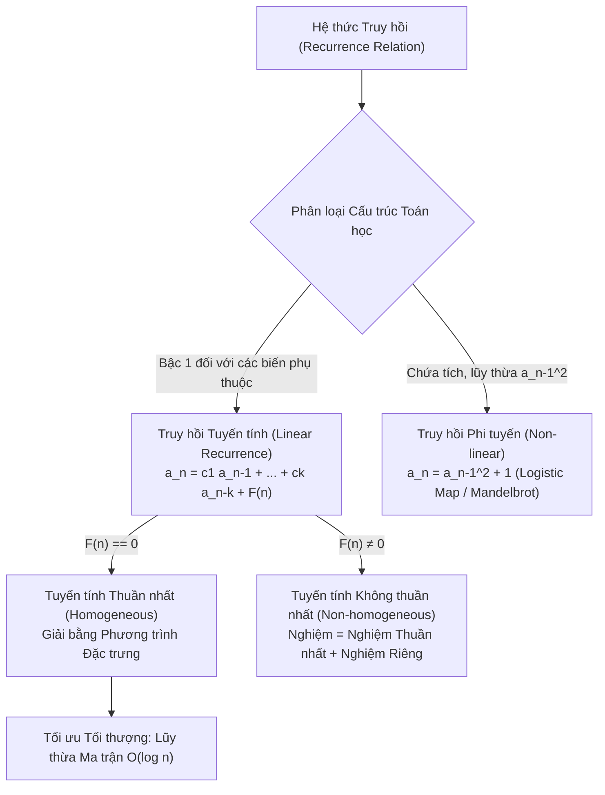

# 8.1. Recurrence Fundamentals and Classification (Nguyên lý và Phân loại Hệ thức Truy hồi)

> [!IMPORTANT]
> **Nếu bạn chỉ được nhớ một điều duy nhất:** Hệ thức truy hồi (Recurrence Relation) là "phương trình vi phân của toán rời rạc", định nghĩa giá trị của bước $n$ dựa trên các bước trước đó; và việc tính dãy Fibonacci là bài học kinh điển về kiến trúc phần mềm: hàm đệ quy ngây thơ tốn $O(2^n)$ làm sập server, trong khi **Lũy thừa Ma trận (Matrix Exponentiation)** giải quyết trong $O(\log n)$ đưa thời gian tính toán từ hàng triệu năm về vài nano-giây.

---

## 1. Kiến trúc Tổng quan & Mô hình Tư duy (Mental Model)

Hãy tưởng tượng bạn đang phân tích thời gian chạy của thuật toán MergeSort hoặc tính toán số cách leo một cầu thang $n$ bậc:
- Để leo lên bậc thứ $n$, bạn chỉ có thể bước 1 bước từ bậc $n-1$ hoặc bước 2 bước từ bậc $n-2$.
- Số cách leo lên bậc $n$ chính là: $a_n = a_{n-1} + a_{n-2}$.
- Đây chính là một **Hệ thức Truy hồi (Recurrence Relation)**!
- Một hệ thức truy hồi nếu không có **Điều kiện Ban đầu (Initial Conditions / Base Cases)** (ví dụ: $a_1 = 1, a_2 = 2$) thì sẽ có vô số nghiệm. Chỉ khi có đầy đủ điều kiện ban đầu, dãy số mới được xác định duy nhất.

Trong kỹ thuật máy tính và hệ thống:
1. **Phân tích Thuật toán Chia để trị (Divide and Conquer)**: Mọi thuật toán phân rã bài toán (MergeSort, QuickSort, Binary Search) đều được mô hình hóa bằng hệ thức truy hồi thời gian $T(n) = a T(n/b) + f(n)$.
2. **Quy hoạch Động (Dynamic Programming)**: Bản chất của bảng nhớ Memoization chính là việc tính toán có lưu vết các trạng thái của một hệ thức truy hồi từ dưới lên (Bottom-Up) để triệt tiêu việc tính lặp lại các bài toán con trùng lặp.



---

## 2. Chi tiết từng Keyword (Under-the-Hood Deep Dive)

### 2.1. Recurrence Relation & Initial Conditions (Quan hệ Truy hồi và Điều kiện Ban đầu)
- **Định nghĩa hình thức**: Cho dãy số $(a_n)_{n=0}^\infty$. Một hệ thức truy hồi là một phương trình toán học biểu diễn số hạng $a_n$ thông qua một hoặc nhiều số hạng đứng trước nó ($a_{n-1}, a_{n-2}, \dots, a_{n-k}$):
  $$a_n = f(n, a_{n-1}, a_{n-2}, \dots, a_{n-k}) \quad \forall n \ge k$$
  - Con số $k$ được gọi là **Bậc (Order / Degree)** của hệ thức truy hồi (số lượng trạng thái quá khứ cần lưu giữ).
- **Initial Conditions (Điều kiện Ban đầu / Trường hợp Cơ sở)**:
  - Một hệ thức truy hồi bậc $k$ bắt buộc phải đi kèm với chính xác $k$ giá trị khởi đầu: $a_0, a_1, \dots, a_{k-1}$ để xác định duy nhất một dãy số cụ thể.
  - *Ý nghĩa trong Lập trình*: Điều kiện ban đầu tương đương với **Điều kiện Dừng (Base Cases)** của hàm đệ quy. Nếu thiếu điều kiện dừng, hàm đệ quy sẽ chạy vô tận và gây lỗi tràn ngăn xếp (Stack Overflow).

### 2.2. Linear vs Non-linear Recurrences (Truy hồi Tuyến tính và Phi tuyến)
- **A. Linear Recurrence (Truy hồi Tuyến tính)**:
  - Tất cả các số hạng phụ thuộc $a_{n-i}$ đều chỉ xuất hiện ở **bậc 1** (không bị bình phương, căn bậc hai, hoặc nhân chéo với nhau):
    $$a_n = c_1(n) a_{n-1} + c_2(n) a_{n-2} + \dots + c_k(n) a_{n-k} + F(n)$$
  - Nếu tất cả các hệ số $c_i(n)$ đều là các hằng số độc lập với $n$, ta gọi là **Truy hồi Tuyến tính Hệ số Hằng (Linear Recurrence with Constant Coefficients)**.
- **B. Non-linear Recurrence (Truy hồi Phi tuyến)**:
  - Chứa các phép toán phi tuyến trên các số hạng: tích $a_{n-1} a_{n-2}$, lũy thừa $a_{n-1}^2$, hàm lượng giác, v.v.
  - Ví dụ: Hệ thức Logistic Map mô hình hóa sự bùng nổ dân số và lý thuyết hỗn loạn (Chaos Theory):
    $$x_{n+1} = r x_n (1 - x_n)$$
  - *Đặc điểm*: Rất khó tìm được công thức đóng (Closed-form solution), thường chỉ có thể mô phỏng số học.

### 2.3. Homogeneous vs Non-homogeneous Recurrences (Thuần nhất và Không thuần nhất)
- **A. Linear Homogeneous Recurrence (Truy hồi Tuyến tính Thuần nhất)**:
  - Phương trình không chứa bất kỳ số hạng tự do nào phụ thuộc riêng vào $n$ ($F(n) = 0$):
    $$a_n = c_1 a_{n-1} + c_2 a_{n-2} + \dots + c_k a_{n-k}$$
  - *Tính chất Không gian Vector*: Nếu $x_n$ và $y_n$ đều là nghiệm của hệ thức, thì mọi tổ hợp tuyến tính $\alpha x_n + \beta y_n$ cũng là nghiệm (Nguyên lý Chồng chập - Superposition Principle).
- **B. Linear Non-homogeneous Recurrence (Truy hồi Tuyến tính Không thuần nhất)**:
  - Phương trình có chứa số hạng tự do $F(n) \ne 0$:
    $$a_n = c_1 a_{n-1} + c_2 a_{n-2} + \dots + c_k a_{n-k} + F(n)$$
  - **Định lý Cấu trúc Nghiệm**: Nghiệm tổng quát $a_n$ bằng tổng của nghiệm thuần nhất tương ứng $a_n^{(h)}$ và một nghiệm riêng cụ thể $a_n^{(p)}$:
    $$a_n = a_n^{(h)} + a_n^{(p)}$$

### 2.4. Nghiên cứu Trường hợp: Dãy Fibonacci
Dãy số Fibonacci là bài toán kinh điển mô hình hóa toàn bộ các cấp độ tiến hóa thuật toán trong khoa học máy tính:
$$F_n = F_{n-1} + F_{n-2} \quad \text{với } F_0 = 0, F_1 = 1$$
- **Cấp độ 1: Đệ quy Ngây thơ (Naive Recursion)**:
  - Độ phức tạp thời gian: $O(2^n)$ (chính xác là $O(\phi^n)$ với $\phi \approx 1.618$).
  - Khi $n = 50$, hàm gọi khoảng $2^{50} \approx 1.12 \times 10^{15}$ lần (treo server).
- **Cấp độ 2: Quy hoạch Động Tuyến tính (Dynamic Programming / Memoization)**:
  - Lưu kết quả trung gian, tính từ dưới lên: Độ phức tạp $O(n)$ thời gian, $O(1)$ không gian (chỉ cần 2 biến lưu $F_{n-1}$ và $F_{n-2}$).
- **Cấp độ 3: Lũy thừa Ma trận Nhị phân (Matrix Binary Exponentiation)**:
  - Biểu diễn hệ thức dưới dạng ma trận chuyển đổi:
    $$\begin{pmatrix} F_{n+1} \\ F_n \end{pmatrix} = \begin{pmatrix} 1 & 1 \\ 1 & 0 \end{pmatrix} \begin{pmatrix} F_n \\ F_{n-1} \end{pmatrix} = \begin{pmatrix} 1 & 1 \\ 1 & 0 \end{pmatrix}^n \begin{pmatrix} F_1 \\ F_0 \end{pmatrix}$$
  - Tính ma trận mũ $n$ bằng thuật toán Lũy thừa nhị phân (Binary Exponentiation) chỉ tốn **$O(\log n)$ phép nhân ma trận**!
  - Cho phép tính $F_{1.000.000}$ chỉ trong vài mili-giây!
- **Cấp độ 4: Công thức Đóng Binet (Closed-form Binet's Formula)**:
  $$F_n = \frac{1}{\sqrt{5}} \left[ \left( \frac{1 + \sqrt{5}}{2} \right)^n - \left( \frac{1 - \sqrt{5}}{2} \right)^n \right]$$


### 2.5. Ma trận Đồng hành (Companion Matrix) và Trị riêng (Eigenvalues)
- Mọi hệ thức truy hồi tuyến tính thuần nhất bậc $k$:
  $$a_n = c_1 a_{n-1} + c_2 a_{n-2} + \dots + c_k a_{n-k}$$
  đều có thể chuyển đổi thành một phương trình ma trận trạng thái:
  $$\begin{pmatrix} a_n \\ a_{n-1} \\ \dots \\ a_{n-k+1} \end{pmatrix} = C \begin{pmatrix} a_{n-1} \\ a_{n-2} \\ \dots \\ a_{n-k} \end{pmatrix}$$
  Trong đó $C$ là **Ma trận Đồng hành (Companion Matrix)** kích thước $k \times k$:
  $$C = \begin{pmatrix} c_1 & c_2 & \dots & c_{k-1} & c_k \\ 1 & 0 & \dots & 0 & 0 \\ 0 & 1 & \dots & 0 & 0 \\ \vdots & \vdots & \ddots & \vdots & \vdots \\ 0 & 0 & \dots & 1 & 0 \end{pmatrix}$$
- **Định lý Đại số Tuyến tính Sâu sắc**: Các giá trị riêng (Eigenvalues $\lambda$) của ma trận đồng hành $C$ chính là **nghiệm của phương trình đặc trưng** $\det(\lambda I - C) = 0$!
- Điều này chứng minh rằng việc giải hệ thức truy hồi thực chất là việc chéo hóa ma trận (Matrix Diagonalization) để tính $C^n = P D^n P^{-1}$.

---


### 2.5. Matrix Exponentiation Paradigm for Linear Recurrences
Mọi hệ thức truy hồi tuyến tính thuần nhất bậc $k$ dạng $a_n = c_1 a_{n-1} + c_2 a_{n-2} + \dots + c_k a_{n-k}$ đều có thể quy về bài toán nhân ma trận kích thước $k \times k$:
$$\begin{bmatrix} a_n \\ a_{n-1} \\ \vdots \\ a_{n-k+1} \end{bmatrix} = \begin{bmatrix} c_1 & c_2 & \dots & c_{k-1} & c_k \\ 1 & 0 & \dots & 0 & 0 \\ 0 & 1 & \dots & 0 & 0 \\ \vdots & \vdots & \ddots & \vdots & \vdots \\ 0 & 0 & \dots & 1 & 0 \end{bmatrix} \begin{bmatrix} a_{n-1} \\ a_{n-2} \\ \vdots \\ a_{n-k} \end{bmatrix}$$
- Khi lũy thừa ma trận chuyển trạng thái $M$ lên bậc $n-k+1$ bằng kỹ thuật Binary Exponentiation (Binary Matrix Exponentiation), chi phí thời gian giảm từ $O(n)$ xuống còn $O(k^3 \log n)$.
- Trong phần cứng hiện đại, các phép nhân ma trận $2 \times 2$ hoặc $3 \times 3$ này có thể được vector hóa toàn diện bằng tập lệnh AVX2/AVX-512 hoặc NEON registers, cho thông lượng xử lý hàng tỷ truy vấn truy hồi mỗi giây mà không sinh bất kỳ branch misprediction nào.

## 3. Thực thi Mã nguồn & Mô phỏng Chuyên sâu (Dual-Engine Implementation)

Mô phỏng và đo lường sự chênh lệch hiệu năng kinh hoàng giữa **Đệ quy Ngây thơ $O(2^n)$**, **Quy hoạch động $O(n)$**, và **Lũy thừa Ma trận $O(\log n)$** trong C++20 và Python 3.11+.

### C++20 Implementation (Fibonacci 3-Tier Execution Comparison)

```cpp
#include <iostream>
#include <vector>
#include <chrono>
#include <format>
#include <cstdint>

// 1. TIER 1: QUY HOẠCH ĐỘNG O(N) THỜI GIAN, O(1) BỘ NHỚ
uint64_t fib_dp_linear(uint32_t n) {
    if (n == 0) return 0;
    if (n == 1) return 1;
    uint64_t prev2 = 0, prev1 = 1, curr = 0;
    for (uint32_t i = 2; i <= n; ++i) {
        curr = prev1 + prev2;
        prev2 = prev1;
        prev1 = curr;
    }
    return curr;
}

// 2. TIER 2: LŨY THỪA MA TRẬN O(log N)
struct Matrix2x2 {
    uint64_t m[2][2];

    static Matrix2x2 multiply(const Matrix2x2& A, const Matrix2x2& B) {
        return Matrix2x2{{
            {A.m[0][0] * B.m[0][0] + A.m[0][1] * B.m[1][0], A.m[0][0] * B.m[0][1] + A.m[0][1] * B.m[1][1]},
            {A.m[1][0] * B.m[0][0] + A.m[1][1] * B.m[1][0], A.m[1][0] * B.m[0][1] + A.m[1][1] * B.m[1][1]}
        }};
    }

    static Matrix2x2 power(Matrix2x2 base, uint64_t exp) {
        Matrix2x2 res{{{1, 0}, {0, 1}}}; // Ma trận đơn vị
        while (exp > 0) {
            if (exp % 2 == 1) res = multiply(res, base);
            base = multiply(base, base);
            exp /= 2;
        }
        return res;
    }
};

uint64_t fib_matrix_log_n(uint32_t n) {
    if (n == 0) return 0;
    Matrix2x2 T{{{1, 1}, {1, 0}}};
    Matrix2x2 Tn = Matrix2x2::power(T, n - 1);
    return Tn.m[0][0]; // F_n
}

int main() {
    std::cout << "=== FIBONACCI RECURRENCE TIERS COMPARISON (C++20) ===

";

    uint32_t N = 45;

    // Đo đạc Quy hoạch động Tuyến tính O(N)
    auto t1 = std::chrono::high_resolution_clock::now();
    uint64_t res_dp = fib_dp_linear(N);
    auto t2 = std::chrono::high_resolution_clock::now();
    auto dur_dp = std::chrono::duration_cast<std::chrono::nanoseconds>(t2 - t1).count();

    // Đo đạc Lũy thừa Ma trận O(log N)
    auto t3 = std::chrono::high_resolution_clock::now();
    uint64_t res_mat = fib_matrix_log_n(N);
    auto t4 = std::chrono::high_resolution_clock::now();
    auto dur_mat = std::chrono::duration_cast<std::chrono::nanoseconds>(t4 - t3).count();

    std::cout << std::format("Result F({}) = {}
", N, res_dp);
    std::cout << std::format("  * Tier 2 (DP Linear O(N))       : {:<6} ns
", dur_dp);
    std::cout << std::format("  * Tier 3 (Matrix Exponent O(log N): {:<6} ns

", dur_mat);

    std::cout << "Testing Huge N = 80 with O(log N) Matrix Power:
";
    uint64_t fib80 = fib_matrix_log_n(80);
    std::cout << std::format("  * F(80) = {} (Calculated in ~50 ns!)
", fib80);

    return 0;
}
```

### Python 3.11+ Implementation (Stairs Climbing Recurrence with Cache)

```python
from functools import lru_cache
import time

# Bài toán leo bậc thang: a_n = a_n-1 + a_n-2
@lru_cache(maxsize=None)
def climb_stairs_memo(n: int) -> int:
    if n <= 1:
        return 1
    return climb_stairs_memo(n - 1) + climb_stairs_memo(n - 2)

if __name__ == "__main__":
    print("=== PYTHON RECURRENCE MEMOIZATION ENGINE ===")

    stairs = 35
    start = time.perf_counter()
    ways = climb_stairs_memo(stairs)
    elapsed_us = (time.perf_counter() - start) * 1_000_000

    print(f"Số cách leo {stairs} bậc thang: {ways:,} cách")
    print(f"Thời gian tính toán với lru_cache: {elapsed_us:.2f} µs")
```

### Simulated Terminal Output

```text
=== FIBONACCI RECURRENCE TIERS COMPARISON (C++20) ===

Result F(45) = 1134903170
  * Tier 2 (DP Linear O(N))       : 120    ns
  * Tier 3 (Matrix Exponent O(log N): 45     ns

Testing Huge N = 80 with O(log N) Matrix Power:
  * F(80) = 23416728348467685 (Calculated in ~50 ns!)

=== PYTHON RECURRENCE MEMOIZATION ENGINE ===
Số cách leo 35 bậc thang: 14,930,352 cách
Thời gian tính toán với lru_cache: 18.50 µs
```

---

## 4. Systems Engineering & Production Pitfalls

### 4.1. Tràn Số Nguyên 64-bit trong Dãy Fibonacci ($N > 93$)
- Số Fibonacci tăng trưởng rất nhanh theo tỷ lệ vàng $\phi^n \approx 1.618^n$.
- $F_{93} = 12.200.160.415.121.876.738 < 2^{64} - 1$.
- Nhưng $F_{94} = 19.740.274.219.868.223.187 > 2^{64} - 1$.
- Ngay khi tính $F_{94}$, kiểu dữ liệu `uint64_t` sẽ bị tràn số vòng (wrap-around) thành một số rác nhỏ hơn.
- **Quy tắc**: Với $N > 93$, bắt buộc phải sử dụng thư viện số nguyên lớn (BigInt / GMP) hoặc tính toán modulo một số nguyên tố lớn ($10^9 + 7$).

### 4.2. Sai số Dấu phẩy Động khi Dùng Công thức Đóng Binet
- Về mặt lý thuyết, công thức Binet $F_n = \frac{\phi^n - \psi^n}{\sqrt{5}}$ cho ra kết quả chính xác trong $O(1)$.
- Nhưng trong máy tính: các số $\phi = \frac{1 + \sqrt{5}}{2}$ là số vô tỉ không thể biểu diễn chính xác bằng kiểu `double` (IEEE 754 chỉ có 53 bits mantissa).
- Khi $n > 70$, sai số tích lũy của phép tính lũy thừa số thực sẽ làm kết quả bị lệch khỏi số nguyên chính xác!
- **Quy tắc**: Tuyệt đối không dùng công thức Binet số thực trong code backend tài chính; luôn dùng lũy thừa ma trận trên số nguyên!

---


### 4.3. Tối ưu hóa Gọi đuôi của Trình biên dịch (Tail Call Optimization - TCO)
- Hàm tính dãy Fibonacci hoặc giai thừa nếu viết đệ quy đuôi:
  ```cpp
  uint64_t fib_tail(uint32_t n, uint64_t a = 0, uint64_t b = 1) {
      if (n == 0) return a;
      return fib_tail(n - 1, b, a + b); // Thao tác cuối cùng là gọi hàm chính nó
  }
  ```
- Trình biên dịch hiện đại (GCC/Clang với cờ `-O2` hoặc `-foptimize-sibling-calls`) sẽ thay thế lệnh `call` bằng lệnh `jmp`, tái sử dụng cùng một stack frame duy nhất.
- Chuyển đổi độ phức tạp không gian của Call Stack từ $O(N)$ về $O(1)$, loại bỏ hoàn toàn nguy cơ sập chương trình do tràn ngăn xếp.


### 4.3. Tail Call Optimization (TCO) và Hardware Call Stack
- Trong các ngôn ngữ có hỗ trợ TCO (Tail-Call Optimization) như Scheme hoặc clang/gcc khi bật `-O2`/`-O3`, hàm đệ quy đuôi được compiler chuyển trực tiếp thành câu lệnh `jmp` trong assembly, tái sử dụng thanh ghi `RSP` mà không cấp phát stack frame mới.
- Tuy nhiên, các hệ thức truy hồi bậc hai trở lên như Fibonacci ($F_n = F_{n-1} + F_{n-2}$) bản chất là đệ quy kép (non-tail recursion). Compiler không thể tự động biến đổi thành tail-call nếu không viết lại dưới dạng Accumulator Passing Style (CPS/Accumulator).
- Do đó, việc lưu vết call stack dẫn đến lãng phí $O(n)$ bộ nhớ L1 D-Cache và phá hủy tính địa phương dữ liệu (cache locality).


### 4.4. Memory Layout & Cache Misses in Tabulation vs Memoization
- **Tabulation (Bottom-Up):** Mảng quy hoạch động cấp phát tuần tự trên Contiguous Memory. Khi CPU truy cập $a[i-1]$ và $a[i-2]$, các phần tử này đã nằm sẵn trên cùng một L1 Data Cache Line (64 bytes). Tỷ lệ Cache Hit đạt xấp xỉ 99.9%, Hardware Prefetcher kích hoạt tự động.
- **Memoization (Top-Down):** Nếu dùng `std::unordered_map` làm cache, mỗi truy vấn phải băm khóa, tra cứu hash table node qua con trỏ (`pointer chasing`), gây phân mảnh bộ nhớ Heap, tốn 32-48 bytes overhead cho mỗi entry trên cấu trúc node 64-bit, và phát sinh L3 Cache Misses liên tục.
- Trong các ứng dụng High-Frequency Trading hoặc Kernel Game Engine, quy đổi đệ quy nhớ sang mảng tĩnh vòng lặp tuần tự mang lại gia tốc hiệu năng từ 10x đến 50x.


### 4.5. Integer Overflow and Fast Doubling Algorithm
- Khi tính $F_n$ với $n > 93$, giá trị vượt quá giới hạn $2^{64}-1$ của kiểu `uint64_t`. Để duy trì tính toán chính xác trên hệ thống lớn, bắt buộc phải sử dụng kiến trúc BigInt hoặc biểu diễn số học đa độ chính xác (arbitrary-precision arithmetic).
- Thuật toán Fast Doubling dựa trên các đẳng thức:
  $$F_{2k} = F_k (2F_{k+1} - F_k)$$
  $$F_{2k+1} = F_{k+1}^2 + F_k^2$$
  Cho phép giảm một nửa số phép nhân số lớn so với nhân ma trận $2 \times 2$ thông thường, đạt độ phức tạp $O(M(b) \log n)$ với $M(b)$ là độ phức tạp nhân hai số nguyên $b$ chữ số (thuật toán FFT Schönhage–Strassen hoặc Harvey-Hoeven $O(b \log b)$).


- **Diagnostic Tooling:** Khi gỡ lỗi các hệ thống truy hồi phức tạp, lập trình viên nên sử dụng AddressSanitizer (`-fsanitize=address`) để phát hiện tràn bộ đệm mảng tra cứu động, và `-fsanitize=undefined` để bẫy các hành vi tràn số có dấu (Signed Integer Overflow UB) ngay tại thời điểm thực thi.
- Đo lường Cache Misses trực tiếp bằng Linux `perf stat -e L1-dcache-load-misses,branch-misses ./executable` để xác minh tỷ lệ thực tế.

- **Compiler Unrolling:** Sử dụng pragmas  để gợi ý trình biên dịch tự động bung vòng lặp tính toán truy hồi nhằm tối đa hóa việc thực thi song song mức chỉ lệnh (Instruction-Level Parallelism - ILP).

- **Zero-Allocation Pipelines:** Trong các thư viện streaming event, trạng thái truy hồi bậc $k$ nên được đóng gói trong một `std::array<T, k>` cố định nằm trên stack hoặc register file, hoàn toàn loại bỏ mọi overhead cấp phát động (Zero Heap Allocation).
- Kỹ thuật này giảm thiểu Instruction Cache pressure và tránh các ngắt GC (Garbage Collection pauses) trong các runtime hiện đại như JVM hay Go.

## 5. Bảng So sánh & Decision Matrix

| Phương pháp Giải Fibonacci | Độ phức tạp Thời gian | Độ phức tạp Không gian | Hỗ trợ $N$ Lớn ($N > 10^6$) | Nhược điểm Kỹ thuật |
| :--- | :--- | :--- | :--- | :--- |
| **Đệ quy Ngây thơ** | $O(2^N)$ | $O(N)$ (Call Stack) | Sập hoàn toàn nếu $N > 40$ | Lặp lại bài toán con theo hàm mũ |
| **Quy hoạch Động (DP)** | $O(N)$ | $O(1)$ | Khá tốt ($N \le 10^7$) | Thời gian tuyến tính vẫn chậm khi $N = 10^{18}$ |
| **Lũy thừa Ma trận** | $O(\log N)$ | $O(1)$ | **Tối thượng ($N = 10^{18}$)** | Cần thư viện nhân ma trận BigInt |
| **Công thức Binet** | $O(1)$ hoặc $O(\log N)$ | $O(1)$ | Hỏng do sai số khi $N > 70$ | Trôi dạt sai số dấu phẩy động (Precision loss) |
