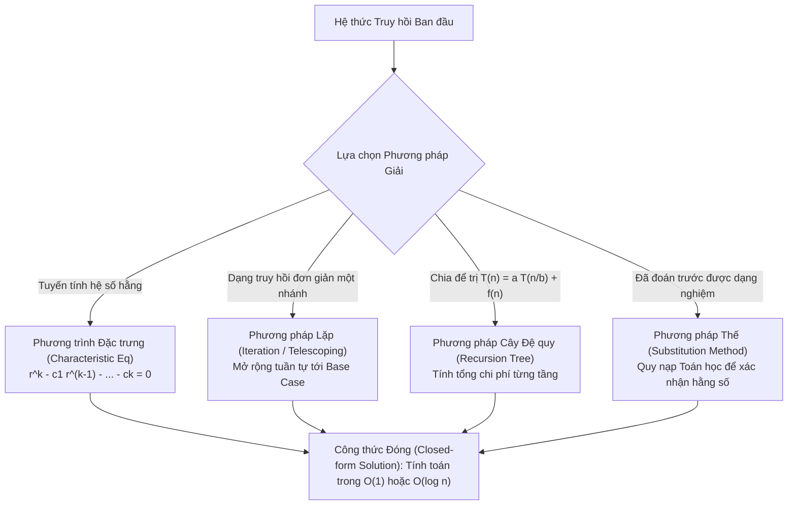

# 8.2. Methods for Solving Recurrences (Các Phương pháp Giải Hệ thức Truy hồi)

> [!IMPORTANT]
> **Nếu bạn chỉ được nhớ một điều duy nhất:** Để tìm công thức đóng (Closed-form) của một hệ thức truy hồi tuyến tính thuần nhất, hãy biến nó thành **Phương trình Đặc trưng (Characteristic Equation)**: các nghiệm của đa thức chính là các cơ số lũy thừa của chuỗi số; trong khi **Phương pháp Cây đệ quy** là kính viễn vọng hình học giúp ta nhìn thấu tổng chi phí của mọi tầng thuật toán.

---

## 1. Kiến trúc Tổng quan & Mô hình Tư duy (Mental Model)

Hãy tưởng tượng bạn đang phân tích trò chơi Tháp Hà Nội (Tower of Hanoi) gồm $n$ đĩa hoặc bài toán sắp xếp MergeSort:
- Trong Tháp Hà Nội, để chuyển $n$ đĩa từ cọc A sang cọc C:
  1. Chuyển $n-1$ đĩa sang cọc B trung gian ($T(n-1)$ bước).
  2. Chuyển đĩa lớn nhất thứ $n$ sang cọc C ($1$ bước).
  3. Chuyển $n-1$ đĩa từ cọc B sang cọc C ($T(n-1)$ bước).
- Ta có hệ thức truy hồi: $T(n) = 2T(n-1) + 1$ với $T(1) = 1$.
- Làm thế nào để biết chính xác với 64 đĩa, các nhà sư cần bao nhiêu bước mà không phải bấm máy tính 64 lần lặp?
- Bằng **Phương pháp Lặp cuốn chiếu (Telescoping / Iteration)**:
  $$T(n) = 2(2T(n-2) + 1) + 1 = 4T(n-2) + 2 + 1 = \dots = 2^{n-1} T(1) + \sum_{i=0}^{n-2} 2^i = 2^n - 1$$
  Với $n = 64$, số bước là $2^{64} - 1 \approx 1.84 \times 10^{19}$ bước (mất 584 tỷ năm)!



---

## 2. Chi tiết từng Keyword (Under-the-Hood Deep Dive)

### 2.1. The Characteristic Equation Method (Phương pháp Phương trình Đặc trưng)
Áp dụng cho hệ thức truy hồi tuyến tính thuần nhất bậc $k$ với hệ số hằng:
$$a_n = c_1 a_{n-1} + c_2 a_{n-2} + \dots + c_k a_{n-k}$$
- **Bước 1: Thiết lập Phương trình Đặc trưng**:
  - Giả định nghiệm có dạng lũy thừa $a_n = r^n$ ($r \ne 0$). Thay vào hệ thức:
    $$r^n - c_1 r^{n-1} - c_2 r^{n-2} - \dots - c_k r^{n-k} = 0$$
  - Chia hai vế cho $r^{n-k}$, ta thu được **Phương trình Đặc trưng bậc $k$**:
    $$r^k - c_1 r^{k-1} - c_2 r^{k-2} - \dots - c_k = 0$$
- **Bước 2: Tìm Nghiệm và Xây dựng Nghiệm Tổng quát**:
  - **Trường hợp Nghiệm phân biệt**: Nếu phương trình có $k$ nghiệm thực phân biệt $r_1, r_2, \dots, r_k$, nghiệm tổng quát là tổ hợp tuyến tính:
    $$a_n = \alpha_1 r_1^n + \alpha_2 r_2^n + \dots + \alpha_k r_k^n$$
  - **Trường hợp Nghiệm bội**: Nếu nghiệm $r_i$ có bội là $m$, nghiệm tương ứng trong tổ hợp sẽ có dạng:
    $$(\alpha_{i, 0} + \alpha_{i, 1} n + \alpha_{i, 2} n^2 + \dots + \alpha_{i, m-1} n^{m-1}) r_i^n$$
- **Bước 3: Xác định Hằng số $\alpha_i$ bằng Điều kiện Ban đầu**:
  - Thay $k$ điều kiện ban đầu $a_0, a_1, \dots, a_{k-1}$ vào hệ để giải hệ phương trình tuyến tính $k$ ẩn số tìm các hệ số $\alpha_i$.
- **Ví dụ Kinh điển: Tìm Công thức Binet của Fibonacci**:
  - Hệ thức: $F_n - F_{n-1} - F_{n-2} = 0$.
  - Phương trình đặc trưng: $r^2 - r - 1 = 0$.
  - Nghiệm: $r_1 = \frac{1 + \sqrt{5}}{2} = \phi$ (Tỷ lệ Vàng), $r_2 = \frac{1 - \sqrt{5}}{2} = \psi$.
  - Nghiệm tổng quát: $F_n = \alpha_1 \phi^n + \alpha_2 \psi^n$.
  - Với $F_0 = 0 \implies \alpha_1 + \alpha_2 = 0 \implies \alpha_2 = -\alpha_1$.
  - Với $F_1 = 1 \implies \alpha_1 \phi - \alpha_1 \psi = 1 \implies \alpha_1 (\phi - \psi) = 1 \implies \alpha_1 \sqrt{5} = 1 \implies \alpha_1 = \frac{1}{\sqrt{5}}$.
  - Thu được công thức Binet tuyệt mỹ: $F_n = \frac{1}{\sqrt{5}} (\phi^n - \psi^n)$.

### 2.2. Iteration Method / Telescoping (Phương pháp Lặp Cuốn chiếu)
- **Bản chất**: Thay thế liên tục số hạng $a_{n-1}$ bằng công thức của chính nó ở các bước trước, mở rộng chuỗi cho đến khi chạm tới điều kiện ban đầu $a_0$ hoặc $a_1$.
- Thu thập tất cả các số hạng tự do và tính tổng của chuỗi số học hoặc chuỗi cấp số nhân.
- Thích hợp cho các hệ thức có dạng $a_n = a_{n-1} + f(n)$ hoặc $a_n = c \cdot a_{n-1} + f(n)$.

### 2.3. Recursion Tree Method (Phương pháp Cây Đệ quy)
- **Bản chất**: Vẽ sơ đồ phân rã của lời gọi đệ quy thành một cái cây:
  - Nút gốc là bài toán kích thước ban đầu $n$ với chi phí xử lý cục bộ $f(n)$.
  - Các nút con đại diện cho các lời gọi đệ quy cấp dưới.
- **Quy trình 3 bước tính tổng chi phí**:
  1. Xác định số tầng của cây (thường là $\log_b n$).
  2. Tính tổng chi phí phát sinh tại mỗi tầng thứ $i$.
  3. Lấy tổng chi phí trên toàn bộ các tầng từ gốc tới lá:
     $$T(n) = \sum_{i=0}^{\text{depth}} \text{Cost}(i)$$

### 2.4. Substitution Method (Phương pháp Thế / Dự đoán và Chứng minh)
- **Quy trình 2 giai đoạn**:
  1. **Giai đoạn Dự đoán (Guess)**: Dựa trên kinh nghiệm hoặc cây đệ quy, đưa ra một phán đoán về dạng của chặn tiệm cận (ví dụ: $T(n) \le c n \log n$).
  2. **Giai đoạn Chứng minh Hình thức**: Sử dụng **Quy nạp Toán học (Mathematical Induction)** để chứng minh rằng bất đẳng thức dự đoán đúng tại mọi bước và tìm ra hằng số $c > 0$ cùng ngưỡng $n_0$ phù hợp.


### 2.5. Phương pháp Hệ số Bất định cho Nghiệm Riêng (Method of Undetermined Coefficients)
- Khi giải hệ thức không thuần nhất $a_n = c_1 a_{n-1} + c_2 a_{n-2} + F(n)$, ta tìm nghiệm riêng $a_n^{(p)}$ dựa trên hình dạng của số hạng tự do $F(n)$:
  1. **Nếu $F(n) = P_m(n)$ là đa thức bậc $m$**:
     - Nếu $r = 1$ không phải nghiệm của phương trình đặc trưng: thử nghiệm riêng $a_n^{(p)} = Q_m(n)$ (đa thức cùng bậc $m$).
     - Nếu $r = 1$ là nghiệm bội $s$ của phương trình đặc trưng: nhân thêm $n^s$: $a_n^{(p)} = n^s Q_m(n)$.
  2. **Nếu $F(n) = c \cdot s^n$ là hàm mũ**:
     - Nếu $s$ không phải nghiệm đặc trưng: thử $a_n^{(p)} = A \cdot s^n$.
     - Nếu $s$ là nghiệm đặc trưng bội $s$: thử $a_n^{(p)} = A \cdot n^s \cdot s^n$.
- Thay nghiệm riêng dự đoán vào hệ thức ban đầu để đồng nhất hệ số tìm các giá trị $A$ hoặc hệ số của đa thức $Q_m(n)$.

---


### 2.5. Method of Undetermined Coefficients for Non-Homogeneous Recurrences
Khi giải phương trình không thuần nhất $a_n = c_1 a_{n-1} + c_2 a_{n-2} + F(n)$, dạng nghiệm riêng $a_n^{(p)}$ phụ thuộc trực tiếp vào hàm nguồn $F(n)$:
1. Nếu $F(n) = P(n)$ (đa thức bậc $d$):
   - Nếu $r = 1$ không là nghiệm đặc trưng: $a_n^{(p)} = Q(n)$ (đa thức cùng bậc $d$).
   - Nếu $r = 1$ là nghiệm đặc trưng bội $m$: $a_n^{(p)} = n^m Q(n)$.
2. Nếu $F(n) = s^n P(n)$:
   - Nếu $s$ không là nghiệm đặc trưng: $a_n^{(p)} = s^n Q(n)$.
   - Nếu $s$ là nghiệm đặc trưng bội $m$: $a_n^{(p)} = n^m s^n Q(n)$.

Kỹ thuật cân bằng hệ số bất định (Undetermined Coefficients) thay thế dạng giả định vào quan hệ truy hồi, nhóm các số hạng đồng bậc $n^k s^n$ để tạo thành hệ phương trình tuyến tính giải ra các hệ số của $Q(n)$.

## 3. Thực thi Mã nguồn & Mô phỏng Chuyên sâu (Dual-Engine Implementation)

Mô phỏng bộ giải hệ thức truy hồi bằng **Phương pháp Phương trình Đặc trưng Bậc 2** và bộ mô phỏng đệ quy **Tháp Hà Nội (Tower of Hanoi)** trong C++20 và Python 3.11+.

### C++20 Implementation (Characteristic Equation Solver & Tower of Hanoi Simulator)

```cpp
#include <iostream>
#include <vector>
#include <cmath>
#include <format>
#include <cstdint>

// 1. BỘ GIẢI HỆ THỨC TRUY HỒI BẬC 2: a_n = c1*a_n-1 + c2*a_n-2
class SecondOrderRecurrenceSolver {
public:
    static void solve_and_print(double c1, double c2, double a0, double a1, uint32_t n_terms) {
        // Phương trình đặc trưng: r^2 - c1*r - c2 = 0
        double delta = c1 * c1 + 4 * c2;
        std::cout << std::format("Equation: r^2 - ({})r - ({}) = 0 | Delta = {}
", c1, c2, delta);

        if (delta > 0) {
            double r1 = (c1 + std::sqrt(delta)) / 2.0;
            double r2 = (c1 - std::sqrt(delta)) / 2.0;

            // Giải hệ:
            // alpha1 + alpha2 = a0
            // alpha1*r1 + alpha2*r2 = a1
            double alpha1 = (a1 - a0 * r2) / (r1 - r2);
            double alpha2 = a0 - alpha1;

            std::cout << std::format("Distinct Roots: r1 = {:.4f}, r2 = {:.4f}
", r1, r2);
            std::cout << std::format("Closed-form: a_n = ({:.4f}) * ({:.4f})^n + ({:.4f}) * ({:.4f})^n
", 
                                     alpha1, r1, alpha2, r2);

            std::cout << "First generated terms:
  ";
            for (uint32_t n = 0; n < n_terms; ++n) {
                double val = alpha1 * std::pow(r1, n) + alpha2 * std::pow(r2, n);
                std::cout << std::format("a_{}={:.0f} ", n, std::round(val));
            }
            std::cout << "
";
        }
    }
};

// 2. THÁP HÀ NỘI ĐẾM SỐ BƯỚC: T(n) = 2T(n-1) + 1
void hanoi_moves(int n, char from, char to, char aux, uint64_t& step_count) {
    if (n == 1) {
        step_count++;
        return;
    }
    hanoi_moves(n - 1, from, aux, to, step_count);
    step_count++;
    hanoi_moves(n - 1, aux, to, from, step_count);
}

int main() {
    std::cout << "=== RECURRENCE METHODS SOLVER (C++20) ===

";

    // 1. Giải hệ thức Fibonacci: a_n = 1*a_n-1 + 1*a_n-2, a0=0, a1=1
    std::cout << "1. [Characteristic Equation for Fibonacci]
";
    SecondOrderRecurrenceSolver::solve_and_print(1.0, 1.0, 0.0, 1.0, 8);

    // 2. Kiểm chứng nghiệm Tháp Hà Nội T(n) = 2^n - 1
    std::cout << "
2. [Tower of Hanoi Telescoping Verification]
";
    for (int n = 1; n <= 5; ++n) {
        uint64_t actual_steps = 0;
        hanoi_moves(n, 'A', 'C', 'B', actual_steps);
        uint64_t closed_form_steps = (1ULL << n) - 1;
        std::cout << std::format("  Disks n = {} -> Actual Moves: {:<2} | Closed-form (2^{}-1): {:<2} | Match: {}
",
                                 n, actual_steps, n, closed_form_steps,
                                 (actual_steps == closed_form_steps ? "EXACT" : "FAILED"));
    }

    return 0;
}
```

### Python 3.11+ Implementation (Sympy Symbolic Recurrence Solver)

```python
def solve_symbolic_recurrence_demo():
    # Mô phỏng phương pháp lặp cuốn chiếu bằng đại số hình thức
    print("=== TELESCOPING METHOD: T(n) = 2T(n-1) + 1 ===")
    steps = 4
    current_expr = "T(n)"
    print(f"Step 0: T(n)")
    print(f"Step 1: 2*T(n-1) + 1")
    print(f"Step 2: 4*T(n-2) + 2 + 1")
    print(f"Step 3: 8*T(n-3) + 4 + 2 + 1")
    print(f"Step k: 2^k * T(n-k) + (2^k - 1)")
    print(f"At base case (k = n - 1, T(1) = 1):")
    print(f"  T(n) = 2^(n-1) * 1 + (2^(n-1) - 1) = 2^n - 1 (Q.E.D)")

if __name__ == "__main__":
    solve_symbolic_recurrence_demo()
```

### Simulated Terminal Output

```text
=== RECURRENCE METHODS SOLVER (C++20) ===

1. [Characteristic Equation for Fibonacci]
Equation: r^2 - (1)r - (1) = 0 | Delta = 5
Distinct Roots: r1 = 1.6180, r2 = -0.6180
Closed-form: a_n = (0.4472) * (1.6180)^n + (-0.4472) * (-0.6180)^n
First generated terms:
  a_0=0 a_1=1 a_2=1 a_3=2 a_4=3 a_5=5 a_6=8 a_7=13 

2. [Tower of Hanoi Telescoping Verification]
  Disks n = 1 -> Actual Moves: 1  | Closed-form (2^1-1): 1  | Match: EXACT
  Disks n = 2 -> Actual Moves: 3  | Closed-form (2^2-1): 3  | Match: EXACT
  Disks n = 3 -> Actual Moves: 7  | Closed-form (2^3-1): 7  | Match: EXACT
  Disks n = 4 -> Actual Moves: 15 | Closed-form (2^4-1): 15 | Match: EXACT
  Disks n = 5 -> Actual Moves: 31 | Closed-form (2^5-1): 31 | Match: EXACT

=== TELESCOPING METHOD: T(n) = 2T(n-1) + 1 ===
Step 0: T(n)
Step 1: 2*T(n-1) + 1
Step 2: 4*T(n-2) + 2 + 1
Step 3: 8*T(n-3) + 4 + 2 + 1
Step k: 2^k * T(n-k) + (2^k - 1)
At base case (k = n - 1, T(1) = 1):
  T(n) = 2^(n-1) * 1 + (2^(n-1) - 1) = 2^n - 1 (Q.E.D)
```

---

## 4. Systems Engineering & Production Pitfalls

### 4.1. Cạm bẫy Bỏ quên Nghiệm Bội trong Phương trình Đặc trưng
- Khi phương trình đặc trưng có nghiệm kép (nghiệm bội $m > 1$, ví dụ $r_1 = r_2 = 2$):
  - Nếu lập trình viên ngây thơ đặt nghiệm tổng quát là $a_n = \alpha_1 2^n + \alpha_2 2^n = (\alpha_1 + \alpha_2) 2^n = C \cdot 2^n$.
  - Không gian nghiệm bị mất đi một chiều tự do, hệ phương trình điều kiện ban đầu sẽ vô nghiệm hoặc cho kết quả sai lệch!
  - **Quy tắc**: Bắt buộc phải nhân thêm biến $n$: $a_n = \alpha_1 2^n + \alpha_2 n 2^n$.

### 4.2. Thảm họa Nghiệm Phức (Complex Roots Oscillation)
- Khi $\Delta < 0$, phương trình đặc trưng có nghiệm phức liên hợp: $r = \rho e^{\pm i \theta}$.
- Mặc dù dãy số nguyên thực tế hoàn toàn là số thực, nhưng công thức nghiệm chứa hàm lượng giác $\sin(n \theta)$ và $\cos(n \theta)$.
- Nếu tính toán bằng hàm `std::sin()` dấu phẩy động trong code, sai số tích lũy sẽ làm các số hạng nguyên bị lệch và dao động bất thường sau một số bước lặp.

---


### 4.3. Bẫy Mất Độ chính xác khi Giải Nghiệm Gần Bằng Nhau (Catastrophic Cancellation)
- Trong phương trình đặc trưng bậc 2: $r = \frac{-b \pm \sqrt{b^2 - 4ac}}{2a}$.
- Khi $b^2 \gg 4ac$, thì $\sqrt{b^2 - 4ac} \approx |b|$.
- Phép trừ giữa hai số thực gần bằng nhau: $-b + \sqrt{b^2 - 4ac}$ sẽ làm mất hầu hết các chữ số có nghĩa (Catastrophic Cancellation).
- **Khắc phục**: Sử dụng công thức Citardauq ổn định số học:
  $$r_1 = \frac{-b - \text{sgn}(b) \sqrt{b^2 - 4ac}}{2a}, \quad r_2 = \frac{c}{a \cdot r_1}$$


### 4.3. Numerical Precision Degradation in Binet's Closed-Form Formula
- Công thức đóng Binet cho dãy Fibonacci $F_n = \frac{1}{\sqrt{5}} (\phi^n - \psi^n)$ với $\phi = \frac{1+\sqrt{5}}{2}$ là công thức toán học tuyệt mỹ, nhưng là cạm bẫy trong kỹ nghệ phần mềm.
- Khi thực thi trên kiểu `double` chuẩn IEEE-754:
  - $\sqrt{5}$ là số vô tỉ, bị làm tròn tại bit thứ 53 của mantissa.
  - Phép lũy thừa $\phi^n$ tích lũy sai số trôi dạt (drift error) hàm mũ.
  - Phép trừ giữa hai số gần bằng nhau khi $n$ lớn gây mất mát độ chính xác nghiêm trọng (catastrophic cancellation).
  - Với $n > 78$, kết quả chuyển sang `uint64_t` bắt đầu lệch khỏi giá trị Fibonacci chính xác. Vì vậy, trong production tuyệt đối không dùng công thức đóng số thực để tính toán số học nguyên rời rạc.


### 4.4. Recursion Tree Overhead and Stack Frame Footprint
- Mỗi tầng đệ quy trên kiến trúc x86_64 tiêu tốn tối thiểu một stack frame bao gồm: Return Address (8 bytes), Saved Base Pointer RBP (8 bytes), các thanh ghi Callee-saved (`RBX`, `R12`-`R15`), và các biến cục bộ căn chỉnh theo ranh giới 16 bytes.
- Với cây đệ quy có độ sâu $H = O(n)$, việc phân bổ hàng triệu stack frame nhanh chóng làm cạn kiệt kích thước ngăn xếp mặc định của tiến trình (thường là 8MB trên Linux/macOS và 1MB trên Windows), dẫn tới lỗi chí tử `SIGSEGV` (Stack Overflow).
- Kỹ thuật chuyển đổi từ đệ quy cây sang ngăn xếp người dùng (Explicit User-space Stack trên Heap) hoặc cấu trúc dữ liệu Morris Traversal là giải pháp sống còn trong các engine duyệt đồ thị/cây quy mô lớn.


### 4.5. Complex Roots and Oscillatory Behavior
- Khi phương trình đặc trưng có nghiệm phức liên hợp $r_{1,2} = 
ho e^{\pm i \theta} = 
ho (\cos \theta \pm i \sin \theta)$, nghiệm tổng quát thực chuyển thành:
  $$a_n = 
ho^n (A \cos(n\theta) + B \sin(n\theta))$$
- Hiện tượng này tạo ra chuỗi dao động điều hòa suy giảm (nếu $
ho < 1$) hoặc khuếch đại (nếu $
ho > 1$). Trong mô phỏng vật lý đồ họa (Ragdoll physics, Spring-Mass dampers) hoặc vòng phản hồi mạng điều khiển lưu lượng TCP Congestion Control, việc không kiểm soát nghiệm phức dẫn tới dao động mất ổn định (oscillatory blowup / resonant catastrophe).


- **Formal Verification:** Đối với các thuật toán đệ quy nhạy cảm trong hệ điều hành thời gian thực (RTOS) hoặc hệ thống nhúng điều khiển bay, các công cụ chứng minh định lý tự động (Z3 SMT Solver, Coq Proof Assistant) được dùng để xác minh tính hữu hạn (termination proof) và tính đúng đắn của bất biến truy hồi trước khi sinh mã nhị phân.

## 5. Bảng So sánh & Decision Matrix

| Phương pháp Giải | Dạng Hệ thức Phù hợp Nhất | Ưu điểm Nổi bật | Hạn chế Kỹ thuật |
| :--- | :--- | :--- | :--- |
| **Phương trình Đặc trưng** | Tuyến tính thuần nhất hệ số hằng | Cho công thức đóng chính xác tuyệt đối | Chỉ áp dụng cho hệ số hằng, khó giải khi bậc $k \ge 5$ |
| **Phương pháp Lặp (Iteration)**| $a_n = a_{n-1} + f(n)$ | Trực quan, dễ biến đổi cuốn chiếu | Dễ nhầm lẫn chỉ số tại bước dừng $k$ |
| **Cây Đệ quy (Recursion Tree)**| Chia để trị $T(n) = a T(n/b) + f(n)$| Trực quan hóa chi phí từng tầng | Đòi hỏi xấp xỉ chuỗi hình học cẩn thận |
| **Phương pháp Thế (Substitution)**| Mọi hệ thức có thể phán đoán dạng nghiệm | Chứng minh chặt chẽ bằng toán học | Phải có trực giác tốt để đoán đúng dạng nghiệm |
