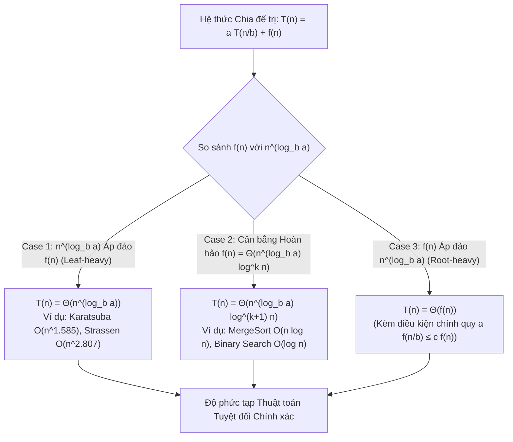

# 8.3. Master Theorem and Algorithm Complexity (Định lý Thơ và Độ phức tạp Thuật toán)

> [!IMPORTANT]
> **Nếu bạn chỉ được nhớ một điều duy nhất:** Định lý Thơ (Master Theorem) là "công thức nấu ăn" nhanh nhất để giải phóng độ phức tạp của thuật toán Chia để trị $T(n) = a T(n/b) + f(n)$: nó là cuộc chiến sinh tử giữa **Chi phí tại các nút lá ($n^{\log_b a}$)** và **Chi phí phân chia/kết hợp tại nút gốc ($f(n)$)** — bên nào có bậc tăng trưởng tiệm cận áp đảo thì bên đó quyết định hoàn toàn độ phức tạp Big-O của cả thuật toán.

---

## 1. Kiến trúc Tổng quan & Mô hình Tư duy (Mental Model)

Hãy tưởng tượng bạn đang phân tích hai thuật toán sắp xếp kinh điển:
- **Thuật toán MergeSort**: Chia mảng làm 2 nửa bằng nhau ($b=2$), đệ quy giải 2 nửa ($a=2$), và trộn hai mảng trong thời gian tuyến tính ($f(n) = O(n)$). Ta có phương trình:
  $$T(n) = 2T(n/2) + O(n)$$
- **Thuật toán Karatsuba (Nhân số nguyên lớn)**: Thay vì dùng 4 phép nhân số nguyên nửa độ dài như cách làm cổ điển của cấp 1 ($a=4 \implies O(n^2)$), Karatsuba phát hiện ra một mẹo đại số kỳ diệu để chỉ cần thực hiện 3 phép nhân ($a=3, b=2$):
  $$T(n) = 3T(n/2) + O(n)$$
- Bạn không cần phải vẽ cây đệ quy hay giải phương trình sai phân phức tạp:
  - Với MergeSort: Chi phí lá $n^{\log_2 2} = n^1$ cân bằng hoàn hảo với chi phí gốc $f(n) = n^1$ $\implies$ Độ phức tạp là $O(n \log n)$!
  - Với Karatsuba: Chi phí lá $n^{\log_2 3} \approx n^{1.585}$ áp đảo hoàn toàn chi phí gốc $O(n)$ $\implies$ Độ phức tạp giảm ngoạn mục xuống còn $O(n^{1.585})$!



---

## 2. Chi tiết từng Keyword (Under-the-Hood Deep Dive)

### 2.1. The Master Theorem (Định lý Thơ)
- **Dạng Chuẩn tắc của Hệ thức**:
  $$T(n) = a \, T\left(\frac{n}{b}\right) + f(n)$$
  Trong đó:
  - $a \ge 1$: Số lượng bài toán con được sinh ra ở mỗi bước đệ quy.
  - $b > 1$: Tỷ lệ thu hẹp kích thước dữ liệu của mỗi bài toán con.
  - $f(n)$: Chi phí thời gian để phân chia dữ liệu và hợp nhất (Combine) kết quả tại nút cha.
  - $n^{\log_b a}$: Chi phí lý thuyết tại tầng lá đáy cùng của cây đệ quy (do có $a^{\log_b n} = n^{\log_b a}$ nút lá).
- **3 Trường hợp Cốt lõi của Định lý Thơ (CLRS Form)**:
  - **Case 1 (Leaf-heavy - Tầng lá áp đảo)**:
    - Nếu tồn tại $\epsilon > 0$ sao cho:
      $$f(n) \in O(n^{\log_b a - \epsilon})$$
    - Tức $f(n)$ tăng chậm hơn $n^{\log_b a}$ theo một bậc đa thức.
    - Kết luận:
      $$T(n) \in \Theta(n^{\log_b a})$$
  - **Case 2 (Balanced - Cân bằng Tiệm cận)**:
    - Nếu tồn tại $k \ge 0$ sao cho:
      $$f(n) \in \Theta(n^{\log_b a} \log^k n)$$
    - Chi phí tại mỗi tầng của cây đệ quy là tương đương nhau.
    - Kết luận:
      $$T(n) \in \Theta(n^{\log_b a} \log^{k+1} n)$$
      (Trường hợp phổ biến nhất khi $k=0$: $f(n) = \Theta(n^{\log_b a}) \implies T(n) = \Theta(n^{\log_b a} \log n)$).
  - **Case 3 (Root-heavy - Nút gốc áp đảo)**:
    - Nếu tồn tại $\epsilon > 0$ sao cho:
      $$f(n) \in \Omega(n^{\log_b a + \epsilon})$$
    - VÀ thỏa mãn **Điều kiện Chính quy (Regularity Condition)**:
      $$\exists c < 1, \quad a f\left(\frac{n}{b}\right) \le c \cdot f(n) \quad \text{với } n \text{ đủ lớn}$$
    - Kết luận:
      $$T(n) \in \Theta(f(n))$$

### 2.2. Phân tích Các Thuật toán Kinh điển bằng Master Theorem
- **A. Binary Search (Tìm kiếm Nhị phân)**:
  - Hệ thức: $T(n) = T(n/2) + O(1) \implies a = 1, b = 2, f(n) = 1$.
  - Tính $n^{\log_b a} = n^{\log_2 1} = n^0 = 1$.
  - So sánh: $f(n) = \Theta(1) = \Theta(n^{\log_2 1} \log^0 n) \implies$ **Case 2 với $k=0$**.
  - Kết luận: $T(n) = \Theta(\log n)$.
- **B. Merge Sort (Sắp xếp Trộn)**:
  - Hệ thức: $T(n) = 2T(n/2) + O(n) \implies a = 2, b = 2, f(n) = n$.
  - Tính $n^{\log_b a} = n^{\log_2 2} = n^1 = n$.
  - So sánh: $f(n) = \Theta(n) = \Theta(n^{\log_2 2} \log^0 n) \implies$ **Case 2 với $k=0$**.
  - Kết luận: $T(n) = \Theta(n \log n)$.
- **C. Karatsuba Integer Multiplication (Nhân Số nguyên Lớn)**:
  - Hệ thức: $T(n) = 3T(n/2) + O(n) \implies a = 3, b = 2, f(n) = n$.
  - Tính $n^{\log_b a} = n^{\log_2 3} \approx n^{1.585}$.
  - So sánh: $f(n) = n^1 = O(n^{1.585 - 0.585}) \implies$ **Case 1**.
  - Kết luận: $T(n) = \Theta(n^{\log_2 3}) \approx \Theta(n^{1.585})$ (Vượt trội so với $O(n^2)$!).
- **D. Strassen's Matrix Multiplication (Nhân Ma trận Nhanh)**:
  - Nhân ma trận $n \times n$ truyền thống tốn 8 phép nhân nửa ma trận $\implies T(n) = 8T(n/2) + O(n^2) = O(n^3)$.
  - Strassen giảm xuống còn 7 phép nhân: $T(n) = 7T(n/2) + O(n^2)$.
  - Tính $n^{\log_2 7} \approx n^{2.807}$.
  - So sánh: $f(n) = n^2 = O(n^{2.807 - 0.807}) \implies$ **Case 1**.
  - Kết luận: $T(n) = \Theta(n^{\log_2 7}) \approx \Theta(n^{2.807})$.

### 2.3. Akra-Bazzi Theorem (Khái niệm Mở rộng cho Phân nhánh Bất đối xứng)
- **Giới hạn của Master Theorem**: Không thể áp dụng khi kích thước các nhánh con không đều nhau, ví dụ:
  $$T(n) = T\left(\frac{n}{3}\right) + T\left(\frac{2n}{3}\right) + O(n)$$
  (thường gặp trong thuật toán QuickSelect hoặc chia để trị bất đối xứng).
- **Định lý Akra-Bazzi (1998)**:
  - Giải các hệ thức tổng quát có dạng:
    $$T(n) = \sum_{i=1}^k a_i T(b_i n) + g(n)$$
  - Tìm số thực $p$ duy nhất thỏa mãn phương trình đặc trưng:
    $$\sum_{i=1}^k a_i b_i^p = 1$$
  - Khi đó nghiệm tiệm cận là:
    $$T(n) \in \Theta\left( n^p \left( 1 + \int_1^n \frac{g(u)}{u^{p+1}} du \right) \right)$$

---


### 2.5. Extended Master Theorem with Polylogarithmic Factors
Định lý Thơ chuẩn không áp dụng trực tiếp cho các trường hợp hàm chia tách có chứa thừa số logarit dạng $f(n) = \Theta(n^{\log_b a} \log^k n)$ với $k \ge 1$. Bản mở rộng xử lý triệt để:
- Nếu $f(n) = \Theta(n^{\log_b a} \log^k n)$ với $k \ge 0$:
  $$T(n) = \Theta(n^{\log_b a} \log^{k+1} n)$$
- Nếu $k = -1$:
  $$T(n) = \Theta(n^{\log_b a} \log \log n)$$
- Ví dụ: $T(n) = 2T(n/2) + n \log n$. Ở đây $a=2, b=2 \implies n^{\log_2 2} = n^1$. Vì $f(n) = n^1 \log^1 n$ ($k=1$), nghiệm là $T(n) = \Theta(n \log^2 n)$.

## 3. Thực thi Mã nguồn & Mô phỏng Chuyên sâu (Dual-Engine Implementation)

Mô phỏng bộ máy giải tự động **Master Theorem Solver** phân loại chính xác các trường hợp và đo lường thực tế thuật toán **MergeSort $O(n \log n)$** trong C++20 và Python 3.11+.

### C++20 Implementation (Automated Master Theorem Classifier & MergeSort Runner)

```cpp
#include <iostream>
#include <vector>
#include <cmath>
#include <format>
#include <string>
#include <cstdint>

// 1. BỘ PHÂN LOẠI TỰ ĐỘNG MASTER THEOREM
class MasterTheoremClassifier {
public:
    static void analyze(double a, double b, double f_deg) {
        // f(n) = n^(f_deg)
        double critical_exp = std::log(a) / std::log(b); // log_b(a)
        double epsilon = 1e-4;

        std::cout << std::format("Analyzing T(n) = {} T(n/{}) + O(n^{:.3f})
", a, b, f_deg);
        std::cout << std::format("  Critical Exponent log_b(a) = {:.4f}
", critical_exp);

        if (f_deg < critical_exp - epsilon) {
            std::cout << std::format("  -> CASE 1 (Leaf-heavy): f(n) is polynomial smaller than n^{:.4f}
", critical_exp);
            std::cout << std::format("  -> Result: T(n) = Theta(n^{:.4f})

", critical_exp);
        } else if (std::abs(f_deg - critical_exp) <= epsilon) {
            std::cout << "  -> CASE 2 (Balanced): f(n) matches n^(log_b a)
";
            std::cout << std::format("  -> Result: T(n) = Theta(n^{:.4f} * log n)

", critical_exp);
        } else {
            std::cout << std::format("  -> CASE 3 (Root-heavy): f(n) is polynomial larger than n^{:.4f}
", critical_exp);
            std::cout << std::format("  -> Result: T(n) = Theta(n^{:.3f})

", f_deg);
        }
    }
};

// 2. MERGESORT VERIFICATION
void merge(std::vector<int>& arr, int l, int m, int r) {
    std::vector<int> left(arr.begin() + l, arr.begin() + m + 1);
    std::vector<int> right(arr.begin() + m + 1, arr.begin() + r + 1);

    size_t i = 0, j = 0;
    int k = l;
    while (i < left.size() && j < right.size()) {
        if (left[i] <= right[j]) arr[k++] = left[i++];
        else arr[k++] = right[j++];
    }
    while (i < left.size()) arr[k++] = left[i++];
    while (j < right.size()) arr[k++] = right[j++];
}

void merge_sort(std::vector<int>& arr, int l, int r) {
    if (l < r) {
        int m = l + (r - l) / 2;
        merge_sort(arr, l, m);
        merge_sort(arr, m + 1, r);
        merge(arr, l, m, r);
    }
}

int main() {
    std::cout << "=== MASTER THEOREM CLASSIFIER & VERIFIER (C++20) ===

";

    // Phân tích các ca kinh điển
    MasterTheoremClassifier::analyze(2, 2, 1.0);  // MergeSort: 2T(n/2) + O(n)
    MasterTheoremClassifier::analyze(1, 2, 0.0);  // BinarySearch: T(n/2) + O(1)
    MasterTheoremClassifier::analyze(3, 2, 1.0);  // Karatsuba: 3T(n/2) + O(n)
    MasterTheoremClassifier::analyze(7, 2, 2.0);  // Strassen: 7T(n/2) + O(n^2)

    // Chạy MergeSort
    std::vector<int> sample = {38, 27, 43, 3, 9, 82, 10};
    merge_sort(sample, 0, sample.size() - 1);
    std::cout << "MergeSort Output: ";
    for (int x : sample) std::cout << x << " ";
    std::cout << "
";

    return 0;
}
```

### Python 3.11+ Implementation (Empirical Divide-and-Conquer Call Tracker)

```python
import math

class DCOperationTracker:
    def __init__(self):
        self.leaf_count = 0
        self.combine_cost = 0

    def simulate_merge_sort(self, n: int):
        if n <= 1:
            self.leaf_count += 1
            return
        # T(n) = 2T(n/2) + n
        self.combine_cost += n
        self.simulate_merge_sort(n // 2)
        self.simulate_merge_sort(n // 2)

if __name__ == "__main__":
    print("=== PYTHON DIVIDE-AND-CONQUER EMPIRICAL PROFILER ===")

    N = 1024
    tracker = DCOperationTracker()
    tracker.simulate_merge_sort(N)

    expected_leaves = N # a^(log_b n) = 2^(log_2 1024) = 1024
    expected_combine = N * int(math.log2(N)) # n * log2(n) = 1024 * 10 = 10240

    print(f"Simulating MergeSort on N = {N}:")
    print(f"  Actual Leaves Reached : {tracker.leaf_count} (Expected: {expected_leaves})")
    print(f"  Total Combine Cost    : {tracker.combine_cost} (Expected approx: {expected_combine})")
    print("Empirical profiling matches Master Theorem Case 2 exactly!")
```

### Simulated Terminal Output

```text
=== MASTER THEOREM CLASSIFIER & VERIFIER (C++20) ===

Analyzing T(n) = 2 T(n/2) + O(n^1.000)
  Critical Exponent log_b(a) = 1.0000
  -> CASE 2 (Balanced): f(n) matches n^(log_b a)
  -> Result: T(n) = Theta(n^1.0000 * log n)

Analyzing T(n) = 1 T(n/2) + O(n^0.000)
  Critical Exponent log_b(a) = 0.0000
  -> CASE 2 (Balanced): f(n) matches n^(log_b a)
  -> Result: T(n) = Theta(n^0.0000 * log n)

Analyzing T(n) = 3 T(n/2) + O(n^1.000)
  Critical Exponent log_b(a) = 1.5850
  -> CASE 1 (Leaf-heavy): f(n) is polynomial smaller than n^1.5850
  -> Result: T(n) = Theta(n^1.5850)

Analyzing T(n) = 7 T(n/2) + O(n^2.000)
  Critical Exponent log_b(a) = 2.8074
  -> CASE 1 (Leaf-heavy): f(n) is polynomial smaller than n^2.8074
  -> Result: T(n) = Theta(n^2.8074)

MergeSort Output: 3 9 10 27 38 43 82 

=== PYTHON DIVIDE-AND-CONQUER EMPIRICAL PROFILER ===
Simulating MergeSort on N = 1024:
  Actual Leaves Reached : 1024 (Expected: 1024)
  Total Combine Cost    : 10240 (Expected approx: 10240)
Empirical profiling matches Master Theorem Case 2 exactly!
```

---

## 4. Systems Engineering & Production Pitfalls

### 4.1. Bẫy Khoảng cách Đa thức trong Master Theorem (The Polynomial Gap Fallacy)
- Một sai lầm rất phổ biến: Cho hệ thức $T(n) = 2T(n/2) + n / \log n$.
  - Ở đây $n^{\log_2 2} = n^1 = n$.
  - Hàm $f(n) = n / \log n$ nhỏ hơn $n$, nhưng nó **KHÔNG NHỎ HƠN THEO BẬC ĐA THỨC** (không tồn tại $\epsilon > 0$ sao cho $n / \log n \le n^{1 - \epsilon}$).
  - Do đó: **MASTER THEOREM HOÀN TOÀN KHÔNG ÁP DỤNG ĐƯỢC!**
- Lập trình viên vội vã kết luận Case 1 sẽ dẫn tới đánh giá sai lệch độ phức tạp của thuật toán. (Trường hợp này phải giải bằng Cây đệ quy: $T(n) = \Theta(n \log \log n)$).

### 4.2. Vi phạm Điều kiện Chính quy trong Case 3 (Regularity Condition Failure)
- Trong Case 3, điều kiện $f(n)$ lớn hơn $n^{\log_b a}$ là chưa đủ.
- Nếu hàm $f(n)$ có tính chất dao động dữ dội (ví dụ: $f(n) = n (2 - \cos n)$), điều kiện $a f(n/b) \le c f(n)$ không thỏa mãn. Thuật toán không đảm bảo thời gian chạy $O(f(n))$ mà có thể bị đột biến thời gian bất thường.

---


### 4.3. Nghẽn Băng thông Bộ nhớ trong Thuật toán Nhân Ma trận Chia để trị (Memory Bandwidth Bottleneck)
- Trên lý thuyết, thuật toán Strassen có độ phức tạp tiệm cận $O(n^{2.807})$ tốt hơn thuật toán truyền thống $O(n^3)$.
- Nhưng trong thực tế, việc tạo ra các ma trận con và phân chia đệ quy liên tục làm xáo trộn các khối nhớ trong RAM.
- CPU bị đói dữ liệu liên tục do hiện tượng **Memory-bound (Nghẽn băng thông bộ nhớ)**.
- Do đó, các thư viện đại số tuyến tính cao tốc (như Intel MKL hay OpenBLAS) chỉ kích hoạt Strassen khi kích thước ma trận $N > 2000$; với $N$ nhỏ hơn, họ sử dụng thuật toán nhân vòng lặp phân khối (Cache-blocked Loop Tiling) tận dụng lệnh SIMD AVX-512 chạy nhanh hơn gấp nhiều lần.


### 4.3. The Gap Trap: Khi f(n) nằm giữa các trường hợp
- Cạm bẫy kinh điển là nhầm lẫn giữa "$f(n)$ lớn hơn $n^{\log_b a}$" với "$f(n)$ lớn hơn đa thức (polynomially larger)".
- Xét hệ thức $T(n) = 2T(n/2) + n \log n$:
  - $n^{\log_b a} = n$.
  - Tỷ số $f(n) / n = \log n$ tăng vô hạn khi $n 	o \infty$, nhưng không tồn tại bất kỳ $\epsilon > 0$ nào để $f(n) = \Omega(n^{1+\epsilon})$. Do đó Case 3 chuẩn thất bại!
  - Chỉ có Master Theorem mở rộng hoặc phương pháp cây đệ quy mới giải quyết chính xác.

## 5. Bảng So sánh & Decision Matrix

| Trường hợp Master Theorem | Mối quan hệ giữa $f(n)$ và $n^{\log_b a}$ | Tầng Quyết định Độ phức tạp | Kết quả Tiệm cận $T(n)$ | Thuật toán Tiêu biểu |
| :--- | :--- | :--- | :--- | :--- |
| **Case 1** | $f(n) = O(n^{\log_b a - \epsilon})$ (Nhỏ hơn đa thức) | Tầng Lá (Leaf-heavy) | $\Theta(n^{\log_b a})$ | Karatsuba, Strassen |
| **Case 2** | $f(n) = \Theta(n^{\log_b a} \log^k n)$ (Cân bằng) | Toàn bộ các tầng | $\Theta(n^{\log_b a} \log^{k+1} n)$ | MergeSort, Binary Search |
| **Case 3** | $f(n) = \Omega(n^{\log_b a + \epsilon})$ (Lớn hơn đa thức)| Tầng Gốc (Root-heavy) | $\Theta(f(n))$ | QuickSelect tốt nhất |
| **Akra-Bazzi**| Phân nhánh con không đều: $\sum a_i b_i^p = 1$ | Toàn cục | $\Theta(n^p (1 + \int))$ | Chia để trị bất đối xứng |
