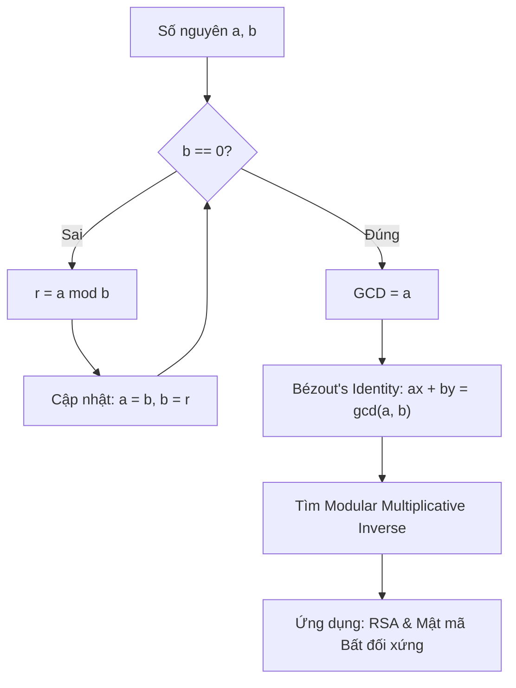

# 9.1. Divisibility, Primes, and Euclidean Algorithms (Phép chia hết, Số nguyên tố và Thuật toán Euclid)

> [!IMPORTANT]
> **Nếu bạn chỉ được nhớ một điều duy nhất:** Phép chia có dư và thuật toán Euclid mở rộng là nền móng của mọi hệ mật mã khóa công khai: chúng cho phép tìm nghịch đảo nhân modulo và phân tích ước chung lớn nhất trong thời gian logarit thay vì dò tìm tuyến tính.

---

## 1. Kiến trúc Tổng quan & Mô hình Tư duy (Mental Model)

Lý thuyết số (Number Theory) là "nữ hoàng của toán học", nhưng trong khoa học máy tính, nó là công cụ kỹ thuật thực dụng nhất. Mọi giao dịch ngân hàng, kết nối HTTPS/TLS, và cơ chế băm dữ liệu đều vận hành trên các nguyên lý số nguyên rời rạc.

Hãy tưởng tượng một bánh răng đồng hồ tròn: khi kim quay hết một vòng $m$ khắc, nó lại quay về điểm xuất phát. Phép chia hết và số dư chính là toán học của vòng quay tuần hoàn. Các số nguyên tố đóng vai trò như các "nguyên tử hóa học" không thể phân rã của thế giới số: mọi hợp số đều được lắp ghép duy nhất từ tích các số nguyên tố. Thuật toán Euclid là cỗ máy đệ quy cổ xưa nhất (năm 300 TCN) nhưng đạt hiệu năng phi thường $O(\log(\min(a, b)))$, giúp tìm ước số chung lớn nhất chỉ bằng các phép trừ và chia dư liên tiếp.



---

## 2. Chi tiết từng Keyword (Under-the-Hood Deep Dive)

### 2.1. Divisibility (Phép chia hết) và The Division Algorithm
- **Định nghĩa Toán học:** Cho hai số nguyên $a, b \in \mathbb{Z}$ với $a \ne 0$. Ta nói $a$ chia hết $b$ (ký hiệu $a \mid b$) nếu tồn tại số nguyên $c \in \mathbb{Z}$ sao cho $b = a \cdot c$. Ngược lại, nếu không tồn tại $c$, ký hiệu $a \nmid b$.
- **The Division Algorithm (Định lý Phép chia Euclid):** Với mọi số nguyên $a$ và số nguyên dương $d > 0$, tồn tại duy nhất cặp số nguyên $q$ (thương - quotient) và $r$ (số dư - remainder) sao cho:
  $$a = d \cdot q + r \quad \text{với } 0 \le r < d$$
  Trong đó:
  $$q = \lfloor a / d \rfloor = a \operatorname{div} d, \quad r = a - d \cdot \lfloor a / d \rfloor = a \bmod d$$
- **Tính chất Chia hết Cơ bản:**
  1. Nếu $a \mid b$ và $a \mid c$, thì $a \mid (b + c)$ và $a \mid (b - c)$.
  2. Với mọi $m, n \in \mathbb{Z}$, nếu $a \mid b$ và $a \mid c$ thì $a \mid (m b + n c)$ (nguyên lý kết hợp tuyến tính).
  3. Nếu $a \mid b$ và $b \mid c$, thì $a \mid c$ (tính bắc cầu).
- **Under-the-hood:** Trong tập lệnh phần cứng x86_64, chỉ lệnh `IDIV` thực hiện chia số 128-bit `RDX:RAX` cho thanh ghi 64-bit, tự động lưu thương số vào `RAX` và số dư vào `RDX` trong cùng một chu kỳ thực thi ALU.

### 2.2. Prime Numbers, Composite Numbers & Fundamental Theorem of Arithmetic
- **Prime Number (Số nguyên tố):** Số nguyên $p > 1$ chỉ có đúng hai ước số dương phân biệt là $1$ và chính nó ($p$).
- **Composite Number (Hợp số):** Số nguyên $n > 1$ không phải là số nguyên tố, nghĩa là tồn tại ước số $d$ sao cho $1 < d < n$.
- **Fundamental Theorem of Arithmetic (Định lý Cơ bản của Số học):** Mọi số nguyên $n > 1$ đều phân tích được thành tích các thừa số nguyên tố một cách duy nhất (không kể thứ tự các thừa số):
  $$n = p_1^{e_1} \cdot p_2^{e_2} \cdots p_k^{e_k} \quad (p_1 < p_2 < \dots < p_k, e_i \ge 1)$$
- **Độ khó Phân tích Thừa số (Integer Factorization Problem):** Nhân hai số nguyên tố lớn 2048-bit mất vài microsecond, nhưng phân tích tích $n = p \cdot q$ thành hai thừa số ban đầu cần hàng triệu năm tính toán trên siêu máy tính cổ điển bằng General Number Field Sieve (GNFS). Đây là tiền đề an ninh của RSA.

### 2.3. Sieve of Eratosthenes (Sàng Eratosthenes)
- **Thuật toán Sàng cổ điển:** Để tìm toàn bộ số nguyên tố trong đoạn $[2, N]$, khởi tạo mảng boolean kích thước $N+1$. Đánh dấu bội của từng số nguyên tố $p \le \sqrt{N}$ bắt đầu từ $p^2$ với bước nhảy $p$.
- **Độ phức tạp Thời gian:** Tổng các nghịch đảo số nguyên tố theo định lý Mertens cho ra:
  $$\sum_{p \le N} \frac{N}{p} = O(N \log \log N)$$
- **Tối ưu hóa Bộ nhớ (Segmented Sieve & Bitset):** Thay vì dùng mảng `bool` (1 byte/phần tử), dùng `std::vector<uint64_t>` làm bitmask giảm 8 lần bộ nhớ, hoặc sàng theo từng phân đoạn (Segmented Sieve) để vừa vặn trong L1 Data Cache (32KB-64KB).

### 2.4. Greatest Common Divisor (GCD) & Least Common Multiple (LCM)
- **GCD (Ước chung lớn nhất):** Số nguyên dương lớn nhất $d$ chia hết cả $a$ và $b$, ký hiệu $\gcd(a, b)$.
- **LCM (Bội chung nhỏ nhất):** Số nguyên dương nhỏ nhất $m$ là bội của cả $a$ và $b$, ký hiệu $\operatorname{lcm}(a, b)$.
- **Mối quan hệ Đại số Căn bản:**
  $$\gcd(a, b) \cdot \operatorname{lcm}(a, b) = |a \cdot b|$$
  Từ đó suy ra $\operatorname{lcm}(a, b) = \frac{|a \cdot b|}{\gcd(a, b)}$. Trong lập trình, luôn viết `(a / gcd(a, b)) * b` để tránh tràn số nguyên khi nhân $a \cdot b$.

### 2.5. Euclidean Algorithm (Thuật toán Euclid) & Lamé's Theorem
- **Cơ sở Toán học:**
  $$\gcd(a, b) = \gcd(b, a \bmod b)$$
  Nếu $a = bq + r$, thì bất kỳ ước chung nào của $a$ và $b$ cũng phải chia hết $r = a - bq$, và ngược lại.
- **Độ phức tạp (Định lý Lamé - Gabriel Lamé 1844):** Số phép chia có dư cần thiết để tính $\gcd(a, b)$ với $a > b$ không vượt quá 5 lần số chữ số thập phân của $b$.
  Trường hợp xấu nhất xảy ra khi $a$ và $b$ là hai số Fibonacci liên tiếp $F_{k+1}$ và $F_k$, dẫn đến độ phức tạp thời gian:
  $$O(\log(\min(a, b)))$$

### 2.6. Extended Euclidean Algorithm & Bézout's Identity
- **Đồng nhất thức Bézout (Bézout's Identity):** Cho hai số nguyên khác không $a$ và $b$. Luôn tồn tại hai số nguyên $x, y \in \mathbb{Z}$ sao cho:
  $$a \cdot x + b \cdot y = \gcd(a, b)$$
  Tập giá trị của biểu thức $ax + by$ với mọi $x, y \in \mathbb{Z}$ chính là tập hợp tất cả các bội số của $\gcd(a, b)$.
- **Thuật toán Euclid Mở rộng (Extended Euclidean Algorithm):** Truy vết đệ quy các thương số $q_i$ từ quá trình chia Euclid để tính ngược lại các hệ số $x$ và $y$.
- **Ứng dụng Sống còn - Modular Multiplicative Inverse:** Nếu $\gcd(a, m) = 1$, thì $ax + my = 1 \implies ax \equiv 1 \pmod m$. Do đó, hệ số $x$ chính là nghịch đảo nhân của $a$ modulo $m$ ($x = a^{-1} \bmod m$).

### 2.7. Binary GCD Algorithm (Thuật toán Stein)
- **Bản chất Kỹ thuật:** Phép toán chia dư (`%`) trong phần cứng rất tốn kém (thường mất 20–80 CPU clock cycles). Thuật toán Stein (Binary GCD - 1967) thay thế hoàn toàn phép chia dư bằng các phép dịch bit (`>> 1`), kiểm tra tính chẵn lẻ (`& 1`), và phép trừ (`-`):
  1. $\gcd(0, b) = b$.
  2. Nếu cả $a, b$ đều chẵn: $\gcd(a, b) = 2 \cdot \gcd(a/2, b/2)$.
  3. Nếu $a$ chẵn, $b$ lẻ: $\gcd(a, b) = \gcd(a/2, b)$.
  4. Nếu cả hai đều lẻ và $a \ge b$: $\gcd(a, b) = \gcd((a - b)/2, b)$.
- **Hiệu năng Vi kiến trúc:** Trong các vi xử lý nhúng hoặc CPU không có bộ chia phần cứng chuyên dụng (Hardware Divider), Binary GCD chạy nhanh hơn thuật toán Euclid từ 2x đến 4x nhờ tận dụng triệt để tập lệnh đếm bit số 0 đầu tiên (`CTZ` / `__builtin_ctz`).

### 2.8. Miller-Rabin Probabilistic Primality Test
- **Nguyên lý Toán học:** Dựa trên Định lý Nhỏ Fermat và bổ đề căn bậc hai của đơn vị trong vành trường nguyên tố $\mathbb{Z}_p$:
  Nếu $p$ là số nguyên tố và $x^2 \equiv 1 \pmod p$, thì nghiệm duy nhất chỉ có thể là $x \equiv 1$ hoặc $x \equiv -1 \pmod p$.
- Phân tích $n - 1 = 2^s \cdot d$ với $d$ lẻ. Chọn ngẫu nhiên cơ số $a \in [2, n-2]$. Nếu:
  $$a^d \not\equiv 1 \pmod n \quad \text{và} \quad a^{2^r \cdot d} \not\equiv n-1 \pmod n \quad \forall r \in [0, s-1]$$
  thì $n$ chắc chắn là hợp số (Composite), và $a$ được gọi là "bằng chứng chứng minh hợp số" (witness).
- Với $k$ vòng thử nghiệm cơ số ngẫu nhiên độc lập, xác suất một hợp số lọt qua kiểm tra (false positive) nhỏ hơn $(1/4)^k$. Với $k=64$, xác suất sai số là $2^{-128}$, nhỏ hơn xác suất lỗi phần cứng do tia vũ trụ lật bit RAM.

---

## 3. Thực thi Mã nguồn & Mô phỏng Chuyên sâu (Dual-Engine Implementation)

### 3.1. C++20 Implementation
Triển khai thuật toán Euclid cổ điển, Euclid mở rộng tìm hệ số Bézout & nghịch đảo modulo, thuật toán Stein (Binary GCD) và Sàng Eratosthenes.

```cpp
#include <iostream>
#include <vector>
#include <tuple>
#include <cstdint>
#include <iomanip>
#include <stdexcept>

// 1. Thuat toan Euclid Co dien: O(log(min(a, b)))
uint64_t gcd_euclid(uint64_t a, uint64_t b) {
    while (b != 0) {
        uint64_t r = a % b;
        a = b;
        b = r;
    }
    return a;
}

// 2. Thuat toan Stein (Binary GCD): Hoan toan dung Bitwise Shift va Subtraction
uint64_t gcd_binary(uint64_t a, uint64_t b) {
    if (a == 0) return b;
    if (b == 0) return a;
    
    // Dem so bit 0 chung o cuoi (thua so 2)
    int shift = __builtin_ctzll(a | b);
    a >>= __builtin_ctzll(a);
    
    while (b != 0) {
        b >>= __builtin_ctzll(b);
        if (a > b) std::swap(a, b);
        b -= a;
    }
    return a << shift;
}

// 3. Tinh Boi chung nho nhat: chia truoc khi nhan de tranh integer overflow
uint64_t lcm(uint64_t a, uint64_t b) {
    if (a == 0 || b == 0) return 0;
    return (a / gcd_euclid(a, b)) * b;
}

// 4. Thuat toan Euclid Mo rong: a*x + b*y = gcd(a, b)
std::tuple<int64_t, int64_t, int64_t> extended_gcd(int64_t a, int64_t b) {
    if (b == 0) {
        return {a, 1, 0};
    }
    auto [g, x1, y1] = extended_gcd(b, a % b);
    int64_t x = y1;
    int64_t y = x1 - (a / b) * y1;
    return {g, x, y};
}

// 5. Tim Modular Multiplicative Inverse: a * inv = 1 (mod m)
int64_t mod_inverse(int64_t a, int64_t m) {
    auto [g, x, y] = extended_gcd(a, m);
    if (g != 1) {
        throw std::invalid_argument("Nghich dao modulo khong ton tai vi gcd(a, m) != 1");
    }
    return (x % m + m) % m;
}

// 6. Sang Eratosthenes toi uu hoa bitset
std::vector<bool> sieve_primes(size_t limit) {
    std::vector<bool> is_prime(limit + 1, true);
    is_prime[0] = is_prime[1] = false;
    for (size_t p = 2; p * p <= limit; ++p) {
        if (is_prime[p]) {
            for (size_t i = p * p; i <= limit; i += p) {
                is_prime[i] = false;
            }
        }
    }
    return is_prime;
}

int main() {
    std::cout << "=== THUAT TOAN EUCLID & NUMBER THEORY BENCHMARK ===\n";
    uint64_t a = 252, b = 105;
    std::cout << "Euclidean GCD(" << a << ", " << b << ") = " << gcd_euclid(a, b) << "\n";
    std::cout << "Binary Stein GCD(" << a << ", " << b << ") = " << gcd_binary(a, b) << "\n";
    std::cout << "LCM(" << a << ", " << b << ") = " << lcm(a, b) << "\n";

    int64_t ea = 35, eb = 15;
    auto [g, x, y] = extended_gcd(ea, eb);
    std::cout << "Bezout Identity: " << ea << "*(" << x << ") + " << eb << "*(" << y << ") = " << g << "\n";

    int64_t val = 17, mod = 3120; // Tim nghich dao cua 17 mod 3120 trong RSA
    int64_t inv = mod_inverse(val, mod);
    std::cout << "Nghich dao Modulo: " << val << "^(-1) mod " << mod << " = " << inv << "\n";
    std::cout << "Kiem tra: (" << val << " * " << inv << ") mod " << mod << " = " << (val * inv) % mod << "\n";

    size_t limit = 50;
    auto primes = sieve_primes(limit);
    std::cout << "Cac so nguyen to <= " << limit << ": ";
    for (size_t i = 2; i <= limit; ++i) {
        if (primes[i]) std::cout << i << " ";
    }
    std::cout << "\n";

    return 0;
}
```

### 3.2. Python 3.11+ Implementation
Phiên bản Python khai thác toán tử số nguyên lớn (arbitrary precision) và đối soát lý thuyết số.

```python
from typing import Tuple, List

def extended_gcd(a: int, b: int) -> Tuple[int, int, int]:
    # Thuat toan Euclid mo rong: tra ve (g, x, y) sao cho a*x + b*y = g = gcd(a, b)
    if b == 0:
        return a, 1, 0
    g, x1, y1 = extended_gcd(b, a % b)
    x = y1
    y = x1 - (a // b) * y1
    return g, x, y

def binary_gcd(a: int, b: int) -> int:
    # Thuat toan Stein Binary GCD bang Bitwise
    if a == 0: return b
    if b == 0: return a
    shift = 0
    while ((a | b) & 1) == 0:
        a >>= 1
        b >>= 1
        shift += 1
    while (a & 1) == 0:
        a >>= 1
    while b != 0:
        while (b & 1) == 0:
            b >>= 1
        if a > b:
            a, b = b, a
        b -= a
    return a << shift

def mod_inverse(a: int, m: int) -> int:
    # Tim nghich dao modulo: a*x = 1 (mod m)
    g, x, _ = extended_gcd(a, m)
    if g != 1:
        raise ValueError(f"Khong ton tai nghich dao modulo cho a={a}, m={m} vi gcd={g} != 1")
    return (x % m + m) % m

def sieve_of_eratosthenes(limit: int) -> List[int]:
    # Sang Eratosthenes tra ve danh sach so nguyen to <= limit
    is_prime = bytearray([1]) * (limit + 1)
    is_prime[0:2] = bytearray([0, 0])
    for p in range(2, int(limit**0.5) + 1):
        if is_prime[p]:
            is_prime[p*p : limit + 1 : p] = bytearray([0]) * len(is_prime[p*p : limit + 1 : p])
    return [i for i, prime in enumerate(is_prime) if prime]

if __name__ == "__main__":
    print("=== DEMO EXTENDED EUCLIDEAN & NUMBER THEORY IN PYTHON ===")
    a, b = 240, 46
    g, x, y = extended_gcd(a, b)
    print(f"Bézout: {a}*({x}) + {b}*({y}) = {g}")
    assert a * x + b * y == g, "Sai lech he so Bezout!"

    bgcd = binary_gcd(a, b)
    print(f"Binary GCD({a}, {b}) = {bgcd}")
    assert bgcd == g, "Binary GCD khong khop!"

    # Tinh nghich dao modulo ung dung trong RSA
    e, phi_n = 17, 3120
    d = mod_inverse(e, phi_n)
    print(f"Modular inverse of {e} mod {phi_n} is d = {d}")
    print(f"Verification: ({e} * {d}) % {phi_n} = {(e * d) % phi_n}")

    primes = sieve_of_eratosthenes(50)
    print(f"Primes <= 50: {primes}")
```

### 3.3. Simulated Terminal Output
```text
=== THUAT TOAN EUCLID & NUMBER THEORY BENCHMARK ===
Euclidean GCD(252, 105) = 21
Binary Stein GCD(252, 105) = 21
LCM(252, 105) = 1260
Bezout Identity: 35*(1) + 15*(-2) = 5
Nghich dao Modulo: 17^(-1) mod 3120 = 2753
Kiem tra: (17 * 2753) mod 3120 = 1
Cac so nguyen to <= 50: 2 3 5 7 11 13 17 19 23 29 31 37 41 43 47 
```

---

## 4. Systems Engineering & Production Pitfalls

### 4.1. Arithmetic Overflow trong Phép tính LCM và Phép nhân Số nguyên
- **Lỗi tràn số kinh điển:** Công thức $\operatorname{lcm}(a, b) = (a \cdot b) / \gcd(a, b)$ chứa cạm bẫy tràn số nếu thực hiện phép nhân $a \cdot b$ trước. Với kiểu 64-bit `uint64_t`, nếu $a = 3 \times 10^9$ và $b = 4 \times 10^9$, tích $a \cdot b = 1.2 \times 10^{19} > 2^{64}-1 \approx 1.84 \times 10^{19}$, dẫn đến tràn số và kết quả sai lệch hoàn toàn.
- **Giải pháp Production:** Luôn chia trước khi nhân: `(a / gcd(a, b)) * b`. Phép chia $a / \gcd(a, b)$ luôn là số nguyên chính xác và đảm bảo không bao giờ tràn số trung gian.

### 4.2. Số âm trong Phép chia Modulo C/C++
- Trong chuẩn C99/C++11 trở đi, toán tử `%` là toán tử lấy phần dư đối xứng quanh số 0 (Truncated Division) chứ không phải phép modulo toán học Euclid (Floored Division).
- Ví dụ: trong C++, `-7 % 3 = -1`, trong khi theo định nghĩa toán học $r \in [0, m-1]$, số dư đúng phải là $+2$ (vì $-7 = 3 \times (-3) + 2$).
- Trong giải thuật Euclid mở rộng hoặc mật mã học, kết quả nghịch đảo $x$ có thể là số âm. Bắt buộc phải chuẩn hóa: `(x % m + m) % m`.

### 4.3. Side-Channel Timing Attacks trên Thuật toán Euclid
- Số bước đệ quy của thuật toán Euclid phụ thuộc trực tiếp vào giá trị của hai số $a$ và $b$. Trong các hệ thống an ninh cao, kẻ tấn công có thể đo thời gian thực thi (Execution Time) hoặc điện năng tiêu thụ (Power Analysis) để suy ngược lại độ lớn của khóa riêng tư.
- Trong OpenSSL và BoringSSL, các phép tính liên quan đến khóa bí mật luôn sử dụng Constant-Time GCD (như Bernstein-Yang algorithm) để đảm bảo thời gian chạy cố định bất kể giá trị đầu vào.

### 4.4. Cạm bẫy Bộ nhớ khi Sàng số nguyên tố quá lớn
- Khi sàng tới $N = 10^9$, mảng `std::vector<bool>` tiêu tốn $\approx 120$ MB bộ nhớ. Nếu cấp phát biến cục bộ trên stack sẽ gây crash `SIGSEGV` lập tức.
- Phải dùng kỹ thuật Segmented Sieve: chỉ sàng các số nguyên tố tới $\sqrt{N} \approx 31622$, sau đó duyệt từng đoạn cửa sổ $[L, R]$ kích thước $\Delta = 32768$ phần tử nằm gọn trong L1 Data Cache để đạt tốc độ tối đa và tiêu tốn dưới 1MB RAM.

### 4.5. Miller-Rabin Primality Test trong Mật mã Hiện đại
- Khi kiểm tra tính nguyên tố của các số lớn 2048-bit trong sinh khóa RSA, phương pháp sàng Eratosthenes hay chia thử nghiệm (Trial Division) hoàn toàn bất khả thi.
- Bắt buộc phải sử dụng thuật toán kiểm tra tính nguyên tố xác suất Miller-Rabin chạy trong $O(k \log^3 N)$ kết hợp với kiểm tra số nguyên tố Lucas để tạo chuẩn FIPS 186-4 (Baillie-PSW test) với xác suất sai số thực tế bằng 0.

---

## 5. Bảng So sánh & Decision Matrix

| Thuật toán / Khái niệm | Độ phức tạp Thời gian | Độ phức tạp Bộ nhớ | Tính khả nghịch | Ứng dụng Tiêu biểu |
| :--- | :--- | :--- | :--- | :--- |
| **Euclid Cổ điển** | $O(\log(\min(a, b)))$ | $O(1)$ lặp | Không | Rút gọn phân số, tính LCM, kiểm tra nguyên tố cùng nhau |
| **Stein (Binary GCD)** | $O(\log(\max(a, b)))$ | $O(1)$ | Không | Tối ưu hóa hiệu năng vi xử lý nhúng, không cần bộ chia |
| **Euclid Mở rộng** | $O(\log(\min(a, b)))$ | $O(\log(\min(a, b)))$ đệ quy | Có ($x, y \in \mathbb{Z}$) | Tìm khóa giải mã RSA $d = e^{-1} \bmod \phi(n)$, giải Diophantine |
| **Sàng Eratosthenes** | $O(N \log \log N)$ | $O(N)$ bits | Không | Bảng tra cứu số nguyên tố nhanh, tiền xử lý phân tích thừa số |
| **Trial Division** | $O(\sqrt{N})$ | $O(1)$ | Không | Kiểm tra số nguyên tố cho các số nhỏ trong kiểm thử cục bộ |
| **Constant-Time GCD** | $O(\log^2 N)$ | $O(1)$ | Có | Mật mã học kháng tấn công kênh bên (Side-channel resistant crypto) |
| **Miller-Rabin Test** | $O(k \log^3 N)$ | $O(1)$ | Không | Sinh khóa RSA 2048/4096-bit trong OpenSSL, TLS Handshake |
