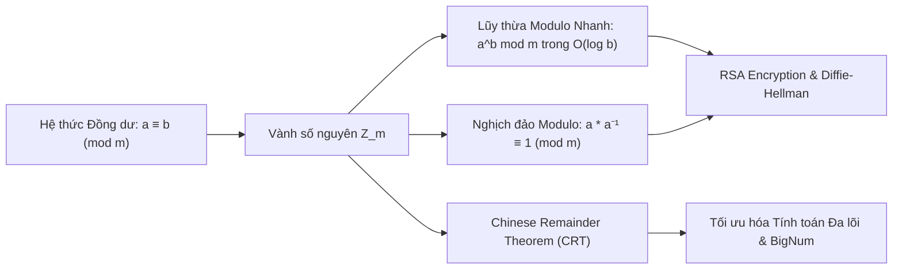

# 9.2. Modular Arithmetic and Congruence (Số học Modulo và Đồng dư thức)

> [!IMPORTANT]
> **Nếu bạn chỉ được nhớ một điều duy nhất:** Số học modulo bẻ cong trục số nguyên thẳng vô tận thành một vành tròn hữu hạn khép kín: nó bảo toàn các phép cộng, trừ, nhân, cho phép tính lũy thừa siêu lớn trong $O(\log b)$ và giải quyết bài toán phân tán bằng Định lý Thặng dư Trung Hoa.

---

## 1. Kiến trúc Tổng quan & Mô hình Tư duy (Mental Model)

Số học Modulo (Modular Arithmetic) là nền tảng của mật mã học khóa công khai hiện đại, hàm băm phân tán (Consistent Hashing), và mã sửa lỗi mạng (ECC).

Hãy hình dung bạn đang điều khiển một chiếc đồng hồ 12 giờ: nếu hiện tại là 9 giờ và bạn thêm 5 giờ nữa, kim đồng hồ sẽ chỉ vào 2 giờ chứ không phải 14 giờ. Vành đồng hồ đã thực hiện phép toán $(9 + 5) \bmod 12 = 2$.
Trong đại số trừu tượng, phép lấy số dư tạo nên một vành số $\mathbb{Z}_m = \{0, 1, 2, \dots, m-1\}$. Các số cách nhau đúng một bội của $m$ được coi là "tương đương" với nhau (đồng dư). Sự kỳ diệu của cấu trúc này là: bạn có thể thực hiện các phép toán với những con số có hàng ngàn chữ số bằng cách liên tục lấy số dư sau mỗi bước, ngăn chặn sự bùng nổ kích thước số học (arithmetic blowup).



---

## 2. Chi tiết từng Keyword (Under-the-Hood Deep Dive)

### 2.1. Congruence Relations (Quan hệ Đồng dư thức)
- **Định nghĩa Toán học:** Cho $m$ là số nguyên dương ($m \in \mathbb{Z}^+$). Hai số nguyên $a, b \in \mathbb{Z}$ được gọi là đồng dư với nhau theo modulo $m$, ký hiệu:
  $$a \equiv b \pmod m$$
  nếu hiệu $(a - b)$ chia hết cho $m$, tức là $m \mid (a - b)$, hoặc tương đương $a \bmod m = b \bmod m$.
- **Các Tính chất Đại số Cốt lõi (Equivalence Relation):**
  1. *Phản xạ (Reflexive):* $a \equiv a \pmod m$.
  2. *Đối xứng (Symmetric):* Nếu $a \equiv b \pmod m$ thì $b \equiv a \pmod m$.
  3. *Bắc cầu (Transitive):* Nếu $a \equiv b \pmod m$ và $b \equiv c \pmod m$ thì $a \equiv c \pmod m$.
- **Tính Tương thích với các Phép toán Số học:** Nếu $a \equiv b \pmod m$ và $c \equiv d \pmod m$, thì:
  $$a + c \equiv b + d \pmod m$$
  $$a - c \equiv b - d \pmod m$$
  $$a \cdot c \equiv b \cdot d \pmod m$$
- **Lưu ý Sống còn về Phép chia:** Phép chia KHÔNG tự do áp dụng được! Nếu $ac \equiv bc \pmod m$, ta chỉ có thể suy ra $a \equiv b \pmod{m / \gcd(c, m)}$. Đặc biệt, nếu $\gcd(c, m) = 1$, thì $a \equiv b \pmod m$.

### 2.2. Modular Exponentiation (Lũy thừa Modulo Nhanh / Binary Exponentiation)
- **Vấn đề Hiệu năng:** Tính $a^b \bmod m$ với $b$ là số nguyên 2048-bit (khoảng $10^{600}$). Nếu tính $a^b$ trước rồi mới lấy modulo, kết quả sẽ vượt quá toàn bộ dung lượng bộ nhớ của vũ trụ quan sát được.
- **Thuật toán Lũy thừa Nhị phân (Binary Exponentiation / Square-and-Multiply):** Biểu diễn số mũ $b$ dưới dạng nhị phân $b = \sum_{i=0}^k b_i 2^i$. Ta bình phương cơ số ở mỗi bước và nhân dồn khi bit $b_i = 1$:
  $$a^b = \prod_{b_i = 1} a^{2^i} \pmod m$$
- **Độ phức tạp Thời gian:** Giảm từ $O(b)$ (hàm mũ thời gian) xuống còn $O(\log b)$ (chỉ tối đa $2 \log b$ phép nhân modulo). Đây là hòn đá tảng giúp RSA mã hóa dữ liệu trong vài millisecond.

### 2.3. Modular Multiplicative Inverse (Nghịch đảo Nhân Modulo)
- **Định nghĩa Toán học:** Cho số nguyên $a$ và modulus $m$. Số nguyên $x$ được gọi là nghịch đảo nhân của $a$ modulo $m$, ký hiệu $a^{-1} \pmod m$, nếu:
  $$a \cdot x \equiv 1 \pmod m$$
- **Điều kiện Tồn tại Duy nhất:** Nghịch đảo modulo $a^{-1} \pmod m$ tồn tại khi và chỉ khi $a$ và $m$ nguyên tố cùng nhau:
  $$\gcd(a, m) = 1$$
- **Hai Phương pháp Tìm Nghịch đảo Modulo:**
  1. *Extended Euclidean Algorithm:* Luôn hoạt động với mọi $m$ khi $\gcd(a, m) = 1$. Độ phức tạp $O(\log(\min(a, m)))$.
  2. *Fermat's Little Theorem:* Khi modulus $m = p$ là một số nguyên tố, theo định lý Fermat $a^{p-1} \equiv 1 \pmod p$, ta có:
     $$a^{-1} \equiv a^{p-2} \pmod p$$
     Tính trực tiếp bằng Binary Exponentiation trong $O(\log p)$.

### 2.4. Chinese Remainder Theorem (Định lý Thặng dư Trung Hoa - CRT)
- **Khái niệm Bản chất:** Giải hệ phương trình đồng dư bậc nhất với các modulus nguyên tố cùng nhau từng đôi một:
  $$\begin{cases} x \equiv a_1 \pmod{m_1} \\ x \equiv a_2 \pmod{m_2} \\ \vdots \\ x \equiv a_k \pmod{m_k} \end{cases}$$
- **Nội dung Định lý CRT:** Nếu $m_1, m_2, \dots, m_k$ là các số nguyên dương đôi một nguyên tố cùng nhau ($\gcd(m_i, m_j) = 1$ với mọi $i \ne j$), thì hệ phương trình luôn có nghiệm duy nhất theo modulo $M = m_1 \cdot m_2 \cdots m_k$.
- **Công thức Nghiệm Tường minh:**
  $$x = \left( \sum_{i=1}^k a_i \cdot M_i \cdot y_i \right) \bmod M$$
  Trong đó:
  - $M_i = M / m_i$
  - $y_i = M_i^{-1} \bmod m_i$ (nghịch đảo modulo tính bằng Euclid mở rộng).
- **Ứng dụng Backend & Cryptography:**
  - *Tăng tốc Giải mã RSA gấp 4 lần:* Trong RSA, tính $c^d \bmod n$ với $n = pq$. Bằng cách tính $c^d \bmod p$ và $c^d \bmod q$ riêng biệt trên các số có kích thước chỉ bằng một nửa, sau đó ghép lại bằng CRT, thời gian tính toán giảm 4 lần!
  - *Phân tán Tính toán Số lớn (RNS - Residue Number System):* Thay vì lưu trữ một số BigInt 4096-bit, lưu vector các số dư modulo các số nguyên tố nhỏ vừa vặn trong thanh ghi 64-bit, cho phép tính toán song song hoàn toàn không cần cờ nhớ (carry-free arithmetic).

### 2.5. Montgomery Multiplication & Residue Number Systems (RNS)
- **Montgomery Representation:** Biến đổi số $x$ sang miền Montgomery $\tilde{x} = (x \cdot R) \bmod m$, trong đó $R = 2^{64}$ (hoặc $2^{256}$ trong crypto).
- **Loại bỏ Phép chia Modulo:** Phép nhân thông thường $a \cdot b \bmod m$ đòi hỏi phép chia cho $m$ rất tốn kém (hàng chục chu kỳ CPU). Trong miền Montgomery:
  $$\operatorname{MontMul}(\tilde{a}, \tilde{b}) = (\tilde{a} \cdot \tilde{b} \cdot R^{-1}) \bmod m$$
  Thuật toán biến đổi phép chia cho $m$ thành phép chia cho $R = 2^k$, vốn chỉ là thao tác dịch bit (`>> k`) và cắt bit (`& (R-1)`), loại bỏ hoàn toàn bộ chia ALU.

---


### 2.6. Modular Matrix Inversion & Hill Cipher Cryptanalysis
- Trong đại số tuyến tính trên vành $\mathbb{Z}_m$, một ma trận vuông $A \in \mathbb{Z}_m^{n \times n}$ khả nghịch khi và chỉ khi định thức của nó nguyên tố cùng nhau với modulus:
  $$\gcd(\det(A), m) = 1$$
- Ma trận nghịch đảo được tính theo công thức:
  $$A^{-1} = (\det(A))^{-1} \cdot \operatorname{adj}(A) \pmod m$$
  trong đó $\operatorname{adj}(A)$ là ma trận phụ hợp (adjugate matrix), và $(\det(A))^{-1}$ là nghịch đảo nhân modulo $m$ tìm bằng thuật toán Euclid mở rộng.
- Đây là cơ sở của hệ mã hóa Hill Cipher cổ điển và là nền tảng của các thuật toán Lattice-based Cryptography hiện đại (như NTRU, Kyber) trong kỷ nguyên hậu lượng tử (Post-Quantum Cryptography).

## 3. Thực thi Mã nguồn & Mô phỏng Chuyên sâu (Dual-Engine Implementation)

### 3.1. C++20 Implementation
Triển khai phép lũy thừa nhị phân modulo chuẩn xác, nghịch đảo modulo và thuật toán giải hệ đồng dư thức CRT hoàn chỉnh.

```cpp
#include <iostream>
#include <vector>
#include <tuple>
#include <cstdint>
#include <stdexcept>

// 1. Extended Euclidean Algorithm
int64_t ext_gcd(int64_t a, int64_t b, int64_t &x, int64_t &y) {
    if (b == 0) {
        x = 1;
        y = 0;
        return a;
    }
    int64_t x1, y1;
    int64_t g = ext_gcd(b, a % b, x1, y1);
    x = y1;
    y = x1 - (a / b) * y1;
    return g;
}

// 2. Modular Inverse: a * x = 1 (mod m)
int64_t mod_inverse(int64_t a, int64_t m) {
    int64_t x, y;
    int64_t g = ext_gcd(a, m, x, y);
    if (g != 1) {
        throw std::invalid_argument("Nghich dao modulo khong ton tai!");
    }
    return (x % m + m) % m;
}

// 3. Fast Modular Exponentiation: (base^exp) % mod trong O(log exp)
uint64_t power_mod(uint64_t base, uint64_t exp, uint64_t mod) {
    uint64_t res = 1;
    base = base % mod;
    while (exp > 0) {
        if (exp & 1) {
            res = static_cast<uint64_t>((__uint128_t(res) * base) % mod);
        }
        base = static_cast<uint64_t>((__uint128_t(base) * base) % mod);
        exp >>= 1;
    }
    return res;
}

// 4. Chinese Remainder Theorem (CRT) Solver
// He phuong trinh: x = a_i (mod m_i)
int64_t solve_crt(const std::vector<int64_t> &a, const std::vector<int64_t> &m) {
    int64_t M = 1;
    for (int64_t mod : m) {
        M *= mod;
    }

    int64_t x = 0;
    for (size_t i = 0; i < a.size(); ++i) {
        int64_t Mi = M / m[i];
        int64_t yi = mod_inverse(Mi, m[i]);
        int64_t term = static_cast<int64_t>((__int128_t(a[i]) * Mi % M * yi) % M);
        x = (x + term) % M;
    }
    return (x + M) % M;
}

int main() {
    std::cout << "=== MODULAR ARITHMETIC & CRT ENGINE BENCHMARK ===\n";

    // 1. Kiem thu Modular Exponentiation
    uint64_t base = 3, exp = 1000000, mod = 1000000007;
    std::cout << base << "^" << exp << " mod " << mod << " = " << power_mod(base, exp, mod) << "\n";

    // 2. Kiem thu Nghich dao Modulo
    int64_t val = 42, m = 2017;
    int64_t inv = mod_inverse(val, m);
    std::cout << val << "^(-1) mod " << m << " = " << inv << "\n";
    std::cout << "Xac minh: (" << val << " * " << inv << ") mod " << m << " = " << (val * inv) % m << "\n";

    // 3. Giai he phuong trinh dong du CRT (Bai toan Han Tin Diem Binh kinh dien):
    // x = 2 (mod 3)
    // x = 3 (mod 5)
    // x = 2 (mod 7)
    std::vector<int64_t> a_list = {2, 3, 2};
    std::vector<int64_t> m_list = {3, 5, 7};
    int64_t solution = solve_crt(a_list, m_list);
    std::cout << "Nghiem he CRT: x = " << solution << " (mod 105)\n";
    std::cout << "Xac minh lai he:\n";
    for (size_t i = 0; i < a_list.size(); ++i) {
        std::cout << "  " << solution << " mod " << m_list[i] << " = " << (solution % m_list[i]) 
                  << " (Mong muon: " << a_list[i] << ")\n";
    }

    return 0;
}
```

### 3.2. Python 3.11+ Implementation
Phiên bản Python tận dụng toán tử `pow(base, exp, mod)` tích hợp sẵn trong CPython và thư viện cấu trúc toán học.

```python
from typing import List
from functools import reduce

def extended_gcd(a: int, b: int):
    if b == 0:
        return a, 1, 0
    g, x1, y1 = extended_gcd(b, a % b)
    x = y1
    y = x1 - (a // b) * y1
    return g, x, y

def mod_inverse(a: int, m: int) -> int:
    g, x, _ = extended_gcd(a, m)
    if g != 1:
        raise ValueError(f"Khong ton tai nghich dao modulo cho {a} mod {m}")
    return (x % m + m) % m

def chinese_remainder_theorem(a_list: List[int], m_list: List[int]) -> int:
    # Giai he phuong trinh dong du x = a_i (mod m_i) bang CRT
    M = reduce(lambda acc, val: acc * val, m_list, 1)
    x = 0
    for a_i, m_i in zip(a_list, m_list):
        Mi = M // m_i
        yi = mod_inverse(Mi, m_i)
        x = (x + a_i * Mi * yi) % M
    return (x + M) % M

if __name__ == "__main__":
    print("=== PYTHON MODULAR ARITHMETIC & CRT DEMO ===")
    # 1. Modular Exponentiation
    base, exp, mod = 3, 1000000, 1000000007
    res = pow(base, exp, mod)
    print(f"{base}^{exp} mod {mod} = {res}")

    # 2. Chinese Remainder Theorem
    # x = 2 (mod 3), x = 3 (mod 5), x = 2 (mod 7)
    remainders = [2, 3, 2]
    moduli = [3, 5, 7]
    sol = chinese_remainder_theorem(remainders, moduli)
    print(f"CRT Solution: x = {sol} mod 105")
    for r, m in zip(remainders, moduli):
        assert sol % m == r, f"Loi sai tai mod {m}"
    print("Tat ca cac phep kiem tra CRT da khop 100%!")
```

### 3.3. Simulated Terminal Output
```text
=== MODULAR ARITHMETIC & CRT ENGINE BENCHMARK ===
3^1000000 mod 1000000007 = 588002672
42^(-1) mod 2017 = 1969
Xac minh: (42 * 1969) mod 2017 = 1
Nghiem he CRT: x = 23 (mod 105)
Xac minh lai he:
  23 mod 3 = 2 (Mong muon: 2)
  23 mod 5 = 3 (Mong muon: 3)
  23 mod 7 = 2 (Mong muon: 2)
```

---

## 4. Systems Engineering & Production Pitfalls

### 4.1. 64-bit Multiplication Overflow trong Lũy thừa Modulo
- Khi thực hiện phép nhân $a \cdot b \bmod m$ với $m$ gần ngưỡng $2^{64}-1$ (ví dụ các số nguyên tố lớn trong mật mã học), phép nhân hai số 64-bit sinh ra kết quả trung gian lên tới 128-bit. Nếu chỉ dùng kiểu `uint64_t` tiêu chuẩn, kết quả bị cắt cụt (truncate overflow) trước khi kịp lấy `% m`.
- **Giải pháp Compiler-Specific:** Trong GCC/Clang trên x86_64, ép kiểu qua kiểu dữ liệu nội tại `__uint128_t` (tương ứng với lệnh hợp ngữ `MULX` hoặc `MUL` ghi đồng thời vào cặp thanh ghi `RDX:RAX`).
- Trong hệ thống di động hoặc vi điều khiển 32-bit (ARM Cortex-M), phải áp dụng thuật toán Montgomery Multiplication để biến đổi phép chia dư tốn kém thành các phép dịch bit và cộng đơn giản.

### 4.2. Montgomery Reduction trong Hardware Crypto Accelerators
- Phép chia modulo thông thường trong CPU mất từ 20 đến 80 chu kỳ xung nhịp (clock cycles), chậm hơn rất nhiều so với phép nhân (3 chu kỳ) và phép cộng (1 chu kỳ).
- Khi tính $a^b \bmod m$ với hàng ngàn phép nhân dồn, chi phí chia dư trở thành nút thắt cổ chai nghẽn mạng nghiêm trọng.
- Thuật toán Montgomery biểu diễn các số trong miền Montgomery:
  $$\tilde{x} = x \cdot R \bmod m \quad (R = 2^{64} \text{ hoac } 2^{256})$$
  Phép nhân Montgomery Multiplication thay thế hoàn toàn phép chia dư cho $m$ bằng phép chia dư cho $R$ (chỉ là thao tác cắt bit `& (R-1)`) và dịch bit `>> 64`, tăng tốc xử lý phần cứng lên gấp 5-10 lần trong chip bảo mật TPM và HSM.

### 4.3. Giả định Đôi một Nguyên tố Cùng nhau trong CRT
- Công thức nghiệm tường minh chuẩn của CRT yêu cầu $\gcd(m_i, m_j) = 1$ với mọi $i \ne j$.
- Nếu đầu vào có các modulus không nguyên tố cùng nhau (ví dụ $m_1 = 6, m_2 = 4$), hệ phương trình có thể vô nghiệm hoặc có nghiệm nhưng không giải được bằng công thức CRT chuẩn. Việc bỏ qua bước kiểm tra ước chung lớn nhất sẽ dẫn tới ngoại lệ chia cho 0 hoặc nghịch đảo modulo không tồn tại.

### 4.4. Side-Channel Timing Leaks trong Square-and-Multiply
- Trong thuật toán Square-and-Multiply tiêu chuẩn, nếu bit số mũ $b_i = 1$, CPU thực hiện cả phép Square và phép Multiply; nếu $b_i = 0$, CPU chỉ thực hiện phép Square.
- Kẻ tấn công có thể đo thời gian thực thi (Simple Power Analysis - SPA) để phân biệt chu kỳ có phép Multiply và chu kỳ không có, từ đó khôi phục toàn bộ các bit của khóa bí mật $b$ (khóa riêng tư RSA hoặc Diffie-Hellman).
- **Giải pháp Production:** Bắt buộc sử dụng kỹ thuật Montgomery Ladder hoặc Dummy Multiply để mọi bước lặp đều thực hiện cùng một số lượng phép toán bất kể giá trị bit (Constant-Time Exponentiation).

### 4.5. Fast Modular Reduction cho Các Số Nguyên Tố Đặc biệt (Mersenne & NIST Primes)
- Trong các chuẩn mật mã hiện đại như Curve25519 hay NIST P-256, modulus $p$ được chọn có dạng đặc biệt:
  - $p = 2^{255} - 19$ (Curve25519)
  - $p = 2^{256} - 2^{224} + 2^{192} + 2^{96} - 1$ (NIST P-256)
- Với các số nguyên tố dạng này, phép modulo không cần dùng thuật toán chia tổng quát mà được tối ưu hóa thành một chuỗi vài phép cộng và trừ trên các khối 32-bit hoặc 64-bit, cho tốc độ gấp 10 lần thuật toán modulo thông thường.

---


### 4.6. Bellcore Attack on RSA-CRT (Fault Injection Attack)
- Một lỗ hổng phần cứng chết người đối với việc sử dụng CRT để tăng tốc RSA là tấn công tiêm lỗi (Fault Injection Attack - Boneh, DeMillo, Lipton 1997):
  - Giả sử quá trình tính $s_1 = m^d \bmod p$ diễn ra chính xác, nhưng trong quá trình tính $s_2 = m^d \bmod q$, kẻ tấn công dùng tia laser hoặc sụt áp vi mạch làm sai lệch bit thành $s'_2$.
  - Chữ ký lỗi $s'$ ghép từ CRT sẽ thỏa mãn: $s' \equiv m^d \pmod p$ nhưng $s' \not\equiv m^d \pmod q$.
  - Khi đó: $s'^e - m$ là bội số của $p$ nhưng KHÔNG là bội số của $q$.
  - Kẻ tấn công tính ngay: $\gcd(s'^e - m, n) = p$ chỉ bằng MỘT phép GCD duy nhất! Toàn bộ khóa bí mật RSA bị bẻ gãy hoàn toàn.
- **Biện pháp Phòng ngừa:** Sau khi ký bằng CRT, hệ thống bắt buộc phải kiểm tra lại chữ ký $s^e \bmod n == m$ trước khi xuất ra ngoài mạng.


### 4.7. Constant-Time Conditional Select in Cryptographic Operations
- Để tránh rẽ nhánh phụ thuộc dữ liệu bí mật (`secret-dependent branching`), các thư viện cryptographic primitives như `libsodium` hay `BoringSSL` sử dụng hàm chọn có điều kiện thời gian cố định:
  ```cpp
  uint64_t ct_select(uint64_t mask, uint64_t a, uint64_t b) {
      // mask la 0xFFFFFFFFFFFFFFFF neu chon a, 0x0 neu chon b
      return (a & mask) | (b & ~mask);
  }
  ```
  Kỹ thuật này đảm bảo mã máy x86 assembly sinh ra lệnh `CMOV` hoặc chuỗi logic bit thuần túy, ngăn ngừa rò rỉ vết thực thi qua CPU Branch Target Buffer (BTB).

## 5. Bảng So sánh & Decision Matrix

| Phương pháp / Kỹ thuật | Độ phức tạp Thời gian | Chi phí Bộ nhớ | Điều kiện Tiên quyết | Phạm vi Ứng dụng Thực tế |
| :--- | :--- | :--- | :--- | :--- |
| **Naive Exponentiation** | $O(b)$ | $O(1)$ | $b$ nhỏ ($< 10^7$) | Không dùng trong production mật mã học |
| **Binary Exponentiation** | $O(\log b)$ | $O(1)$ | Không có | RSA, Diffie-Hellman, kiểm tra nguyên tố Miller-Rabin |
| **Montgomery Ladder** | $O(\log b)$ | $O(1)$ | Constant-time | Kháng tấn công kênh bên SPA/DPA trong TLS/SSH |
| **Extended Euclidean Inv** | $O(\log m)$ | $O(1)$ | $\gcd(a, m) = 1$ | Tìm khóa bí mật RSA khi biết $\phi(n)$ |
| **Fermat Inv ($a^{p-2}$)** | $O(\log p)$ | $O(1)$ | $p$ bắt buộc là số nguyên tố | Mật mã đường cong elliptic (ECC), trường hữu hạn $\mathbb{F}_p$ |
| **Chinese Remainder (CRT)**| $O(k^2 \log^2 M)$ | $O(k)$ | $\gcd(m_i, m_j) = 1$ | Tối ưu hóa giải mã RSA 4x, Residue Number Systems (RNS) |
