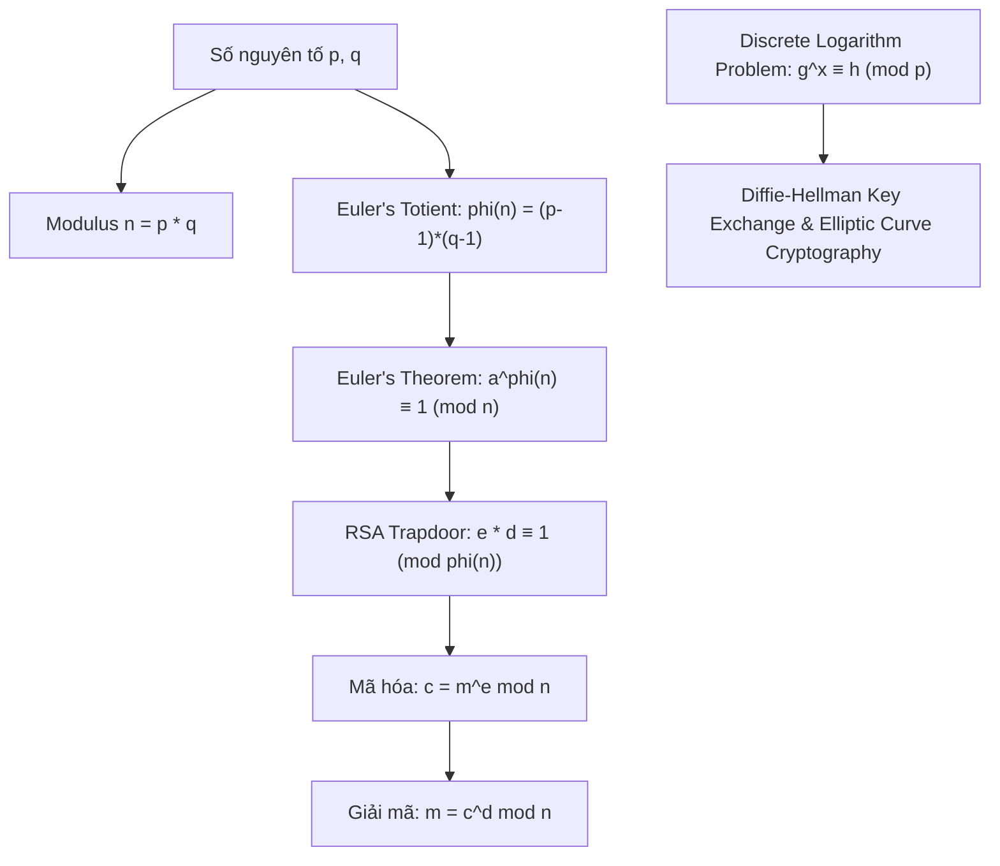

# 9.3. Fermat's and Euler's Theorems & Discrete Logarithm (Định lý Fermat, Euler và Logarit Rời rạc)

> [!IMPORTANT]
> **Nếu bạn chỉ được nhớ một điều duy nhất:** Định lý Euler $a^{\phi(n)} \equiv 1 \pmod n$ và bài toán Logarit rời rạc (DLP) là hai trụ cột toán học của toàn bộ nền kinh tế số: chúng cung cấp cơ chế mã hóa bất đối xứng khóa công khai và trao đổi khóa bí mật an toàn qua kênh truyền công cộng.

---

## 1. Kiến trúc Tổng quan & Mô hình Tư duy (Mental Model)

Toán học mật mã học hiện đại hoạt động dựa trên các "hàm một chiều có cửa sập" (trapdoor one-way functions): một phép tính cực kỳ dễ dàng khi đi xuôi, nhưng bất khả thi về mặt tính toán khi đi ngược lại nếu không nắm giữ chiếc "chìa khóa cửa sập".

Hãy tưởng tượng một phép trộn màu sơn vật lý: bạn dễ dàng trộn hai màu xanh và vàng để tạo ra màu xanh lá, nhưng từ màu xanh lá, một kẻ quan sát không tài nào tách lại được màu sơn gốc.
- **Phép lũy thừa modulo $g^x \bmod p$** chính là phép trộn màu xuôi: tính toán cực nhanh trong $O(\log x)$ bằng Binary Exponentiation.
- **Bài toán Logarit rời rạc (Discrete Logarithm)** chính là việc tách lại màu sơn: tìm lại số mũ $x$ ban đầu đòi hỏi thử nghiệm bùng nổ hàm mũ $O(p)$ hoặc $O(\sqrt{p})$.
- **Định lý Fermat và Định lý Euler** cung cấp "chiếc chìa khóa cửa sập" $\phi(n)$: cho phép người tạo khóa biết trước chu kỳ tuần hoàn của vành số, từ đó "quay ngược" kim đồng hồ modulo để giải mã thông điệp.



---

## 2. Chi tiết từng Keyword (Under-the-Hood Deep Dive)

### 2.1. Fermat's Little Theorem (Định lý Nhỏ Fermat)
- **Nội dung Định lý (Pierre de Fermat 1640):** Cho $p$ là một số nguyên tố. Nếu $a$ là số nguyên không chia hết cho $p$ ($p \nmid a$), thì:
  $$a^{p-1} \equiv 1 \pmod p$$
  Dạng tổng quát với mọi số nguyên $a \in \mathbb{Z}$:
  $$a^p \equiv a \pmod p$$
- **Ứng dụng Rút gọn Số mũ Siêu lớn:** Khi tính $a^b \bmod p$, ta có thể rút gọn số mũ $b$ theo modulo $(p - 1)$:
  $$a^b \equiv a^{b \bmod (p-1)} \pmod p$$
  Ví dụ: Tính $7^{1000002} \bmod 11$. Vì $p=11$, $p-1=10$. Số mũ $1000002 \equiv 2 \pmod{10}$.
  Do đó: $7^{1000002} \equiv 7^2 = 49 \equiv 5 \pmod{11}$. Phép tính giảm từ hàng triệu bước xuống đúng 1 phép bình phương.
- **Fermat Primality Test & Carmichael Numbers:**
  - Kiểm tra tính nguyên tố: Chọn ngẫu nhiên $a \in [2, n-1]$. Nếu $a^{n-1} \not\equiv 1 \pmod n$, $n$ chắc chắn là hợp số.
  - Cạm bẫy Số Carmichael: Tồn tại các hợp số $n$ thỏa mãn $a^{n-1} \equiv 1 \pmod n$ với MỌI cơ số $a$ nguyên tố cùng nhau với $n$ (ví dụ: $561 = 3 \times 11 \times 17, 1105, 1729$). Thuật toán Fermat bị đánh lừa hoàn toàn bởi các số này, bắt buộc phải nâng cấp lên thuật toán Miller-Rabin.

### 2.2. Euler's Totient Function (Hàm Phi Euler $\phi(n)$)
- **Định nghĩa Toán học (Leonhard Euler 1763):** Với mọi số nguyên dương $n \ge 1$, $\phi(n)$ là số lượng các số nguyên $k$ trong đoạn $[1, n]$ nguyên tố cùng nhau với $n$:
  $$\phi(n) = |\{k \in \mathbb{Z} \mid 1 \le k \le n \text{ va } \gcd(k, n) = 1\}|$$
- **Các Tính chất Đại số Căn bản:**
  1. Nếu $p$ là số nguyên tố: $\phi(p) = p - 1$.
  2. Nếu $p$ là số nguyên tố và $k \ge 1$: $\phi(p^k) = p^k - p^{k-1} = p^k \left(1 - \frac{1}{p}\right)$.
  3. Tính Nhân tính (Multiplicative Function): Nếu $\gcd(a, b) = 1$, thì:
     $$\phi(a \cdot b) = \phi(a) \cdot \phi(b)$$
- **Công thức Tích Euler Tổng quát:** Phân tích $n = p_1^{e_1} p_2^{e_2} \cdots p_k^{e_k}$, ta có:
  $$\phi(n) = n \cdot \prod_{p \mid n} \left(1 - \frac{1}{p}\right)$$
- **Trường hợp Đặc biệt dùng trong RSA:** Cho $n = p \cdot q$ với $p, q$ là hai số nguyên tố phân biệt:
  $$\phi(n) = \phi(p) \cdot \phi(q) = (p - 1)(q - 1)$$

### 2.3. Euler's Theorem (Định lý Euler)
- **Nội dung Định lý:** Cho $n$ là một số nguyên dương bất kỳ và $a$ là số nguyên nguyên tố cùng nhau với $n$ ($\gcd(a, n) = 1$). Khi đó:
  $$a^{\phi(n)} \equiv 1 \pmod n$$
- **Sự Tổng quát hóa của Định lý Fermat:** Khi $n = p$ là số nguyên tố, $\phi(p) = p - 1$, định lý Euler trở về chính xác định lý nhỏ Fermat.
- **Ý nghĩa Quyết định trong Mật mã RSA:**
  - Chọn khóa công khai $e$ và khóa riêng tư $d$ sao cho $e \cdot d \equiv 1 \pmod{\phi(n)}$.
  - Tức là tồn tại $k \in \mathbb{Z}$ sao cho $ed = 1 + k \phi(n)$.
  - Khi giải mã thông điệp mã hóa $c = m^e \bmod n$:
    $$c^d = (m^e)^d = m^{ed} = m^{1 + k \phi(n)} = m \cdot (m^{\phi(n)})^k \equiv m \cdot (1)^k = m \pmod n$$
  - Nhờ Định lý Euler, thông điệp $m$ được phục hồi nguyên vẹn 100%!

### 2.4. Discrete Logarithm Problem (Bài toán Logarit Rời rạc - DLP)
- **Định nghĩa Toán học:** Cho nhóm cyclic hữu hạn $\mathbb{Z}_p^*$ với $p$ là số nguyên tố, $g$ là một phần tử sinh (generator / primitive root) của nhóm, và một phần tử $h \in \mathbb{Z}_p^*$.
  Tìm số nguyên $x \in [0, p-2]$ thỏa mãn:
  $$g^x \equiv h \pmod p$$
  Số $x$ được gọi là logarit rời rạc của $h$ theo cơ số $g$, ký hiệu $x = \operatorname{dlog}_g(h)$ hoặc $\operatorname{ind}_g(h)$.
- **Độ khó Tính toán (The Hardness Assumption):**
  - Trong khi tính $h = g^x \bmod p$ mất $O(\log x)$ bằng lũy thừa nhị phân, việc tìm ngược lại $x$ từ $h$ không có công thức giải tích trực tiếp.
  - Phương pháp duyệt cạn (Brute-force) mất $O(p)$ bước. Với số nguyên tố 2048-bit ($p \approx 2^{2048}$), không gian tìm kiếm là không tưởng.
- **Ứng dụng Sống còn:** Là nền móng của giao thức trao đổi khóa Diffie-Hellman, chữ ký số ElGamal, DSA, và mật mã đường cong Elliptic (ECDSA/Ed25519) bảo vệ toàn bộ giao thức SSH, Bitcoin, Ethereum và HTTPS.

### 2.5. Baby-Step Giant-Step Algorithm (Thuật toán Shanks)
- **Nguyên lý Thuật toán (Daniel Shanks 1971):** Giải bài toán logarit rời rạc trong thời gian $O(\sqrt{p})$ và bộ nhớ $O(\sqrt{p})$ dựa trên kỹ thuật Space-Time Tradeoff:
  1. Đặt $m = \lceil \sqrt{p} \rceil$. Biểu diễn số mũ cần tìm dưới dạng:
     $$x = i \cdot m - j \quad (0 \le i \le m, \; 0 \le j < m)$$
  2. Phương trình $g^x \equiv h \pmod p$ tương đương với:
     $$g^{i \cdot m - j} \equiv h \pmod p \iff (g^m)^i \equiv h \cdot g^j \pmod p$$
  3. **Baby-steps:** Tính trước bảng băm (Hash Table) lưu các giá trị $h \cdot g^j \bmod p$ với mọi $j \in [0, m-1]$.
  4. **Giant-steps:** Duyệt $i = 1, 2, \dots, m$, tính giá trị $(g^m)^i \bmod p$ và tra cứu trong bảng băm.
  5. Khi tìm thấy phần tử trùng khớp (Collision match): nghiệm là $x = i \cdot m - j$.

---

## 3. Thực thi Mã nguồn & Mô phỏng Chuyên sâu (Dual-Engine Implementation)

### 3.1. C++20 Implementation
Triển khai tính hàm Phi Euler $\phi(n)$, lũy thừa modulo nhanh và thuật toán Baby-Step Giant-Step giải bài toán logarit rời rạc.

```cpp
#include <iostream>
#include <vector>
#include <unordered_map>
#include <cmath>
#include <cstdint>
#include <stdexcept>

// 1. Modular Exponentiation: O(log exp)
uint64_t power_mod(uint64_t base, uint64_t exp, uint64_t mod) {
    uint64_t res = 1;
    base %= mod;
    while (exp > 0) {
        if (exp & 1) res = static_cast<uint64_t>((__uint128_t(res) * base) % mod);
        base = static_cast<uint64_t>((__uint128_t(base) * base) % mod);
        exp >>= 1;
    }
    return res;
}

// 2. Tinh Ham Phi Euler phi(n) trong O(sqrt(n))
uint64_t euler_phi(uint64_t n) {
    uint64_t result = n;
    for (uint64_t p = 2; p * p <= n; ++p) {
        if (n % p == 0) {
            while (n % p == 0) n /= p;
            result -= result / p;
        }
    }
    if (n > 1) {
        result -= result / n;
    }
    return result;
}

// 3. Baby-Step Giant-Step Algorithm: Giai g^x = h (mod p) trong O(sqrt(p))
int64_t baby_step_giant_step(uint64_t g, uint64_t h, uint64_t p) {
    uint64_t m = static_cast<uint64_t>(std::ceil(std::sqrt(p)));
    std::unordered_map<uint64_t, uint64_t> table;

    // Baby-steps: Luu h * g^j (mod p) voi 0 <= j < m
    uint64_t cur = h % p;
    for (uint64_t j = 0; j < m; ++j) {
        table[cur] = j;
        cur = static_cast<uint64_t>((__uint128_t(cur) * g) % p);
    }

    // Giant-steps: Tinh (g^m)^i va tra cuu
    uint64_t gm = power_mod(g, m, p);
    cur = 1;
    for (uint64_t i = 1; i <= m; ++i) {
        cur = static_cast<uint64_t>((__uint128_t(cur) * gm) % p);
        if (table.find(cur) != table.end()) {
            uint64_t j = table[cur];
            return static_cast<int64_t>(i * m - j);
        }
    }
    return -1; // Khong tim thay nghiem
}

int main() {
    std::cout << "=== FERMAT, EULER & DISCRETE LOGARITHM BENCHMARK ===\n";

    // 1. Kiem thu Ham Phi Euler
    uint64_t n = 36;
    std::cout << "phi(" << n << ") = " << euler_phi(n) << " (Cac so nguyen to cung nhau: 1, 5, 7, 11, 13, 17, 19, 23, 25, 29, 31, 35)\n";
    
    // RSA modulus n = 61 * 53 = 3233
    uint64_t rsa_p = 61, rsa_q = 53;
    uint64_t rsa_n = rsa_p * rsa_q;
    std::cout << "RSA Modulus n = " << rsa_n << " => phi(n) = (60)*(52) = " << euler_phi(rsa_n) << "\n";

    // 2. Kiem thu Dinh ly Euler: a^phi(n) = 1 (mod n)
    uint64_t a = 7;
    uint64_t phi_val = euler_phi(rsa_n);
    std::cout << a << "^phi(" << rsa_n << ") mod " << rsa_n << " = " << power_mod(a, phi_val, rsa_n) << "\n";

    // 3. Kiem thu Baby-Step Giant-Step
    // Giai: 3^x = 13 (mod 17)
    uint64_t base_g = 3, target_h = 13, prime_p = 17;
    int64_t x_sol = baby_step_giant_step(base_g, target_h, prime_p);
    std::cout << "Giai he: " << base_g << "^x = " << target_h << " (mod " << prime_p << ")\n";
    std::cout << "=> Nghiệm x = " << x_sol << "\n";
    std::cout << "Xac minh: " << base_g << "^" << x_sol << " mod " << prime_p << " = " 
              << power_mod(base_g, x_sol, prime_p) << "\n";

    return 0;
}
```

### 3.2. Python 3.11+ Implementation
Phiên bản Python triển khai thuật toán Baby-step Giant-step và đối soát định lý Euler.

```python
import math
from typing import Optional

def euler_phi(n: int) -> int:
    """Tinh ham phi Euler trong O(sqrt(n))."""
    result = n
    p = 2
    temp = n
    while p * p <= temp:
        if temp % p == 0:
            while temp % p == 0:
                temp //= p
            result -= result // p
        p += 1
    if temp > 1:
        result -= result // temp
    return result

def baby_step_giant_step(g: int, h: int, p: int) -> Optional[int]:
    """Giai phuong trinh logarit roi rac g^x = h (mod p) bang thuat toan Shanks."""
    m = math.isqrt(p) + 1
    table = {}

    # Baby-steps: hash table cua h * g^j mod p
    cur = h % p
    for j in range(m):
        table[cur] = j
        cur = (cur * g) % p

    # Giant-steps: tim collision voi (g^m)^i mod p
    gm = pow(g, m, p)
    cur = 1
    for i in range(1, m + 1):
        cur = (cur * gm) % p
        if cur in table:
            j = table[cur]
            return i * m - j
    return None

if __name__ == "__main__":
    print("=== DEMO FERMAT, EULER & DISCRETE LOGARITHM IN PYTHON ===")
    
    # 1. Euler Phi & Euler's Theorem Verification
    p, q = 61, 53
    n = p * q
    phi_n = (p - 1) * (q - 1)
    assert euler_phi(n) == phi_n, "Sai lech gia tri Phi Euler"
    print(f"n = {n}, phi(n) = {phi_n}")

    a = 123
    assert pow(a, phi_n, n) == 1, "Dinh ly Euler khong thoa man!"
    print(f"Xac minh Dinh ly Euler: {a}^phi({n}) mod {n} = {pow(a, phi_n, n)}")

    # 2. Discrete Logarithm: 5^x = 8 mod 23
    g, h, prime = 5, 8, 23
    x = baby_step_giant_step(g, h, prime)
    print(f"Giai {g}^x = {h} (mod {prime}) => x = {x}")
    assert pow(g, x, prime) == h, "Giai sai Discrete Logarithm!"
    print(f"Xac minh: {g}^{x} mod {prime} = {pow(g, x, prime)}")
```

### 3.3. Simulated Terminal Output
```text
=== FERMAT, EULER & DISCRETE LOGARITHM BENCHMARK ===
phi(36) = 12 (Cac so nguyen to cung nhau: 1, 5, 7, 11, 13, 17, 19, 23, 25, 29, 31, 35)
RSA Modulus n = 3233 => phi(n) = (60)*(52) = 3120
7^phi(3233) mod 3233 = 1
Giai he: 3^x = 13 (mod 17)
=> Nghiệm x = 4
Xac minh: 3^4 mod 17 = 13
```

---

## 4. Systems Engineering & Production Pitfalls

### 4.1. Pollard's Rho Algorithm và Cạn kiệt Bộ nhớ của Shanks
- Thuật toán Baby-Step Giant-Step đòi hỏi lưu trữ $\lceil \sqrt{p} \rceil$ phần tử trong bảng băm. Với các nhóm mật mã thực tế $p \approx 2^{128}$, việc lưu $2^{64}$ entry 64-bit đòi hỏi hơn $10^{11}$ Gigabytes RAM — điều bất khả thi về mặt vật lý.
- **Giải pháp Production:** Trong kiểm thử an ninh thực tế, các chuyên gia mật mã sử dụng thuật toán Pollard's Rho cho Discrete Logarithm: sử dụng thuật toán phát hiện chu trình Floyd (Floyd's Cycle-Finding Algorithm) với hai con trỏ rùa và thỏ (tortoise and hare), đạt cùng độ phức tạp thời gian $O(\sqrt{p})$ nhưng chỉ tiêu tốn $O(1)$ bộ nhớ.

### 4.2. Safe Primes và Tấn công Pohlig-Hellman
- Nếu nhóm số nguyên tố $p - 1$ có các thừa số nguyên tố toàn là số nhỏ (gọi là số trơn - smooth number), thuật toán Pohlig-Hellman có thể chia nhỏ bài toán logarit rời rạc modulo $p$ thành các bài toán logarit trên từng thừa số nhỏ bằng CRT, phá hủy an ninh hệ thống trong tích tắc.
- **Tiêu chuẩn Thiết kế An toàn:** Trong Diffie-Hellman (RFC 3526), bắt buộc phải sử dụng số nguyên tố an toàn (Safe Prime):
  $$p = 2q + 1 \quad \text{trong do } q \text{ cung la so nguyen to (Sophie Germain prime)}$$
  Khi đó nhóm $\mathbb{Z}_p^*$ chỉ chứa ước số nguyên tố lớn nhất là $q$, triệt tiêu hoàn toàn khả năng tấn công của Pohlig-Hellman.

### 4.3. Small Subgroup Confinement Attack
- Trong giao thức trao đổi khóa Diffie-Hellman, đối tác độc hại có thể gửi một giá trị $A$ nằm trong một nhóm con có bậc rất nhỏ (Small Subgroup) thay vì một phần tử sinh toàn nhóm.
- Khi nạn nhân tính khóa phiên $K = A^b \bmod p$, kết quả chỉ có thể rơi vào vài giá trị hạn chế, giúp kẻ tấn công đoán được các bit của khóa bí mật $b$.
- **Biện pháp Phòng ngừa:** Hệ thống bắt buộc phải kiểm tra tính hợp lệ của khóa công khai (Public Key Validation): kiểm tra $2 \le A \le p-2$ và kiểm tra $A^q \equiv 1 \pmod p$.

### 4.4. Bleichenbacher's Attack trên RSA PKCS#1 v1.5
- Việc áp dụng trực tiếp công thức Euler $m = c^d \bmod n$ mà không có cơ chế đệm an toàn dẫn đến lỗ hổng Bleichenbacher Padding Oracle Attack (1998):
  - Kẻ tấn công gửi hàng triệu bản mã biến đổi và quan sát thông báo lỗi giải mã đệm từ máy chủ (Server Error Codes).
  - Khôi phục bản rõ mà không cần bẻ khóa modulus $n$.
- **Tiêu chuẩn Bắt buộc:** Tuyệt đối không dùng mã hóa RSA thô (Textbook RSA). Bắt buộc phải tích hợp chuẩn đệm tối ưu hóa xác suất RSA-OAEP (Optimal Asymmetric Encryption Padding) hoặc chuyển hẳn sang Ed25519/ECDSA.

---


### 4.5. Carmichael Function λ(n) vs Euler Totient φ(n)
- Trong triển khai RSA công nghiệp hiện đại, các kỹ sư thường dùng hàm Carmichael $\lambda(n)$ thay vì hàm Euler $\phi(n)$:
  $$\lambda(n) = \operatorname{lcm}(p-1, q-1)$$
- Vì $\lambda(n)$ luôn là ước số của $\phi(n)$, số mũ giải mã nhỏ nhất $d = e^{-1} \bmod \lambda(n)$ nhỏ hơn đáng kể so với modulo $\phi(n)$, giúp tiết kiệm chu kỳ xung nhịp CPU trong các phép lũy thừa giải mã và ký số mà vẫn bảo toàn 100% tính đúng đắn toán học.


### 4.6. Shor's Quantum Algorithm Threat
- Thuật toán Shor (Peter Shor 1994) trên máy tính lượng tử có thể giải quyết cả bài toán phân tích thừa số nguyên tố (bẻ khóa RSA) lẫn bài toán logarit rời rạc (bẻ khóa DH/ECC) trong thời gian đa thức $O((\log N)^3)$ bằng thuật toán biến đổi Fourier lượng tử (Quantum Fourier Transform - QFT).
- Điều này thúc đẩy quá trình chuyển đổi toàn diện của Viện Tiêu chuẩn và Công nghệ Quốc gia Mỹ (NIST) sang các thuật toán mật mã hậu lượng tử (PQC) như ML-KEM (Kyber) và ML-DSA (Dilithium) dựa trên độ khó của mạng tinh thể đại số (Lattices).

## 5. Bảng So sánh & Decision Matrix

| Khái niệm / Thuật toán | Cơ sở Toán học | Độ phức tạp Thời gian | Chi phí Bộ nhớ | Vai trò Hệ thống Thực tế |
| :--- | :--- | :--- | :--- | :--- |
| **Định lý Fermat** | $a^{p-1} \equiv 1 \pmod p$ | $O(\log p)$ | $O(1)$ | Rút gọn số mũ, kiểm tra nguyên tố sơ bộ |
| **Định lý Euler** | $a^{\phi(n)} \equiv 1 \pmod n$ | $O(\log n)$ | $O(1)$ | Tính đúng đắn của cơ chế giải mã RSA $m^{ed} \equiv m$ |
| **Phi Euler $\phi(n)$** | Phân tích thừa số | $O(\sqrt{n})$ | $O(1)$ | Sinh cặp khóa RSA ($e, d$), xác định kích thước nhóm |
| **Shanks (BSGS)** | Space-time tradeoff | $O(\sqrt{p})$ | $O(\sqrt{p})$ | Giải logarit rời rạc cho nhóm nhỏ, kiểm thử mã hóa |
| **Pollard's Rho (DLP)** | Cycle finding | $O(\sqrt{p})$ | $O(1)$ | Phá mã logarit rời rạc không tốn RAM |
| **Pohlig-Hellman** | CRT trên thừa số trơn | $O(\sum e_i (\log p + \sqrt{p_i}))$ | $O(1)$ | Tấn công phá hủy các nhóm Diffie-Hellman dùng số nguyên tố yếu |
