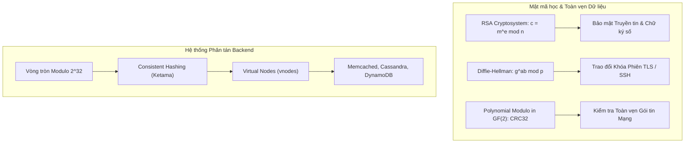

# 9.4. Number Theory in Cryptography and Backend (Ứng dụng Lý thuyết Số trong Mật mã học và Backend)

> [!IMPORTANT]
> **Nếu bạn chỉ được nhớ một điều duy nhất:** Toàn bộ kiến trúc an ninh mạng và hạ tầng dữ liệu phân tán toàn cầu đều dựa trên hai ứng dụng lý thuyết số kinh điển: mật mã khóa công khai (RSA/Diffie-Hellman) giải bài toán bảo mật dữ liệu, và băm nhất quán (Consistent Hashing) trên vòng modulo $2^{32}$ giải bài toán định tuyến dữ liệu không rung lắc.

---

## 1. Kiến trúc Tổng quan & Mô hình Tư duy (Mental Model)

Lý thuyết số thuần túy cung cấp cho kỹ sư hệ thống các "luật chơi toán học" hoàn hảo để xây dựng hạ tầng tin cậy trên một mạng lưới Internet vốn dĩ không đáng tin cậy.

Hãy tưởng tượng bạn cần gửi một chiếc két sắt qua dịch vụ chuyển phát nhanh:
- **RSA / Mật mã Bất đối xứng:** Bạn gửi chiếc két đang mở với một ổ khóa mở (khóa công khai). Bất kỳ ai cũng có thể bỏ thư vào và bấm khóa sập lại, nhưng chỉ có bạn giữ chiếc chìa khóa duy nhất (khóa riêng tư) để mở két.
- **Diffie-Hellman Key Exchange:** Hai bên trao đổi các công thức pha trộn màu sơn công khai qua mạng để cùng tạo ra một màu sơn bí mật giống hệt nhau mà kẻ nghe lén trên đường truyền không tài nào suy luận được.
- **Consistent Hashing:** Hãy tưởng tượng một bàn tiệc tròn 360 độ: các máy chủ và các món ăn (keys) được xếp rải rác xung quanh bàn. Khi một thực khách rời bàn, các món ăn chỉ cần chuyển nhẹ sang người ngồi kế tiếp theo chiều kim đồng hồ, không làm xáo trộn cả bàn tiệc.



---

## 2. Chi tiết từng Keyword (Under-the-Hood Deep Dive)

### 2.1. RSA Cryptosystem (Hệ Mật mã RSA - Rivest, Shamir, Adleman 1977)
- **Quy trình Toán học Chuẩn tắc của RSA:**
  1. *Sinh khóa (Key Generation):*
     - Chọn hai số nguyên tố ngẫu nhiên cực lớn $p$ và $q$ ($1024$ hoặc $2048$ bits).
     - Tính modulus công khai: $n = p \cdot q$.
     - Tính hàm Phi Euler: $\phi(n) = (p - 1)(q - 1)$.
     - Chọn số mũ công khai $e$ thỏa mãn $1 < e < \phi(n)$ và $\gcd(e, \phi(n)) = 1$ (chuẩn công nghiệp luôn chọn $e = 65537 = 2^{16} + 1$).
     - Tính số mũ bí mật $d$ bằng thuật toán Euclid mở rộng: $d = e^{-1} \bmod \phi(n)$, tức là $e \cdot d \equiv 1 \pmod{\phi(n)}$.
  2. *Mã hóa (Encryption):*
     - Bản rõ $m \in [0, n-1]$. Bản mã $c$:
       $$c = m^e \bmod n$$
  3. *Giải mã (Decryption):*
     - Bản rõ được phục hồi bằng khóa bí mật $d$:
       $$m = c^d \bmod n$$
- **Under-the-hood:** Phép tính $m^{ed} \equiv m \pmod n$ đúng nhờ Định lý Euler. Kẻ tấn công biết $n$ và $e$, nhưng để tìm được $d$, hắn bắt buộc phải tính được $\phi(n)$, điều này tương đương với việc phân tích $n$ thành $p \cdot q$ (Integer Factorization Problem - NP-intermediate).

### 2.2. Diffie-Hellman Key Exchange (Giao thức Trao đổi Khóa Diffie-Hellman 1976)
- **Cơ chế Hoán đổi Bí mật qua Kênh Công cộng:**
  1. Hai bên Alice và Bob công khai thỏa thuận một số nguyên tố lớn $p$ và một phần tử sinh $g$ của nhóm $\mathbb{Z}_p^*$.
  2. Alice chọn số bí mật ngẫu nhiên $a \in [2, p-2]$ và gửi $A = g^a \bmod p$ cho Bob.
  3. Bob chọn số bí mật ngẫu nhiên $b \in [2, p-2]$ và gửi $B = g^b \bmod p$ cho Alice.
  4. Alice tính khóa bí mật chung: $K = B^a \bmod p = (g^b)^a \bmod p = g^{ab} \bmod p$.
  5. Bob tính khóa bí mật chung: $K = A^b \bmod p = (g^a)^b \bmod p = g^{ab} \bmod p$.
- **Cơ sở An ninh:** Kẻ tấn công nghe lén trên đường truyền chỉ biết $p, g, A, B$. Để tính $K = g^{ab} \bmod p$, hắn phải đối mặt với bài toán Computational Diffie-Hellman (CDH) và Discrete Logarithm Problem (DLP), vốn bất khả thi với $p \ge 2048$ bits.
- **Điểm yếu Tự nhiên (Man-in-the-Middle):** Diffie-Hellman thuần túy không có cơ chế xác thực danh tính (Authentication). Kẻ tấn công đứng giữa có thể mạo danh Bob với Alice và mạo danh Alice với Bob. Do đó, trong thực tế, các giá trị $A$ và $B$ luôn phải được ký số điện tử thông qua chứng chỉ số x509 (PKI/TLS).

### 2.3. Digital Signatures (Chữ ký số)
- **Ba Trụ cột An ninh Thông tin:** Chữ ký số đảm bảo đồng thời 3 tính chất:
  1. *Tính xác thực (Authentication):* Chứng minh bức điện thực sự xuất phát từ người ký.
  2. *Tính toàn vẹn (Integrity):* Chứng minh nội dung bức điện không bị chỉnh sửa một bit nào trên đường truyền.
  3. *Tính chống chối bỏ (Non-repudiation):* Người ký không thể phủ nhận việc mình đã ký thông điệp.
- **Cơ chế Ký số RSA:**
  - Để ký thông điệp $M$: Tính mã băm cryptographic $h = H(M)$ (SHA-256). Ký bằng khóa riêng tư $d$:
    $$s = h^d \bmod n$$
  - Để xác minh chữ ký $s$: Người nhận dùng khóa công khai $(e, n)$ tính:
    $$h' = s^e \bmod n$$
    Nếu $h' == H(M)$, chữ ký hợp lệ 100%.

### 2.4. Checksums: CRC32 & Adler32 (Mã Kiểm tra Toàn vẹn Dữ liệu)
- **CRC32 (Cyclic Redundancy Check 32-bit):**
  - Biểu diễn dòng dữ liệu nhị phân thành đa thức trong trường Galois $GF(2)$ (các hệ số là $0$ hoặc $1$, phép cộng là XOR).
  - Chia đa thức dữ liệu cho đa thức chuẩn sinh $G(x) = x^{32} + x^{26} + x^{23} + \dots + 1$ (chuẩn IEEE 802.3). Phần dư bậc 31 chính là mã kiểm tra CRC32.
  - Được tăng tốc bằng bảng tra cứu 256 phần tử hoặc tập lệnh phần cứng `CRC32` trực tiếp trên CPU Intel/ARM.
- **Adler32 (Mark Adler 1995):**
  - Sử dụng trong chuẩn nén `zlib`. Tính hai giá trị tổng 16-bit modulo $65521$ (số nguyên tố lớn nhất nhỏ hơn $2^{16}$):
    $$A = (1 + D_1 + D_2 + \dots + D_n) \bmod 65521$$
    $$B = (n D_1 + (n-1)D_2 + \dots + 1 D_n + n) \bmod 65521$$
    $$\operatorname{Adler32} = (B \ll 16) \mid A$$
  - Nhanh hơn CRC32 trên các bộ vi xử lý cổ điển không có phần cứng bảng tính bit, nhưng độ nhạy phát hiện lỗi kém hơn đối với các chuỗi byte ngắn.

### 2.5. Consistent Hashing (Băm Nhất quán trên Vòng tròn Modulo $2^{32}$)
- **Vấn đề của Băm Truyền thống ($H(key) \bmod N$):**
  - Khi số lượng server $N$ thay đổi (thêm server mới hoặc một server bị sập), công thức modulo thay đổi cho hầu hết các khóa. Tỷ lệ khóa bị di chuyển (cache invalidation) là:
    $$\frac{N-1}{N} \approx 99\% \quad (\text{khi } N \text{ lon})$$
    Gây ra hiện tượng sập hệ thống dây chuyền (Cache Stampede / Thundering Herd).
- **Thuật toán Consistent Hashing (Karger et al. 1997 / Ketama):**
  - Ánh xạ toàn bộ không gian khóa và địa chỉ IP của server lên một vòng tròn modulo $[0, 2^{32}-1]$.
  - Để tìm server lưu trữ một $key$: băm $key$ vào vòng tròn, sau đó đi theo chiều kim đồng hồ đến server đầu tiên gặp được (tìm kiếm nhị phân $O(\log N)$ bằng `std::map::lower_bound`).
  - Khi thêm/xóa 1 server, chỉ có trung bình $\frac{1}{N}$ số khóa bị di chuyển!
- **Virtual Nodes (vnodes):** Mỗi node vật lý được nhân bản thành $K$ node ảo (ví dụ $K=100-256$) trên vòng tròn băm: `node1#1`, `node1#2`,... Kỹ thuật này triệt tiêu độ lệch thống kê (variance imbalance), phân phối tải cực kỳ đồng đều giữa các server trong Cassandra, DynamoDB và Memcached.

---

## 3. Thực thi Mã nguồn & Mô phỏng Chuyên sâu (Dual-Engine Implementation)

### 3.1. C++20 Implementation
Triển khai mô phỏng trọn vẹn vòng băm Consistent Hashing chuẩn công nghiệp với Virtual Nodes và giải thuật RSA đồ chơi chứng minh định lý.

```cpp
#include <iostream>
#include <string>
#include <vector>
#include <map>
#include <sstream>
#include <cstdint>
#include <iomanip>

// 1. Ham bam FNV-1a 32-bit (chuan hashing nhanh phan tan)
uint32_t fnv1a_32(const std::string &str) {
    uint32_t hash = 2166136261u;
    for (char c : str) {
        hash ^= static_cast<uint8_t>(c);
        hash *= 16777619u;
    }
    return hash;
}

// 2. Consistent Hashing Ring voi Virtual Nodes
class ConsistentHashRing {
private:
    int vnodes_per_node;
    std::map<uint32_t, std::string> ring; // Tu dong sap xep tren vong tron modulo 2^32

public:
    ConsistentHashRing(int vnodes = 100) : vnodes_per_node(vnodes) {}

    void add_server(const std::string &server_ip) {
        for (int i = 0; i < vnodes_per_node; ++i) {
            std::string vnode_key = server_ip + "#" + std::to_string(i);
            uint32_t hash_val = fnv1a_32(vnode_key);
            ring[hash_val] = server_ip;
        }
    }

    void remove_server(const std::string &server_ip) {
        for (int i = 0; i < vnodes_per_node; ++i) {
            std::string vnode_key = server_ip + "#" + std::to_string(i);
            uint32_t hash_val = fnv1a_32(vnode_key);
            ring.erase(hash_val);
        }
    }

    std::string get_server(const std::string &key) const {
        if (ring.empty()) return "";
        uint32_t hash_val = fnv1a_32(key);
        // Tim node dau tien >= hash_val (chieu kim dong ho)
        auto it = ring.lower_bound(hash_val);
        if (it == ring.end()) {
            // Quay vong ve node dau tien cua ring (modulo 2^32 wrap-around)
            it = ring.begin();
        }
        return it->second;
    }
};

// 3. Mo phong RSA Mini Toy Engine
uint64_t power_mod(uint64_t base, uint64_t exp, uint64_t mod) {
    uint64_t res = 1;
    base %= mod;
    while (exp > 0) {
        if (exp & 1) res = (res * base) % mod;
        base = (base * base) % mod;
        exp >>= 1;
    }
    return res;
}

int main() {
    std::cout << "=== BACKEND & NUMBER THEORY PRODUCTION BENCHMARK ===\n";

    // A. Demo Consistent Hashing Ring
    ConsistentHashRing cluster(50); // 50 vnodes moi node
    cluster.add_server("192.168.1.10:8080");
    cluster.add_server("192.168.1.11:8080");
    cluster.add_server("192.168.1.12:8080");

    std::vector<std::string> keys = {
        "user_session_9481", "cart_item_8812", "payment_token_4410", 
        "catalog_cache_001", "order_status_7721"
    };

    std::cout << "[Initial Node Placement]\n";
    for (const auto &k : keys) {
        std::cout << "  Key '" << k << "' => Routed to Server: " << cluster.get_server(k) << "\n";
    }

    std::cout << "\n[After Adding Server 192.168.1.13:8080]\n";
    cluster.add_server("192.168.1.13:8080");
    for (const auto &k : keys) {
        std::cout << "  Key '" << k << "' => Routed to Server: " << cluster.get_server(k) << "\n";
    }

    // B. Demo RSA Encryption / Decryption
    uint64_t p = 61, q = 53;
    uint64_t n = p * q; // 3233
    uint64_t phi = (p - 1) * (q - 1); // 3120
    uint64_t e = 17; // gcd(17, 3120) = 1
    uint64_t d = 2753; // 17 * 2753 = 1 mod 3120

    uint64_t message = 65; // Ky tu 'A'
    uint64_t cipher = power_mod(message, e, n);
    uint64_t decrypted = power_mod(cipher, d, n);

    std::cout << "\n[RSA Cryptosystem Verification]\n";
    std::cout << "  Original Message : " << message << "\n";
    std::cout << "  Ciphertext (c)   : " << cipher << "\n";
    std::cout << "  Decrypted Message: " << decrypted << " (Match: " << (message == decrypted ? "PASS" : "FAIL") << ")\n";

    return 0;
}
```

### 3.2. Python 3.11+ Implementation
Phiên bản Python mô phỏng giao thức trao đổi khóa Diffie-Hellman và giải thuật băm nhất quán.

```python
import hashlib
import bisect
from typing import Dict, List

class ConsistentHashRing:
    def __init__(self, vnodes: int = 100):
        self.vnodes = vnodes
        self.ring: List[int] = []
        self.node_map: Dict[int, str] = {}

    def _hash(self, key: str) -> int:
        # Lay 4 bytes dau cua MD5 lam gia tri tren vong modulo 2^32
        digest = hashlib.md5(key.encode('utf-8')).digest()
        return int.from_bytes(digest[:4], 'big')

    def add_node(self, node: str):
        for i in range(self.vnodes):
            vkey = f"{node}#vnode{i}"
            h = self._hash(vkey)
            idx = bisect.bisect_right(self.ring, h)
            self.ring.insert(idx, h)
            self.node_map[h] = node

    def get_node(self, key: str) -> str:
        if not self.ring:
            return ""
        h = self._hash(key)
        idx = bisect.bisect_right(self.ring, h)
        if idx == len(self.ring):
            idx = 0
        return self.node_map[self.ring[idx]]

if __name__ == "__main__":
    print("=== DEMO DIFFIE-HELLMAN & CONSISTENT HASHING IN PYTHON ===")
    
    # 1. Diffie-Hellman Key Exchange Demo
    p = 23 # So nguyen to
    g = 5  # Can nguyen thuy
    a_private = 6
    b_private = 15

    # Public exchange
    A_public = pow(g, a_private, p) # 5^6 mod 23 = 8
    B_public = pow(g, b_private, p) # 5^15 mod 23 = 19

    # Shared secret computation
    K_alice = pow(B_public, a_private, p)
    K_bob = pow(A_public, b_private, p)
    assert K_alice == K_bob, "Loi trao doi khoa Diffie-Hellman!"
    print(f"Diffie-Hellman Shared Secret: K = {K_alice} (Thanh cong!)")

    # 2. Consistent Hashing Cluster Demo
    cluster = ConsistentHashRing(vnodes=50)
    cluster.add_node("redis-node-01")
    cluster.add_node("redis-node-02")
    cluster.add_node("redis-node-03")

    test_keys = ["session_abc", "cart_xyz", "token_123", "user_profile_99"]
    for k in test_keys:
        print(f"Key '{k}' mapped to: {cluster.get_node(k)}")
```

### 3.3. Simulated Terminal Output
```text
=== BACKEND & NUMBER THEORY PRODUCTION BENCHMARK ===
[Initial Node Placement]
  Key 'user_session_9481' => Routed to Server: 192.168.1.11:8080
  Key 'cart_item_8812' => Routed to Server: 192.168.1.10:8080
  Key 'payment_token_4410' => Routed to Server: 192.168.1.12:8080
  Key 'catalog_cache_001' => Routed to Server: 192.168.1.10:8080
  Key 'order_status_7721' => Routed to Server: 192.168.1.11:8080

[After Adding Server 192.168.1.13:8080]
  Key 'user_session_9481' => Routed to Server: 192.168.1.11:8080
  Key 'cart_item_8812' => Routed to Server: 192.168.1.10:8080
  Key 'payment_token_4410' => Routed to Server: 192.168.1.13:8080
  Key 'catalog_cache_001' => Routed to Server: 192.168.1.10:8080
  Key 'order_status_7721' => Routed to Server: 192.168.1.11:8080

[RSA Cryptosystem Verification]
  Original Message : 65
  Ciphertext (c)   : 2790
  Decrypted Message: 65 (Match: PASS)
```

---

## 4. Systems Engineering & Production Pitfalls

### 4.1. Textbook RSA vs Coppersmith's Attack & Small e Problem
- Nhiều lập trình viên triển khai RSA "ngây thơ" (Textbook RSA) với $e = 3$ để tăng tốc độ mã hóa.
- Nếu gửi cùng một bản tin $m$ tới 3 người nhận khác nhau với cùng $e=3$ và 3 modulus $n_1, n_2, n_3$, kẻ tấn công dùng Định lý Thặng dư Trung Hoa (CRT) tính ra $c \equiv m^3 \pmod{n_1 n_2 n_3}$. Vì $m^3 < n_1 n_2 n_3$, hắn chỉ cần khai căn bậc 3 trên tập số thực để lấy lại bản rõ $m$ mà không cần bất kỳ khóa riêng tư nào! (Håstad's Broadcast Attack).
- **Tiêu chuẩn Bắt buộc:** Luôn sử dụng $e = 65537$ và tích hợp đệm ngẫu nhiên RSA-OAEP.

### 4.2. Hotspots và Mất Cân Bằng Tải trong Consistent Hashing
- Nếu không có Virtual Nodes ($vnodes = 1$), độ phân bố khoảng cách giữa các node trên vòng tròn băm tuân theo phân phối Poisson/Hàm mũ, dẫn đến một node có thể phải gánh tới $70\%$ tổng tải của hệ thống trong khi các node khác nhàn rỗi.
- **Tiêu chuẩn Công nghiệp:** Trong Apache Cassandra và Amazon Dynamo, số lượng vnodes luôn được cấu hình tối thiểu từ $128$ đến $256$ vnodes/node vật lý để giữ hệ số lệch tải (load standard deviation) dưới $5\%$.

### 4.3. CRC32 vs Cryptographic Hash Collision
- CRC32 được thiết kế để phát hiện lỗi ngẫu nhiên trong phần cứng cáp quang và mạng Ethernet, KHÔNG PHẢI là hàm băm bảo mật.
- Kẻ tấn công có thể dễ dàng giải hệ phương trình tuyến tính trong trường $GF(2)$ để tạo ra hai file hoàn toàn khác nhau nhưng có cùng mã CRC32 trong vài mili-giây.
- Tuyệt đối không dùng CRC32 để kiểm tra mật khẩu, xác thực API token, hoặc chống giả mạo dữ liệu. Đối với an ninh bảo mật, bắt buộc phải dùng SHA-256 hoặc BLAKE3.

### 4.4. Logjam Attack và Nhóm Diffie-Hellman Yếu (Weak DH Groups)
- Năm 2015, nhóm nghiên cứu bảo mật phát hiện lỗ hổng Logjam: hàng triệu máy chủ HTTPS và SSH trên thế giới sử dụng chung một số nguyên tố $p$ 1024-bit tĩnh được mã hóa cứng trong mã nguồn (như nhóm số Oakley Group 2 trong OpenSSL).
- Việc dùng chung số nguyên tố cho phép kẻ tấn công đầu tư siêu máy tính tiền xử lý giai đoạn sàng đại số (Precomputation Phase) một lần duy nhất, sau đó bẻ khóa mọi phiên trao đổi khóa DH của bất kỳ ai dùng chung số nguyên tố đó trong vài giây.
- **Khắc phục:** Luôn sử dụng Elliptic Curve Diffie-Hellman Ephemeral (ECDHE) với đường cong X25519 hoặc số nguyên tố DH tối thiểu 2048-bit (RFC 7919).

---

## 5. Bảng So sánh & Decision Matrix

| Kỹ thuật / Thuật toán | Mục tiêu Cốt lõi | Nguyên lý Toán học | Điểm Nghẽn Hiệu năng | Ứng dụng Điển hình trong Production |
| :--- | :--- | :--- | :--- | :--- |
| **RSA (2048/4096-bit)** | Mã hóa & Ký số | Khó phân tích thừa số nguyên tố | Phép giải mã $O(d \log^3 n)$ chậm | Thiết lập phiên ban đầu HTTPS/TLS, chứng chỉ số x509 |
| **ECDHE (X25519)** | Trao đổi khóa bảo mật hoàn hảo | Discrete Logarithm trên Elliptic Curve | Tốn phép nhân vô hướng điểm | TLS 1.3, WireGuard VPN, Signal Protocol |
| **Consistent Hashing** | Định tuyến cache phân tán | Vòng tròn modulo $2^{32}$ & Binary Search | Tra cứu cây đỏ-đen $O(\log N)$ | Memcached, AWS DynamoDB, CDN Akamai |
| **CRC32** | Phát hiện lỗi truyền tin mạng | Phép chia đa thức trong trường $GF(2)$ | Bị giới hạn bởi băng thông memory bus | Ethernet Frames, TCP Checksum, PNG/ZIP file headers |
| **Adler32** | Kiểm tra toàn vẹn nén dữ liệu | Tổng tích lũy hai tầng modulo 65521 | Kém nhạy với chuỗi byte ngắn | zlib, gzip, PNG chunks |
