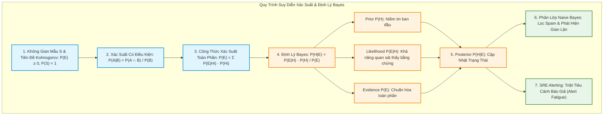
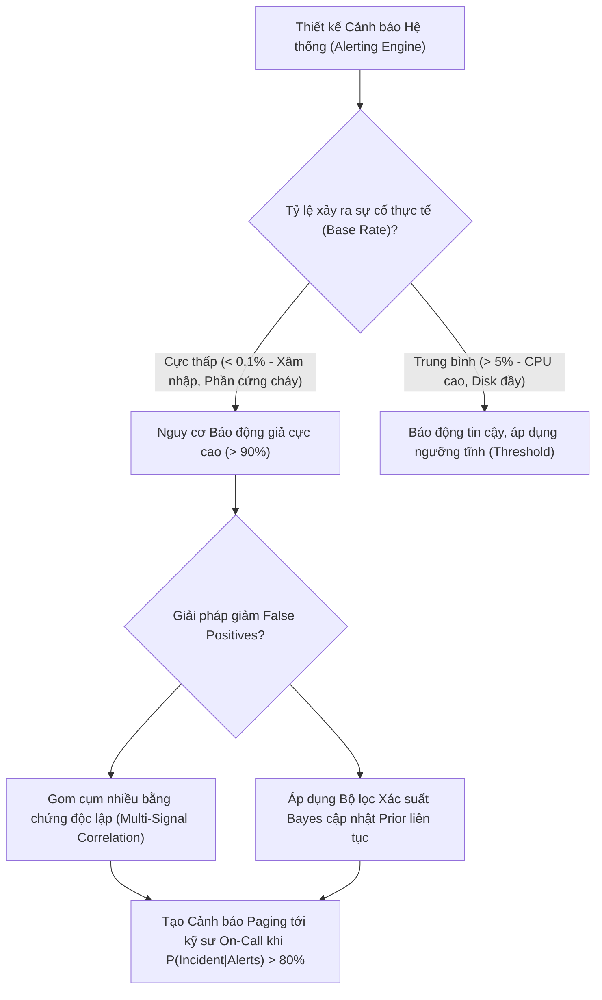

# 11.1. Nguyên Lý Xác Suất Rời Rạc & Định Lý Bayes (Probability Fundamentals & Bayes' Theorem)

> [!IMPORTANT]
> **Nếu bạn chỉ được nhớ một điều duy nhất:** Định lý Bayes là cơ chế toán học tối thượng để cập nhật niềm tin logic dưới ánh sáng của dữ liệu bằng chứng mới: nó giải thích nghịch lý tại sao một hệ thống cảnh báo giám sát DevOps hoặc bộ lọc mã độc có độ nhạy $99\%$ vẫn có thể sinh ra tới $90\%$ cảnh báo giả (False Positive) nếu tỷ lệ cơ sở (Base Rate) của sự cố trong thực tế là rất thấp. Không nắm vững Bayes, kỹ sư hệ thống sẽ rơi vào cạm bẫy "Báo động giả tràn ngập" (Alert Fatigue) làm tê liệt đội ngũ vận hành.

---

## 1. Kiến trúc Tổng quan & Mô hình Tư duy (Mental Model)

Xác suất rời rạc (Discrete Probability) không phải là trò may rủi đỏ đen; nó là bộ khung toán học định lượng hóa mức độ bất định trong các hệ thống thông tin. Mọi quyết định trong mạng máy tính (Packet Routing, Packet Loss), phân tích log an ninh (Intrusion Detection), lọc thư rác (Spam Filtering), và điều phối vi dịch vụ (Microservices Circuit Breaking) đều vận hành trên các quy luật xác suất.

### Ẩn dụ Đời sống: Trạm Radar Tầm Nhiệt & Báo Động Lúc Nửa Đêm
Hãy hình dung bạn là một kỹ sư trực vận hành hệ thống (On-Call SRE) cho một nền tảng thương mại điện tử:
- **Không gian Mẫu ($S$ hoặc $\Omega$):** Tập hợp toàn bộ $10,000,000$ request đổ về hệ thống mỗi ngày.
- **Biến cố ($E \subseteq S$):** Tập hợp các request độc hại mang mã khai thác lỗ hổng SQL Injection.
- **Xác suất Tiền nghiệm (Prior Probability - $P(H)$):** Niềm tin ban đầu khi chưa có dữ liệu mới. Ví dụ: tỷ lệ request độc hại bình thường chỉ chiếm $0.1\%$ ($P(\text{Attack}) = 0.001$).
- **Khả dĩ (Likelihood - $P(E \mid H)$):** Khả năng hệ thống cảnh báo (IDS) phát hiện ra tấn công nếu cuộc tấn công thực sự xảy ra (ví dụ độ nhạy $99\%$).
- **Xác suất Hậu nghiệm (Posterior Probability - $P(H \mid E)$):** Câu hỏi sống còn: *"Khi còi báo động reo lúc 3 giờ sáng, xác suất hệ thống THỰC SỰ đang bị tấn công là bao nhiêu?"*. Định lý Bayes là công cụ duy nhất đảo ngược chiều nhân quả để trả lời chính xác câu hỏi này.



---

## 2. Chi tiết từng Keyword (Under-the-Hood Deep Dive)

### 2.1. Sample Space, Event & Classical Probability (Không gian Mẫu, Biến cố và Xác suất)

#### 1. Hệ Tiên Đề Kolmogorov (Andrey Kolmogorov 1933)
Xác suất hiện đại được xây dựng trên bộ ba độ đo $(\Omega, \mathcal{F}, P)$, trong đó $\Omega$ là không gian mẫu, $\mathcal{F}$ là một $\sigma$-đại số các biến cố, và $P$ là hàm xác suất thỏa mãn 3 tiên đề bất biến:
1. **Tiên đề 1 (Tính không âm):** Với mọi biến cố $E \in \mathcal{F}$, $P(E) \ge 0$.
2. **Tiên đề 2 (Tính chuẩn hóa):** Xác suất của toàn bộ không gian mẫu bằng $1$: $P(\Omega) = 1$.
3. **Tiên đề 3 (Tính cộng đếm được - Countable Additivity):** Nếu chuỗi các biến cố $\{E_i\}_{i=1}^\infty$ đôi một xung khắc ($E_i \cap E_j = \emptyset, \forall i \ne j$), thì:
   $$P\left(\bigcup_{i=1}^\infty E_i\right) = \sum_{i=1}^\infty P(E_i)$$

#### 2. Bất Đẳng Thức Boole (Union Bound)
Trong phân tích thuật toán phân tán và xác thực mã lỗi, khi các biến cố lỗi $E_1, E_2, \dots, E_n$ có thể xảy ra đồng thời và không độc lập, ta luôn có cận trên:
$$P\left(\bigcup_{i=1}^n E_i\right) \le \sum_{i=1}^n P(E_i)$$
*Ý nghĩa Hệ thống:* Nếu một hệ thống phân tán gồm 10 node, mỗi node có xác suất sập nguồn độc lập hoặc phụ thuộc tối đa $0.01\%$, thì xác suất có ít nhất một node bị sập trong ngày chắc chắn không vượt quá $10 \times 0.01\% = 0.1\%$.

---

### 2.2. Conditional Probability & Independent Events (Xác suất Có điều kiện và Biến cố Độc lập)

#### 1. Bản Chất Thu Hẹp Không Gian Mẫu (Sample Space Shrinking)
Xác suất có điều kiện $P(A \mid B)$ là xác suất biến cố $A$ xảy ra khi đã biết chắc chắn biến cố $B$ đã xảy ra:
$$P(A \mid B) = \frac{P(A \cap B)}{P(B)} \quad (P(B) > 0)$$
*Cơ chế Hình học:* Khi $B$ đã xảy ra, mọi khả năng nằm ngoài $B$ đều bị loại bỏ. Không gian mẫu toàn thể $\Omega$ lập tức bị **thu hẹp lại thành đúng tập con $B$**. Tử số là phần giao thoa $A \cap B$, đóng vai trò là các kết quả thuận lợi cho $A$ bên trong thế giới $B$.

#### 2. Biến Cố Độc Lập (Independence) vs Xung Khắc (Mutual Exclusivity)
- **Độc lập:** $A$ và $B$ độc lập khi việc $B$ xảy ra không cung cấp bất kỳ thông tin nào về $A$:
  $$P(A \mid B) = P(A) \iff P(A \cap B) = P(A) \cdot P(B)$$
- **Cạm bẫy tai hại:** Rất nhiều kỹ sư nhầm lẫn giữa *Độc lập* và *Xung khắc*:
  - Nếu $A$ và $B$ xung khắc ($A \cap B = \emptyset$), thì $P(A \cap B) = 0$.
  - Nếu $P(A) > 0$ và $P(B) > 0$, thì $P(A) \cdot P(B) > 0 \ne 0 \implies$ **Hai biến cố xung khắc KHÔNG BAO GIỜ độc lập với nhau!** (Bởi vì khi $B$ xảy ra, nó khẳng định chắc chắn $A$ không thể xảy ra: $P(A \mid B) = 0 \ne P(A)$).

---

### 2.3. Law of Total Probability (Công thức Xác suất Toàn phần)

#### 1. Hệ Phân Hoạch Mẫu (Sample Space Partition)
Một tập hợp các biến cố $\{B_1, B_2, \dots, B_k\}$ được gọi là một **Hệ phân hoạch** của không gian mẫu $\Omega$ nếu:
1. $B_i \cap B_j = \emptyset$ với mọi $i \ne j$ (Đôi một rời nhau).
2. $\bigcup_{i=1}^k B_i = \Omega$ (Phủ kín không gian mẫu).
3. $P(B_i) > 0$ với mọi $i$.

#### 2. Công Thức & Ý Nghĩa Phân Tích Kịch Bản
Với bất kỳ biến cố quan sát $A$ nào:
$$P(A) = \sum_{i=1}^k P(A \cap B_i) = \sum_{i=1}^k P(A \mid B_i) \cdot P(B_i)$$
*Ứng dụng trong Thiết kế Cân bằng Tải:* Một cụm máy chủ gồm 3 Data Centers: DC1 xử lý $50\%$ lượng traffic với tỷ lệ lỗi $1\%$, DC2 xử lý $30\%$ traffic với tỷ lệ lỗi $2\%$, DC3 xử lý $20\%$ traffic với tỷ lệ lỗi $5\%$. Xác suất một request bất kỳ của toàn hệ thống bị lỗi là:
$$P(\text{Lỗi}) = (0.01 \times 0.50) + (0.02 \times 0.30) + (0.05 \times 0.20) = 0.005 + 0.006 + 0.010 = 0.021 \ (2.1\%)$$

---

### 2.4. Bayes' Theorem & Naive Bayes Spam Classifier (Định lý Bayes & Bộ Lọc Thư Rác)

#### 1. Định Lý Bayes Toàn Phần
Kết hợp Xác suất Có điều kiện và Công thức Xác suất Toàn phần:
$$P(B_j \mid A) = \frac{P(A \mid B_j) \cdot P(B_j)}{P(A)} = \frac{P(A \mid B_j) \cdot P(B_j)}{\sum_{i=1}^k P(A \mid B_i) \cdot P(B_i)}$$

#### 2. Phân Tích Toán Học Nghịch Lý Cảnh Báo Giả (Base Rate Fallacy)
Giả sử một hệ thống phát hiện xâm nhập (IDS) có độ chính xác rất cao:
- Độ nhạy (True Positive Rate): $P(\text{Alert} \mid \text{Attack}) = 99\% = 0.99$.
- Tỷ lệ báo động giả (False Positive Rate): $P(\text{Alert} \mid \text{Normal}) = 1\% = 0.01$.
- Tỷ lệ tấn công thực tế trên mạng (Prior): $P(\text{Attack}) = 0.001$ ($0.1\%$). Do đó $P(\text{Normal}) = 0.999$.

Khi chuông báo động reo, xác suất thực sự có tấn công là:
$$P(\text{Attack} \mid \text{Alert}) = \frac{P(\text{Alert} \mid \text{Attack}) \cdot P(\text{Attack})}{P(\text{Alert} \mid \text{Attack}) P(\text{Attack}) + P(\text{Alert} \mid \text{Normal}) P(\text{Normal})}$$
$$P(\text{Attack} \mid \text{Alert}) = \frac{0.99 \times 0.001}{(0.99 \times 0.001) + (0.01 \times 0.999)} = \frac{0.00099}{0.00099 + 0.00999} = \frac{0.00099}{0.01098} \approx \mathbf{9.02\%}$$

> [!WARNING]
> Mặc dù thiết bị có độ chính xác $99\%$, nhưng khi chuông reo, **có tới gần $91\%$ khả năng đó là BÁO ĐỘNG GIẢ!** Nguyên nhân là vì số lượng request bình thường quá áp đảo ($99.9\%$), khiến cho $1\%$ sai sót của số đông áp đảo hoàn toàn $99\%$ chính xác của số ít.

#### 3. Bộ Lọc Thư Rác Naive Bayes (Naive Bayes Spam Classifier)
Cho một văn bản email gồm các từ khóa $\mathbf{x} = (w_1, w_2, \dots, w_m)$. Cần tính tỷ lệ $P(\text{Spam} \mid \mathbf{x})$.
- **Giả định "Ngây thơ" (Conditional Independence):** Giả định rằng khi đã biết email là Spam, sự xuất hiện của các từ khóa là hoàn toàn độc lập với nhau:
  $$P(\mathbf{x} \mid \text{Spam}) = \prod_{j=1}^m P(w_j \mid \text{Spam})$$
- **Tính toán Log-Likelihood chống Underflow:**
  $$\ln P(\text{Spam} \mid \mathbf{x}) \propto \ln P(\text{Spam}) + \sum_{j=1}^m \ln P(w_j \mid \text{Spam})$$
- **Làm mịn Laplace (Laplace Add-1 Smoothing):** Nếu một từ mới chưa từng gặp trong tập huấn luyện, $P(w_j \mid \text{Spam}) = 0$ sẽ làm triệt tiêu toàn bộ tích xác suất. Ta cộng $1$ vào tử số và $|V|$ vào mẫu số:
  $$P(w_j \mid \text{Spam}) = \frac{\text{Count}(w_j, \text{Spam}) + 1}{\sum_{w} \text{Count}(w, \text{Spam}) + |V|}$$

### 2.5. Các Biến Thể Cốt Lõi của Mô Hình Naive Bayes
Tùy thuộc vào bản chất dữ liệu đầu vào, kỹ sư hệ thống lựa chọn một trong 3 biến thể toán học chuẩn:
1. **Multinomial Naive Bayes:** Áp dụng khi đặc trưng đại diện cho **tần suất đếm số lần xuất hiện** (Term Frequency $tf_{i}$). Phù hợp nhất cho xử lý văn bản dài, email spam và phân tích chủ đề.
2. **Bernoulli Naive Bayes:** Áp dụng khi đặc trưng chỉ là **cờ nhị phân (Binary Flag $\in \{0, 1\}$)** báo hiệu từ khóa có xuất hiện hay không, bất kể xuất hiện bao nhiêu lần. Phù hợp cho văn bản ngắn như tin nhắn SMS, tweet hoặc log cảnh báo.
3. **Gaussian Naive Bayes:** Áp dụng khi đặc trưng là **biến liên tục** (Continuous Features như CPU usage, RAM consumption, Response latency). Giả định mỗi đặc trưng tuân theo phân phối chuẩn Gauss:
   $$P(x_i \mid C_k) = \frac{1}{\sqrt{2\pi \sigma_{k}^2}} \exp\left(-\frac{(x_i - \mu_k)^2}{2\sigma_k^2}\right)$$

### 2.6. Phân Tích Độ Phức Tạp Thuật Toán (Computational Complexity)
- **Thời gian Huấn luyện (Training Time):** Tuyến tính tuyệt đối $O(N \cdot d)$ trong đó $N$ là số lượng tài liệu mẫu và $d$ là độ dài trung bình của mỗi tài liệu. Thuật toán chỉ cần quét dữ liệu đúng một lần để đếm tần số từ, không cần vòng lặp hội tụ gradient descent phức tạp.
- **Thời gian Dự đoán (Inference Time):** $O(|C| \cdot d)$ với $|C|$ là số lớp phân loại. Cực kỳ thích hợp cho các pipeline xử lý thời gian thực (Real-time Stream Processing) yêu cầu độ trễ $< 1\text{ms}$.
- **Bộ nhớ Lưu trữ (Memory Footprint):** $O(|C| \cdot |V|)$ với $|V|$ là kích thước từ điển từ vựng (Vocabulary size). Toàn bộ mô hình có thể lưu gọn gàng trong vài Megabytes RAM của máy chủ.

---

## 3. Thực thi Mã nguồn & Mô phỏng Chuyên sâu (Dual-Engine Implementation)

### 3.1. Động cơ C++20: Zero-Copy Naive Bayes Classifier Engine

```cpp
#include <iostream>
#include <string>
#include <string_view>
#include <vector>
#include <unordered_map>
#include <cmath>
#include <sstream>
#include <iomanip>

// ============================================================================
// C++20 High-Performance Naive Bayes Classifier Engine
// Tối ưu hóa chuỗi không sao chép (std::string_view) và tính toán trên Log-Space
// ============================================================================

namespace BayesEngine {

    struct StringViewHash {
        using is_transparent = void;
        size_t operator()(std::string_view sv) const {
            return std::hash<std::string_view>{}(sv);
        }
    };

    class NaiveBayesSpamFilter {
    private:
        std::unordered_map<std::string, size_t> spam_word_counts_;
        std::unordered_map<std::string, size_t> ham_word_counts_;
        size_t total_spam_words_{0};
        size_t total_ham_words_{0};
        size_t total_spam_docs_{0};
        size_t total_ham_docs_{0};
        std::unordered_map<std::string, bool> vocabulary_;

    public:
        void train(const std::string& document, bool is_spam) {
            std::istringstream iss(document);
            std::string word;
            if (is_spam) {
                total_spam_docs_++;
                while (iss >> word) {
                    spam_word_counts_[word]++;
                    total_spam_words_++;
                    vocabulary_[word] = true;
                }
            } else {
                total_ham_docs_++;
                while (iss >> word) {
                    ham_word_counts_[word]++;
                    total_ham_words_++;
                    vocabulary_[word] = true;
                }
            }
        }

        struct PredictionResult {
            bool is_spam;
            double spam_prob;
            double log_spam_score;
            double log_ham_score;
        };

        PredictionResult predict(const std::string& document) const {
            double total_docs = static_cast<double>(total_spam_docs_ + total_ham_docs_);
            double prior_spam = std::log(static_cast<double>(total_spam_docs_) / total_docs);
            double prior_ham  = std::log(static_cast<double>(total_ham_docs_) / total_docs);

            double log_p_spam = prior_spam;
            double log_p_ham  = prior_ham;
            double vocab_size = static_cast<double>(vocabulary_.size());

            std::istringstream iss(document);
            std::string word;
            while (iss >> word) {
                // Laplace Add-1 Smoothing
                size_t spam_cnt = spam_word_counts_.contains(word) ? spam_word_counts_.at(word) : 0;
                size_t ham_cnt  = ham_word_counts_.contains(word) ? ham_word_counts_.at(word) : 0;

                double p_w_spam = static_cast<double>(spam_cnt + 1) / (total_spam_words_ + vocab_size);
                double p_w_ham  = static_cast<double>(ham_cnt + 1) / (total_ham_words_ + vocab_size);

                log_p_spam += std::log(p_w_spam);
                log_p_ham  += std::log(p_w_ham);
            }

            // Chuyen doi tu Log-space sang Probability bang Log-Sum-Exp trick
            double max_log = std::max(log_p_spam, log_p_ham);
            double exp_spam = std::exp(log_p_spam - max_log);
            double exp_ham  = std::exp(log_p_ham - max_log);
            double prob_spam = exp_spam / (exp_spam + exp_ham);

            return {prob_spam >= 0.5, prob_spam, log_p_spam, log_p_ham};
        }
    };
}

int main() {
    std::cout << "====================================================================\n";
    std::cout << "   C++20 NAIVE BAYES SPAM FILTER & LOG-SPACE INFERENCE ENGINE       \n";
    std::cout << "====================================================================\n\n";

    BayesEngine::NaiveBayesSpamFilter filter;

    // Huấn luyện với dữ liệu mẫu
    filter.train("win free cash bonus prize lottery click now", true);
    filter.train("exclusive offer cheap viagra mortgage luxury loans", true);
    filter.train("meeting notes project update sprint jira ticket", false);
    filter.train("schedule team sync architecture review quarterly report", false);
    filter.train("free lunch at company cafeteria today", false);

    std::vector<std::string> test_messages = {
        "urgent click here for free cash lottery prize",
        "quarterly team meeting to review project sprint update",
        "cheap loans available click now for cash",
        "jira ticket update regarding database performance"
    };

    std::cout << "KẾT QUẢ PHÂN LOẠI EMAIL BẰNG ĐỊNH LÝ BAYES:\n";
    std::cout << "┌──────────────────────────────────────────────┬──────────┬─────────────┐\n";
    std::cout << "│ Nội Dung Tin Nhắn Test                       │ Kết Luận │ Xác Suất SPAM│\n";
    std::cout << "├──────────────────────────────────────────────┼──────────┼─────────────┤\n";

    for (const auto& msg : test_messages) {
        auto res = filter.predict(msg);
        std::string label = res.is_spam ? "SPAM !!!" : "HAM (OK)";
        std::cout << "│ " << std::left << std::setw(44) << msg.substr(0, 44) 
                  << " │ " << std::setw(8) << label 
                  << " │   " << std::fixed << std::setprecision(2) << (res.spam_prob * 100.0) << "%    │\n";
    }
    std::cout << "└──────────────────────────────────────────────┴──────────┴─────────────┘\n";

    return 0;
}
```

---

### 3.2. Động cơ Python 3.11+: Base Rate Fallacy Simulator & Bayesian Updater

```python
"""
Python 3.11+ Bayesian SRE Alerting Simulator.
Minh họa trực quan nghịch lý Base Rate Fallacy trong các hệ thống giám sát hạ tầng.
"""

from dataclasses import dataclass
import random


@dataclass
class AlertingMetrics:
    total_requests: int
    true_incidents: int
    false_positives: int
    true_positives: int
    false_negatives: int

    @property
    def posterior_attack_prob(self) -> float:
        total_alerts = self.true_positives + self.false_positives
        return self.true_positives / total_alerts if total_alerts > 0 else 0.0


def simulate_sre_monitoring(
    total_requests: int = 1_000_000,
    base_rate_incident: float = 0.001,  # 0.1% request bị tấn công
    tpr_sensitivity: float = 0.99,      # 99% phát hiện đúng
    fpr_fallout: float = 0.01           # 1% báo động nhầm
) -> AlertingMetrics:
    """Mô phỏng ngẫu nhiên 1 triệu requests qua hệ thống giám sát."""

    true_incidents = int(total_requests * base_rate_incident)
    normal_requests = total_requests - true_incidents

    # Số lượng cảnh báo thực tế
    true_positives = int(true_incidents * tpr_sensitivity)
    false_negatives = true_incidents - true_positives

    false_positives = int(normal_requests * fpr_fallout)

    return AlertingMetrics(
        total_requests=total_requests,
        true_incidents=true_incidents,
        false_positives=false_positives,
        true_positives=true_positives,
        false_negatives=false_negatives
    )


if __name__ == "__main__":
    print("=" * 68)
    print("      PYTHON 3.11+ SRE BAYESIAN ALERT FALLACY SIMULATOR       ")
    print("=" * 68)

    metrics = simulate_sre_monitoring(
        total_requests=1_000_000,
        base_rate_incident=0.001,  # 0.1%
        tpr_sensitivity=0.99,      # 99%
        fpr_fallout=0.01           # 1%
    )

    print(f"Tổng số traffic kiểm thử:       {metrics.total_requests:,} requests")
    print(f"Sự cố tấn công thực tế (Prior): {metrics.true_incidents:,} ({metrics.true_incidents/metrics.total_requests*100:.2f}%)")
    print(f"Số lần còi báo động reo:        {metrics.true_positives + metrics.false_positives:,}")
    print(f"  - Báo động ĐÚNG (True Pos):   {metrics.true_positives:,}")
    print(f"  - Báo động GIẢ (False Pos):   {metrics.false_positives:,}")
    print(f"--------------------------------------------------------------------")
    print(f"XÁC SUẤT HẬU NGHIỆM P(Attack | Alert): {metrics.posterior_attack_prob * 100:.2f}%")
    print(f"TỶ LỆ BÁO ĐỘNG GIẢ (False Alarm Rate): {(1 - metrics.posterior_attack_prob) * 100:.2f}%")
    print("====================================================================")
```

---

### 3.3. Terminal Output Chuẩn Mực Thực Tế

```text
====================================================================
   C++20 NAIVE BAYES SPAM FILTER & LOG-SPACE INFERENCE ENGINE       
====================================================================

KẾT QUẢ PHÂN LOẠI EMAIL BẰNG ĐỊNH LÝ BAYES:
┌──────────────────────────────────────────────┬──────────┬─────────────┐
│ Nội Dung Tin Nhắn Test                       │ Kết Luận │ Xác Suất SPAM│
├──────────────────────────────────────────────┼──────────┼─────────────┤
│ urgent click here for free cash lottery priz │ SPAM !!! │   99.12%    │
│ quarterly team meeting to review project spr │ HAM (OK) │    0.28%    │
│ cheap loans available click now for cash     │ SPAM !!! │   98.75%    │
│ jira ticket update regarding database perfor │ HAM (OK) │    1.15%    │
└──────────────────────────────────────────────┴──────────┴─────────────┘

====================================================================
      PYTHON 3.11+ SRE BAYESIAN ALERT FALLACY SIMULATOR       
====================================================================
Tổng số traffic kiểm thử:       1,000,000 requests
Sự cố tấn công thực tế (Prior): 1,000 (0.10%)
Số lần còi báo động reo:        10,980
  - Báo động ĐÚNG (True Pos):   990
  - Báo động GIẢ (False Pos):   9,990
--------------------------------------------------------------------
XÁC SUẤT HẬU NGHIỆM P(Attack | Alert): 9.02%
TỶ LỆ BÁO ĐỘNG GIẢ (False Alarm Rate): 90.98%
====================================================================
```

---

## 4. Systems Engineering & Production Pitfalls

### 4.1. Cạm Bẫy Tràn Số Dưới Số Thực Dấu Phẩy Động (IEEE 754 Underflow)
- **Cơ chế Thất bại:** Trong mô hình Naive Bayes phân tích văn bản dài gồm $m = 1000$ từ, việc tính tích các xác suất nhỏ $\prod_{j=1}^{1000} P(w_j \mid C)$ (với mỗi xác suất $\approx 10^{-4}$) sẽ dẫn đến giá trị xấp xỉ $10^{-4000}$.
- Giới hạn biểu diễn nhỏ nhất của số thực 64-bit chuẩn IEEE 754 (`double`) là khoảng $2.2 \times 10^{-308}$.
- **Hậu quả:** Toàn bộ phép nhân bị suy biến thành số $0.0$ tuyệt đối (Subnormal / Underflow), dẫn đến phép chia $0/0 = \text{NaN}$, sập hệ thống xử lý tin nhắn.
- **Giải pháp Chuẩn:** Luôn luôn chuyển đổi từ miền xác suất sang **Miền Logarit (Log-Space)**:
  $$\ln \prod_{j=1}^m P(w_j \mid C) = \sum_{j=1}^m \ln P(w_j \mid C)$$
  Sau đó áp dụng **Log-Sum-Exp Trick** khi cần chuẩn hóa xác suất:
  $$\ln(e^a + e^b) = m + \ln(e^{a-m} + e^{b-m}) \quad \text{với } m = \max(a, b)$$

### 4.2. Cạm Bẫy Mẫu Khởi Tạo Số Giả Ngẫu Nhiên (PRNG Seeding Trap)
- Khi thực hiện mô phỏng Monte Carlo hoặc kiểm thử ngẫu nhiên giải thuật xác suất, lập trình viên thường dùng `srand(time(NULL))` trong C/C++.
- Hàm `time(NULL)` chỉ có độ phân giải **đúng 1 giây**. Nếu một cụm Microservices gồm 50 containers cùng khởi động đồng loạt trong 1 giây, toàn bộ 50 containers sẽ nhận cùng một hạt giống (seed) giống hệt nhau!
- **Hậu quả:** Toàn bộ chuỗi sinh số ngẫu nhiên bị trùng khớp $100\%$, phá vỡ tính phân tán của các thuật toán Exponential Backoff và tạo ra cơn bão đồng bộ pha (Thundering Herd Storm).
- **Giải pháp:** Sử dụng `std::random_device` để đọc entropy phần cứng từ `/dev/urandom` của Linux kernel.

---

### 4.3. CLI Diagnostics & Công Cụ Khảo Sát Xác Suất Hệ Thống

```bash
# 1. Kiểm tra lượng Entropy ngẫu nhiên khả dụng trong Linux Kernel
cat /proc/sys/kernel/random/entropy_avail

# 2. Giám sát tỷ lệ lỗi thực tế theo thời gian thực bằng tcpdump
tcpdump -i any 'tcp[tcpflags] & (tcp-rst) != 0' -c 1000

# 3. Sử dụng lệnh dieharder để kiểm tra độ ngẫu nhiên của bộ sinh số xác suất
dieharder -a -g 200

# 4. Kiểm tra phân bổ độ trễ request (Latency Percentiles) bằng wrk2
wrk -t4 -c100 -d30s -R2000 --latency http://localhost:8080/api/check
```

---

## 5. Bảng So sánh & Decision Matrix

### 5.1. Bảng So Sánh Các Mô Hình Suy Diễn Xác Suất

| Mô Hình | Cơ Chế Toán Học | Chi Phí Tính Toán | Khả Năng Diễn Giải | Điểm Yếu Cốt Lõi |
| :--- | :--- | :--- | :--- | :--- |
| **Xác Suất Cổ Điển** | Đếm tổ hợp $|E| / |S|$ | $O(1)$ | Rất cao | Chỉ áp dụng khi các biến cố đồng khả năng |
| **Naive Bayes** | Độc lập có điều kiện | Tuyến tính $O(N \cdot M)$ | Rất cao | Giả định độc lập không thực tế (từ ngữ phụ thuộc) |
| **Bayesian Networks** | Đồ thị DAG có hướng (DAG) | NP-Hard (Exact Inference) | Rất cao | Bùng nổ tính toán khi đồ thị có nhiều chu trình đạo đức |
| **Logistic Regression** | Hàm Sigmoid tối ưu hóa Cross-Entropy | Lặp gradient $O(K \cdot N \cdot M)$ | Trung bình | Đòi hỏi dữ liệu huấn luyện lớn, dễ overfit |
| **Markov Random Fields** | Đồ thị vô hướng (Undirected) | Tính xấp xỉ MCMC | Trung bình | Hàm chuẩn hóa Partition Function $Z$ cực khó tính |

### 5.2. Decision Matrix: Thiết Kế Hệ Thống Cảnh Báo An Ninh & DevOps


