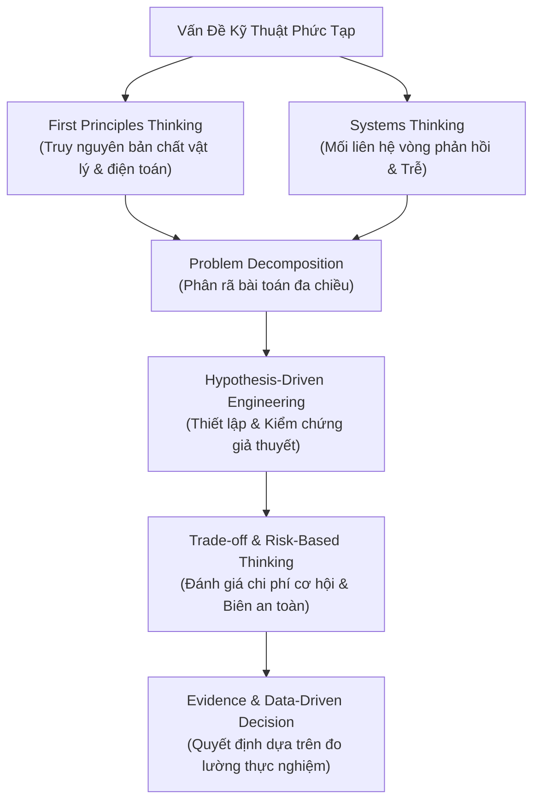
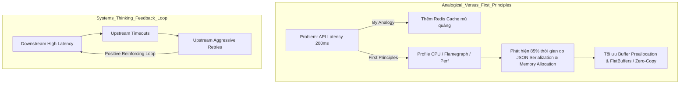
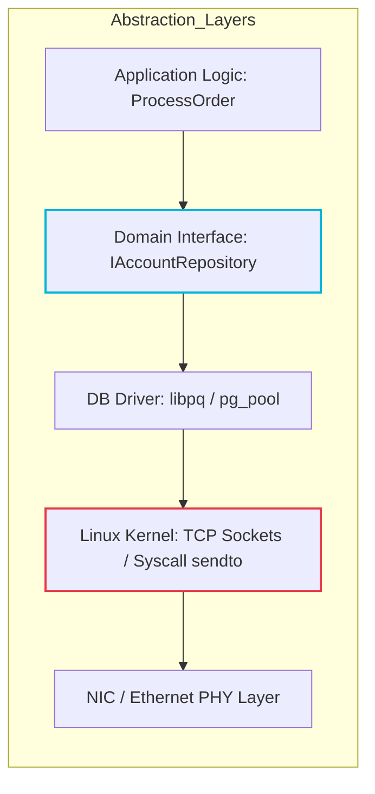
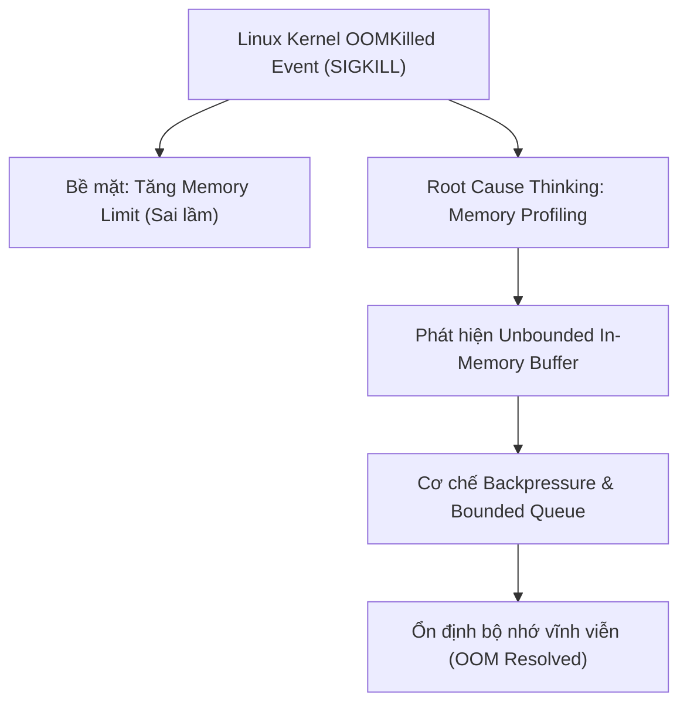
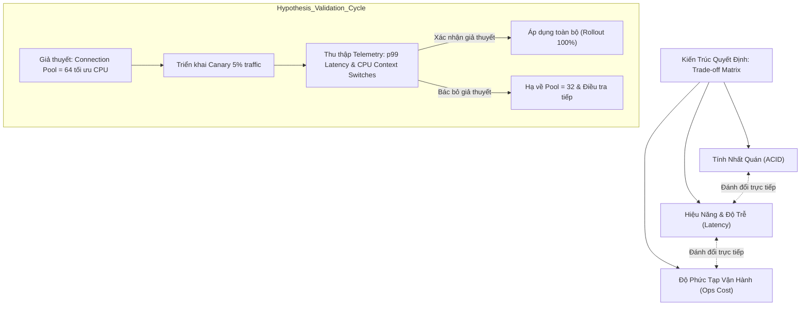

# 1.1. Các Mô Hình Tư Duy Cốt Lõi và Lập Luận Kỹ Thuật (Core Thinking Models & Reasoning)

## Tổng quan về Core Thinking Models & Reasoning
Trong kỹ nghệ phần mềm chuyên nghiệp, sự khác biệt căn bản giữa một "coder" và một "mature engineer" nằm ở năng lực nhận thức và các mô hình tư duy (mental models). Khi đối mặt với một sự cố production phức tạp, một yêu cầu nghiệp vụ mơ hồ hoặc một hệ thống phân tán hàng triệu người dùng, việc chỉ thuộc lòng cú pháp ngôn ngữ là hoàn toàn bất lực. Kỹ sư trưởng thành sử dụng hệ thống các phương pháp tư duy chặt chẽ: từ việc truy nguyên chân lý nền tảng (First Principles), nhìn nhận hệ thống đa chiều (Systems Thinking), suy luận định lượng dựa trên dữ liệu (Data-Driven, Evidence-Based) đến tư duy đánh đổi (Trade-off Thinking) để đưa ra các quyết định kỹ thuật bền vững.



---

## 2. Chi tiết từng Keyword (Under-the-Hood Deep Dive)

---

### 1. Engineering Mindset, First Principles Thinking & Systems Thinking

#### 1. Khái niệm bản chất (What & Why)
* **Engineering Mindset**: Tư duy kỹ thuật thực nghiệm định hướng giải quyết vấn đề dưới các ràng buộc (ngân sách, thời gian, tài nguyên máy chủ, tính sẵn sàng). Trọng tâm là tạo ra giá trị bền vững và có thể kiểm chứng, thay vì sự hoàn hảo trừu tượng.
* **First Principles Thinking (Tư duy nguyên lý đầu tiên)**: Phương pháp phân rã một hệ thống phức tạp về các tiên đề cơ bản nhất không thể bị bác bỏ (định luật bảo toàn, tốc độ ánh sáng, chu kỳ xung nhịp CPU, dung lượng L1 cache, giới hạn băng thông mạng) và xây dựng giải pháp từ đó, thay vì sao chép theo thói quen (reasoning by analogy).
* **Systems Thinking (Tư duy hệ thống)**: Năng lực nhìn nhận phần mềm không phải như các hàm rời rạc mà là một chỉnh thể gồm các thành phần tương tác động (dynamic feedback loops, delays, unintended side effects, emergent properties).

#### 2. Cơ chế hoạt động sâu (Under the hood / Hardcore Internals)
Khi tối ưu một dịch vụ backend bị nghẽn (bottleneck):
- **Analogical Thinking (Sai lầm phổ biến)**: "Netflix dùng Kafka/Redis, ta cũng áp dụng microservices + Kafka".
- **First Principles (Tầng phần cứng & OS)**:
  - Băng thông mạng: $10\text{ Gbps} \approx 1.25\text{ GB/s}$.
  - Độ trễ truy xuất RAM (DDR4/5): $\approx 50-100\text{ ns}$; L1 cache: $\approx 1\text{ ns}$; NVMe SSD: $\approx 10-50\text{ µs}$; Mạng nội mạng (Intra-DC): $\approx 500\text{ µs}$.
  - Context switch overhead của Linux Kernel: $1-3\text{ µs}$ tốn hàng nghìn chu kỳ CPU và flush TLB (Translation Lookaside Buffer).
  - Áp dụng First Principles chỉ ra rằng việc chia tách thành quá nhiều microservices sẽ gây áp lực lên tầng mạng và serialization (JSON/Protobuf), biến CPU bound thành I/O latency bound.
- **Systems Thinking Feedback Loop**:
  - Tăng `retry_count` khi downstream bị timeout $\rightarrow$ Khuếch đại lưu lượng tải (Retry Storm) $\rightarrow$ Downstream quá tải nặng hơn $\rightarrow$ Cascading Failure trên diện rộng.

#### 3. Sơ đồ minh họa (Mermaid Diagram)


#### 4. Code ví dụ thực chiến (C++20: Zero-Copy String Processing vs Vô tội vạ Allocations)
```cpp
#include <iostream>
#include <string_view>
#include <vector>
#include <span>
#include <chrono>

// First Principles: Heap allocation (malloc/free) đòi hỏi tương tác với OS brk/mmap 
// hoặc lock-based memory pools (tcmalloc, jemalloc) gây cache pollution và syscall overhead.
// Giải pháp First Principles: string_view (Zero-Copy) và stack-based memory.

struct HeaderField {
    std::string_view key;
    std::string_view value;
};

// Hàm phân tích HTTP Header bằng Zero-Copy (First Principles Mindset)
std::vector<HeaderField> parseHeadersZeroCopy(std::string_view rawHttp) {
    std::vector<HeaderField> headers;
    headers.reserve(16); // Preallocate để tránh realloc

    size_t start = 0;
    while (start < rawHttp.size()) {
        size_t lineEnd = rawHttp.find("\r\n", start);
        if (lineEnd == std::string_view::npos) break;
        if (lineEnd == start) break; // Kết thúc header

        std::string_view line = rawHttp.substr(start, lineEnd - start);
        size_t colon = line.find(':');
        if (colon != std::string_view::npos) {
            headers.push_back({
                .key = line.substr(0, colon),
                .value = line.substr(colon + 1)
            });
        }
        start = lineEnd + 2;
    }
    return headers;
}

int main() {
    std::string_view raw = "Host: api.internal.local\r\nContent-Type: application/json\r\n\r\n";
    auto headers = parseHeadersZeroCopy(raw);
    for (const auto& h : headers) {
        std::cout << "Header: [" << h.key << "] -> [" << h.value << "]\n";
    }
    return 0;
}
```

#### 5. Ưu / Nhược điểm, Pitfalls & Anti-patterns
- **Ưu điểm**: Nhìn thấu điểm thắt cổ chai vật lý, loại trừ việc tốn chi phí hạ tầng vô ích.
- **Pitfalls**: Áp dụng First Principles quá cực đoan (tự viết lại database, web framework) dẫn đến trễ tiến độ dự án (Not-Invented-Here Syndrome).

#### 6. Ứng dụng thực tế trong Backend / Systems
- **Tối ưu hóa Storage Engine**: Thiết kế LSM-Tree (Log-Structured Merge-Tree) trong RocksDB dựa trên First Principles: Sequential Write trên đĩa nhanh hơn Random Write hàng chục lần.

---

### 2. Critical, Analytical & Computational Thinking, Logical Reasoning & Abstraction

#### 1. Khái niệm bản chất (What & Why)
* **Critical Thinking (Tư duy phản biện)**: Không chấp nhận thông tin hiển nhiên mà liên tục thẩm định giả thiết: "Dữ liệu đo đạc có bị sai lệch (measurement bias) không?", "Log metric p99 này có phản ánh đúng trải nghiệm của người dùng thực tế không?".
* **Analytical Thinking (Tư duy phân tích)**: Bóc tách một thực thể phức tạp thành các thành phần logic cơ sở để nghiên cứu mối quan hệ nhân quả.
* **Logical Reasoning (Lập luận logic)**: Áp dụng suy luận diễn dịch (deductive) và quy nạp (inductive) để chứng minh tính đúng đắn của thuật toán, state machine và bất biến (invariants).
* **Abstraction Thinking (Tư duy trừu tượng)**: Khả năng giấu đi các chi tiết hiện thực phức tạp không liên quan ở một tầng cụ thể để giảm thiểu tải nhận thức (cognitive load).
* **Computational Thinking (Tư duy tính toán)**: Biến đổi bài toán thế giới thực thành dạng thức mà máy tính có thể thực thi hiệu quả (độ phức tạp thời gian $O(N)$, không gian $O(1)$, tính song song).

#### 2. Cơ chế hoạt động sâu (Under the hood / Hardcore Internals)
- **State Machine Invariants**: Tư duy logic đòi hỏi kỹ sư xác định các bất biến ở tầng bộ nhớ và luồng thực thi. Ví dụ, trong một atomic ring buffer:
  $$\text{Head} \le \text{Tail} + \text{Capacity}$$
- **Hardware Abstraction Layer (HAL)**: Sự trừu tượng hóa cho phép phần mềm gọi syscall `write()` mà không cần biết tầng dưới là NVMe SSD, SATA HDD hay NFS socket. Tuy nhiên, kỹ sư phản biện phải nhận thức được **Leaky Abstraction**: Một write call bị block do đĩa I/O bị nghẽn làm tê liệt event loop đơn luồng của Node.js hoặc Redis.

#### 3. Sơ đồ minh họa (Mermaid Diagram)


#### 4. Code ví dụ thực chiến (TypeScript: Type-Level Logical Reasoning & State Invariants)
```typescript
// Áp dụng Logical Reasoning & Abstraction để ngăn chặn Invalid State ngay tại thời điểm biên dịch (Compile-time)
type UnverifiedUser = {
  kind: 'UNVERIFIED';
  email: string;
  verificationToken: string;
};

type ActiveUser = {
  kind: 'ACTIVE';
  email: string;
  userId: string;
  activatedAt: Date;
};

type BannedUser = {
  kind: 'BANNED';
  userId: string;
  banReason: string;
};

// Algebraic Data Type (Tagged Union) bảo đảm loại trừ trạng thái bất hợp lệ
type User = UnverifiedUser | ActiveUser | BannedUser;

function processOrder(user: User, orderId: string): void {
  // Compiler ép buộc kiểm tra logic đầy đủ các nhánh (Exhaustiveness Checking)
  switch (user.kind) {
    case 'ACTIVE':
      console.log(`Processing order ${orderId} for active user ${user.userId}`);
      break;
    case 'UNVERIFIED':
      throw new Error(`Cannot process order: User email ${user.email} is not verified.`);
    case 'BANNED':
      throw new Error(`Forbidden: User ${user.userId} is banned. Reason: ${user.banReason}`);
  }
}
```

#### 5. Ưu / Nhược điểm, Pitfalls & Anti-patterns
- **Anti-pattern: Leaky Abstraction Ignorance**: Quên mất rằng bên dưới các ORM hào nhoáng (Hibernate, Prisma) là các câu lệnh SQL với vấn đề $N+1$ query và full table scan.

#### 6. Ứng dụng thực tế trong Backend / Systems
- **Thiết kế Domain Boundaries**: Dùng trừu tượng hóa để cô lập logic thanh toán khỏi SDK của các cổng thanh toán bên ngoài (Stripe, Paypal), cho phép chuyển đổi nhà cung cấp mà không sửa đổi một dòng code nghiệp vụ.

---

### 3. Problem Decomposition, Root Cause Thinking & Constraint-Based Thinking

#### 1. Khái niệm bản chất (What & Why)
* **Problem Decomposition**: Kỹ thuật phân rã một bài toán lớn, bất khả thi thành các bài toán con độc lập, có thể giải quyết tuần tự hoặc song song.
* **Root Cause Thinking**: Từ chối các biện pháp chữa cháy bề mặt (patching symptoms), luôn kiên trì đào sâu tìm nguyên nhân gốc rễ gây ra lỗi (thường là do lỗi thiết kế, thiếu invariant hoặc quy trình kiểm thử yếu kém).
* **Constraint-Based Thinking**: Tư duy luôn bắt đầu bằng việc xác định rõ các biên giới cứng (hard constraints - ví dụ: RAM 8GB, mạng trễ tối đa 10ms, chuẩn PCI-DSS) và biên giới mềm (soft constraints - thời gian dev, chi phí hạ tầng).

#### 2. Cơ chế hoạt động sâu (Under the hood / Hardcore Internals)
Khi hệ thống gặp lỗi Out-Of-Memory (`OOMKilled` bởi Linux Kernel `oom-reaper` qua tín hiệu `SIGKILL - 9`):
1. **Symptom**: Pod Kubernetes bị restart liên tục.
2. **Symptom-Level Fix (Bad)**: Tăng RAM pod từ 2GB lên 8GB $\rightarrow$ Vài ngày sau pod 8GB vẫn sập.
3. **Root Cause Analysis (Deep)**:
   - Sử dụng `gdb`, `valgrind` hoặc Go/C++ profiler (`pprof`, `heaptrack`).
   - Phát hiện bộ đệm `std::vector` hoặc channel không có bounded capacity (Unbounded Queue).
   - Khi mạng downstream bị chậm, upstream tiếp tục đẩy message vào queue $\rightarrow$ Heap tăng phi mã $\rightarrow$ Kernel `mm/oom_kill.c` can thiệp.
   - Giải pháp tận gốc: Áp dụng **Backpressure** và **Bounded Queue** với rejection policy tường minh.

#### 3. Sơ đồ minh họa (Mermaid Diagram)


#### 4. Code ví dụ thực chiến (C++20: Bounded Queue với Backpressure ngăn chặn OOM)
```cpp
#include <iostream>
#include <queue>
#include <mutex>
#include <condition_variable>
#include <optional>

// Bounded Queue thể hiện Constraint-Based Thinking: Không bao giờ cấp phát tài nguyên vô tận.
template <typename T>
class BoundedQueue {
private:
    std::queue<T> queue_;
    const size_t capacity_;
    std::mutex mtx_;
    std::condition_variable cv_not_full_;
    std::condition_variable cv_not_empty_;

public:
    explicit BoundedQueue(size_t capacity) : capacity_(capacity) {}

    // Push chặn luồng sản xuất nếu hàng đợi đã đầy (Backpressure)
    void push(T item) {
        std::unique_lock<std::mutex> lock(mtx_);
        cv_not_full_.wait(lock, [this] { return queue_.size() < capacity_; });
        queue_.push(std::move(item));
        cv_not_empty_.notify_one();
    }

    // Pop lấy item ra và đánh thức producer
    T pop() {
        std::unique_lock<std::mutex> lock(mtx_);
        cv_not_empty_.wait(lock, [this] { return !queue_.empty(); });
        T val = std::move(queue_.front());
        queue_.pop();
        cv_not_full_.notify_one();
        return val;
    }

    size_t size() {
        std::lock_guard<std::mutex> lock(mtx_);
        return queue_.size();
    }
};
```

#### 5. Ưu / Nhược điểm, Pitfalls & Anti-patterns
- **Anti-pattern: Infinite Retries without Backoff**: Khi downstream sập, upstream liên tục retry với tốc độ tối đa khiến hệ thống không bao giờ có thể tự phục hồi.

#### 6. Ứng dụng thực tế trong Backend / Systems
- Thiết kế TCP Flow Control: Sử dụng Receive Window (`rwnd`) và Sliding Window để client không gửi dữ liệu vượt quá năng lực buffer của server.

---

### 4. Trade-off, Risk-Based, Cost-Benefit & Hypothesis-Driven Thinking

#### 1. Khái niệm bản chất (What & Why)
* **Trade-off Thinking**: Thừa nhận trong kỹ thuật phần mềm **không có giải pháp tốt nhất (no silver bullet), chỉ có các sự đánh đổi**. Ví dụ: Tăng tính nhất quán dữ liệu (Consistency) đồng nghĩa với việc giảm tính sẵn sàng (Availability) hoặc tăng độ trễ (Latency).
* **Risk-Based Thinking**: Đánh giá kiến trúc dựa trên ma trận xác suất và mức độ nghiêm trọng của rủi ro (Risk = Probability × Impact).
* **Cost-Benefit Analysis**: Cân đối giữa chi phí đầu tư (thời gian lập trình viên, phí server đám mây, độ phức tạp bảo trì) so với lợi ích kinh doanh mang lại.
* **Evidence-Based & Data-Driven Decision Making**: Mọi kết luận kỹ thuật phải dựa trên số liệu đo lường thực tế (profiling benchmarks, telemetry metrics), không dựa trên cảm tính hoặc thâm niên.
* **Hypothesis-Driven Engineering**: Mọi thay đổi kỹ thuật được xem như một giả thuyết khoa học: "Nếu ta áp dụng connection pool kích thước 50, thì độ trễ p99 sẽ giảm 30% mà không gây cạn kiệt socket". Sau đó chạy thử nghiệm (A/B testing, Canary) để bác bỏ hoặc xác nhận.

#### 2. Cơ chế hoạt động sâu (Under the hood / Hardcore Internals)
Khi chọn giữa **Synchronous In-Memory Cache (Redis)** và **Database Direct Query with Indexing**:
- **Đánh đổi Latency vs Consistency**:
  - Redis: Đọc mất $0.5\text{ ms}$, nhưng tồn tại rủi ro Cache Invalidation (Cache Inconsistency) và race condition khi ghi đè song song.
  - PostgreSQL Read Replica: Đọc mất $3-5\text{ ms}$, nhưng duy trì được ACID và giảm độ phức tạp kiến trúc.
- **Evidence-Based Profiling**:
  Trước khi quyết định mua thêm Redis cluster tốn $\$2,000/\text{tháng}$, kỹ sư chạy công cụ `EXPLAIN (ANALYZE, BUFFERS)` trên PostgreSQL:
  Phát hiện câu lệnh SQL đang dùng `Seq Scan` do thiếu partial index. Thêm index giảm thời gian truy vấn từ $250\text{ ms}$ xuống còn $1.2\text{ ms}$. Lợi ích đạt được ngay lập tức với chi phí phát sinh bằng $\$0$.

#### 3. Sơ đồ minh họa (Mermaid Diagram)


#### 4. Code ví dụ thực chiến (TypeScript: Hypothesis-Driven Metrics & Canary Routing)
```typescript
interface RequestMetrics {
  durationMs: number;
  statusCode: number;
  experimentGroup: 'BASELINE' | 'CANARY_NEW_ALGO';
}

class TelemetryCollector {
  private metrics: RequestMetrics[] = [];

  record(metric: RequestMetrics): void {
    this.metrics.push(metric);
    // Trong production: gửi trực tiếp tới Prometheus/OpenTelemetry collector
  }

  // Đánh giá dựa trên bằng chứng dữ liệu (Data-Driven Decision)
  evaluateHypothesis(): { baselineP99: number; canaryP99: number; conclusion: string } {
    const calcP99 = (group: 'BASELINE' | 'CANARY_NEW_ALGO') => {
      const times = this.metrics
        .filter((m) => m.experimentGroup === group)
        .map((m) => m.durationMs)
        .sort((a, b) => a - b);
      if (times.length === 0) return 0;
      const idx = Math.floor(times.length * 0.99);
      return times[idx];
    };

    const baselineP99 = calcP99('BASELINE');
    const canaryP99 = calcP99('CANARY_NEW_ALGO');

    const conclusion =
      canaryP99 < baselineP99 * 0.8
        ? 'Xác nhận giả thuyết: Thuật toán mới cải thiện p99 trên 20%!'
        : 'Bác bỏ giả thuyết: Không có cải thiện đáng kể, rollback ngay.';

    return { baselineP99, canaryP99, conclusion };
  }
}
```

#### 5. Ưu / Nhược điểm, Pitfalls & Anti-patterns
- **Anti-pattern: Cargo Cult Engineering**: Áp dụng công nghệ thời thượng (Rust, K8s, Kafka) chỉ vì các hãng lớn quảng cáo, mà không hề đo lường tính khả thi và chi phí vận hành cho bài toán của chính công ty mình.

#### 6. Ứng dụng thực tế trong Backend / Systems
- **Chaos Engineering tại Netflix (Chaos Monkey)**: Đưa ra giả thuyết rằng hệ thống có thể chịu được việc mất 1 Availability Zone (AZ) mà không downtime. Bật công cụ tắt ngẫu nhiên instance để chứng minh hoặc bác bỏ giả thuyết trên production.

---

## Tổng kết Chương 1.1
Các mô hình tư duy cốt lõi (First Principles, Systems Thinking, Logical Reasoning, Hypothesis-Driven) là la bàn định hướng cho mọi kỹ sư chuyên nghiệp. Bằng cách luôn đặt câu hỏi về bản chất vật lý của máy tính, thấu hiểu tác động toàn cục của hệ thống và ra quyết định dựa trên đo lường thực tế, kỹ sư có thể tránh được hàng ngàn sai lầm tốn kém cả về thời gian lẫn chi phí vận hành.
