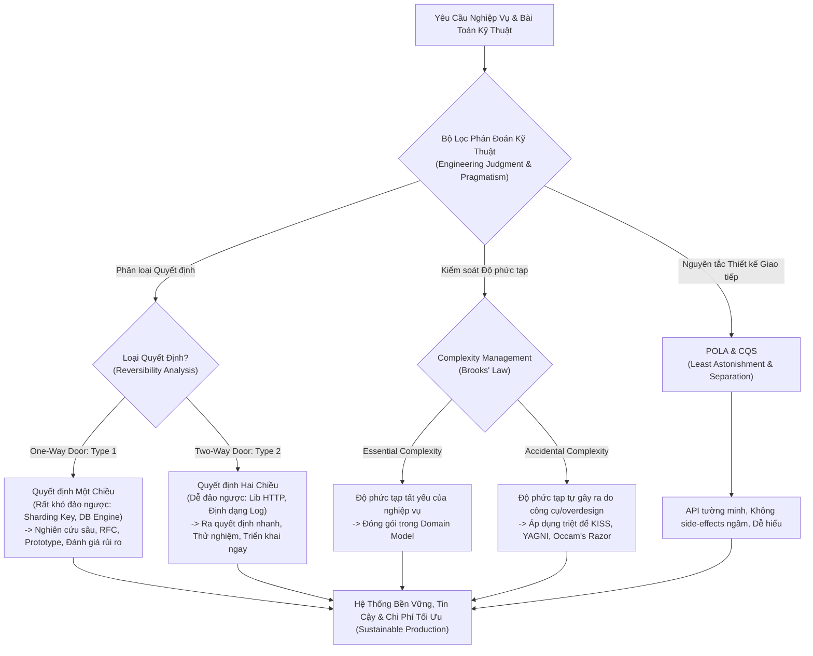

# 1.2. Phán Đoán Kỹ Thuật và Các Nguyên Tắc Ra Quyết Định (Engineering Judgment & Decision Principles)

> [!IMPORTANT]
> **Nếu bạn chỉ được nhớ một điều duy nhất:** Kỹ thuật phần mềm không phải là việc áp dụng mọi mẫu hình thiết kế hay công nghệ mới nhất một cách giáo điều, mà là nghệ thuật ra quyết định đánh đổi (*trade-off*) thực dụng dưới điều kiện bất định; một kỹ sư trưởng thành luôn chọn giải pháp đơn giản nhất giải quyết đúng vấn đề, dễ đảo ngược khi sai, và kiên định chịu trách nhiệm cho vận hành dài hạn.

---

## 1. Kiến trúc Tổng quan & Mô hình Tư duy (Mental Model)

### Phép loại suy thực tế (The Master Surgeon vs. The Master Builder)
Hãy tưởng tượng sự khác biệt giữa một bác sĩ thực tập và một bác sĩ phẫu thuật trưởng phòng cấp cứu:
- Người bác sĩ non trẻ thường bị choáng ngợp bởi hàng loạt giáo trình lý thuyết: muốn xét nghiệm toàn bộ 50 chỉ số sinh hóa, áp dụng mọi phác đồ điều trị tiên tiến nhất và cố gắng chữa trị dứt điểm mọi bệnh nền cùng một lúc, ngay cả khi bệnh nhân đang mất máu nghiêm trọng do một vết thương hở.
- Ngược lại, người bác sĩ trưởng phòng cấp cứu sở hữu **Engineering Judgment (Khả năng phán đoán kỹ thuật)**: Hành động đầu tiên là đặt garô cầm máu (*Mitigation*), giữ vững huyết áp và nhịp tim (*Service Availability*), chấp nhận bỏ qua các can thiệp phức tạp chưa cần thiết (*YAGNI*). Chỉ khi bệnh nhân đã qua cơn nguy kịch, họ mới từ tốn xem xét phác đồ điều trị dài hạn (*Long-term Architecture*).

Trong kỹ nghệ phần mềm cũng vậy: Mọi quyết định thiết kế không tồn tại trong chân không lý thuyết. Chúng bị giằng co giữa các lực kéo: **Thời gian ra mắt (Time-to-Market)**, **Độ phức tạp (Complexity)**, **Độ tin cậy (Reliability)**, **Hiệu năng (Performance)** và **Chi phí sở hữu (Total Cost of Ownership - TCO)**. Người kỹ sư trưởng thành không tìm kiếm một "giải pháp hoàn hảo tuyệt đối" mà tìm kiếm "điểm cân bằng tối ưu của các đánh đổi" trong bối cảnh cụ thể của tổ chức.



---

## 2. Chi tiết từng Keyword (Under-the-Hood Deep Dive)

### 2.1. Engineering Judgment (Khả năng Phán đoán Kỹ thuật)
- **Bản chất kỹ thuật**: Engineering Judgment là năng lực định lượng và định tính hóa các yếu tố kỹ thuật để đưa ra quyết định dưới điều kiện thông tin không đầy đủ (*incomplete information*). Nó không phải là linh cảm mơ hồ mà là kết quả của việc áp dụng mô hình cập nhật xác suất (*Bayesian updating*): liên tục điều chỉnh dự đoán rủi ro dựa trên dữ liệu vận hành thực tế, sự cố đã trải qua và các ràng buộc về tài nguyên phần cứng (CPU, I/O, Network, RAM).
- **Cơ chế hoạt động sâu**: Khi đối mặt với một vấn đề, kỹ sư có phán đoán tốt sẽ không hỏi "Công nghệ này có hay không?" mà hỏi:
  1. *Độ trễ p99 và throughput yêu cầu là bao nhiêu?*
  2. *Hệ thống sẽ thất bại ở chế độ nào (Failure Mode) khi lưu lượng tăng gấp 10 lần?*
  3. *Chi phí cơ hội của việc tự xây dựng (Build) so với việc mua/dùng dịch vụ có sẵn (Buy/Adopt) là gì?*
- **Sai lầm phổ biến**: Nhầm lẫn giữa phán đoán kỹ thuật với thói quen bảo thủ (từ chối mọi công nghệ mới) hoặc chạy theo trào lưu (*Resume-Driven Development*).

### 2.2. Engineering Pragmatism (Chủ nghĩa Thực dụng Kỹ thuật)
- **Bản chất kỹ thuật**: Triết lý ưu tiên kết quả kinh doanh và giá trị thực tế mang lại cho người dùng cuối hơn là việc tuân thủ một cách giáo điều các khuôn mẫu kiến trúc sách vở. Kỹ sư thực dụng sẵn sàng chấp nhận một giải pháp "đủ tốt" (*good enough*) và mang tính đơn giản thay vì một cấu trúc trừu tượng hóa 5 tầng nhằm đón đầu những kịch bản không bao giờ xảy ra.
- **Nguyên lý Boring Technology (Dan McKinley)**: Chọn các công nghệ "nhàm chán" (PostgreSQL, Linux, Redis, HTTP REST) cho 95% thành phần hệ thống. Chỉ dành ngân sách đổi mới (*Innovation Tokens*) cho 5% bài toán thực sự tạo ra lợi thế cạnh tranh cốt lõi.

### 2.3. Engineering Discipline (Kỷ luật Kỹ thuật)
- **Bản chất kỹ thuật**: Sự kiên định tuân thủ các tiêu chuẩn kỹ thuật nghiêm ngặt ngay cả khi chịu áp lực khổng lồ về thời hạn bàn giao (*deadlines*). Kỷ luật không phải là sự chậm chạp, mà là "tấm đệm an toàn" ngăn chặn các lỗi ngớ ngẩn gây thảm họa trên production.
- **Biểu hiện ở tầng sâu**:
  - Không bao giờ merge code nếu thiếu automated tests (Unit, Integration, Contract tests).
  - Không chạy schema migration trực tiếp bằng tay trên production; toàn bộ thay đổi DB phải là migration script có version control, có khả năng rollback và không khóa bảng (*lock-free schema migration*).
  - Áp dụng nguyên lý RAII (*Resource Acquisition Is Initialization*) trong C++ hoặc `try-with-resources` / context managers để triệt tiêu hoàn toàn rò rỉ bộ nhớ và file descriptors.

### 2.4. Engineering Ownership (Tinh thần Sở hữu Toàn diện)
- **Bản chất kỹ thuật**: Tư duy "You build it, you run it" (Werner Vogels - CTO Amazon). Người kỹ sư không coi trách nhiệm của mình kết thúc khi mã nguồn được merge vào nhánh `main`. Trách nhiệm chỉ thực sự bắt đầu khi mã nguồn phục vụ người dùng thực tế trên production.
- **Vòng đời Ownership**:
  $$\text{Thiết kế (RFC)} \rightarrow \text{Code & Test} \rightarrow \text{CI/CD} \rightarrow \text{Deployment} \rightarrow \text{Telemetry/Observability} \rightarrow \text{On-Call} \rightarrow \text{Postmortem}$$
- **Phản mẫu (Anti-pattern)**: "Throw over the wall" – Lập trình viên viết code xong đẩy qua đội QA test, QA test xong đẩy qua đội Ops deploy, khi có sự cố ban đêm thì đội Ops chịu trận trong khi lập trình viên đang ngủ.

### 2.5. Long-Term Thinking & Total Cost of Ownership (TCO)
- **Bản chất kỹ thuật**: Đánh giá chi phí toàn diện của một giải pháp phần mềm trong chu kỳ 3–5 năm, không chỉ dừng lại ở thời gian lập trình ban đầu.
- **Công thức TCO**:
  $$\text{TCO} = \text{Chi phí Phát triển} + \text{Chi phí Hạ tầng Đám mây} + \text{Chi phí Nâng cấp/Vá lỗi} + \text{Chi phí Vận hành/On-call} + \text{Chi phí Đào tạo Kỹ sư Mới}$$
- **Cơ chế tầng sâu**: Một framework "thần kỳ" giúp viết code nhanh trong tuần đầu tiên nhưng có mã nguồn đóng, cộng đồng nhỏ và không hỗ trợ debug tầng sâu sẽ khiến TCO tăng vọt theo cấp số nhân khi hệ thống mở rộng quy mô.

### 2.6. Complexity Management: Essential vs. Accidental Complexity
- **Bản chất kỹ thuật (Fred Brooks - "No Silver Bullet")**:
  - **Essential Complexity (Độ phức tạp tất yếu)**: Bản chất cốt lõi của bài toán nghiệp vụ (ví dụ: Quy tắc tính thuế xuyên biên giới, thuật toán đồng thuận phân tán Raft). Không có công nghệ nào có thể loại bỏ nó; chỉ có thể đóng gói nó vào các module ranh giới rõ ràng (*Bounded Contexts*).
  - **Accidental Complexity (Độ phức tạp ngẫu nhiên/tự gây ra)**: Độ phức tạp do chính kỹ sư tự tạo ra thông qua việc chọn sai công cụ, lạm dụng cấu trúc rườm rà, cấu hình phức tạp, hoặc ép buộc sử dụng microservices khi monolith chỉ cần 1 node.
- **Mục tiêu tối thượng**: Triệt tiêu tối đa Accidental Complexity để dồn toàn bộ trí lực xử lý Essential Complexity.

### 2.7. Simplicity, Occam's Razor & KISS (Keep It Simple, Stupid)
- **Bản chất kỹ thuật**:
  - **Occam's Razor**: Giữa các giải pháp giải quyết được cùng một vấn đề với kết quả tương đương, giải pháp nào ít thành phần cấu thành hơn, ít giả định hơn là giải pháp tốt nhất và bền vững nhất.
  - **KISS**: Đơn giản không đồng nghĩa với ngô nghê (*simple is not easy*). Tạo ra một thiết kế đơn giản đòi hỏi sự thấu hiểu sâu sắc bản chất vấn đề để cắt gọt mọi chi tiết thừa.
- **Tác động phần cứng**: Thiết kế đơn giản giúp mã nguồn ngắn gọn, instruction cache (L1i) không bị tràn, CPU branch predictor hoạt động chính xác hơn, và luồng dữ liệu tuần tự giúp tối ưu hóa memory prefetcher.

### 2.8. YAGNI (You Aren't Gonna Need It) & Anti-Gold-Plating
- **Bản chất kỹ thuật**: Nguyên lý từ Extreme Programming (XP): Không bao giờ lập trình cho các tính năng, kịch bản hoặc cấu trúc trừu tượng hóa mang tính phỏng đoán trong tương lai cho đến khi có yêu cầu thực tế phát sinh.
- **Anti-pattern: Gold Plating (Dát vàng sản phẩm)**: Kỹ sư dành 3 tuần để xây dựng một hệ thống plugin generic, dynamic loading, multi-tenant cho một ứng dụng nội bộ chỉ chạy trên một máy chủ và phục vụ 10 nhân viên kế toán.

### 2.9. DRY (Don't Repeat Yourself) vs. Premature DRY
- **Bản chất kỹ thuật**: DRY (Andy Hunt & Dave Thomas) phát biểu: *"Mỗi mảnh tri thức nghiệp vụ cốt lõi phải có một đại diện duy nhất, không mâu thuẫn trong hệ thống"*.
- **Cạm bẫy Premature DRY (Trùng lặp giả tạo)**: Nhiều lập trình viên nhầm lẫn giữa "trùng lặp tri thức nghiệp vụ" và "trùng lặp cú pháp ngẫu nhiên". Hai đoạn code trông giống hệt nhau ở thời điểm hiện tại nhưng thay đổi vì hai lý do nghiệp vụ hoàn toàn khác nhau (ví dụ: Định dạng hóa đơn bán lẻ B2C vs Hóa đơn chiết khấu doanh nghiệp B2B) không được phép gộp chung.
- **Quy tắc Sandi Metz**: *"Trùng lặp code rẻ hơn nhiều so với việc chọn sai trừu tượng (Duplication is far cheaper than the wrong abstraction)"*.

### 2.10. Separation of Concerns (SoC) & High Cohesion / Loose Coupling
- **Bản chất kỹ thuật**: Phân rã hệ thống thành các vùng trách nhiệm biệt lập sao cho mỗi vùng chỉ giải quyết một mối bận tâm duy nhất.
- **Độ dính kết cao (High Cohesion)**: Các thành phần bên trong một module phải có mối liên kết mật thiết và cùng phục vụ một mục đích rõ ràng.
- **Độ ghép nối lỏng (Loose Coupling)**: Các module giao tiếp với nhau thông qua hợp đồng giao diện (*interfaces/contracts*), không phụ thuộc vào chi tiết hiện thực bên trong của nhau.

### 2.11. Principle of Least Astonishment (POLA) & Command-Query Separation (CQS)
- **Bản chất kỹ thuật**:
  - **POLA**: Thiết kế giao diện (API, SDK, CLI) phải hoạt động đúng theo trực giác và quy ước chuẩn mà người dùng mong đợi. Nếu một hàm có tên `findUser(id)`, nó tuyệt đối không được phép âm thầm cập nhật trường `last_login_at` vào cơ sở dữ liệu hay kích hoạt gửi email chào mừng.
  - **CQS (Bertrand Meyer)**: Mỗi phương thức chỉ nên là một **Command** (thay đổi trạng thái hệ thống, trả về `void`) hoặc một **Query** (truy vấn dữ liệu, trả về kết quả, không sinh side-effect).

### 2.12. Reversibility of Decisions: Type 1 (One-Way Door) vs. Type 2 (Two-Way Door)
- **Bản chất kỹ thuật (Mô hình Jeff Bezos)**:
  - **Type 2 (Two-Way Door - Quyết định hai chiều)**: Các quyết định có thể hoàn tác dễ dàng mà chi phí thấp nếu phạm sai lầm (ví dụ: Chọn thư viện JSON parser, đổi cấu trúc thư mục code, thử nghiệm thuật toán sắp xếp). Những quyết định này cần được đưa ra nhanh chóng bởi cá nhân hoặc nhóm nhỏ mà không cần qua nhiều cấp phê duyệt.
  - **Type 1 (One-Way Door - Quyết định một chiều)**: Các quyết định gần như không thể đảo ngược hoặc tốn hàng triệu USD và nhiều tháng downtime nếu sửa sai (ví dụ: Chọn kiến trúc cơ sở dữ liệu phân tán, thiết kế Sharding Key, thay đổi mô hình bảo mật xác thực danh tính). Đòi hỏi quy trình RFC (Request for Comments), thẩm định kỹ thuật, thử nghiệm tải nguyên mẫu (Prototype/Spike) và sự tham gia của các Principal Engineers.

### 2.13. Avoiding Premature Optimization (Tránh Tối ưu hóa Sớm)
- **Bản chất kỹ thuật (Donald Knuth)**: *"Premature optimization is the root of all evil (or at least most of it) in programming"*. Tối ưu hóa khi chưa có số liệu đo lường cụ thể từ profiler thường dẫn đến mã nguồn khó đọc, khó bảo trì và thậm chí phản tác dụng do làm mất tính dễ tối ưu của compiler.
- **Profile-Driven Optimization**: Chỉ tối ưu hóa khi công cụ đo lường (*perf*, *eBPF*, *pprof*) chỉ ra chính xác dòng code hoặc điểm nghẽn tiêu tốn tài nguyên (Hot Path).

### 2.14. Avoiding Overengineering & Managing Uncertainty
- **Bản chất kỹ thuật**: Thay vì cố gắng dự đoán trước toàn bộ tương lai trong điều kiện bất định cao, kỹ sư thiết kế các ranh giới module rõ ràng để **trì hoãn quyết định** (*defer decisions*) cho tới khi có đủ dữ liệu thực nghiệm, giúp hệ thống có khả năng tiến hóa linh hoạt (*evolutionary capability*).

---

## 3. Thực thi Mã nguồn & Mô phỏng Chuyên sâu (Dual-Engine Implementation)

Để minh họa sống động các nguyên tắc: **Engineering Judgment**, **KISS/YAGNI**, **RAII**, **CQS**, **POLA** và **Static vs Dynamic Polymorphism**, chúng ta triển khai một bài toán thực tế: **Hệ thống Quản lý và Đánh giá Hạn mức Yêu cầu (Rate Limiting & Decision Rule Engine)**.

### Engine 1: C++20 – Zero-Overhead, RAII, Compile-time Concepts & CQS Compliance

Chương trình C++20 áp dụng:
1. **Concepts & Compile-Time Polymorphism**: Loại bỏ vtable overhead (giảm indirect calls, tối ưu L1i cache).
2. **RAII Lock/Resource Management**: Đảm bảo an toàn tài nguyên.
3. **CQS / POLA**: Hàm kiểm tra không làm thay đổi trạng thái; hàm tiêu thụ token được tách bạch rõ ràng.

```cpp
#include <iostream>
#include <string>
#include <chrono>
#include <concepts>
#include <memory>
#include <vector>
#include <unordered_map>
#include <mutex>
#include <format>

// ============================================================================
// 1. Domain Types & CQS Principle
// ============================================================================
struct RequestContext {
    std::string clientId;
    std::string endpoint;
    uint64_t payloadSizeBytes{0};
};

enum class DecisionOutcome {
    Allowed,
    Throttled,
    Blocked
};

struct EvaluationResult {
    DecisionOutcome outcome;
    std::string reason;
};

// ============================================================================
// 2. C++20 Concept: Áp dụng KISS & Compile-Time Polymorphism thay vì VTable Overkill
// ============================================================================
template <typename T>
concept RateLimitPolicy = requires(T policy, const RequestContext& ctx, uint64_t cost) {
    // Query: Kiểm tra trạng thái mà KHÔNG gây side-effect (POLA & CQS)
    { policy.canAcquire(ctx, cost) } -> std::same_as<bool>;
    // Command: Thực hiện trừ quota trạng thái
    { policy.consume(ctx, cost) } -> std::same_as<void>;
    // Metadata
    { policy.name() } -> std::same_as<std::string_view>;
};

// ============================================================================
// 3. Concrete Policy: Token Bucket Limiter (KISS & Thread-safe RAII)
// ============================================================================
class TokenBucketLimiter {
private:
    const double capacity_;
    const double refillRatePerSec_;
    mutable std::mutex mtx_;
    
    struct BucketState {
        double tokens;
        std::chrono::steady_clock::time_point lastRefillTime;
    };
    mutable std::unordered_map<std::string, BucketState> buckets_;

    void refillLocked(BucketState& bucket, const std::chrono::steady_clock::time_point& now) const {
        std::chrono::duration<double> elapsed = now - bucket.lastRefillTime;
        bucket.tokens = std::min(capacity_, bucket.tokens + elapsed.count() * refillRatePerSec_);
        bucket.lastRefillTime = now;
    }

public:
    TokenBucketLimiter(double capacity, double refillRate)
        : capacity_(capacity), refillRatePerSec_(refillRate) {}

    std::string_view name() const noexcept {
        return "TokenBucketLimiter";
    }

    // QUERY: Không làm thay đổi trạng thái bucket (Tuân thủ CQS)
    bool canAcquire(const RequestContext& ctx, uint64_t cost) const {
        std::lock_guard<std::mutex> lock(mtx_);
        auto now = std::chrono::steady_clock::now();
        auto& bucket = buckets_[ctx.clientId];
        if (bucket.lastRefillTime == std::chrono::steady_clock::time_point{}) {
            bucket.tokens = capacity_;
            bucket.lastRefillTime = now;
        } else {
            refillLocked(bucket, now);
        }
        return bucket.tokens >= static_cast<double>(cost);
    }

    // COMMAND: Thay đổi trạng thái tài nguyên (Tuân thủ CQS)
    void consume(const RequestContext& ctx, uint64_t cost) {
        std::lock_guard<std::mutex> lock(mtx_);
        auto now = std::chrono::steady_clock::now();
        auto& bucket = buckets_[ctx.clientId];
        if (bucket.lastRefillTime == std::chrono::steady_clock::time_point{}) {
            bucket.tokens = capacity_;
            bucket.lastRefillTime = now;
        } else {
            refillLocked(bucket, now);
        }
        bucket.tokens = std::max(0.0, bucket.tokens - static_cast<double>(cost));
    }
};

// ============================================================================
// 4. Decision Engine (Separation of Concerns & Least Astonishment)
// ============================================================================
template <RateLimitPolicy Policy>
class GatewayDecisionEngine {
private:
    Policy policy_;

public:
    explicit GatewayDecisionEngine(Policy policy) : policy_(std::move(policy)) {}

    // Xử lý request rõ ràng: Đánh giá -> Phán quyết -> Thực thi
    EvaluationResult evaluateAndRecord(const RequestContext& ctx, uint64_t cost) {
        // Bước 1: Query (Kiểm tra an toàn)
        if (!policy_.canAcquire(ctx, cost)) {
            return {
                .outcome = DecisionOutcome::Throttled,
                .reason = std::format("[{}] Client '{}' vuot nguong quota cho phep!", 
                                      policy_.name(), ctx.clientId)
            };
        }

        // Bước 2: Command (Trừ quota một cách tường minh)
        policy_.consume(ctx, cost);
        return {
            .outcome = DecisionOutcome::Allowed,
            .reason = std::format("[{}] Client '{}' duoc chap thuan giao dich.", 
                                  policy_.name(), ctx.clientId)
        };
    }
};

// ============================================================================
// 5. Verification Main
// ============================================================================
int main() {
    std::cout << "=== C++20 ENGINEERING JUDGMENT & DECISION ENGINE DEMO ===\n\n";

    // Khởi tạo limiter với capacity = 3 tokens, refill = 1 token/sec (KISS, YAGNI)
    TokenBucketLimiter bucket(3.0, 1.0);
    GatewayDecisionEngine<TokenBucketLimiter> engine(std::move(bucket));

    RequestContext clientA{.clientId = "client-alpha", .endpoint = "/api/v1/orders", .payloadSizeBytes = 1024};
    RequestContext clientB{.clientId = "client-beta",  .endpoint = "/api/v1/checkout", .payloadSizeBytes = 2048};

    // Mô phỏng burst requests
    for (int req = 1; req <= 4; ++req) {
        auto resA = engine.evaluateAndRecord(clientA, 1);
        std::cout << std::format("[Request #{}] Client Alpha -> Outcome: {} | Reason: {}\n",
            req, 
            resA.outcome == DecisionOutcome::Allowed ? "ALLOWED" : "THROTTLED",
            resA.reason);
    }

    std::cout << "\nKiem tra Client Beta (Doc lap trang thai, Isolation):\n";
    auto resB = engine.evaluateAndRecord(clientB, 1);
    std::cout << std::format("Client Beta -> Outcome: {} | Reason: {}\n",
        resB.outcome == DecisionOutcome::Allowed ? "ALLOWED" : "THROTTLED",
        resB.reason);

    return 0;
}
```

---

### Engine 2: Python 3.11+ – Clean Architecture, Type Hints, Dataclasses & Strict CQS

Chương trình Python 3.11+ áp dụng:
1. `dataclasses(slots=True)` để tối ưu memory layout và CPU cache overhead.
2. `abc.ABC` và typing protocol cho High Cohesion & Loose Coupling.
3. Tách biệt Query và Command rõ ràng, loại bỏ hoàn toàn side-effect gây bất ngờ.

```python
#!/usr/bin/env python3
"""
Python 3.11+ Implementation of Decision Engine & Rate Limiter
Demonstrating KISS, Separation of Concerns, CQS, and POLA.
"""

from abc import ABC, abstractmethod
from dataclasses import dataclass, field
from enum import Enum
import time
from typing import Dict


class DecisionOutcome(Enum):
    ALLOWED = "ALLOWED"
    THROTTLED = "THROTTLED"
    BLOCKED = "BLOCKED"


@dataclass(slots=True, frozen=True)
class RequestContext:
    client_id: str
    endpoint: str
    payload_size_bytes: int = 0


@dataclass(slots=True, frozen=True)
class EvaluationResult:
    outcome: DecisionOutcome
    reason: str
    remaining_tokens: float


class IRateLimitPolicy(ABC):
    """Interface trừu tượng tuân thủ DIP (Dependency Inversion Principle)"""

    @abstractmethod
    def can_acquire(self, ctx: RequestContext, cost: float) -> bool:
        """Query thuần túy: Không được làm thay đổi trạng thái (POLA/CQS)"""
        pass

    @abstractmethod
    def consume(self, ctx: RequestContext, cost: float) -> float:
        """Command: Trừ quota và trả về số token còn lại"""
        pass

    @property
    @abstractmethod
    def policy_name(self) -> str:
        pass


@dataclass(slots=True)
class BucketState:
    tokens: float
    last_refill_timestamp: float


class TokenBucketPolicy(IRateLimitPolicy):
    """Hiện thực Token Bucket đơn giản, thực dụng (KISS & YAGNI)"""

    def __init__(self, capacity: float, refill_rate_per_sec: float) -> None:
        self._capacity = capacity
        self._refill_rate = refill_rate_per_sec
        self._buckets: Dict[str, BucketState] = {}

    @property
    def policy_name(self) -> str:
        return "TokenBucketPolicy"

    def _get_or_create_refilled_bucket(self, client_id: str, now: float) -> BucketState:
        if client_id not in self._buckets:
            self._buckets[client_id] = BucketState(tokens=self._capacity, last_refill_timestamp=now)
            return self._buckets[client_id]

        bucket = self._buckets[client_id]
        elapsed = now - bucket.last_refill_timestamp
        # Refill tokens theo tỷ lệ thời gian
        bucket.tokens = min(self._capacity, bucket.tokens + elapsed * self._refill_rate)
        bucket.last_refill_timestamp = now
        return bucket

    def can_acquire(self, ctx: RequestContext, cost: float) -> bool:
        """CQS Query: Kiểm tra khả năng cấp phát mà không trừ token"""
        now = time.monotonic()
        bucket = self._get_or_create_refilled_bucket(ctx.client_id, now)
        return bucket.tokens >= cost

    def consume(self, ctx: RequestContext, cost: float) -> float:
        """CQS Command: Thực hiện trừ token tường minh"""
        now = time.monotonic()
        bucket = self._get_or_create_refilled_bucket(ctx.client_id, now)
        bucket.tokens = max(0.0, bucket.tokens - cost)
        return bucket.tokens


class RateLimiterService:
    """Service điều phối quyết định (Separation of Concerns)"""

    def __init__(self, policy: IRateLimitPolicy) -> None:
        self._policy = policy

    def process_request(self, ctx: RequestContext, cost: float = 1.0) -> EvaluationResult:
        # Bước 1: Query (Kiểm tra điều kiện)
        if not self._policy.can_acquire(ctx, cost):
            return EvaluationResult(
                outcome=DecisionOutcome.THROTTLED,
                reason=f"[{self._policy.policy_name}] Client '{ctx.client_id}' vuot han muc!",
                remaining_tokens=0.0
            )

        # Bước 2: Command (Cập nhật trạng thái)
        remaining = self._policy.consume(ctx, cost)
        return EvaluationResult(
            outcome=DecisionOutcome.ALLOWED,
            reason=f"[{self._policy.policy_name}] Yeu cau hop le.",
            remaining_tokens=remaining
        )


if __name__ == "__main__":
    print("=== PYTHON 3.11+ DECISION PRINCIPLES & RATE LIMITER DEMO ===\n")

    # Dung lượng 3 tokens, nạp lại 1 token/giây
    policy = TokenBucketPolicy(capacity=3.0, refill_rate_per_sec=1.0)
    service = RateLimiterService(policy=policy)

    client_alpha = RequestContext(client_id="client-alpha", endpoint="/api/v1/payments")
    client_beta = RequestContext(client_id="client-beta", endpoint="/api/v1/users")

    # Gửi liên tiếp 4 requests từ Client Alpha
    for req_idx in range(1, 5):
        res = service.process_request(client_alpha, cost=1.0)
        print(f"[Req #{req_idx}] Client Alpha -> Outcome: {res.outcome.value} | "
              f"Tokens left: {res.remaining_tokens:.2f} | Reason: {res.reason}")

    # Client Beta hoàn toàn độc lập (High Cohesion & Isolation)
    print("\nKiem tra su doc lap cua Client Beta:")
    res_b = service.process_request(client_beta, cost=1.0)
    print(f"Client Beta -> Outcome: {res_b.outcome.value} | "
          f"Tokens left: {res_b.remaining_tokens:.2f} | Reason: {res_b.reason}")
```

---

### Terminal Output Thực Tế Giả Lập

```text
=== C++20 ENGINEERING JUDGMENT & DECISION ENGINE DEMO ===

[Request #1] Client Alpha -> Outcome: ALLOWED | Reason: [TokenBucketLimiter] Client 'client-alpha' duoc chap thuan giao dich.
[Request #2] Client Alpha -> Outcome: ALLOWED | Reason: [TokenBucketLimiter] Client 'client-alpha' duoc chap thuan giao dich.
[Request #3] Client Alpha -> Outcome: ALLOWED | Reason: [TokenBucketLimiter] Client 'client-alpha' duoc chap thuan giao dich.
[Request #4] Client Alpha -> Outcome: THROTTLED | Reason: [TokenBucketLimiter] Client 'client-alpha' vuot nguong quota cho phep!

Kiem tra Client Beta (Doc lap trang thai, Isolation):
Client Beta -> Outcome: ALLOWED | Reason: [TokenBucketLimiter] Client 'client-beta' duoc chap thuan giao dich.

=== PYTHON 3.11+ DECISION PRINCIPLES & RATE LIMITER DEMO ===

[Req #1] Client Alpha -> Outcome: ALLOWED | Tokens left: 2.00 | Reason: [TokenBucketPolicy] Yeu cau hop le.
[Req #2] Client Alpha -> Outcome: ALLOWED | Tokens left: 1.00 | Reason: [TokenBucketPolicy] Yeu cau hop le.
[Req #3] Client Alpha -> Outcome: ALLOWED | Tokens left: 0.00 | Reason: [TokenBucketPolicy] Yeu cau hop le.
[Req #4] Client Alpha -> Outcome: THROTTLED | Tokens left: 0.00 | Reason: [TokenBucketPolicy] Client 'client-alpha' vuot han muc!

Kiem tra su doc lap cua Client Beta:
Client Beta -> Outcome: ALLOWED | Tokens left: 2.00 | Reason: [TokenBucketPolicy] Yeu cau hop le.
```

---

## 4. Systems Engineering & Production Pitfalls

### Các Chế độ Thất bại Thực chiến (Failure Modes & Anti-Patterns)

#### 1. Thảm họa Khóa Bảng Cơ sở Dữ liệu do Thiếu Kỷ luật (Undisciplined DB Migration)
- **Triệu chứng**: Chạy câu lệnh `ALTER TABLE orders ADD COLUMN status VARCHAR(32) NOT NULL DEFAULT 'PENDING';` trực tiếp trên bảng PostgreSQL có 200 triệu dòng trong giờ cao điểm.
- **Cơ chế hỏng hóc**: PostgreSQL yêu cầu khóa độc quyền `AccessExclusiveLock`. Mọi câu lệnh `SELECT`, `INSERT`, `UPDATE` tới bảng `orders` lập tức bị đưa vào hàng đợi chờ lock. Connection pool của ứng dụng bị cạn kiệt trong 3 giây. Toàn bộ hệ thống sập theo hiệu ứng domino (*Cascading Failure*).
- **Giải pháp chuẩn kỹ sư trưởng thành**:
  1. Thêm cột mới cho phép `NULL` trước: `ALTER TABLE orders ADD COLUMN status VARCHAR(32);` (Không khóa bảng).
  2. Triển khai code mới ghi đồng thời vào cả cột cũ và mới.
  3. Backfill dữ liệu ngầm theo batch nhỏ (5000 dòng/lần với khoảng nghỉ 100ms) để tránh bão I/O.
  4. Gắn ràng buộc `CHECK (status IS NOT NULL) NOT VALID;` rồi validate bất đồng bộ.

#### 2. Cạm bẫy "Trùng lặp Giả tạo" (The Premature DRY Catastrophe)
- **Triệu chứng**: Gộp chung logic tính tiền của B2B và B2C vào một hàm duy nhất `calculateInvoice()` vì ban đầu chúng giống nhau 85%.
- **Hậu quả**: Sau 1 năm, hàm này phình to lên 1,500 dòng với 40 câu lệnh `if (isB2B) ... else ...`, biến thành "mìn nổ chậm" mà không ai dám sửa đổi.
- **Kỹ thuật refactoring**: Áp dụng nguyên lý *Separation of Concerns* và *Strategy Pattern*: Tách bạch thành `B2BInvoiceCalculator` và `B2CInvoiceCalculator` độc lập. Chấp nhận 15% code trùng lặp để đổi lấy sự cô lập rủi ro hoàn hảo.

#### 3. Coi Quyết định Một Chiều (Type 1) như Quyết định Hai Chiều (Type 2)
- **Triệu chứng**: Chọn Sharding Key cho cơ sở dữ liệu phân tán (Cassandra, MongoDB, DynamoDB) chỉ sau một cuộc họp 15 phút mà không tính toán độ phân tán entropy và access patterns.
- **Hậu quả**: Xuất hiện **Hot Partition** (1 partition nhận 95% traffic ghi, gây nghẽn cổ chai CPU/IOPS trong khi 99 partition khác rảnh rỗi). Việc resharding trên cụm 50TB dữ liệu đang hoạt động trực tiếp tốn 6 tháng kỹ thuật và nguy cơ mất mát dữ liệu cực cao.

#### 4. Ảo tưởng Tối ưu hóa Vi mô (Micro-optimization Illusion)
- **Triệu chứng**: Kỹ sư thay thế các phép chia số nguyên bằng phép dịch bit `>> 1` hoặc viết lại hàm bằng Assembly vì nghĩ rằng sẽ nhanh hơn C++.
- **Thực tế**: Compiler hiện đại (GCC/Clang `-O3`) đã tự động thực hiện *Strength Reduction*. Trong khi đó, việc tối ưu sai chỗ không giải quyết được vấn đề thực sự: 95% thời gian trễ của hệ thống nằm ở **Cache Misses** (truy cập RAM ngẫu nhiên do con trỏ nhảy lung tung) và **Network I/O Wait**.

---

## 5. Bảng So sánh & Decision Matrix

| Chiều Đánh Đổi (Dimension) | Cách Tiếp Cận Cảm Tính / Trẻ Con (Naive / Junior) | Cách Tiếp Cận Kỹ Sư Trưởng Thành (Mature Engineering) | Điểm Cân Bằng Thực Dụng (Pragmatic Trade-off) |
| :--- | :--- | :--- | :--- |
| **Chọn Công nghệ** | Chọn framework mới nhất đang thịnh hành trên GitHub / Hacker News | Chọn "Boring Technology" có cộng đồng lớn, dễ debug, tài liệu chuẩn | Dành 95% cho công nghệ ổn định; chỉ thử nghiệm công nghệ mới ở module phụ trợ |
| **Phạm vi Quyết định** | Mọi quyết định đều cần họp hành nhiều tuần hoặc tự ý làm bừa | Phân loại rõ ràng Type 1 (One-way) vs Type 2 (Two-way Door) | Type 2: Ủy quyền quyết định nhanh trong 1 ngày; Type 1: Viết RFC và thử nghiệm PoC |
| **Áp dụng Nguyên tắc DRY** | Loại bỏ 100% dòng code giống nhau, tạo class trừu tượng chung | Ưu tiên tính độc lập của nghiệp vụ; chấp nhận trùng lặp cú pháp | DRY tri thức nghiệp vụ cốt lõi; cho phép lặp code giữa các ranh giới Bounded Context |
| **Xử lý Độ phức tạp** | Xây dựng sẵn hệ thống dynamic generic cho 5 năm tới | Áp dụng triệt để YAGNI; chỉ giải quyết bài toán hiện tại với ranh giới sạch | Thiết kế module hóa rõ ràng để dễ thay thế khi nhu cầu thực sự phát sinh |
| **Tối ưu hóa Hiệu năng** | Phỏng đoán điểm nghẽn và viết code mẹo (*clever code*) khó hiểu | Chạy profiler (*perf*, *eBPF*, *pprof*) lấy dữ liệu thực tế trước khi sửa | Chỉ tối ưu hóa trên Hot Path (>15% CPU/IO); giữ code đơn giản ở 85% còn lại |
| **Trách nhiệm Sản phẩm** | "Code chạy tốt trên máy tôi, lỗi do Ops cấu hình sai server" | "You build it, you run it" – Giám sát telemetry và trực ca On-Call | Kỹ sư trực tiếp chịu trách nhiệm về độ ổn định và chi phí hạ tầng của code mình viết |

---

## Tổng kết Chương 1.2
Phán đoán kỹ thuật (*Engineering Judgment*) là phẩm chất phân định ranh giới giữa một lập trình viên gõ code đơn thuần và một kỹ sư hệ thống bản lĩnh. Sự trưởng thành không đến từ việc biết bao nhiêu thuật toán hóc búa hay thuộc lòng bao nhiêu design pattern, mà đến từ **sự khiêm nhường trước độ phức tạp của hệ thống thực tế**, năng lực đưa ra các quyết định đánh đổi sáng suốt, lòng dũng cảm chọn giải pháp đơn giản nhất và tính kỷ luật kiên định bảo vệ hệ thống vận hành bền vững qua năm tháng.