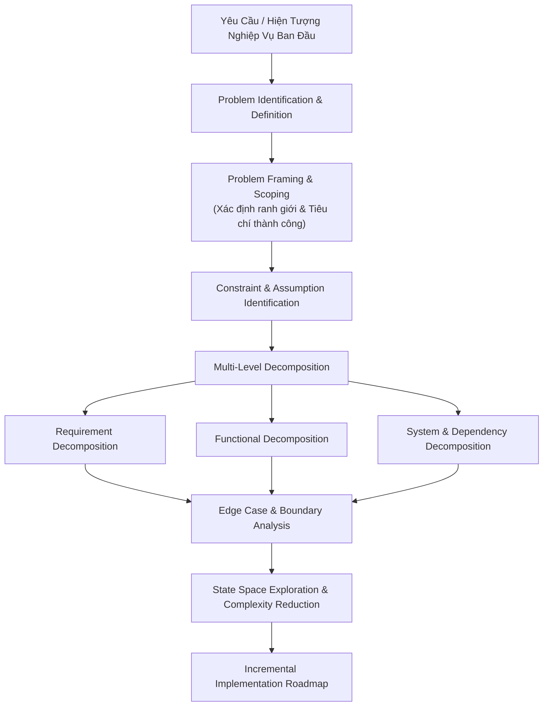
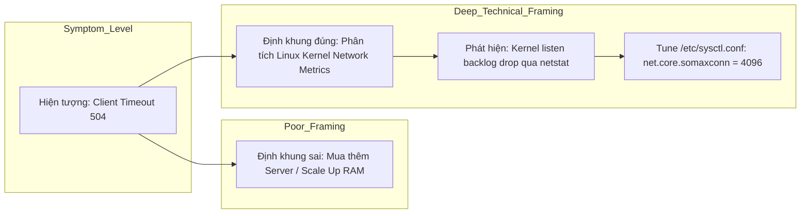
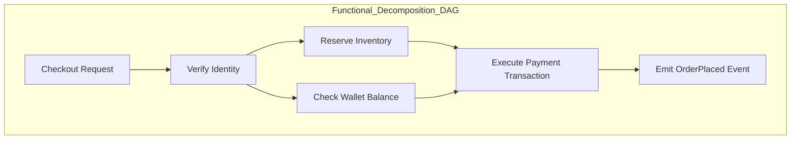
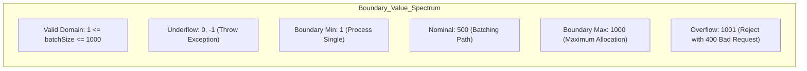
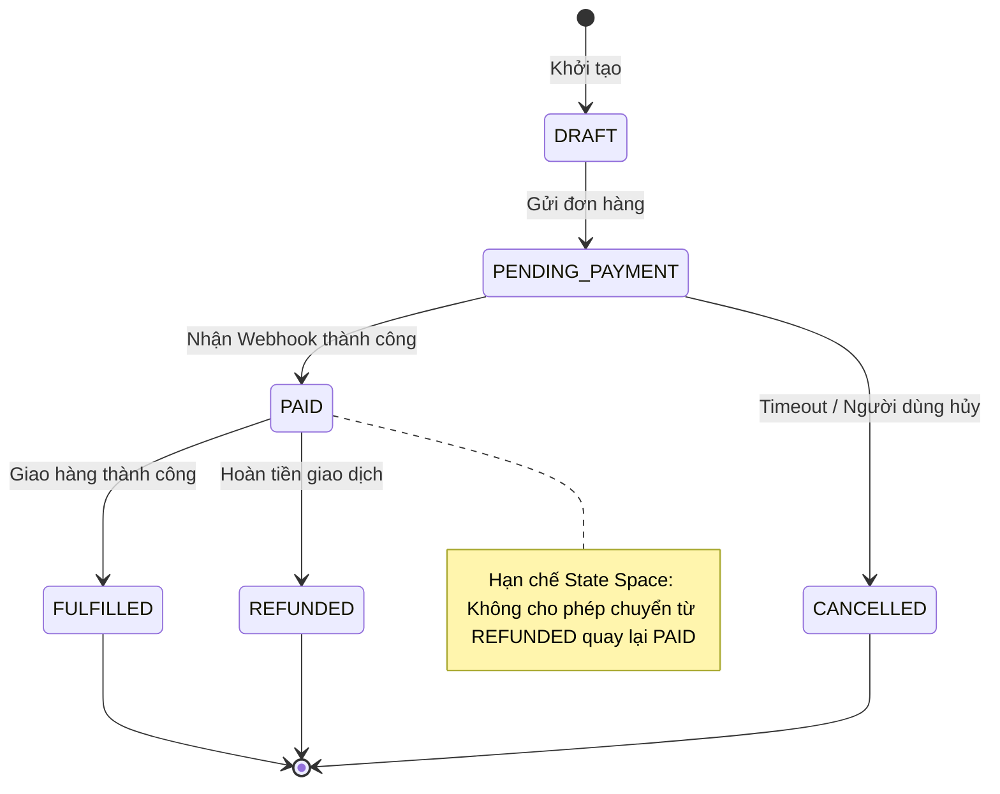

# 2.1. Định Khung Bài Toán và Kỹ Thuật Phân Rã (Problem Framing & Decomposition Techniques)

## Tổng quan về Problem Framing & Decomposition Techniques
Trong kỹ nghệ phần mềm chuyên nghiệp, giải pháp kỹ thuật tốt đến đâu cũng trở nên vô nghĩa nếu giải quyết sai bài toán. **Problem Framing (Định khung bài toán)** và **Problem Decomposition (Phân rã bài toán)** là hai kỹ năng quyết định khả năng kiểm soát độ phức tạp của một hệ thống lớn. Thay vì vội vã lao vào code dựa trên các mô tả mơ hồ, kỹ sư trưởng thành chủ động định nghĩa ranh giới, xác định các ràng buộc cứng, phơi bày các giả định tiềm ẩn, phân tích không gian trạng thái (State Space) và phân rã hệ thống thành các khối độc lập có thể kiểm thử và triển khai tịnh tiến (Incremental Problem Solving).



---

## 2. Chi tiết từng Keyword (Under-the-Hood Deep Dive)

---

### 1. Problem Identification, Definition, Framing & Scoping

#### 1. Khái niệm bản chất (What & Why)
* **Problem Identification (Nhận diện bài toán)**: Khả năng phát hiện vấn đề thực sự ẩn sau các biểu hiện triệu chứng bề mặt. Ví dụ: Khách hàng phàn nàn "Trang web bị đơ", nhưng vấn đề thực sự là database connection pool bị cạn kiệt do slow query.
* **Problem Definition (Định nghĩa bài toán)**: Mô tả bài toán một cách chính xác, định lượng và phi cảm tính: "Độ trễ p99 của API `/checkout` tăng từ $120\text{ ms}$ lên $3.4\text{ s}$ khi lượng request vượt quá 500 RPS".
* **Problem Framing (Định khung bài toán)**: Cách tiếp cận và góc nhìn nhận diện vấn đề. Định khung sai sẽ dẫn đến giải pháp tồi (ví dụ: Định khung "Cần mua server đắt hơn để chịu tải" thay vì định khung "Tại sao thuật toán sắp xếp đang có độ phức tạp $O(N^2)$ trong vòng lặp chính?").
* **Problem Scoping (Xác định phạm vi bài toán)**: Vạch rõ ranh giới tường minh giữa những gì nằm trong phạm vi giải quyết (In-scope) và những gì dứt khoát không giải quyết trong giai đoạn hiện tại (Out-of-scope), ngăn ngừa hiện tượng phình to phạm vi (Scope Creep).

#### 2. Cơ chế hoạt động sâu (Under the hood / Hardcore Internals)
Khi định khung một bài toán hiệu năng mạng backend:
- Nếu định khung: "Băng thông mạng không đủ": Đội ngũ sẽ nâng cấp card mạng NIC từ 10GbE lên 40GbE.
- Nhưng kiểm tra ở tầng nhân Linux kernel qua lệnh:
  ```bash
  ss -s
  netstat -s | grep "listen queue"
  cat /proc/sys/net/core/somaxconn
  ```
- Phát hiện: `TCP listen queue` tràn (backlog drop), kernel đang âm thầm vứt bỏ các gói SYN (`TCP SYN Flooding / ListenDrop`).
- Vấn đề thực chất nằm ở cấu hình kernel socket buffer `somaxconn` và tham số backlog của hàm `listen(int sockfd, int backlog)`, hoàn toàn không liên quan đến băng thông vật lý. Định khung chính xác giúp tiết kiệm hàng chục nghìn USD mua sắm phần cứng.

#### 3. Sơ đồ minh họa (Mermaid Diagram)


#### 4. Code ví dụ thực chiến (C++20: Cấu hình Socket Backlog tường minh ở tầng Kernel)
```cpp
#include <iostream>
#include <sys/socket.h>
#include <netinet/in.h>
#include <unistd.h>
#include <system_error>

// Kỹ thuật Định Nghĩa Phạm Vi & Hiện Thực: Thiết lập TCP Server với Backlog đúng chuẩn
class TcpServerSocket {
private:
    int server_fd_{-1};

public:
    void initialize(int port, int backlogQueueSize) {
        server_fd_ = ::socket(AF_INET, SOCK_STREAM, 0);
        if (server_fd_ < 0) {
            throw std::system_error(errno, std::generic_category(), "Socket creation failed");
        }

        // Kỹ thuật tránh TIME_WAIT socket exhaustion: SO_REUSEADDR
        int opt = 1;
        ::setsockopt(server_fd_, SOL_SOCKET, SO_REUSEADDR, &opt, sizeof(opt));

        sockaddr_in address{};
        address.sin_family = AF_INET;
        address.sin_addr.s_addr = INADDR_ANY;
        address.sin_port = htons(port);

        if (::bind(server_fd_, reinterpret_cast<struct sockaddr*>(&address), sizeof(address)) < 0) {
            throw std::system_error(errno, std::generic_category(), "Bind failed");
        }

        // Định lượng tham số backlog rõ ràng theo Scoping yêu cầu chịu tải
        if (::listen(server_fd_, backlogQueueSize) < 0) {
            throw std::system_error(errno, std::generic_category(), "Listen failed");
        }
        std::cout << "Server lắng nghe trên cổng " << port << " với backlog queue: " << backlogQueueSize << "\n";
    }

    ~TcpServerSocket() {
        if (server_fd_ >= 0) ::close(server_fd_);
    }
};
```

#### 5. Ưu / Nhược điểm, Pitfalls & Anti-patterns
- **Anti-pattern: XY Problem**: Khách hàng hoặc đồng nghiệp yêu cầu giải pháp Y (ví dụ: "Làm thế nào để tăng timeout của Nginx lên 300 giây?") thay vì nói bài toán gốc X ("Dịch vụ xuất báo cáo PDF bị treo quá lâu"). Kỹ sư non trẻ sẽ cắm đầu làm Y, trong khi kỹ sư trưởng thành sẽ điều tra X.

#### 6. Ứng dụng thực tế trong Backend / Systems
- Viết tài liệu **Project Charter** hoặc **One-Pager**: Trước khi gõ code, kỹ sư định nghĩa chính xác: Problem Statement, Target Metrics, In-Scope, Out-of-Scope và Non-Goals.

---

### 2. Multi-Level Decomposition & Dependency Analysis

#### 1. Khái niệm bản chất (What & Why)
* **Problem Decomposition (Phân rã bài toán)**: Chia bài toán tổng quát thành các hợp phần trực giao (orthogonal).
* **Requirement Decomposition (Phân rã yêu cầu)**: Bóc tách các tuyên bố kinh doanh cấp cao thành các năng lực (Capabilities), câu chuyện người dùng (User Stories) và tiêu chí chấp nhận cụ thể (Acceptance Criteria).
* **Functional Decomposition (Phân rã chức năng)**: Chia một chu trình nghiệp vụ thành các hàm hoặc dịch vụ thuần túy không trùng lặp (ví dụ: Tính chiết khấu $\rightarrow$ Kiểm tra tồn kho $\rightarrow$ Tạo giao dịch thanh toán).
* **System Decomposition (Phân rã hệ thống)**: Tách kiến trúc tổng thể thành các subsystem, microservice hoặc module có ranh giới chịu lỗi và mở rộng độc lập.
* **Dependency Analysis (Phân tích phụ thuộc)**: Xây dựng Đồ thị có hướng (Directed Acyclic Graph - DAG) giữa các thành phần để phát hiện vòng lặp phụ thuộc (circular dependency), chuỗi thắt cổ chai đơn điểm (single-threaded bottlenecks) và thứ tự thực thi hợp lệ.

#### 2. Cơ chế hoạt động sâu (Under the hood / Hardcore Internals)
- **Directed Acyclic Graph (DAG) & Topological Sort**:
  Trong một build system (như Bazel, Make) hoặc hệ thống xử lý workflow (Airflow, Temporal), phân rã hệ thống phụ thuộc là bài toán sắp xếp tô-pô trên đồ thị.
  Nếu xuất hiện chu trình ($A \rightarrow B \rightarrow C \rightarrow A$), hệ thống rơi vào trạng thái Deadlock hoặc không thể xác định thứ tự khởi tạo bộ nhớ (Static Initialization Order Fiasco trong C++).
- **Phân rã ở tầng dữ liệu**: Tránh Distributed Transactions (2-Phase Commit có độ trễ cao và giữ lock tài nguyên lâu dài) bằng cách phân rã thành **Saga Pattern** sử dụng Event-Driven Choreography hoặc Orchestration.

#### 3. Sơ đồ minh họa (Mermaid Diagram)


#### 4. Code ví dụ thực chiến (C++20: Topological Sort phát hiện Circular Dependency)
```cpp
#include <iostream>
#include <vector>
#include <queue>
#include <unordered_map>
#include <string>

// Kỹ thuật Dependency Analysis: Kiểm tra tính hợp lệ của đồ thị phụ thuộc giữa các module
class DependencyResolver {
private:
    std::unordered_map<std::string, std::vector<std::string>> adj_;
    std::unordered_map<std::string, int> in_degree_;

public:
    void addDependency(const std::string& from, const std::string& to) {
        // 'from' phải chạy trước 'to'
        adj_[from].push_back(to);
        in_degree_[to]++;
        if (!in_degree_.contains(from)) in_degree_[from] = 0;
    }

    std::vector<std::string> resolveOrder() {
        std::queue<std::string> q;
        for (const auto& [node, deg] : in_degree_) {
            if (deg == 0) q.push(node);
        }

        std::vector<std::string> order;
        while (!q.empty()) {
            std::string u = q.front();
            q.pop();
            order.push_back(u);

            for (const auto& v : adj_[u]) {
                if (--in_degree_[v] == 0) {
                    q.push(v);
                }
            }
        }

        if (order.size() != in_degree_.size()) {
            throw std::runtime_error("Phát hiện Circular Dependency! Không thể phân rã tuần tự.");
        }
        return order;
    }
};
```

#### 5. Ưu / Nhược điểm, Pitfalls & Anti-patterns
- **Anti-pattern: God Service / God Object**: Thất bại trong phân rã chức năng, dồn toàn bộ 50 logic nghiệp vụ khác nhau vào một class hoặc một dịch vụ duy nhất.

#### 6. Ứng dụng thực tế trong Backend / Systems
- **Module Dependency Injection trong Spring Boot / NestJS / Wire**: Tự động giải quyết DAG của các dependency khi dịch vụ khởi động (Bootstrap phase).

---

### 3. Constraint, Assumption, Edge Case & Boundary Analysis

#### 1. Khái niệm bản chất (What & Why)
* **Constraint Identification (Xác định ràng buộc)**: Liệt kê các giới hạn bất di bất dịch của môi trường (RAM tối đa, SLA thời gian phản hồi, luật lưu trữ dữ liệu GDPR).
* **Assumption Identification (Xác định giả định)**: Làm rõ các niềm tin ngầm định: "Giả định rằng đồng hồ hệ thống trên các server không bị trôi quá 50ms" (trong thực tế, NTP drift xảy ra thường xuyên và có thể phá vỡ tính đúng đắn của thuật toán đồng thuận).
* **Edge Case Identification (Xác định ca biên)**: Tìm kiếm các kịch bản ngoại lệ nằm ở điểm giao của không gian dữ liệu: chuỗi rỗng, số âm, payload kích thước cực đại, giao dịch xảy ra đúng nửa đêm ngày nhuận.
* **Failure Case Identification (Xác định ca thất bại)**: Chủ động mô hình hóa các trạng thái sập: "Điều gì xảy ra nếu mạng ngắt kết nối giữa lúc đã trừ tiền ngân hàng nhưng chưa kịp lưu vào database?".
* **Boundary Analysis (Phân tích giá trị biên)**: Kỹ thuật kiểm thử và thiết kế tập trung vào các điểm chuyển đổi trạng thái ($N-1, N, N+1$, giá trị `INT_MAX`, `UINT64_MAX`).

#### 2. Cơ chế hoạt động sâu (Under the hood / Hardcore Internals)
- **Integer Overflow & Arithmetic Boundary**:
  Trong C++, Signed Integer Overflow là **Undefined Behavior (UB)**. Trình biên dịch có quyền giả định UB không bao giờ xảy ra và optimize loại bỏ luôn câu lệnh kiểm tra:
  ```cpp
  // LỖI NGUY HIỂM: Trình biên dịch có thể tối ưu xóa bỏ if này vì giả định x + 1 > x luôn đúng!
  if (x + 1 < x) { /* handle overflow */ }
  ```
  Để an toàn, phải phân tích biên bằng cách kiểm tra trước khi tính toán:
  ```cpp
  if (x > std::numeric_limits<int>::max() - 1) { /* handle */ }
  ```
- **Off-by-one errors trong Paging & Buffer Allocation**: Đọc vượt quá 1 byte trong bộ nhớ đệm gây ra lỗ hổng bảo mật kinh điển (như OpenSSL Heartbleed leak dữ liệu RAM).

#### 3. Sơ đồ minh họa (Mermaid Diagram)


#### 4. Code ví dụ thực chiến (TypeScript: Defensive Boundary Checks & Domain Constraints)
```typescript
class Money {
  private constructor(private readonly amountInCents: bigint) {}

  // Factory method áp dụng Constraint & Boundary Analysis nghiêm ngặt
  public static fromDollars(dollars: number): Money {
    if (!Number.isFinite(dollars)) {
      throw new RangeError("Số tiền phải là số thực hữu hạn (không được là NaN hoặc Infinity)");
    }
    if (dollars < 0) {
      throw new RangeError("Số tiền không được là số âm");
    }

    // Phòng chống lỗi làm tròn dấu phẩy động IEEE 754 (vd: 0.1 + 0.2 !== 0.3)
    const cents = BigInt(Math.round(dollars * 100));
    const MAX_ALLOWED_CENTS = BigInt("100000000000"); // 1 tỷ USD limit

    if (cents > MAX_ALLOWED_CENTS) {
      throw new RangeError("Số tiền vượt quá hạn mức giao dịch tối đa cho phép");
    }

    return new Money(cents);
  }

  public getCents(): bigint {
    return this.amountInCents;
  }
}
```

#### 5. Ưu / Nhược điểm, Pitfalls & Anti-patterns
- **Anti-pattern: Happy Path Bias**: Lập trình viên chỉ kiểm thử trường hợp dữ liệu hoàn hảo, không viết code dự phòng cho các kịch bản mạng ngắt đột ngột, ổ đĩa đầy hoặc database trả về lỗi timeout.

#### 6. Ứng dụng thực tế trong Backend / Systems
- **Rate Limiting**: Thuật toán Token Bucket luôn có biên giới rõ ràng: Dung lượng tối đa của xô (`bucket_capacity`) và tốc độ làm đầy (`refill_rate`).

---

### 4. State Space Analysis, Complexity Reduction & Incremental Problem Solving

#### 1. Khái niệm bản chất (What & Why)
* **State Space Analysis (Phân tích không gian trạng thái)**: Xác định tất cả các tổ hợp trạng thái có thể có của hệ thống ($S = s_1 \times s_2 \times \dots \times s_k$). Nếu không quản lý tốt, số lượng trạng thái sẽ bùng nổ theo cấp số nhân (State Explosion).
* **Complexity Reduction (Giảm thiểu độ phức tạp)**: Kỹ thuật thu hẹp không gian trạng thái bằng cách loại bỏ các trạng thái không thể xảy ra (Make Invalid States Unrepresentable) và chuẩn hóa luồng điều khiển.
* **Incremental Problem Solving (Giải quyết bài toán tịnh tiến)**: Chia nhỏ lộ trình phát triển thành các bước có thể kiểm chứng được, triển khai từng phần nhỏ độc lập (Vertical Slices) thay vì cố gắng hoàn thiện một dự án "Big Bang" sau 12 tháng.

#### 2. Cơ chế hoạt động sâu (Under the hood / Hardcore Internals)
- **Tác động của State Explosion lên Concurrency**:
  Khi 2 luồng truy cập vào 3 biến trạng thái dùng chung mà không có cơ chế khóa hoặc đồng bộ hóa:
  Số lượng kịch bản xen kẽ các chỉ thị CPU (instruction interleavings) là:
  $$\frac{(N \cdot M)!}{(M!)^N}$$
  Điều này làm phát sinh các lỗi tranh chấp dữ liệu (Race Conditions) cực kỳ khó tái hiện (Heisenbugs).
- **Complexity Reduction thông qua Immutability**: Khi dữ liệu là bất biến (Read-only memory pages sau khi khởi tạo), mọi thao tác đọc song song đều thread-safe 100% mà không cần dùng Mutex lock hay Memory Barrier, loại trừ hoàn toàn khả năng xảy ra race condition.

#### 3. Sơ đồ minh họa (Mermaid Diagram)


#### 4. Code ví dụ thực chiến (C++20: State Pattern với `std::variant` loại trừ Invalid State)
```cpp
#include <iostream>
#include <variant>
#include <string>

// Complexity Reduction: Dùng std::variant để gói gọn State Space,
// bảo đảm tại một thời điểm hệ thống CHỈ có thể ở đúng một trạng thái hợp lệ.

struct Draft { std::string draftId; };
struct PendingPayment { std::string invoiceId; double amount; };
struct Paid { std::string transactionHash; };
struct Cancelled { std::string reason; };

using OrderState = std::variant<Draft, PendingPayment, Paid, Cancelled>;

// Biểu diễn chuyển đổi trạng thái (State Transition) rõ ràng
OrderState transitionToPaid(const OrderState& currentState, std::string txHash) {
    if (std::holds_alternative<PendingPayment>(currentState)) {
        std::cout << "Chuyển trạng thái từ PendingPayment sang Paid thành công.\n";
        return Paid{ .transactionHash = std::move(txHash) };
    }
    throw std::logic_error("Lỗi chuyển trạng thái bất hợp lệ! Đơn hàng chưa ở trạng thái PendingPayment.");
}

int main() {
    OrderState order = PendingPayment{ .invoiceId = "INV-9901", .amount = 150.0 };
    order = transitionToPaid(order, "0xabc123456789deadbeef");
    return 0;
}
```

#### 5. Ưu / Nhược điểm, Pitfalls & Anti-patterns
- **Anti-pattern: Boolean Flag Explosion**: Lưu trữ trạng thái bằng 5 cờ boolean độc lập (`isPending`, `isPaid`, `isCancelled`, `isDelivered`, `isRefunded`). Khi đó không gian trạng thái là $2^5 = 32$ tổ hợp, trong đó có vô số trạng thái vô nghĩa như vừa `isPaid = true` vừa `isCancelled = true`.

#### 6. Ứng dụng thực tế trong Backend / Systems
- **Raft / Paxos Consensus Protocol**: Phân tích chặt chẽ không gian trạng thái của từng Node (Leader, Follower, Candidate) và các nhiệm kỳ (Terms) để chứng minh tính nhất quán của dữ liệu phân tán.

---

## Tổng kết Chương 2.1
Định khung và phân rã bài toán là vũ khí mạnh nhất của người kỹ sư phần mềm khi đối mặt với sự phức tạp. Bằng cách định nghĩa bài toán chính xác ở tầng kỹ thuật, chia tách hệ thống theo đồ thị phụ thuộc hợp lý, siết chặt các điều kiện biên và thu hẹp không gian trạng thái, chúng ta biến những thách thức kiến trúc khổng lồ thành các module đơn giản, ổn định và dễ kiểm soát.
