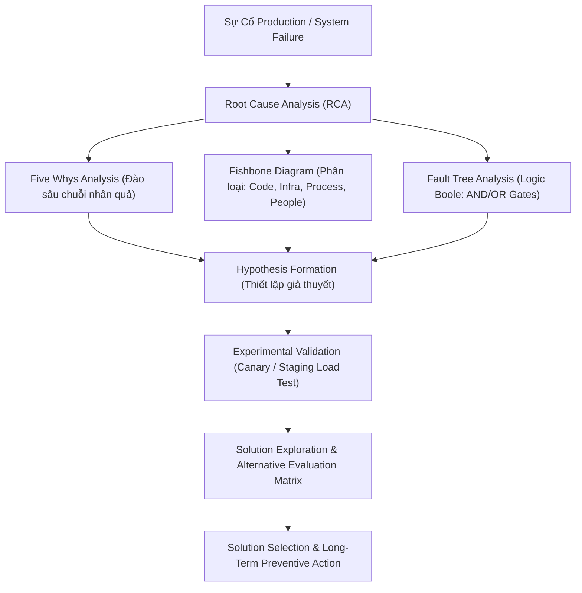
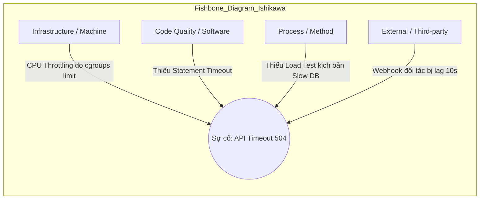
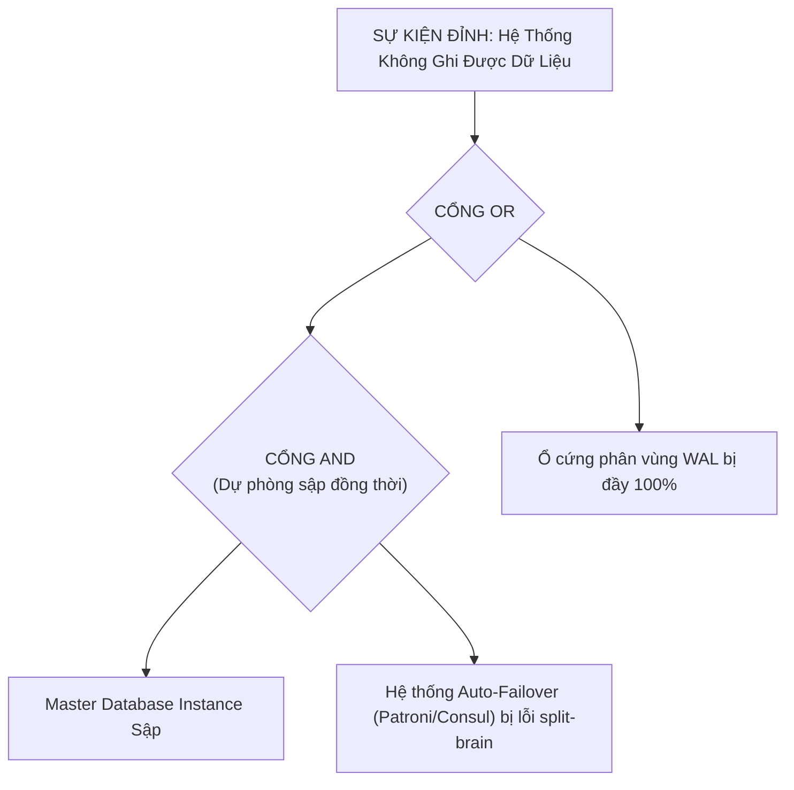
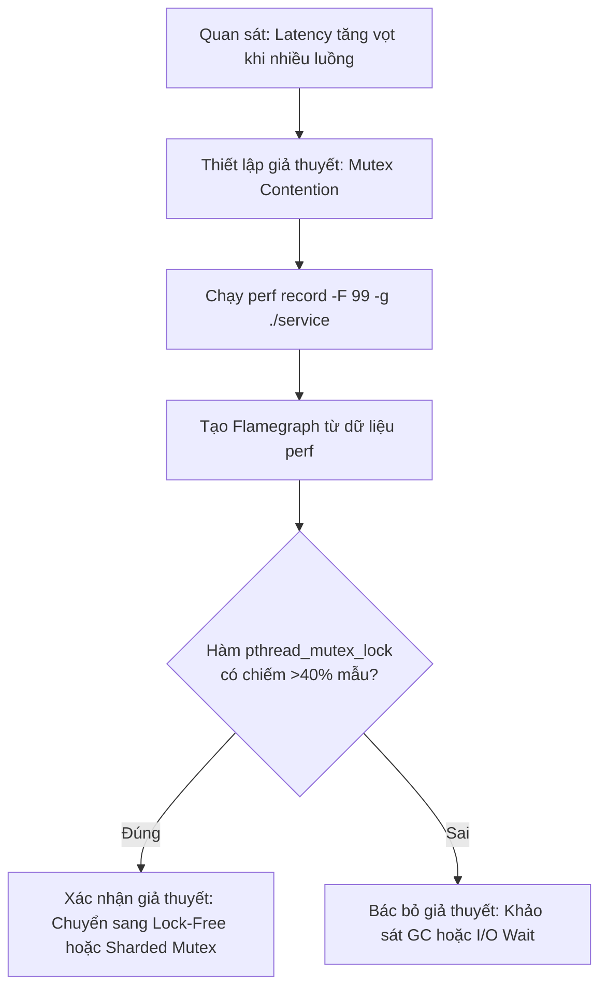
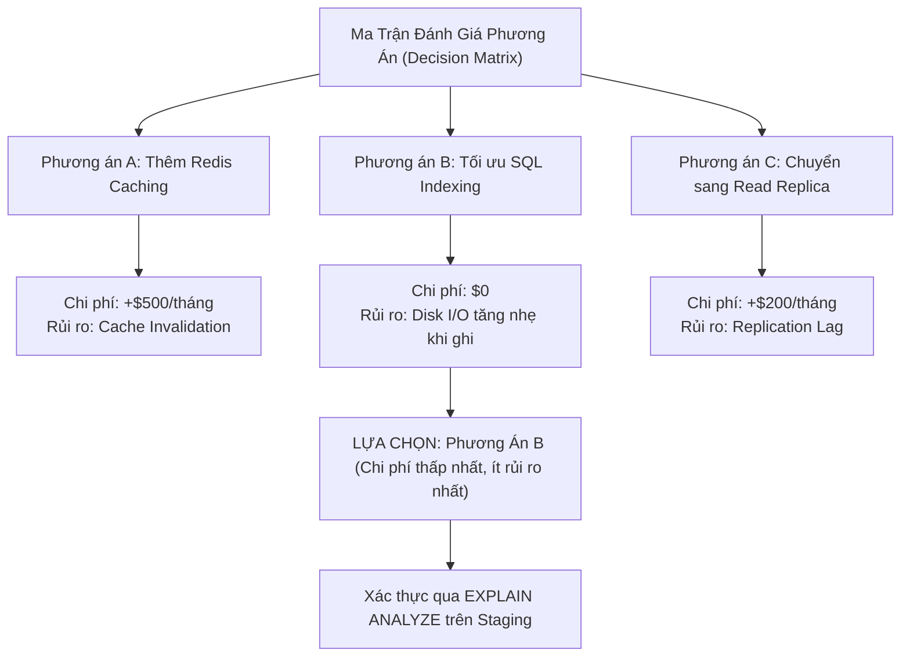

# 2.2. Phân Tích Nguyên Nhân Gốc Rễ và Thực Nghiệm Xác Thực (Root Cause Analysis & Experimental Validation)

## Tổng quan về Root Cause Analysis & Experimental Validation
Khi sự cố xảy ra trong một hệ thống phân tán phức tạp, phản xạ tự nhiên của kỹ sư thiếu kinh nghiệm là "thử khởi động lại dịch vụ" hoặc "thêm log rồi deploy lại". Cách tiếp cận này chỉ chữa phần ngọn và khiến lỗi chắc chắn sẽ lặp lại trong tương lai. Kỹ nghệ chuyên nghiệp đòi hỏi quy trình điều tra có hệ thống: áp dụng **Root Cause Analysis (RCA)**, mô hình **Five Whys**, biểu đồ xương cá **Ishikawa (Fishbone Diagram)**, **Fault Tree Analysis (FTA)**, và **FMEA** để tìm ra khiếm khuyết cơ cấu sâu xa. Đồng thời, kỹ sư xây dựng các giả thuyết khoa học và thực hiện kiểm chứng thực nghiệm trước khi quyết định lựa chọn giải pháp cuối cùng.



---

## 2. Chi tiết từng Keyword (Under-the-Hood Deep Dive)

---

### 1. Root Cause Analysis (RCA), Five Whys & Fishbone Diagram

#### 1. Khái niệm bản chất (What & Why)
* **Root Cause Analysis (RCA - Phân tích nguyên nhân gốc rễ)**: Phương pháp tiếp cận có cấu trúc nhằm xác định yếu tố cốt lõi mà nếu loại bỏ nó, sự cố sẽ không thể tái diễn.
* **Five Whys (Năm câu hỏi tại sao)**: Kỹ thuật đặt câu hỏi lặp đi lặp lại để vượt qua các triệu chứng kỹ thuật bề mặt và chạm tới khiếm khuyết trong thiết kế hệ thống hoặc quy trình phát triển.
* **Fishbone Diagram (Biểu đồ xương cá / Ishikawa)**: Công cụ trực quan hóa giúp phân loại các nguyên nhân tiềm ẩn thành các nhóm chủ chốt: Machine (Hạ tầng, Máy chủ), Method (Quy trình CI/CD, Kiến trúc), Material (Dữ liệu đầu vào, Thư viện bên thứ ba), và Manpower (Con người, Đào tạo, Trực on-call).

#### 2. Cơ chế hoạt động sâu (Under the hood / Hardcore Internals)
Ví dụ thực tế về một chuỗi **Five Whys** trong sự cố Backend sập:
1. *Tại sao API Gateway trả về HTTP 502 Bad Gateway?* $\rightarrow$ Vì microservice Orders không phản hồi TCP request.
2. *Tại sao microservice Orders không phản hồi?* $\rightarrow$ Vì toàn bộ luồng worker trong Thread Pool bị treo ở trạng thái `WAITING`.
3. *Tại sao thread pool bị treo?* $\rightarrow$ Vì connection pool tới PostgreSQL bị cạn kiệt (Zero available connections).
4. *Tại sao connection pool bị cạn kiệt?* $\rightarrow$ Vì một transaction thực hiện `SELECT ... FOR UPDATE` mà không có câu lệnh `COMMIT` hoặc `ROLLBACK` khi gặp lỗi parse JSON.
5. *Tại sao transaction bị bỏ lửng mà không timeout?* $\rightarrow$ Vì service sử dụng cấu hình mặc định: Không thiết lập `statement_timeout` và `idle_in_transaction_session_timeout` trên database driver.
$\Rightarrow$ **Root Cause**: Thiếu quy chuẩn thiết lập timeout bắt buộc cho database client connections.

#### 3. Sơ đồ minh họa (Mermaid Diagram)


#### 4. Code ví dụ thực chiến (TypeScript: Cấu hình Connection Pool & Statement Timeout an toàn)
```typescript
import { Pool, PoolConfig } from 'pg';

// Hiện thực RCA Action Item: Đảm bảo không bao giờ để transaction treo vĩnh viễn (Leak)
const robustPoolConfig: PoolConfig = {
  host: process.env.DB_HOST,
  port: 5432,
  user: process.env.DB_USER,
  password: process.env.DB_PASSWORD,
  database: 'production_orders',
  
  // 1. Quản lý Connection Boundary
  max: 20, // Số connection tối đa
  idleTimeoutMillis: 30000,
  connectionTimeoutMillis: 2000, // Timeout khi mượn connection thất bại
  
  // 2. Chặn đứng Root Cause bằng cách ép buộc cấu hình Timeout ở tầng Session
  // statement_timeout: Ngắt truy vấn chạy quá 3 giây
  // idle_in_transaction_session_timeout: Ngắt kết nối mở transaction rồi "ngủ quên" quá 5 giây
  statement_timeout: 3000,
  query_timeout: 3000,
};

export const dbPool = new Pool(robustPoolConfig);

dbPool.on('connect', (client) => {
  client.query('SET idle_in_transaction_session_timeout = 5000');
});
```

#### 5. Ưu / Nhược điểm, Pitfalls & Anti-patterns
- **Anti-pattern: Stopping at Human Error ("Do lập trình viên sơ suất")**: Đổ lỗi cho cá nhân là dấu hiệu của sự thiếu trưởng thành kỹ thuật. Hệ thống tốt phải có cơ chế guardrails, linter và compiler ngăn chặn con người mắc lỗi ngớ ngẩn.

#### 6. Ứng dụng thực tế trong Backend / Systems
- Viết tài liệu **Postmortem không đổ lỗi (Blameless Postmortem)** tại Google/Meta sau mỗi sự cố Severity-1 (SEV-1).

---

### 2. Fault Tree Analysis (FTA) & Failure Mode and Effects Analysis (FMEA)

#### 1. Khái niệm bản chất (What & Why)
* **Fault Tree Analysis (FTA - Phân tích cây lỗi)**: Phương pháp diễn dịch từ trên xuống (top-down) sử dụng đại số Boole (các cổng logic AND, OR) để mô hình hóa xác suất sự cố cấp cao nhất bắt nguồn từ các lỗi linh kiện phần cứng hoặc lỗi module phần mềm.
* **Failure Mode and Effects Analysis (FMEA - Phân tích hình thái sai hỏng và ảnh hưởng)**: Phương pháp phân tích từ dưới lên (bottom-up), chủ động liệt kê mọi thành phần trong hệ thống, đánh giá cách nó có thể bị hỏng và xếp hạng rủi ro dựa trên chỉ số **RPN (Risk Priority Number)**:
  $$\text{RPN} = \text{Severity (Mức nghiêm trọng)} \times \text{Occurrence (Xác suất xảy ra)} \times \text{Detection (Khả năng phát hiện)}$$

#### 2. Cơ chế hoạt động sâu (Under the hood / Hardcore Internals)
- **Cổng Logic trong FTA**:
  - **Cổng OR**: Sự kiện đỉnh xảy ra nếu *chỉ cần một* trong các sự kiện con xảy ra (ví dụ: Service sập nếu RAM hết HOẶC Disk đầy).
  - **Cổng AND**: Sự kiện đỉnh chỉ xảy ra khi *đồng thời toàn bộ* các cơ chế dự phòng đều sập (ví dụ: Mất dữ liệu chỉ xảy ra khi Primary Node sập VÀ Standby Node bị lag replication chưa kịp sync).
  - Kỹ sư trưởng thành sử dụng kiến trúc cổng AND để triệt tiêu các điểm chết đơn lẻ (Single Point of Failure - SPOF).

#### 3. Sơ đồ minh họa (Mermaid Diagram)


#### 4. Code ví dụ thực chiến (C++20: FMEA Framework tính toán Risk Priority Number)
```cpp
#include <iostream>
#include <string>
#include <vector>
#include <algorithm>

struct FailureMode {
    std::string component;
    std::string failureEffect;
    int severity;   // Thang điểm 1 (Thấp) -> 10 (Nghiêm trọng - Mất dữ liệu)
    int occurrence; // Thang điểm 1 (Hiếm gặp) -> 10 (Xảy ra liên tục)
    int detection;  // Thang điểm 1 (Dễ phát hiện/Có Alert) -> 10 (Chạy ngầm không ai biết)

    int calculateRPN() const noexcept {
        return severity * occurrence * detection;
    }
};

int main() {
    std::vector<FailureMode> fmeaSheet = {
        {"Redis Cache", "Cache Invalidation lỗi trả về stale data", 6, 5, 4},
        {"Primary DB", "Cạn kiệt Disk Space cho WAL logs", 10, 3, 2},
        {"Payment Gateway", "Third-party API lag không có circuit breaker", 9, 7, 3}
    };

    // Sắp xếp ưu tiên xử lý các rủi ro kỹ thuật có chỉ số RPN cao nhất
    std::sort(fmeaSheet.begin(), fmeaSheet.end(), [](const auto& a, const auto& b) {
        return a.calculateRPN() > b.calculateRPN();
    });

    std::cout << "=== BẢNG XẾP HẠNG RỦI RO KỸ THUẬT (FMEA RPN) ===\n";
    for (const auto& item : fmeaSheet) {
        std::cout << "Thành phần: " << item.component 
                  << " | RPN: " << item.calculateRPN() 
                  << " | Hậu quả: " << item.failureEffect << "\n";
    }
    return 0;
}
```

#### 5. Ưu / Nhược điểm, Pitfalls & Anti-patterns
- **Ưu điểm**: Biến các lo ngại mơ hồ thành số liệu định lượng để thuyết phục ban quản trị cấp kinh phí nâng cấp hạ tầng.
- **Pitfalls**: Lạm dụng giấy tờ hành chính FMEA quá chi tiết cho các dự án prototype giai đoạn đầu.

#### 6. Ứng dụng thực tế trong Backend / Systems
- **Thiết kế hệ thống thanh toán**: Áp dụng FMEA để chứng minh rằng ngay cả khi mạng viễn thông chập chờn, tiền của khách hàng vẫn được bảo vệ nhờ cơ chế Idempotency Key và Reconciliation Job.

---

### 3. Hypothesis Formation, Validation & Experimental Problem Solving

#### 1. Khái niệm bản chất (What & Why)
* **Hypothesis Formation (Thiết lập giả thuyết)**: Chuyển đổi nghi vấn thành một mệnh đề có thể kiểm chứng hoặc bác bỏ (falsifiable statement): "Giả thuyết: Thread contention trên `std::mutex` tại hàm `recordStat()` là nguyên nhân khiến CPU sử dụng chỉ đạt 25% nhưng latency p99 lại tăng gấp 4 lần".
* **Hypothesis Validation (Xác thực giả thuyết)**: Thiết kế các thử nghiệm có kiểm soát (controlled experiments) để đo đạc và chứng minh giả thuyết bằng công cụ chuẩn (Flamegraph, eBPF, perf).
* **Experimental Problem Solving (Giải quyết vấn đề bằng thực nghiệm)**: Không đoán mò, biến quá trình gỡ lỗi thành phương pháp khoa học: Quan sát $\rightarrow$ Giả thuyết $\rightarrow$ Thực nghiệm $\rightarrow$ Kết luận.

#### 2. Cơ chế hoạt động sâu (Under the hood / Hardcore Internals)
- **Linux eBPF (Extended Berkeley Packet Filter) & Profiling**:
  Thay vì đưa hàng trăm câu lệnh `printf` vào mã nguồn gây sai lệch thời gian thực thi (Probe Effect), kỹ sư dùng eBPF trace trực tiếp vào kernel functions hoặc usermode markers:
  ```bash
  # Đo thời gian chờ mutex lock mà không cần sửa đổi mã nguồn nhị phân
  bpftrace -e 'uprobe:/path/to/binary:pthread_mutex_lock { @start[tid] = nsecs; } 
               uretprobe:/path/to/binary:pthread_mutex_lock /@start[tid]/ { 
                 @wait_time = hist(nsecs - @start[tid]); delete(@start[tid]); }'
  ```
  Nếu biểu đồ histogram chỉ ra độ trễ tập trung ở dải mili-giây, giả thuyết về Mutex Contention được chứng minh 100%.

#### 3. Sơ đồ minh họa (Mermaid Diagram)


#### 4. Code ví dụ thực chiến (C++20: So sánh Thực nghiệm Mutex vs Lock-Free Atomic Ring Buffer)
```cpp
#include <iostream>
#include <atomic>
#include <chrono>
#include <vector>
#include <thread>

// Thực nghiệm kiểm chứng: Đo đạc chi phí contention của Atomic vs Mutex
constexpr int64_t ITERATIONS = 10'000'000;
std::atomic<int64_t> atomic_counter{0};

void workerAtomic() {
    for (int64_t i = 0; i < ITERATIONS; ++i) {
        atomic_counter.fetch_add(1, std::memory_order_relaxed);
    }
}

int main() {
    auto start = std::chrono::high_resolution_clock::now();
    std::thread t1(workerAtomic);
    std::thread t2(workerAtomic);
    t1.join();
    t2.join();
    auto end = std::chrono::high_resolution_clock::now();

    auto durationMs = std::chrono::duration_cast<std::chrono::milliseconds>(end - start).count();
    std::cout << "Thực nghiệm chứng minh Atomic Counter hoàn tất trong: " << durationMs << " ms\n";
    return 0;
}
```

#### 5. Ưu / Nhược điểm, Pitfalls & Anti-patterns
- **Anti-pattern: Confirmation Bias (Thiên kiến xác nhận)**: Chỉ tìm kiếm các metric ủng hộ giả thuyết yêu thích của mình và phớt lờ các số liệu mâu thuẫn.

#### 6. Ứng dụng thực tế trong Backend / Systems
- **A/B Testing & Micro-benchmarking**: Sử dụng Google Benchmark để chứng minh rằng một thuật toán nén mới thực sự làm giảm băng thông truyền tải mà không ngốn thêm quá 5% CPU.

---

### 4. Solution Exploration, Alternative Evaluation, Selection & Validation

#### 1. Khái niệm bản chất (What & Why)
* **Solution Exploration (Thăm dò giải pháp)**: Không dừng lại ở ý tưởng đầu tiên nảy ra trong đầu; chủ động tìm kiếm ít nhất 3 phương án kiến trúc khác nhau (ví dụ: Giải pháp A: Cache tại client; Giải pháp B: Scale database read replica; Giải pháp C: Đổi data structure sang LSM-Tree).
* **Alternative Evaluation (Đánh giá phương án thay thế)**: Lập ma trận so sánh các phương án dựa trên các tiêu chí kỹ thuật và kinh doanh rõ ràng: Độ phức tạp cài đặt, độ trễ, chi phí hạ tầng, rủi ro tương thích ngược.
* **Solution Selection (Lựa chọn giải pháp)**: Ra quyết định chọn phương án tối ưu dựa trên ma trận đánh đổi, kèm theo tài liệu giải trình (Rationale).
* **Solution Validation (Xác thực giải pháp)**: Kiểm chứng giải pháp trong môi trường thử nghiệm (Staging load test, Chaos injection) và triển khai Canary trên production trước khi rollout 100%.

#### 2. Cơ chế hoạt động sâu (Under the hood / Hardcore Internals)
- **Đánh giá Phương án Sharding Database**:
  - *Phương án 1 (Application-Level Sharding)*: Ứng dụng tự hash ID người dùng để định tuyến sang DB1 hoặc DB2. Ưu điểm: Hiệu năng cao, không tốn proxy trung gian. Nhược điểm: Logic code phức tạp, khó re-sharding.
  - *Phương án 2 (Proxy-Based Sharding - Vitess / Citus)*: Có tầng proxy ở giữa định tuyến. Ưu điểm: Ứng dụng coi như 1 database duy nhất. Nhược điểm: Tốn thêm 1 network hop ($0.3-0.8\text{ ms}$ latency), thêm chi phí vận hành cụm proxy.
  - Kỹ sư lựa chọn dựa trên quy mô dữ liệu và năng lực vận hành của đội ngũ.

#### 3. Sơ đồ minh họa (Mermaid Diagram)


#### 4. Code ví dụ thực chiến (TypeScript: Ma Trận Đánh Giá Phương Án Kỹ Thuật Bằng Code)
```typescript
interface SolutionOption {
  name: string;
  implementationCostDays: number;
  runtimeLatencyMs: number;
  monthlyInfraCostUsd: number;
  complexityScore: number; // 1 (Đơn giản) -> 10 (Rất phức tạp)
}

function evaluateBestOption(options: SolutionOption[]): SolutionOption {
  // Hàm mục tiêu: Trọng số cân nhắc theo ngữ cảnh công ty giai đoạn hiện tại
  // Ưu tiên Latency thấp và Độ phức tạp thấp
  const calculateScore = (opt: SolutionOption) => {
    return (
      opt.runtimeLatencyMs * 0.4 +
      opt.complexityScore * 15 * 0.3 +
      opt.implementationCostDays * 10 * 0.2 +
      (opt.monthlyInfraCostUsd / 100) * 0.1
    );
  };

  return options.reduce((best, current) => 
    calculateScore(current) < calculateScore(best) ? current : best
  );
}

const candidates: SolutionOption[] = [
  { name: 'Redis Cache Layer', implementationCostDays: 5, runtimeLatencyMs: 2, monthlyInfraCostUsd: 400, complexityScore: 6 },
  { name: 'Postgres Partial Indexing', implementationCostDays: 1, runtimeLatencyMs: 8, monthlyInfraCostUsd: 0, complexityScore: 2 },
  { name: 'Kafka Async Materialized View', implementationCostDays: 14, runtimeLatencyMs: 1, monthlyInfraCostUsd: 1200, complexityScore: 9 }
];

const selected = evaluateBestOption(candidates);
console.log(`Giải pháp tối ưu được chọn dựa trên ma trận kỹ thuật: ${selected.name}`);
```

#### 5. Ưu / Nhược điểm, Pitfalls & Anti-patterns
- **Anti-pattern: Single Option Bias**: Chỉ trình bày một phương án duy nhất lên Tech Lead / ban giám đốc và khẳng định "đây là cách duy nhất". Kỹ sư chuyên nghiệp luôn mang lại sự lựa chọn kèm ma trận đánh đổi.

#### 6. Ứng dụng thực tế trong Backend / Systems
- **Tài liệu RFC (Request for Comments)**: Luôn bắt buộc có mục "Alternatives Considered" nêu rõ lý do tại sao các phương án khác bị từ chối.

---

## Tổng kết Chương 2.2
Sự cố là cơ hội học hỏi lớn nhất của một tổ chức kỹ thuật nếu được tiếp cận bằng tinh thần khoa học. Bằng việc làm chủ các công cụ phân tích nguyên nhân gốc rễ (5 Whys, Ishikawa, FTA, FMEA), kiểm chứng giả thuyết bằng dữ liệu thực nghiệm thay vì phỏng đoán, và so sánh các phương án trên một ma trận đánh đổi đa chiều, người kỹ sư bảo đảm hệ thống ngày càng trở nên bền vững trước mọi biến cố.
