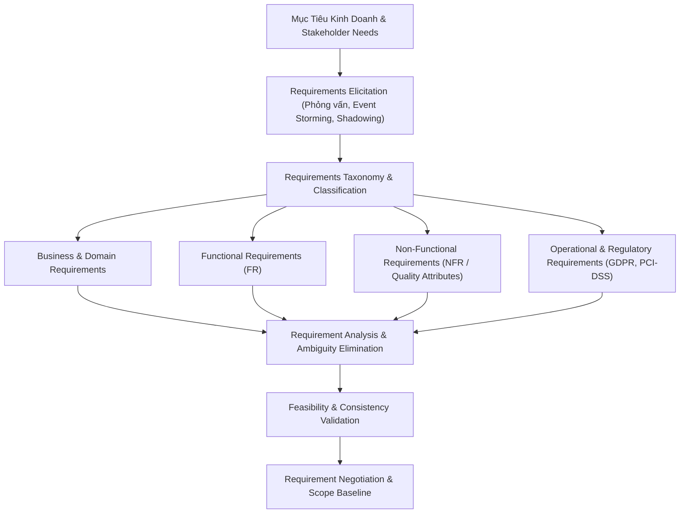
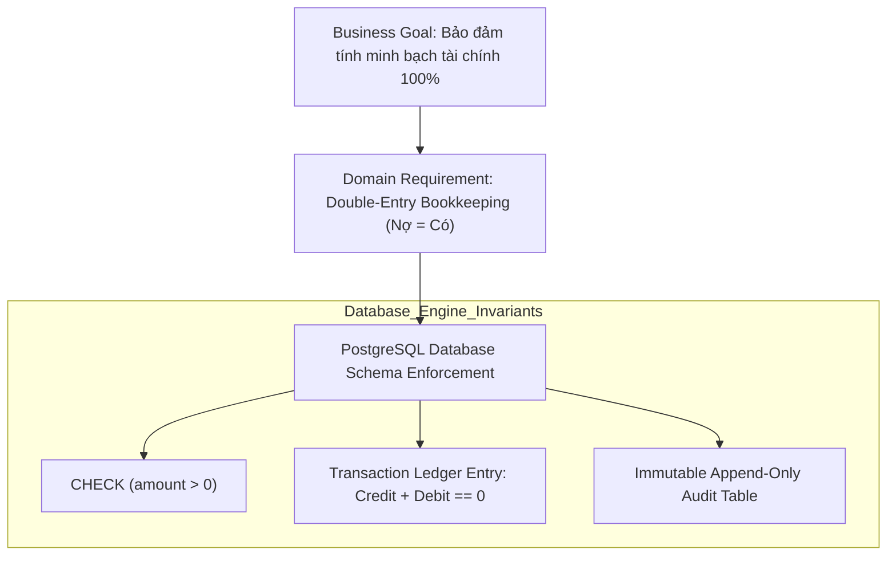
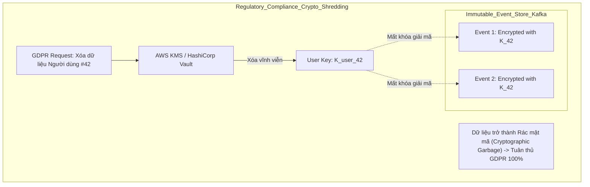
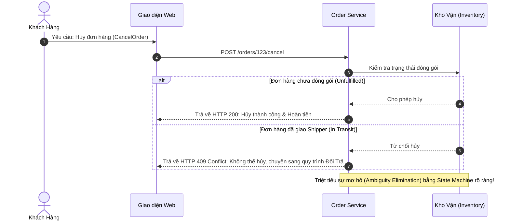
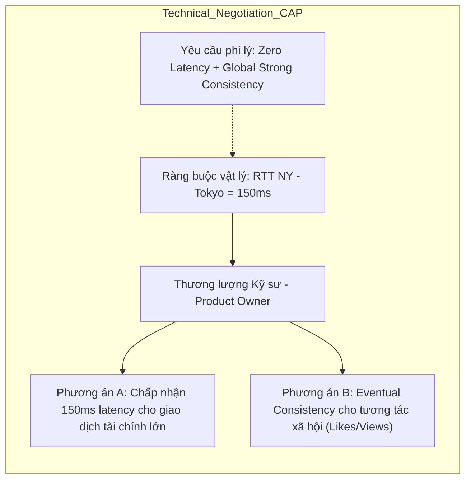

# 3.1. Phân Loại và Khơi Gợi Yêu Cầu Kỹ Nghệ (Requirements Taxonomy & Elicitation)

## Tổng quan về Requirements Taxonomy & Elicitation
Trong vòng đời phát triển phần mềm, chi phí sửa một lỗi phát sinh từ khâu phân tích yêu cầu khi đã lên production cao gấp 50 đến 200 lần so với khi phát hiện ở giai đoạn thiết kế. **Requirements Engineering (Kỹ nghệ yêu cầu)** là chiếc cầu nối giữa mục tiêu kinh doanh trừu tượng của các bên liên quan (stakeholders) và hiện thực kiến trúc phần mềm thực tế. Thay vì thụ động nhận yêu cầu, kỹ sư trưởng thành chủ động phân loại đa chiều (Business, User, Functional, Non-Functional, Operational, Regulatory), khơi gợi các nhu cầu tiềm ẩn (Elicitation), triệt tiêu sự mơ hồ (Ambiguity), và thương lượng kỹ thuật (Negotiation) để đảm bảo tính khả thi và nhất quán của hệ thống.



---

## 2. Chi tiết từng Keyword (Under-the-Hood Deep Dive)

---

### 1. Requirements Taxonomy: Business, Stakeholder, User & Domain Requirements

#### 1. Khái niệm bản chất (What & Why)
* **Requirements Engineering (Kỹ nghệ yêu cầu)**: Ngành khoa học có cấu trúc bao gồm các quy trình khơi gợi, phân tích, đặc tả, xác minh và quản lý các yêu cầu của hệ thống phần mềm.
* **Business Requirements (Yêu cầu kinh doanh)**: Mục tiêu cấp cao của doanh nghiệp (ví dụ: "Tăng tỷ lệ chuyển đổi giỏ hàng thêm 15%", "Giảm chi phí vận hành kho vận 20%").
* **Stakeholder Requirements (Yêu cầu của các bên liên quan)**: Nhu cầu của các đối tượng cụ thể tác động hoặc bị tác động bởi hệ thống: Ban giám đốc, Đội ngũ pháp lý, Kế toán, Đội Chăm sóc khách hàng.
* **User Requirements (Yêu cầu người dùng)**: Mong muốn và tác vụ mà người dùng cuối muốn thực hiện thông qua hệ thống phần mềm dưới góc nhìn đời thường.
* **Domain Requirements (Yêu cầu nghiệp vụ ngành)**: Các quy tắc cơ bản bắt nguồn từ đặc thù của ngành kinh doanh đó mà phần mềm bắt buộc phải tuân theo (ví dụ: Trong ngành ngân hàng, sổ cái kế toán phải luôn cân bằng hai vế Nợ/Có theo nguyên lý Double-entry Bookkeeping).

#### 2. Cơ chế hoạt động sâu (Under the hood / Hardcore Internals)
- **Domain Invariants trong kiến trúc Database**:
  Yêu cầu Domain không chỉ tồn tại trên giấy mà phải được áp đặt thành các bất biến vật lý trong Database Schema bằng cách sử dụng các ràng buộc (Constraints):
  - `CHECK constraint`: Ngăn chặn số dư tài khoản âm (`balance >= 0`).
  - `FOREIGN KEY với ON DELETE RESTRICT`: Bảo vệ tính toàn vẹn tham chiếu của các giao dịch lịch sử.
  - `EXCLUDE constraint trong PostgreSQL`: Ngăn chặn việc trùng lặp đặt phòng trong cùng một khoảng thời gian (Temporal Overlap).

#### 3. Sơ đồ minh họa (Mermaid Diagram)


#### 4. Code ví dụ thực chiến (C++20: Mô hình hóa Bất Biến Domain trong Kế Toán Kép)
```cpp
#include <iostream>
#include <vector>
#include <numeric>
#include <stdexcept>
#include <string>

// Domain Requirement: Giao dịch kế toán kép bắt buộc tổng Nợ (Debit) và Có (Credit) phải cân bằng tuyệt đối
struct LedgerEntry {
    std::string accountId;
    int64_t amountInCents; // Dương: Debit, Âm: Credit
};

class AccountingTransaction {
private:
    std::string transactionId_;
    std::vector<LedgerEntry> entries_;

public:
    explicit AccountingTransaction(std::string txId) : transactionId_(std::move(txId)) {}

    void addEntry(std::string accountId, int64_t amountInCents) {
        entries_.push_back({std::move(accountId), amountInCents});
    }

    // Xác thực bất biến Domain trước khi commit vào Storage
    void validateInvariants() const {
        if (entries_.empty()) {
            throw std::domain_error("Giao dịch kế toán không được phép rỗng.");
        }

        int64_t sum = std::accumulate(entries_.begin(), entries_.end(), int64_t{0},
            [](int64_t acc, const LedgerEntry& entry) {
                return acc + entry.amountInCents;
            });

        if (sum != 0) {
            throw std::domain_error("Vi phạm Domain Invariant: Tổng Debit và Credit không cân bằng (Sum != 0)!");
        }
    }
};

int main() {
    try {
        AccountingTransaction tx("TX-8801");
        tx.addEntry("Cash_Account", 5000);   // +$50.00
        tx.addEntry("Revenue_Account", -5000); // -$50.00
        tx.validateInvariants();
        std::cout << "Giao dịch hợp lệ, thỏa mãn Domain Invariants.\n";
    } catch (const std::exception& e) {
        std::cerr << "Lỗi nghiệp vụ: " << e.what() << "\n";
    }
    return 0;
}
```

#### 5. Ưu / Nhược điểm, Pitfalls & Anti-patterns
- **Anti-pattern: Anemic Domain Model (Mô hình miền thiếu máu)**: Để các thực thể chỉ là các túi chứa dữ liệu (getter/setter) và đẩy toàn bộ logic kiểm tra bất biến ra các Service phân tán, dẫn đến việc vi phạm quy tắc kế toán khi có service mới được viết thêm.

#### 6. Ứng dụng thực tế trong Backend / Systems
- **Core Banking Systems**: Hệ thống lưu trữ sổ cái tài chính của các ngân hàng lớn (Finacle, Temenos) luôn áp đặt Domain Requirements ở tầng thấp nhất của hệ thống.

---

### 2. Functional vs Non-Functional, System, Technical, Operational & Regulatory Requirements

#### 1. Khái niệm bản chất (What & Why)
* **Functional Requirements (FR - Yêu cầu chức năng)**: Mô tả *hệ thống phải làm gì* (hành vi, tính toán, biến đổi dữ liệu, xuất báo cáo).
* **Non-Functional Requirements (NFR - Yêu cầu phi chức năng / Quality Attributes)**: Mô tả *hệ thống hoạt động tốt như thế nào* dưới các tiêu chí chất lượng: Độ trễ (Latency), Băng thông (Throughput), Tính sẵn sàng (Availability), Khả năng mở rộng (Scalability), Bảo mật (Security).
* **System Requirements (Yêu cầu hệ thống)**: Các yêu cầu tổng hợp ở cấp độ toàn bộ hệ thống bao gồm cả phần mềm, phần cứng, mạng và con người vận hành.
* **Technical Requirements (Yêu cầu kỹ thuật)**: Ràng buộc cụ thể về mặt công nghệ (ví dụ: "Phải chạy trên Kubernetes 1.28+, Linux Kernel 5.15 LTS, hỗ trợ giao thức HTTP/2 và gRPC").
* **Operational Requirements (Yêu cầu vận hành)**: Tiêu chuẩn về việc triển khai, sao lưu dự phòng (Backup/Restore RPO/RTO), giám sát log và tính khả trì khi chạy trên production.
* **Regulatory Requirements (Yêu cầu pháp lý & tuân thủ)**: Các quy định bắt buộc của pháp luật hoặc ngành: GDPR (Quyền được xóa dữ liệu cá nhân), HIPAA (Bảo vệ thông tin y tế), PCI-DSS (Bảo vệ thẻ tín dụng).

#### 2. Cơ chế hoạt động sâu (Under the hood / Hardcore Internals)
- **Biến Regulatory Requirements thành Kỹ Thuật (GDPR "Right to be Forgotten")**:
  - Không thể đơn thuần chạy lệnh `DELETE FROM users WHERE id = ?` trên hệ thống Event-Sourcing hoặc Kafka cluster vì Kafka log là **Immutable Append-Only** trên ổ đĩa.
  - **Kỹ thuật Crypto-Shredding (Hủy khóa mã hóa)**: Mỗi người dùng có một khóa mã hóa dữ liệu riêng biệt ($K_{user}$) được lưu trữ trong Key Management Service (KMS). Dữ liệu PII của người dùng ghi vào Kafka/Database đều được mã hóa bằng $K_{user}$.
  - Khi có yêu cầu xóa theo GDPR: Chỉ cần xóa khóa $K_{user}$ khỏi KMS $\rightarrow$ Toàn bộ dữ liệu của người dùng trong các phân vùng Kafka lịch sử lập tức trở thành chuỗi byte ngẫu nhiên không thể giải mã, thỏa mãn chuẩn pháp lý mà không cần phá vỡ tính bất biến của append-only log.

#### 3. Sơ đồ minh họa (Mermaid Diagram)


#### 4. Code ví dụ thực chiến (TypeScript: Mô hình hóa NFR Service Level Indicators)
```typescript
// NFR Quantification: Biến yêu cầu phi chức năng thành các ràng buộc có thể giám sát bằng code
interface ServiceLevelIndicator {
  name: string;
  targetP99LatencyMs: number;
  minAvailabilityPercentage: number;
}

const checkoutSLI: ServiceLevelIndicator = {
  name: "CheckoutService_OrderPlacement",
  targetP99LatencyMs: 250,        // NFR: p99 latency < 250ms
  minAvailabilityPercentage: 99.95 // NFR: 99.95% Availability (Tối đa 21.6 phút downtime/tháng)
};

class LatencyWatchdog {
  private samples: number[] = [];

  recordDuration(ms: number) {
    this.samples.push(ms);
  }

  isSLIViolated(sli: ServiceLevelIndicator): boolean {
    if (this.samples.length === 0) return false;
    const sorted = [...this.samples].sort((a, b) => a - b);
    const p99Index = Math.floor(sorted.length * 0.99);
    const actualP99 = sorted[p99Index];

    const violated = actualP99 > sli.targetP99LatencyMs;
    if (violated) {
      console.warn(`[ALERT NFR VIOLATION] Dịch vụ ${sli.name} có p99 = ${actualP99}ms (Vượt ngưỡng ${sli.targetP99LatencyMs}ms)`);
    }
    return violated;
  }
}
```

#### 5. Ưu / Nhược điểm, Pitfalls & Anti-patterns
- **Anti-pattern: "Mơ hồ hóa NFR"**: Khách hàng ghi yêu cầu "Hệ thống phải chạy nhanh và an toàn". Đây là yêu cầu vô giá trị vì không thể kiểm thử. Kỹ sư phải bắt buộc lượng hóa: "p99 latency < 200ms tại 1000 RPS, mã hóa TLS 1.3 và đạt chứng chỉ SOC2".

#### 6. Ứng dụng thực tế trong Backend / Systems
- **Thiết kế hệ thống FinTech**: Bắt buộc phải thỏa mãn chuẩn **PCI-DSS Level 1**: Dữ liệu thẻ CVV không bao giờ được phép lưu xuống ổ đĩa, ngay cả trong log debug của ứng dụng.

---

### 3. Requirement Elicitation, Analysis, Ambiguity, Completeness & Consistency

#### 1. Khái niệm bản chất (What & Why)
* **Requirement Elicitation (Khơi gợi yêu cầu)**: Kỹ thuật khai thác nhu cầu thực tế của khách hàng thông qua phỏng vấn chuyên sâu, Event Storming workshops, phân tích luồng công việc hiện tại (Workflow Shadowing) và phân tích đối thủ cạnh tranh.
* **Requirement Analysis (Phân tích yêu cầu)**: Đánh giá tính khả thi, phân giải các mâu thuẫn giữa các bên liên quan và phân rã các yêu cầu thành các ca sử dụng cụ thể.
* **Requirement Ambiguity (Sự mơ hồ trong yêu cầu)**: Trạng thái một câu từ có thể hiểu theo nhiều nghĩa kỹ thuật khác nhau (ví dụ: "Người dùng có thể hủy đơn hàng bất kỳ lúc nào" $\rightarrow$ Vậy nếu đơn hàng đã được giao cho shipper thì có được hủy không?).
* **Requirement Completeness (Tính toàn vẹn của yêu cầu)**: Đảm bảo không bỏ sót bất kỳ kịch bản bất thường hoặc điều kiện biên nào của hệ thống.
* **Requirement Consistency (Tính nhất quán của yêu cầu)**: Đảm bảo các yêu cầu không triệt tiêu hoặc mâu thuẫn lẫn nhau (ví dụ: Yêu cầu A đòi hỏi "Mã hóa dữ liệu tại client trước khi gửi lên server", nhưng Yêu cầu B lại đòi hỏi "Server phải tìm kiếm toàn văn Full-Text Search trên trường dữ liệu đó").

#### 2. Cơ chế hoạt động sâu (Under the hood / Hardcore Internals)
- **Kỹ thuật Event Storming trong Domain-Driven Design (DDD)**:
  Tập hợp Domain Experts và Kỹ sư phần mềm để khơi gợi yêu cầu theo trục thời gian (Timeline):
  - **Domain Events** (Màu cam): Các sự kiện nghiệp vụ đã xảy ra trong quá khứ (`OrderPlaced`, `PaymentFailed`, `InventoryReserved`).
  - **Commands** (Màu xanh dương): Các hành động kích hoạt sự kiện (`PlaceOrder`, `CancelOrder`).
  - **Read Models / Projections** (Màu xanh lá): Dữ liệu người dùng cần xem để ra quyết định thực thi command.
  Phương pháp này giúp lôi ra ánh sáng toàn bộ các yêu cầu ẩn và giải quyết sự mâu thuẫn từ ngữ giữa các phòng ban.

#### 3. Sơ đồ minh họa (Mermaid Diagram)


#### 4. Code ví dụ thực chiến (C++20: Khử bỏ Ambiguity bằng Finite State Machine rõ ràng)
```cpp
#include <iostream>
#include <string>
#include <stdexcept>

// Triệt tiêu Requirement Ambiguity bằng cách mã hóa các quy tắc chuyển đổi trạng thái rõ ràng
enum class OrderStatus {
    CREATED,
    PAID,
    PACKING,
    IN_TRANSIT,
    CANCELLED
};

class OrderWorkflow {
private:
    OrderStatus status_{OrderStatus::CREATED};

public:
    void cancel() {
        switch (status_) {
            case OrderStatus::CREATED:
            case OrderStatus::PAID:
                status_ = OrderStatus::CANCELLED;
                std::cout << "Hủy đơn hàng thành công.\n";
                break;
            case OrderStatus::PACKING:
                throw std::logic_error("Không thể hủy: Đơn hàng đang được đóng gói trong kho.");
            case OrderStatus::IN_TRANSIT:
                throw std::logic_error("Không thể hủy: Đơn hàng đã bàn giao cho đơn vị vận chuyển.");
            case OrderStatus::CANCELLED:
                std::cout << "Đơn hàng vốn dĩ đã bị hủy từ trước.\n";
                break;
        }
    }

    void setStatus(OrderStatus s) { status_ = s; }
};

int main() {
    OrderWorkflow order;
    order.setStatus(OrderStatus::IN_TRANSIT);
    try {
        order.cancel(); // Thử nghiệm kịch bản biên
    } catch (const std::exception& e) {
        std::cerr << "Xử lý thành công ca mơ hồ nghiệp vụ: " << e.what() << "\n";
    }
    return 0;
}
```

#### 5. Ưu / Nhược điểm, Pitfalls & Anti-patterns
- **Anti-pattern: "Code First, Ask Questions Later"**: Kỹ sư vội vàng code dựa trên giả định chủ quan của mình mà không xác nhận lại các điểm mơ hồ với Product Manager, dẫn đến việc phải đập đi xây lại toàn bộ sau sprint review.

#### 6. Ứng dụng thực tế trong Backend / Systems
- **Tài liệu BDD (Behavior-Driven Development) với Cucumber / Gherkin**: Sử dụng cú pháp `Given - When - Then` để chuyển hóa yêu cầu ngôn ngữ tự nhiên thành các bài kiểm thử tự động không thể hiểu sai lệch.

---

### 4. Requirement Feasibility & Negotiation

#### 1. Khái niệm bản chất (What & Why)
* **Requirement Feasibility (Tính khả thi của yêu cầu)**: Đánh giá xem yêu cầu có thể hiện thực hóa được hay không dưới các ràng buộc: Định luật vật lý (Tốc độ ánh sáng trong sợi cáp quang), Năng lực phần cứng, Ngân sách dự án và Thời hạn bàn giao.
* **Requirement Negotiation (Thương lượng yêu cầu)**: Nghệ thuật thảo luận kỹ thuật với các bên liên quan để tìm ra phương án dung hòa khi các yêu cầu xung đột nhau hoặc vượt quá giới hạn khả thi.

#### 2. Cơ chế hoạt động sâu (Under the hood / Hardcore Internals)
- **Thương lượng Định Lý CAP trong Hệ Thống Phân Tán**:
  - Khách hàng yêu cầu: "Hệ thống cơ sở dữ liệu phải có tính sẵn sàng 100% (High Availability) trên toàn cầu, không bao giờ mất kết nối, đồng thời dữ liệu đọc ở Tokyo phải luôn tuyệt đối khớp với dữ liệu vừa ghi ở New York (Strict Serializability)".
  - Kỹ sư trưởng thành phân tích vật lý:
    - Khoảng cách New York - Tokyo $\approx 10,800\text{ km}$.
    - Thời gian ánh sáng truyền trong sợi quang một vòng đi về (Round-trip time - RTT) tối thiểu là $130-150\text{ ms}$.
    - Do đó, nếu đòi hỏi Strong Consistency phân tán, mỗi lệnh ghi bắt buộc phải chịu độ trễ mạng tối thiểu 150ms.
  - Tiến hành thương lượng kỹ thuật: Thuyết phục khách hàng chấp nhận mô hình **Eventual Consistency** hoặc **Read-Your-Own-Writes Consistency** để giảm độ trễ ghi xuống còn dưới 5ms tại local data center.

#### 3. Sơ đồ minh họa (Mermaid Diagram)


#### 4. Code ví dụ thực chiến (TypeScript: Mô hình hóa Read-Your-Own-Writes Consistency)
```typescript
// Thương lượng khả thi: Áp dụng cơ chế định tuyến phiên (Session Consistency)
// thay vì bắt toàn bộ cụm Database phân tán phải đồng bộ tức thì.

interface DatabaseNode {
  query(sql: string): Promise<any>;
}

class ConsistencyRouter {
  constructor(
    private primaryMaster: DatabaseNode,
    private readReplicas: DatabaseNode[]
  ) {}

  async executeRead(userId: string, sql: string, lastUserWriteTimestamp: number): Promise<any> {
    const REPLICATION_LAG_THRESHOLD_MS = 1000;
    const timeSinceLastWrite = Date.now() - lastUserWriteTimestamp;

    // Nếu người dùng vừa ghi dữ liệu trong vòng 1 giây trước: Đọc từ Master để bảo đảm thấy dữ liệu của chính mình
    if (timeSinceLastWrite < REPLICATION_LAG_THRESHOLD_MS) {
      console.log(`[Read-Your-Own-Writes] Định tuyến truy vấn của user ${userId} tới Primary Master.`);
      return await this.primaryMaster.query(sql);
    }

    // Sau 1 giây: Thỏa mãn Eventual Consistency, định tuyến ngẫu nhiên tới Read Replica để giảm tải cho Master
    const replica = this.readReplicas[Math.floor(Math.random() * this.readReplicas.length)];
    console.log(`[Eventual Consistency] Định tuyến truy vấn tới Read Replica.`);
    return await replica.query(sql);
  }
}
```

#### 5. Ưu / Nhược điểm, Pitfalls & Anti-patterns
- **Anti-pattern: "The Yes-Man Engineer"**: Luôn gật đầu đồng ý với mọi yêu cầu phi lý của Product Owner hoặc Sales mà không cảnh báo trước về các giới hạn kỹ thuật, dẫn đến dự án sụp đổ thảm hại khi đi vào vận hành thực tế.

#### 6. Ứng dụng thực tế trong Backend / Systems
- **Thiết kế hạ tầng Streaming Video (YouTube/Netflix)**: Thương lượng chấp nhận độ trễ vài giây (Buffering delay) để người xem có chất lượng video mượt mà 4K mà không bị giật lag mạng.

---

## Tổng kết Chương 3.1
Kỹ nghệ yêu cầu là nền tảng sống còn của mọi dự án phần mềm chuyên nghiệp. Bằng cách phân loại đa tầng các loại yêu cầu, biến các ràng buộc pháp lý và phi chức năng thành các chỉ số kỹ thuật có thể đo lường được, triệt tiêu sự mơ hồ bằng các mô hình toán học và state machine chặt chẽ, người kỹ sư bảo đảm hệ thống được xây dựng đúng ngay từ những dòng code đầu tiên.
